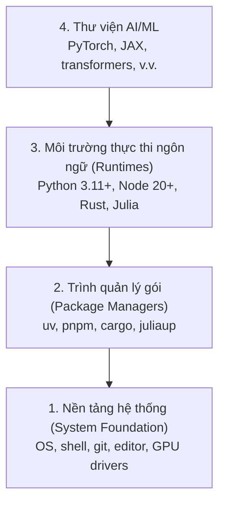

# Môi trường phát triển (Dev Environment)

> Công cụ định hình tư duy của bạn. Hãy thiết lập một lần và chuẩn chỉ ngay từ đầu.

**Type:** Build
**Languages:** Python, Node.js, Rust
**Prerequisites:** None
**Time:** ~45 phút

## Mục tiêu học tập

- Thiết lập chuỗi công cụ Python 3.11+, Node.js 20+, và Rust từ đầu.
- Cấu hình môi trường ảo và trình quản lý gói để đảm bảo các bản dựng có thể tái lập (reproducible builds).
- Kiểm tra quyền truy cập GPU với CUDA/MPS và chạy thử một phép toán tensor.
- Hiểu rõ mô hình ngăn xếp 4 tầng: Hệ thống, Trình quản lý gói, Môi trường thực thi (Runtimes), và Thư viện AI.

## Vấn đề đặt ra

Bạn chuẩn bị học kỹ thuật AI qua hơn 500 bài học sử dụng Python, TypeScript, Rust và Julia. Nếu môi trường của bạn gặp lỗi, từng bài học sẽ biến thành một cuộc chiến chống lại lỗi công cụ thay vì tập trung vào việc học kiến thức.

Hầu hết mọi người thường bỏ qua bước thiết lập môi trường chuẩn. Sau đó, họ mất hàng giờ để debug lỗi import, xung đột phiên bản và thiếu driver CUDA. Chúng ta sẽ làm điều này một lần và làm thật chuẩn xác.

## Khái niệm

Một môi trường kỹ thuật AI hoàn chỉnh gồm 4 tầng:



Chúng ta cài đặt từ dưới lên trên (bottom-up). Mỗi tầng phụ thuộc vào tầng bên dưới nó.

```figure
s0-env-stack
```

## Bắt tay vào xây dựng (Build It)

### Bước 1: Nền tảng hệ thống

Kiểm tra hệ thống của bạn và cài đặt các công cụ cơ bản.

```bash
# macOS
xcode-select --install
brew install git curl wget

# Ubuntu/Debian
sudo apt update && sudo apt install -y build-essential git curl wget unzip

# Windows (khuyên dùng WSL2)
wsl --install -d Ubuntu-24.04
```

### Bước 2: Cài đặt Python với uv

Chúng ta sử dụng `uv` — công cụ nhanh hơn pip từ 10 đến 100 lần và tự động quản lý các môi trường ảo.

```bash
curl -LsSf https://astral.sh/uv/install.sh | sh

uv python install 3.12

uv venv
source .venv/bin/activate  # hoặc .venv\Scripts\activate trên Windows

uv pip install numpy matplotlib jupyter
```

Kiểm tra lại:

```python
import sys
print(f"Python {sys.version}")

import numpy as np
print(f"NumPy {np.__version__}")
a = np.array([1, 2, 3])
print(f"Vector: {a}, tích vô hướng với chính nó: {np.dot(a, a)}")
```

### Bước 3: Cài đặt Node.js với pnpm

Dành cho các bài học TypeScript (agents, MCP servers, web apps).

```bash
curl -fsSL https://fnm.vercel.app/install | bash
fnm install 22
fnm use 22

npm install -g pnpm

node -e "console.log('Node', process.version)"
```

Trình cài đặt fnm sẽ kiểm tra lệnh `unzip` trước, nếu thiếu sẽ thoát với thông báo: `Not installing fnm due to missing dependencies.`: Trên Linux nó giải nén file zip, trên macOS nó cài qua Homebrew. macOS đã có sẵn `unzip`; trên Ubuntu, Debian và WSL2, bạn cài từ lệnh apt ở Bước 1 (`sudo apt install -y unzip` nếu bạn đã bỏ lỡ bước đó).

**macOS / Apple Silicon (M1/M2/M3/M4):** Nếu trình cài đặt báo lỗi `Error: Cannot install under Rosetta 2 in ARM default prefix (/opt/homebrew)`, terminal của bạn đang chạy dưới Rosetta 2 (`arch` in ra `i386`) trong khi Homebrew là bản arm64 gốc. Hãy cài đặt fnm ép buộc arm64, kết nối vào shell của bạn rồi chạy lại từ `fnm install 22`:

```bash
arch -arm64 brew install fnm
echo 'eval "$(fnm env --use-on-cd)"' >> ~/.zshrc
source ~/.zshrc
```

### Bước 4: Cài đặt Rust

Dành cho các bài học yêu cầu hiệu năng cao (inference engines, low-level systems).

```bash
curl --proto '=https' --tlsv1.2 -sSf https://sh.rustup.rs | sh

rustc --version
cargo --version
```

### Bước 5: Cài đặt Julia (Tùy chọn)

Dành cho các bài học nặng về toán học nơi Julia phát huy sức mạnh vượt trội.

```bash
curl -fsSL https://install.julialang.org | sh

julia -e 'println("Julia ", VERSION)'
```

### Bước 6: Thiết lập GPU (Nếu bạn có GPU)

**NVIDIA (Linux / Windows):**

```bash
nvidia-smi

# Cài đặt PyTorch với CUDA
uv pip install torch torchvision torchaudio --index-url https://download.pytorch.org/whl/cu124
```

**macOS / Apple Silicon (M1/M2/M3/M4):** Không có CUDA trên Mac — đây là điều bình thường, không phải lỗi. **Không** truyền `--index-url .../cuXXX` (những bản build đó chỉ dành cho Linux/Windows nên cài sẽ lỗi). Hãy cài bản mặc định, đã tích hợp sẵn backend GPU MPS (Metal) của Apple:

```bash
uv pip install torch torchvision torchaudio
```

Kiểm tra (chạy được trên mọi hệ điều hành):

```python
import torch
print(f"CUDA khả dụng: {torch.cuda.is_available()}")           # False trên macOS — bình thường
print(f"MPS khả dụng:  {torch.backends.mps.is_available()}")   # True trên Apple Silicon
if torch.cuda.is_available():
    print(f"GPU: {torch.cuda.get_device_name(0)}")
```

Không có GPU? Không sao cả. Hầu hết các bài học đều chạy tốt trên CPU. Đối với các bài học huấn luyện nặng, hãy dùng Google Colab hoặc GPU đám mây.

### Bước 7: Kiểm tra lộ trình bạn muốn bắt đầu

Chạy mọi lệnh trong bài học này từ thư mục gốc của repository (thư mục chứa `README.md` và `phases/`). Script kiểm tra preflight chỉ kiểm tra những gì bạn cần cho lộ trình đã chọn, mặc định bỏ qua các công cụ của những bài học sau để người mới bắt đầu không bị choáng ngợp bởi hàng loạt cảnh báo.

Bắt đầu toàn bộ chuỗi cơ bản (Beginner):

```bash
python3 phases/00-setup-and-tooling/01-dev-environment/code/verify.py --route beginner
```

Hoặc kiểm tra riêng lộ trình bạn quan tâm:

```bash
python3 phases/00-setup-and-tooling/01-dev-environment/code/verify.py --route ml-foundations
python3 phases/00-setup-and-tooling/01-dev-environment/code/verify.py --route llm-engineering
python3 phases/00-setup-and-tooling/01-dev-environment/code/verify.py --route agents
python3 phases/00-setup-and-tooling/01-dev-environment/code/verify.py --route mcp
python3 phases/00-setup-and-tooling/01-dev-environment/code/verify.py --route agent-skills
python3 phases/00-setup-and-tooling/01-dev-environment/code/verify.py --route certification
```

Thêm cờ `--show-later` nếu bạn muốn kiểm tra luôn các công cụ và thư viện tùy chọn dùng cho các bài học nâng cao phía sau. Việc thiếu công cụ của bài sau sẽ không bao giờ chặn lộ trình hiện tại của bạn.

Mỗi bài kiểm tra bắt buộc bị lỗi sẽ hiển thị đường dẫn hoặc lỗi import cụ thể cùng lệnh khắc phục chính xác. Các lộ trình Agent Skills và certification cũng sẽ hiển thị các bước kiểm tra thủ công vì script Python không thể tự kiểm tra xem AI host đã nhận diện skill hay chưa.

Khi bài kiểm tra beginner thành công, nó sẽ in ra đường dẫn đến bài học đầu tiên có thể chạy được:

```text
Ready to start Beginner course.
Next: python3 phases/01-math-foundations/01-linear-algebra-intuition/code/vectors.py
```

## Sử dụng trong thực tế (Use It)

Môi trường của bạn đã sẵn sàng cho lộ trình đã chọn. Hãy cài đặt thêm các công cụ sau này khi có bài học yêu cầu thay vì để việc cài đặt toàn bộ tech stack làm cản trở bước chân đầu tiên của bạn. Dưới đây là bảng tổng hợp công cụ qua toàn bộ chương trình học:

| Ngôn ngữ | Sử dụng trong | Trình quản lý gói |
|---|---|---|
| Python | Phases 1-12 (ML, DL, NLP, Vision, Audio, LLMs) | uv |
| TypeScript | Phases 13-17 (Tools, Agents, Swarms, Infra) | pnpm |
| Rust | Phases 12, 15-17 (Hệ thống yêu cầu hiệu năng cao) | cargo |
| Julia | Phase 1 (Nền tảng toán học) | Pkg |

## Xuất xưởng sản phẩm (Ship It)

Bài học này cung cấp một script kiểm tra tự động mà bất kỳ ai cũng có thể chạy để xác thực cấu hình của mình.

Xem file `outputs/prompt-env-check.md` để lấy câu lệnh prompt giúp trợ lý AI chẩn đoán các sự cố môi trường.

## Bài tập thực hành (Exercises)

1. Chạy script kiểm tra và khắc phục bất kỳ cảnh báo lỗi nào.
2. Tạo một môi trường ảo Python cho khóa học này và cài đặt PyTorch.
3. Viết chương trình "Hello World" bằng cả 4 ngôn ngữ và chạy từng chương trình.

### Gợi ý (Hints)

**Bài tập 1.** Chạy lệnh `python3 phases/00-setup-and-tooling/01-dev-environment/code/verify.py --route beginner` từ thư mục gốc của repo và sửa từng dòng lỗi đầu tiên trước khi xem dòng tiếp theo. Quá trình kiểm tra hoàn tất khi bạn chạy lại script và mọi đầu mục đều vượt qua (passed).

**Bài tập 2.** Tạo môi trường ảo bằng lệnh `uv venv` tại thư mục gốc, kích hoạt nó (`source .venv/bin/activate` hoặc `.venv\Scripts\activate`), sau đó cài đặt PyTorch bằng lệnh ở Bước 6 phù hợp với phần cứng của bạn. Chạy `python -c "import torch; print(torch.__version__)"` bên trong môi trường ảo; in ra số phiên bản tức là cài đặt thành công.

**Bài tập 3.** Sử dụng 4 runtime từ ngăn xếp: Python, TypeScript trên Node.js, Rust và Julia. Viết một file nhỏ cho mỗi ngôn ngữ và chạy lần lượt bằng `python3`, `npx tsx` (Node.js không thể chạy trực tiếp file `.ts`), `cargo run` hoặc `rustc`, và `julia`. Mỗi chương trình phải in ra thông điệp của bạn và kết thúc với mã thoát 0 (exit code 0).
