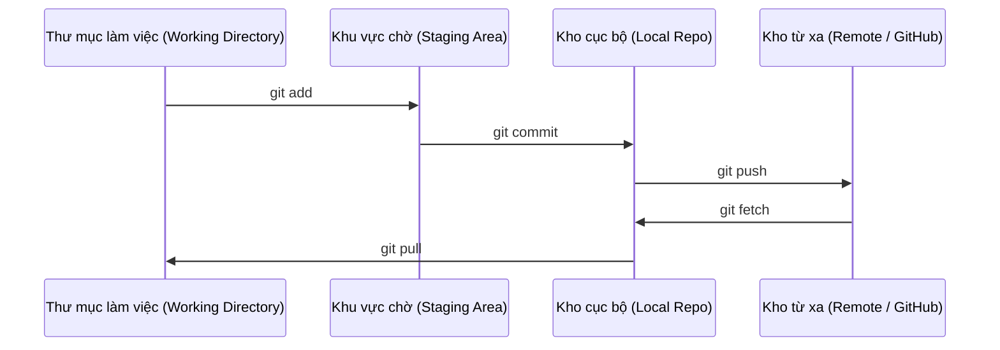

# Git & Làm việc cộng tác (Git & Collaboration)

> Kiểm soát phiên bản không phải là điều tùy chọn. Mọi thử nghiệm, mọi mô hình, mọi bài học bạn xây dựng tại đây đều được ghi lại dấu vết.

**Type:** Learn
**Languages:** --
**Prerequisites:** Phase 0, Lesson 01
**Time:** ~30 phút

## Mục tiêu học tập

- Cấu hình thông tin định danh Git và thực hiện quy trình làm việc hàng ngày: add, commit, và push.
- Tạo và gộp nhánh (merge branch) cho các thử nghiệm độc lập mà không ảnh hưởng tới nhánh chính (main).
- Viết file `.gitignore` để loại trừ các tệp checkpoint mô hình và file nhị phân lớn.
- Điều hướng lịch sử commit bằng `git log` để hiểu tiến trình phát triển của dự án.

## Vấn đề đặt ra

Bạn chuẩn bị viết hàng trăm file code trải dài qua 20 phases. Nếu không có hệ thống kiểm soát phiên bản, bạn sẽ bị mất code, làm hỏng những thứ không thể khôi phục, và không có cách nào để cộng tác cùng người khác.

Git là công cụ. GitHub là nơi lưu trữ code. Bài học này tập trung vào chính xác những gì bạn cần cho khóa học này, không lan man.

## Khái niệm



Ba điều cốt lõi cần nhớ:
1. Lưu thường xuyên (`git commit`)
2. Đẩy lên kho từ xa (`git push`)
3. Tạo nhánh cho các thử nghiệm (`git checkout -b experiment`)

```figure
s0-commit-dag
```

## Bắt tay vào xây dựng (Build It)

### Bước 1: Cấu hình Git

```bash
git config --global user.name "Tên Của Bạn"
git config --global user.email "you@example.com"
```

### Bước 2: Quy trình làm việc hàng ngày

```bash
git status
git add file.py
git commit -m "Add perceptron implementation"
git push origin main
```

### Bước 3: Phân nhánh cho các thử nghiệm

```bash
git checkout -b experiment/new-optimizer

# ... thực hiện thay đổi, commit ...

git checkout main
git merge experiment/new-optimizer
```

### Bước 4: Làm việc với repository của khóa học

Bạn không thể push trực tiếp vào repo chính của khóa học — chỉ các maintainer mới có quyền ghi. Hãy Fork repo trên GitHub trước (nút Fork ở góc trên bên phải) để `origin` trỏ về bản sao của chính bạn:

```bash
git clone https://github.com/YOUR-USERNAME/ai-engineering-from-scratch.git
cd ai-engineering-from-scratch

git checkout -b my-progress
# học các bài học, commit code của bạn
git push origin my-progress
```

## Sử dụng trong thực tế (Use It)

Trong khóa học này, bạn chỉ cần những lệnh cốt lõi sau:

| Lệnh | Khi nào sử dụng |
|---|---|
| `git clone` | Lấy mã nguồn khóa học về máy |
| `git add` + `git commit` | Lưu tiến trình công việc của bạn |
| `git push` | Sao lưu tiến trình lên GitHub |
| `git checkout -b` | Thử nghiệm giải pháp mới mà không làm hỏng nhánh main |
| `git log --oneline` | Xem tóm tắt lịch sử những việc bạn đã làm |

Chỉ vậy thôi. Bạn không cần rebase, cherry-pick, hay submodules phức tạp cho khóa học này.

## Bài tập thực hành (Exercises)

1. Fork repo này, clone fork về máy, tạo nhánh `my-progress`, tạo một file, commit và push lên.
2. Tạo file `.gitignore` để loại bỏ các file checkpoint mô hình (`.pt`, `.pth`, `.safetensors`).
3. Xem lại lịch sử commit của repo bằng `git log --oneline` và đọc cách các bài học được thêm vào theo thời gian.

### Gợi ý (Hints)

**Bài tập 1.** Nhấn nút Fork trên GitHub, sau đó chạy `git clone` với URL của fork bạn vừa tạo. Sau khi chạy `git push -u origin my-progress`, hãy mở fork trên GitHub và kiểm tra danh sách nhánh hiển thị nhánh `my-progress` kèm file của bạn.

**Bài tập 2.** Thêm mẫu đuôi mở rộng, ví dụ `*.pt`, vào file `.gitignore` ở thư mục gốc repo. Thử tạo một file trống với đuôi tương ứng và chạy `git status`; file đó sẽ không xuất hiện trong danh sách untracked files.

**Bài tập 3.** Chạy `git log --oneline` rồi chạy tiếp `git log --oneline -- phases/00-setup-and-tooling` để chỉ xem các commit làm thay đổi phase này. Chọn một commit và chạy `git show --stat <hash>` để xem các file bài học nào đã được thêm vào.

## Thuật ngữ quan trọng (Key Terms)

| Thuật ngữ | Cách gọi thông thường | Ý nghĩa bản chất |
|---|---|---|
| Commit | "Lưu lại" | Một ảnh chụp (snapshot) toàn bộ dự án của bạn tại một thời điểm |
| Branch | "Bản sao" | Một con trỏ trỏ tới một commit và di chuyển tịnh tiến khi bạn làm việc |
| Merge | "Gộp code" | Lấy những thay đổi từ một nhánh và hợp nhất chúng vào nhánh khác |
| Remote | "Đám mây" | Một bản sao repo được lưu trữ ở nơi khác (GitHub, GitLab) |
