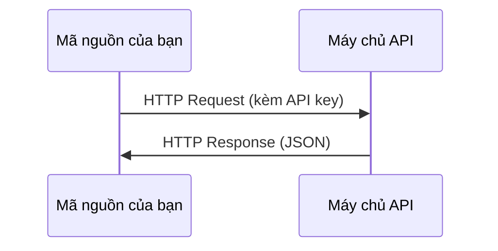

# API & Khóa xác thực (APIs & Keys)

> Mọi AI API đều hoạt động theo cùng một cơ chế: gửi yêu cầu (request), nhận phản hồi (response). Chi tiết có thể thay đổi, nhưng mô hình cốt lõi thì không.

**Type:** Build
**Languages:** Python, TypeScript
**Prerequisites:** Phase 0, Lesson 01
**Time:** ~30 phút

## Mục tiêu học tập

- Lưu trữ API key an toàn bằng biến môi trường (environment variables) và file `.env`.
- Thực hiện lệnh gọi API tới LLM bằng cả Python SDK của Anthropic và mã HTTP thuần (raw HTTP).
- So sánh định dạng request/response giữa việc dùng SDK và HTTP thuần để phục vụ debug.
- Nhận diện và xử lý các lỗi API phổ biến bao gồm lỗi xác thực (authentication) và giới hạn tần suất (rate limits).

## Vấn đề đặt ra

Bắt đầu từ Phase 11, bạn sẽ gọi các API của LLM (Anthropic, OpenAI, Google). Trong Phase 13-16, bạn sẽ xây dựng các agent tự động gọi những API này trong các vòng lặp (loops). Bạn cần hiểu cơ chế hoạt động của API key, cách lưu trữ chúng an toàn và cách thực hiện lệnh gọi API đầu tiên.

## Khái niệm



Mỗi lệnh gọi API luôn gồm 4 thành phần:
1. Điểm cuối - Endpoint (URL)
2. Khóa xác thực - API key (Xác thực danh tính)
3. Phần thân yêu cầu - Request body (Nội dung bạn muốn gửi)
4. Phần thân phản hồi - Response body (Kết quả bạn nhận lại)

```figure
s0-secret-inject
```

## Bắt tay vào xây dựng (Build It)

### Bước 1: Lưu trữ API key an toàn

Tuyệt đối không bao giờ để API key trực tiếp trong code. Hãy sử dụng biến môi trường:

```bash
export ANTHROPIC_API_KEY="sk-ant-..."
export OPENAI_API_KEY="sk-..."
```

Hoặc lưu vào file `.env` (và nhớ thêm file này vào `.gitignore`):

```
ANTHROPIC_API_KEY=sk-ant-...
OPENAI_API_KEY=sk-...
```

### Bước 2: Lệnh gọi API đầu tiên (Python)

```python
import os

import anthropic

client = anthropic.Anthropic()

MODEL = os.environ.get("LLM_MODEL", "claude-sonnet-5")

response = client.messages.create(
    model=MODEL,
    max_tokens=256,
    messages=[{"role": "user", "content": "Mạng nơ-ron là gì trong một câu?"}]
)

print(response.content[0].text)
```

Biến `LLM_MODEL` chọn model id của Anthropic, mặc định là alias Sonnet không kèm ngày tháng. Các nhà cung cấp khác (OpenAI, Google, v.v.) cũng theo cùng mô hình gồm key kết hợp model id, nhưng mỗi bên có SDK, endpoint và schema request/response riêng.

### Bước 3: Lệnh gọi API đầu tiên (TypeScript)

```typescript
import Anthropic from "@anthropic-ai/sdk";

const client = new Anthropic();

const MODEL = process.env.LLM_MODEL ?? "claude-sonnet-5";

const response = await client.messages.create({
  model: MODEL,
  max_tokens: 256,
  messages: [{ role: "user", content: "Mạng nơ-ron là gì trong một câu?" }],
});

console.log(response.content[0].text);
```

### Bước 4: Gọi bằng HTTP thuần (Không dùng SDK)

```python
import os
import urllib.request
import json

url = "https://api.anthropic.com/v1/messages"
headers = {
    "Content-Type": "application/json",
    "x-api-key": os.environ["ANTHROPIC_API_KEY"],
    "anthropic-version": "2023-06-01",
}
body = json.dumps({
    "model": os.environ.get("LLM_MODEL", "claude-sonnet-5"),
    "max_tokens": 256,
    "messages": [{"role": "user", "content": "Mạng nơ-ron là gì trong một câu?"}],
}).encode()

req = urllib.request.Request(url, data=body, headers=headers, method="POST")
with urllib.request.urlopen(req) as resp:
    result = json.loads(resp.read())
    print(result["content"][0]["text"])
```

Đây chính là những gì SDK thực thi ở tầng bên dưới. Hiểu rõ lệnh gọi HTTP thuần sẽ giúp bạn rất nhiều khi cần debug sự cố mạng hoặc lỗi giao thức.

## Sử dụng trong thực tế (Use It)

Trong khóa học này:

| API | Khi nào bạn cần | Hạn mức miễn phí |
|---|---|---|
| Anthropic (Claude) | Phases 11-16 (agents, tools) | Tặng $5 credit khi đăng ký |
| OpenAI | Phase 11 (so sánh) | Tặng $5 credit khi đăng ký |
| Hugging Face | Phases 4-10 (models, datasets) | Miễn phí |

Bạn chưa cần phải đăng ký toàn bộ ngay lúc này. Hãy thiết lập từng dịch vụ khi bài học tương ứng yêu cầu.

## Xuất xưởng sản phẩm (Ship It)

Bài học này xuất xưởng:
- `outputs/prompt-api-troubleshooter.md` - Prompt hỗ trợ chẩn đoán các lỗi API phổ biến.

## Bài tập thực hành (Exercises)

1. Lấy một API key từ Anthropic và thực hiện lệnh gọi API đầu tiên.
2. Thử nghiệm phiên bản HTTP thuần và so sánh định dạng phản hồi với phiên bản dùng SDK.
3. Cố ý dùng một API key sai và đọc thông báo lỗi trả về.

### Gợi ý (Hints)

**Bài tập 1.** Tạo key trong Anthropic Console, gán vào biến môi trường `ANTHROPIC_API_KEY` như hướng dẫn, rồi chạy file `code/first_api_call.py`. Lệnh gọi thành công khi script in ra câu trả lời của mô hình và không báo lỗi.

**Bài tập 2.** Cả hai hàm trong `code/first_api_call.py` chỉ in văn bản và số lượng token. Hãy thêm `print(response)` trong `call_with_sdk()` và `print(result)` trong `call_raw_http()`, sau đó chạy script để xem toàn bộ phản hồi. So sánh các trường: JSON thuần có các trường `content`, `usage`, và `stop_reason` tương tự như các thuộc tính đối tượng trong SDK.

**Bài tập 3.** Gán giá trị giả mạo cho `ANTHROPIC_API_KEY` chỉ trong một cửa sổ terminal, rồi chạy lại script. Quan sát mã trạng thái HTTP (status code) và kiểu lỗi; lỗi xác thực danh tính sẽ trả về mã 401 Unauthorized.

## Thuật ngữ quan trọng (Key Terms)

| Thuật ngữ | Cách gọi thông thường | Ý nghĩa bản chất |
|---|---|---|
| API key | "Mật khẩu cho API" | Chuỗi ký tự duy nhất định danh tài khoản của bạn và cấp quyền cho các yêu cầu |
| Rate limit | "Bị bóp băng thông" | Số lượng yêu cầu tối đa cho phép mỗi phút/giờ nhằm ngăn ngừa lạm dụng và bảo đảm công bằng |
| Token | "Một từ" (trong ngữ cảnh API) | Đơn vị thanh toán: token đầu vào và đầu ra được đếm và tính phí riêng biệt |
| Streaming | "Phản hồi thời gian thực" | Nhận phản hồi từng từ một thay vì chờ đợi toàn bộ câu trả lời hoàn tất |
