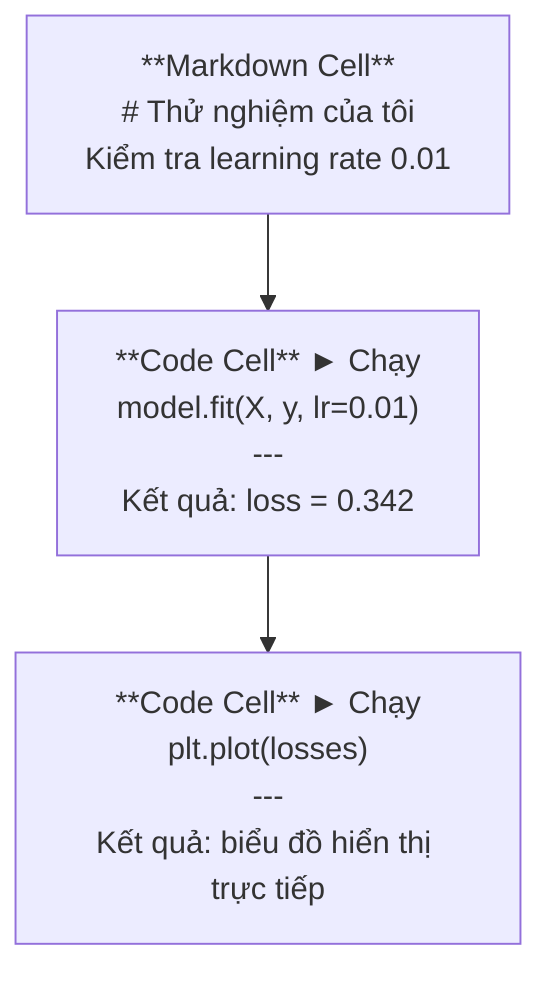
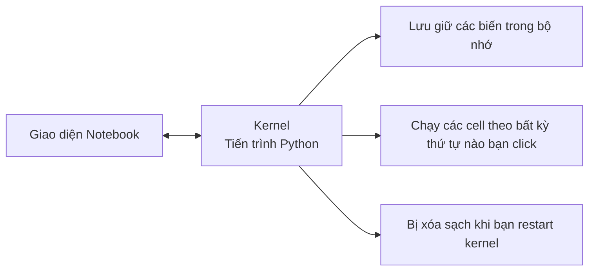

# Sổ tay Jupyter (Jupyter Notebooks)

> Notebooks là bàn thí nghiệm của kỹ sư AI. Bạn tạo mẫu thử nghiệm (prototype) tại đây, sau đó chuyển phần hoạt động hiệu quả lên môi trường sản xuất.

**Type:** Build
**Languages:** Python
**Prerequisites:** Phase 0, Lesson 01
**Time:** ~30 phút

## Mục tiêu học tập

- Cài đặt và khởi chạy JupyterLab, Jupyter Notebook, hoặc VS Code với tiện ích mở rộng Jupyter.
- Sử dụng các lệnh ma thuật (magic commands như `%timeit`, `%%time`, `%matplotlib inline`) để đo hiệu năng và trực quan hóa dữ liệu trực tiếp trong notebook.
- Phân biệt khi nào nên dùng notebook so với script và áp dụng quy trình: "thử nghiệm trong notebook, triển khai trong script" (explore in notebooks, ship in scripts).
- Nhận diện và phòng tránh các cạm bẫy notebook phổ biến: chạy cell không theo thứ tự, biến trạng thái ngầm (hidden state), và rò rỉ bộ nhớ (memory leaks).

## Vấn đề đặt ra

Mọi bài báo nghiên cứu AI, hướng dẫn kỹ thuật và cuộc thi Kaggle đều sử dụng Jupyter Notebooks. Chúng cho phép bạn chạy code theo từng phần nhỏ, xem kết quả đầu ra ngay lập tức, kết hợp code với lời giải thích chi tiết, và lặp lại thử nghiệm cực nhanh. Nếu bạn học AI mà không dùng notebook, bạn giống như đang làm bài tập toán mà không có giấy nháp.

Tuy nhiên, notebook cũng có những cạm bẫy chết người. Nhiều người lạm dụng chúng cho mọi thứ, kể cả những tác vụ mà notebook thể hiện rất tệ. Biết rõ khi nào nên dùng notebook và khi nào nên dùng script sẽ cứu bạn thoát khỏi những cơn ác mộng debug sau này.

## Khái niệm

Một notebook là một danh sách các ô (cells). Mỗi cell có thể là code hoặc văn bản giải thích (markdown).



Kernel là một tiến trình Python chạy ngầm. Khi bạn chạy một cell, notebook gửi code tới kernel, kernel thực thi và trả kết quả về. Mọi cell trong cùng một notebook đều chia sẻ chung một kernel, do đó các biến số được lưu giữ liên tục giữa các cell.



Cụm từ "chạy theo bất kỳ thứ tự nào bạn click" vừa là siêu năng lực, vừa là con dao hai lưỡi có thể tự làm tổn thương dự án của bạn.

```figure
s0-cell-order
```

## Bắt tay vào xây dựng (Build It)

### Bước 1: Chọn giao diện làm việc của bạn

Ba lựa chọn, chung một định dạng file:

| Giao diện | Cách cài đặt | Phù hợp nhất cho |
|---|---|---|
| JupyterLab | `pip install jupyterlab` rồi gõ `jupyter lab` | Trải nghiệm IDE hoàn chỉnh, nhiều tab, quản lý file, terminal tích hợp |
| Jupyter Notebook | `pip install notebook` rồi gõ `jupyter notebook` | Đơn giản, nhẹ nhàng, mở từng notebook một |
| VS Code | Cài đặt extension "Jupyter" | Tích hợp sẵn trong editor của bạn, hỗ trợ git, debugging mạnh mẽ |

Cả ba đều đọc và ghi cùng định dạng file `.ipynb`. Hãy chọn bất kỳ công cụ nào bạn thấy thoải mái nhất. JupyterLab là công cụ phổ biến nhất trong giới kỹ sư AI.

```bash
pip install jupyterlab
jupyter lab
```

### Bước 2: Các phím tắt quan trọng nhất

Bạn thao tác trên hai chế độ: Nhấn `Escape` để vào chế độ lệnh - Command Mode (vạch màu xanh dương bên trái), nhấn `Enter` để vào chế độ chỉnh sửa - Edit Mode (vạch màu xanh lá).

**Chế độ lệnh (dùng nhiều nhất):**

| Phím tắt | Thao tác |
|---|---|
| `Shift+Enter` | Chạy cell hiện tại và chuyển xuống cell tiếp theo |
| `A` | Chèn thêm cell mới ở phía trên (Above) |
| `B` | Chèn thêm cell mới ở phía dưới (Below) |
| `DD` | Xóa cell hiện tại |
| `M` | Chuyển cell sang định dạng Markdown |
| `Y` | Chuyển cell sang định dạng Code |
| `Z` | Hoàn tác thao tác cell (Undo) |
| `Ctrl+Shift+H` | Hiển thị toàn bộ bảng phím tắt |

**Chế độ chỉnh sửa:**

| Phím tắt | Thao tác |
|---|---|
| `Tab` | Tự động hoàn thành code (Autocomplete) |
| `Shift+Tab` | Xem chữ ký và tài liệu hàm (Signature / Docstring) |
| `Ctrl+/` | Bật/tắt chú thích code (Toggle comment) |

`Shift+Enter` là phím tắt bạn sẽ bấm hàng nghìn lần mỗi ngày. Hãy làm quen với nó đầu tiên.

### Bước 3: Các loại cell

**Ô mã nguồn (Code cells)** thực thi code Python và hiển thị kết quả ngay bên dưới:

```python
import numpy as np
data = np.random.randn(1000)
data.mean(), data.std()
```

Đầu ra: `(0.0032, 0.9987)`

**Ô văn bản (Markdown cells)** hiển thị văn bản có định dạng. Sử dụng chúng để ghi chép bạn đang làm gì và lý do tại sao. Hỗ trợ tiêu đề, in đậm, in nghiêng, công thức toán LaTeX (`$E = mc^2$`), bảng biểu và hình ảnh.

### Bước 4: Các lệnh ma thuật (Magic commands)

Đây không phải là cú pháp Python thuần mà là các lệnh đặc biệt của Jupyter, bắt đầu bằng `%` (line magic - cho một dòng) hoặc `%%` (cell magic - cho toàn bộ ô).

**Đo thời gian chạy code:**

```python
%timeit np.random.randn(10000)
```

Đầu ra: `45.2 us +/- 1.3 us per loop`

```python
%%time
model.fit(X_train, y_train, epochs=10)
```

Đầu ra: `Wall time: 2.34 s`

`%timeit` chạy đoạn code nhiều lần để lấy thời gian trung bình. `%%time` chỉ chạy đúng một lần. Dùng `%timeit` cho các hàm nhỏ (microbenchmarks) và `%%time` cho các lượt huấn luyện mô hình dài.

**Kích hoạt hiển thị đồ thị nội dòng (inline plots):**

```python
%matplotlib inline
```

Mọi câu lệnh `plt.plot()` hoặc `plt.show()` từ lúc này sẽ hiển thị trực tiếp ngay dưới cell trong notebook.

**Cài đặt thư viện mà không cần rời khỏi notebook:**

```python
!pip install scikit-learn
```

Tiền tố `!` cho phép bạn chạy bất kỳ lệnh terminal nào.

**Kiểm tra biến môi trường:**

```python
%env CUDA_VISIBLE_DEVICES
```

### Bước 5: Hiển thị kết quả phong phú (Rich output)

Notebooks tự động hiển thị giá trị của biểu thức cuối cùng trong cell. Nhưng bạn có thể tận dụng nó rất hiệu quả:

```python
import pandas as pd

df = pd.DataFrame({
    "model": ["Linear", "Random Forest", "Neural Net"],
    "accuracy": [0.72, 0.89, 0.94],
    "training_time": [0.1, 2.3, 45.6]
})
df
```

Đoạn code trên sẽ vẽ một bảng HTML đẹp mắt, dễ đọc hơn nhiều so với in text thông thường. Tương tự với đồ thị:

```python
import matplotlib.pyplot as plt

plt.figure(figsize=(8, 4))
plt.plot([1, 2, 3, 4], [1, 4, 2, 3])
plt.title("Inline Plot")
plt.show()
```

Biểu đồ sẽ xuất hiện ngay lập tức bên dưới cell. Đó là lý do vì sao notebook chiếm ưu thế tuyệt đối trong nghiên cứu AI: bạn nhìn thấy dữ liệu, biểu đồ và mã nguồn cùng một lúc.

Hiển thị hình ảnh từ file:

```python
from IPython.display import Image, display
display(Image(filename="architecture.png"))
```

### Bước 6: Google Colab

Colab là môi trường Jupyter notebook miễn phí trên đám mây của Google. Bạn được cấp sẵn GPU, các thư viện phổ biến và khả năng tích hợp Google Drive mà không cần cài đặt gì.

1. Truy cập [colab.research.google.com](https://colab.research.google.com)
2. Tải lên bất kỳ file `.ipynb` nào từ khóa học
3. Chọn menu Runtime > Change runtime type > Chọn T4 GPU (miễn phí)

Điểm khác biệt của Colab so với Jupyter cục bộ:
- Tệp không tự lưu vĩnh viễn giữa các phiên (cần lưu vào Drive hoặc tải về máy).
- Cài sẵn: numpy, pandas, matplotlib, torch, tensorflow, sklearn.
- Dùng `from google.colab import files` để tải lên/xuống dữ liệu.
- Dùng `from google.colab import drive; drive.mount('/content/drive')` để kết nối bộ nhớ Google Drive.
- Phiên làm việc sẽ tự ngắt kết nối sau 90 phút không hoạt động (gói miễn phí).

## Sử dụng trong thực tế (Use It)

### Notebooks vs Scripts: Khi nào dùng cái nào?

| Dùng Notebook cho | Dùng Script (`.py`) cho |
|---|---|
| Khám phá, phân tích tập dữ liệu | Đường ống huấn luyện (Training pipelines) |
| Làm mẫu thử nghiệm mô hình (Prototyping) | Tiện ích tái sử dụng (Reusable utilities) |
| Trực quan hóa kết quả, vẽ biểu đồ | Bất kỳ file nào có cấu trúc `if __name__` |
| Báo cáo, giải thích tiến trình làm việc | Tác vụ chạy định kỳ theo lịch |
| Các thử nghiệm nhanh | Mã nguồn đưa lên môi trường sản xuất |
| Làm bài tập thực hành trong khóa học | Xây dựng package và thư viện |

Quy tắc bất hủ: **Thử nghiệm trong notebook, xuất xưởng trong script (explore in notebooks, ship in scripts)**.

Quy trình làm việc chuẩn trong kỹ thuật AI:
1. Khám phá dữ liệu trong notebook.
2. Thử nghiệm kiến trúc mô hình trong notebook.
3. Khi code đã chạy ổn định, bóc tách và chuyển các hàm/lớp vào các file `.py`.
4. Import lại các file `.py` đó vào notebook để làm các thực nghiệm nâng cao tiếp theo.

### Các cạm bẫy thường gặp

**Chạy lộn xộn thứ tự (Out-of-order execution):** Bạn chạy cell 5, rồi quay lại sửa cell 2, rồi chạy cell 7. Notebook chạy tốt trên máy bạn nhưng khi người khác chạy từ đầu đến cuối thì bị lỗi. Khắc phục: Luôn chọn menu Kernel > Restart & Run All trước khi chia sẻ cho ai khác.

**Trạng thái ngầm (Hidden state):** Bạn xóa một cell nhưng biến mà nó tạo ra vẫn còn nằm trong bộ nhớ RAM của Kernel. Trông file có vẻ sạch sẽ nhưng lại phụ thuộc vào một cell "ma" đã bị xóa. Khắc phục: Khởi động lại (restart) kernel thường xuyên.

**Rò rỉ bộ nhớ (Memory leaks):** Nạp tập dữ liệu 4GB, huấn luyện mô hình, rồi lại nạp tập dữ liệu khác mà không giải phóng tài nguyên. Khắc phục: Dùng `del tên_biến` kết hợp `gc.collect()`, hoặc đơn giản là restart kernel.

## Xuất xưởng sản phẩm (Ship It)

Bài học này xuất xưởng:
- `outputs/prompt-notebook-helper.md` - Prompt hỗ trợ debug các sự cố notebook thường gặp.

## Bài tập thực hành (Exercises)

1. Mở JupyterLab, tạo một notebook mới, và sử dụng `%timeit` để so sánh tốc độ giữa list comprehension và numpy khi tạo mảng 100,000 số ngẫu nhiên.
2. Tạo một notebook gồm cả markdown và code cell để nạp một file CSV, hiển thị dataframe và vẽ biểu đồ. Sau đó chọn Kernel > Restart & Run All để đảm bảo chạy mượt từ trên xuống dưới.
3. Lấy code từ file `code/notebook_tips.py`, dán vào một Colab notebook và chạy thử trên môi trường GPU miễn phí.

### Gợi ý (Hints)

**Bài tập 1.** Khởi động JupyterLab bằng lệnh `jupyter lab`, sau đó đặt mỗi phiên bản vào một cell riêng bắt đầu bằng `%timeit`. Dùng chung kích thước 100,000 ở cả hai cell để đảm bảo phép đo so sánh cùng một khối lượng công việc.

**Bài tập 2.** Dùng `pd.read_csv` để đọc dữ liệu, hiển thị dataframe ở dòng cuối cùng của cell, và vẽ đồ thị bằng `df.plot()` hoặc matplotlib. Sau khi chọn Kernel > Restart & Run All, mỗi cell phải hiển thị số thứ tự thực thi tăng dần và không có cell nào bị báo lỗi đỏ.

**Bài tập 3.** Trên Colab, nhớ chọn Runtime > Change runtime type > GPU trước khi dán code. Quá trình chạy hoàn tất khi mỗi hàm trong `code/notebook_tips.py` in ra tiêu đề của phần đó và `torch.cuda.is_available()` trả về `True` trong một cell.

## Thuật ngữ quan trọng (Key Terms)

| Thuật ngữ | Cách gọi thông thường | Ý nghĩa bản chất |
|---|---|---|
| Kernel | "Thứ đang chạy code của tôi" | Tiến trình Python độc lập chịu trách nhiệm thực thi mã trong cell và lưu giữ biến trong bộ nhớ |
| Cell | "Một khối code" | Đơn vị có thể chạy độc lập trong notebook, có thể là code hoặc markdown |
| Magic command | "Mẹo trong Jupyter" | Các lệnh đặc biệt bắt đầu bằng `%` hoặc `%%` để điều khiển môi trường notebook |
| `.ipynb` | "File notebook" | File định dạng JSON lưu trữ nội dung các cell, kết quả đầu ra và metadata. Viết tắt của IPython Notebook |

## Tài liệu đọc thêm (Further Reading)

- [JupyterLab Docs](https://jupyterlab.readthedocs.io/) để xem toàn bộ tính năng nâng cao.
- [Google Colab FAQ](https://research.google.com/colaboratory/faq.html) về hạn mức và tính năng riêng của Colab.
- [28 Jupyter Notebook Tips](https://www.dataquest.io/blog/jupyter-notebook-tips-tricks-shortcuts/) để học các mẹo phím tắt hữu ích.
