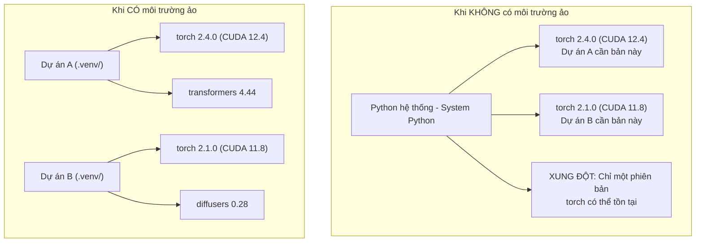

# Môi trường ảo Python (Python Environments)

> "Địa ngục phụ thuộc" (Dependency hell) là có thật. Và môi trường ảo chính là phương thuốc cứu cánh.

**Type:** Build
**Languages:** Shell
**Prerequisites:** Phase 0, Lesson 01
**Time:** ~30 phút

## Mục tiêu học tập

- Tạo môi trường ảo độc lập sử dụng `uv`, `venv`, hoặc `conda`.
- Viết file `pyproject.toml` với các nhóm phụ thuộc tùy chọn (optional dependency groups) và sinh file khóa (lockfile) để đảm bảo tính tái lập.
- Chẩn đoán và khắc phục các sai lầm phổ biến: cài đặt toàn cục (global), trộn lẫn pip và conda, xung đột phiên bản CUDA.
- Triển khai chiến lược môi trường riêng cho từng phase (per-phase) đối với các dự án có thư viện xung đột nhau.

## Vấn đề đặt ra

Bạn cài PyTorch 2.4 cho một dự án tinh chỉnh mô hình (fine-tuning). Tuần tới, một dự án khác lại yêu cầu PyTorch 2.1 vì bản dựng CUDA của nó bị cố định phiên bản cũ. Bạn nâng cấp toàn cục, dự án thứ nhất hỏng. Bạn hạ cấp, dự án thứ hai hỏng.

Đây chính là "địa ngục phụ thuộc" (dependency hell). Nó xảy ra liên tục trong công việc AI/ML vì:

- PyTorch, JAX, và TensorFlow mỗi bên tự đóng gói bản CUDA bindings riêng.
- Các thư viện mô hình thường ghim chặt (pin) vào một phiên bản framework cụ thể.
- Lệnh `pip install` toàn cục sẽ ghi đè lên bất kỳ thứ gì có trước đó.
- Các bản build CUDA 11.8 không hoạt động với driver CUDA 12.x (và ngược lại).

Giải pháp: Mỗi dự án phải có một môi trường ảo độc lập riêng với các gói thư viện của riêng nó.

## Khái niệm



```figure
s0-env-isolation
```

## Bắt tay vào xây dựng (Build It)

### Lựa chọn 1: uv venv (Khuyên dùng)

`uv` là trình quản lý gói Python nhanh nhất hiện nay (nhanh hơn pip từ 10 đến 100 lần). Nó tích hợp cả quản lý môi trường ảo, các phiên bản Python và giải quyết xung đột phụ thuộc trong một công cụ duy nhất.

```bash
curl -LsSf https://astral.sh/uv/install.sh | sh

uv python install 3.12

cd your-project
uv venv
source .venv/bin/activate
```

Cài đặt các gói thư viện:

```bash
uv pip install torch numpy
```

Khởi tạo một dự án chuẩn có sẵn `pyproject.toml` trong một bước duy nhất:

```bash
uv init my-ai-project
cd my-ai-project
uv add torch numpy matplotlib
```

### Lựa chọn 2: venv (Có sẵn trong Python)

Nếu bạn không thể cài đặt `uv`, Python đã tích hợp sẵn module `venv`:

```bash
python3 -m venv .venv
source .venv/bin/activate  # Trên Linux/macOS
.venv\Scripts\activate     # Trên Windows

pip install torch numpy
```

Chậm hơn `uv`, nhưng hoạt động được ở bất kỳ nơi nào có cài Python.

### Lựa chọn 3: conda (Khi bạn bắt buộc phải dùng)

Conda quản lý cả các thư viện ngoài Python như bộ công cụ CUDA toolkit, cuDNN và thư viện C/C++. Hãy dùng conda khi:

- Bạn cần một phiên bản CUDA toolkit cụ thể mà không thể cài đặt trên toàn hệ thống.
- Bạn làm việc trên một cụm máy chủ dùng chung (shared cluster) nơi bạn không có quyền root/sudo.
- Hướng dẫn cài đặt của thư viện yêu cầu rõ ràng: "hãy dùng conda".

```bash
# Cài đặt miniconda (bản rút gọn, không cài Anaconda đầy đủ nặng nề)
curl -LsSf https://repo.anaconda.com/miniconda/Miniconda3-latest-Linux-x86_64.sh -o miniconda.sh
bash miniconda.sh -b

conda create -n myproject python=3.12
conda activate myproject

conda install pytorch torchvision torchaudio pytorch-cuda=12.4 -c pytorch -c nvidia
```

Nguyên tắc vàng: Nếu đã dùng conda cho một môi trường, hãy dùng conda để cài mọi gói trong môi trường đó. Việc dùng lẫn lộn `pip install` bên trong một môi trường conda sẽ gây ra xung đột phụ thuộc rất khó chẩn đoán.

### Chiến lược cho khóa học này: Quản lý môi trường theo từng Phase

Bạn có thể muốn tạo một môi trường duy nhất cho toàn bộ khóa học. Đừng làm vậy. Các phase khác nhau sẽ cần các thư viện khác nhau (đôi khi xung đột nhau).

Chiến lược khuyến nghị:

```
ai-engineering-from-scratch/
├── .venv/                    <-- Môi trường dùng chung nhẹ cho phases 0-3
├── phases/
│   ├── 04-neural-networks/
│   │   └── .venv/            <-- Môi trường PyTorch
│   ├── 05-cnns/
│   │   └── .venv/            <-- Dùng chung môi trường PyTorch (symlink hoặc thư mục dùng chung)
│   ├── 08-transformers/
│   │   └── .venv/            <-- Có thể cần phiên bản transformers riêng
│   └── 11-llm-apis/
│       └── .venv/            <-- Chỉ cần các SDK gọi API, không cần cài torch nặng nề
```

Script tại file `code/env_setup.sh` sẽ tự động tạo môi trường nền tảng ban đầu cho bạn.

## Khái niệm cơ bản về pyproject.toml

Mỗi dự án Python hiện đại nên có một file `pyproject.toml`. Nó thay thế cho `setup.py`, `setup.cfg` và `requirements.txt` trong một file cấu hình duy nhất:

```toml
[project]
name = "ai-engineering-from-scratch"
version = "0.1.0"
requires-python = ">=3.11"
dependencies = [
    "numpy>=1.26",
    "matplotlib>=3.8",
    "jupyter>=1.0",
    "scikit-learn>=1.4",
]

[project.optional-dependencies]
torch = ["torch>=2.3", "torchvision>=0.18"]
llm = ["anthropic>=0.39", "openai>=1.50"]
```

Sau đó cài đặt theo nhu cầu:

```bash
uv pip install -e ".[torch]"    # Cài các gói cơ sở + PyTorch
uv pip install -e ".[llm]"      # Cài các gói cơ sở + LLM SDKs
uv pip install -e ".[torch,llm]" # Cài tất cả
```

## Tệp khóa (Lockfiles)

Lockfile sẽ ghim (pin) chính xác phiên bản của từng phụ thuộc (kể cả các phụ thuộc gián tiếp - transitive dependencies). Điều này đảm bảo tính tái lập 100%: bất kỳ ai cài đặt từ lockfile cũng đều nhận được các gói có phiên bản giống hệt nhau.

```bash
# uv tự động sinh ra uv.lock khi bạn dùng uv add
uv add numpy

# Cách tiếp cận bằng pip-tools
uv pip compile pyproject.toml -o requirements.lock
uv pip install -r requirements.lock
```

Hãy commit file lockfile này vào git. Khi ai đó clone dự án về, họ chỉ cần cài đặt từ lockfile là đảm bảo môi trường giống hệt bạn.

## Các sai lầm thường gặp

### 1. Cài đặt toàn cục (Globally)

```bash
pip install torch  # XẤU: Cài trực tiếp vào Python của hệ điều hành

source .venv/bin/activate
pip install torch  # TỐT: Cài bên trong môi trường ảo độc lập
```

Kiểm tra vị trí gói được cài vào:

```bash
which python       # Phải hiển thị .venv/bin/python, không phải /usr/bin/python
which pip          # Phải hiển thị .venv/bin/pip
```

### 2. Trộn lẫn pip và conda

```bash
conda create -n myenv python=3.12
conda activate myenv
conda install pytorch -c pytorch
pip install some-other-package   # XẤU: Có thể làm hỏng cơ chế theo dõi phụ thuộc của conda
conda install some-other-package # TỐT: Để conda tự quản lý tất cả
```

Nếu bắt buộc phải dùng pip bên trong môi trường conda (đối với một số thư viện chỉ có trên PyPI), hãy cài toàn bộ các gói conda trước, và chỉ dùng pip ở bước cuối cùng.

### 3. Quên kích hoạt môi trường ảo

```bash
python train.py           # Dùng nhầm Python hệ thống, báo lỗi thiếu thư viện
source .venv/bin/activate
python train.py           # Dùng đúng Python của dự án, chạy mượt mà
```

Dấu nhắc lệnh terminal của bạn phải có tên môi trường phía trước:

```
(.venv) $ python train.py
```

### 4. Commit thư mục .venv vào git

```bash
echo ".venv/" >> .gitignore
```

Thư mục môi trường ảo thường nặng từ 200MB đến 2GB. Chúng chỉ có tác dụng cục bộ trên máy bạn, không thể chuyển đổi nguyên si sang máy khác. Thay vào đó, hãy commit `pyproject.toml` và file lockfile.

### 5. Xung đột phiên bản CUDA

```bash
nvidia-smi                # Hiển thị phiên bản CUDA của driver (ví dụ: 12.4)
python -c "import torch; print(torch.version.cuda)"  # Hiển thị phiên bản CUDA mà PyTorch được biên dịch
```

Hai phiên bản này phải tương thích với nhau: Phiên bản CUDA của PyTorch phải **nhỏ hơn hoặc bằng** phiên bản CUDA mà driver card đồ họa của bạn hỗ trợ.

## Sử dụng trong thực tế (Use It)

Chạy script cài đặt để tạo môi trường cho khóa học:

```bash
bash phases/00-setup-and-tooling/06-python-environments/code/env_setup.sh
```

Lệnh này sẽ tạo thư mục `.venv` tại gốc repo với các phụ thuộc cốt lõi đã được cài đặt và kiểm tra hoàn chỉnh.

## Bài tập thực hành (Exercises)

1. Chạy `env_setup.sh` và kiểm tra toàn bộ các bài kiểm tra đều vượt qua.
2. Tạo một môi trường ảo thứ hai, cài đặt một phiên bản numpy khác trong đó, và xác nhận hai môi trường hoàn toàn cách ly với nhau.
3. Viết một file `pyproject.toml` cho một dự án cần cả PyTorch và Anthropic SDK.
4. Thử cố ý cài đặt một gói toàn cục (không kích hoạt venv), kiểm tra xem nó được lưu ở đâu, sau đó gỡ cài đặt sạch sẽ.

### Gợi ý (Hints)

**Bài tập 1.** Chạy lệnh `bash phases/00-setup-and-tooling/06-python-environments/code/env_setup.sh` từ thư mục gốc của repository. Đọc từng dòng thông báo; nếu có bài kiểm tra thất bại, hãy khắc phục đúng mục đó và chạy lại script cho đến khi không còn lỗi.

**Bài tập 2.** Tạo môi trường thứ hai trong một thư mục mới bằng `uv venv`, kích hoạt nó và cài một bản numpy cũ hơn có ghim phiên bản như `numpy==1.26.4`. Chạy `python -c "import numpy; print(numpy.__version__)"` trong từng môi trường; hai phiên bản in ra phải khác nhau.

**Bài tập 3.** Bắt đầu từ ví dụ trong mục Cơ bản về pyproject.toml, thêm `torch` và `anthropic` vào danh sách `dependencies`. Chạy `uv pip install -e .` hoặc `uv sync` trong môi trường mới; file cấu hình đúng khi bạn có thể import cả hai thư viện mà không bị lỗi.

**Bài tập 4.** Hủy kích hoạt mọi môi trường (`deactivate`), chạy `pip install --user <tên_gói_nhỏ>`, sau đó chạy `pip show <tên_gói>` và đọc dòng `Location`. Gỡ cài đặt bằng `pip uninstall <tên_gói>` rồi chạy lại `pip show` để xác nhận gói đã biến mất.

## Thuật ngữ quan trọng (Key Terms)

| Thuật ngữ | Cách gọi thông thường | Ý nghĩa bản chất |
|---|---|---|
| Virtual environment | "Môi trường ảo / venv" | Thư mục cách ly chứa trình thông dịch Python và các gói thư viện riêng, tách biệt với Python hệ thống |
| Lockfile | "File ghim phiên bản" | File liệt kê chính xác từng gói và phiên bản cụ thể, đảm bảo việc cài đặt giống hệt nhau trên mọi máy tính |
| pyproject.toml | "File thay thế setup.py" | File cấu hình chuẩn của các dự án Python hiện đại, thay thế cho setup.py, setup.cfg, và requirements.txt |
| Transitive dependency | "Phụ thuộc của phụ thuộc" | Gói B phụ thuộc vào C; nếu bạn cài A (vốn phụ thuộc vào B), thì C là phụ thuộc gián tiếp của A |
| CUDA mismatch | "Lỗi không nhận GPU" | PyTorch được biên dịch cho một phiên bản CUDA khác với phiên bản mà driver GPU của máy tính bạn hỗ trợ |
