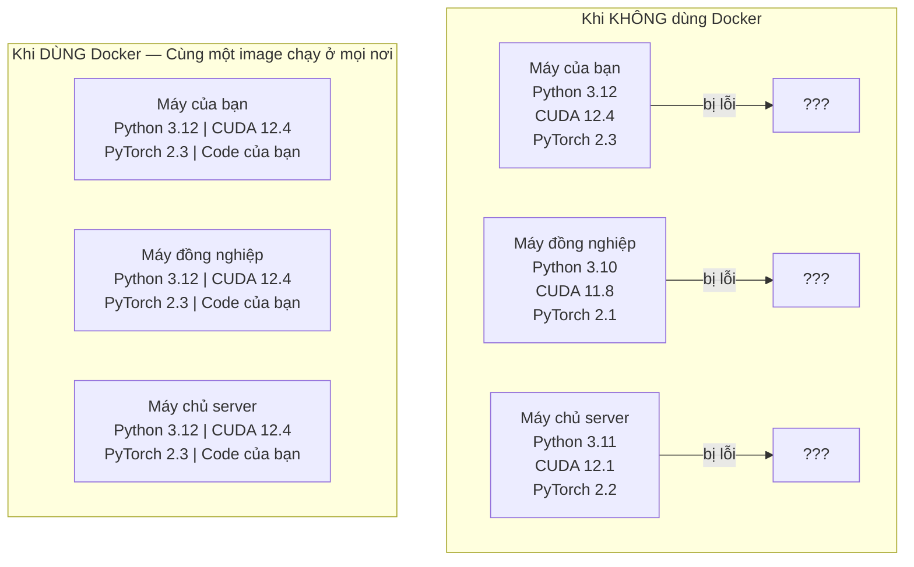

# Docker cho Kỹ thuật AI (Docker for AI)

> Container biến câu nói "trên máy tôi vẫn chạy bình thường" trở thành dĩ vãng.

**Type:** Build
**Languages:** Docker
**Prerequisites:** Phase 0, Lessons 01 and 03
**Time:** ~60 phút

## Mục tiêu học tập

- Xây dựng Docker image hỗ trợ GPU với CUDA, PyTorch và các thư viện AI từ Dockerfile.
- Gắn (mount) thư mục máy chủ dưới dạng volumes để lưu trữ bền vững mô hình, dữ liệu và mã nguồn qua các lần dựng lại container.
- Cấu hình NVIDIA Container Toolkit để cấp quyền truy cập GPU bên trong container.
- Điều phối các ứng dụng AI đa dịch vụ (máy chủ suy luận + cơ sở dữ liệu vector) bằng Docker Compose.

## Vấn đề đặt ra

Bạn huấn luyện một mô hình trên laptop với PyTorch 2.3, CUDA 12.4 và Python 3.12. Đồng nghiệp của bạn dùng PyTorch 2.1, CUDA 11.8 và Python 3.10. Mô hình của bạn bị sập (crash) trên máy của họ. Nhưng Dockerfile của bạn sẽ chạy mượt mà trên cả hai máy.

Các dự án AI thường là cơn ác mộng về phụ thuộc phần mềm. Một ngăn xếp điển hình bao gồm Python, PyTorch, driver CUDA, cuDNN, các thư viện C tầng hệ thống, và các gói chuyên biệt như `flash-attn` đòi hỏi phiên bản compiler cực kỳ chính xác. Docker đóng gói toàn bộ những thứ này vào một image duy nhất, chạy đồng nhất ở mọi nơi.

## Khái niệm

Docker đóng gói mã nguồn, môi trường thực thi, thư viện và công cụ hệ thống vào một đơn vị độc lập gọi là container. Hãy coi nó như một máy ảo siêu nhẹ, nhưng nó dùng chung nhân (kernel) của hệ điều hành máy chủ thay vì chạy nhân riêng, vì vậy nó khởi động chỉ trong vài giây thay vì vài phút.



### Tại sao dự án AI lại cần Docker hơn hầu hết các dự án khác?

1. **Driver GPU rất mỏng manh và dễ xung đột.** Code viết cho CUDA 12.4 không thể chạy trên CUDA 11.8. Docker cô lập CUDA toolkit bên trong container trong khi vẫn chia sẻ an toàn driver GPU của máy chủ thông qua NVIDIA Container Toolkit.

2. **Trọng số mô hình (weights) có kích thước khổng lồ.** Một mô hình 7 tỷ tham số (7B) chiếm tới 14 GB ở định dạng fp16. Bạn chắc chắn không muốn phải tải lại 14 GB mỗi lần build lại container. Cơ chế Docker volumes cho phép bạn gắn thư mục models từ máy chủ vào trong container.

3. **Kiến trúc đa dịch vụ (multi-service) là tiêu chuẩn.** Một ứng dụng AI thực tế không chỉ là một đoạn script Python đơn lẻ. Nó bao gồm một máy chủ suy luận (inference server), một cơ sở dữ liệu vector (vector database) cho RAG, và có thể cả một giao diện web. Docker Compose điều phối tất cả các dịch vụ này chỉ với một câu lệnh duy nhất.

### Thuật ngữ cốt lõi

| Thuật ngữ | Ý nghĩa bản chất |
|---|---|
| Image | Khuôn mẫu chỉ đọc (Read-only template). Bản thiết kế công thức của bạn, được build từ Dockerfile. |
| Container | Một phiên bản đang chạy của image. Căn bếp đang hoạt động của bạn. |
| Dockerfile | Tệp hướng dẫn từng bước để build ra một image, xếp chồng từng lớp (layers). |
| Volume | Vùng lưu trữ bền vững (persistent storage) không bị mất khi container dừng hoặc bị xóa. |
| docker-compose | Công cụ định nghĩa và chạy các ứng dụng gồm nhiều container bằng cú pháp YAML. |

### Các mô hình container phổ biến trong AI

```
Dev Container (Môi trường phát triển)
  Đầy đủ bộ công cụ: Editor, Jupyter, công cụ gỡ lỗi (debugging).
  Dùng trong quá trình nghiên cứu và thử nghiệm tính năng.

Training Container (Môi trường huấn luyện)
  Tối giản tối đa: Chỉ chứa script huấn luyện và các phụ thuộc bắt buộc.
  Chạy trên các cụm GPU cluster. Không editor, không Jupyter.

Inference Container (Môi trường suy luận phục vụ người dùng)
  Tối ưu hóa tốc độ phục vụ: Image nhỏ nhẹ, thời gian khởi động lạnh (cold start) cực nhanh.
  Chạy sau bộ cân bằng tải (load balancer) trên môi trường sản xuất.
```

```figure
s0-image-layers
```

## Bắt tay vào xây dựng (Build It)

### Bước 1: Cài đặt Docker

```bash
# macOS
brew install --cask docker
open /Applications/Docker.app

# Ubuntu
curl -fsSL https://get.docker.com | sh
sudo usermod -aG docker $USER
# Đăng xuất và đăng nhập lại để thay đổi nhóm người dùng có hiệu lực
```

Kiểm tra:

```bash
docker --version
docker run hello-world
```

### Bước 2: Cài đặt NVIDIA Container Toolkit (Cho Linux có GPU NVIDIA)

Công cụ này cho phép container Docker truy cập trực tiếp vào GPU của bạn. Người dùng macOS và Windows (WSL2) có thể bỏ qua bước này; Docker Desktop trên các hệ điều hành đó tự xử lý việc điều phối GPU.

```bash
distribution=$(. /etc/os-release;echo $ID$VERSION_ID)
curl -fsSL https://nvidia.github.io/libnvidia-container/gpgkey | sudo gpg --dearmor -o /usr/share/keyrings/nvidia-container-toolkit-keyring.gpg
curl -s -L https://nvidia.github.io/libnvidia-container/$distribution/libnvidia-container.list | \
    sed 's#deb https://#deb [signed-by=/usr/share/keyrings/nvidia-container-toolkit-keyring.gpg] https://#g' | \
    sudo tee /etc/apt/sources.list.d/nvidia-container-toolkit.list

sudo apt-get update
sudo apt-get install -y nvidia-container-toolkit
sudo nvidia-ctk runtime configure --runtime=docker
sudo systemctl restart docker
```

Kiểm tra quyền truy cập GPU từ bên trong một container:

```bash
docker run --rm --gpus all nvidia/cuda:12.4.1-base-ubuntu22.04 nvidia-smi
```

Nếu bạn nhìn thấy bảng thông tin card màn hình, bộ công cụ đã hoạt động hoàn hảo.

### Bước 3: Tìm hiểu các base image phổ biến

Chọn đúng base image sẽ giúp bạn tiết kiệm hàng giờ gỡ lỗi:

```
nvidia/cuda:12.4.1-devel-ubuntu22.04
  Chứa đầy đủ CUDA toolkit và các trình biên dịch (compilers).
  Dùng cho: Biên dịch các thư viện cần nvcc (flash-attn, bitsandbytes).
  Dung lượng: ~4 GB

nvidia/cuda:12.4.1-runtime-ubuntu22.04
  Chỉ chứa môi trường thực thi CUDA runtime, không kèm compiler.
  Dùng cho: Chạy code đã được biên dịch sẵn.
  Dung lượng: ~1.5 GB

pytorch/pytorch:2.6.0-cuda12.4-cudnn9-runtime
  Đã cài sẵn PyTorch trên nền CUDA.
  Dùng cho: Bỏ qua bước cài đặt PyTorch phức tạp.
  Dung lượng: ~6 GB

python:3.12-slim
  Không có CUDA, chỉ chạy trên CPU.
  Dùng cho: Các ứng dụng suy luận nhẹ, công cụ phân tích không cần GPU.
  Dung lượng: ~150 MB
```

### Bước 4: Viết một Dockerfile cho phát triển AI

Dưới đây là nội dung file `code/Dockerfile`. Hãy cùng phân tích:

```dockerfile
FROM --platform=linux/amd64 nvidia/cuda:12.4.1-devel-ubuntu22.04

ENV DEBIAN_FRONTEND=noninteractive
ENV PYTHONUNBUFFERED=1

RUN apt-get update && apt-get install -y --no-install-recommends \
    software-properties-common \
    git \
    curl \
    build-essential \
    && add-apt-repository -y ppa:deadsnakes/ppa \
    && apt-get update && apt-get install -y --no-install-recommends \
    python3.12 \
    python3.12-venv \
    python3.12-dev \
    && rm -rf /var/lib/apt/lists/*

RUN update-alternatives --install /usr/bin/python python /usr/bin/python3.12 1

RUN curl -sSL https://raw.githubusercontent.com/pypa/get-pip/3b73145063be545b649ad9ca83ea8da5fc915a4f/public/get-pip.py -o /tmp/get-pip.py \
    && echo "a341e1a43e38001c551a1508a73ff23636a11970b61d901d9a1cad2a18f57055  /tmp/get-pip.py" | sha256sum -c - \
    && python /tmp/get-pip.py \
    && rm /tmp/get-pip.py \
    && update-alternatives --install /usr/bin/pip pip /usr/local/bin/pip3.12 1

RUN python -m pip install --no-cache-dir --upgrade pip setuptools wheel

RUN python -m pip install --no-cache-dir \
    torch==2.6.0+cu124 \
    torchvision==0.21.0+cu124 \
    torchaudio==2.6.0+cu124 \
    --index-url https://download.pytorch.org/whl/cu124

RUN python -m pip install --no-cache-dir \
    numpy \
    pandas \
    scikit-learn \
    matplotlib \
    jupyter \
    transformers \
    datasets \
    accelerate \
    safetensors

WORKDIR /workspace

VOLUME ["/workspace", "/models"]

EXPOSE 8888

CMD ["python"]
```

Build image:

```bash
docker build -t ai-dev -f phases/00-setup-and-tooling/07-docker-for-ai/code/Dockerfile .
```

Lần đầu tiên sẽ mất chút thời gian (do tải base image CUDA + PyTorch). Các lần build sau sẽ cực nhanh nhờ bộ nhớ đệm (cached layers).

**macOS / Apple Silicon (M1/M2/M3/M4):** Cờ `--platform=linux/amd64` ở dòng `FROM` chính là yếu tố giúp bản build này thành công trên máy Mac. Base image CUDA cũng hỗ trợ arm64 và Docker Desktop sẽ tự động chọn nó trên Apple Silicon, nhưng PyTorch chỉ phát hành gói wheel `cu124` cho x86_64, do đó bước cài đặt `pip install torch==2.6.0+cu124` sẽ bị lỗi `No matching distribution found`. Việc cố định nền tảng (pinning platform) sẽ kéo image x86_64 về chạy dưới cơ chế giả lập: quá trình build sẽ chậm hơn và container sẽ không nhận GPU (vì Mac vốn dĩ không có CUDA). Hãy bỏ cờ `--gpus all` khi chạy lệnh `docker run` trên Mac. Để làm việc với GPU trên Apple Silicon, bạn nên chạy code trực tiếp với bản build MPS từ Bài 01 và chỉ dùng image này cho các máy tính x86_64 Linux có GPU NVIDIA.

Chạy container:

```bash
docker run --rm -it --gpus all \
    -v $(pwd):/workspace \
    -v ~/models:/models \
    ai-dev python -c "import torch; print(f'PyTorch {torch.__version__}, CUDA: {torch.cuda.is_available()}')"
```

Chạy Jupyter trực tiếp trong container:

```bash
docker run --rm -it --gpus all \
    -v $(pwd):/workspace \
    -v ~/models:/models \
    -p 8888:8888 \
    ai-dev jupyter notebook --ip=0.0.0.0 --port=8888 --no-browser --allow-root
```

### Bước 5: Gắn thư mục (Volume mounts) cho dữ liệu và mô hình

Volume mounts là yếu tố sống còn trong kỹ thuật AI. Nếu không có chúng, mô hình 14 GB bạn vừa mất công tải về sẽ bốc hơi ngay khi container tắt đi.

```bash
# Gắn mã nguồn của bạn
-v $(pwd):/workspace

# Gắn thư mục lưu trữ mô hình dùng chung
-v ~/models:/models

# Gắn tập dữ liệu
-v ~/datasets:/data
```

Bên trong mã nguồn huấn luyện, bạn tải trực tiếp từ đường dẫn đã gắn:

```python
from transformers import AutoModel

model = AutoModel.from_pretrained("/models/llama-7b")
```

Mô hình thực tế nằm an toàn trên ổ cứng máy chủ của bạn. Bạn có thể xóa và tạo lại container bao nhiêu lần tùy thích mà không cần tải lại mô hình.

### Bước 6: Docker Compose cho ứng dụng AI đa dịch vụ

Một ứng dụng RAG thực tế cần cả máy chủ suy luận và một cơ sở dữ liệu vector. Docker Compose giúp chạy cả hai chỉ với một lệnh.

Xem file `code/docker-compose.yml`:

```yaml
services:
  ai-dev:
    build:
      context: .
      dockerfile: Dockerfile
    deploy:
      resources:
        reservations:
          devices:
            - driver: nvidia
              count: all
              capabilities: [gpu]
    volumes:
      - ../../../:/workspace
      - ~/models:/models
      - ~/datasets:/data
    ports:
      - "8888:8888"
    stdin_open: true
    tty: true
    command: jupyter notebook --ip=0.0.0.0 --port=8888 --no-browser --allow-root

  qdrant:
    image: qdrant/qdrant:v1.12.5
    ports:
      - "6333:6333"
      - "6334:6334"
    volumes:
      - qdrant_data:/qdrant/storage

volumes:
  qdrant_data:
```

Khởi động toàn bộ ngăn xếp:

```bash
cd phases/00-setup-and-tooling/07-docker-for-ai/code
docker compose up -d
```

Lúc này, container AI của bạn có thể gọi trực tiếp cơ sở dữ liệu vector qua địa chỉ `http://qdrant:6333` bằng tên dịch vụ. Docker Compose tự động tạo một mạng nội bộ (shared network) kết nối chúng với nhau.

Kiểm tra kết nối từ bên trong container AI:

```python
from qdrant_client import QdrantClient

client = QdrantClient(host="qdrant", port=6333)
print(client.get_collections())
```

Tắt toàn bộ dịch vụ:

```bash
docker compose down
```

Thêm cờ `-v` nếu bạn muốn xóa sạch cả dữ liệu trong volume của Qdrant:

```bash
docker compose down -v
```

### Bước 7: Các lệnh Docker hữu ích cho công việc AI

```bash
# Xem danh sách container đang chạy
docker ps

# Xem tất cả các image và dung lượng ổ đĩa của chúng
docker images

# Xóa các image không dùng để giải phóng ổ cứng
docker system prune -a

# Kiểm tra GPU bên trong một container đang chạy
docker exec -it <container_id> nvidia-smi

# Sao chép file từ bên trong container ra máy thật
docker cp <container_id>:/workspace/results.csv ./results.csv

# Xem nhật ký (logs) của container
docker logs -f <container_id>
```

## Sử dụng trong thực tế (Use It)

Bây giờ bạn đã có một môi trường phát triển AI hoàn toàn có thể tái lập. Trong suốt phần còn lại của khóa học:

- Sử dụng `docker compose up` để khởi động cùng lúc môi trường dev và cơ sở dữ liệu vector.
- Gắn mã nguồn, mô hình và dữ liệu dưới dạng volume để không bị mất mát khi rebuild.
- Khi bài học cần thêm gói thư viện mới, chỉ cần thêm dòng cài đặt vào Dockerfile và build lại.
- Chia sẻ Dockerfile cho đồng đội, họ sẽ nhận được môi trường giống hệt bạn 100%.

### Nếu không có GPU?

Chỉ cần bỏ cờ `--gpus all` và khối cấu hình deploy NVIDIA trong docker-compose. Container vẫn hoạt động rất tốt cho các bài học chạy trên CPU. PyTorch sẽ tự phát hiện không có CUDA và chuyển sang chạy CPU mượt mà.

## Bài tập thực hành (Exercises)

1. Build Dockerfile và chạy `python -c "import torch; print(torch.__version__)"` bên trong container.
2. Khởi động ngăn xếp docker-compose và xác nhận Qdrant có thể truy cập được từ container AI tại `http://qdrant:6333/collections`.
3. Thêm thư viện `flask` vào Dockerfile, build lại, và chạy một API server đơn giản trên cổng 5000. Ánh xạ cổng với `-p 5000:5000`.
4. Đo dung lượng image bằng lệnh `docker images`. Thử chuyển base image từ `devel` sang `runtime` và so sánh dung lượng chênh lệch.

### Gợi ý (Hints)

**Bài tập 1.** Build với lệnh `docker build -t ai-dev -f phases/00-setup-and-tooling/07-docker-for-ai/code/Dockerfile .`, sau đó chạy lệnh import bên trong `docker run --rm ai-dev`. Trên máy Mac, hãy bỏ cờ `--gpus all`. Container phải in ra phiên bản bắt đầu bằng `2.6.0`.

**Bài tập 2.** Chạy `docker compose up -d` trong thư mục `code/`, sau đó mở terminal trong service `ai-dev` bằng lệnh `docker compose exec ai-dev bash`. Bên trong terminal đó, chạy lệnh `curl http://qdrant:6333/collections`; nếu nhận được JSON trả về tức là tên dịch vụ đã được phân giải chính xác qua mạng compose.

**Bài tập 3.** Thêm dòng `RUN pip install flask` vào Dockerfile, build lại, và khởi động server với thiết lập `host="0.0.0.0"`, vì nếu server chỉ gắn vào localhost bên trong container thì bên ngoài máy thật sẽ không thể truy cập được. Mở trình duyệt tại `http://localhost:5000` để kiểm tra.

**Bài tập 4.** Chạy `docker images ai-dev` và ghi lại cột SIZE. Thay `devel` thành `runtime` ở dòng `FROM`, build với một tag mới và so sánh dung lượng; image runtime sẽ nhẹ hơn đáng kể vì không chứa các trình biên dịch và header files.

## Thuật ngữ quan trọng (Key Terms)

| Thuật ngữ | Cách gọi thông thường | Ý nghĩa bản chất |
|---|---|---|
| Container | "Máy ảo siêu nhẹ" | Một tiến trình cách ly dùng chung nhân hệ điều hành của máy chủ, có hệ thống tệp và mạng riêng biệt |
| Image layer | "Bước lưu đệm (cache)" | Mỗi chỉ thị trong Dockerfile tạo ra một tầng (layer). Các layer không đổi được cache lại giúp việc build lại cực nhanh |
| NVIDIA Container Toolkit | "Đưa GPU vào Docker" | Cơ chế móc nối runtime cho phép container truy cập phần cứng GPU qua cờ `--gpus` |
| Volume mount | "Thư mục dùng chung" | Một thư mục trên máy tính được ánh xạ vào trong container. Dữ liệu vẫn được giữ nguyên sau khi container dừng |
| Base image | "Điểm xuất phát" | Image chỉ định ở dòng `FROM` làm nền móng cho Dockerfile. Quyết định hệ điều hành và công cụ có sẵn ban đầu |
