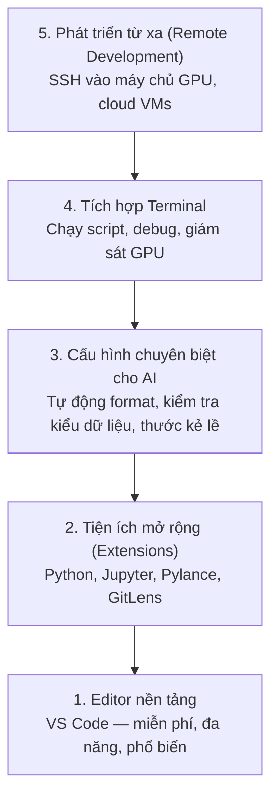

# Thiết lập trình soạn thảo (Editor Setup)

> Trình soạn thảo (editor) là người bạn đồng hành (co-pilot) của bạn. Hãy cấu hình một lần để nó không cản trở công việc và phát huy tối đa sức mạnh hỗ trợ bạn.

**Type:** Build
**Languages:** --
**Prerequisites:** Phase 0, Lesson 01
**Time:** ~20 phút

## Mục tiêu học tập

- Cài đặt VS Code cùng các tiện ích mở rộng (extensions) thiết yếu cho Python, Jupyter, linting và Remote SSH.
- Cấu hình tự động format khi lưu (format-on-save), kiểm tra kiểu dữ liệu (type checking) và cuộn kết quả notebook cho các luồng công việc AI.
- Thiết lập Remote SSH để chỉnh sửa và gỡ lỗi mã nguồn trên máy chủ GPU từ xa mượt mà như trên máy cục bộ.
- Đánh giá các trình soạn thảo thay thế (Cursor, Windsurf, Neovim) và điểm đánh đổi của chúng đối với công việc AI.

## Vấn đề đặt ra

Bạn sẽ dành hàng ngàn giờ trong trình soạn thảo để viết Python, chạy notebook, debug các vòng lặp huấn luyện (training loops) và kết nối SSH vào các máy chủ GPU. Một trình soạn thảo cấu hình sai sẽ biến mỗi phiên làm việc thành sự bực bội: không có gợi ý tự động (autocomplete), không có gợi ý kiểu dữ liệu (type hints), không báo lỗi trực tiếp, phải format thủ công và thao tác terminal vụng về.

Thiết lập chuẩn chỉ chỉ mất khoảng 20 phút. Nhưng nếu bỏ qua, bạn sẽ lãng phí 20 phút mỗi ngày vì những phiền toái không đáng có.

## Khái niệm

Một môi trường soạn thảo chuẩn cho kỹ sư AI cần 5 tầng:



```figure
s0-lsp-roundtrip
```

## Bắt tay vào xây dựng (Build It)

### Bước 1: Cài đặt VS Code

VS Code là trình soạn thảo được khuyến nghị. Nó hoàn toàn miễn phí, chạy trên mọi hệ điều hành, hỗ trợ Jupyter notebook hạng nhất và có hệ sinh thái tiện ích mở rộng đáp ứng mọi nhu cầu kỹ thuật AI.

Tải về tại: [code.visualstudio.com](https://code.visualstudio.com/).

Kiểm tra từ terminal:

```bash
code --version
```

Nếu không tìm thấy lệnh `code` trên macOS, hãy mở VS Code, nhấn `Cmd+Shift+P`, gõ "Shell Command", và chọn "Install 'code' command in PATH".

### Bước 2: Cài đặt các tiện ích mở rộng thiết yếu

Mở terminal tích hợp trong VS Code (phím tắt `` Ctrl+` `` trên mọi nền tảng) và cài đặt các extension quan trọng nhất:

```bash
code --install-extension ms-python.python
code --install-extension ms-python.vscode-pylance
code --install-extension ms-toolsai.jupyter
code --install-extension eamodio.gitlens
code --install-extension ms-vscode-remote.remote-ssh
code --install-extension ms-python.debugpy
code --install-extension ms-python.black-formatter
code --install-extension charliermarsh.ruff
```

Công dụng của từng extension:

| Tiện ích | Lý do cần dùng |
|---|---|
| Python | Hỗ trợ ngôn ngữ, tự nhận diện môi trường ảo (venv), chạy và debug code |
| Pylance | Kiểm tra kiểu dữ liệu nhanh, autocomplete thông minh, tự động giải quyết import |
| Jupyter | Chạy file notebook trực tiếp trong VS Code, xem các biến trong bộ nhớ |
| GitLens | Xem lịch sử ai đã sửa dòng code nào (inline git blame), trực quan hóa thay đổi |
| Remote SSH | Mở một thư mục trên máy chủ GPU từ xa mượt mà như đang mở trên máy cá nhân |
| Debugpy | Gỡ lỗi từng bước (step-through debugging) cho Python |
| Black Formatter | Tự động định dạng code khi lưu, đảm bảo phong cách code nhất quán |
| Ruff | Công cụ linting siêu nhanh, bắt các lỗi sai cú pháp phổ biến |

Tệp `code/vscode/extensions.json` trong bài học này chứa danh sách đề xuất đầy đủ. Bạn chỉ cần sao chép nó vào thư mục `.vscode/extensions.json` trong dự án của mình, VS Code sẽ tự động gợi ý bạn cài đặt khi mở dự án.

### Bước 3: Cấu hình cài đặt (Settings)

Sao chép cấu hình từ file `code/vscode/settings.json` trong bài học này, hoặc áp dụng thủ công qua menu `Settings > Open Settings (JSON)`.

Các cấu hình cốt lõi cho công việc AI:

```jsonc
{
    "python.analysis.typeCheckingMode": "basic",
    "editor.formatOnSave": true,
    "editor.rulers": [88, 120],
    "notebook.output.scrolling": true,
    "files.autoSave": "afterDelay"
}
```

Tại sao các thiết lập này lại quan trọng:

- **Type checking ở mức basic**: Bắt lỗi sai kiểu tham số trước khi bạn chạy code. Tiết kiệm hàng giờ debug các lỗi lệch kích thước tensor (shape mismatch) hoặc truyền sai tham số API.
- **Format on save**: Bạn không bao giờ phải bận tâm về việc thụt lề hay định dạng nữa. Black sẽ tự xử lý mỗi khi bạn bấm lưu.
- **Thước kẻ lề ở cột 88 và 120**: Black tự động ngắt dòng ở 88 ký tự. Mốc 120 ký tự giúp bạn nhận biết khi nào docstring và bình luận bắt đầu quá dài.
- **Cuộn kết quả notebook (output scrolling)**: Vòng lặp huấn luyện thường in ra hàng nghìn dòng log. Nếu không bật cuộn, bảng hiển thị kết quả sẽ tràn ngập màn hình.
- **Tự động lưu (auto-save)**: Chắc chắn bạn sẽ có lúc quên lưu file trước khi chạy lệnh trong terminal, dẫn tới việc script chạy mã nguồn cũ. Auto-save loại bỏ hoàn toàn rủi ro này.

### Bước 4: Tích hợp Terminal

Terminal tích hợp sẵn của VS Code là nơi bạn chạy các script huấn luyện, theo dõi GPU và quản lý môi trường ảo.

Cấu hình terminal tối ưu:

```jsonc
{
    "terminal.integrated.defaultProfile.osx": "zsh",
    "terminal.integrated.defaultProfile.linux": "bash",
    "terminal.integrated.fontSize": 13,
    "terminal.integrated.scrollback": 10000
}
```

Các phím tắt terminal hữu ích:

| Thao tác | macOS | Linux / Windows |
|---|---|---|
| Bật/tắt Terminal | `` Ctrl+` `` | `` Ctrl+` `` |
| Mở Terminal mới | `` Ctrl+Shift+` `` | `` Ctrl+Shift+` `` |
| Chia đôi màn hình Terminal | `Cmd+\` | `Ctrl+Shift+5` |

Chia đôi màn hình terminal cực kỳ tiện lợi: một bên dùng để chạy script huấn luyện, một bên chạy `nvidia-smi -l 1` hoặc `watch -n 1 nvidia-smi` để giám sát tài nguyên GPU liên tục.

### Bước 5: Phát triển từ xa (SSH vào các máy chủ GPU)

Đây là tiện ích mở rộng quan trọng nhất đối với một kỹ sư AI. Bạn sẽ thường xuyên chạy huấn luyện trên các máy chủ từ xa (Cloud VMs, máy chủ phòng thí nghiệm, Lambda Labs, Vast.ai). Remote SSH cho phép bạn mở hệ thống tệp từ xa, chỉnh sửa file, chạy terminal và debug code như thể mọi thứ đang nằm ngay trên ổ cứng máy bạn.

Cách thiết lập:

1. Cài đặt tiện ích Remote SSH (đã thực hiện ở Bước 2).
2. Nhấn `Ctrl+Shift+P` (hoặc `Cmd+Shift+P`), gõ "Remote-SSH: Connect to Host".
3. Nhập địa chỉ: `user@your-gpu-box-ip`.
4. VS Code sẽ tự động cài đặt thành phần máy chủ nhẹ lên máy từ xa.

Để đăng nhập không cần gõ mật khẩu, hãy thiết lập khóa SSH (SSH keys):

```bash
ssh-keygen -t ed25519 -C "your-email@example.com"
ssh-copy-id user@your-gpu-box-ip
```

Thêm cấu hình máy chủ vào file `~/.ssh/config` để kết nối nhanh:

```
Host gpu-box
    HostName 203.0.113.50
    User ubuntu
    IdentityFile ~/.ssh/id_ed25519
    ForwardAgent yes
```

Bây giờ bạn chỉ cần chọn lệnh `Remote-SSH: Connect to Host > gpu-box` là kết nối ngay lập tức.

## Các lựa chọn thay thế (Alternatives)

### Cursor

[cursor.com](https://cursor.com) là một bản phân nhánh (fork) từ VS Code tích hợp sẵn AI sinh code sâu vào lõi. Nó dùng chung hệ sinh thái extension và định dạng cấu hình settings của VS Code. Nếu bạn dùng Cursor, toàn bộ kiến thức trong bài học này vẫn giữ nguyên giá trị. Bạn có thể import cùng file `settings.json` và `extensions.json`.

### Windsurf

[windsurf.com](https://windsurf.com) cũng là một trình soạn thảo AI-first phát triển từ mã nguồn VS Code. Tương tự: dùng chung extension, cấu hình settings và tính năng Remote SSH.

### Vim / Neovim

Nếu bạn đã quen dùng Vim hoặc Neovim và đạt năng suất cao với nó, hãy tiếp tục sử dụng. Cấu hình tối thiểu cho công việc Python AI trên Neovim gồm:

- **pyright** hoặc **pylsp** để kiểm tra kiểu dữ liệu (cài qua Mason hoặc thủ công).
- **nvim-lspconfig** để kết nối language server.
- **jupyter-vim** hoặc **molten-nvim** để chạy code tương tự notebook.
- **telescope.nvim** để tìm kiếm file và ký hiệu nhanh.
- **none-ls.nvim** kết hợp với black và ruff để format và lint code.

Nếu bạn chưa từng dùng Vim trước đây, **đừng bắt đầu học Vim vào lúc này**. Độ dốc học tập của Vim sẽ làm bạn phân tâm khỏi việc học kỹ thuật AI. Hãy dùng VS Code.

## Sử dụng trong thực tế (Use It)

Với thiết lập này, quy trình làm việc hàng ngày của bạn sẽ là:

1. Mở thư mục dự án trong VS Code (hoặc kết nối qua Remote SSH tới máy chủ GPU).
2. Viết Python với sự hỗ trợ của tự động gợi ý, chú thích kiểu dữ liệu và báo lỗi trực tiếp.
3. Chạy các notebook trực tiếp bằng tiện ích Jupyter tích hợp.
4. Dùng terminal tích hợp để chạy script huấn luyện, cài đặt gói bằng `uv pip install` và giám sát GPU.
5. Xem lại các thay đổi bằng GitLens trước khi commit code lên git.

## Bài tập thực hành (Exercises)

1. Cài đặt VS Code và toàn bộ các tiện ích mở rộng được liệt kê ở Bước 2.
2. Sao chép nội dung cấu hình `settings.json` từ bài học này vào cấu hình VS Code của bạn.
3. Mở một file Python và kiểm tra xem Pylance có hiển thị gợi ý kiểu dữ liệu và Black có tự động format khi bạn lưu file hay không.
4. Nếu bạn có quyền truy cập vào một máy chủ từ xa, hãy thiết lập Remote SSH và mở một thư mục trên đó.

### Gợi ý (Hints)

**Bài tập 1.** Cài đặt các extension từ bảng ở Bước 2 hoặc cài theo ID trong file `code/vscode/extensions.json` bằng lệnh `code --install-extension <id>`. Chạy `code --list-extensions` để kiểm tra lại danh sách đã cài.

**Bài tập 2.** Mở menu Settings > Open Settings (JSON) và sao chép nội dung từ `code/vscode/settings.json` vào. Nếu file đã có các cấu hình cũ, hãy gộp các khóa và đảm bảo cú pháp JSON hợp lệ (VS Code sẽ gạch đỏ nếu JSON bị lỗi).

**Bài tập 3.** Viết một hàm có khai báo kiểu dữ liệu (type annotation), sau đó rê chuột (hover) lên lời gọi hàm đó; Pylance sẽ hiển thị kiểu dữ liệu suy luận được. Thêm các khoảng trắng thừa trên một dòng và bấm lưu (`Ctrl+S`); Black sẽ tự động căn chỉnh lại dòng đó ngay lập tức.

**Bài tập 4.** Thêm thông tin máy chủ vào file `~/.ssh/config` trước và xác nhận lệnh `ssh <host>` hoạt động tốt trong terminal. Sau đó dùng lệnh Remote SSH của VS Code để kết nối; thanh trạng thái góc dưới cùng bên trái sẽ hiển thị tên máy chủ khi VS Code đã chạy thành công trên máy từ xa.

## Thuật ngữ quan trọng (Key Terms)

| Thuật ngữ | Cách gọi thông thường | Ý nghĩa bản chất |
|---|---|---|
| LSP | "Bộ máy gợi ý code" | Language Server Protocol: tiêu chuẩn giao tiếp giúp trình soạn thảo lấy thông tin kiểu dữ liệu, gợi ý code và chẩn đoán lỗi từ một server ngôn ngữ chuyên biệt |
| Pylance | "Plugin Python" | Language server Python của Microsoft sử dụng Pyright để kiểm tra kiểu dữ liệu tĩnh và cung cấp tính năng IntelliSense |
| Remote SSH | "Làm việc trên máy chủ" | Tiện ích mở rộng của VS Code chạy một server nhẹ trên máy từ xa và truyền giao diện trực tiếp về máy cục bộ của bạn |
| Format on save | "Tự làm đẹp code" | Trình soạn thảo tự động chạy bộ định dạng (Black, Ruff) mỗi khi bạn lưu file, giúp phong cách code luôn sạch đẹp và đồng nhất |
