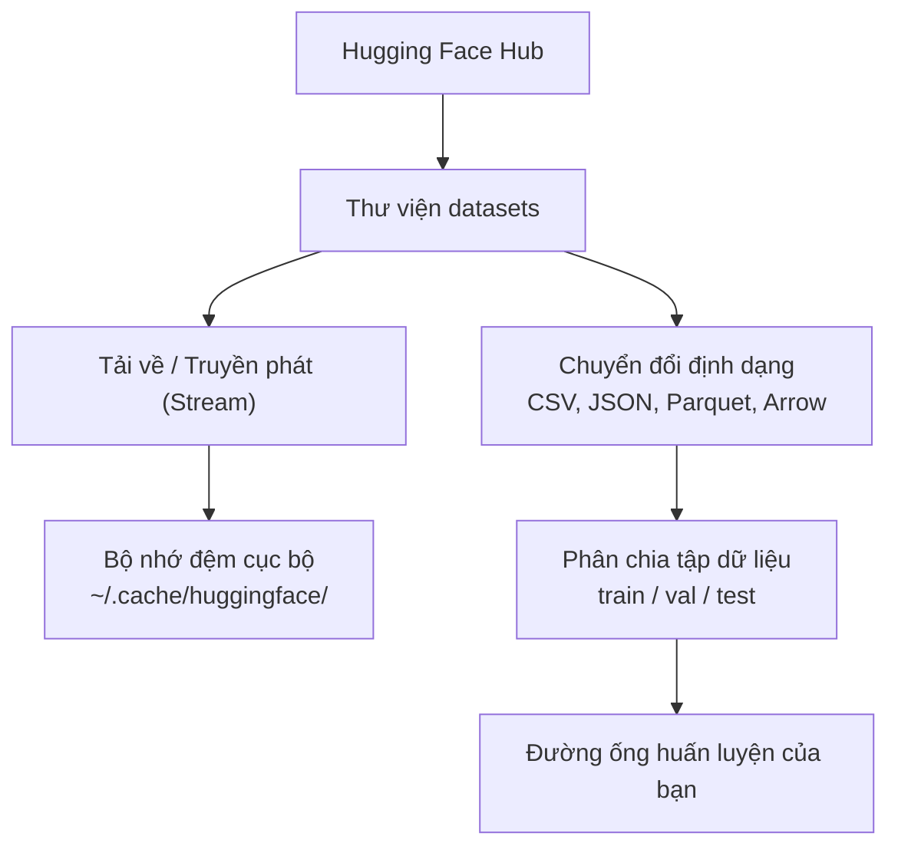

# Quản lý dữ liệu (Data Management)

> Dữ liệu là nhiên liệu. Cách bạn quản lý dữ liệu quyết định tốc độ bạn có thể tiến xa đến đâu.

**Type:** Build
**Language:** Python
**Prerequisites:** Phase 0, Lesson 01
**Time:** ~45 phút

## Mục tiêu học tập

- Nạp (load), truyền phát trực tiếp (stream) và lưu đệm (cache) tập dữ liệu bằng thư viện Hugging Face `datasets`.
- Chuyển đổi qua lại giữa các định dạng CSV, JSON, Parquet, Arrow và giải thích điểm mạnh/yếu của từng loại.
- Tạo các tập phân chia train/validation/test có tính tái lập với seed ngẫu nhiên cố định.
- Quản lý các file mô hình và tập dữ liệu dung lượng lớn bằng `.gitignore`, Git LFS hoặc DVC.

## Vấn đề đặt ra

Mọi dự án AI đều bắt đầu từ dữ liệu. Bạn cần tìm kiếm tập dữ liệu, tải chúng về, chuyển đổi qua lại giữa các định dạng, chia nhỏ cho các bước huấn luyện và đánh giá, đồng thời đánh phiên bản để mọi thử nghiệm đều có thể tái lập được. Làm những việc này một cách thủ công mỗi lần sẽ rất chậm chạp và dễ phát sinh lỗi. Bạn cần một quy trình làm việc chuẩn hóa và có thể tự động lặp lại.

## Khái niệm



Thư viện `datasets` của Hugging Face là tiêu chuẩn vàng trong ngành để nạp dữ liệu cho các tác vụ AI. Nó tự động xử lý toàn bộ việc tải xuống, lưu đệm, chuyển đổi định dạng và truyền phát trực tiếp mà bạn không cần phải tự viết lại từ đầu.

```figure
s0-data-pipeline
```

## Bắt tay vào xây dựng (Build It)

### Bước 1: Cài đặt thư viện datasets

```bash
pip install datasets huggingface_hub
```

### Bước 2: Nạp một tập dữ liệu

```python
from datasets import load_dataset

dataset = load_dataset("stanfordnlp/imdb")
print(dataset)
print(dataset["train"][0])
```

Đoạn mã trên sẽ tải về tập dữ liệu đánh giá phim IMDB. Sau lần tải đầu tiên, các lần sau dữ liệu sẽ được đọc trực tiếp từ bộ nhớ đệm tại `~/.cache/huggingface/datasets/`.

### Bước 3: Truyền phát trực tiếp tập dữ liệu lớn (Streaming)

Một số tập dữ liệu quá khổng lồ để lưu trữ vừa trên ổ cứng của bạn. Kỹ thuật streaming cho phép nạp dữ liệu theo từng dòng (row by row) mà không cần phải tải toàn bộ tập dữ liệu về máy.

```python
dataset = load_dataset("wikimedia/wikipedia", "20231101.en", split="train", streaming=True)

for i, example in enumerate(dataset):
    print(example["title"])
    if i >= 4:
        break
```

Chế độ streaming trả về một đối tượng `IterableDataset`. Bạn xử lý các dòng dữ liệu ngay khi chúng được nạp về. Dung lượng RAM tiêu thụ luôn được giữ ở mức cố định dù tập dữ liệu có lớn đến hàng trăm GB.

### Bước 4: Các định dạng dữ liệu

Thư viện `datasets` sử dụng Apache Arrow ở tầng lõi bên dưới. Bạn có thể dễ dàng chuyển đổi sang các định dạng khác tùy theo yêu cầu của hệ thống:

```python
dataset = load_dataset("stanfordnlp/imdb", split="train")

dataset.to_csv("imdb_train.csv")
dataset.to_json("imdb_train.json")
dataset.to_parquet("imdb_train.parquet")
```

Bảng so sánh các định dạng:

| Định dạng | Kích thước | Tốc độ đọc | Phù hợp nhất cho |
|---|---|---|---|
| CSV | Lớn | Chậm | Con người đọc trực tiếp, mở bằng bảng tính Excel |
| JSON | Lớn | Chậm | Giao tiếp qua API, dữ liệu có cấu trúc lồng nhau |
| Parquet | Rất nhỏ (nén tốt) | Nhanh | Phân tích dữ liệu, truy vấn theo cột (columnar) |
| Arrow | Nhỏ | Nhanh nhất | Xử lý trực tiếp trong RAM (cơ chế nội tại của `datasets`) |

Đối với công việc AI: **Parquet là định dạng lưu trữ ổ cứng tốt nhất**. **Arrow là định dạng tối ưu nhất khi thao tác trên RAM**. Còn CSV và JSON chỉ nên dùng để trao đổi dữ liệu đơn giản.

### Bước 5: Phân chia tập dữ liệu (Data splits)

Mọi dự án Machine Learning đều cần 3 tập phân chia:

- **Train (Huấn luyện)**: Mô hình học từ tập này (thường chiếm 80%)
- **Validation (Kiểm định)**: Dùng để theo dõi tiến độ và điều chỉnh tham số trong quá trình huấn luyện (thường chiếm 10%)
- **Test (Kiểm thử)**: Đánh giá độ chính xác cuối cùng sau khi huấn luyện xong (thường chiếm 10%)

Nếu tập dữ liệu chưa được chia sẵn, bạn hãy tự chia như sau:

```python
dataset = load_dataset("stanfordnlp/imdb", split="train")

split = dataset.train_test_split(test_size=0.2, seed=42)
train_val = split["train"].train_test_split(test_size=0.125, seed=42)

train_ds = train_val["train"]
val_ds = train_val["test"]
test_ds = split["test"]

print(f"Train: {len(train_ds)}, Val: {len(val_ds)}, Test: {len(test_ds)}")
```

Luôn luôn đặt giá trị `seed` để đảm bảo tính tái lập (reproducibility). Cùng một giá trị seed sẽ luôn tạo ra các tập phân chia giống hệt nhau.

### Bước 6: Tải và lưu đệm mô hình

Mô hình là các file có kích thước rất lớn. Thư viện `huggingface_hub` tự động quản lý việc tải và lưu đệm:

```python
from huggingface_hub import hf_hub_download, snapshot_download

model_path = hf_hub_download(
    repo_id="sentence-transformers/all-MiniLM-L6-v2",
    filename="config.json"
)
print(f"Đã lưu đệm tại: {model_path}")

model_dir = snapshot_download("sentence-transformers/all-MiniLM-L6-v2")
print(f"Thư mục mô hình đầy đủ: {model_dir}")
```

Các mô hình được lưu đệm tại `~/.cache/huggingface/hub/`. Sau khi tải một lần, các lần chạy tiếp theo sẽ nạp ngay lập tức từ ổ cứng.

### Bước 7: Quản lý các file dung lượng lớn

Trọng số mô hình và các tập dữ liệu lớn tuyệt đối không nên commit trực tiếp vào git. Bạn có ba giải pháp:

**Lựa chọn A: Dùng .gitignore (Đơn giản nhất)**

```
*.bin
*.safetensors
*.pt
*.onnx
data/*.parquet
data/*.csv
models/
```

**Lựa chọn B: Git LFS (Quản lý file lớn trực tiếp trong Git)**

```bash
git lfs install
git lfs track "*.bin"
git lfs track "*.safetensors"
git add .gitattributes
```

Git LFS chỉ lưu các con trỏ (pointers) trong repo của bạn, còn dữ liệu thật được lưu trên một máy chủ lưu trữ riêng. GitHub cung cấp 1 GB miễn phí.

**Lựa chọn C: DVC (Hệ thống kiểm soát phiên bản dữ liệu - Data Version Control)**

```bash
pip install dvc
dvc init
dvc add data/training_set.parquet
git add data/training_set.parquet.dvc data/.gitignore
git commit -m "Track training data with DVC"
```

DVC tạo các file `.dvc` nhỏ trỏ tới dữ liệu của bạn. Bản thân dữ liệu thật được lưu trữ trên S3, GCS hoặc các dịch vụ đám mây khác.

| Phương pháp | Độ phức tạp | Phù hợp nhất cho |
|---|---|---|
| .gitignore | Thấp | Dự án cá nhân, dữ liệu công khai có thể tải lại bất kỳ lúc nào |
| Git LFS | Trung bình | Đội ngũ cần chia sẻ trọng số mô hình qua git |
| DVC | Cao | Tái lập các thử nghiệm phức tạp, tập dữ liệu lớn, làm việc nhóm quy mô |

Đối với khóa học này, `.gitignore` là hoàn toàn đủ dùng. Hãy dùng DVC khi bạn cần tái lập chính xác các thử nghiệm trên nhiều máy tính khác nhau.

### Bước 8: Các mô hình lưu trữ

**Lưu trữ cục bộ (Local storage)**: Hoạt động rất tốt cho các tập dữ liệu dưới ~10 GB. Bộ nhớ đệm của Hugging Face tự xử lý phần này.

**Lưu trữ đám mây (Cloud storage)**: Dành cho dữ liệu lớn hơn hoặc cần chia sẻ giữa các máy ảo GPU:

```python
import os

local_path = os.path.expanduser("~/.cache/huggingface/datasets/")

# s3_path = "s3://my-bucket/datasets/"
# gcs_path = "gs://my-bucket/datasets/"
```

## Các tập dữ liệu được dùng trong khóa học này

| Tập dữ liệu | Các bài học áp dụng | Kích thước | Kiến thức đem lại |
|---|---|---|---|
| IMDB | Tokenization, phân loại văn bản | 84 MB | Các nguyên lý phân loại văn bản cơ bản |
| WikiText | Mô hình hóa ngôn ngữ (Language modeling) | 181 MB | Bài toán dự đoán token tiếp theo (Next-token prediction) |
| SQuAD | Hệ thống hỏi đáp (QA systems) | 35 MB | Trích xuất câu trả lời từ ngữ cảnh |
| Common Crawl (subset) | Xây dựng Embeddings | Biến đổi | Kỹ thuật xử lý văn bản quy mô lớn |
| MNIST | Nền tảng Computer Vision | 21 MB | Các nguyên lý cơ bản của phân loại hình ảnh |
| COCO (subset) | AI đa phương thức (Multimodal) | Biến đổi | Khớp nối dữ liệu hình ảnh và văn bản |

Bạn chưa cần tải toàn bộ dữ liệu này bây giờ. Mỗi bài học sẽ chỉ định chính xác những gì cần dùng.

## Sử dụng trong thực tế (Use It)

Chạy script tiện ích để kiểm tra toàn bộ hoạt động:

```bash
python code/data_utils.py
```

Script này sẽ tải một tập dữ liệu nhỏ, chuyển đổi định dạng, phân chia tập và in ra bảng tổng kết.

## Xuất xưởng sản phẩm (Ship It)

Bài học này cung cấp:
- `code/data_utils.py` - Tiện ích nạp và lưu đệm dữ liệu có thể tái sử dụng.
- `outputs/prompt-data-helper.md` - Prompt giúp chọn đúng tập dữ liệu cho từng bài toán cụ thể.

## Bài tập thực hành (Exercises)

1. Nạp tập dữ liệu `glue` với cấu hình `mrpc` và quan sát 5 mẫu đầu tiên.
2. Dùng kỹ thuật streaming để đọc tập dữ liệu `c4` và đếm xem bạn có thể xử lý bao nhiêu mẫu trong vòng 10 giây.
3. Chuyển đổi một tập dữ liệu sang Parquet và so sánh dung lượng file với định dạng CSV.
4. Tạo phép phân chia tỷ lệ 70/15/15 cho train/val/test với seed cố định và kiểm tra lại số lượng mẫu ở từng tập.

### Gợi ý (Hints)

**Bài tập 1.** Gọi hàm `load_and_inspect("glue", "mrpc")` từ file `code/data_utils.py`, hoặc gọi trực tiếp `load_dataset("glue", "mrpc")`, sau đó in `ds["train"][:5]`. Mỗi mẫu phải có đủ các trường `sentence1`, `sentence2`, và `label`.

**Bài tập 2.** Nạp tập dữ liệu với tùy chọn `streaming=True` như hàm `stream_dataset` làm mẫu, sau đó đọc các bản ghi trong một vòng lặp dừng lại khi `time.time()` vượt quá thời gian bắt đầu cộng thêm 10 giây. Hãy chạy hai lần; lần đầu luôn bao gồm thời gian khởi tạo kết nối mạng ban đầu.

**Bài tập 3.** Lưu cùng một tập dữ liệu bằng cả `to_csv` và `to_parquet`, sau đó so sánh kích thước file bằng `ls -lh` hoặc `os.path.getsize`. Nạp lại file Parquet bằng `load_from_parquet` và kiểm tra số dòng không hề bị thay đổi.

**Bài tập 4.** Dùng hàm `train_test_split` hai lần liên tiếp với cùng một `seed` cố định: lần đầu tách riêng 30% ra, lần hai chia đôi 30% đó thành hai phần 15%. Tổng độ dài 3 tập phải bằng độ dài ban đầu, và khi chạy lại lần thứ hai với cùng seed thì mẫu đầu tiên của mỗi tập phải hoàn toàn giống hệt.

## Thuật ngữ quan trọng (Key Terms)

| Thuật ngữ | Cách gọi thông thường | Ý nghĩa bản chất |
|---|---|---|
| Dataset split | "Tập dữ liệu huấn luyện" | Các tập con có tên riêng (train/val/test) được sử dụng ở các giai đoạn khác nhau của vòng đời ML |
| Streaming | "Nạp lười (lazy load)" | Xử lý dữ liệu từng dòng trực tiếp từ máy chủ từ xa mà không cần tải toàn bộ tập dữ liệu về ổ cứng |
| Parquet | "CSV dạng nén" | Định dạng file lưu trữ theo cột (columnar) được tối ưu hóa cao cho các truy vấn phân tích và tiết kiệm bộ nhớ |
| Arrow | "Bảng dữ liệu siêu tốc" | Định dạng cột trên RAM được thư viện `datasets` dùng nội bộ để đọc dữ liệu mà không cần sao chép bộ nhớ (zero-copy) |
| Git LFS | "Git cho file nặng" | Tiện ích mở rộng lưu các file dung lượng lớn ra ngoài kho git trong khi vẫn giữ con trỏ kiểm soát phiên bản |
| DVC | "Git cho dữ liệu" | Hệ thống kiểm soát phiên bản dành riêng cho dữ liệu và mô hình, tích hợp mượt mà với bộ nhớ đám mây |
| Cache | "Đã tải sẵn rồi" | Bản sao cục bộ của dữ liệu đã tải trước đó, mặc định được lưu tại `~/.cache/huggingface/` |
