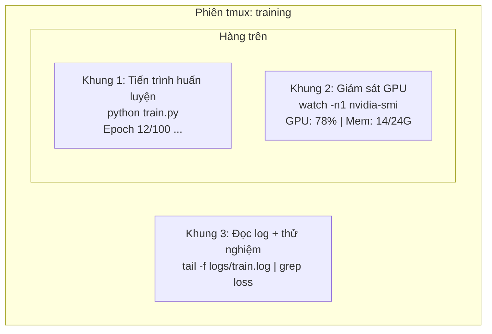

# Terminal & Shell

> Terminal là ngôi nhà thực sự của các kỹ sư AI. Hãy biến nơi đây thành không gian làm việc thoải mái và quen thuộc nhất của bạn.

**Type:** Learn
**Languages:** --
**Prerequisites:** Phase 0, Lesson 01
**Time:** ~35 phút

## Mục tiêu học tập

- Sử dụng cơ chế đường ống (piping), điều hướng luồng dữ liệu (redirects) và lệnh `grep` để lọc và xử lý các bản ghi nhật ký (training logs) trực tiếp từ dòng lệnh.
- Tạo các phiên tmux bền vững với nhiều khung hiển thị (panes) để chạy song song tiến trình huấn luyện và giám sát GPU.
- Giám sát tài nguyên hệ thống và GPU bằng các công cụ `htop`, `nvtop` và `nvidia-smi`.
- Truyền tải tệp tin an toàn giữa máy cục bộ và máy chủ từ xa bằng SSH, `scp` và `rsync`.

## Vấn đề đặt ra

Bạn sẽ dành thời gian trong terminal nhiều hơn bất kỳ trình soạn thảo nào. Chạy huấn luyện, theo dõi GPU, đọc log theo thời gian thực, kết nối SSH vào máy chủ từ xa, quản lý môi trường ảo... Mọi luồng công việc AI đều chạm tới shell. Nếu bạn thao tác chậm ở terminal, toàn bộ tiến độ của bạn sẽ bị chậm lại.

Bài học này trang bị những kỹ năng dòng lệnh thực sự quan trọng và hữu ích cho kỹ sư AI. Không lan man về lịch sử Unix. Không đào sâu vào lập trình Bash phức tạp. Chỉ tập trung vào đúng những gì bạn cần.

## Khái niệm



Ba tác vụ chạy đồng thời. Chỉ trong một cửa sổ terminal duy nhất. Bạn có thể ngắt kết nối (detach), tắt máy về nhà, kết nối SSH lại từ xa và gắn lại phiên (reattach). Tiến trình huấn luyện vẫn chạy bền bỉ không hề gián đoạn.

```figure
s0-shell-pipeline
```

## Bắt tay vào xây dựng (Build It)

### Bước 1: Hiểu rõ shell bạn đang dùng

Kiểm tra shell hiện tại của hệ thống:

```bash
echo $SHELL
```

Hầu hết các hệ thống dùng `bash` hoặc `zsh`. Cả hai đều rất tốt. Mọi câu lệnh trong khóa học này đều chạy được trên cả hai shell.

Các thao tác cơ bản bắt buộc phải thành thạo:

```bash
# Di chuyển thư mục
cd ~/projects/ai-engineering-from-scratch
pwd
ls -la

# Tìm kiếm lịch sử lệnh (phím tắt hữu ích nhất bạn sẽ học)
# Nhấn Ctrl+R rồi gõ một phần lệnh cũ từng chạy
# Nhấn tiếp Ctrl+R để duyệt qua các kết quả trùng khớp

# Xóa sạch màn hình terminal
clear   # hoặc phím tắt Ctrl+L

# Hủy một lệnh đang chạy
# Nhấn Ctrl+C

# Tạm dừng một lệnh đang chạy (tiếp tục lại bằng lệnh fg)
# Nhấn Ctrl+Z
```

### Bước 2: Kỹ thuật đường ống (Piping) và điều hướng luồng (Redirects)

Đường ống kết nối đầu ra của lệnh này thành đầu vào của lệnh tiếp theo. Đây là cách bạn phân tích log, lọc kết quả và liên kết các công cụ với nhau:

```bash
# Đếm số lần từ khóa "loss" xuất hiện trong file log
cat train.log | grep "loss" | wc -l

# Trích xuất riêng các giá trị loss từ đầu ra huấn luyện
grep "loss:" train.log | awk '{print $NF}' > losses.txt

# Theo dõi file log cập nhật theo thời gian thực, chỉ lọc các dòng ERROR
tail -f train.log | grep --line-buffered "ERROR"

# Sắp xếp các thử nghiệm theo độ chính xác cuối cùng (accuracy) từ cao xuống thấp
grep "final_accuracy" results/*.log | sort -t= -k2 -n -r

# Điều hướng stdout và stderr ra hai file riêng biệt
python train.py > output.log 2> errors.log

# Điều hướng cả stdout và stderr vào chung một file log
python train.py > train_full.log 2>&1
```

Bảng ký hiệu điều hướng cốt lõi:

| Ký hiệu | Tác dụng |
|---|---|
| `>` | Ghi đè luồng xuất chuẩn (stdout) vào file |
| `>>` | Ghi nối tiếp (append) luồng xuất chuẩn vào cuối file |
| `2>` | Ghi luồng báo lỗi (stderr) vào file |
| `2>&1` | Đưa luồng báo lỗi (stderr) về chung vị trí với luồng xuất chuẩn (stdout) |
| `\|` | Lấy stdout của lệnh trước làm stdin (đầu vào) cho lệnh sau |

### Bước 3: Chạy tiến trình ngầm (Background processes)

Các đợt huấn luyện thường mất hàng giờ. Bạn không thể giữ cửa sổ terminal mở suốt thời gian đó:

```bash
# Chạy ngầm (kết quả vẫn bắn ra màn hình terminal)
python train.py &

# Chạy ngầm an toàn, miễn nhiễm với sự kiện đóng terminal (nohup)
nohup python train.py > train.log 2>&1 &

# Xem danh sách các tác vụ đang chạy ngầm
jobs
ps aux | grep train.py

# Đưa một tác vụ ngầm quay lại tương tác trực tiếp trên màn hình
fg %1

# Dừng/hủy một tiến trình ngầm
kill %1
# hoặc tìm PID theo tên lệnh và dừng
kill $(pgrep -f "train.py")
```

So sánh các phương pháp chạy ngầm:

| Phương pháp | Tồn tại khi đóng terminal? | Gắn lại tương tác được không? |
|---|---|---|
| `lệnh &` | Không | Không |
| `nohup lệnh &` | Có | Không (chỉ kiểm tra qua file log) |
| `screen` / `tmux` | Có | **Có (hoàn toàn tương tác lại được)** |

Đối với bất kỳ tác vụ nào chạy lâu hơn vài phút, hãy sử dụng **tmux**.

### Bước 4: Làm chủ tmux

tmux cho phép tạo các phiên làm việc độc lập với nhiều khung màn hình (panes). Đây là công cụ hữu dụng nhất để quản lý các lượt huấn luyện mô hình:

```bash
# Cài đặt
# macOS
brew install tmux
# Ubuntu
sudo apt install tmux

# Tạo một phiên làm việc có đặt tên
tmux new -s training

# Chia đôi màn hình theo chiều ngang
# Nhấn tổ hợp: Ctrl+B sau đó nhấn phím "

# Chia đôi màn hình theo chiều dọc
# Nhấn tổ hợp: Ctrl+B sau đó nhấn phím %

# Di chuyển giữa các khung màn hình
# Nhấn tổ hợp: Ctrl+B sau đó nhấn các phím mũi tên

# Rời khỏi phiên (detach) - tiến trình bên trong vẫn tiếp tục chạy
# Nhấn tổ hợp: Ctrl+B sau đó nhấn phím d

# Gắn lại vào phiên làm việc cũ
tmux attach -t training

# Xem danh sách các phiên tmux đang chạy
tmux ls

# Xóa một phiên tmux
tmux kill-session -t training
```

Kịch bản làm việc điển hình của kỹ sư AI:

```bash
tmux new -s train

# Khung 1: Bắt đầu chạy huấn luyện
python train.py --epochs 100 --lr 1e-4

# Nhấn Ctrl+B rồi nhấn " để chia khung ngang, chạy lệnh giám sát GPU
watch -n1 nvidia-smi

# Nhấn Ctrl+B rồi nhấn % để chia tiếp khung dọc, theo dõi log
tail -f logs/experiment.log

# Rời khỏi phiên bằng Ctrl+B rồi nhấn d
# Đăng xuất SSH, đi uống cà phê, sau đó quay lại kết nối lại:
# tmux attach -t train
```

### Bước 5: Giám sát tài nguyên với htop và nvtop

```bash
# Quản lý tiến trình CPU/RAM hệ thống (trực quan hơn top)
htop

# Quản lý tiến trình GPU (nếu dùng GPU NVIDIA)
# Cài đặt: sudo apt install nvtop (Ubuntu) hoặc brew install nvtop (macOS)
nvtop

# Kiểm tra nhanh thông số GPU
nvidia-smi

# Tự động cập nhật thông số GPU mỗi giây một lần
watch -n1 nvidia-smi

# Xem danh sách các tiến trình cụ thể đang chiếm dụng VRAM của GPU
nvidia-smi --query-compute-apps=pid,name,used_memory --format=csv
```

Các phím tắt quan trọng trong `htop`:
- `F6` hoặc `>`: Sắp xếp theo cột (sắp xếp theo cột bộ nhớ MEM% để tìm lỗi rò rỉ RAM).
- `F5`: Chuyển sang chế độ xem cây tiến trình (tree view) để thấy các tiến trình con.
- `F9`: Dừng/hủy một tiến trình (Kill).
- `/`: Tìm kiếm theo tên tiến trình.

### Bước 6: Kết nối SSH vào máy chủ GPU từ xa

Khi thuê GPU đám mây (Lambda Labs, RunPod, Vast.ai), bạn sẽ kết nối qua giao thức SSH:

```bash
# Kết nối cơ bản
ssh user@gpu-box-ip

# Kết nối dùng private key riêng
ssh -i ~/.ssh/my_gpu_key user@gpu-box-ip

# Sao chép file từ máy bạn lên máy từ xa
scp model.pt user@gpu-box-ip:~/models/

# Tải file kết quả từ máy từ xa về máy bạn
scp user@gpu-box-ip:~/results/metrics.json ./

# Đồng bộ cả thư mục (tốc độ cao và tối ưu cho nhiều file)
rsync -avz ./data/ user@gpu-box-ip:~/data/

# Chuyển tiếp cổng (Port Forwarding - mở TensorBoard/Jupyter từ xa trên trình duyệt máy bạn)
ssh -L 8888:localhost:8888 user@gpu-box-ip
# Bây giờ bạn chỉ cần mở http://localhost:8888 trên trình duyệt của máy bạn
```

Cấu hình alias kết nối nhanh trong `~/.ssh/config`:

```
Host gpu
    HostName 192.168.1.100
    User ubuntu
    IdentityFile ~/.ssh/gpu_key
```

Từ lúc này, bạn chỉ cần gõ một lệnh ngắn gọn: `ssh gpu`.

### Bước 7: Các bí danh lệnh (Aliases) tiện dụng cho công việc AI

Thêm những dòng sau vào file `~/.bashrc` hoặc `~/.zshrc`:

```bash
# Xem trạng thái GPU gọn gàng
alias gpu='nvidia-smi --query-gpu=index,name,utilization.gpu,memory.used,memory.total,temperature.gpu --format=csv,noheader'

# Tắt nhanh toàn bộ các tiến trình Python đang chạy huấn luyện
alias killtraining='pkill -f "python.*train"'

# Kích hoạt nhanh môi trường ảo
alias ae='source .venv/bin/activate'

# Theo dõi loss theo thời gian thực
alias watchloss='tail -f logs/*.log | grep --line-buffered "loss"'
```

Xem toàn bộ danh sách tại file `code/shell_aliases.sh`.

### Bước 8: Các mẫu lệnh dòng lệnh thường gặp

```bash
# Chạy huấn luyện, ghi log ra file đồng thời vẫn hiển thị ra màn hình (tee)
python train.py 2>&1 | tee train.log

# So sánh log của hai thử nghiệm cạnh nhau
diff <(grep "accuracy" exp1.log) <(grep "accuracy" exp2.log)

# Tìm các file mô hình có dung lượng lớn nhất trên ổ cứng
find . -name "*.pt" -o -name "*.safetensors" | xargs du -h | sort -rh | head -20

# Kiểm tra dung lượng ổ đĩa
df -h
du -sh ./data/*

# Kiểm tra biến môi trường trước khi chạy huấn luyện
env | grep -i cuda
env | grep -i torch
```

## Sử dụng trong thực tế (Use It)

Trong suốt lộ trình của khóa học:

| Công cụ | Khi nào bạn sẽ sử dụng |
|---|---|
| tmux | Mọi đợt huấn luyện mô hình (từ Phase 3 trở đi) |
| `tail -f` + `grep` | Giám sát tiến độ và phát hiện lỗi trong file log |
| `nohup` / `&` | Chạy nhanh các script nền ngắn hạn |
| `htop` / `nvtop` | Gỡ lỗi nghẽn cổ chai CPU, tràn bộ nhớ RAM hoặc VRAM (OOM) |
| SSH + `rsync` | Làm việc với máy ảo GPU trên đám mây |
| Piping + redirects | Bóc tách và phân tích các chỉ số thực nghiệm |

## Bài tập thực hành (Exercises)

1. Cài đặt tmux, tạo một phiên gồm 3 khung hiển thị: một khung chạy `htop`, một khung chạy `watch -n1 date`, và một khung mở terminal tương tác. Thực hành rời khỏi phiên (detach) và gắn lại phiên (reattach).
2. Thêm các alias từ file `code/shell_aliases.sh` vào cấu hình shell của bạn và tải lại bằng `source ~/.zshrc` (hoặc `~/.bashrc`).
3. Tạo một file log giả lập và dùng kết hợp `grep`, `tail`, và `awk` để trích xuất danh sách giá trị loss.
4. Thiết lập cấu hình SSH trong `~/.ssh/config` cho một máy chủ bạn có quyền truy cập (hoặc dùng `localhost` để luyện tập cú pháp).

### Gợi ý (Hints)

**Bài tập 1.** Bắt đầu với `tmux new -s practice`, chia khung bằng tổ hợp `Ctrl+B` rồi gõ `"` và `%`, di chuyển giữa các khung bằng `Ctrl+B` kèm phím mũi tên. Rời khỏi phiên bằng `Ctrl+B` rồi gõ `d`. Kiểm tra bằng `tmux ls` và gắn lại bằng `tmux attach -t practice`.

**Bài tập 2.** Sao chép các dòng alias vào cuối file `~/.zshrc` hoặc `~/.bashrc`, sau đó chạy `source` trên file đó. Gõ lệnh `alias gpu` để xác nhận shell đã nhận diện thành công.

**Bài tập 3.** Dùng lệnh `tail -5 fake_train.log` để xem định dạng dòng log. Sau đó lọc dòng chứa loss bằng `grep loss` và in trường cuối cùng bằng lệnh `awk '{print $NF}'`.

**Bài tập 4.** Thêm khối `Host gpu` vào `~/.ssh/config` với các thông số tương ứng. Chạy lệnh `ssh -G gpu` để in ra các tham số cấu hình mà SSH sẽ áp dụng khi kết nối.

## Thuật ngữ quan trọng (Key Terms)

| Thuật ngữ | Cách gọi thông thường | Ý nghĩa bản chất |
|---|---|---|
| Shell | "Giao diện dòng lệnh" | Chương trình thông dịch và thực thi các câu lệnh do người dùng nhập vào (bash, zsh, fish) |
| tmux | "Bộ đa hợp terminal" | Công cụ quản lý nhiều phiên làm việc và chia nhiều khung hiển thị trong cùng một cửa sổ terminal |
| Pipe | "Dấu gạch đứng" | Toán tử `\|` chuyển dữ liệu đầu ra của lệnh này thành đầu vào của lệnh tiếp theo |
| PID | "Mã tiến trình" | Số định danh duy nhất được hệ điều hành gán cho mỗi tiến trình đang hoạt động |
| nohup | "Không ngắt kết nối" | Lệnh giúp tiến trình miễn nhiễm với tín hiệu hangup (SIGHUP) khi cửa sổ terminal bị đóng |
| SSH | "Kết nối vào server" | Giao thức mạng mã hóa an toàn cho phép đăng nhập và thực thi lệnh từ xa trên máy khác |
