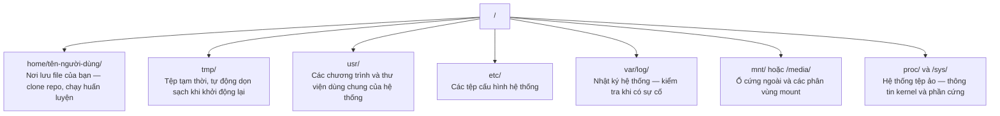

# Linux cho Kỹ thuật AI (Linux for AI)

> Hầu hết các hệ thống AI đều chạy trên Linux. Bạn cần nắm đủ kiến thức thực chiến để không bao giờ bị mắc kẹt.

**Type:** Learn
**Languages:** --
**Prerequisites:** Phase 0, Lesson 01
**Time:** ~30 phút

## Mục tiêu học tập

- Điều hướng hệ thống tệp tin Linux và thực hiện các thao tác tệp cơ bản trực tiếp từ dòng lệnh.
- Quản lý quyền truy cập tệp với `chmod` và `chown` để xử lý triệt để lỗi "Permission denied".
- Quản lý và cài đặt các gói hệ thống bằng `apt`, chuẩn bị môi trường sẵn sàng cho một máy chủ GPU mới.
- Nhận diện những điểm khác biệt mấu chốt giữa macOS và Linux để tránh các lỗi ngớ ngẩn khi làm việc từ xa.

## Vấn đề đặt ra

Bạn có thể quen phát triển trên macOS hoặc Windows. Nhưng khoảnh khắc bạn kết nối SSH vào một máy chủ GPU đám mây, thuê máy ảo Lambda Labs hoặc bật một máy chủ EC2, bạn sẽ bước vào thế giới Ubuntu Linux. Terminal là giao diện duy nhất của bạn. Không có Finder, không có Explorer, không có giao diện đồ họa GUI. Nếu không biết cách điều hướng file, cài đặt thư viện và quản lý tiến trình bằng dòng lệnh, bạn sẽ bị mất tiền oan khi GPU nhàn rỗi chỉ để google cách giải nén một file trên Linux.

Đây là cẩm nang sinh tồn tối cần thiết cho kỹ sư AI.

## Cấu trúc hệ thống tệp tin Linux

Linux tổ chức toàn bộ mọi thứ dưới một gốc duy nhất là `/`. Không có ổ `C:\` hay `/Volumes`. Các thư mục bạn sẽ thường xuyên làm việc cùng:



Thư mục người dùng (home directory) của bạn là ký hiệu `~` hoặc đường dẫn `/home/your-username`. Gần như mọi thao tác bạn làm đều diễn ra tại đây.

## Các lệnh thiết yếu hàng ngày

Đây là 13 lệnh bao quát hầu hết công việc trên máy chủ GPU từ xa:

### Di chuyển và định vị

```bash
pwd                         # Tôi đang đứng ở thư mục nào?
ls                          # Thư mục này có những file gì?
ls -la                      # Hiển thị chi tiết toàn bộ file, bao gồm cả file ẩn
cd /path/to/dir             # Đi tới thư mục chỉ định
cd ~                        # Trở về thư mục cá nhân (home)
cd ..                       # Đi lên thư mục cha phía trên một cấp
```

### Quản lý tệp và thư mục

```bash
mkdir my-project            # Tạo thư mục mới
mkdir -p a/b/c              # Tạo thư mục lồng nhau trong một lần chạy duy nhất

cp file.txt backup.txt      # Sao chép file
cp -r src/ src-backup/      # Sao chép cả thư mục (đệ quy - recursive)

mv old.txt new.txt          # Đổi tên file
mv file.txt /tmp/           # Di chuyển file sang vị trí khác

rm file.txt                 # Xóa file (xóa vĩnh viễn, không có thùng rác)
rm -rf my-dir/              # Xóa thư mục và toàn bộ nội dung bên trong
```

Lệnh `rm -rf` có hiệu lực vĩnh viễn và không thể hoàn tác. Luôn kiểm tra kỹ đường dẫn trước khi nhấn Enter.

### Xem nội dung tệp

```bash
cat file.txt                # In toàn bộ nội dung file ra màn hình
head -20 file.txt           # Xem 20 dòng đầu tiên
tail -20 file.txt           # Xem 20 dòng cuối cùng
tail -f log.txt             # Xem file log cập nhật theo thời gian thực (nhấn Ctrl+C để dừng)
less file.txt               # Cuộn xem file dài (nhấn phím q để thoát)
```

### Tìm kiếm

```bash
grep "error" training.log           # Tìm các dòng có chứa từ "error"
grep -r "learning_rate" .           # Tìm kiếm đệ quy trong toàn bộ thư mục hiện tại
grep -i "cuda" config.yaml          # Tìm kiếm không phân biệt chữ hoa/thường

find . -name "*.py"                 # Tìm tất cả các file Python trong thư mục hiện tại
find . -name "*.ckpt" -size +1G     # Tìm các file checkpoint có kích thước lớn hơn 1GB
```

## Phân quyền tệp tin (Permissions)

Mọi tệp trong Linux đều gắn liền với người sở hữu và các bit phân quyền:

```bash
ls -l train.py
# -rwxr-xr-- 1 user group 2048 Mar 19 10:00 train.py
#  ^^^             Quyền của chủ sở hữu (owner): đọc (r), ghi (w), thực thi (x)
#     ^^^          Quyền của nhóm (group): đọc (r), thực thi (x)
#        ^^        Quyền của những người khác (others): chỉ đọc (r)
```

Các lệnh điều chỉnh quyền phổ biến:

```bash
chmod +x train.sh           # Cấp quyền thực thi cho một script
chmod 755 deploy.sh         # Chủ sở hữu: toàn quyền, người khác: đọc + thực thi
chmod 644 config.yaml       # Chủ sở hữu: đọc + ghi, người khác: chỉ đọc

chown user:group file.txt   # Thay đổi chủ sở hữu của file (cần quyền sudo)
```

Khi gặp thông báo lỗi "Permission denied", gần như chắc chắn là do thiếu quyền. Chạy lệnh `chmod +x` hoặc dùng `sudo` sẽ giải quyết hầu hết trường hợp.

## Quản lý gói hệ thống (apt)

Ubuntu sử dụng trình quản lý gói `apt`:

```bash
sudo apt update             # Cập nhật danh sách gói mới nhất (luôn chạy lệnh này đầu tiên)
sudo apt install -y htop    # Cài đặt gói (cờ -y tự động đồng ý cài đặt)
sudo apt install -y build-essential  # Cài trình biên dịch C, make... cần thiết cho nhiều thư viện Python
sudo apt install -y tmux    # Cài đặt bộ đa hợp terminal

apt list --installed        # Xem danh sách các gói đã cài đặt
sudo apt remove htop        # Gỡ cài đặt gói
```

Bộ công cụ thiết yếu nên cài đặt ngay trên một máy chủ GPU mới:

```bash
sudo apt update && sudo apt install -y \
    build-essential \
    git \
    curl \
    wget \
    tmux \
    htop \
    unzip \
    python3-venv
```

## Quản lý người dùng và quyền sudo

Thông thường bạn đăng nhập dưới tư cách người dùng thường. Một số tác vụ hệ thống yêu cầu quyền quản trị viên tối cao (root):

```bash
whoami                      # Tôi đang đăng nhập bằng user nào?
sudo lệnh                   # Chạy một lệnh đơn lẻ dưới quyền root
sudo su                     # Chuyển hẳn sang tài khoản root (dùng gõ exit để thoát ra)
```

Trên máy ảo GPU đám mây, bạn thường là người dùng duy nhất và đã có sẵn quyền sudo. Đừng chạy mọi thứ bằng root một cách bừa bãi. Chỉ dùng sudo khi thực sự cần quyền quản trị hệ thống.

## Quản lý tiến trình và dịch vụ hệ thống

Khi chương trình huấn luyện bị treo, hoặc bạn muốn kiểm tra xem những gì đang chạy:

```bash
htop                        # Giao diện trực quan theo dõi CPU, RAM và tiến trình (nhấn q để thoát)
ps aux | grep python        # Tìm các tiến trình Python đang hoạt động
kill 12345                  # Yêu cầu dừng tiến trình có PID 12345 một cách an toàn
kill -9 12345               # Ép buộc dừng ngay lập tức (Force kill)
nvidia-smi                  # Xem mức tiêu hao VRAM và các tiến trình dùng GPU
```

Quản lý dịch vụ chạy nền với `systemctl`:

```bash
sudo systemctl start nginx          # Khởi động dịch vụ
sudo systemctl stop nginx           # Dừng dịch vụ
sudo systemctl restart nginx        # Khởi động lại dịch vụ
sudo systemctl status nginx         # Kiểm tra trạng thái dịch vụ
sudo systemctl enable nginx         # Tự động khởi chạy cùng hệ thống khi boot
```

## Quản lý dung lượng ổ đĩa (Disk Space)

Máy ảo GPU thường có dung lượng ổ đĩa hạn chế trong khi các mô hình và tập dữ liệu rất lớn:

```bash
df -h                       # Xem dung lượng trống của tất cả các phân vùng ổ đĩa
df -h /home                 # Xem riêng phân vùng /home

du -sh *                    # Xem kích thước từng mục trong thư mục hiện tại
du -sh ~/.cache             # Xem kích thước bộ nhớ đệm (nơi chứa pip và huggingface models)
du -sh /data/checkpoints/   # Kiểm tra dung lượng thư mục checkpoints

# Tìm 20 thư mục chiếm nhiều dung lượng nhất trên hệ thống
du -h --max-depth=1 / 2>/dev/null | sort -hr | head -20
```

Các mẹo dọn dẹp dung lượng nhanh:

```bash
# Xóa bộ nhớ đệm của pip
pip cache purge

# Xóa bộ nhớ đệm của apt
sudo apt clean

# Xóa các file checkpoint cũ không còn dùng
rm -rf checkpoints/epoch_01/ checkpoints/epoch_02/
```

## Mạng và truyền tải tệp (Networking)

```bash
# Tải file từ internet
wget https://example.com/model.bin                   # Tải file về máy
curl -O https://example.com/data.tar.gz              # Tải file bằng curl

# Sao chép file giữa hai máy tính
scp model.bin user@remote:/data/                     # Đẩy file từ máy bạn lên máy từ xa
scp user@remote:/data/results.csv .                  # Tải file từ máy từ xa về thư mục hiện tại
scp -r user@remote:/data/checkpoints/ ./local-dir/   # Sao chép cả thư mục

# Đồng bộ thư mục thông minh với rsync (nhanh hơn scp, tiếp tục tải nếu bị đứt mạng)
rsync -avz --progress ./data/ user@remote:/data/
rsync -avz --progress user@remote:/results/ ./results/
```

Hãy ưu tiên sử dụng `rsync` thay vì `scp` đối với các tệp dữ liệu lớn. `rsync` chỉ truyền các byte có thay đổi và có thể tiếp tục truyền tải mà không cần tải lại từ đầu nếu mất kết nối.

## WSL2 dành cho người dùng Windows

Nếu bạn dùng Windows, WSL2 mang đến một môi trường Linux thực thụ mà không cần phải cài đặt dual-boot:

```bash
# Trong PowerShell (chạy với quyền Administrator)
wsl --install -d Ubuntu-24.04

# Sau khi khởi động lại, mở Ubuntu từ Start menu
sudo apt update && sudo apt upgrade -y
```

WSL2 chạy một nhân Linux thực thụ. Toàn bộ các lệnh trong bài học này đều áp dụng hoàn hảo trong WSL2. Dữ liệu trên ổ đĩa Windows của bạn có thể truy cập được tại `/mnt/c/Users/YourName/`. Driver card đồ họa NVIDIA chỉ cần cài trên Windows là CUDA sẽ tự động khả dụng bên trong WSL2.

## Những điểm khác biệt cần lưu ý giữa macOS và Linux

| macOS | Linux | Điểm cần chú ý |
|---|---|---|
| `brew install` | `sudo apt install` | Tên gói đôi khi khác nhau (ví dụ: `brew install readline` vs `sudo apt install libreadline-dev`). |
| `open file.txt` | `xdg-open file.txt` | Nhưng máy chủ từ xa không có GUI, hãy dùng `cat` hoặc `less`. |
| `pbcopy` / `pbpaste` | Không khả dụng | Không thể dùng lệnh copy/paste clipboard của Mac qua SSH. |
| `~/.zshrc` | `~/.bashrc` | macOS mặc định dùng zsh, hầu hết máy chủ Linux dùng bash. |
| `/opt/homebrew/` | `/usr/bin/`, `/usr/local/bin/` | Các file thực thi nhị phân nằm ở vị trí khác nhau. |
| Không phân biệt hoa/thường | **Có phân biệt hoa/thường** | `Model.py` và `model.py` là **hai file hoàn toàn khác nhau** trên Linux. |
| Ký tự xuống dòng `\n` | Ký tự xuống dòng `\n` | Giống nhau, nhưng Windows dùng `\r\n` sẽ làm lỗi bash script (dùng `dos2unix` để sửa). |

```figure
s0-process-fork
```

## Bài tập thực hành (Exercises)

1. Kết nối SSH vào một máy tính Linux (hoặc mở WSL2) và di chuyển vào thư mục home. Tạo một thư mục dự án mới, tạo 3 file trống bằng lệnh `touch`, sau đó kiểm tra lại bằng `ls -la`.
2. Cài đặt `htop` bằng lệnh `apt`, khởi động nó và xác định tiến trình nào đang chiếm nhiều bộ nhớ RAM nhất.
3. Tạo một phiên tmux, chạy lệnh `sleep 300` bên trong đó, rời phiên (detach), xem danh sách các phiên và gắn lại phiên (reattach).
4. Sử dụng lệnh `df -h` để kiểm tra dung lượng ổ đĩa còn trống, sau đó dùng lệnh `du -sh ~/.cache/*` để tìm xem mục nào đang chiếm nhiều dung lượng nhất trong cache.
5. Truyền một file từ máy cá nhân lên máy từ xa bằng lệnh `scp`, sau đó làm tương tự với lệnh `rsync` và cảm nhận sự khác biệt.

### Gợi ý (Hints)

**Bài tập 1.** Dùng lệnh `cd ~`, `mkdir`, và `cd` vào thư mục vừa tạo, sau đó chạy `touch file1.txt file2.txt file3.txt`. Kiểm tra danh sách hiển thị với `ls -la`, xác nhận quyền sở hữu và kích thước các file là 0 byte.

**Bài tập 2.** Cài đặt bằng `sudo apt install -y htop`, khởi động bằng lệnh `htop`, sau đó nhấn phím `F6` để sắp xếp danh sách theo cột `MEM%`. Tiến trình ở dòng đầu tiên chính là tiến trình tiêu tốn RAM nhiều nhất.

**Bài tập 3.** Tạo phiên bằng lệnh `tmux new -s train`, gõ `sleep 300`, sau đó nhấn tổ hợp `Ctrl+B` rồi gõ `d` để rời phiên. Gõ `tmux ls` để kiểm tra phiên vẫn tồn tại và gắn lại bằng `tmux attach -t train`.

**Bài tập 4.** Chạy `df -h` và đọc cột `Avail` của phân vùng chứa thư mục cá nhân. Sau đó chạy lệnh `du -sh ~/.cache/* | sort -h` để dòng có kích thước lớn nhất được xếp ở cuối cùng.

**Bài tập 5.** Thử sao chép file với `scp file.txt user@host:~/`, sau đó chạy thử `rsync -avP file.txt user@host:~/`. Chạy lại lệnh `rsync` lần thứ hai: bạn sẽ thấy nó hoàn thành gần như ngay lập tức vì không phải truyền lại những dữ liệu không đổi.
