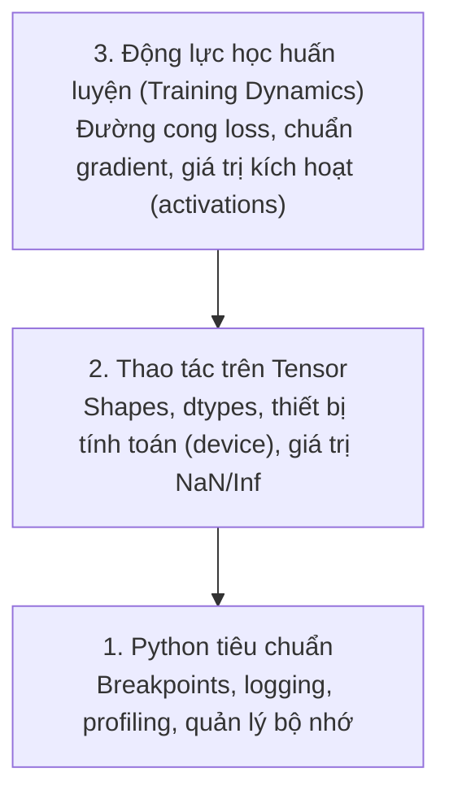

# Gỡ lỗi & Đo kiểm hiệu năng (Debugging and Profiling)

> Những lỗi nguy hiểm nhất trong AI không hề làm sập chương trình. Chúng âm thầm huấn luyện trên đống rác và báo cáo một đường cong loss đẹp như mơ.

**Type:** Build
**Language:** Python
**Prerequisites:** Lesson 1 (Dev Environment), kiến thức PyTorch cơ bản
**Time:** ~60 phút

## Mục tiêu học tập

- Sử dụng `breakpoint()` có điều kiện và hàm `debug_print` để kiểm tra kích thước tensor (shapes), kiểu dữ liệu (dtypes) và các giá trị NaN ngay giữa quá trình huấn luyện.
- Đo kiểm hiệu năng (profile) vòng lặp huấn luyện bằng `cProfile`, `line_profiler` và `tracemalloc` để xác định các điểm nghẽn cổ chai.
- Phát hiện các lỗi AI phổ biến: lệch kích thước tensor, lỗi loss ra NaN, rò rỉ dữ liệu (data leakage) và tensor bị đặt sai thiết bị tính toán (wrong-device).
- Thiết lập TensorBoard để trực quan hóa đường cong hàm mất mát (loss curves), biểu đồ phân bố trọng số (weight histograms) và độ dốc (gradients).

## Vấn đề đặt ra

Mã nguồn AI thất bại theo cách hoàn toàn khác biệt so với phần mềm thông thường. Một ứng dụng web khi lỗi sẽ sập kèm theo một stack trace rõ ràng. Nhưng một vòng lặp huấn luyện cấu hình sai có thể chạy suốt 8 tiếng, đốt hết $200 tiền GPU của bạn, và sinh ra một mô hình chỉ biết dự đoán giá trị trung bình cho mọi đầu vào. Code không hề ném ra bất kỳ lỗi đỏ nào. Bug nằm ở một tensor bị đặt nhầm trên CPU, một lệnh `.detach()` bị bỏ quên, hoặc nhãn dữ liệu bị rò rỉ vào tập đặc trưng (features).

Bạn cần những công cụ gỡ lỗi chuyên biệt để tóm gọn những lỗi âm thầm này trước khi chúng lãng phí thời gian và chi phí tính toán của bạn.

## Khái niệm

Gỡ lỗi trong AI vận hành ở 3 tầng:



Hầu hết mọi người vội vã nhảy ngay lên tầng 3 (ngồi nhìn chằm chằm vào biểu đồ TensorBoard). Nhưng 80% lỗi trong AI thực chất nằm ở tầng 1 và tầng 2.

```figure
s0-flame-hot
```

## Bắt tay vào xây dựng (Build It)

### Phần 1: Gỡ lỗi bằng lệnh Print (Đơn giản nhưng vô cùng hiệu quả)

Nhiều người xem nhẹ việc print khi debug. Đừng làm vậy. Với mã nguồn thao tác trên tensor, một câu lệnh in có mục tiêu còn hiệu quả hơn việc nhảy từng bước trong debugger vì bạn cần quan sát cùng lúc cả shape, dtype và khoảng giá trị của tensor:

```python
def debug_print(name, tensor):
    print(f"{name}: shape={tensor.shape}, dtype={tensor.dtype}, "
          f"device={tensor.device}, "
          f"min={tensor.min().item():.4f}, max={tensor.max().item():.4f}, "
          f"mean={tensor.mean().item():.4f}, "
          f"has_nan={tensor.isnan().any().item()}")
```

Gọi hàm này sau mỗi phép tính bạn nghi ngờ. Khi đã tìm ra bug, chỉ việc xóa lệnh in đi. Nhanh gọn và trực tiếp.

### Phần 2: Trình gỡ lỗi Python (pdb và breakpoint)

Trình gỡ lỗi tích hợp sẵn của Python rất mạnh mẽ cho AI. Hãy đặt lệnh `breakpoint()` vào vòng lặp huấn luyện để kiểm tra trực tiếp các tensor tương tác:

```python
def training_step(model, batch, criterion, optimizer):
    inputs, labels = batch
    outputs = model(inputs)
    loss = criterion(outputs, labels)

    # Chỉ dừng khi loss bất thường hoặc bị NaN
    if loss.item() > 100 or torch.isnan(loss):
        breakpoint()

    loss.backward()
    optimizer.step()
```

Khi debugger kích hoạt, các lệnh tương tác hữu ích:

- `p outputs.shape`: Kiểm tra kích thước đầu ra
- `p loss.item()`: Xem giá trị loss hiện tại
- `p torch.isnan(outputs).sum()`: Đếm số lượng phần tử NaN
- `p model.fc1.weight.grad`: Kiểm tra gradient của trọng số
- `c`: Tiếp tục chạy (continue), `q`: Thoát hẳn (quit)

Đây là kỹ thuật gỡ lỗi có điều kiện (conditional debugging). Bạn chỉ dừng chương trình khi có dấu hiệu bất thường, cực kỳ hữu ích cho các vòng huấn luyện hàng vạn bước.

### Phần 3: Ghi nhật ký (Logging) trong Python

Thay thế các lệnh in bằng logging khi hệ thống bước vào giai đoạn chạy dài hạn:

```python
import logging

logging.basicConfig(
    level=logging.INFO,
    format="%(asctime)s [%(levelname)s] %(message)s",
    handlers=[
        logging.FileHandler("training.log"),
        logging.StreamHandler()
    ]
)
logger = logging.getLogger(__name__)

logger.info("Bắt đầu huấn luyện: lr=%.4f, batch_size=%d", lr, batch_size)
logger.warning("Cảnh báo Loss tăng đột biến: %.4f tại bước %d", loss.item(), step)
logger.error("Loss bị NaN tại bước %d, dừng chương trình", step)
```

Logging cung cấp mốc thời gian (timestamp), phân cấp mức độ cảnh báo (severity levels) và tự động ghi ra file. Khi quá trình huấn luyện bị lỗi lúc 3 giờ sáng, bạn sẽ có file log đầy đủ để tra cứu thay vì những dòng chữ trên terminal đã trôi mất.

### Phần 4: Đo thời gian từng đoạn mã (Timing Code Sections)

Biết thời gian đang bị lãng phí ở đâu là bước đầu tiên để tối ưu hóa hiệu năng:

```python
import time

class Timer:
    def __init__(self, name=""):
        self.name = name

    def __enter__(self):
        self.start = time.perf_counter()
        return self

    def __exit__(self, *args):
        elapsed = time.perf_counter() - self.start
        print(f"[{self.name}] {elapsed:.4f}s")

with Timer("Nạp dữ liệu (data loading)"):
    batch = next(dataloader_iter)

with Timer("Lan truyền tiến (forward pass)"):
    outputs = model(batch)

with Timer("Lan truyền ngược (backward pass)"):
    loss.backward()
```

Một sự thật rất phổ biến: nạp dữ liệu thường chiếm tới 60% thời gian của một chu kỳ huấn luyện. Giải pháp là tăng `num_workers > 0` trong DataLoader, chứ không phải mua thêm GPU đắt tiền.

### Phần 5: Đo kiểm chi tiết với cProfile và line_profiler

```bash
python -m cProfile -s cumtime train.py
```

Lệnh này liệt kê mọi lời gọi hàm được sắp xếp theo tổng thời gian tích lũy. Nếu cần đo chi tiết từng dòng code:

```bash
pip install line_profiler
```

```python
@profile
def train_step(model, data, target):
    output = model(data)
    loss = F.cross_entropy(output, target)
    loss.backward()
    return loss

# Chạy với lệnh: kernprof -l -v train.py
```

### Phần 6: Giám sát và đo kiểm bộ nhớ (Memory Profiling)

#### Bộ nhớ RAM với tracemalloc

```python
import tracemalloc

tracemalloc.start()

model = build_model()
data = load_dataset()

snapshot = tracemalloc.take_snapshot()
top_stats = snapshot.statistics("lineno")
for stat in top_stats[:10]:
    print(stat)
```

#### Bộ nhớ VRAM của GPU với PyTorch

```python
import torch

if torch.cuda.is_available():
    print(torch.cuda.memory_summary())
    print(f"Bộ nhớ đã cấp phát: {torch.cuda.memory_allocated() / 1e9:.2f} GB")
    print(f"Bộ nhớ dự trữ đệm: {torch.cuda.memory_reserved() / 1e9:.2f} GB")
```

Khi gặp lỗi tràn bộ nhớ VRAM - Out of Memory (OOM):

1. **Giảm batch size** (bước đầu tiên và luôn luôn hiệu quả nhất).
2. Dùng `torch.cuda.empty_cache()` để dọn bộ nhớ đệm không dùng.
3. Dùng `del tensor` kết hợp `torch.cuda.empty_cache()` để giải phóng các biến trung gian lớn.
4. Dùng kỹ thuật Mixed Precision (`torch.cuda.amp`) để giảm một nửa dung lượng bộ nhớ.
5. Dùng kỹ thuật Gradient Checkpointing cho các mô hình rất sâu.

### Phần 7: Các lỗi AI kinh điển và cách xử lý

#### 1. Lệch kích thước Tensor (Shape Mismatch)

Đây là lỗi phổ biến nhất. Mô hình mong đợi tensor có dạng `[batch, channels, height, width]` nhưng đầu vào lại là `[batch, features]`.

```python
def check_shapes(model, sample_input):
    print(f"Input: {sample_input.shape}")
    hooks = []

    def make_hook(name):
        def hook(module, inp, out):
            in_shape = inp[0].shape if isinstance(inp, tuple) else inp.shape
            out_shape = out.shape if hasattr(out, "shape") else type(out)
            print(f"  {name}: {in_shape} -> {out_shape}")
        return hook

    for name, module in model.named_modules():
        hooks.append(module.register_forward_hook(make_hook(name)))

    with torch.no_grad():
        model(sample_input)

    for h in hooks:
        h.remove()
```

Chạy hàm này một lần với một batch mẫu, bạn sẽ thấy toàn bộ bản đồ chuyển đổi kích thước của từng tầng trong mô hình.

#### 2. Loss bị biến thành NaN

Loss bị NaN đồng nghĩa với việc các phép tính đã bị phát nổ (exploded). Các nguyên nhân thường gặp:

- Tốc độ học (Learning rate) quá cao.
- Phép chia cho 0 trong hàm loss tự viết.
- Tính log của số 0 hoặc số âm.
- Hiện tượng bùng nổ gradient (Exploding gradients).

```python
def detect_nan(model, loss, step):
    if torch.isnan(loss):
        print(f"Loss bị NaN tại bước {step}")
        for name, param in model.named_parameters():
            if param.grad is not None:
                if torch.isnan(param.grad).any():
                    print(f"  Gradient bị NaN tại {name}")
                if torch.isinf(param.grad).any():
                    print(f"  Gradient bị Inf tại {name}")
        return True
    return False
```

#### 3. Rò rỉ dữ liệu (Data Leakage)

Mô hình đạt độ chính xác 99% trên tập test? Đừng vội mừng, đó chắc chắn là một bug rò rỉ dữ liệu:

```python
def check_data_leakage(train_set, test_set, id_column="id"):
    train_ids = set(train_set[id_column].tolist())
    test_ids = set(test_set[id_column].tolist())
    overlap = train_ids & test_ids
    if overlap:
        print(f"LỖI RÒ RỈ DỮ LIỆU: Có {len(overlap)} mẫu trùng lặp giữa tập train và test!")
        return True
    return False
```

#### 4. Nhầm lẫn thiết bị tính toán (Wrong Device)

Tensors nằm ở hai thiết bị khác nhau (một cái trên CPU, một cái trên GPU) sẽ gây lỗi runtime hoặc âm thầm làm giảm tốc độ huấn luyện nghiêm trọng:

```python
def check_devices(model, *tensors):
    model_device = next(model.parameters()).device
    print(f"Thiết bị của mô hình: {model_device}")
    for i, t in enumerate(tensors):
        if t.device != model_device:
            print(f"  CẢNH BÁO: tensor {i} nằm trên {t.device}, trong khi mô hình ở {model_device}")
```

### Phần 8: Giám sát trực quan với TensorBoard

```bash
pip install tensorboard
```

```python
from torch.utils.tensorboard import SummaryWriter

writer = SummaryWriter("runs/experiment_1")

for step in range(num_steps):
    loss = train_step(model, batch)

    writer.add_scalar("loss/train", loss.item(), step)
    writer.add_scalar("lr", optimizer.param_groups[0]["lr"], step)

    if step % 100 == 0:
        for name, param in model.named_parameters():
            writer.add_histogram(f"weights/{name}", param, step)
            if param.grad is not None:
                writer.add_histogram(f"grads/{name}", param.grad, step)

writer.close()
```

Khởi động giao diện TensorBoard:

```bash
tensorboard --logdir=runs
```

Những dấu hiệu quan trọng cần nhận biết:
- **Loss không chịu giảm**: Learning rate quá nhỏ hoặc kiến trúc mô hình có vấn đề.
- **Loss dao động dữ dội**: Learning rate quá lớn.
- **Loss đột ngột thành NaN**: Mất ổn định số học (numerical instability).
- **Train loss giảm đều nhưng validation loss lại tăng**: Mô hình bị quá khớp (overfitting).
- **Biểu đồ phân bố trọng số xẹp về 0**: Hiện tượng biến mất gradient (vanishing gradients).

## Sử dụng trong thực tế (Use It)

Quy trình gỡ lỗi tiêu chuẩn giúp bắt gọn 90% lỗi AI:

1. **Trước khi huấn luyện**: Chạy `check_shapes` với một batch mẫu để xác minh kích thước các tầng.
2. **Trong 10 bước đầu tiên**: Dùng `debug_print` để soi giá trị loss, outputs và gradients. Đảm bảo không có NaN.
3. **Trong suốt quá trình huấn luyện**: Ghi log lại loss, learning rate và chuẩn gradient. Quan sát trên TensorBoard.
4. **Khi có lỗi phát sinh**: Đặt `breakpoint()` tại điểm nghi vấn và kiểm tra trực tiếp các tensor.
5. **Để tối ưu hiệu năng**: Đo thời gian nạp dữ liệu so với lan truyền tiến/ngược.

## Xuất xưởng sản phẩm (Ship It)

Bài học này xuất xưởng:
- `phases/00-setup-and-tooling/12-debugging-and-profiling/code/debug_tools.py` - Bộ công cụ gỡ lỗi hoàn chỉnh có thể tái sử dụng.
- `outputs/prompt-debug-ai-code.md` - Prompt giúp trợ lý AI chẩn đoán các lỗi AI đặc thù.

## Bài tập thực hành (Exercises)

1. Chạy file `debug_tools.py` và đọc kỹ kết quả từng phần. Thử sửa mô hình mẫu để tạo ra lỗi NaN (gợi ý: chia cho 0 trong forward pass) và xem hàm phát hiện NaN bắt lỗi như thế nào.
2. Đo kiểm một vòng lặp huấn luyện bằng `cProfile` và xác định hàm nào chạy chậm nhất.
3. Dùng `tracemalloc` để tìm dòng code nào trong pipeline nạp dữ liệu đang ngốn nhiều bộ nhớ nhất.
4. Thiết lập TensorBoard cho một bài toán huấn luyện đơn giản và nhận diện xem mô hình có bị hiện tượng quá khớp (overfitting) hay không.
5. Đặt lệnh `breakpoint()` bên trong một vòng lặp huấn luyện và thực hành xem shape, device và giá trị gradient tại terminal của debugger.

### Gợi ý (Hints)

**Bài tập 1.** Chạy lệnh `python phases/00-setup-and-tooling/12-debugging-and-profiling/code/debug_tools.py`. Sau đó thay đổi hàm forward trong `demo_nan_detection` để chia cho 0; hàm `detect_nan` sẽ in ra cảnh báo kèm số bước huấn luyện bị lỗi.

**Bài tập 2.** Chạy script với lệnh `python -m cProfile -s cumtime your_script.py`. Xem các dòng đầu tiên của cột `cumtime` để tìm ra hàm tốn nhiều thời gian nhất do bạn viết.

**Bài tập 3.** Gọi `tracemalloc.start()` trước đoạn code nạp dữ liệu và `tracemalloc.take_snapshot()` sau đó. In `snapshot.statistics("lineno")[:5]` để xem chính xác file và số dòng gây tốn bộ nhớ nhất.

**Bài tập 4.** Ghi cả train loss và validation loss vào `SummaryWriter` ở mỗi epoch, sau đó bật `tensorboard --logdir=runs`. Nếu train loss tiếp tục giảm sâu trong khi val loss bắt đầu ngóc đầu đi lên, đó chính là overfitting.

**Bài tập 5.** Đặt `breakpoint()` ngay sau lệnh `loss.backward()` và chạy script. Tại dấu nhắc `(Pdb)`, hãy gõ lệnh `p x.shape`, `p x.device`, và `p next(model.parameters()).grad`, sau đó gõ `c` để tiếp tục chạy bước tiếp theo.
