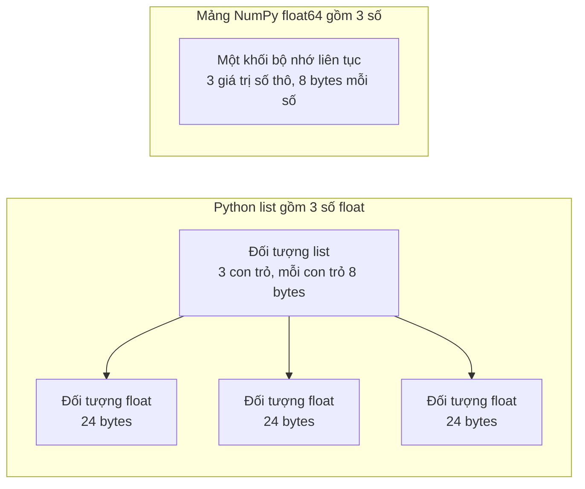

# Python cho Kỹ thuật AI (Python for AI Engineering)

> Hầu hết code trong khóa học này sử dụng cùng một tập hợp nhỏ các đặc trưng và cú pháp (idioms) chuẩn của Python. Hãy làm chủ chúng ngay tại đây trước khi bước vào các bài học về toán học và mô hình.

**Type:** Build
**Languages:** Python
**Prerequisites:** Dev Environment, Python Environments
**Time:** ~120 phút

## Mục tiêu học tập

- Đọc và viết thành thạo các cấu trúc cú pháp (idioms) mà mã nguồn khóa học sử dụng nhiều nhất: từ unpacking, f-strings cho tới dataclasses và comprehensions.
- Nhận diện 3 lỗi lập trình Python nguy hiểm có thể trả về kết quả sai lệch mà không hề báo lỗi: danh sách dùng chung tham chiếu (shared lists), giá trị mặc định có thể biến đổi (mutable defaults), và generator bị cạn kiệt sau một lần duyệt (used-up generators).
- Xây dựng bộ nạp dữ liệu CSV và JSON, hàm chia tập train/test có seed cố định, và bộ sinh mini-batch hoàn toàn bằng thư viện chuẩn (standard library).
- Tự viết phép nhân vô hướng (dot product), tính giá trị trung bình (mean) và độ lệch chuẩn (standard deviation) bằng Python thuần, đồng thời đo lường tốc độ và bộ nhớ tiêu thụ.
- Giải thích bản chất vì sao vòng lặp duyệt số trong Python thuần lại chậm, và cơ chế phát thanh (broadcasting) của NumPy đưa các vòng lặp vào mã máy đã biên dịch như thế nào.

## Vấn đề đặt ra

Các bài học sau phase này sử dụng Python thuần cho phần toán học và kiến trúc mô hình. Trong số 541 file Python của giáo trình, có tới 276 file sử dụng `dataclasses`. Ngoài ra, 187 file gọi lệnh `random.seed` hoặc khởi tạo bộ sinh ngẫu nhiên độc lập `random.Random`. Nếu những cú pháp này còn xa lạ với bạn, bạn sẽ phải chật vật giải mã cú pháp thay vì tập trung tiếp thu bản chất toán học.

Python cũng có những hành vi ngầm có thể dẫn tới kết quả sai mà không đưa ra bất kỳ thông báo lỗi nào:
1. Hai biến có thể cùng trỏ tới một danh sách (list), khiến thao tác sửa đổi qua biến này vô tình làm thay đổi biến kia.
2. Tham số mặc định (default argument) lưu giữ giá trị của nó qua nhiều lần gọi hàm liên tiếp.
3. Một generator sẽ rỗng không sau một lần duyệt qua, khiến epoch huấn luyện thứ hai không nhận được dữ liệu và giá trị loss hoàn toàn đứng yên.

Vấn đề cuối cùng là tốc độ tính toán. Trên máy tính thử nghiệm, một vòng lặp Python thuần duyệt qua 1 triệu số thực mất khoảng 30 mili-giây. Trong khi đó, NumPy thực hiện cùng phép nhân vô hướng chỉ trong chưa đầy 1 mili-giây. Bạn cần hiểu rõ căn nguyên sâu xa của sự khác biệt này để biết khi nào nên viết vòng lặp tường minh và khi nào cần chuyển sang phép toán mảng vector hóa.

## Khái niệm

### Mã nguồn khóa học thực tế sử dụng những gì?

Chúng tôi đã phân tích cú pháp toàn bộ 541 file Python trong thư mục `phases/*/*/code/` bằng module `ast`. Bảng dưới đây thống kê số lượng file sử dụng từng cấu trúc cú pháp:

| Cấu trúc cú pháp | Số file | Tỷ lệ |
|---|---|---|
| Khai báo hàm (`def`) | 541 | 100% |
| Khối bảo vệ `if __name__ == "__main__":` | 529 | 98% |
| Chuỗi định dạng f-strings | 517 | 96% |
| Giải nén bộ dữ liệu (Tuple unpacking) | 448 | 83% |
| Khai báo lớp (`class`) | 379 | 70% |
| List comprehensions | 375 | 69% |
| Chú thích kiểu dữ liệu trên hàm (Type hints) | 342 | 63% |
| Biểu thức Generator (Generator expressions) | 326 | 60% |
| Cắt lát danh sách (Slices) | 314 | 58% |
| Hàm ẩn danh `lambda` | 175 | 32% |
| Xử lý ngoại lệ `try` / `except` | 120 | 22% |
| Quản lý ngữ cảnh `with` | 96 | 18% |
| Dict comprehensions | 93 | 17% |
| Hàm Generator với từ khóa `yield` | 14 | 3% |

Các module chuẩn được import nhiều nhất: 340 file bắt đầu bằng `from __future__ import annotations`, và 276 file dùng `dataclasses`. Các module `math`, `random` và `json` xuất hiện lần lượt trong 187, 175 và 126 file. Module `collections` xuất hiện trong 70 file, trong khi `itertools` chỉ dùng trong 4 file.

Đặc biệt, không có bài học nào gọi `map()` hay `filter()`; toàn bộ công việc đó đều được thực hiện qua các cú pháp comprehensions trực quan và dễ đọc hơn.

### Tên biến chỉ là con trỏ tham chiếu tới đối tượng

Trong Python, một biến thực chất là một cái tên trỏ tới một đối tượng trong bộ nhớ. Phép gán `=` chỉ gán cái tên đó cho đối tượng, chứ không hề sao chép đối tượng. Khi hai biến cùng trỏ tới một danh sách (list), thay đổi nội dung qua biến này sẽ thấy ngay qua biến kia. Các kiểu dữ liệu số, chuỗi (string) và tuple là bất biến (immutable), nên quy tắc này không gây lỗi. Nhưng list, dict và set là các đối tượng khả biến (mutable), vì vậy bạn bắt buộc phải tạo bản sao độc lập (copy) khi cần.

### Danh sách chứa con trỏ, mảng chứa dữ liệu thô

Một danh sách Python không lưu trực tiếp các con số liền kề nhau. Nó lưu trữ một dãy các con trỏ (pointers), và mỗi con trỏ trỏ tới một đối tượng Python hoàn chỉnh. Trên hệ điều hành 64-bit, mỗi con trỏ tốn 8 byte và mỗi đối tượng số thực `float` tốn tới 24 byte. Trong khi đó, một mảng NumPy `float64` lưu trực tiếp các giá trị số 8-byte thô nằm kề sát nhau trong một khối bộ nhớ liên tục duy nhất.



Một vòng lặp duyệt qua list phải làm rất nhiều việc cho từng phần tử: Trình thông dịch thực thi từng chỉ thị bytecode một, lần theo con trỏ bộ nhớ, kiểm tra kiểu dữ liệu của từng toán hạng, gọi hàm nhân số thực của CPython, rồi tạo một đối tượng Python float mới tinh để chứa kết quả.

NumPy thực hiện cùng phép toán đó trong một vòng lặp mã máy C/C++ đã biên dịch sẵn chạy trực tiếp trên các byte thô. Nó chỉ kiểm tra kiểu dữ liệu một lần duy nhất cho toàn bộ mảng và không tạo ra bất kỳ đối tượng Python trung gian nào. Mã lệnh vector hóa mô tả phép toán trên toàn bộ mảng (ví dụ: `(x - mean) / std`), và tầng thư viện C bên dưới sẽ đảm nhận việc lặp với tốc độ phần cứng tối đa.

### Danh sách chứa tất cả phần tử, Generator chỉ giữ một phần tử tại một thời điểm

Một list comprehension xây dựng sẵn toàn bộ các phần tử trong RAM trước khi dòng lệnh tiếp theo được thực thi. Một generator chỉ sinh ra một phần tử duy nhất mỗi khi người gọi yêu cầu phần tử tiếp theo. Dung lượng bộ nhớ của danh sách tăng tỷ lệ thuận với số lượng phần tử. Trong khi đó, dung lượng bộ nhớ của một generator luôn được giữ ở mức cố định dù số phần tử có lên đến hàng triệu.

Tuy nhiên, một generator chỉ có thể duyệt qua một lần duy nhất (single pass). Sau khi phần tử cuối cùng được lấy ra, các lần gọi tiếp theo sẽ trả về ngoại lệ `StopIteration`, khiến vòng lặp `for` thứ hai hoàn toàn không nhận được dữ liệu nào.

```figure
s0-list-vs-generator
```

## Các cú pháp chuẩn bạn cần nắm vững

### 1. Giá trị, tập hợp và giải nén (Unpacking)

Bốn tập hợp dựng sẵn trong Python:

| Kiểu dữ liệu | Ví dụ | Có thứ tự? | Có thể thay đổi? | Ứng dụng phổ biến trong khóa học |
|---|---|---|---|---|
| `list` | `[0.5, 1.2]` | Có | Có | Mẫu dữ liệu, giá trị loss, danh sách trọng số |
| `tuple` | `(32, 784)` | Có | Không | Kích thước mảng (shapes), bản ghi cố định, khóa của dict |
| `dict` | `{"lr": 0.01}` | Theo thứ tự chèn | Có | Cấu hình tham số, từ điển từ vựng (vocabularies), bản ghi JSON |
| `set` | `{"cat", "dog"}` | Không | Có | Tập từ vựng duy nhất, kiểm tra trùng lặp phần tử |

Ví dụ minh họa việc gán không tự động sao chép danh sách:

```python
weights = [0.5, -1.2, 3.0]
alias = weights
alias[0] = 99.0
print(weights)  # [99.0, -1.2, 3.0] — weights cũng bị đổi!

independent = list(weights)  # Tạo bản sao thực sự
independent[1] = 0.0
print(weights, independent)

grid = [[0] * 3] * 2  # NGUY HIỂM: Hai hàng cùng trỏ tới một danh sách!
grid[0][0] = 1
print(grid)  # [[1, 0, 0], [1, 0, 0]]

grid = [[0] * 3 for _ in range(2)]  # ĐÚNG: Mỗi hàng là một danh sách độc lập
grid[0][0] = 1
print(grid)  # [[1, 0, 0], [0, 0, 0]]
```

Giải nén (Unpacking) và f-strings:

```python
shape = (32, 784)
batch_size, n_features = shape
first, *middle, last = [1, 2, 3, 4, 5]
x, y = 1.0, 3.0
x, y = y, x  # Hoán đổi giá trị tức thì

config = {"lr": 0.01, "epochs": 5}
print(f"lr={config['lr']:.0e} loss={0.123456:.3f} n={60_000:,} {batch_size=}")
# In ra: lr=1e-02 loss=0.123 n=60,000 batch_size=32
```

Cú pháp `{batch_size=}` in ra cả tên biến lẫn giá trị của nó, cực kỳ tiện dụng khi debug.

Cắt lát danh sách (Slicing):

```python
tokens = ["<s>", "the", "cat", "sat", "on", "the", "mat", "</s>"]
print(tokens[1:-1])   # Bỏ token đầu và cuối
print(tokens[:3])     # 3 token đầu
print(tokens[::2])    # Lấy cách quãng 2 bước
print(tokens[::-1])   # Đảo ngược danh sách
```

### 2. Comprehensions (Cú pháp biểu thức rút gọn)

```python
scores = [0.91, 0.42, 0.77, 0.15, 0.66]
labels = [1 if s >= 0.5 else 0 for s in scores]
high = [s for s in scores if s > 0.6]
squares = {i: i * i for i in range(4)}
sum_sq = sum(s * s for s in scores)  # Generator expression đưa trực tiếp vào sum

matrix = [[1, 2, 3], [4, 5, 6]]
transposed = [list(col) for col in zip(*matrix)]  # Chuyển vị ma trận
flat = [v for row in matrix for v in row]          # Làm phẳng ma trận thành mảng 1D
```

### 3. Hàm, tham số và Closures

```python
def clip(value, low=0.0, high=1.0):
    return max(low, min(high, value))

# Tham số bắt buộc phải gọi bằng tên (keyword-only) đứng sau dấu *
def train(data, *, lr=0.01, epochs=3):
    return f"{len(data)} samples, lr={lr}, epochs={epochs}"

# Closure: Hàm scale ghi nhớ biến factor từ hàm tạo ra nó
def make_scaler(factor):
    def scale(values):
        return [v * factor for v in values]
    return scale
```

**Cạm bẫy tham số mặc định khả biến (Mutable default arguments):**

```python
# SAI: bucket dùng chung cho tất cả các lần gọi hàm!
def add_bad(item, bucket=[]):
    bucket.append(item)
    return bucket

# ĐÚNG: Luôn dùng None làm mặc định cho các cấu trúc mutable
def add_good(item, bucket=None):
    if bucket is None:
        bucket = []
    bucket.append(item)
    return bucket
```

### 4. Lớp và Dataclasses

Decorator `@dataclass` tự động sinh các phương thức `__init__`, `__repr__`, và `__eq__`:

```python
from dataclasses import dataclass, field

@dataclass(frozen=True)
class Example:
    features: tuple[float, ...]
    label: int

@dataclass
class TrainConfig:
    lr: float = 0.01
    epochs: int = 5
    hidden: list[int] = field(default_factory=lambda: [64, 32])
```

Các phương thức đặc biệt (`__len__`, `__getitem__`) giúp một class hoạt động tự nhiên như một mảng trong Python:

```python
class SquaresDataset:
    def __init__(self, n):
        self.n = n

    def __len__(self):
        return self.n

    def __getitem__(self, index):
        if not 0 <= index < self.n:
            raise IndexError(index)
        return index, index * index

ds = SquaresDataset(4)
print(len(ds))  # 4
print(ds[2])    # (2, 4)
```

Mô hình Dataset dạng bản đồ (map-style datasets) trong PyTorch sử dụng chính xác hai phương thức `__len__` và `__getitem__` này.

### 5. Iterators và Generators

```python
def countdown(n):
    while n > 0:
        yield n
        n -= 1

gen = countdown(3)
print(list(gen))  # [3, 2, 1]
print(list(gen))  # [] — Generator đã bị cạn kiệt sau lần gọi đầu tiên!
```

Đọc file từng dòng một bằng generator để tiết kiệm RAM tối đa:

```python
def read_rows(path):
    with open(path, encoding="utf-8") as fh:
        header = fh.readline().rstrip("\n").split(",")
        for line in fh:
            yield dict(zip(header, line.rstrip("\n").split(",")))
```

### 6. Quản lý ngữ cảnh (Context Managers) và Ngoại lệ

```python
import time
from contextlib import contextmanager

@contextmanager
def timer(label):
    start = time.perf_counter()
    try:
        yield
    finally:
        print(f"{label}: {(time.perf_counter() - start) * 1000:.1f} ms")

with timer("Tính tổng bình phương"):
    total = sum(i * i for i in range(200_000))
```

### 7. Chú thích kiểu dữ liệu và Khối bảo vệ Main

```python
from __future__ import annotations
from collections.abc import Iterable, Sequence

def mean(values: Sequence[float]) -> float:
    if not values:
        raise ValueError("mean() cần ít nhất một phần tử")
    return sum(values) / len(values)

def main() -> None:
    print(mean([1.0, 2.0, 4.0]))

if __name__ == "__main__":
    main()
```

Khối `if __name__ == "__main__":` đảm bảo hàm `main()` chỉ chạy khi bạn thực thi file trực tiếp từ dòng lệnh, và không tự động chạy khi file khác import nó vào (rất cần thiết cho các unit test).

### 8. Thao tác Tệp, JSON, CSV và Sắp xếp

```python
import csv
import json
from pathlib import Path

# Sắp xếp danh sách dictionary bằng hàm lambda làm key:
by_score = sorted(rows, key=lambda r: r["score"], reverse=True)

# Sắp xếp đa tiêu chí (ưu tiên label trước, sau đó tới text):
sorted(rows, key=lambda r: (-r["label"], r["text"]))
```

### 9. Công cụ Đếm, Gom nhóm và Iterator

```python
from collections import Counter, defaultdict, deque
from itertools import islice, product

# Đếm tần suất xuất hiện:
counts = Counter(["cat", "dog", "cat", "bird", "cat"])
print(counts.most_common(2))  # [('cat', 3), ('dog', 1)]

# Gom nhóm tự động không cần kiểm tra key tồn tại:
positions = defaultdict(list)

# Hàng đợi có độ dài tối đa (cửa sổ trượt lưu loss gần nhất):
recent_losses = deque(maxlen=5)

# Lưới tổ hợp siêu tham số (Hyperparameter grid):
grid = list(product([0.1, 0.01], [16, 32]))
```

## Bắt tay vào xây dựng (Build It)

Bài học này xây dựng hoàn chỉnh bộ công cụ nền tảng trong `code/main.py`:

1. **`Record` và `load_records`**: Nạp dữ liệu CSV hoặc JSON về cấu trúc Record chuẩn gồm `features` (tuple số thực) và `label` (số nguyên).
2. **`train_test_split`**: Chia dữ liệu train/test với seed ngẫu nhiên cố định bằng bộ sinh độc lập `random.Random(seed)`.
3. **`batches`**: Bộ sinh mini-batch dựa trên `itertools.islice`, hỗ trợ tùy chọn `drop_last`.
4. **`dot`, `mean`, `std`, `make_standardizer`**: Tự viết các phép toán vector cơ bản và bộ chuẩn hóa đặc trưng (standardizer) theo mô hình closure.
5. **Đo kiểm tốc độ và bộ nhớ**: So sánh hiệu năng giữa vòng lặp index, zip generator, và phép toán mảng NumPy.

Chạy thử demo hoàn chỉnh:

```bash
python phases/00-setup-and-tooling/13-python-for-ai-engineering/code/main.py
```

## Sử dụng trong thực tế (Use It)

### So sánh với mảng NumPy và kỹ thuật Broadcasting

NumPy vượt trội hoàn toàn về tốc độ tính toán nhờ 3 lý do:
1. Mảng lưu trữ trực tiếp các số thực 64-bit thô trong một khối bộ nhớ liền mạch duy nhất.
2. Vòng lặp được thực thi hoàn toàn trong mã C đã biên dịch, không tốn chi phí kiểm tra kiểu cho từng phần tử.
3. Dữ liệu liên tục cho phép tận dụng tập lệnh vector SIMD của vi xử lý.

```python
import numpy as np

X = np.array([[1.0, 100.0], [2.0, 300.0], [3.0, 500.0]])
mu = X.mean(axis=0)
sigma = X.std(axis=0)
Z = (X - mu) / sigma  # Broadcasting tự động trừ vector trung bình cho từng hàng
```

Quy tắc Broadcasting của NumPy: So sánh các chiều kích thước từ chiều cuối cùng ngược về đầu. Hai chiều tương thích khi chúng bằng nhau hoặc một trong hai bằng 1. Chiều có kích thước bằng 1 sẽ được tự động nhân bản ảo mà không tốn thêm bộ nhớ.

## Xuất xưởng sản phẩm (Ship It)

Bài học này xuất xưởng:
- `code/main.py` - Toàn bộ mã nguồn thư viện chuẩn cho kỹ thuật AI.
- `outputs/prompt-python-review.md` - Prompt chuyên dụng để rà soát mã nguồn Python trong các dự án AI, giúp phát hiện sớm các lỗi tham chiếu ngầm, generator cạn kiệt, thiếu seed ngẫu nhiên và rò rỉ dữ liệu.

## Bài tập thực hành (Exercises)

1. Chạy hàm `run_demo(seed=8)` từ file `main.py`. Quan sát các dòng kết quả nào bị thay đổi và dòng nào giữ nguyên giá trị so với khi chạy `seed=7`. Giải thích lý do vì sao kích thước các tập chia (split sizes) không hề thay đổi.
2. Tự viết hàm `median(values)` bằng Python thuần để tìm giá trị trung vị. Kiểm tra tính đúng đắn với hàm `statistics.median` trên cả danh sách có số phần tử lẻ và chẵn.
3. Viết hàm `stream_records(path)` dưới dạng generator để sinh từng bản ghi `Record` một từ file CSV. Tạo một file dữ liệu 200,000 dòng và dùng `tracemalloc` để so sánh dung lượng RAM đỉnh điểm (peak memory) giữa `stream_records` và `load_records`.
4. Viết hàm nhân ma trận với vector `matvec(matrix, vector)` bằng cả Python thuần và NumPy. Đo thời gian chạy của cả hai với các kích thước ma trận 4, 64, và 1024 để tìm ra kích thước mà tại đó NumPy bắt đầu vượt lên nhanh hơn Python thuần trên máy của bạn.
5. Viết một script quét toàn bộ các file code Python trong repo (`phases/*/*/code/*.py`) bằng module `ast` để đếm số file sử dụng `ast.ListComp`, `ast.Yield`, và `ast.With`.

### Gợi ý (Hints)

**Bài tập 1.** Import hàm `run_demo` từ `code/main.py`, gọi lần lượt với `seed=7` và `seed=8`. Các giá trị tính toán phụ thuộc vào dữ liệu ngẫu nhiên sẽ đổi; trong khi kích thước các tập chỉ phụ thuộc vào `n` và `test_fraction` nên luôn giữ cố định.

**Bài tập 2.** Tạo bản sao và sắp xếp danh sách (`sorted(values)`). Với độ dài lẻ, lấy phần tử chính giữa `sorted_list[n // 2]`; với độ dài chẵn, lấy trung bình cộng của hai phần tử nằm giữa `(sorted_list[n // 2 - 1] + sorted_list[n // 2]) / 2`.

**Bài tập 3.** Tham khảo hàm `load_records` trong `code/main.py`, thay bước gom phần tử vào list bằng lệnh `yield Record(...)`. Dùng `save_records` để tạo file 200,000 dòng và so sánh bộ nhớ bằng `peak_bytes`.

**Bài tập 4.** Dùng hàm `dot` đã viết trong bài cho từng hàng của ma trận đối với Python thuần, và dùng toán tử `@` (`np.array(matrix) @ np.array(vector)`) cho NumPy.

**Bài tập 5.** Đọc từng file bằng `Path.read_text`, phân tích cú pháp bằng `ast.parse` và kiểm tra nút tương ứng bằng `any(isinstance(node, ast.ListComp) for node in ast.walk(tree))`.

## Thuật ngữ quan trọng (Key Terms)

| Thuật ngữ | Cách gọi thông thường | Ý nghĩa bản chất |
|---|---|---|
| Iterable | "Thứ có thể lặp được" | Bất kỳ đối tượng nào mà hàm `iter()` chấp nhận (list, tuple, file, generator) |
| Iterator | "Con trỏ duyệt dữ liệu" | Đối tượng có phương thức `__next__` trả về từng phần tử một và ném ra `StopIteration` khi hết |
| Generator | "Danh sách lười (lazy list)" | Một iterator tạo từ hàm có `yield` hoặc biểu thức ngoặc tròn `()`, chỉ sinh dữ liệu khi được yêu cầu |
| Comprehension | "Vòng lặp một dòng" | Cú pháp biểu thức ngắn gọn để tạo mới list, dict hoặc set từ một iterable kèm bộ lọc tùy chọn |
| Closure | "Hàm bao đóng" | Một hàm ghi nhớ và giữ quyền truy cập các biến cục bộ từ phạm vi mà nó được sinh ra |
| Dataclass | "Cấu trúc dữ liệu tự động" | Class mà Python tự động viết sẵn các hàm `__init__`, `__repr__`, `__eq__` dựa trên chú thích kiểu dữ liệu |
| Vectorized code | "Mã lệnh vector hóa" | Code áp dụng một phép toán trên toàn bộ mảng dữ liệu để vòng lặp được thực thi bởi thư viện C biên dịch sẵn |
| Broadcasting | "Tự khớp kích thước mảng" | Bộ quy tắc của NumPy cho phép kết hợp các mảng khác kích thước bằng cách tái sử dụng chiều có kích thước bằng 1 |
