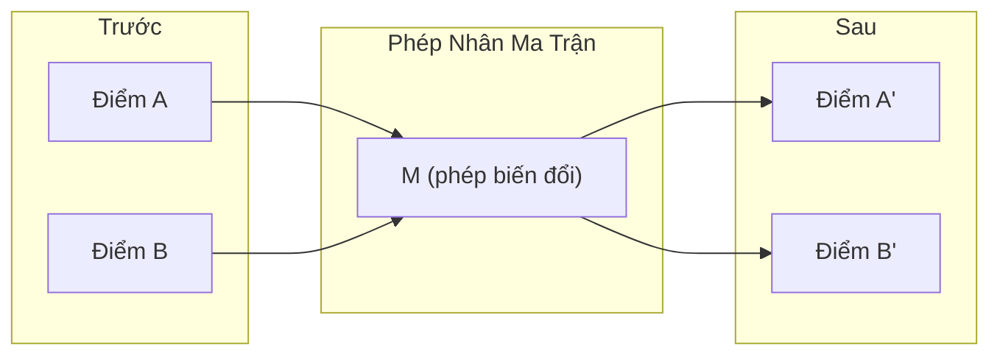
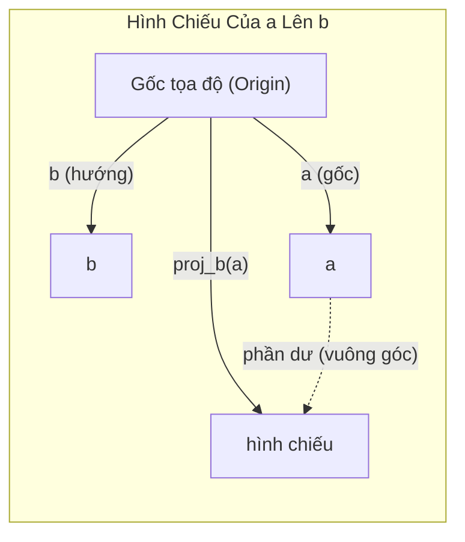

# Trực Giác Đại Số Tuyến Tính (Linear Algebra Intuition)

> Mọi mô hình AI thực chất chỉ là toán ma trận khoác lên mình một chiếc mũ lộng lẫy.

**Type:** Learn
**Languages:** Python, Julia
**Prerequisites:** Phase 0
**Time:** ~60 phút

## Mục Tiêu Học Tập

- Tự cài đặt các phép toán trên vector và ma trận (cộng, tích vô hướng, nhân ma trận) từ đầu bằng Python
- Giải thích theo góc nhìn hình học ý nghĩa của tích vô hướng, phép chiếu vector và quá trình trực chuẩn hóa Gram-Schmidt
- Xác định tính độc lập tuyến tính, hạng (rank) và cơ sở (basis) của một tập hợp vector bằng phép khử hàng (row reduction)
- Kết nối các khái niệm đại số tuyến tính với ứng dụng thực tế trong AI: embeddings, điểm attention, và LoRA

## Vấn Đề

Mở bất kỳ bài báo ML/AI nào, ngay trong trang đầu tiên bạn sẽ thấy vector, ma trận, tích vô hướng và các phép biến đổi. Nếu không có trực giác về đại số tuyến tính, chúng chỉ là những ký hiệu vô nghĩa. Nhưng khi đã nắm được bản chất, bạn sẽ thấy mạng nơ-ron thực sự đang làm gì -- dịch chuyển và biến đổi các điểm trong không gian.

Bạn không cần phải là một nhà toán học hàn lâm. Bạn chỉ cần hiểu hình học đằng sau các phép toán này đại diện cho điều gì, rồi tự tay lập trình cài đặt chúng.

## Khái Niệm

### Vector Là Các Điểm (Và Hướng Đi)

Một vector thực chất chỉ là một danh sách các con số. Nhưng những con số đó mang ý nghĩa vật lý/hình học -- chúng là tọa độ trong không gian.

**Vector 2D [3, 2]:**

| x | y | Điểm / Ý nghĩa |
|---|---|----------------|
| 3 | 2 | Vector chỉ từ gốc tọa độ (0,0) tới điểm (3, 2) trên mặt phẳng |

Vector này có độ dài (magnitude) là $\sqrt{3^2 + 2^2} = \sqrt{13}$ và hướng lên trên sang phải.

Trong AI, vector đại diện cho mọi thứ:
- Một từ → một vector gồm 768 số (biểu diễn "ngữ nghĩa" của từ trong không gian embedding)
- Một bức ảnh → một vector chứa hàng triệu giá trị pixel
- Một người dùng → một vector thể hiện sở thích cá nhân

### Ma Trận Là Phép Biến Đổi

Một ma trận biến đổi vector này thành vector khác. Nó có thể xoay, co giãn tỉ lệ, kéo giãn hoặc chiếu phẳng.



Trong AI, ma trận CHÍNH LÀ mô hình:
- Trọng số mạng nơ-ron (weights) → các ma trận biến đổi dữ liệu đầu vào thành đầu ra
- Điểm Attention → các ma trận quyết định cần tập trung chú ý vào thông tin nào
- Embeddings → ma trận ánh xạ từ ngữ thành vector

### Tích Vô Hướng (Dot Product) Đo Độ Tương Đồng

Tích vô hướng của hai vector cho bạn biết mức độ tương đồng hoặc độ gióng hàng (alignment) giữa chúng:

```math
\begin{aligned}
a \cdot b &= a_1 \times b_1 + a_2 \times b_2 + \cdots + a_n \times b_n \\[4pt]
\text{Cùng hướng:} \quad a \cdot b &> 0 \quad \text{(tương đồng/gần gũi)} \\
\text{Vuông góc:} \quad a \cdot b &= 0 \quad \text{(không liên quan/trực giao)} \\
\text{Ngược hướng:} \quad a \cdot b &< 0 \quad \text{(trái ngược nhau)}
\end{aligned}
```

Đây chính xác là cách các công cụ tìm kiếm vector, hệ thống gợi ý và RAG hoạt động -- tìm các vector có tích vô hướng (hoặc cosine similarity) cao nhất.

### Độc Lập Tuyến Tính (Linear Independence)

Các vector được gọi là độc lập tuyến tính nếu không có vector nào trong tập hợp có thể biểu diễn dưới dạng tổ hợp tuyến tính của các vector còn lại. Nếu $v_1, v_2, v_3$ độc lập, chúng căng (span) được toàn bộ không gian 3 chiều. Nếu một vector là tổ hợp của các vector khác, chúng chỉ căng được một mặt phẳng 2D.

Tại sao điều này quan trọng trong AI: ma trận đặc trưng (feature matrix) của bạn nên có các cột độc lập tuyến tính. Nếu hai đặc trưng tương quan hoàn hảo (phụ thuộc tuyến tính), mô hình không thể phân biệt được tác động của từng đặc trưng. Điều này gây ra hiện tượng đa cộng tuyến (multicollinearity) trong hồi quy -- ma trận trọng số trở nên mất ổn định, và một thay đổi nhỏ ở đầu vào có thể làm bùng nổ sai số đầu ra.

**Ví dụ cụ thể:**

```
v1 = [1, 0, 0]
v2 = [0, 1, 0]
v3 = [2, 1, 0]   # v3 = 2*v1 + v2
```

$v_1$ và $v_2$ độc lập -- không vector nào là bội số vô hướng hay tổ hợp của vector kia. Nhưng $v_3 = 2 v_1 + v_2$, vì vậy $\lbrace v_1, v_2, v_3 \rbrace$ là một tập phụ thuộc tuyến tính. Cả 3 vector này đều nằm gọn trong mặt phẳng xy. Cho dù bạn kết hợp chúng thế nào, bạn không bao giờ với tới được vector [0, 0, 1]. Bạn có 3 vector nhưng thực chất chỉ có 2 bậc tự do.

Trong một tập dữ liệu: nếu `feature_3 = 2*feature_1 + feature_2`, việc thêm `feature_3` cung cấp số không (zero) thông tin mới cho mô hình. Tệ hơn, nó làm phương trình chuẩn (normal equation) bị suy biến (singular) -- không thể tìm nghiệm trọng số duy nhất.

### Cơ Sở (Basis) Và Hạng (Rank)

Một cơ sở (basis) là một tập hợp tối thiểu các vector độc lập tuyến tính có thể căng phủ toàn bộ không gian. Số lượng vector cơ sở chính là số chiều của không gian đó.

Cơ sở tiêu chuẩn cho không gian 3D là `{[1,0,0], [0,1,0], [0,0,1]}`. Nhưng bất kỳ 3 vector độc lập tuyến tính nào trong 3D cũng tạo thành một cơ sở hợp lệ. Việc chọn cơ sở chính là việc lựa chọn hệ tọa độ.

Hạng (Rank) của một ma trận = số cột độc lập tuyến tính = số hàng độc lập tuyến tính. Nếu $\text{rank} < \min(\text{rows}, \text{cols})$, ma trận bị khuyết hạng (rank-deficient). Điều này có nghĩa:
- Hệ phương trình có vô số nghiệm (hoặc vô nghiệm)
- Thông tin bị mất mát trong quá trình biến đổi
- Ma trận không thể nghịch đảo (non-invertible)

| Tình huống | Hạng (Rank) | Ý nghĩa đối với ML |
|------------|-------------|-------------------|
| Đủ hạng $(\text{rank} = \min(m, n))$ | Tối đa có thể | Khi số hàng nhiều hơn hoặc bằng số cột (đủ hạng cột), nghiệm bình phương tối thiểu là duy nhất. Khi số hàng ít hơn số cột, có vô số nghiệm khớp chính xác. |
| Khuyết hạng $(\text{rank} < \min(m, n))$ | Dưới mức tối đa | Các đặc trưng bị dư thừa. Có vô số nghiệm trọng số. Cần kỹ thuật điều chuẩn (regularization). |
| Hạng 1 | 1 | Mọi cột đều là bản sao nhân tỉ lệ của một vector. Toàn bộ dữ liệu nằm trên một đường thẳng. |
| Gần khuyết hạng (giá trị suy biến nhỏ) | Thấp về mặt số học | Ma trận có điều kiện xấu (ill-conditioned). Nhiễu nhỏ ở đầu vào gây xáo trộn lớn ở đầu ra. Cần cắt bớt SVD hoặc hồi quy Ridge. |

### Phép Chiếu (Projection)

Chiếu vector **a** lên vector **b** sẽ cho thành phần của **a** theo hướng của **b**:

```math
\mathop{\mathrm{proj}}_b(a) = \frac{a \cdot b}{b \cdot b} \, b
```

Phần dư $(a - \mathop{\mathrm{proj}}_b(a))$ vuông góc với $b$. Phép phân tích trực giao này là nền tảng của phương pháp bình phương tối thiểu (least-squares fitting).

Phép chiếu xuất hiện ở khắp mọi nơi trong ML:
- Hồi quy tuyến tính cực tiểu hóa khoảng cách từ các quan sát đến không gian cột -- nghiệm CHÍNH LÀ một phép chiếu
- PCA chiếu dữ liệu lên các hướng có phương sai cực đại
- Cơ chế Attention trong Transformers tính phép chiếu của queries lên keys



**Ví dụ:** $a = [3, 4]$, $b = [1, 0]$

$\mathop{\mathrm{proj}}_b(a) = (3 \cdot 1 + 4 \cdot 0) / (1 \cdot 1 + 0 \cdot 0) \cdot [1, 0] = 3 \cdot [1, 0] = [3, 0]$

Phép chiếu đã loại bỏ thành phần y. Đây là dạng giảm chiều dữ liệu (dimensionality reduction) ở dạng đơn giản nhất -- vứt bỏ các hướng bạn không quan tâm.

### Quá Trình Trực Chuẩn Hóa Gram-Schmidt

Biến đổi bất kỳ tập hợp vector độc lập tuyến tính nào thành một cơ sở trực chuẩn (orthonormal basis). Trực chuẩn nghĩa là mỗi vector có độ dài bằng 1 và từng cặp vector đôi một vuông góc với nhau.

Thuật toán:
1. Lấy vector đầu tiên, chuẩn hóa nó về độ dài 1
2. Lấy vector thứ hai, trừ đi hình chiếu của nó lên vector thứ nhất, rồi chuẩn hóa
3. Lấy vector thứ ba, trừ đi hình chiếu của nó lên tất cả các vector đã chuẩn hóa trước đó, rồi chuẩn hóa
4. Lặp lại cho các vector còn lại

```
Đầu vào:  v1, v2, v3, ... (độc lập tuyến tính)

u1 = v1 / |v1|

w2 = v2 - (v2 dot u1) * u1
u2 = w2 / |w2|

w3 = v3 - (v3 dot u1) * u1 - (v3 dot u2) * u2
u3 = w3 / |w3|

Đầu ra:  u1, u2, u3, ... (cơ sở trực chuẩn)
```

Đây chính là cơ chế phân tích QR (QR decomposition) hoạt động bên trong: ma trận Q chứa cơ sở trực chuẩn, R chứa các hệ số chiếu. Phân tích QR được sử dụng trong:
- Giải hệ phương trình tuyến tính (ổn định hơn phép khử Gauss)
- Tính toán trị riêng (thuật toán QR)
- Hồi quy bình phương tối thiểu (phương pháp số học tiêu chuẩn)

```figure
eigen-directions
```

## Tự Xây Dựng (Build It)

### Bước 1: Vector từ đầu (Python)

```python
class Vector:
    def __init__(self, components):
        self.components = list(components)
        self.dim = len(self.components)

    def __add__(self, other):
        return Vector([a + b for a, b in zip(self.components, other.components)])

    def __sub__(self, other):
        return Vector([a - b for a, b in zip(self.components, other.components)])

    def dot(self, other):
        return sum(a * b for a, b in zip(self.components, other.components))

    def magnitude(self):
        return sum(x**2 for x in self.components) ** 0.5

    def normalize(self):
        mag = self.magnitude()
        return Vector([x / mag for x in self.components])

    def cosine_similarity(self, other):
        return self.dot(other) / (self.magnitude() * other.magnitude())

    def __repr__(self):
        return f"Vector({self.components})"


a = Vector([1, 2, 3])
b = Vector([4, 5, 6])

print(f"a + b = {a + b}")
print(f"a · b = {a.dot(b)}")
print(f"|a| = {a.magnitude():.4f}")
print(f"cosine similarity = {a.cosine_similarity(b):.4f}")
```

### Bước 2: Ma trận từ đầu (Python)

```python
class Matrix:
    def __init__(self, rows):
        self.rows = [list(row) for row in rows]
        self.shape = (len(self.rows), len(self.rows[0]))

    def __matmul__(self, other):
        if isinstance(other, Vector):
            return Vector([
                sum(self.rows[i][j] * other.components[j] for j in range(self.shape[1]))
                for i in range(self.shape[0])
            ])
        rows = []
        for i in range(self.shape[0]):
            row = []
            for j in range(other.shape[1]):
                row.append(sum(
                    self.rows[i][k] * other.rows[k][j]
                    for k in range(self.shape[1])
                ))
            rows.append(row)
        return Matrix(rows)

    def transpose(self):
        return Matrix([
            [self.rows[j][i] for j in range(self.shape[0])]
            for i in range(self.shape[1])
        ])

    def __repr__(self):
        return f"Matrix({self.rows})"


rotation_90 = Matrix([[0, -1], [1, 0]])
point = Vector([3, 1])

rotated = rotation_90 @ point
print(f"Gốc: {point}")
print(f"Xoay 90°: {rotated}")
```

### Bước 3: Tại sao điều này quan trọng trong AI

```python
import random

random.seed(42)
weights = Matrix([[random.gauss(0, 0.1) for _ in range(3)] for _ in range(2)])
input_vector = Vector([1.0, 0.5, -0.3])

output = weights @ input_vector
print(f"Đầu vào (3D): {input_vector}")
print(f"Đầu ra (2D): {output}")
print("Đây chính là điều mà một tầng mạng nơ-ron thực hiện -- phép nhân ma trận.")
```

### Bước 4: Phiên bản Julia

```julia
a = [1.0, 2.0, 3.0]
b = [4.0, 5.0, 6.0]

println("a + b = ", a + b)
println("a · b = ", a ⋅ b)       # Julia hỗ trợ toán tử ký tự unicode
println("|a| = ", √(a ⋅ a))
println("cosine = ", (a ⋅ b) / (√(a ⋅ a) * √(b ⋅ b)))

# Nhân ma trận với vector
W = [0.1 -0.2 0.3; 0.4 0.5 -0.1]
x = [1.0, 0.5, -0.3]
println("Wx = ", W * x)
println("Đây chính là một tầng mạng nơ-ron.")
```

### Bước 5: Độc lập tuyến tính và phép chiếu từ đầu (Python)

```python
def is_linearly_independent(vectors):
    n = len(vectors)
    dim = len(vectors[0].components)
    mat = Matrix([v.components[:] for v in vectors])
    rows = [row[:] for row in mat.rows]
    rank = 0
    for col in range(dim):
        pivot = None
        for row in range(rank, len(rows)):
            if abs(rows[row][col]) > 1e-10:
                pivot = row
                break
        if pivot is None:
            continue
        rows[rank], rows[pivot] = rows[pivot], rows[rank]
        scale = rows[rank][col]
        rows[rank] = [x / scale for x in rows[rank]]
        for row in range(len(rows)):
            if row != rank and abs(rows[row][col]) > 1e-10:
                factor = rows[row][col]
                rows[row] = [rows[row][j] - factor * rows[rank][j] for j in range(dim)]
        rank += 1
    return rank == n


def project(a, b):
    scalar = a.dot(b) / b.dot(b)
    return Vector([scalar * x for x in b.components])


def gram_schmidt(vectors):
    orthonormal = []
    for v in vectors:
        w = v
        for u in orthonormal:
            proj = project(w, u)
            w = w - proj
        if w.magnitude() < 1e-10:
            continue
        orthonormal.append(w.normalize())
    return orthonormal


v1 = Vector([1, 0, 0])
v2 = Vector([1, 1, 0])
v3 = Vector([1, 1, 1])
basis = gram_schmidt([v1, v2, v3])
for i, u in enumerate(basis):
    print(f"u{i+1} = {u}")
    print(f"  |u{i+1}| = {u.magnitude():.6f}")

print(f"u1 · u2 = {basis[0].dot(basis[1]):.6f}")
print(f"u1 · u3 = {basis[0].dot(basis[2]):.6f}")
print(f"u2 · u3 = {basis[1].dot(basis[2]):.6f}")
```

## Sử Dụng Thư Viện (Use It)

Bây giờ là thao tác tương tự với NumPy -- công cụ bạn sẽ thực sự dùng trong sản xuất:

```python
import numpy as np

a = np.array([1, 2, 3], dtype=float)
b = np.array([4, 5, 6], dtype=float)

print(f"a + b = {a + b}")
print(f"a · b = {np.dot(a, b)}")
print(f"|a| = {np.linalg.norm(a):.4f}")
print(f"cosine = {np.dot(a, b) / (np.linalg.norm(a) * np.linalg.norm(b)):.4f}")

W = np.random.randn(2, 3) * 0.1
x = np.array([1.0, 0.5, -0.3])
print(f"Wx = {W @ x}")
```

### Rank, Phép Chiếu và Phân Tích QR với NumPy

```python
import numpy as np

A = np.array([[1, 2], [2, 4]])
print(f"Rank: {np.linalg.matrix_rank(A)}")

a = np.array([3, 4])
b = np.array([1, 0])
proj = (np.dot(a, b) / np.dot(b, b)) * b
print(f"Hình chiếu của {a} lên {b}: {proj}")

Q, R = np.linalg.qr(np.random.randn(3, 3))
print(f"Q là ma trận trực giao: {np.allclose(Q @ Q.T, np.eye(3))}")
print(f"R là ma trận tam giác trên: {np.allclose(R, np.triu(R))}")
```

### PyTorch -- Tensor Là Vector Với Đạo Hàm Tự Động (Autodiff)

```python
import torch

x = torch.randn(3, requires_grad=True)
y = torch.tensor([1.0, 0.0, 0.0])

similarity = torch.dot(x, y)
similarity.backward()

print(f"x = {x.data}")
print(f"y = {y.data}")
print(f"dot product = {similarity.item():.4f}")
print(f"d(dot)/dx = {x.grad}")
```

Gradient của tích vô hướng đối với x chính là y. PyTorch đã tự động tính toán điều này. Mọi thao tác trong mạng nơ-ron đều được ghép nối từ các phép toán cơ sở như thế này -- nhân ma trận, tích vô hướng, phép chiếu -- và autodiff theo dõi gradient xuyên suốt tất cả chúng.

Bạn vừa tự tay xây dựng từ đầu những gì NumPy làm trong một dòng lệnh. Giờ đây bạn đã hiểu rõ điều gì đang diễn ra dưới nắp ca-pô.

## Xuất Bản Sản Phẩm (Ship It)

Bài học này xuất bản artifact:
- `outputs/prompt-linear-algebra-tutor.md` -- prompt trợ lý AI để dạy đại số tuyến tính thông qua trực giác hình học trực quan

## Mối Liên Hệ Thực Tế (Connections)

Mọi khái niệm trong bài học này đều kết nối trực tiếp tới các thành phần cụ thể của AI hiện đại:

| Khái niệm | Nơi xuất hiện trong AI |
|-----------|------------------------|
| Tích vô hướng (Dot product) | Điểm Attention trong Transformers, độ đo cosine similarity trong RAG |
| Nhân ma trận | Mọi tầng mạng nơ-ron, mọi phép biến đổi tuyến tính |
| Độc lập tuyến tính | Chọn lọc đặc trưng (feature selection), tránh đa cộng tuyến |
| Hạng (Rank) | Xác định hệ phương trình có giải được không, LoRA (Low-Rank Adaptation) |
| Phép chiếu (Projection) | Hồi quy tuyến tính (chiếu lên không gian cột), PCA |
| Gram-Schmidt / QR | Bộ giải số học (numerical solvers), tính toán trị riêng |
| Cơ sở trực chuẩn | Tính toán số học ổn định, các phép biến đổi whitening |

LoRA xứng đáng được nhắc đến đặc biệt. Nó fine-tune các mô hình ngôn ngữ lớn bằng cách phân rã các cập nhật ma trận trọng số thành các ma trận hạng thấp (low-rank). Thay vì cập nhật trực tiếp ma trận trọng số kích thước 4096x4096 (16 triệu tham số), LoRA cập nhật hai ma trận kích thước 4096x16 và 16x4096 (chỉ 131.000 tham số). Ràng buộc hạng 16 này có nghĩa LoRA giả định rằng bản cập nhật trọng số nằm trong một không gian con 16 chiều của không gian 4096 chiều ban đầu. Đó chính là đại số tuyến tính tạo nên sức mạnh thực sự.

## Bài Tập Thực Hành

1. Cài đặt phương thức `Vector.angle_between(other)` trả về góc tính bằng độ giữa hai vector.
2. Tạo một ma trận co giãn 2D gấp đôi tọa độ x và gấp ba tọa độ y, sau đó áp dụng nó vào vector [1, 1].
3. Cho 5 vector giả lập embedding từ ngữ (kích thước 50 chiều), tìm cặp từ giống nhau nhất bằng cosine similarity.
4. Kiểm chứng đầu ra của thuật toán Gram-Schmidt thực sự trực chuẩn: kiểm tra mọi cặp vector có tích vô hướng xấp xỉ 0 và mỗi vector có độ dài bằng 1.
5. Tạo ma trận 3x3 có hạng bằng 2. Kiểm chứng bằng phương thức `rank()`. Sau đó giải thích các cột căng nên đối tượng hình học nào.
6. Chiếu vector [1, 2, 3] lên vector [1, 1, 1]. Kết quả thu được đại diện cho điều gì về mặt hình học?

### Gợi Ý

**Bài 1.** Bắt đầu từ `cosine_similarity`, kẹp giá trị trong khoảng từ -1 đến 1 để tránh lỗi làm tròn số thực, sau đó dùng hàm arc cosine (`math.acos`) và chuyển đổi radian sang độ. Kiểm tra rằng `Vector([1, 0])` và `Vector([0, 1])` ra 90 độ, và vector với chính nó ra 0 độ.

**Bài 2.** Đặt 2 hệ số tỉ lệ trên đường chéo chính của ma trận 2x2 và đặt 0 vào hai ô còn lại. Kết quả cho [1, 1] phải là [2, 3].

**Bài 3.** Tính độ tương đồng cosine cho mọi cặp trong 5 vector (tổng cộng 10 cặp) và giữ lại giá trị lớn nhất. Thử kiểm tra vòng lặp với chính một vector trước, giá trị phải bằng 1.

**Bài 4.** Dùng `gram_schmidt` trên 3 vector độc lập tuyến tính, sau đó tính `dot` cho từng cặp và `magnitude` cho từng vector. So sánh với một ngưỡng sai số như `1e-9`, vì số thực dấu phẩy động không cho ra số 0 tuyệt đối.

**Bài 5.** Cho hàng hoặc cột thứ ba bằng tổng của hai hàng hoặc cột đầu tiên, như vậy một hướng bị lặp lại. `rank()` phải trả về 2, và các cột khi đó căng nên một mặt phẳng đi qua gốc tọa độ.

**Bài 6.** Tính hệ số tỉ lệ $\frac{a \cdot b}{b \cdot b}$ và nhân nó với vector $b$, hoặc gọi `project_onto`. Kiểm tra xem phần dư $a$ trừ đi hình chiếu có tích vô hướng bằng 0 với [1, 1, 1] hay không.

## Thuật Ngữ Then Chốt

| Thuật ngữ | Người ta thường nói | Bản chất thực sự |
|-----------|--------------------|-------------------|
| Vector | "Một mũi tên" | Danh sách các con số biểu diễn một điểm hoặc hướng trong không gian n chiều |
| Ma trận | "Một bảng số" | Phép biến đổi ánh xạ các vector từ không gian này sang không gian khác |
| Tích vô hướng (Dot product) | "Nhân rồi cộng lại" | Thước đo mức độ gióng hàng của hai vector -- cốt lõi của tìm kiếm độ tương đồng |
| Embedding | "Ma thuật của AI" | Một vector số biểu diễn ngữ nghĩa của thực thể (từ ngữ, hình ảnh, người dùng) |
| Độc lập tuyến tính | "Chúng không đè lên nhau" | Không vector nào trong tập hợp có thể tạo ra từ tổ hợp của các vector khác |
| Hạng (Rank) | "Có bao nhiêu chiều" | Số lượng cột (hoặc hàng) độc lập tuyến tính trong một ma trận |
| Phép chiếu (Projection) | "Chiếc bóng" | Thành phần của một vector đi theo hướng của một vector khác |
| Cơ sở (Basis) | "Các trục tọa độ" | Tập hợp tối thiểu các vector độc lập căng phủ toàn bộ không gian |
| Trực chuẩn (Orthonormal) | "Các vector đơn vị vuông góc" | Các vector đôi một vuông góc với nhau và mỗi vector đều có độ dài bằng 1 |

## Tóm Tắt Công Thức

| Công thức | Ý nghĩa |
|-----------|---------|
| $a \cdot b = \sum_i a_i b_i$ | Tích vô hướng. Đo lường độ thẳng hàng và là cốt lõi của điểm attention và cosine similarity |
| $\cos\theta = \frac{a \cdot b}{\lvert a\rvert \lvert b\rvert}$ | Góc giữa hai vector. 1 là cùng hướng, 0 là trực giao (vuông góc) |
| $\lvert a\rvert = \sqrt{a \cdot a}$ | Độ lớn / độ dài vector (magnitude) |
| $y = Ax, y_i = \sum_j A_{ij} x_j$ | Tích ma trận - vector. Tầng mạng nơ-ron áp dụng phép toán này cho mỗi đầu vào |
| $\text{proj}_b a = \frac{a \cdot b}{b \cdot b} b$ | Hình chiếu của $a$ lên $b$, thành phần của $a$ chạy dọc theo $b$ |
| $b^\perp = a - \text{proj}_b a$ | Thành phần của $a$ vuông góc với $b$, dùng trong thuật toán Gram-Schmidt |
| $\text{rank}(A) \leq \min(m,n)$ | Hạng ma trận, số lượng cột độc lập tuyến tính. Quyết định xem $Ax = b$ có nghiệm hay không |
| $\Delta W = BA$, $B$ là 4096×16, $A$ là 16×4096 | Cập nhật hạng thấp. LoRA thay thế cập nhật 4096×4096 (16M tham số) bằng hai thừa số hạng 16 (131K tham số) |
| Cơ sở trực chuẩn: $\lvert v_i\rvert = 1, v_i \cdot v_j = 0$ | Các phép biến đổi ổn định, khả nghịch như whitening và phân tích QR |
