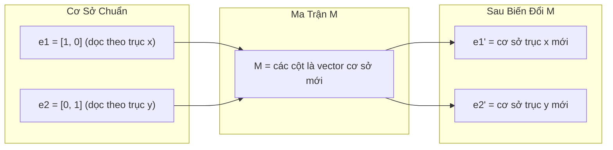
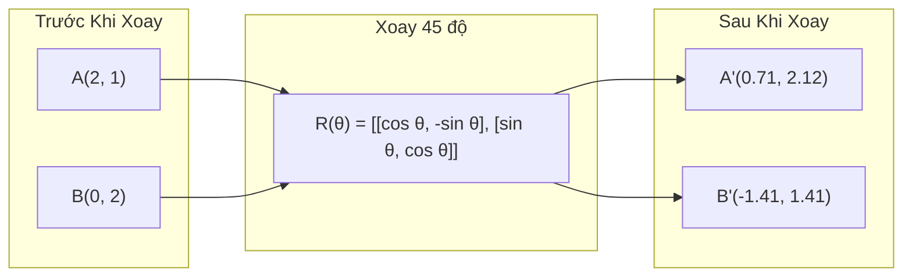
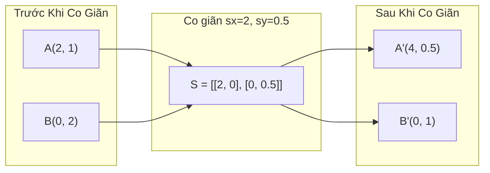
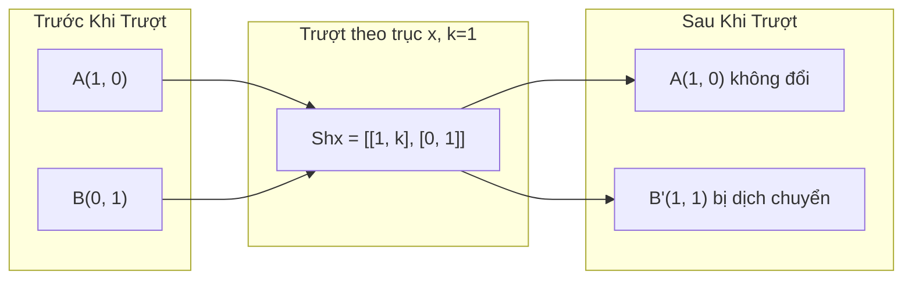
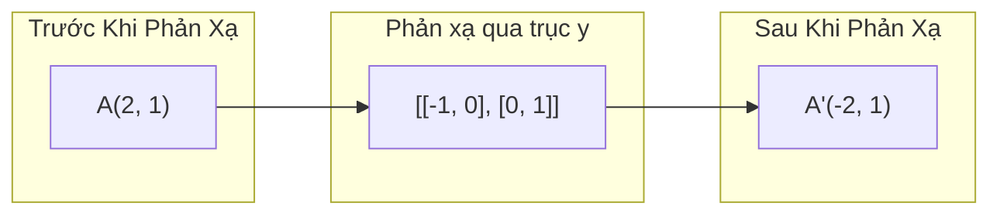
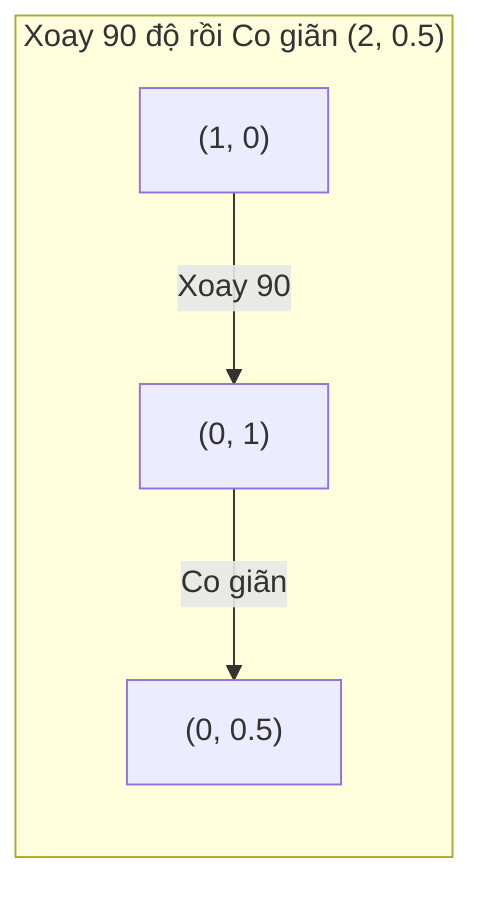
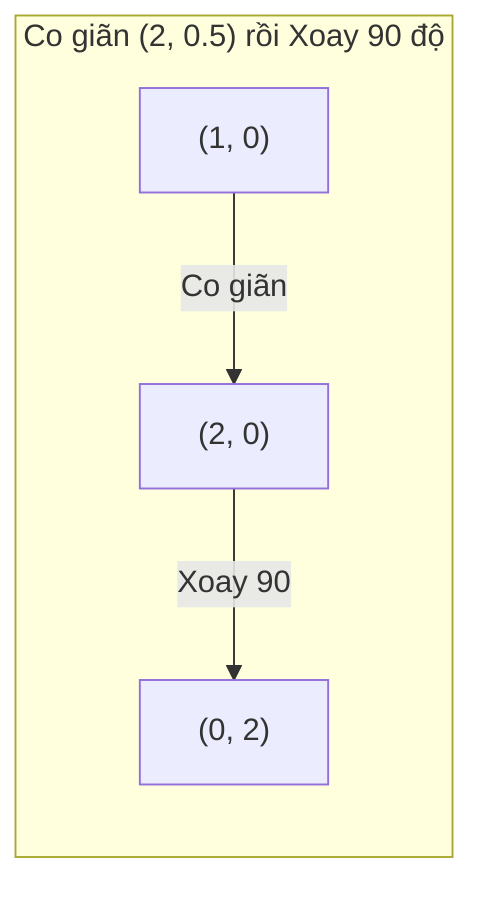

# Các Phép Biến Đổi Ma Trận (Matrix Transformations)

> Ma trận là một cỗ máy tái định hình không gian. Hiểu được nó làm gì với từng điểm, bạn sẽ thấu suốt toàn bộ phép biến đổi.

**Type:** Build
**Languages:** Python, Julia
**Prerequisites:** Phase 1, Lessons 01-02 (Linear Algebra Intuition, Vectors & Matrices Operations)
**Time:** ~75 phút

## Mục Tiêu Học Tập

- Xây dựng các ma trận xoay (rotation), co giãn (scaling), trượt (shearing), và phản xạ đối xứng (reflection), rồi áp dụng chúng lên các điểm trong không gian 2D và 3D
- Kết hợp (compose) nhiều phép biến đổi liên tiếp thông qua phép nhân ma trận và chứng minh rằng thứ tự thực hiện là tối quan trọng
- Tính toán trị riêng (eigenvalues) và vector riêng (eigenvectors) của ma trận 2x2 từ phương trình đặc trưng (characteristic equation)
- Giải thích vì sao trị riêng quyết định các hướng chính trong PCA, sự ổn định của mạng hồi quy RNN và hành vi phân cụm phổ (spectral clustering)

## Vấn Đề

Khi đọc tài liệu về PCA, bạn thấy cụm từ "tìm các vector riêng của ma trận hiệp phương sai". Khi đọc về độ ổn định của mô hình, bạn thấy "kiểm tra xem tất cả các trị riêng có độ lớn nhỏ hơn 1 hay không". Khi tìm hiểu về tăng cường dữ liệu (data augmentation), bạn thấy "áp dụng phép xoay ngẫu nhiên". Tất cả những điều này sẽ chỉ là những công thức mơ hồ cho đến khi bạn thực sự nắm được ma trận biến đổi không gian như thế nào về mặt hình học.

Ma trận không chỉ là những bảng số vô hồn. Chúng là những cỗ máy biến đổi không gian. Ma trận xoay sẽ quay các điểm. Ma trận co giãn sẽ kéo dãn hoặc thu hẹp chúng. Ma trận trượt sẽ làm nghiêng lệch các trục. Mọi phép biến đổi mà mạng nơ-ron áp dụng lên dữ liệu đều là một trong những phép toán này hoặc là sự kết hợp của chúng. Bài học này sẽ giúp bạn hiểu rõ từng cơ chế một cách trực quan và cụ thể nhất.

## Khái Niệm

### Phép Biến Đổi Dưới Dạng Ma Trận

Mọi phép biến đổi tuyến tính trong không gian 2D đều có thể biểu diễn dưới dạng ma trận 2x2. Ma trận cho bạn biết chính xác các vector cơ sở [1, 0] và [0, 1] sẽ đi về đâu sau biến đổi. Tất cả các điểm khác sẽ tự động tuân theo quy tắc đó.



### Phép Xoay (Rotation)

Phép xoay 2D theo góc $\theta$ bảo toàn khoảng cách và góc giữa các điểm. Nó di chuyển mọi điểm dọc theo một cung tròn quanh gốc tọa độ.



Trong 3D, bạn xoay quanh một trục cố định. Mỗi trục có ma trận xoay riêng:

```math
\begin{aligned}
R_z(\theta) &= \begin{bmatrix} \cos\theta & -\sin\theta & 0 \\ \sin\theta & \cos\theta & 0 \\ 0 & 0 & 1 \end{bmatrix} \quad \text{Xoay quanh trục z (mặt phẳng x-y quay, z giữ nguyên)} \\[6pt]
R_x(\theta) &= \begin{bmatrix} 1 & 0 & 0 \\ 0 & \cos\theta & -\sin\theta \\ 0 & \sin\theta & \cos\theta \end{bmatrix} \quad \text{Xoay quanh trục x (mặt phẳng y-z quay, x giữ nguyên)} \\[6pt]
R_y(\theta) &= \begin{bmatrix} \cos\theta & 0 & \sin\theta \\ 0 & 1 & 0 \\ -\sin\theta & 0 & \cos\theta \end{bmatrix} \quad \text{Xoay quanh trục y (mặt phẳng x-z quay, y giữ nguyên)}
\end{aligned}
```

### Phép Co Giãn (Scaling)

Phép co giãn kéo dài hoặc nén lại dọc theo từng trục một cách độc lập.



### Phép Trượt (Shearing)

Phép trượt làm nghiêng một trục trong khi giữ cố định trục kia. Nó biến hình chữ nhật thành hình bình hành.



Ma trận trượt:
- `Shx = [[1, k], [0, 1]]` dịch chuyển $x$ một lượng $k \cdot y$
- `Shy = [[1, 0], [k, 1]]` dịch chuyển $y$ một lượng $k \cdot x$

### Phép Phản Xạ Đối Xứng (Reflection)

Phép phản xạ lấy đối xứng các điểm qua một trục hoặc một đường thẳng.



Ma trận phản xạ:
- Đối xứng qua trục y: `[[-1, 0], [0, 1]]`
- Đối xứng qua trục x: `[[1, 0], [0, -1]]`

### Kết Hợp Nhiều Phép Biến Đổi (Composition)

Áp dụng phép biến đổi A rồi đến B tương đương với phép nhân các ma trận tương ứng: `result = B @ A @ point`. Thứ tự thực hiện là bắt buộc. Xoay rồi co giãn sẽ cho kết quả hoàn toàn khác với co giãn rồi mới xoay.



Ma trận kết hợp: `S @ R = [[0, -2], [0.5, 0]]`



Ma trận kết hợp: `R @ S = [[0, -0.5], [2, 0]]`

Kết quả hoàn toàn khác nhau. Phép nhân ma trận không có tính chất giao hoán ($A \cdot B \neq B \cdot A$).

### Trị Riêng (Eigenvalues) Và Vector Riêng (Eigenvectors)

Hầu hết các vector đều bị đổi hướng khi bị một ma trận tác động vào. Tuy nhiên, có những vector rất đặc biệt: ma trận chỉ kéo dãn hoặc thu ngắn chúng lại dọc theo đúng hướng ban đầu, tuyệt đối không làm quay hướng. Những vector này được gọi là **vector riêng**. Hệ số co giãn tương ứng được gọi là **trị riêng**.

```
A @ v = lambda * v

v: vector riêng (hướng không bị đổi góc)
lambda: trị riêng (hệ số co giãn theo hướng đó)

Ví dụ: A = | 2  1 |
           | 1  2 |

Vector riêng [1, 1] với trị riêng 3:
  A @ [1, 1] = [3, 3] = 3 * [1, 1]     (cùng hướng, bị kéo dài gấp 3 lần)

Vector riêng [1, -1] với trị riêng 1:
  A @ [1, -1] = [1, -1] = 1 * [1, -1]  (cùng hướng, giữ nguyên độ dài)
```

Ma trận này kéo giãn không gian gấp 3 lần dọc theo hướng [1, 1] và giữ nguyên độ dài dọc theo hướng [1, -1]. Mọi hướng khác trong mặt phẳng đều là sự pha trộn giữa hai hướng cơ sở này.

### Phân Rã Trị Riêng (Eigendecomposition)

Nếu một ma trận vuông cấp $n$ có $n$ vector riêng độc lập tuyến tính, nó có thể được phân tích thành:

```
A = V @ D @ V^(-1)

V: ma trận chứa các vector riêng làm các cột
D: ma trận đường chéo chứa các trị riêng tương ứng
V^(-1): ma trận nghịch đảo của V

Ý nghĩa hình học: xoay tọa độ về hệ trục của các vector riêng -> co giãn theo từng trục -> xoay ngược trở lại tọa độ ban đầu.
```

### Tại Sao Trị Riêng Quan Trọng Trong AI

**PCA (Principal Component Analysis):** Các vector riêng của ma trận hiệp phương sai chính là các thành phần chính (principal components). Các trị riêng tương ứng cho biết lượng phương sai (thông tin) mà mỗi thành phần giữ lại. Sắp xếp theo trị riêng giảm dần, giữ lại $k$ thành phần đầu tiên, bạn đã hoàn thành việc giảm chiều dữ liệu.

**Độ ổn định của mô hình (Stability):** Trong các mạng nơ-ron hồi quy (RNN) và hệ thống động lực, nếu trị riêng có độ lớn $> 1$, tín hiệu qua nhiều bước thời gian sẽ bùng nổ (exploding gradients). Nếu độ lớn $< 1$, tín hiệu sẽ tiêu biến mất dần (vanishing gradients). Đó chính là vấn đề đạo hàm biến mất / bùng nổ được diễn đạt trong một câu.

**Phương pháp phổ (Spectral Methods):** Mạng nơ-ron đồ thị (GNN) sử dụng trị riêng của ma trận kề. Thuật toán phân cụm phổ (Spectral Clustering) sử dụng trị riêng của ma trận Laplacian. Các vector riêng tiết lộ cấu trúc cộng đồng và cụm ẩn sâu bên trong đồ thị.

### Định Thức Là Hệ Số Co Giãn Thể Tích

Định thức (determinant) của ma trận biến đổi cho bạn biết diện tích (2D) hoặc thể tích (3D) được phóng to hay thu nhỏ bao nhiêu lần sau biến đổi.

```
det = 1:   diện tích được bảo toàn tuyệt đối (phép xoay)
det = 2:   diện tích tăng gấp đôi
det = 0:   không gian bị ép bẹp xuống số chiều thấp hơn (suy biến, không thể nghịch đảo)
det = -1:  diện tích bảo toàn nhưng hướng không gian bị lật ngược (phép phản xạ đối xứng)

| det(Phép xoay) | = 1        (luôn luôn)
| det(Co giãn sx, sy) | = sx * sy
| det(Phép trượt) | = 1      (diện tích luôn bảo toàn)
| det(Phản xạ) | = -1        (hướng không gian bị đảo ngược)
```

```figure
matrix-transform
```

## Tự Xây Dựng (Build It)

### Bước 1: Các ma trận biến đổi từ đầu (Python)

```python
import math

def rotation_2d(theta):
    c, s = math.cos(theta), math.sin(theta)
    return [[c, -s], [s, c]]

def scaling_2d(sx, sy):
    return [[sx, 0], [0, sy]]

def shearing_2d(kx, ky):
    return [[1, kx], [ky, 1]]

def reflection_x():
    return [[1, 0], [0, -1]]

def reflection_y():
    return [[-1, 0], [0, 1]]

def mat_vec_mul(matrix, vector):
    return [
        sum(matrix[i][j] * vector[j] for j in range(len(vector)))
        for i in range(len(matrix))
    ]

def mat_mul(a, b):
    rows_a, cols_b = len(a), len(b[0])
    cols_a = len(a[0])
    return [
        [sum(a[i][k] * b[k][j] for k in range(cols_a)) for j in range(cols_b)]
        for i in range(rows_a)
    ]

point = [1.0, 0.0]
angle = math.pi / 4

rotated = mat_vec_mul(rotation_2d(angle), point)
print(f"Xoay (1,0) góc 45 độ: ({rotated[0]:.4f}, {rotated[1]:.4f})")

scaled = mat_vec_mul(scaling_2d(2, 3), [1.0, 1.0])
print(f"Co giãn (1,1) theo (2,3): ({scaled[0]:.1f}, {scaled[1]:.1f})")

sheared = mat_vec_mul(shearing_2d(1, 0), [1.0, 1.0])
print(f"Trượt (1,1) với kx=1: ({sheared[0]:.1f}, {sheared[1]:.1f})")

reflected = mat_vec_mul(reflection_y(), [2.0, 1.0])
print(f"Phản xạ (2,1) qua trục y: ({reflected[0]:.1f}, {reflected[1]:.1f})")
```

### Bước 2: Kết hợp các phép biến đổi (Composition)

```python
R = rotation_2d(math.pi / 2)
S = scaling_2d(2, 0.5)

rotate_then_scale = mat_mul(S, R)
scale_then_rotate = mat_mul(R, S)

point = [1.0, 0.0]
result1 = mat_vec_mul(rotate_then_scale, point)
result2 = mat_vec_mul(scale_then_rotate, point)

print(f"Xoay 90 rồi co giãn: ({result1[0]:.2f}, {result1[1]:.2f})")
print(f"Co giãn rồi xoay 90: ({result2[0]:.2f}, {result2[1]:.2f})")
print(f"Giống nhau không? {result1 == result2}")
```

### Bước 3: Tính trị riêng và vector riêng từ đầu (cho ma trận 2x2)

Đối với ma trận 2x2 `[[a, b], [c, d]]`, trị riêng là nghiệm của phương trình đặc trưng: $\lambda^2 - (a+d)\lambda + (ad - bc) = 0$.

```python
def eigenvalues_2x2(matrix):
    a, b = matrix[0]
    c, d = matrix[1]
    trace = a + d
    det = a * d - b * c
    discriminant = trace ** 2 - 4 * det
    if discriminant < 0:
        real = trace / 2
        imag = (-discriminant) ** 0.5 / 2
        return (complex(real, imag), complex(real, -imag))
    sqrt_disc = discriminant ** 0.5
    return ((trace + sqrt_disc) / 2, (trace - sqrt_disc) / 2)

def eigenvector_2x2(matrix, eigenvalue):
    a, b = matrix[0]
    c, d = matrix[1]
    if abs(b) > 1e-10:
        v = [b, eigenvalue - a]
    elif abs(c) > 1e-10:
        v = [eigenvalue - d, c]
    else:
        if abs(a - eigenvalue) < 1e-10:
            v = [1, 0]
        else:
            v = [0, 1]
    mag = (v[0] ** 2 + v[1] ** 2) ** 0.5
    return [v[0] / mag, v[1] / mag]

A = [[2, 1], [1, 2]]
vals = eigenvalues_2x2(A)
print(f"Ma trận: {A}")
print(f"Trị riêng: {vals[0]:.4f}, {vals[1]:.4f}")

for val in vals:
    vec = eigenvector_2x2(A, val)
    result = mat_vec_mul(A, vec)
    scaled = [val * vec[0], val * vec[1]]
    print(f"  lambda={val:.1f}, v={[round(x,4) for x in vec]}")
    print(f"    A@v = {[round(x,4) for x in result]}")
    print(f"    l*v = {[round(x,4) for x in scaled]}")
```

### Bước 4: Định thức là hệ số co giãn diện tích

```python
def det_2x2(matrix):
    return matrix[0][0] * matrix[1][1] - matrix[0][1] * matrix[1][0]

print(f"det(xoay 45 độ)  = {det_2x2(rotation_2d(math.pi/4)):.4f}")
print(f"det(co giãn 2,3) = {det_2x2(scaling_2d(2, 3)):.1f}")
print(f"det(trượt kx=1)  = {det_2x2(shearing_2d(1, 0)):.1f}")
print(f"det(phản xạ y)   = {det_2x2(reflection_y()):.1f}")

singular = [[1, 2], [2, 4]]
print(f"det(suy biến)    = {det_2x2(singular):.1f}")
print("Suy biến: các cột tỉ lệ với nhau, toàn bộ không gian bị nén bẹp thành một đường thẳng.")
```

## Sử Dụng Thư Viện (Use It)

NumPy xử lý tất cả các phép toán trên bằng các chương trình tối ưu hóa:

```python
import numpy as np

theta = np.pi / 4
R = np.array([[np.cos(theta), -np.sin(theta)],
              [np.sin(theta),  np.cos(theta)]])

point = np.array([1.0, 0.0])
print(f"Xoay (1,0) 45 độ: {R @ point}")

S = np.diag([2.0, 3.0])
composed = S @ R
print(f"Co giãn (2,3) sau khi Xoay 45: {composed @ point}")

A = np.array([[2, 1], [1, 2]], dtype=float)
eigenvalues, eigenvectors = np.linalg.eig(A)
print(f"\nTrị riêng: {eigenvalues}")
print(f"Vector riêng (từng cột):\n{eigenvectors}")

for i in range(len(eigenvalues)):
    v = eigenvectors[:, i]
    lam = eigenvalues[i]
    print(f"  A @ v{i} = {A @ v}, lambda * v{i} = {lam * v}")

print(f"\ndet(R) = {np.linalg.det(R):.4f}")
print(f"det(S) = {np.linalg.det(S):.1f}")

B = np.array([[3, 1], [0, 2]], dtype=float)
vals, vecs = np.linalg.eig(B)
D = np.diag(vals)
V = vecs
reconstructed = V @ D @ np.linalg.inv(V)
print(f"\nPhân rã trị riêng A = V @ D @ V^-1:")
print(f"Gốc:\n{B}")
print(f"Tái cấu trúc lại:\n{reconstructed}")
```

### Phép Xoay 3D với NumPy

```python
def rotation_3d_z(theta):
    c, s = np.cos(theta), np.sin(theta)
    return np.array([[c, -s, 0], [s, c, 0], [0, 0, 1]])

def rotation_3d_x(theta):
    c, s = np.cos(theta), np.sin(theta)
    return np.array([[1, 0, 0], [0, c, -s], [0, s, c]])

point_3d = np.array([1.0, 0.0, 0.0])
rotated_z = rotation_3d_z(np.pi / 2) @ point_3d
rotated_x = rotation_3d_x(np.pi / 2) @ point_3d

print(f"\nĐiểm 3D: {point_3d}")
print(f"Xoay 90 độ quanh trục z: {np.round(rotated_z, 4)}")
print(f"Xoay 90 độ quanh trục x: {np.round(rotated_x, 4)}")
```

## Xuất Bản Sản Phẩm (Ship It)

Bài học này xây dựng nền tảng hình học cho thuật toán PCA (trong Phase 2) và phân tích ma trận trọng số mạng nơ-ron. Thuật toán trị riêng/vector riêng được tự tay cài đặt ở đây chính là nền tảng cốt lõi của các phương pháp giảm chiều dữ liệu, phân cụm phổ và phân tích độ ổn định của hệ thống ML trong môi trường sản xuất.

## Bài Tập Thực Hành

1. Áp dụng phép xoay, co giãn và trượt lên một hình vuông đơn vị (các góc tại [0,0], [1,0], [1,1], [0,1]). In ra tọa độ các đỉnh sau biến đổi cho từng trường hợp. Xác nhận rằng phép xoay bảo toàn khoảng cách giữa các đỉnh.
2. Tìm các trị riêng của ma trận [[4, 2], [1, 3]] bằng tay sử dụng phương trình đặc trưng. Sau đó kiểm chứng lại bằng hàm tự viết và hàm của NumPy.
3. Tạo một tổ hợp gồm 3 phép biến đổi (xoay 30 độ, co giãn theo [1.5, 0.8], trượt với kx=0.3) và áp dụng lên 8 điểm sắp xếp thành hình tròn. In tọa độ trước và sau biến đổi. Tính định thức của ma trận tổng hợp và kiểm chứng xem nó có bằng tích định thức của từng ma trận thành phần hay không.

### Gợi Ý

**Bài 1.** Áp dụng `rotation_2d`, `scaling_2d` và `shearing_2d` lên từng đỉnh bằng hàm `mat_vec_mul`. Đối với phép xoay, tính chiều dài 4 cạnh và 2 đường chéo trước và sau biến đổi; các giá trị này bắt buộc phải giữ nguyên không đổi.

**Bài 2.** Viết phương trình đặc trưng $\lambda^2 - (\text{trace})\lambda + \det = 0$ và giải nó. Kiểm tra xem tổng 2 nghiệm có bằng vết ma trận (trace = 7) và tích 2 nghiệm có bằng định thức (det = 10) hay không, sau đó so sánh với `eigenvalues_2x2` và `np.linalg.eigvals`.

**Bài 3.** Xây dựng 3 ma trận với `shearing_2d(0.3, 0)` cho phép trượt, nhân chúng bằng hàm `mat_mul` theo đúng thứ tự tác động, rồi áp dụng lên 8 điểm $(\cos\theta, \sin\theta)$. Phép xoay có định thức bằng 1, phép trượt có định thức bằng 1, vì vậy `det_2x2` của ma trận tổ hợp phải bằng chính xác $1.5 \times 0.8 = 1.2$.

## Thuật Ngữ Then Chốt

| Thuật ngữ | Người ta thường nói | Bản chất thực sự |
|-----------|--------------------|-------------------|
| Ma trận xoay (Rotation matrix) | "Làm quay đối tượng" | Một ma trận trực giao di chuyển các điểm trên đường tròn đồng tâm trong khi bảo toàn khoảng cách và góc. Định thức luôn bằng 1. |
| Ma trận co giãn (Scaling matrix) | "Phóng to / thu nhỏ" | Một ma trận đường chéo kéo giãn hoặc nén độc lập theo từng trục. Định thức bằng tích các hệ số co giãn. |
| Ma trận trượt (Shearing matrix) | "Làm nghiêng hình" | Ma trận dịch chuyển một tọa độ tỉ lệ thuận với tọa độ kia, biến hình chữ nhật thành hình bình hành. Định thức bằng 1. |
| Phản xạ (Reflection) | "Gương soi" | Ma trận lật ngược không gian qua một trục hoặc mặt phẳng. Định thức bằng -1. |
| Tổ hợp biến đổi (Composition) | "Làm 2 thao tác liên tiếp" | Nhân các ma trận biến đổi lại để tạo chuỗi thao tác. Thứ tự là bắt buộc: B @ A nghĩa là biến đổi A trước, rồi B sau. |
| Vector riêng (Eigenvector) | "Hướng đặc biệt" | Một hướng mà ma trận chỉ kéo dãn hoặc thu ngắn, tuyệt đối không làm quay góc. Dấu vân tay đặc trưng của phép biến đổi. |
| Trị riêng (Eigenvalue) | "Mức độ co dãn" | Hệ số vô hướng mà ma trận phóng đại vector riêng tương ứng. Có thể là số âm (lật ngược) hoặc số phức (chứa thành phần quay). |
| Phân rã trị riêng (Eigendecomposition) | "Tách nhỏ ma trận" | Biểu diễn ma trận dưới dạng $V D V^{-1}$, tách nó thành các hướng kéo dãn cơ sở và biên độ tương ứng. |
| Định thức (Determinant) | "Một con số từ ma trận" | Hệ số mà phép biến đổi phóng đại diện tích (2D) hoặc thể tích (3D). Bằng 0 nghĩa là phép biến đổi không thể hoàn tác. |
| Phương trình đặc trưng | "Nguồn gốc trị riêng" | Phương trình $\det(A - \lambda I) = 0$. Đa thức mà nghiệm của nó chính là các trị riêng. |

## Tài Liệu Đọc Thêm

- [3Blue1Brown: Phép Biến Đổi Tuyến Tính](https://www.3blue1brown.com/lessons/linear-transformations) -- trực giác hình ảnh xuất sắc về cách ma trận tái định hình không gian
- [3Blue1Brown: Trị Riêng và Vector Riêng](https://www.3blue1brown.com/lessons/eigenvalues) -- bài giảng trực quan hay nhất về ý nghĩa hình học của vector riêng
- [MIT 18.06 Bài giảng 21: Eigenvalues and Eigenvectors](https://ocw.mit.edu/courses/18-06-linear-algebra-spring-2010/) -- bài giảng kinh điển của giáo sư Gilbert Strang
