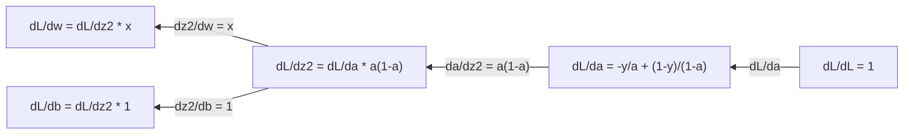

# Giải Tích Cho Machine Learning (Calculus for Machine Learning)

> Đạo hàm cho bạn biết hướng nào là hướng xuống dốc. Đó là tất cả những gì một mạng nơ-ron cần để học.

**Type:** Learn
**Language:** Python
**Prerequisites:** Phase 1, Lessons 01-03
**Time:** ~60 phút

## Mục Tiêu Học Tập

- Tính toán đạo hàm giải tích (analytical) và đạo hàm số học (numerical) cho các hàm số phổ biến trong ML ($x^2$, sigmoid, cross-entropy)
- Tự cài đặt thuật toán hạ độ dốc (gradient descent) từ đầu để cực tiểu hóa hàm mất mát trong không gian 1D và 2D
- Suy dẫn gradient của mô hình hồi quy tuyến tính và huấn luyện mô hình thông qua việc cập nhật trọng số thủ công
- Giải thích ma trận Hessian, khai triển xấp xỉ chuỗi Taylor và mối liên hệ mật thiết giữa chúng với các phương pháp tối ưu hóa

## Vấn Đề

Bạn có một mạng nơ-ron với hàng triệu trọng số. Mỗi trọng số giống như một chiếc núm xoay. Bạn cần tìm ra hướng xoay cho từng chiếc núm một để khiến mô hình bớt sai đi một chút. Giải tích chính là công cụ chỉ ra chính xác hướng xoay đó.

Nếu không có giải tích, việc huấn luyện một mạng nơ-ron sẽ giống như việc thử thay đổi ngẫu nhiên từng con số và cầu may. Nhờ có đạo hàm, bạn biết chính xác từng trọng số ảnh hưởng đến sai số như thế nào. Bạn xoay từng chiếc núm đúng hướng, trong mọi lần lặp.

## Khái Niệm

### Đạo Hàm Là Gì?

Đạo hàm đo lường tốc độ biến thiên. Đối với một hàm số $y = f(x)$, đạo hàm $f'(x)$ cho bạn biết: nếu bạn nhích nhẹ $x$ một lượng cực nhỏ, thì $y$ sẽ thay đổi bao nhiêu?

Về mặt hình học, đạo hàm là hệ số góc (độ dốc) của tiếp tuyến tại một điểm trên đồ thị.

**Xét hàm số $f(x) = x^2$:**

| $x$ | $f(x)$ | $f'(x)$ (hệ số góc) |
|-----|--------|---------------------|
| 0 | 0 | 0 (nằm ngang, điểm đáy) |
| 1 | 1 | 2 |
| 2 | 4 | 4 (độ dốc tiếp tuyến tại điểm này) |
| 3 | 9 | 6 |

Tại $x=2$, độ dốc là 4. Nếu bạn nhích $x$ sang phải một chút xíu, $y$ sẽ tăng thêm một lượng gấp khoảng 4 lần lượng nhích đó. Tại $x=0$, độ dốc bằng 0. Bạn đang ở ngay đáy của chiếc bát.

Định nghĩa toán học hình thức:

```math
f'(x) = \lim_{h \to 0} \frac{f(x + h) - f(x)}{h}
```

Trong lập trình, bạn bỏ qua phép lấy giới hạn và chỉ cần chọn một giá trị $h$ rất nhỏ. Đó chính là đạo hàm số học (numerical derivative).

### Đạo Hàm Riêng: Từng Biến Một Tại Một Thời Điểm

Các hàm số thực tế có rất nhiều đầu vào. Hàm mất mát của mạng nơ-ron phụ thuộc vào hàng triệu trọng số. Một đạo hàm riêng (partial derivative) sẽ coi tất cả các biến số khác là hằng số, và chỉ lấy đạo hàm theo duy nhất một biến đang xét.

```math
\begin{aligned}
f(x, y) &= x^2 + 3xy + y^2 \\[4pt]
\frac{\partial f}{\partial x} &= 2x + 3y \quad \text{(coi } y \text{ là hằng số)} \\
\frac{\partial f}{\partial y} &= 3x + 2y \quad \text{(coi } x \text{ là hằng số)}
\end{aligned}
```

Mỗi đạo hàm riêng trả lời cho câu hỏi: nếu tôi chỉ nhích nhẹ duy nhất một trọng số này, hàm mất mát sẽ thay đổi thế nào?

### Gradient: Vector Của Tất Cả Các Đạo Hàm Riêng

Gradient gom tất cả các đạo hàm riêng thành một vector duy nhất. Đối với hàm số $f(x, y, z)$, gradient là:

```math
\nabla f = \left[ \frac{\partial f}{\partial x}, \frac{\partial f}{\partial y}, \frac{\partial f}{\partial z} \right]
```

Vector Gradient luôn chỉ theo hướng tăng nhanh nhất (steepest ascent) của hàm số. Do đó, để cực tiểu hóa một hàm số, chúng ta đi theo hướng ngược lại với gradient ($-\nabla f$).

**Đường mức (contour lines) của $f(x,y) = x^2 + y^2$:**

Hàm số có dạng một chiếc bát với các đường đồng mức là các đường tròn đồng tâm. Điểm cực tiểu nằm tại (0, 0).

| Điểm | $\nabla f$ | $-\nabla f$ (hướng giảm dốc) |
|------|------------|------------------------------|
| (1, 1) | [2, 2] (chỉ lên dốc, xa điểm đáy) | [-2, -2] (chỉ xuống dốc, hướng về đáy) |
| (0, 0) | [0, 0] (phẳng, tại điểm cực tiểu) | [0, 0] |

Đó chính là bức tranh trực quan của thuật toán Gradient Descent: Tính toán gradient, đổi dấu nó, và bước một bước theo hướng đó.

### Kết Nối Với Tối Ưu Hóa

Huấn luyện một mạng nơ-ron bản chất là bài toán tối ưu hóa. Bạn có một hàm mất mát $L(w_1, w_2, \ldots, w_n)$ đo lường độ sai lệch của mô hình. Bạn muốn cực tiểu hóa hàm số này.

```
Quy tắc cập nhật của Gradient Descent:

  w_mới = w_cũ - learning_rate * dL/dw

Đối với mỗi trọng số:
  1. Tính đạo hàm riêng của hàm mất mát theo trọng số đó
  2. Lấy trọng số hiện tại trừ đi một lượng tỉ lệ với đạo hàm đó
  3. Lặp lại quá trình
```

Tốc độ học (learning rate) kiểm soát độ dài của mỗi bước đi. Quá lớn sẽ khiến bạn nhảy vọt qua điểm cực tiểu. Quá nhỏ sẽ khiến quá trình học diễn ra chậm như rùa bò.

**Không gian mất mát (lát cắt 1D):**

Hàm mất mát $L(w)$ tạo thành một đường cong với các đỉnh và thung lũng khi trọng số $w$ thay đổi:
- **Cực tiểu toàn cục (Global minimum):** Điểm thấp nhất trên toàn bộ đường cong -- lời giải tối ưu nhất.
- **Cực tiểu địa phương (Local minimum):** Thung lũng thấp hơn các điểm xung quanh nhưng không phải là điểm thấp nhất nói chung.
- **Độ dốc (Slope):** Gradient descent luôn trượt xuống dốc từ bất kỳ điểm xuất phát nào. Trong không gian nhiều chiều (hàng triệu trọng số), việc mắc kẹt tại cực tiểu địa phương hiếm khi là vấn đề cản trở thực tế.

### Đạo Hàm Số Học vs Đạo Hàm Giải Tích

Có hai cách tiếp cận để tính đạo hàm:

- **Giải tích (Analytical):** Áp dụng các quy tắc giải tích toán học bằng tay. Ví dụ với $f(x) = x^2$, đạo hàm là $f'(x) = 2x$. Chính xác tuyệt đối và tính toán cực nhanh.
- **Số học (Numerical):** Xấp xỉ dựa trên định nghĩa sai phân hữu hạn. Tính $f(x+h)$ và $f(x-h)$ với $h$ cực nhỏ, rồi tính thương số.

```
Đạo hàm số học (sai phân trung tâm - central difference):

f'(x) ~= f(x + h) - f(x - h)
          -----------------------
                   2h

Trong thực tế, h = 0.0001 hoạt động rất tốt
```

Đạo hàm số học chậm hơn nhưng có thể áp dụng cho bất kỳ hàm số nào dưới dạng hộp đen. Đạo hàm giải tích nhanh nhưng đòi hỏi bạn phải chứng minh công thức. Các framework học sâu hiện đại sử dụng cách tiếp cận thứ ba: **tự động tính đạo hàm (automatic differentiation - autodiff)**, giúp tính toán đạo hàm chính xác bằng cơ chế máy tính.

### Các Đạo Hàm Cơ Bản Cần Nhớ Trong ML

```
Hàm số           Đạo hàm              Ứng dụng trong ML
------           -------              -----------------
f(x) = x^2       f'(x) = 2x           Hàm mất mát (MSE)
f(x) = wx + b    f'(w) = x            Tầng tuyến tính (gradient theo trọng số)
                 f'(b) = 1            Tầng tuyến tính (gradient theo bias)
                 f'(x) = w            Tầng tuyến tính (gradient theo đầu vào)
f(x) = e^x       f'(x) = e^x          Hàm Softmax, Attention
f(x) = ln(x)     f'(x) = 1/x          Hàm mất mát Cross-entropy
f(x) = 1/(1+e^-x) f'(x) = f(x)(1-f(x)) Hàm kích hoạt Sigmoid
```

### Quy Tắc Dây Chuyền (Chain Rule)

Khi các hàm số lồng ghép vào nhau, quy tắc dây chuyền cho bạn biết cách lấy đạo hàm của hàm hợp:

```
Nếu y = f(g(x)), thì dy/dx = f'(g(x)) * g'(x)

Ví dụ: y = (3x + 1)^2
  Hàm ngoài: f(u) = u^2       f'(u) = 2u
  Hàm trong: g(x) = 3x + 1    g'(x) = 3
  dy/dx = 2(3x + 1) * 3 = 6(3x + 1)
```

Mạng nơ-ron là một chuỗi các hàm hợp lồng ghép: input -> linear -> activation -> linear -> activation -> loss. Lan truyền ngược (Backpropagation) thực chất chỉ là quy tắc dây chuyền được áp dụng lặp đi lặp lại từ đầu ra ngược về đầu vào.

### Ma Trận Hessian

Gradient cho bạn biết độ dốc. Ma trận Hessian cho bạn biết độ cong (curvature).

Hessian là ma trận chứa tất cả các đạo hàm riêng bậc hai. Với hàm số $f(x_1, x_2, \ldots, x_n)$, phần tử $(i, j)$ của Hessian là:

```math
H_{ij} = \frac{\partial^2 f}{\partial x_i \, \partial x_j}
```

Với hàm 2 biến $f(x, y)$:

```math
H = \begin{bmatrix} \dfrac{\partial^2 f}{\partial x^2} & \dfrac{\partial^2 f}{\partial x \, \partial y} \\[8pt] \dfrac{\partial^2 f}{\partial y \, \partial x} & \dfrac{\partial^2 f}{\partial y^2} \end{bmatrix}
```

**Tính chất của Hessian tại điểm dừng (nơi gradient = 0):**

| Tính chất của Hessian | Ý nghĩa | Hình dạng bề mặt |
|-----------------------|---------|-------------------|
| Xác định dương (tất cả trị riêng > 0) | Cực tiểu địa phương | Chiếc bát ngửa lên |
| Xác định âm (tất cả trị riêng < 0) | Cực đại địa phương | Chiếc bát úp xuống |
| Không xác định (trị riêng lẫn lộn dương âm) | Điểm yên ngựa (Saddle point) | Hình yên ngựa |

**Tại sao Hessian quan trọng trong ML:**

Phương pháp Newton (Newton's method) sử dụng Hessian để thực hiện các bước tối ưu thông minh hơn gradient descent. Thay vì chỉ đi theo độ dốc, nó điều chỉnh theo độ cong bề mặt:

```math
\begin{aligned}
\text{Bước cập nhật Newton:} \quad & w_{\text{mới}} = w_{\text{cũ}} - H^{-1} \cdot \text{gradient} \\
\text{Gradient descent:} \quad & w_{\text{mới}} = w_{\text{cũ}} - \text{lr} \cdot \text{gradient}
\end{aligned}
```

Phương pháp Newton hội tụ nhanh hơn vì Hessian "tái cân bằng kích thước" gradient -- các hướng có độ dốc quá lớn sẽ đi bước nhỏ hơn, các hướng bằng phẳng sẽ đi bước lớn hơn.

Tuy nhiên: với mạng có $N$ tham số, Hessian có kích thước $N \times N$. Với mô hình 1 triệu tham số, ma trận Hessian sẽ có 1 nghìn tỷ phần tử. Do đó chúng ta phải dùng các thuật toán xấp xỉ bậc hai như Adam hay L-BFGS.

| Thuật toán | Sử dụng | Chi phí mỗi bước | Tốc độ hội tụ |
|------------|---------|------------------|---------------|
| Gradient descent | Đạo hàm bậc 1 | $O(N)$ | Chậm (tuyến tính) |
| Phương pháp Newton | Ma trận Hessian đầy đủ | $O(N^3)$ | Rất nhanh (bậc hai) |
| L-BFGS | Xấp xỉ Hessian từ lịch sử gradient | $O(N)$ | Khá nhanh (siêu tuyến tính) |
| Adam | Tốc độ học thích ứng từng tham số (xấp xỉ đường chéo Hessian) | $O(N)$ | Trung bình |
| Natural gradient | Ma trận Fisher Information (Hessian thống kê) | $O(N^2)$ | Nhanh |

### Khai Triển Chuỗi Taylor

Mọi hàm số khả vi đều có thể được xấp xỉ cục bộ xung quanh một điểm bằng đa thức:

```math
f(x + h) = f(x) + f'(x)\,h + \frac{1}{2} f''(x)\,h^2 + \frac{1}{6} f'''(x)\,h^3 + \cdots
```

- **Xấp xỉ bậc 1 = Gradient Descent:** $f(x + h) \approx f(x) + f'(x) h$. Bạn đang dùng mô hình tuyến tính cục bộ.
- **Xấp xỉ bậc 2 = Phương pháp Newton:** $f(x + h) \approx f(x) + f'(x) h + \frac{1}{2} f''(x) h^2$. Mô hình bậc hai dạng parabol. Cực tiểu hóa nó cho nghiệm $h = -f'(x)/f''(x)$.

### Tích Phân Trong ML

Đạo hàm đo tốc độ biến thiên. Tích phân tính toán sự tích lũy -- diện tích dưới đường cong.

- **Xác suất:** $P(a < X < b) = \int_a^b p(x) \, dx$.
- **Kỳ vọng (Expected Value):** $\mathbb{E}[f(X)] = \int f(x) \, p(x) \, dx$. Hàm mất mát thực chất là kỳ vọng sai số trên toàn bộ phân phối dữ liệu.
- **Độ phân kỳ KL (KL Divergence):** Đo lường sự khác biệt giữa hai phân phối xác suất trong VAEs và mô hình khuếch tán.

### Quy Tắc Dây Chuyền Trong Đồ Thị Tính Toán (Computation Graph)

Đồ thị tính toán biểu diễn dòng chảy xuôi (Forward pass):


Lượt tính toán ngược (Backward pass) tính toán gradient từ phải sang trái:



Đây chính là toàn bộ bản chất của Lan truyền ngược (Backpropagation).

### Ma Trận Jacobian

Khi một hàm số ánh xạ một vector sang một vector khác (như một tầng nơ-ron), đạo hàm của nó là một ma trận, gọi là **ma trận Jacobian** $J \in \mathbb{R}^{m \times n}$. Nó chứa mọi đạo hàm riêng của từng đầu ra theo từng đầu vào. Gradient sẽ lan truyền ngược qua ma trận chuyển vị của Jacobian.

```figure
derivative-tangent
```

## Tự Xây Dựng (Build It)

### Bước 1: Đạo hàm số học từ đầu

```python
def numerical_derivative(f, x, h=1e-7):
    return (f(x + h) - f(x - h)) / (2 * h)

def f(x):
    return x ** 2

for x in [-2, -1, 0, 1, 2]:
    numerical = numerical_derivative(f, x)
    analytical = 2 * x
    print(f"x={x:2d}  f'(x) số học={numerical:.6f}  giải tích={analytical:.1f}")
```

### Bước 2: Đạo hàm riêng và Gradient

```python
def numerical_gradient(f, point, h=1e-7):
    gradient = []
    for i in range(len(point)):
        point_plus = list(point)
        point_minus = list(point)
        point_plus[i] += h
        point_minus[i] -= h
        partial = (f(point_plus) - f(point_minus)) / (2 * h)
        gradient.append(partial)
    return gradient

def f_multi(point):
    x, y = point
    return x**2 + 3*x*y + y**2

grad = numerical_gradient(f_multi, [1.0, 2.0])
print(f"Gradient số học tại (1,2): {[f'{g:.4f}' for g in grad]}")
print(f"Gradient giải tích tại (1,2): [2*1+3*2, 3*1+2*2] = [{2*1+3*2}, {3*1+2*2}]")
```

### Bước 3: Gradient Descent tìm cực tiểu của f(x) = x^2

```python
x = 5.0
lr = 0.1
for step in range(20):
    grad = 2 * x
    x = x - lr * grad
    print(f"bước {step:2d}  x={x:8.4f}  f(x)={x**2:10.6f}")
```

### Bước 4: Gradient Descent trên hàm số 2D

```python
def f_2d(point):
    x, y = point
    return x**2 + y**2

point = [4.0, 3.0]
lr = 0.1
for step in range(30):
    grad = numerical_gradient(f_2d, point)
    point = [p - lr * g for p, g in zip(point, grad)]
    loss = f_2d(point)
    if step % 5 == 0 or step == 29:
        print(f"bước {step:2d}  điểm=({point[0]:7.4f}, {point[1]:7.4f})  f={loss:.6f}")
```

### Bước 5: So sánh đạo hàm số học và giải tích

```python
import math

test_functions = [
    ("x^2",      lambda x: x**2,          lambda x: 2*x),
    ("x^3",      lambda x: x**3,          lambda x: 3*x**2),
    ("sin(x)",   lambda x: math.sin(x),   lambda x: math.cos(x)),
    ("e^x",      lambda x: math.exp(x),   lambda x: math.exp(x)),
    ("1/x",      lambda x: 1/x,           lambda x: -1/x**2),
]

x = 2.0
print(f"{'Hàm số':<12} {'Số học':>12} {'Giải tích':>12} {'Sai số':>12}")
print("-" * 50)
for name, f, df in test_functions:
    num = numerical_derivative(f, x)
    ana = df(x)
    err = abs(num - ana)
    print(f"{name:<12} {num:12.6f} {ana:12.6f} {err:12.2e}")
```

### Bước 6: Tính ma trận Hessian bằng số học

```python
def hessian_2d(f, x, y, h=1e-5):
    fxx = (f(x + h, y) - 2 * f(x, y) + f(x - h, y)) / (h ** 2)
    fyy = (f(x, y + h) - 2 * f(x, y) + f(x, y - h)) / (h ** 2)
    fxy = (f(x + h, y + h) - f(x + h, y - h) - f(x - h, y + h) + f(x - h, y - h)) / (4 * h ** 2)
    return [[fxx, fxy], [fxy, fyy]]

def saddle(x, y):
    return x ** 2 - y ** 2

def bowl(x, y):
    return x ** 2 + y ** 2

H_saddle = hessian_2d(saddle, 0.0, 0.0)
H_bowl = hessian_2d(bowl, 0.0, 0.0)
print(f"Hessian của hàm yên ngựa: {H_saddle}")  # [[2, 0], [0, -2]] -- trị riêng trái dấu
print(f"Hessian của hình bát:     {H_bowl}")    # [[2, 0], [0, 2]]  -- đều dương
```

### Bước 7: Thử nghiệm xấp xỉ Taylor

```python
import math

def taylor_approx(f, f_prime, f_double_prime, x0, h, order=2):
    result = f(x0)
    if order >= 1:
        result += f_prime(x0) * h
    if order >= 2:
        result += 0.5 * f_double_prime(x0) * h ** 2
    return result

x0 = 0.0
for h in [0.1, 0.5, 1.0, 2.0]:
    true_val = math.sin(h)
    t1 = taylor_approx(math.sin, math.cos, lambda x: -math.sin(x), x0, h, order=1)
    t2 = taylor_approx(math.sin, math.cos, lambda x: -math.sin(x), x0, h, order=2)
    print(f"h={h:.1f}  sin(h)={true_val:.4f}  bậc 1={t1:.4f}  bậc 2={t2:.4f}")
```

### Bước 8: Huấn luyện mô hình hồi quy tuyến tính từ đầu

```python
import random

random.seed(42)

w = random.gauss(0, 1)
b = random.gauss(0, 1)
lr = 0.01

xs = [1.0, 2.0, 3.0, 4.0, 5.0]
ys = [3.0, 5.0, 7.0, 9.0, 11.0]

for epoch in range(200):
    total_loss = 0
    dw = 0
    db = 0
    for x, y in zip(xs, ys):
        pred = w * x + b
        error = pred - y
        total_loss += error ** 2
        dw += 2 * error * x
        db += 2 * error
    dw /= len(xs)
    db /= len(xs)
    total_loss /= len(xs)
    w -= lr * dw
    b -= lr * db
    if epoch % 40 == 0 or epoch == 199:
        print(f"epoch {epoch:3d}  w={w:.4f}  b={b:.4f}  loss={total_loss:.6f}")

print(f"\nHọc được: y = {w:.2f}x + {b:.2f}")
print(f"Thực tế:   y = 2x + 1")
```

Mọi vòng lặp huấn luyện học sâu dựa trên gradient đều tuân thủ khuôn mẫu này: dự đoán, tính loss, tính gradient, cập nhật trọng số.

## Sử Dụng Thư Viện (Use It)

Với NumPy, các thao tác trở nên ngắn gọn và hiệu quả hơn:

```python
import numpy as np

x = np.array([1, 2, 3, 4, 5], dtype=float)
y = np.array([3, 5, 7, 9, 11], dtype=float)

w, b = np.random.randn(), np.random.randn()
lr = 0.01

for epoch in range(200):
    pred = w * x + b
    error = pred - y
    loss = np.mean(error ** 2)
    dw = np.mean(2 * error * x)
    db = np.mean(2 * error)
    w -= lr * dw
    b -= lr * db

print(f"Học được: y = {w:.2f}x + {b:.2f}")
```

## Bài Tập Thực Hành

1. Cài đặt `numerical_second_derivative(f, x)` bằng cách gọi lồng hai lần `numerical_derivative`. Xác nhận rằng đạo hàm bậc hai của $x^3$ tại $x=2$ là 12.
2. Dùng thuật toán gradient descent tìm điểm cực tiểu của $f(x, y) = (x - 3)^2 + (y + 1)^2$. Bắt đầu từ $(0, 0)$. Kết quả phải hội tụ về $(3, -1)$.
3. Bổ sung quán tính (momentum) vào vòng lặp gradient descent: duy trì một vector vận tốc `v` tích lũy các gradient trong quá khứ. So sánh tốc độ hội tụ khi có và không có quán tính trên hàm $f(x) = x^4 - 3x^2$.

### Gợi Ý

**Bài 1.** Định nghĩa một hàm phụ trả về `numerical_derivative(f, x)` và truyền hàm phụ đó vào `numerical_derivative` lần thứ hai. Nếu kết quả bị nhiễu do sai số làm tròn số thực, hãy dùng bước $h$ lớn hơn một chút như `h=1e-4`; giá trị tại $x=2$ phải xấp xỉ 12.

**Bài 2.** Viết gradient giải tích $(2(x - 3), 2(y + 1))$ hoặc dùng hàm `numerical_gradient`, sau đó chạy từ $(0, 0)$. In ra tọa độ mỗi 10 bước; điểm sẽ dịch chuyển dần về $(3, -1)$ và mất mát tiệm cận về 0.

**Bài 3.** Giữ biến vận tốc `v`, cập nhật `v = momentum * v - lr * grad`, sau đó cộng `v` vào `x`. Đếm số bước cần thiết để đưa gradient về sát 0; cực tiểu nằm tại $x = \pm\sqrt{1.5} \approx \pm 1.225$.

## Thuật Ngữ Then Chốt

| Thuật ngữ | Người ta thường nói | Bản chất thực sự |
|-----------|--------------------|-------------------|
| Đạo hàm (Derivative) | "Hệ số góc" | Tốc độ biến thiên của hàm số tại một điểm. Cho biết đầu ra thay đổi bao nhiêu trên một đơn vị thay đổi của đầu vào. |
| Đạo hàm riêng (Partial derivative) | "Đạo hàm theo 1 biến" | Đạo hàm theo một biến duy nhất trong khi giữ tất cả các biến khác cố định. |
| Gradient | "Hướng dốc đứng nhất" | Vector gom tất cả các đạo hàm riêng. Chỉ theo hướng làm hàm số tăng nhanh nhất. |
| Hạ độ dốc (Gradient descent) | "Đi xuống dốc" | Trừ bớt gradient (nhân với tốc độ học) khỏi các tham số để giảm sai số. Cốt lõi của huấn luyện mạng nơ-ron. |
| Tốc độ học (Learning rate) | "Kích thước bước đi" | Hệ số vô hướng kiểm soát độ lớn mỗi bước cập nhật. Quá lớn: phân kỳ. Quá nhỏ: hội tụ chậm. |
| Quy tắc dây chuyền (Chain rule) | "Nhân các đạo hàm lại" | Quy tắc lấy đạo hàm của hàm hợp: $\frac{df}{dx} = \frac{df}{dg} \cdot \frac{dg}{dx}$. Nền tảng toán học của lan truyền ngược. |
| Ma trận Jacobian | "Ma trận đạo hàm" | Khi hàm số biến đổi vector thành vector, Jacobian là ma trận chứa tất cả các đạo hàm riêng của từng đầu ra theo từng đầu vào. |
| Đạo hàm số học | "Sai phân hữu hạn" | Xấp xỉ đạo hàm bằng cách tính giá trị hàm tại hai điểm rất gần nhau rồi chia cho khoảng cách. |
| Lan truyền ngược (Backpropagation) | "Reverse-mode autodiff" | Tính toán gradient lần lượt từng tầng từ đầu ra ngược về đầu vào bằng quy tắc dây chuyền. |
| Ma trận Hessian | "Đạo hàm bậc hai" | Ma trận chứa tất cả các đạo hàm riêng bậc hai. Mô tả độ cong bề mặt. Hessian xác định dương tại điểm dừng cho biết điểm cực tiểu địa phương. |
| Chuỗi Taylor | "Xấp xỉ đa thức" | Xấp xỉ hàm số cục bộ quanh một điểm bằng các đạo hàm: $f(x+h) \approx f(x) + f'(x)h + \frac{1}{2}f''(x)h^2 + \cdots$. Cơ sở lý giải tại sao gradient descent và Newton hoạt động. |
| Tích phân (Integral) | "Diện tích dưới đường cong" | Phép tích lũy một đại lượng trên một miền. Trong ML, tích phân định nghĩa xác suất, kỳ vọng và độ phân kỳ KL. |

## Tài Liệu Đọc Thêm

- [3Blue1Brown: Bản chất của Giải tích](https://www.3blue1brown.com/topics/calculus) - trực giác hình ảnh tuyệt vời cho đạo hàm, tích phân và quy tắc dây chuyền
- [Stanford CS231n: Lan truyền ngược (Backpropagation)](https://cs231n.github.io/optimization-2/) - cách thức dòng gradient chảy qua các tầng mạng nơ-ron
