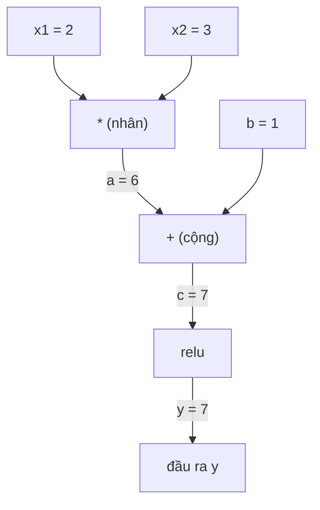
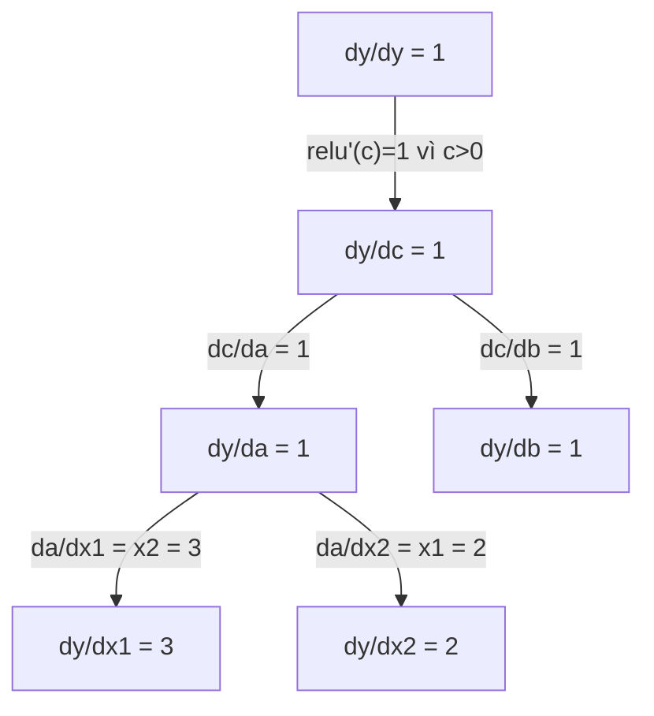

# Quy Tắc Dây Chuyền & Đạo Hàm Tự Động (Chain Rule & Automatic Differentiation)

> Quy tắc dây chuyền là động cơ đằng sau mọi mạng nơ-ron có khả năng học hỏi.

**Type:** Build
**Language:** Python
**Prerequisites:** Phase 1, Lesson 04 (Derivatives & Gradients)
**Time:** ~90 phút

## Mục Tiêu Học Tập

- Xây dựng một công cụ autograd tối giản (lớp `Value`) ghi lại các phép toán và tự động tính gradient thông qua cơ chế reverse-mode autodiff
- Cài đặt lượt truyền xuôi (forward pass) và lượt truyền ngược (backward pass) trên đồ thị tính toán sử dụng thuật toán sắp xếp tô-pô (topological sort)
- Xây dựng và huấn luyện mạng perceptron đa tầng (MLP) giải bài toán logic XOR chỉ sử dụng công cụ autograd tự viết từ đầu
- Kiểm chứng tính chính xác của thuật toán autodiff bằng kỹ thuật gradient checking so sánh với sai phân hữu hạn số học

## Vấn Đề

Bạn có thể dễ dàng tính đạo hàm của các hàm số đơn giản. Nhưng một mạng nơ-ron không phải là một hàm số đơn giản. Nó là sự kết hợp lồng ghép của hàng trăm, hàng nghìn phép toán: nhân ma trận, cộng bias, kích hoạt phi tuyến, nhân ma trận tiếp, hàm softmax, rồi đến hàm mất mát cross-entropy. Đầu ra là một hàm lồng trong một hàm lồng trong một hàm khác.

Để huấn luyện mạng, bạn cần gradient của hàm mất mát đối với từng trọng số đơn lẻ. Làm điều này bằng tay là bất khả thi với hàng triệu tham số. Tính toán bằng số học (sai phân hữu hạn) thì quá chậm chạp.

Quy tắc dây chuyền cung cấp nền tảng toán học. Đạo hàm tự động (Automatic differentiation - autodiff) cung cấp thuật toán lập trình. Cùng nhau, chúng cho phép bạn tính toán gradient chính xác tuyệt đối qua mọi phép hợp hàm tùy ý với thời gian tính toán tương đương một lượt truyền xuôi duy nhất.

Đây chính xác là cách PyTorch, TensorFlow và JAX vận hành. Bạn sẽ tự tay xây dựng một phiên bản thu nhỏ hoàn chỉnh từ đầu.

## Khái Niệm

### Quy Tắc Dây Chuyền (The Chain Rule)

Nếu $y = f(g(x))$, đạo hàm của $y$ theo $x$ là:

```math
\frac{dy}{dx} = \frac{dy}{dg} \cdot \frac{dg}{dx} = f'(g(x)) \cdot g'(x)
```

Bạn nhân các đạo hàm thành phần dọc theo chuỗi liên kết. Mỗi mắt xích đóng góp đạo hàm cục bộ của chính nó.

Ví dụ: $y = \sin(x^2)$

```math
\begin{aligned}
g(x) &= x^2 \qquad & g'(x) &= 2x \\
f(g) &= \sin(g) \qquad & f'(g) &= \cos(g) \\[4pt]
\frac{dy}{dx} &= \cos(x^2) \cdot 2x
\end{aligned}
```

Đối với các hàm lồng nhau sâu hơn, chuỗi dây chuyền kéo dài tương ứng:

```math
\begin{aligned}
y &= f(g(h(x))) \\[4pt]
\frac{dy}{dx} &= f'(g(h(x))) \cdot g'(h(x)) \cdot h'(x)
\end{aligned}
```

Mỗi tầng trong mạng nơ-ron là một mắt xích trong chuỗi liên kết này.

### Đồ Thị Tính Toán (Computational Graphs)

Đồ thị tính toán giúp trực quan hóa quy tắc dây chuyền. Mỗi phép toán trở thành một nút (node) trong đồ thị. Dữ liệu chảy xuôi qua đồ thị. Gradient chảy ngược trở lại.

**Lượt truyền xuôi - Forward pass (tính toán giá trị):**



**Lượt truyền ngược - Backward pass (tính toán gradient):**



Lượt truyền ngược áp dụng quy tắc dây chuyền tại mọi nút, lan truyền gradient từ đầu ra ngược về các đầu vào.

### Chế Độ Xuôi (Forward Mode) vs Chế Độ Ngược (Reverse Mode)

Có hai cách áp dụng quy tắc dây chuyền qua đồ thị tính toán:

- **Chế độ xuôi (Forward mode):** Bắt đầu từ đầu vào và đẩy đạo hàm về phía trước. Nó khởi tạo $dx/dx = 1$ và lan truyền qua từng phép toán. Phương pháp này tối ưu khi bạn có **ít đầu vào và nhiều đầu ra**.
- **Chế độ ngược (Reverse mode):** Bắt đầu từ đầu ra và kéo gradient ngược về đầu vào. Nó khởi tạo $dy/dy = 1$ và lan truyền ngược qua từng phép toán. Phương pháp này tối ưu khi bạn có **nhiều đầu vào và ít đầu ra**.

Mạng nơ-ron có hàng triệu đầu vào (trọng số) nhưng chỉ có một đầu ra duy nhất (giá trị hàm mất mát loss). Chế độ ngược tính toán toàn bộ gradient cho tất cả triệu tham số chỉ trong một lượt duyệt ngược duy nhất. Đó là lý do tại sao lan truyền ngược (backpropagation) sử dụng chế độ ngược (reverse mode).

| Chế độ | Điểm khởi đầu (Seed) | Chiều lan truyền | Tối ưu nhất khi |
|--------|----------------------|------------------|-----------------|
| Forward | $dx_i/dx_i = 1$ | Đầu vào -> Đầu ra | Ít đầu vào, nhiều đầu ra |
| Reverse | $dy/dy = 1$ | Đầu ra -> Đầu vào | Nhiều đầu vào, ít đầu ra (Mạng nơ-ron) |

### Số Đối Ngẫu (Dual Numbers) Cho Chế Độ Xuôi

Chế độ xuôi có thể được cài đặt rất đẹp mắt bằng số đối ngẫu. Số đối ngẫu có dạng $a + b\epsilon$ với quy ước $\epsilon^2 = 0$.

```
Số đối ngẫu: (giá trị, đạo hàm)

(2, 1) nghĩa là: giá trị bằng 2, đạo hàm theo x bằng 1

Quy tắc đại số:
  (a, a') + (b, b') = (a+b, a'+b')
  (a, a') * (b, b') = (a*b, a'*b + a*b')
  sin(a, a')        = (sin(a), cos(a)*a')
```

### Xây Dựng Một Công Cụ Autograd

Một công cụ autograd cần 3 thành phần cốt lõi:

1. **Đóng gói giá trị (Value wrapping):** Bọc từng con số trong một đối tượng lưu trữ giá trị dữ liệu và gradient tích lũy của nó.
2. **Ghi lại đồ thị (Graph recording):** Mọi phép toán tự động ghi lại các biến đầu vào và hàm tính đạo hàm cục bộ tương ứng.
3. **Lượt truyền ngược (Backward pass):** Sắp xếp tô-pô (topological sort) đồ thị, duyệt ngược thứ tự đó và kích hoạt quy tắc dây chuyền tại mỗi nút.

### Cơ Chế PyTorch Autograd Hoạt Động Bên Dưới

Khi bạn viết mã trong PyTorch:

```python
x = torch.tensor(2.0, requires_grad=True)
y = x ** 2 + 3 * x + 1
y.backward()
print(x.grad)  # 7.0 = 2*x + 3 = 2*2 + 3
```

Bên trong, PyTorch thực hiện:
1. Tạo nút `Tensor` cho `x` với cờ `requires_grad=True`.
2. Mỗi phép toán (`**`, `*`, `+`) tạo ra một nút mới và đính kèm hàm tính đạo hàm ngược `grad_fn`.
3. Lệnh `y.backward()` kích hoạt quá trình duyệt ngược qua đồ thị đã ghi nhận.
4. Gradient tích lũy vào thuộc tính `.grad` thông qua phép cộng dồn `+=` (không ghi đè).
5. Đồ thị tính toán là đồ thị động (dynamic graph / define-by-run) được tạo mới trong mỗi lượt chạy xuôi, cho phép sử dụng vòng lặp và câu lệnh rẽ nhánh `if/else` của Python bên trong mô hình.

```figure
chain-rule
```

## Tự Xây Dựng (Build It)

### Bước 1: Lớp Value

```python
class Value:
    def __init__(self, data, children=(), op=''):
        self.data = data
        self.grad = 0.0
        self._backward = lambda: None
        self._prev = set(children)
        self._op = op

    def __repr__(self):
        return f"Value(data={self.data:.4f}, grad={self.grad:.4f})"
```

Mỗi đối tượng `Value` lưu giữ dữ liệu số, gradient (ban đầu bằng 0), một hàm `_backward`, và tập hợp các nút con tạo ra nó.

### Bước 2: Các phép toán cơ bản với theo dõi gradient

```python
    def __add__(self, other):
        other = other if isinstance(other, Value) else Value(other)
        out = Value(self.data + other.data, (self, other), '+')
        def _backward():
            self.grad += out.grad
            other.grad += out.grad
        out._backward = _backward
        return out

    def __mul__(self, other):
        other = other if isinstance(other, Value) else Value(other)
        out = Value(self.data * other.data, (self, other), '*')
        def _backward():
            self.grad += other.data * out.grad
            other.grad += self.data * out.grad
        out._backward = _backward
        return out

    def relu(self):
        out = Value(max(0, self.data), (self,), 'relu')
        def _backward():
            self.grad += (1.0 if out.data > 0 else 0.0) * out.grad
        out._backward = _backward
        return out
```

Phép cộng dồn `+=` xử lý chính xác trường hợp một biến được dùng nhiều lần trong các nhánh khác nhau của biểu thức.

### Bước 3: Lượt truyền ngược (Backward pass)

```python
    def backward(self):
        topo = []
        visited = set()
        def build_topo(v):
            if v not in visited:
                visited.add(v)
                for child in v._prev:
                    build_topo(child)
                topo.append(v)
        build_topo(self)

        self.grad = 1.0
        for v in reversed(topo):
            v._backward()
```

Sắp xếp tô-pô đảm bảo gradient của mỗi nút được cộng dồn đầy đủ trước khi nút đó tiếp tục đẩy gradient về các nút con của nó. Gradient khởi đầu tại nút gốc là 1.0 ($dy/dy = 1$).

### Bước 4: Hoàn thiện các phép toán toán học cho Value

```python
    def __neg__(self):
        return self * -1

    def __sub__(self, other):
        return self + (-other)

    def __radd__(self, other):
        return self + other

    def __rmul__(self, other):
        return self * other

    def __rsub__(self, other):
        return other + (-self)

    def __pow__(self, n):
        out = Value(self.data ** n, (self,), f'**{n}')
        def _backward():
            self.grad += n * (self.data ** (n - 1)) * out.grad
        out._backward = _backward
        return out

    def __truediv__(self, other):
        return self * (other ** -1) if isinstance(other, Value) else self * (Value(other) ** -1)

    def exp(self):
        import math
        e = math.exp(self.data)
        out = Value(e, (self,), 'exp')
        def _backward():
            self.grad += e * out.grad
        out._backward = _backward
        return out

    def log(self):
        import math
        out = Value(math.log(self.data), (self,), 'log')
        def _backward():
            self.grad += (1.0 / self.data) * out.grad
        out._backward = _backward
        return out

    def tanh(self):
        import math
        t = math.tanh(self.data)
        out = Value(t, (self,), 'tanh')
        def _backward():
            self.grad += (1 - t ** 2) * out.grad
        out._backward = _backward
        return out
```

| Phép toán | Quy tắc đạo hàm ngược | Ứng dụng trong mạng nơ-ron |
|-----------|------------------------|----------------------------|
| `__sub__` | Tái sử dụng cộng và đổi dấu | Tính hàm mất mát (pred - target) |
| `__pow__` | $n \cdot x^{n-1}$ | Hàm mất mát sai số bình phương MSE |
| `__truediv__` | Tái sử dụng nhân và lũy thừa -1 | Chuẩn hóa, co giãn tốc độ học |
| `exp` | $\exp(x) \cdot \text{upstream}$ | Softmax, ước lượng hợp lý cực đại |
| `log` | $(1/x) \cdot \text{upstream}$ | Hàm mất mát Cross-entropy |
| `tanh` | $(1 - \tanh^2) \cdot \text{upstream}$ | Hàm kích hoạt cổ điển |

### Bước 5: Xây dựng mạng nơ-ron MLP từ đầu

```python
import random

class Neuron:
    def __init__(self, n_inputs):
        self.w = [Value(random.uniform(-1, 1)) for _ in range(n_inputs)]
        self.b = Value(0.0)

    def __call__(self, x):
        act = sum((wi * xi for wi, xi in zip(self.w, x)), self.b)
        return act.tanh()

    def parameters(self):
        return self.w + [self.b]

class Layer:
    def __init__(self, n_inputs, n_outputs):
        self.neurons = [Neuron(n_inputs) for _ in range(n_outputs)]

    def __call__(self, x):
        return [n(x) for n in self.neurons]

    def parameters(self):
        return [p for n in self.neurons for p in n.parameters()]

class MLP:
    def __init__(self, sizes):
        self.layers = [Layer(sizes[i], sizes[i+1]) for i in range(len(sizes)-1)]

    def __call__(self, x):
        for layer in self.layers:
            x = layer(x)
        return x[0] if len(x) == 1 else x

    def parameters(self):
        return [p for layer in self.layers for p in layer.parameters()]
```

**Huấn luyện giải bài toán XOR:**

```python
random.seed(42)
model = MLP([2, 4, 1])  # 2 đầu vào, 4 nơ-ron ẩn, 1 đầu ra

xs = [[0, 0], [0, 1], [1, 0], [1, 1]]
ys = [-1, 1, 1, -1]  # Mẫu XOR (dùng nhãn -1 và 1 cho hàm tanh)

for step in range(100):
    preds = [model(x) for x in xs]
    loss = sum((p - y) ** 2 for p, y in zip(preds, ys))

    for p in model.parameters():
        p.grad = 0.0
    loss.backward()

    lr = 0.05
    for p in model.parameters():
        p.data -= lr * p.grad

    if step % 20 == 0:
        print(f"bước {step:3d}  loss = {loss.data:.4f}")

print("\nDự đoán sau khi huấn luyện:")
for x, y in zip(xs, ys):
    print(f"  đầu vào={x}  mục tiêu={y:2d}  dự đoán={model(x).data:6.3f}")
```

Đây chính là micrograd: Toàn bộ vòng lặp huấn luyện mạng nơ-ron bằng Python thuần với cơ chế tự động tính đạo hàm. Mọi framework deep learning thương mại đều hoạt động dựa trên nguyên lý này ở quy mô lớn.

### Bước 6: Kiểm tra Gradient (Gradient Checking)

Làm sao bạn biết cơ chế autodiff của mình cài đặt đúng? So sánh nó với đạo hàm số học:

```python
def gradient_check(build_expr, x_val, h=1e-7):
    x = Value(x_val)
    y = build_expr(x)
    y.backward()
    autodiff_grad = x.grad

    y_plus = build_expr(Value(x_val + h)).data
    y_minus = build_expr(Value(x_val - h)).data
    numerical_grad = (y_plus - y_minus) / (2 * h)

    diff = abs(autodiff_grad - numerical_grad)
    return autodiff_grad, numerical_grad, diff

def expr(x):
    return (x ** 3 + x * 2 + 1).tanh()

ad, num, diff = gradient_check(expr, 0.5)
print(f"Autodiff:   {ad:.8f}")
print(f"Số học:     {num:.8f}")
print(f"Chênh lệch: {diff:.2e}")
# Chênh lệch phải nhỏ hơn 1e-5
```

### Bước 7: Kiểm chứng với tính toán thủ công bằng tay

```python
x1 = Value(2.0)
x2 = Value(3.0)
a = x1 * x2          # a = 6.0
b = a + Value(1.0)    # b = 7.0
y = b.relu()          # y = 7.0

y.backward()

print(f"y = {y.data}")          # 7.0
print(f"dy/dx1 = {x1.grad}")   # 3.0 (= x2)
print(f"dy/dx2 = {x2.grad}")   # 2.0 (= x1)
```

## Sử Dụng Thư Viện (Use It)

Kiểm chứng lại với PyTorch:

```python
import torch

x1 = torch.tensor(2.0, requires_grad=True)
x2 = torch.tensor(3.0, requires_grad=True)
a = x1 * x2
b = a + 1.0
y = torch.relu(b)
y.backward()

print(f"PyTorch dy/dx1 = {x1.grad.item()}")  # 3.0
print(f"PyTorch dy/dx2 = {x2.grad.item()}")  # 2.0
```

Công cụ tự viết của bạn cho ra kết quả trùng khớp hoàn toàn với PyTorch vì toán học bên dưới là như nhau: reverse-mode autodiff thông qua quy tắc dây chuyền.

## Xuất Bản Sản Phẩm (Ship It)

Bài học này cung cấp:
- `outputs/skill-autodiff.md` -- hướng dẫn chuyên sâu để xây dựng và gỡ lỗi các hệ thống autograd
- `code/autodiff.py` -- bộ công cụ autograd tối giản có thể mở rộng

Lớp `Value` xây dựng ở đây là nền tảng trực tiếp cho vòng lặp huấn luyện mạng nơ-ron hoàn chỉnh ở Phase 3.

## Bài Tập Thực Hành

1. Thêm phương thức `__pow__` vào lớp `Value` để tính `x ** n`. Xác nhận rằng $\frac{d}{dx}(x^3)$ tại $x=2$ bằng chính xác `12.0`.
2. Thêm hàm kích hoạt `tanh`. Xác nhận rằng $\tanh'(0) = 1$ và $\tanh'(2) \approx 0.0707$.
3. Xây dựng đồ thị tính toán cho một nơ-ron đơn lẻ: `y = relu(w1*x1 + w2*x2 + b)`. Tính toàn bộ 5 gradient và kiểm chứng lại với PyTorch.
4. Cài đặt chế độ forward-mode autodiff bằng số đối ngẫu. Tạo một lớp `Dual` và kiểm chứng nó cho ra đạo hàm tương tự như công cụ reverse-mode.

### Gợi Ý

**Bài 1.** Kiểm tra hàm `_backward` của `__pow__` áp dụng công thức $n x^{n-1} \cdot \text{out.grad}$. Chạy `x = Value(2.0)`, `y = x ** 3`, `y.backward()`; `x.grad` phải ra 12.0.

**Bài 2.** Sử dụng công thức $\tanh'(x) = 1 - \tanh(x)^2$ trong `_backward`. So sánh với sai phân hữu hạn của bạn: $\frac{\tanh(x + h) - \tanh(x - h)}{2h}$ phải khớp tại $x = 0$ và $x = 2$.

**Bài 3.** Khởi tạo biểu thức `w1*x1 + w2*x2 + b` bằng các đối tượng `Value`, áp dụng `relu` và gọi `backward`. Nếu đầu vào của `relu` là dương, gradient của `w1` sẽ bằng `x1`; nếu âm, cả 5 gradient đều bằng 0.

**Bài 4.** Lưu giá trị và đạo hàm trong mỗi đối tượng `Dual`, áp dụng quy tắc nhân $(a, a')(b, b') = (ab, a'b + ab')$. Gán đạo hàm đầu vào là 1 và so sánh kết quả với `x.grad` từ engine reverse-mode.

## Thuật Ngữ Then Chốt

| Thuật ngữ | Người ta thường nói | Bản chất thực sự |
|-----------|--------------------|-------------------|
| Quy tắc dây chuyền (Chain rule) | "Nhân các đạo hàm lại" | Đạo hàm của hàm hợp bằng tích các đạo hàm cục bộ của từng hàm thành phần được đánh giá tại điểm tương ứng. |
| Đồ thị tính toán | "Sơ đồ mạng" | Đồ thị có hướng không chu trình (DAG) trong đó các nút là phép toán và các cạnh mang giá trị (lượt xuôi) hoặc gradient (lượt ngược). |
| Chế độ xuôi (Forward mode) | "Đẩy đạo hàm về trước" | Autodiff lan truyền đạo hàm từ đầu vào đến đầu ra. Tốn 1 lượt chạy cho mỗi biến đầu vào. |
| Chế độ ngược (Reverse mode) | "Lan truyền ngược" | Autodiff lan truyền gradient từ đầu ra về đầu vào. Tốn 1 lượt chạy duy nhất cho một biến đầu ra. |
| Autograd | "Đạo hàm tự động" | Hệ thống ghi lại các phép toán trên dữ liệu, xây dựng đồ thị và tính gradient chính xác thông qua quy tắc dây chuyền. |
| Số đối ngẫu (Dual numbers) | "Giá trị kèm đạo hàm" | Các số có dạng $a + b\epsilon$ với $\epsilon^2 = 0$, tự động mang theo thông tin đạo hàm qua các phép toán số học. |
| Sắp xếp tô-pô (Topological sort) | "Thứ tự phụ thuộc" | Sắp xếp các nút của đồ thị sao cho mỗi nút luôn đứng sau tất cả các nút phụ thuộc của nó. Bắt buộc cho việc tính gradient ngược. |
| Tích lũy gradient | "Cộng dồn, không ghi đè" | Khi một giá trị được sử dụng trong nhiều phép toán khác nhau, gradient của nó là tổng của tất cả các nhánh gradient gửi về. |
| Đồ thị động (Dynamic graph) | "Define by run" | Đồ thị tính toán được tạo dựng lại trong mỗi lượt chạy forward, cho phép sử dụng vòng lặp và điều kiện rẽ nhánh linh hoạt (kiểu PyTorch). |
| Gradient checking | "Kiểm chứng số học" | So sánh gradient tính bằng autodiff với gradient xấp xỉ bằng sai phân hữu hạn để đảm bảo tính đúng đắn. |
| MLP | "Perceptron đa tầng" | Mạng nơ-ron có một hoặc nhiều tầng ẩn. Mỗi nơ-ron tính tổng có trọng số cộng bias rồi qua hàm kích hoạt. |
| Nơ-ron (Neuron) | "Tổng trọng số + kích hoạt" | Đơn vị tính toán cơ bản: $\text{output} = \text{activation}(w_1 x_1 + w_2 x_2 + \cdots + b)$. Trọng số và bias là các tham số có thể học được. |

## Tài Liệu Đọc Thêm

- [3Blue1Brown: Giải tích trong Lan truyền ngược](https://www.youtube.com/watch?v=tIeHLnjs5U8) -- video trực quan hóa quy tắc dây chuyền trong mạng nơ-ron
- [PyTorch Autograd mechanics](https://pytorch.org/docs/stable/notes/autograd.html) -- tài liệu chính thức về cơ chế autograd của PyTorch
- [Baydin et al., Automatic Differentiation in Machine Learning: a Survey](https://arxiv.org/abs/1502.05767) -- bài báo tổng quan kinh điển về đạo hàm tự động
