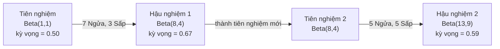

# Định Lý Bayes (Bayes' Theorem)

> Xác suất nói về những gì bạn kỳ vọng. Định lý Bayes nói về những gì bạn học hỏi được.

**Type:** Build
**Language:** Python
**Prerequisites:** Phase 1, Lesson 06 (Probability Fundamentals)
**Time:** ~75 phút

## Mục Tiêu Học Tập

- Áp dụng Định lý Bayes để tính xác suất hậu nghiệm (posterior) từ tiên nghiệm (prior), độ hợp lý (likelihood) và bằng chứng (evidence)
- Xây dựng bộ phân loại văn bản Naive Bayes từ đầu với kỹ thuật làm mịn Laplace và tính toán trong không gian log (log-space)
- So sánh phương pháp ước lượng MLE và MAP, giải thích vì sao MAP tương đương với kỹ thuật điều chuẩn L2 regularization
- Cài đặt quá trình cập nhật Bayes tuần tự (sequential updating) sử dụng phân phối tiên nghiệm liên hợp Beta-Binomial cho bài toán A/B testing

## Vấn Đề

Một xét nghiệm y tế có độ chính xác 99%. Bạn nhận được kết quả xét nghiệm dương tính. Xác suất bạn thực sự mắc bệnh là bao nhiêu?

Hầu hết mọi người sẽ trả lời ngay là 99%. Nhưng câu trả lời thực tế phụ thuộc hoàn toàn vào mức độ hiếm gặp của căn bệnh đó trong cộng đồng. Nếu chỉ có 1 trong 10.000 người mắc bệnh, kết quả dương tính chỉ mang lại cho bạn khoảng 1% khả năng thực sự bị bệnh. 99% các kết quả dương tính còn lại chỉ là báo động giả từ những người hoàn toàn khỏe mạnh.

Đây không phải là câu đố mẹo. Đây chính là Định lý Bayes. Mọi bộ lọc thư rác, mọi hệ thống chẩn đoán y khoa, mọi mô hình máy học định lượng độ bất định đều vận hành dựa trên chính xác cơ chế suy luận này: Bạn bắt đầu với một niềm tin ban đầu. Bạn quan sát thấy bằng chứng mới. Bạn cập nhật lại niềm tin của mình.

Nếu bạn xây dựng các hệ thống ML mà không hiểu rõ điều này, bạn sẽ diễn giải sai hoàn toàn đầu ra của mô hình, đặt ngưỡng quyết định tồi tệ, và triển khai các dự đoán tự tin thái quá nhưng sai lầm nguy hiểm.

## Khái Niệm

### Từ Xác Suất Đồng Thời Đến Định Lý Bayes

Từ Bài 06, bạn đã biết công thức xác suất có điều kiện:

```math
P(A \mid B) = \frac{P(A \text{ và } B)}{P(B)}
```

Và một cách đối xứng:

```math
P(B \mid A) = \frac{P(A \text{ và } B)}{P(A)}
```

Cả hai biểu thức đều có chung tử số là $P(A \text{ và } B)$. Cân bằng chúng và biến đổi:

```math
\begin{aligned}
P(A \text{ và } B) &= P(A \mid B) \cdot P(B) = P(B \mid A) \cdot P(A) \\[4pt]
&\text{Suy ra:} \\[4pt]
P(A \mid B) &= \frac{P(B \mid A) \cdot P(A)}{P(B)}
\end{aligned}
```

Đó chính là Định lý Bayes: Bốn đại lượng, một phương trình duy nhất.

### Bốn Thành Phần Cốt Lõi

| Thành phần | Tên gọi | Ý nghĩa |
|------------|---------|---------|
| $P(A \mid B)$ | Hậu nghiệm (Posterior) | Niềm tin đã được cập nhật về $A$ sau khi đã quan sát thấy bằng chứng $B$ |
| $P(B \mid A)$ | Độ hợp lý (Likelihood) | Mức độ khả dĩ xuất hiện bằng chứng $B$ nếu giả thuyết $A$ là đúng |
| $P(A)$ | Tiên nghiệm (Prior) | Niềm tin ban đầu của bạn về $A$ trước khi nhìn thấy bất kỳ bằng chứng nào |
| $P(B)$ | Bằng chứng (Evidence) | Tổng xác suất quan sát thấy $B$ dưới mọi khả năng có thể |

Số hạng bằng chứng $P(B)$ đóng vai trò là hằng số chuẩn hóa, được mở rộng theo công thức xác suất toàn phần:

```math
P(B) = P(B \mid A) \cdot P(A) + P(B \mid \text{không } A) \cdot P(\text{không } A)
```

### Ví Dụ Về Xét Nghiệm Y Tế

Căn bệnh ảnh hưởng tới 1 trong 10.000 người ($P = 0.0001$). Xét nghiệm đạt độ chính xác 99% (bắt đúng 99% người bệnh, và cho kết quả dương tính giả ở 1% người khỏe mạnh):

```math
\begin{aligned}
P(\text{bệnh}) &= 0.0001 \quad \text{(tiên nghiệm: bệnh rất hiếm)} \\
P(\text{dương tính} \mid \text{bệnh}) &= 0.99 \quad \text{(likelihood: xét nghiệm phát hiện ra)} \\
P(\text{dương tính} \mid \text{khỏe}) &= 0.01 \quad \text{(tỉ lệ dương tính giả)} \\[6pt]
P(\text{dương tính}) &= 0.99 \cdot 0.0001 + 0.01 \cdot 0.9999 \\
&= 0.000099 + 0.009999 \\
&= 0.010098 \\[6pt]
P(\text{bệnh} \mid \text{dương tính}) &= \frac{0.99 \cdot 0.0001}{0.010098} \\
&= 0.0098 \approx 0.98\%
\end{aligned}
```

Chưa đầy 1%. Niềm tin tiên nghiệm đã chi phối hoàn toàn kết quả. Khi một hiện tượng quá hiếm, ngay cả xét nghiệm chính xác cao cũng tạo ra đa số là báo động giả. Đó là lý do bác sĩ luôn chỉ định xét nghiệm khẳng định độc lập lần 2.

### Ví Dụ Bộ Lọc Thư Rác (Spam Filter)

Email gửi đến có chứa từ "lottery" (xổ số). Liệu nó có phải thư rác (spam) không?

```math
\begin{aligned}
P(\text{spam}) &= 0.3 \quad \text{(30\% email nói chung là thư rác)} \\
P(\text{"lottery"} \mid \text{spam}) &= 0.05 \quad \text{(5\% thư rác có chứa từ "lottery")} \\
P(\text{"lottery"} \mid \text{thư thường}) &= 0.001 \quad \text{(chỉ 0.1\% thư thường có từ "lottery")} \\[6pt]
P(\text{"lottery"}) &= 0.05 \cdot 0.3 + 0.001 \cdot 0.7 = 0.0157 \\[6pt]
P(\text{spam} \mid \text{"lottery"}) &= \frac{0.05 \cdot 0.3}{0.0157} = 95.5\%
\end{aligned}
```

Chỉ một từ khóa đã nâng xác suất từ 30% lên 95.5%. Một bộ lọc spam thực tế sẽ áp dụng định lý Bayes trên hàng trăm từ ngữ đồng thời.

### Naive Bayes: Giả Định Độc Lập

Naive Bayes mở rộng cho nhiều đặc trưng bằng cách giả định rằng tất cả các từ ngữ xuất hiện độc lập có điều kiện với nhau khi đã biết lớp:

```math
P(\text{lớp} \mid f_1, f_2, \ldots, f_n) = \frac{P(\text{lớp}) \cdot P(f_1 \mid \text{lớp}) \cdot P(f_2 \mid \text{lớp}) \cdots P(f_n \mid \text{lớp})}{P(f_1, f_2, \ldots, f_n)}
```

Từ "Naive" (ngây thơ) đến từ chính giả định độc lập này. Trong thực tế các từ ngữ không hề độc lập (ví dụ "Trí tuệ" và "Nhân tạo" thường đi cùng nhau). Tuy nhiên thuật toán vẫn hoạt động hiệu quả bất ngờ trong thực tế, vì mô hình chỉ cần xếp hạng xem lớp nào có điểm cao nhất chứ không cần tính xác suất tuyệt đối chính xác từng số thập phân.

Vì mẫu số $P(f_1, \ldots, f_n)$ giống nhau cho mọi lớp, chúng ta chỉ cần so sánh tử số:

```math
\text{điểm}(\text{lớp}) = P(\text{lớp}) \cdot \prod_i P(f_i \mid \text{lớp})
```

### Ước Lượng Hợp Lý Cực Đại (MLE)

Làm sao tính $P(\text{từ} \mid \text{lớp})$ từ tập dữ liệu huấn luyện? Đếm tần suất:

```math
P(\text{"miễn phí"} \mid \text{spam}) = \frac{\text{số email spam chứa "miễn phí"}}{\text{tổng số email spam}}
```

Đây là MLE (Maximum Likelihood Estimation): chọn tham số sao cho dữ liệu quan sát được có xác suất xuất hiện cao nhất.

Vấn đề: nếu một từ chưa bao giờ xuất hiện trong tập huấn luyện của thư rác, MLE gán xác suất cho từ đó bằng 0. Một giá trị 0 duy nhất sẽ nhân bẹp toàn bộ tích xác suất về 0! Ta khắc phục bằng **làm mịn Laplace (Laplace smoothing)**:

```math
P(\text{từ} \mid \text{lớp}) = \frac{\text{số\_lần}(\text{từ}, \text{lớp}) + 1}{\text{tổng\_từ\_trong\_lớp} + \text{kích\_thước\_từ\_vựng}}
```

Cộng 1 vào mỗi số đếm đảm bảo không có từ nào bị gán xác suất bằng 0 tuyệt đối.

### Ước Lượng Hậu Nghiệm Cực Đại (MAP)

- **MLE:** Tìm tham số tối đa hóa $P(\text{dữ liệu} \mid \text{tham số})$.
- **MAP (Maximum A Posteriori):** Tìm tham số tối đa hóa $P(\text{tham số} \mid \text{dữ liệu})$.

Theo định lý Bayes:

```math
P(\text{tham số} \mid \text{dữ liệu}) \propto P(\text{dữ liệu} \mid \text{tham số}) \cdot P(\text{tham số})
```

MAP bổ sung thêm phân phối tiên nghiệm cho chính các tham số. Nếu bạn tin rằng các trọng số mạng nơ-ron nên nhỏ, bạn đặt một phân phối tiên nghiệm Gaussian phạt các giá trị lớn. Đây chính xác là kỹ thuật **điều chuẩn L2 (L2 regularization / Ridge)**. Hình phạt Ridge trong hồi quy thực chất là việc áp đặt tiên nghiệm Gaussian lên các trọng số.

| Phương pháp | Tối ưu hóa | Tương đương trong ML |
|-------------|------------|----------------------|
| MLE | $P(\text{dữ liệu} \mid \theta)$ | Huấn luyện không điều chuẩn |
| MAP | $P(\text{dữ liệu} \mid \theta) \cdot P(\theta)$ | Điều chuẩn L2 / L1 (Regularization) |

```figure
bayes-update
```

## Tự Xây Dựng (Build It)

### Bước 1: Hàm Định lý Bayes

```python
def bayes(prior, likelihood, false_positive_rate):
    evidence = likelihood * prior + false_positive_rate * (1 - prior)
    posterior = likelihood * prior / evidence
    return posterior

result = bayes(prior=0.0001, likelihood=0.99, false_positive_rate=0.01)
print(f"P(bệnh|dương tính) = {result:.4f}")
```

### Bước 2: Bộ phân loại Naive Bayes từ đầu

```python
import math
from collections import defaultdict

class NaiveBayes:
    def __init__(self, smoothing=1.0):
        self.smoothing = smoothing
        self.class_counts = defaultdict(int)
        self.word_counts = defaultdict(lambda: defaultdict(int))
        self.class_word_totals = defaultdict(int)
        self.vocab = set()

    def train(self, documents, labels):
        for doc, label in zip(documents, labels):
            self.class_counts[label] += 1
            words = doc.lower().split()
            for word in words:
                self.word_counts[label][word] += 1
                self.class_word_totals[label] += 1
                self.vocab.add(word)

    def predict(self, document):
        words = document.lower().split()
        total_docs = sum(self.class_counts.values())
        vocab_size = len(self.vocab)
        best_class = None
        best_score = float("-inf")
        for cls in self.class_counts:
            score = math.log(self.class_counts[cls] / total_docs)
            for word in words:
                count = self.word_counts[cls].get(word, 0)
                total = self.class_word_totals[cls]
                score += math.log((count + self.smoothing) / (total + self.smoothing * vocab_size))
            if score > best_score:
                best_score = score
                best_class = cls
        return best_class
```

Tính toán bằng log xác suất ngăn chặn hoàn toàn lỗi tràn số dưới (underflow).

### Bước 3: Huấn luyện trên dữ liệu thư rác

```python
train_docs = [
    "win free money now",
    "free lottery ticket winner",
    "claim your prize today free",
    "urgent offer free cash",
    "congratulations you won free",
    "meeting tomorrow at noon",
    "project update attached",
    "can we schedule a call",
    "quarterly report review",
    "lunch on thursday sounds good",
    "team standup notes attached",
    "please review the pull request",
]

train_labels = [
    "spam", "spam", "spam", "spam", "spam",
    "ham", "ham", "ham", "ham", "ham", "ham", "ham",
]

classifier = NaiveBayes()
classifier.train(train_docs, train_labels)

test_messages = [
    "free money waiting for you",
    "meeting rescheduled to friday",
    "you won a free prize",
    "please review the attached report",
]

for msg in test_messages:
    print(f"  '{msg}' -> {classifier.predict(msg)}")
```

### Bước 4: Kiểm tra xác suất các từ học được

```python
def show_top_words(classifier, cls, n=5):
    vocab_size = len(classifier.vocab)
    total = classifier.class_word_totals[cls]
    probs = {}
    for word in classifier.vocab:
        count = classifier.word_counts[cls].get(word, 0)
        probs[word] = (count + classifier.smoothing) / (total + classifier.smoothing * vocab_size)
    sorted_words = sorted(probs.items(), key=lambda x: x[1], reverse=True)
    for word, prob in sorted_words[:n]:
        print(f"    {word}: {prob:.4f}")

print("\nCác từ phổ biến nhất trong spam:")
show_top_words(classifier, "spam")
print("\nCác từ phổ biến nhất trong thư thường (ham):")
show_top_words(classifier, "ham")
```

## Sử Dụng Thư Viện (Use It)

Scikit-learn cung cấp thư viện Naive Bayes tối ưu:

```python
from sklearn.feature_extraction.text import CountVectorizer
from sklearn.naive_bayes import MultinomialNB

vectorizer = CountVectorizer()
X_train = vectorizer.fit_transform(train_docs)
clf = MultinomialNB()
clf.fit(X_train, train_labels)

X_test = vectorizer.transform(test_messages)
predictions = clf.predict(X_test)
for msg, pred in zip(test_messages, predictions):
    print(f"  '{msg}' -> {pred}")
```

### Phân Phối Tiên Nghiệm Liên Hợp (Conjugate Priors)

Khi phân phối tiên nghiệm và phân phối hậu nghiệm thuộc cùng một họ phân phối, phân phối tiên nghiệm được gọi là **liên hợp (conjugate)**. Điều này giúp việc cập nhật hậu nghiệm trở nên vô cùng gọn gàng -- bạn có nghiệm giải tích khép kín mà không cần tích phân phức tạp.

| Độ hợp lý (Likelihood) | Tiên nghiệm liên hợp (Conjugate Prior) | Hậu nghiệm (Posterior) | Ứng dụng |
|-----------------------|----------------------------------------|------------------------|----------|
| Bernoulli | $\text{Beta}(a, b)$ | $\text{Beta}(a + \text{thành công}, b + \text{thất bại})$ | Ước lượng xác suất tung xu |
| Normal (biết phương sai) | $\text{Normal}(\mu_0, \sigma_0)$ | Normal(trung bình có trọng số, phương sai nhỏ hơn) | Hiệu chỉnh cảm biến |
| Poisson | $\text{Gamma}(a, b)$ | $\text{Gamma}(a + \sum \text{đếm}, b + n)$ | Mô hình hóa tỉ lệ xuất hiện |
| Multinomial | $\text{Dirichlet}(\alpha)$ | $\text{Dirichlet}(\alpha + \text{số lần})$ | Mô hình chủ đề (topic modeling) |

Quy tắc cập nhật Beta-Binomial:

```math
\begin{aligned}
\text{Tiên nghiệm:} \quad & \text{Beta}(a, b) \\
\text{Dữ liệu:} \quad & s \text{ thành công}, f \text{ thất bại} \\
\text{Hậu nghiệm:} \quad & \text{Beta}(a + s, b + f)
\end{aligned}
```

Không cần tích phân. Không cần lấy mẫu phức tạp. Chỉ cần một phép cộng số học đơn giản.

### Cập Nhật Bayes Tuần Tự (Sequential Updating)

Hôm nay là hậu nghiệm, ngày mai trở thành tiên nghiệm:



Đây là nền tảng của học trực tuyến (online learning), thuật toán Thompson Sampling cho bài toán Multi-Armed Bandit, và hệ thống gợi ý theo thời gian thực.

### Ứng Dụng Trong Thử Nghiệm A/B (Bayesian A/B Testing)

Kiểm thử 2 màu nút bấm: Phương án A (xanh dương) và Phương án B (xanh lá).
1. **Tiên nghiệm:** $\text{Beta}(1, 1)$ cho cả hai phương án (chưa có dữ liệu).
2. **Dữ liệu thực tế:**
   - A: 50 lượt click trên 1.000 lượt xem.
   - B: 65 lượt click trên 1.000 lượt xem.
3. **Hậu nghiệm:**
   - A: $\text{Beta}(1 + 50, 1 + 950) = \text{Beta}(51, 951)$, kỳ vọng = 0.051.
   - B: $\text{Beta}(1 + 65, 1 + 935) = \text{Beta}(66, 936)$, kỳ vọng = 0.066.
4. **Quyết định:** Dùng mô phỏng Monte Carlo rút 100.000 mẫu để tính xác suất $P(B > A)$. Nếu $P(B > A) > 0.95$, bạn tự tin phát hành phương án B.

## Bài Tập Thực Hành

1. **Xét nghiệm kép:** Bệnh nhân thực hiện xét nghiệm 2 lần độc lập (đều chính xác 99%, tỉ lệ mắc bệnh 1/10.000) và đều cho kết quả dương tính. Xác suất người này thực sự mắc bệnh sau 2 lần xét nghiệm là bao nhiêu? (Dùng hậu nghiệm lần 1 làm tiên nghiệm lần 2).
2. **Tác động của tham số làm mịn:** Chạy bộ phân loại thư rác với các giá trị làm mịn `smoothing` lần lượt là 0.01, 0.1, 1.0, và 10.0. Xác suất của các từ phổ biến thay đổi ra sao?
3. **Thêm đặc trưng:** Mở rộng lớp `NaiveBayes` để kết hợp thêm độ dài tin nhắn (ngắn/dài) làm đặc trưng bên cạnh tần suất từ.
4. **Tính MAP bằng tay:** Cho quan sát 7 lần ngửa trong 10 lần tung đồng xu. Hãy tính ước lượng MAP cho xác suất ngửa với tiên nghiệm $\text{Beta}(2, 2)$, và so sánh với ước lượng MLE ($7/10$).

### Gợi Ý

**Bài 1.** Gọi hàm `bayes` lần 1 để lấy hậu nghiệm, sau đó gọi lại hàm `bayes` lần 2 lấy giá trị đó làm tiên nghiệm mới. Kết quả sau 2 lần xét nghiệm dương tính sẽ nhảy vọt lên xấp xỉ 0.5 (khoảng 50%).

**Bài 2.** Tạo các đối tượng `NaiveBayes(smoothing=s)` khác nhau và in ra các từ có xác suất cao nhất. Với smoothing=0, một từ chỉ xuất hiện ở thư thường sẽ nhận xác suất 0 trong thư rác, khiến phép tính log bị lỗi không xác định.

**Bài 3.** Đếm số lượng thư rác và thư thường có độ dài ngắn, chia cho tổng số thư của từng lớp để tính tỉ lệ, sau đó cộng thêm log xác suất đó vào hàm `predict`.

**Bài 4.** Với tiên nghiệm $\text{Beta}(\alpha, \beta)$, công thức ước lượng MAP là $\frac{h + \alpha - 1}{n + \alpha + \beta - 2}$. Thay $h=7, n=10, \alpha=2, \beta=2$, ta được $\frac{7+2-1}{10+2+2-2} = \frac{8}{12} \approx 0.667$, giá trị này nằm giữa MLE (0.7) và niềm tin tiên nghiệm (0.5).

## Thuật Ngữ Then Chốt

| Thuật ngữ | Người ta thường nói | Bản chất thực sự |
|-----------|--------------------|-------------------|
| Tiên nghiệm (Prior) | "Dự đoán ban đầu" | $P(\text{giả thuyết})$ trước khi quan sát dữ liệu. Trong ML: chính là thành phần điều chuẩn. |
| Độ hợp lý (Likelihood) | "Độ khớp dữ liệu" | $P(\text{dữ liệu} \mid \text{giả thuyết})$. Xác suất xuất hiện dữ liệu quan sát dưới một giả thuyết cụ thể. |
| Hậu nghiệm (Posterior) | "Niềm tin cập nhật" | $P(\text{giả thuyết} \mid \text{dữ liệu})$. Tiên nghiệm nhân với độ hợp lý, sau đó chuẩn hóa. |
| Bằng chứng (Evidence) | "Hằng số chuẩn hóa" | $P(\text{dữ liệu})$ trên tất cả các giả thuyết có thể, đảm bảo tổng xác suất hậu nghiệm bằng 1. |
| Naive Bayes | "Bộ phân loại văn bản" | Bộ phân loại giả định các đặc trưng độc lập với nhau khi biết lớp. Hiệu quả cao trong thực tế. |
| Làm mịn Laplace | "Cộng một (add-one)" | Cộng một hằng số nhỏ vào số đếm để loại trừ hoàn toàn xác suất bằng 0 đối với dữ liệu mới. |
| MLE | "Lấy theo tần suất" | Tìm tham số tối đa hóa $P(\text{dữ liệu} \mid \text{tham số})$. Không có tiên nghiệm. Dễ bị quá khớp với mẫu nhỏ. |
| MAP | "MLE kèm tiên nghiệm" | Tìm tham số tối đa hóa $P(\text{dữ liệu} \mid \theta) \cdot P(\theta)$. Tương đương hoàn toàn với ML có điều chuẩn. |
| Tiên nghiệm liên hợp | "Cùng họ phân phối" | Cặp phân phối tiên nghiệm và hậu nghiệm cùng dạng, giúp cập nhật tham số bằng phép cộng đại số. |

## Tài Liệu Đọc Thêm

- [3Blue1Brown: Định lý Bayes](https://www.youtube.com/watch?v=HZGCoVF3YvM) - video trực quan kinh điển với ví dụ xét nghiệm y khoa
- [Stanford CS229: Generative Learning Algorithms](https://cs229.stanford.edu/main_notes.pdf) - thuật toán Naive Bayes và mối liên hệ với mô hình phân biệt
- [Think Bayes](https://greenteapress.com/wp/think-bayes/) - sách mở miễn phí về thống kê Bayes với code Python
