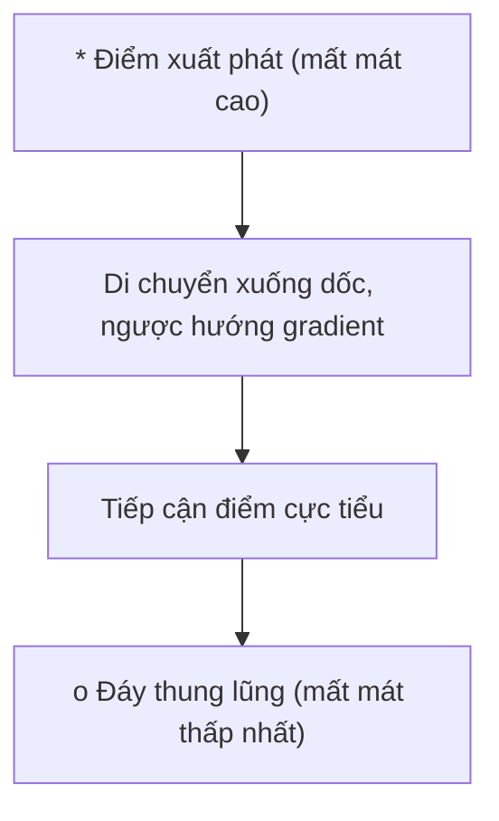
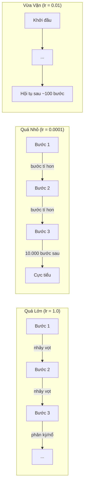
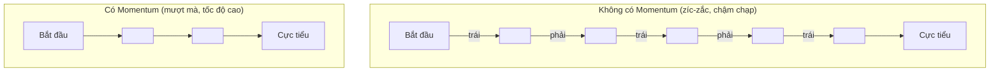
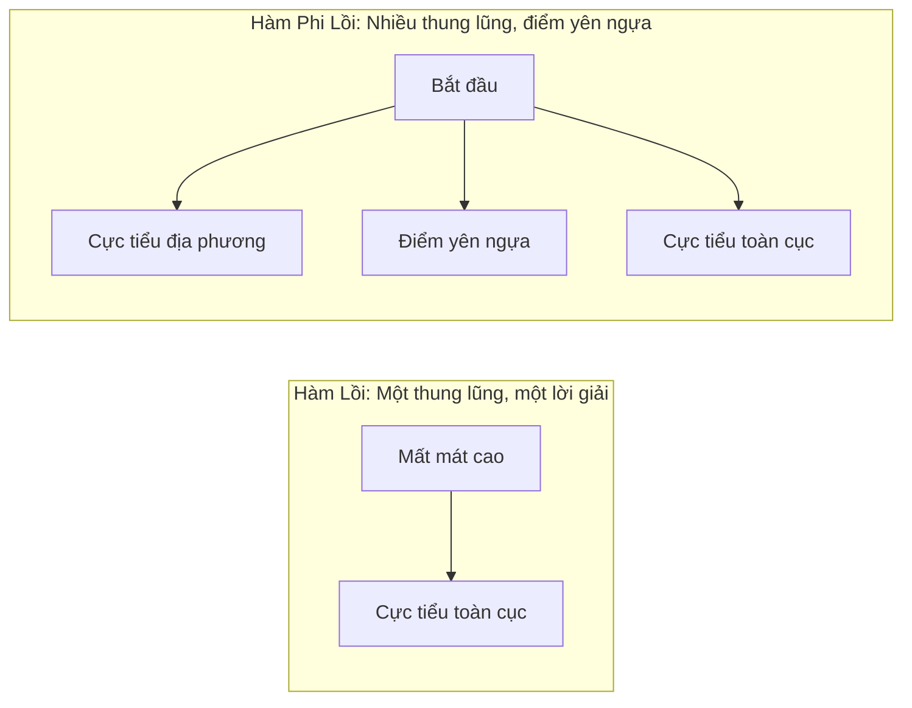

# Tối Ưu Hóa (Optimization)

> Huấn luyện mạng nơ-ron thực chất không có gì khác ngoài việc tìm đường xuống đáy một thung lũng.

**Type:** Build
**Language:** Python
**Prerequisites:** Phase 1, Lessons 04-05 (Derivatives, Gradients)
**Time:** ~75 phút

## Mục Tiêu Học Tập

- Tự lập trình các bộ tối ưu Gradient Descent nguyên bản (vanilla), SGD kèm quán tính (Momentum), và Adam từ đầu
- So sánh tốc độ hội tụ của các thuật toán tối ưu trên hàm Rosenbrock và giải thích tại sao Adam lại có khả năng tự thích ứng tốc độ học cho từng trọng số riêng biệt
- Phân biệt bề mặt hàm mất mát lồi (convex) và phi lồi (non-convex), giải thích vai trò của các điểm yên ngựa (saddle points) trong không gian nhiều chiều
- Cấu hình các chiến lược thay đổi tốc độ học (learning rate schedules: step decay, cosine annealing, warmup) để tăng độ ổn định cho quá trình huấn luyện

## Vấn Đề

Bạn có một hàm mất mát. Nó cho biết mô hình của bạn đang sai lệch nhiều như thế nào. Bạn có các gradient. Chúng cho biết hướng nào sẽ làm sai số trở nên trầm trọng hơn. Bây giờ bạn cần một chiến lược để bước xuống đáy thung lũng.

Cách tiếp cận ngây thơ rất đơn giản: di chuyển ngược hướng gradient, nhân bước đi với một hệ số gọi là tốc độ học (learning rate), và lặp lại. Đây là thuật toán Gradient Descent, và nó hoạt động được. Nhưng chữ "hoạt động được" đi kèm với rất nhiều cạm bẫy: Tốc độ học quá lớn sẽ khiến bạn nhảy vọt qua miệng thung lũng, dội qua dội lại giữa các vách núi. Tốc độ học quá nhỏ sẽ khiến bạn bò lê lết qua hàng chục nghìn bước không cần thiết. Gặp phải một điểm yên ngựa (saddle point), bạn sẽ bị mắc kẹt dừng lại mặc dù chưa hề chạm tới đáy cực tiểu.

Mọi bộ tối ưu hóa (optimizer) trong học sâu đều là câu trả lời cho cùng một câu hỏi: Làm thế nào để xuống tới đáy thung lũng nhanh hơn và đáng tin cậy hơn?

## Khái Niệm

### Bản Chất Của Tối Ưu Hóa

Tối ưu hóa là quá trình tìm kiếm các giá trị đầu vào để cực tiểu hóa (hoặc cực đại hóa) một hàm số mục tiêu. Trong Machine Learning, hàm số đó là hàm mất mát (loss function). Đầu vào là các trọng số (weights) của mô hình. Huấn luyện mô hình chính là bài toán tối ưu hóa.

```
Cực tiểu hóa L(w) trong đó:
  L = hàm mất mát
  w = các trọng số mô hình (có thể lên tới hàng triệu tham số)
```

### Hạ Độ Dốc Cơ Bản (Vanilla Gradient Descent)

Bộ tối ưu đơn giản nhất: Tính gradient của hàm mất mát theo từng trọng số. Di chuyển từng trọng số theo hướng ngược lại với gradient, nhân với tốc độ học:

```math
w = w - \text{lr} \cdot \text{gradient}
```

Đó là toàn bộ thuật toán. Một dòng duy nhất.



### Tốc Độ Học: Siêu Tham Số Quan Trọng Nhất

Tốc độ học (learning rate) kiểm soát độ dài của mỗi bước nhảy. Nó quyết định mọi thứ về sự hội tụ của mô hình.



Không có công thức toán học cố định nào cho tốc độ học tối ưu. Bạn tìm thấy nó thông qua thực nghiệm. Các điểm khởi đầu phổ biến: `0.001` cho Adam, `0.01` cho SGD có quán tính (momentum).

### So Sánh SGD, Batch Và Mini-Batch

Vanilla Gradient Descent tính toán gradient trên toàn bộ tập dữ liệu rồi mới bước một bước (gọi là Batch GD). Nó ổn định nhưng cực kỳ chậm chạp và tốn bộ nhớ.

Stochastic Gradient Descent (SGD) tính toán gradient chỉ trên một mẫu ngẫu nhiên duy nhất và cập nhật trọng số ngay lập tức. Nó rất nhanh nhưng đường đi bị rung lắc mạnh (noisy).

Mini-batch Gradient Descent dung hòa cả hai: Tính gradient trên một nhóm mẫu nhỏ (batch size: 32, 64, 128, 256 mẫu), sau đó thực hiện bước cập nhật. Đây là phương pháp mà toàn bộ ngành AI thực tế đang sử dụng.

| Biến thể | Kích thước batch | Chất lượng gradient | Tốc độ mỗi bước | Độ nhiễu |
|----------|------------------|---------------------|-----------------|----------|
| Batch GD | Toàn bộ dữ liệu | Chính xác tuyệt đối | Rất chậm | Không có |
| SGD | 1 mẫu | Rất nhiễu | Rất nhanh | Cao |
| Mini-batch | 32 - 256 mẫu | Ước lượng tốt | Cân bằng | Vừa phải |

Độ nhiễu ngẫu nhiên trong Mini-batch và SGD không phải là lỗi, mà là một lợi thế: Nó giúp mô hình rung lắc thoát khỏi các thung lũng cực tiểu nông và các điểm yên ngựa.

### Quán Tính (Momentum): Hòn Bi Lăn Xuống Dốc

Gradient Descent thông thường chỉ nhìn vào gradient ở bước hiện tại. Nếu gradient bị đổi hướng liên tục hình zíc-zắc (thường thấy trong các hẻm núi hẹp), tốc độ tiến về phía trước sẽ rất chậm. Momentum khắc phục điều này bằng cách tích lũy các gradient trong quá khứ thành một biến vận tốc (velocity):

```math
\begin{aligned}
v &= \beta \cdot v + \text{gradient} \\
w &= w - \text{lr} \cdot v
\end{aligned}
```

Hình ảnh ẩn dụ: Một hòn bi lăn xuống dốc. Nó không dừng lại và khởi động lại từ đầu ở mỗi gờ đất nhỏ. Nó tích lũy động lượng theo các hướng di chuyển nhất quán và triệt tiêu các dao động ngang vô ích.



Hệ số $\beta$ (thường chọn 0.9) kiểm soát lượng quán tính giữ lại từ quá khứ. $\beta$ càng cao thì đường đi càng mượt nhưng sẽ phản ứng chậm hơn khi cần chuyển hướng đột ngột.

### Adam: Tốc Độ Học Tự Thích Ứng

Mỗi trọng số khác nhau cần các tốc độ học khác nhau. Một trọng số hiếm khi nhận được gradient lớn thì nên đi bước dài hơn khi cuối cùng nó cũng nhận được tín hiệu. Một trọng số liên tục nhận gradient khổng lồ thì nên đi bước nhỏ cẩn trọng.

Adam (Adaptive Moment Estimation) theo dõi hai thống kê cho từng trọng số:
1. Moment thứ nhất ($m$): giá trị trung bình trượt của gradient (đóng vai trò như momentum).
2. Moment thứ hai ($v$): giá trị trung bình trượt của bình phương gradient (đo độ lớn/biên độ gradient).

```math
\begin{aligned}
m &= \beta_1 \cdot m + (1 - \beta_1) \cdot \text{gradient} \\
v &= \beta_2 \cdot v + (1 - \beta_2) \cdot \text{gradient}^2 \\[4pt]
\hat{m} &= \frac{m}{1 - \beta_1^t} \quad \text{(hiệu chỉnh độ lệch khởi đầu - bias correction)} \\
\hat{v} &= \frac{v}{1 - \beta_2^t} \quad \text{(hiệu chỉnh độ lệch khởi đầu - bias correction)} \\[4pt]
w &= w - \text{lr} \cdot \frac{\hat{m}}{\sqrt{\hat{v}} + \epsilon}
\end{aligned}
```

Phép chia cho $\sqrt{\hat{v}}$ chính là bí quyết cốt lõi: Các trọng số có gradient biến động lớn sẽ bị chia cho một số lớn (bước đi nhỏ lại). Các trọng số có gradient nhỏ sẽ chia cho số nhỏ (bước đi dài ra). Mỗi trọng số sở hữu một tốc độ học thích ứng của riêng mình.

Các siêu tham số mặc định chuẩn: `lr=0.001, beta1=0.9, beta2=0.999, epsilon=1e-8`. Các giá trị này hoạt động tốt trên phần lớn bài toán.

### Các Chiến Lược Điều Chỉnh Tốc Độ Học (Learning Rate Schedules)

Tốc độ học cố định luôn là sự đánh đổi. Ở giai đoạn đầu, bạn muốn bước đi dài để tiến bộ nhanh. Ở giai đoạn cuối, bạn muốn bước đi thật nhỏ để tinh chỉnh sâu sát đáy cực tiểu.

| Chiến lược | Công thức | Trường hợp sử dụng |
|------------|-----------|--------------------|
| Giảm theo bước (Step decay) | $\text{lr} = \text{lr} \cdot \text{factor}$ sau mỗi $N$ epochs | Đơn giản, kiểm soát thủ công |
| Giảm theo hàm mũ (Exponential) | $\text{lr} = \text{lr}_0 \cdot \text{decay}^t$ | Giảm dần đều đặn mượt mà |
| Cosine Annealing | Giảm theo chu kỳ nửa sóng cosine | Mô hình Transformers, huấn luyện hiện đại |
| Khởi động + Giảm (Warmup + Decay) | Tăng tuyến tính lúc đầu, sau đó giảm dần | Mô hình LLM lớn, tránh bất ổn định ban đầu |

### Hàm Lồi (Convex) vs Phi Lồi (Non-Convex)

Một hàm số lồi (convex) không có cực tiểu cục bộ xấu: mọi cực tiểu địa phương đều là cực tiểu toàn cục duy nhất. Gradient descent với tốc độ học phù hợp luôn luôn tìm ra lời giải tối ưu.

Ngược lại, hàm mất mát của mạng nơ-ron là **phi lồi (non-convex)**. Nó chứa vô số thung lũng, vách đá, vùng bằng phẳng và các điểm yên ngựa.



Trong thực tế không gian hàng triệu chiều của mạng nơ-ron, cực tiểu địa phương hiếm khi là rào cản lớn vì đa số chúng đều có giá trị mất mát tương đương nhau. Chướng ngại vật thực sự là các **điểm yên ngựa (saddle points)** (phẳng ở một số chiều nhưng cong ở các chiều khác). Quán tính (momentum) và tính ngẫu nhiên của mini-batch chính là chìa khóa để trượt qua các điểm yên ngựa này.

```figure
gradient-descent
```

## Tự Xây Dựng (Build It)

### Bước 1: Hàm kiểm thử Rosenbrock

Hàm Rosenbrock là bài kiểm tra tiêu chuẩn kinh điển cho các thuật toán tối ưu. Điểm cực tiểu nằm tại (1, 1) trong một thung lũng hẹp uốn lượn hình parabol:

```math
f(x, y) = (1 - x)^2 + 100 \cdot (y - x^2)^2
```

```python
def rosenbrock(params):
    x, y = params
    return (1 - x) ** 2 + 100 * (y - x ** 2) ** 2

def rosenbrock_gradient(params):
    x, y = params
    df_dx = -2 * (1 - x) + 200 * (y - x ** 2) * (-2 * x)
    df_dy = 200 * (y - x ** 2)
    return [df_dx, df_dy]
```

### Bước 2: Hạ độ dốc cơ bản (Vanilla Gradient Descent)

```python
class GradientDescent:
    def __init__(self, lr=0.001):
        self.lr = lr

    def step(self, params, grads):
        return [p - self.lr * g for p, g in zip(params, grads)]
```

### Bước 3: SGD có quán tính (Momentum)

```python
class SGDMomentum:
    def __init__(self, lr=0.001, momentum=0.9):
        self.lr = lr
        self.momentum = momentum
        self.velocity = None

    def step(self, params, grads):
        if self.velocity is None:
            self.velocity = [0.0] * len(params)
        self.velocity = [
            self.momentum * v + g
            for v, g in zip(self.velocity, grads)
        ]
        return [p - self.lr * v for p, v in zip(params, self.velocity)]
```

### Bước 4: Bộ tối ưu Adam

```python
class Adam:
    def __init__(self, lr=0.001, beta1=0.9, beta2=0.999, epsilon=1e-8):
        self.lr = lr
        self.beta1 = beta1
        self.beta2 = beta2
        self.epsilon = epsilon
        self.m = None
        self.v = None
        self.t = 0

    def step(self, params, grads):
        if self.m is None:
            self.m = [0.0] * len(params)
            self.v = [0.0] * len(params)

        self.t += 1

        self.m = [
            self.beta1 * m + (1 - self.beta1) * g
            for m, g in zip(self.m, grads)
        ]
        self.v = [
            self.beta2 * v + (1 - self.beta2) * (g ** 2)
            for v, g in zip(self.v, grads)
        ]

        m_hat = [m / (1 - self.beta1 ** self.t) for m in self.m]
        v_hat = [v / (1 - self.beta2 ** self.t) for v in self.v]

        return [
            p - self.lr * mh / (vh ** 0.5 + self.epsilon)
            for p, mh, vh in zip(params, m_hat, v_hat)
        ]
```

### Bước 5: Chạy thử nghiệm và so sánh

```python
def optimize(optimizer, func, grad_func, start, steps=5000):
    params = list(start)
    history = [params[:]]
    for _ in range(steps):
        grads = grad_func(params)
        params = optimizer.step(params, grads)
        history.append(params[:])
    return history

start = [-1.0, 1.0]

gd_history = optimize(GradientDescent(lr=0.0005), rosenbrock, rosenbrock_gradient, start)
sgd_history = optimize(SGDMomentum(lr=0.0001, momentum=0.9), rosenbrock, rosenbrock_gradient, start)
adam_history = optimize(Adam(lr=0.01), rosenbrock, rosenbrock_gradient, start)

for name, history in [("GD", gd_history), ("SGD+M", sgd_history), ("Adam", adam_history)]:
    final = history[-1]
    loss = rosenbrock(final)
    print(f"{name:6s} -> x={final[0]:.6f}, y={final[1]:.6f}, loss={loss:.8f}")
```

Kết quả: Adam hội tụ nhanh nhất. SGD kèm momentum đi đường mượt mà. Vanilla GD tiến triển rất chậm trong lòng hẻm núi hẹp.

## Sử Dụng Thư Viện (Use It)

Trong môi trường thực tế với PyTorch:

```python
import torch

model = torch.nn.Linear(784, 10)

sgd = torch.optim.SGD(model.parameters(), lr=0.01, momentum=0.9)
adam = torch.optim.Adam(model.parameters(), lr=0.001)
adamw = torch.optim.AdamW(model.parameters(), lr=0.001, weight_decay=0.01)

scheduler = torch.optim.lr_scheduler.CosineAnnealingLR(adam, T_max=100)
```

Quy tắc kinh nghiệm trong thực tế:
- Luôn bắt đầu với **Adam** (`lr=0.001`), hoạt động tốt ngay mà không cần tinh chỉnh nhiều.
- Chuyển sang **SGD với momentum** (`lr=0.01, momentum=0.9`) khi cần đạt độ chính xác kiểm thử cao nhất ở giai đoạn cuối và có đủ thời gian tinh chỉnh.
- Sử dụng **AdamW** (Adam tách biệt phân rã trọng số) cho các kiến trúc Transformer và LLM.
- Luôn kết hợp chiến lược điều chỉnh tốc độ học (learning rate scheduler) cho các lượt huấn luyện dài.

## Bài Tập Thực Hành

1. **Quét tốc độ học (Learning rate sweep):** Chạy Vanilla Gradient Descent trên hàm Rosenbrock với các tốc độ học `[0.0001, 0.0005, 0.001, 0.005, 0.01]`. In ra giá trị mất mát sau 5.000 bước. Tìm tốc độ học lớn nhất mà thuật toán vẫn hội tụ.
2. **So sánh tham số quán tính:** Chạy SGD với các giá trị momentum `[0.0, 0.5, 0.9, 0.99]` trên hàm Rosenbrock. Theo dõi hàm mất mát ở từng bước. Giá trị nào hội tụ nhanh nhất? Giá trị nào bị dao động vượt ngưỡng (overshoot)?
3. **Thoát khỏi điểm yên ngựa:** Xét hàm số $f(x, y) = x^2 - y^2$ (có điểm yên ngựa tại gốc tọa độ). Xuất phát từ $(0.01, 0.01)$. So sánh hành vi của Vanilla GD, SGD có momentum và Adam. Thuật toán nào thoát khỏi điểm yên ngựa thành công?
4. **Cài đặt suy giảm tốc độ học:** Bổ sung chiến lược suy giảm hàm mũ vào lớp `GradientDescent`: `lr = lr_0 * 0.999^step`. So sánh tốc độ hội tụ khi có và không có suy giảm tốc độ học.

### Gợi Ý

**Bài 1.** Lặp qua danh sách các tốc độ học và gọi `optimize`. Khi tốc độ học quá lớn, giá trị mất mát sẽ tăng vọt hoặc biến thành `nan` (phân kỳ); cực tiểu toàn cục nằm tại $(1, 1)$ với giá trị hàm bằng 0.

**Bài 2.** Khởi tạo `SGDMomentum(momentum=m)` cho từng giá trị và ghi lại mất mát sau mỗi bước. Bạn sẽ thấy khi momentum bằng 0.99, đường đi dễ bị trượt vọt qua thung lũng (overshoot) trước khi quay lại.

**Bài 3.** Gradient là $(2x, -2y)$. Chạy 3 bộ tối ưu từ $(0.01, 0.01)$ và in giá trị $y$ sau mỗi 100 bước: bộ tối ưu nào làm $\lvert y \rvert$ tăng nhanh chóng chính là bộ tối ưu đã trượt dốc thoát khỏi điểm yên ngựa thành công.

**Bài 4.** Lưu biến `lr_0` và bộ đếm bước bước đi `step` bên trong `GradientDescent`. Kiểm tra tại bước 1.000, tốc độ học sẽ giảm từ `lr_0` xuống còn khoảng $0.37 \times \text{lr}_0$.

## Thuật Ngữ Then Chốt

| Thuật ngữ | Người ta thường nói | Bản chất thực sự |
|-----------|--------------------|-------------------|
| Hạ độ dốc (Gradient descent) | "Đi xuống dốc" | Cập nhật trọng số bằng cách trừ bớt gradient nhân với tốc độ học. |
| Tốc độ học (Learning rate) | "Kích thước bước đi" | Hệ số vô hướng kiểm soát khoảng cách cập nhật trọng số ở mỗi bước. |
| Quán tính (Momentum) | "Đà lăn của viên bi" | Tích lũy các gradient trong quá khứ thành vector vận tốc, giúp giảm rung lắc và tăng tốc theo hướng nhất quán. |
| SGD | "Lấy mẫu ngẫu nhiên" | Tính toán gradient trên một mẫu hoặc tập con ngẫu nhiên (mini-batch) thay vì toàn bộ dữ liệu. |
| Mini-batch | "Gói dữ liệu con" | Tập con gồm 32 - 256 mẫu dữ liệu dùng để ước lượng gradient cho mỗi bước cập nhật. |
| Adam | "Bộ tối ưu mặc định" | Thuật toán tối ưu theo dõi moment bậc 1 và bậc 2 để gán tốc độ học thích ứng cho từng tham số. |
| Bias correction | "Sửa sai lúc khởi đầu" | Chia cho $(1 - \beta^t)$ để bù đắp việc moment ban đầu bị lệch về 0 trong những bước đầu. |
| Hàm lồi (Convex) | "Một thung lũng duy nhất" | Hàm số mà mọi cực tiểu địa phương đều là cực tiểu toàn cục. Mạng nơ-ron không phải là hàm lồi. |
| Điểm yên ngựa (Saddle point) | "Bằng phẳng nhưng không phải đáy" | Điểm có gradient bằng 0 nhưng là cực tiểu theo hướng này và là cực đại theo hướng khác. |
| Không gian mất mát (Loss landscape) | "Địa hình đồi núi" | Đồ thị biểu diễn giá trị hàm mất mát trải trên không gian các trọng số mô hình. |

## Tài Liệu Đọc Thêm

- [Sebastian Ruder: Tổng quan các thuật toán tối ưu Gradient Descent](https://ruder.io/optimizing-gradient-descent/) - bài khảo sát kinh điển, chi tiết và toàn diện nhất
- [Tại sao Momentum thực sự hiệu quả (Distill)](https://distill.pub/2017/momentum/) - đồ họa tương tác tuyệt đẹp về động lực học của momentum
- [Bài báo gốc về thuật toán Adam (Kingma & Ba, 2014)](https://arxiv.org/abs/1412.6980) - bài báo khoa học ngắn gọn, dễ đọc
- [Trực quan hóa Loss Landscape của Mạng Nơ-ron (Li et al., 2018)](https://arxiv.org/abs/1712.09913) - nghiên cứu chứng minh sự khác biệt giữa cực tiểu phẳng và cực tiểu nhọn
