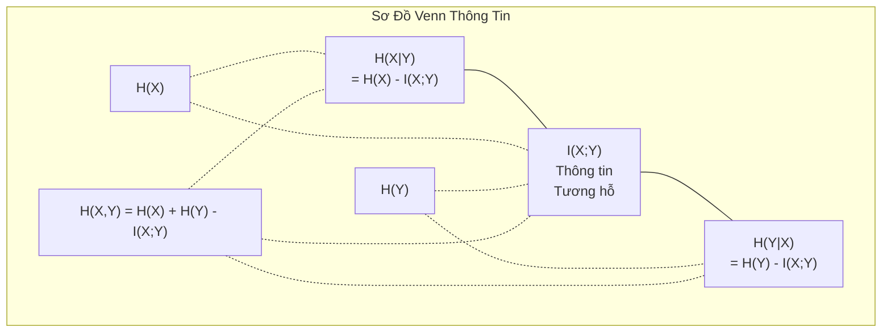

# Lý Thuyết Thông Tin (Information Theory)

> Lý thuyết thông tin đo lường sự bất ngờ. Các hàm mất mát đều được xây dựng từ nó.

**Type:** Learn
**Language:** Python
**Prerequisites:** Phase 1, Lesson 06 (Probability)
**Time:** ~60 phút

## Mục Tiêu Học Tập

- Tự tính toán entropy, cross-entropy, và độ phân kỳ KL divergence từ đầu, giải thích rõ mối quan hệ mật thiết giữa chúng
- Suy dẫn vì sao việc cực tiểu hóa hàm mất mát cross-entropy tương đương hoàn toàn với việc cực đại hóa ước lượng hợp lý (log-likelihood)
- Tính toán thông tin tương hỗ (mutual information) giữa các đặc trưng và nhãn mục tiêu để xếp hạng mức độ quan trọng của đặc trưng
- Giải thích độ bối rối (perplexity) như là kích thước từ vựng hiệu dụng mà mô hình ngôn ngữ đang phân vân lựa chọn

## Vấn Đề

Bạn gọi hàm `CrossEntropyLoss()` trong hầu như mọi mô hình phân loại bạn huấn luyện. Bạn nhìn thấy chỉ số "perplexity" trong mọi bài báo nghiên cứu về mô hình ngôn ngữ lớn (LLM). Bạn đọc về độ phân kỳ KL divergence trong VAEs, nén mô hình (distillation), và căn chỉnh RLHF. Đây không phải là các khái niệm rời rạc ngẫu nhiên. Chúng đều là một ý tưởng duy nhất được khoác lên những chiếc áo khác nhau.

Lý thuyết thông tin cung cấp ngôn ngữ chuẩn xác để suy luận về độ bất định, nén dữ liệu và dự đoán. Claude Shannon đã phát minh ra nó vào năm 1948 để giải quyết các bài toán truyền dẫn tín hiệu viễn thông. Thật kỳ diệu, việc huấn luyện một mạng nơ-ron cũng chính là một bài toán truyền thông: mô hình đang cố gắng truyền đi nhãn đúng thông qua một kênh truyền nhiễu gồm hàng triệu trọng số đã học.

Bài học này sẽ tự tay xây dựng mọi công thức từ đầu để bạn thấy chúng bắt nguồn từ đâu và tại sao chúng lại vận hành hiệu quả đến vậy.

## Khái Niệm

### Lượng Thông Tin (Độ Bất Ngờ - Surprise)

Khi một sự việc hiếm gặp bất ngờ xảy ra, nó mang lại cho chúng ta nhiều thông tin hơn. Một đồng xu rơi vào mặt ngửa? Bình thường, không có gì bất ngờ. Trúng xổ số độc đắc? Cực kỳ bất ngờ!

Lượng thông tin (information content / self-information) của một biến cố có xác suất $p$ được định nghĩa là:

```math
I(x) = -\log(p(x))
```

Dùng logarit cơ số 2 cho đơn vị là **bits**. Dùng logarit tự nhiên (cơ số $e$) cho đơn vị là **nats**.

```
Biến cố               Xác suất       Độ bất ngờ (bits)
Đồng xu cân đối ngửa   0.5            1.0
Gieo được mặt 6        0.167          2.58
Biến cố tỉ lệ 1/1000   0.001          9.97
Biến cố chắc chắn      1.0            0.0
```

Một sự kiện chắc chắn xảy ra mang lại đúng 0 bit thông tin. Bạn vốn đã biết trước nó sẽ xảy ra rồi.

### Entropy (Độ Bất Ngờ Trung Bình)

Entropy là kỳ vọng toán học của độ bất ngờ trên tất cả các kết quả có thể xảy ra của một phân phối xác suất:

```math
H(P) = -\sum_{x} p(x) \log(p(x))
```

Một đồng xu cân đối có entropy cực đại đối với biến nhị phân: đúng 1 bit. Một đồng xu lệch nặng (99% ngửa) có entropy rất thấp: chỉ 0.08 bits. Vì bạn gần như đã biết trước kết quả, mỗi lần tung xu hầu như chẳng mang lại thông tin gì mới.

```math
\begin{aligned}
\text{Đồng xu chuẩn:} \quad & H = -(0.5 \log_2(0.5) + 0.5 \log_2(0.5)) = 1.0 \text{ bit} \\
\text{Đồng xu lệch:} \quad & H = -(0.99 \log_2(0.99) + 0.01 \log_2(0.01)) = 0.08 \text{ bits}
\end{aligned}
```

Entropy đo lường mức độ bất định nội tại không thể triệt tiêu của một phân phối. Bạn không bao giờ có thể nén dữ liệu xuống dưới giới hạn entropy này.

### Cross-Entropy (Hàm Mất Mát Quen Thuộc Hằng Ngày)

Cross-entropy (entropy chéo) đo lường độ bất ngờ trung bình khi bạn dùng một phân phối dự đoán $Q$ để mã hóa các sự kiện thực tế bắt nguồn từ phân phối thực $P$:

```math
H(P, Q) = -\sum_{x} p(x) \log(q(x))
```

- $P$ là phân phối thực tế (các nhãn ground-truth).
- $Q$ là phân phối dự đoán của mô hình.

Nếu $Q$ khớp hoàn hảo với $P$, cross-entropy bằng đúng entropy của $P$. Bất kỳ sự sai lệch nào cũng khiến cross-entropy tăng lớn hơn.

Trong bài toán phân loại, nhãn thực $P$ là vector one-hot (lớp đúng có xác suất bằng 1, tất cả các lớp khác bằng 0). Khi đó công thức cross-entropy rút gọn lại chỉ còn:

```math
H(P, Q) = -\log(q(\text{lớp\_thực}))
```

Đó là toàn bộ công thức hàm mất mát cross-entropy trong phân loại. Cực tiểu hóa nó đồng nghĩa với việc cực đại hóa xác suất dự đoán gán cho nhãn đúng.

### Độ Phân Kỳ KL Divergence (Khoảng Cách Giữa Các Phân Phối)

Độ phân kỳ KL (Kullback-Leibler Divergence) đo lường lượng thông tin bị lãng phí (độ bất ngờ phụ thêm) khi bạn dùng phân phối $Q$ thay vì phân phối thực $P$:

```math
\begin{aligned}
D_{KL}(P \,\|\, Q) &= \sum_{x} p(x) \log\left(\frac{p(x)}{q(x)}\right) \\
&= H(P, Q) - H(P)
\end{aligned}
```

Từ công thức trên ta thấy:
$$\text{Cross-Entropy} = \text{Entropy} + D_{KL}$$

Vì nhãn thực tế $P$ là cố định trong quá trình huấn luyện, nên entropy $H(P)$ là một hằng số. Do đó, **cực tiểu hóa cross-entropy tương đương hoàn toàn với việc cực tiểu hóa độ phân kỳ KL**. Bạn đang đẩy phân phối của mô hình ngày càng tiệm cận sát phân phối thực tế.

Chú ý: KL divergence không có tính chất đối xứng ($D_{KL}(P \Vert Q) \ne D_{KL}(Q \Vert P)$), nên nó không phải là một hàm khoảng cách metric thực thụ.

### Thông Tin Tương Hỗ (Mutual Information)

Thông tin tương hỗ đo lường lượng thông tin mà việc biết được biến số này cung cấp về biến số kia:

```math
\begin{aligned}
I(X; Y) &= H(X) - H(X \mid Y) \\
&= H(X) + H(Y) - H(X, Y)
\end{aligned}
```

Nếu $X$ và $Y$ độc lập, thông tin tương hỗ bằng 0. Nếu chúng tương quan hoàn hảo, thông tin tương hỗ bằng đúng entropy của từng biến.

Trong chọn lọc đặc trưng (feature selection), thông tin tương hỗ cao giữa một đặc trưng đầu vào và nhãn mục tiêu cho biết đặc trưng đó rất hữu ích. Ngược lại, thông tin tương hỗ gần bằng 0 đồng nghĩa đặc trưng đó chỉ là nhiễu vô giá trị.

### Biểu Đồ Venn Về Các Mối Quan Hệ Thông Tin



### Kỹ Thuật Làm Mịn Nhãn (Label Smoothing)

Phân loại thông thường sử dụng nhãn cứng one-hot: `[0, 0, 1, 0]`. Làm mịn nhãn thay thế nhãn cứng bằng nhãn mềm:

```math
\text{nhãn\_mềm} = (1 - \epsilon) \cdot \text{nhãn\_cứng} + \frac{\epsilon}{\text{số\_lớp}}
```

Với $\epsilon = 0.1$ và 4 lớp:
- Nhãn cứng: `[0, 0, 1, 0]`
- Nhãn mềm: `[0.025, 0.025, 0.925, 0.025]`

Dưới góc nhìn lý thuyết thông tin, nhãn mềm làm tăng entropy của phân phối mục tiêu, ngăn cản mô hình đẩy logits lên giá trị vô cùng lớn, hoạt động như một cơ chế điều chuẩn giúp mô hình tránh tự tin thái quá.

### Vì Sao Cross-Entropy Là Hàm Mất Mát Chuẩn Mực Cho Phân Loại?

Ba góc nhìn khác nhau đều dẫn đến cùng một công thức:

1. **Góc nhìn Lý thuyết thông tin:** Cross-entropy đo lường số bit bị lãng phí do mô hình dự đoán sai lệch so với thực tế. Cực tiểu hóa nó giúp mô hình trở thành bộ mã hóa thông tin tối ưu nhất.
2. **Góc nhìn Ước lượng hợp lý cực đại (MLE):** Với $N$ mẫu huấn luyện:
   $$\text{NLL} = -\sum_i \log(q(y_i))$$
   Đây chính là hàm mất mát Cross-Entropy. Cực tiểu hóa Cross-entropy = Cực đại hóa xác suất của dữ liệu huấn luyện dưới mô hình.
3. **Góc nhìn Gradient:** Gradient của hàm cross-entropy kết hợp với hàm softmax theo logits có dạng cực kỳ đẹp:
   $$\frac{\partial L}{\partial z_i} = q_i - p_i = (\text{dự đoán} - \text{thực tế})$$
   Đơn giản, ổn định số học và tính toán siêu tốc.

### Độ Bối Rối (Perplexity) Trong Mô Hình Ngôn Ngữ

Perplexity là lũy thừa hàm mũ của cross-entropy. Nó biểu thị số lượng lựa chọn tương đương nhau mà mô hình đang phân vân tại mỗi bước dự đoán từ tiếp theo:

```math
\text{Perplexity} = e^{H(P, Q)} \quad \text{(khi tính bằng nats)}
```

Một mô hình ngôn ngữ có perplexity bằng 50 nghĩa là tại mỗi vị trí sinh từ tiếp theo, mức độ băn khoăn của mô hình tương đương với việc phải đoán ngẫu nhiên trong một danh sách 50 từ vựng tiềm năng. Giá trị perplexity càng thấp thì mô hình dự đoán càng chính xác và tự tin.

```figure
entropy-kl
```

## Tự Xây Dựng (Build It)

### Bước 1: Lượng thông tin và Entropy

```python
import math

def information_content(p, base=2):
    if p <= 0 or p > 1:
        return float('inf') if p <= 0 else 0.0
    return -math.log(p) / math.log(base)

def entropy(probs, base=2):
    return sum(
        p * information_content(p, base)
        for p in probs if p > 0
    )

fair_coin = [0.5, 0.5]
biased_coin = [0.99, 0.01]
fair_die = [1/6] * 6

print(f"Entropy đồng xu chuẩn: {entropy(fair_coin):.4f} bits")
print(f"Entropy đồng xu lệch:  {entropy(biased_coin):.4f} bits")
print(f"Entropy súc sắc chuẩn: {entropy(fair_die):.4f} bits")
```

### Bước 2: Cross-Entropy và KL Divergence

```python
def cross_entropy(p, q, base=2):
    total = 0.0
    for pi, qi in zip(p, q):
        if pi > 0:
            if qi <= 0:
                return float('inf')
            total += pi * (-math.log(qi) / math.log(base))
    return total

def kl_divergence(p, q, base=2):
    return cross_entropy(p, q, base) - entropy(p, base)

true_dist = [0.7, 0.2, 0.1]
good_model = [0.6, 0.25, 0.15]
bad_model = [0.1, 0.1, 0.8]

print(f"Entropy phân phối thực:    {entropy(true_dist):.4f} bits")
print(f"CE (mô hình tốt):          {cross_entropy(true_dist, good_model):.4f} bits")
print(f"CE (mô hình tồi):          {cross_entropy(true_dist, bad_model):.4f} bits")
print(f"KL divergence (tốt):       {kl_divergence(true_dist, good_model):.4f} bits")
print(f"KL divergence (tồi):       {kl_divergence(true_dist, bad_model):.4f} bits")
```

### Bước 3: Cross-Entropy làm hàm mất mát phân loại

```python
def softmax(logits):
    max_logit = max(logits)
    exps = [math.exp(z - max_logit) for z in logits]
    total = sum(exps)
    return [e / total for e in exps]

def cross_entropy_loss(true_class, logits):
    probs = softmax(logits)
    return -math.log(probs[true_class])

logits = [2.0, 1.0, 0.1]
true_class = 0

probs = softmax(logits)
loss = cross_entropy_loss(true_class, logits)

print(f"Logits:      {logits}")
print(f"Softmax:     {[f'{p:.4f}' for p in probs]}")
print(f"Nhãn thực:   {true_class}")
print(f"Hàm mất mát: {loss:.4f} nats")
print(f"Perplexity:  {math.exp(loss):.2f}")
```

### Bước 4: Kiểm chứng Cross-Entropy bằng Negative Log-Likelihood

```python
import random

random.seed(42)

n_samples = 1000
n_classes = 3
true_labels = [random.randint(0, n_classes - 1) for _ in range(n_samples)]
model_logits = [[random.gauss(0, 1) for _ in range(n_classes)] for _ in range(n_samples)]

ce_loss = sum(
    cross_entropy_loss(label, logits)
    for label, logits in zip(true_labels, model_logits)
) / n_samples

nll = -sum(
    math.log(softmax(logits)[label])
    for label, logits in zip(true_labels, model_logits)
) / n_samples

print(f"Mất mát Cross-entropy:     {ce_loss:.6f}")
print(f"Negative Log-Likelihood:   {nll:.6f}")
print(f"Chênh lệch:                {abs(ce_loss - nll):.2e}")
```

### Bước 5: Thông tin tương hỗ (Mutual Information)

```python
def mutual_information(joint_probs, base=2):
    rows = len(joint_probs)
    cols = len(joint_probs[0])

    margin_x = [sum(joint_probs[i][j] for j in range(cols)) for i in range(rows)]
    margin_y = [sum(joint_probs[i][j] for i in range(rows)) for j in range(cols)]

    mi = 0.0
    for i in range(rows):
        for j in range(cols):
            pxy = joint_probs[i][j]
            if pxy > 0:
                mi += pxy * math.log(pxy / (margin_x[i] * margin_y[j])) / math.log(base)
    return mi

independent = [[0.25, 0.25], [0.25, 0.25]]
dependent = [[0.45, 0.05], [0.05, 0.45]]

print(f"MI (độc lập):    {mutual_information(independent):.4f} bits")
print(f"MI (phụ thuộc):  {mutual_information(dependent):.4f} bits")
```

## Sử Dụng Thư Viện (Use It)

Với NumPy:

```python
import numpy as np

def np_entropy(p):
    p = np.asarray(p, dtype=float)
    mask = p > 0
    result = np.zeros_like(p)
    result[mask] = p[mask] * np.log(p[mask])
    return -result.sum()

def np_cross_entropy(p, q):
    p, q = np.asarray(p, dtype=float), np.asarray(q, dtype=float)
    mask = p > 0
    return -(p[mask] * np.log(q[mask])).sum()

def np_kl_divergence(p, q):
    return np_cross_entropy(p, q) - np_entropy(p)

true = np.array([0.7, 0.2, 0.1])
pred = np.array([0.6, 0.25, 0.15])
print(f"Entropy:    {np_entropy(true):.4f} nats")
print(f"Cross-ent:  {np_cross_entropy(true, pred):.4f} nats")
print(f"KL div:     {np_kl_divergence(true, pred):.4f} nats")
```

## Bài Tập Thực Hành

1. Tính entropy của bảng chữ cái tiếng Anh giả định phân phối đều (26 chữ cái). Sau đó ước lượng entropy sử dụng tần suất xuất hiện thực tế của các chữ cái trong tiếng Anh. Giá trị nào cao hơn và tại sao?
2. Một mô hình xuất ra logits `[5.0, 2.0, 0.5]` cho một mẫu có nhãn đúng là lớp 1. Tính hàm mất mát cross-entropy bằng tay, rồi kiểm chứng lại bằng hàm code. Logits có dạng như thế nào thì hàm mất mát tiến về 0?
3. Chứng minh rằng độ phân kỳ KL không có tính đối xứng. Chọn hai phân phối $P$ và $Q$, tính $D_{KL}(P \Vert Q)$ và $D_{KL}(Q \Vert P)$, giải thích nguyên nhân chênh lệch.
4. Xây dựng hàm tính toán độ bối rối (perplexity) cho một chuỗi token dự đoán. Nhận vào danh sách các cặp (true_token_index, predicted_logits) và trả về perplexity của toàn chuỗi.

### Gợi Ý

**Bài 1.** Với 26 xác suất bằng nhau, entropy là $\log_2(26) \approx 4.70$ bits. Tần suất chữ cái thực tế không đều (chữ 'e' xuất hiện nhiều hơn 'z'), do đó entropy thực tế sẽ thấp hơn nhiều (khoảng 4.1 bits).

**Bài 2.** Tính softmax của logits, sau đó lấy $-\ln$ xác suất tại chỉ số 1, kết quả xấp xỉ 3.06 nats. Hàm mất mát chỉ tiến về 0 khi logit của lớp 1 vượt trội áp đảo hoàn toàn so với các logits khác.

**Bài 3.** Chọn $P = [0.9, 0.1]$ và $Q = [0.5, 0.5]$. Vì mỗi hướng lấy trọng số log ratio theo phân phối khác nhau nên giá trị tính ra sẽ hoàn toàn khác biệt.

**Bài 4.** Với mỗi cặp token, tính `cross_entropy_loss`, lấy trung bình cộng trên toàn chuỗi rồi lấy hàm mũ `math.exp()`.

## Thuật Ngữ Then Chốt

| Thuật ngữ | Người ta thường nói | Bản chất thực sự |
|-----------|--------------------|-------------------|
| Lượng thông tin | "Độ bất ngờ" | Số bit (hoặc nats) cần thiết để mã hóa một biến cố: $-\log(p)$. |
| Entropy | "Độ ngẫu nhiên" | Độ bất ngờ trung bình trên toàn bộ kết quả của phân phối. Đo lường độ bất định tối thiểu. |
| Cross-entropy | "Hàm mất mát" | Độ bất ngờ trung bình khi dùng phân phối mô hình $Q$ để mã hóa dữ liệu thực từ $P$. |
| KL divergence | "Khoảng cách giữa phân phối" | Lượng bit lãng phí khi dùng $Q$ thay vì $P$. Bằng Cross-entropy trừ đi Entropy. |
| Thông tin tương hỗ | "Độ liên quan giữa X và Y" | Lượng bất định về $X$ được giảm bớt khi đã biết $Y$. Bằng 0 khi độc lập. |
| Perplexity | "Độ bối rối của mô hình" | Lũy thừa hàm mũ của cross-entropy. Số lượng token tiềm năng mà mô hình đang phân vân. |
| Bits | "Đơn vị Shannon" | Thông tin đo bằng log cơ số 2. Một bit giải quyết sự bất định của 1 lần tung xu chuẩn. |
| Nats | "Đơn vị của ML" | Thông tin đo bằng log tự nhiên cơ số $e$. Mặc định trong PyTorch và TensorFlow. |
| Negative Log-Likelihood | "Hàm NLLLoss" | Đồng nhất hoàn toàn với Cross-Entropy khi nhãn mục tiêu ở dạng one-hot. |

## Tài Liệu Đọc Thêm

- [Shannon 1948: Lý thuyết Toán học về Truyền thông](https://people.math.harvard.edu/~ctm/home/text/others/shannon/entropy/entropy.pdf) - bài báo nguyên bản sáng lập ngành lý thuyết thông tin
- [Visual Information Theory (Chris Olah)](https://colah.github.io/posts/2015-09-Visual-Information/) - bài viết trực quan hóa xuất sắc nhất về entropy và KL divergence
- [Tài liệu PyTorch CrossEntropyLoss](https://pytorch.org/docs/stable/generated/torch.nn.CrossEntropyLoss.html) - cách thư viện triển khai những gì bạn vừa xây dựng
