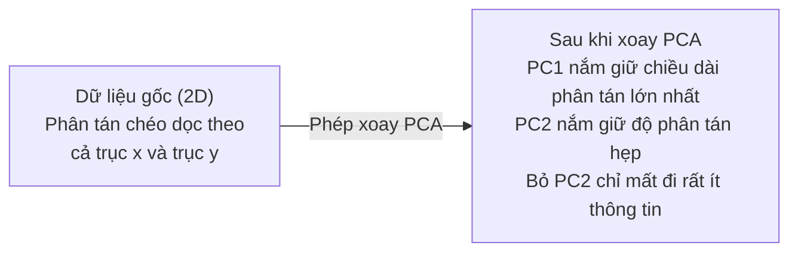

# Giảm Chiều Dữ Liệu (Dimensionality Reduction)

> Dữ liệu nhiều chiều luôn chứa đựng cấu trúc. Bạn tìm thấy nó khi nhìn từ đúng góc độ.

**Type:** Build
**Language:** Python
**Prerequisites:** Phase 1, Lessons 01 (Linear Algebra Intuition), 02 (Vectors, Matrices & Operations), 03 (Eigenvalues & Eigenvectors), 06 (Probability & Distributions)
**Time:** ~90 phút

## Mục Tiêu Học Tập

- Tự lập trình thuật toán PCA từ đầu: chuẩn hóa tâm dữ liệu (center data), tính ma trận hiệp phương sai, phân rã trị riêng và chiếu dữ liệu
- Sử dụng tỉ lệ phương sai giải thích được (explained variance ratio) và phương pháp điểm khuỷu tay (elbow method) để chọn số lượng thành phần chính tối ưu
- So sánh các kỹ thuật PCA, t-SNE, và UMAP khi trực quan hóa tập dữ liệu chữ số viết tay MNIST trên không gian 2D và giải thích sự đánh đổi giữa chúng
- Ứng dụng Kernel PCA với hàm nhân RBF để phân tách các cấu trúc dữ liệu phi tuyến mà PCA tuyến tính thông thường không thể xử lý

## Vấn Đề

Bạn có một tập dữ liệu với 784 đặc trưng cho mỗi mẫu. Đó có thể là các giá trị pixel của chữ số viết tay, mức độ biểu hiện gen sinh học, hoặc các tín hiệu hành vi người dùng. Bạn không thể trực quan hóa 784 chiều không gian. Bạn không thể vẽ đồ thị, thậm chí bộ não con người không thể hình dung nổi không gian đó.

Nhưng phần lớn trong số 784 đặc trưng đó là dư thừa. Thông tin thực tế nằm trên một bề mặt không gian con nhỏ hơn rất nhiều. Một chữ số "7" viết tay không cần tới 784 con số độc lập để mô tả. Nó chỉ cần vài thông số chính: góc của nét gạch, độ dài thanh ngang, độ nghiêng của nét sổ. Phần còn lại chỉ là nhiễu nền.

Giảm chiều dữ liệu giúp tìm ra bề mặt không gian con đó. Nó nén dữ liệu 784 chiều xuống còn 2, 10, hoặc 50 chiều nhưng vẫn giữ lại trọn vẹn cấu trúc thông tin cốt lõi quan trọng nhất.

## Khái Niệm

### Lời Nguyền Số Chiều (The Curse of Dimensionality)

Không gian nhiều chiều đi ngược lại trực giác thông thường của con người. Ba hiện tượng kỳ lạ xảy ra khi số chiều tăng cao:

1. **Khoảng cách trở nên vô nghĩa:** Trong không gian số chiều cực lớn, khoảng cách giữa hai điểm ngẫu nhiên bất kỳ đều hội tụ về cùng một giá trị. Nếu mọi điểm đều cách nhau một khoảng xấp xỉ như nhau, các thuật toán tìm kiếm láng giềng gần nhất (k-NN) hoàn toàn mất tác dụng.

```
Số chiều    Tỉ lệ khoảng cách trung bình (max/min giữa các điểm ngẫu nhiên)
2           ~5.0
10          ~1.8
100         ~1.2
1000        ~1.02 (khoảng cách max và min gần như bằng nhau!)
```

2. **Thể tích dồn về các góc:** Một hình siêu lập phương đơn vị trong không gian $d$ chiều có $2^d$ góc. Ở 100 chiều, gần như toàn bộ thể tích đều nằm ở các góc xa trung tâm. Dữ liệu bị dàn mỏng ra các góc biên, và vùng lõi trung tâm trở nên hoàn toàn trống rỗng.

3. **Cần lượng dữ liệu khổng lồ theo cấp số nhân:** Để duy trì cùng một mật độ mẫu trong không gian, khi tăng từ 2D lên 20D, bạn cần lượng dữ liệu gấp $10^{18}$ lần. Bạn không bao giờ có đủ dữ liệu như vậy. Giảm chiều dữ liệu giúp đưa mật độ mẫu trở lại mức có thể xử lý hiệu quả.

### PCA: Tìm Các Hướng Biến Thiên Quan Trọng Nhất

Phân tích Thành phần Chính (Principal Component Analysis - PCA) tìm kiếm các trục tọa độ mà dọc theo đó dữ liệu có độ biến thiên (phương sai) lớn nhất. Nó xoay hệ tọa độ sao cho trục thứ nhất giữ được nhiều phương sai nhất, trục thứ hai giữ nhiều phương sai tiếp theo, và cứ thế tiếp tục.

Quy trình thuật toán:
1. **Chuẩn hóa tâm dữ liệu (Center data):** Trừ đi giá trị trung bình của từng đặc trưng.
2. **Tính ma trận hiệp phương sai (Covariance matrix):** Đo lường mức độ biến thiên đồng thời giữa các cặp đặc trưng.
3. **Phân rã trị riêng (Eigendecomposition):** Tìm các hướng thành phần chính (vector riêng) và mức độ biến thiên tương ứng (trị riêng).
4. **Sắp xếp theo trị riêng:** Trị riêng lớn nhất đứng đầu tiên.
5. **Chiếu dữ liệu (Project):** Giữ lại $k$ vector riêng hàng đầu và loại bỏ các thành phần còn lại.



### Tỉ Lệ Phương Sai Giải Thích Được (Explained Variance Ratio)

Mỗi thành phần chính (PC) giữ lại một tỉ lệ phương sai trên tổng phương sai toàn bộ:

```
Thành phần    Trị riêng    Tỉ lệ giải thích    Tỉ lệ tích lũy
PC1           4.73         0.473 (47.3%)       0.473 (47.3%)
PC2           2.51         0.251 (25.1%)       0.724 (72.4%)
PC3           1.12         0.112 (11.2%)       0.836 (83.6%)
PC4           0.89         0.089 (8.9%)        0.925 (92.5%)
```

Khi phương sai tích lũy đạt 95%, bạn biết rằng chỉ cần 4 thành phần đó đã nắm giữ 95% thông tin của toàn bộ tập dữ liệu ban đầu. Tất cả các thành phần sau đó chủ yếu chỉ là nhiễu.

### Cách Chọn Số Lượng Thành Phần $k$

1. **Ngưỡng cố định (Threshold):** Giữ lại đủ số thành phần để đạt 90% hoặc 95% phương sai tích lũy.
2. **Phương pháp điểm khuỷu tay (Elbow method):** Vẽ đồ thị phương sai tích lũy theo số thành phần. Chọn điểm mà tại đó đường cong bắt đầu nằm ngang (lợi ích cận biên giảm dần).
3. **Hiệu năng của mô hình downstream:** Dùng PCA làm bước tiền xử lý. Thử nghiệm các giá trị $k$ khác nhau và đo độ chính xác của mô hình phân loại. Chọn giá trị $k$ nhỏ nhất mà độ chính xác bắt đầu bão hòa.

### t-SNE: Bảo Toàn Cấu Trúc Láng Giềng Cục Bộ

t-SNE (t-Distributed Stochastic Neighbor Embedding) được thiết kế chuyên biệt cho mục đích **trực quan hóa dữ liệu**. Nó ánh xạ dữ liệu nhiều chiều về không gian 2D (hoặc 3D) bằng cách bảo toàn xác suất các điểm là láng giềng gần nhau.

Đặc điểm chính của t-SNE:
- **Phi tuyến tính (Non-linear):** Có thể mở phẳng các đa tạp uốn lượn phức tạp mà PCA tuyến tính bó tay.
- **Tính ngẫu nhiên (Stochastic):** Mỗi lần chạy có thể cho ra hình dáng cụm hơi khác nhau.
- **Tham số Perplexity:** Quyết định số lượng láng giềng xung quanh được xem xét (thường chọn từ 5 đến 50).
- **Lưu ý:** Khoảng cách giữa các cụm tách biệt trên đồ thị t-SNE không mang nhiều ý nghĩa định lượng thực tế, chỉ có cấu trúc bên trong từng cụm là đáng tin cậy.
- Chậm trên tập dữ liệu lớn ($O(n^2)$).

### UMAP: Nhanh Hơn, Bảo Toàn Cấu Trúc Toàn Cục Tốt Hơn

UMAP (Uniform Manifold Approximation and Projection) là kỹ thuật giảm chiều phi tuyến thế hệ mới dựa trên lý thuyết đa tạp topo:
- **Tốc độ vượt trội:** Nhanh hơn t-SNE nhiều lần nhờ sử dụng đồ thị k-NN xấp xỉ, xử lý được hàng triệu mẫu.
- **Bảo toàn cấu trúc toàn cục tốt hơn:** Khoảng cách tương đối giữa các cụm trên không gian chiếu có ý nghĩa hình học rõ ràng hơn t-SNE.

Tham số chính:
- `n_neighbors`: Số lượng láng giềng định nghĩa cấu trúc cục bộ. Giá trị càng lớn càng bảo toàn cấu trúc toàn cục.
- `min_dist`: Khoảng cách tối thiểu giữa các điểm trên không gian 2D, quyết định mức độ cô đặc của các cụm.

### So Sánh Tổng Quan Các Phương Pháp

| Phương pháp | Trường hợp sử dụng | Loại cấu trúc bảo toàn | Tốc độ |
|-------------|--------------------|------------------------|--------|
| **PCA** | Tiền xử lý dữ liệu trước khi train mô hình | Phương sai toàn cục (tuyến tính) | Cực nhanh (giải tích chính xác) |
| **t-SNE** | Vẽ biểu đồ 2D chất lượng cao để làm báo cáo | Láng giềng cục bộ | Chậm (thích hợp < 10k mẫu) |
| **UMAP** | Trực quan hóa 2D cho dữ liệu quy mô lớn | Cục bộ + một phần toàn cục | Nhanh - Trung bình (hàng triệu mẫu) |
| **Kernel PCA** | Phân tách dữ liệu phi tuyến (vòng tròn đồng tâm) | Cấu trúc phi tuyến theo hàm nhân | Trung bình (bị giới hạn bộ nhớ) |

### Kernel PCA

PCA tiêu chuẩn chỉ tìm được các không gian con tuyến tính (đường thẳng, mặt phẳng). Nhưng nếu dữ liệu phân bố trên một đa tạp phi tuyến (ví dụ hai vòng tròn đồng tâm lồng vào nhau trong 2D)? Không có đường thẳng nào tách được chúng.

Kernel PCA áp dụng PCA trong không gian đặc trưng nhiều chiều ẩn thông qua hàm nhân (Kernel Trick), tương tự như trong thuật toán SVM. Hàm nhân RBF (Gaussian kernel) có thể biến hai vòng tròn đồng tâm thành hai cụm tách biệt tuyến tính hoàn toàn.

```figure
pca-axes
```

## Tự Xây Dựng (Build It)

### Bước 1: Xây dựng lớp PCA từ đầu

```python
import numpy as np

class PCA:
    def __init__(self, n_components):
        self.n_components = n_components
        self.components = None
        self.mean = None
        self.eigenvalues = None
        self.explained_variance_ratio_ = None

    def fit(self, X):
        # 1. Chuẩn hóa tâm dữ liệu
        self.mean = np.mean(X, axis=0)
        X_centered = X - self.mean

        # 2. Tính ma trận hiệp phương sai
        cov_matrix = np.cov(X_centered, rowvar=False)

        # 3. Phân rã trị riêng
        eigenvalues, eigenvectors = np.linalg.eigh(cov_matrix)

        # 4. Sắp xếp giảm dần theo trị riêng
        sorted_idx = np.argsort(eigenvalues)[::-1]
        eigenvalues = eigenvalues[sorted_idx]
        eigenvectors = eigenvectors[:, sorted_idx]

        # 5. Lưu lại k thành phần hàng đầu
        self.components = eigenvectors[:, :self.n_components].T
        self.eigenvalues = eigenvalues[:self.n_components]
        total_var = np.sum(eigenvalues)
        self.explained_variance_ratio_ = self.eigenvalues / total_var

        return self

    def transform(self, X):
        X_centered = X - self.mean
        return X_centered @ self.components.T

    def fit_transform(self, X):
        self.fit(X)
        return self.transform(X)
```

### Bước 2: Thử nghiệm trên dữ liệu giả lập 3D

```python
np.random.seed(42)
n_samples = 500

t = np.random.uniform(0, 2 * np.pi, n_samples)
x1 = 3 * np.cos(t) + np.random.normal(0, 0.2, n_samples)
x2 = 3 * np.sin(t) + np.random.normal(0, 0.2, n_samples)
x3 = 0.5 * x1 + 0.3 * x2 + np.random.normal(0, 0.1, n_samples)

X_synthetic = np.column_stack([x1, x2, x3])

pca = PCA(n_components=2)
X_reduced = pca.fit_transform(X_synthetic)

print(f"Kích thước gốc:      {X_synthetic.shape}")
print(f"Kích thước sau nén:  {X_reduced.shape}")
print(f"Tỉ lệ phương sai giải thích: {pca.explained_variance_ratio_}")
print(f"Tổng phương sai giữ lại:     {sum(pca.explained_variance_ratio_):.4f}")
```

### Bước 3: Nén tập dữ liệu chữ số viết tay MNIST 784 chiều

```python
from sklearn.datasets import fetch_openml

mnist = fetch_openml("mnist_784", version=1, as_frame=False, parser="auto")
X_mnist = mnist.data[:5000].astype(float)
y_mnist = mnist.target[:5000].astype(int)

# Thử nghiệm nén xuống 50 chiều
pca_mnist = PCA(n_components=50)
X_pca50 = pca_mnist.fit_transform(X_mnist)
print(f"50 thành phần giữ lại được {sum(pca_mnist.explained_variance_ratio_):.2%} lượng thông tin")

# Nén xuống 2 chiều để vẽ đồ thị
pca_2d = PCA(n_components=2)
X_pca2d = pca_2d.fit_transform(X_mnist)
print(f"2 thành phần giữ lại được {sum(pca_2d.explained_variance_ratio_):.2%} lượng thông tin")
```

### Bước 4: So sánh với Scikit-Learn và t-SNE

```python
from sklearn.decomposition import PCA as SklearnPCA
from sklearn.manifold import TSNE

sklearn_pca = SklearnPCA(n_components=2)
X_sklearn_pca = sklearn_pca.fit_transform(X_mnist)

print(f"\nPCA tự viết phương sai:     {pca_2d.explained_variance_ratio_}")
print(f"Sklearn PCA phương sai:     {sklearn_pca.explained_variance_ratio_}")

tsne = TSNE(n_components=2, perplexity=30, random_state=42)
X_tsne = tsne.fit_transform(X_mnist)
print(f"\nt-SNE kích thước đầu ra: {X_tsne.shape}")
```

### Bước 5: UMAP

```python
try:
    from umap import UMAP

    reducer = UMAP(n_components=2, n_neighbors=15, min_dist=0.1, random_state=42)
    X_umap = reducer.fit_transform(X_mnist)
    print(f"UMAP kích thước đầu ra: {X_umap.shape}")
except ImportError:
    print("Cài đặt thư viện: pip install umap-learn")
```

## Sử Dụng Thư Viện (Use It)

Sử dụng PCA làm bước tiền xử lý nén đặc trưng trước mô hình phân loại:

```python
from sklearn.decomposition import PCA as SklearnPCA
from sklearn.linear_model import LogisticRegression
from sklearn.model_selection import train_test_split
from sklearn.metrics import accuracy_score

X_train, X_test, y_train, y_test = train_test_split(
    X_mnist, y_mnist, test_size=0.2, random_state=42
)

results = {}
for k in [10, 30, 50, 100, 200]:
    pca_k = SklearnPCA(n_components=k)
    X_tr = pca_k.fit_transform(X_train)
    X_te = pca_k.transform(X_test)

    clf = LogisticRegression(max_iter=1000, random_state=42)
    clf.fit(X_tr, y_train)
    acc = accuracy_score(y_test, clf.predict(X_te))
    var_captured = sum(pca_k.explained_variance_ratio_)
    results[k] = (acc, var_captured)
    print(f"k={k:>3d}  độ chính xác={acc:.4f}  phương sai giữ lại={var_captured:.4f}")
```

Độ chính xác đạt ngưỡng bão hòa ở $k=50$ (chỉ cần 50 chiều thay vì 784 chiều). Điểm bão hòa đó chính là điểm tối ưu để vận hành hệ thống thực tế.

## Bài Tập Thực Hành

1. Bổ sung phương thức `inverse_transform` vào lớp `PCA` tự viết. Tái cấu trúc lại các bức ảnh chữ số MNIST từ 10, 50 và 200 thành phần chính. In ra sai số tái cấu trúc (MSE so với ảnh gốc) cho từng trường hợp.
2. Chạy thuật toán t-SNE trên cùng tập con MNIST với các giá trị perplexity lần lượt là 5, 30, và 100. Nhận xét đồ thị thay đổi ra sao và giải thích vì sao perplexity ảnh hưởng tới độ cô đặc của các cụm.
3. Tạo tập dữ liệu 50 chiều nhưng chỉ có 5 đặc trưng thực sự mang thông tin (dùng hàm `sklearn.datasets.make_classification(n_features=50, n_informative=5, n_redundant=45)`). Áp dụng PCA và kiểm tra xem đường cong phương sai tích lũy có nhận diện chính xác dữ liệu thực chất chỉ là 5 chiều hay không.

### Gợi Ý

**Bài 1.** Công thức tái cấu trúc là $\hat{X} = X_{\text{reduced}} @ \text{components} + \text{mean}$. Tính sai số trung bình bình phương `np.mean((X - X_recon)**2)`. Khi số thành phần tăng từ 10 lên 200, sai số tái cấu trúc phải giảm mạnh rõ rệt.

**Bài 2.** Khởi tạo `TSNE(perplexity=p, random_state=42)`. Perplexity thấp chỉ quan sát số ít láng giềng gần nên tạo ra nhiều cụm nhỏ rời rạc; perplexity cao bao quát nhiều láng giềng hơn nên gom các điểm thành các khối mượt mà toàn cục.

**Bài 3.** Vì 45 đặc trưng kia là tổ hợp tuyến tính dư thừa của 5 đặc trưng gốc, phương sai tích lũy sẽ chạm mốc xấp xỉ 100% ngay tại $k=5$.

## Thuật Ngữ Then Chốt

| Thuật ngữ | Người ta thường nói | Bản chất thực sự |
|-----------|--------------------|-------------------|
| Lời nguyền số chiều | "Quá nhiều đặc trưng" | Khoảng cách, thể tích và mật độ dữ liệu biến đổi bất thường khi số chiều tăng cao. Mô hình đòi hỏi lượng dữ liệu tăng theo cấp số nhân. |
| PCA | "Nén số chiều" | Xoay hệ tọa độ sao cho các trục thẳng hàng với các hướng có phương sai lớn nhất, sau đó loại bỏ các trục có phương sai nhỏ. |
| Thành phần chính (PC) | "Hướng quan trọng" | Một vector riêng của ma trận hiệp phương sai. Hướng trong không gian đặc trưng mà dữ liệu phân tán nhiều nhất. |
| Tỉ lệ phương sai giải thích | "Lượng thông tin giữ lại" | Tỉ số giữa trị riêng của thành phần đó trên tổng tất cả các trị riêng. |
| Ma trận hiệp phương sai | "Mức độ tương quan" | Ma trận đối xứng đo lường mức độ biến thiên đồng thời giữa các cặp đặc trưng. |
| t-SNE | "Biểu đồ phân cụm" | Phương pháp phi tuyến tính ánh xạ dữ liệu về 2D bằng cách bảo toàn xác suất láng giềng. Dành riêng cho trực quan hóa. |
| UMAP | "t-SNE thế hệ mới" | Thuật toán phi tuyến dựa trên đa tạp topo, nhanh hơn t-SNE và giữ cấu trúc toàn cục tốt hơn. |
| Đa tạp (Manifold) | "Mặt phẳng dữ liệu cong" | Bề mặt có số chiều thấp hơn nằm uốn lượn bên trong không gian có số chiều cao hơn (ví dụ tờ giấy 2D bị vo lại trong không gian 3D). |

## Tài Liệu Đọc Thêm

- [A Tutorial on Principal Component Analysis (Shlens)](https://arxiv.org/abs/1404.1100) - tài liệu suy dẫn toán học xuất sắc và sáng rõ nhất về PCA
- [How to Use t-SNE Effectively (Distill)](https://distill.pub/2016/misread-tsne/) - hướng dẫn tương tác trực quan về các cạm bẫy và cách chỉnh tham số t-SNE
- [Tài liệu chính thức của thư viện UMAP](https://umap-learn.readthedocs.io/) - cơ sở lý thuyết và hướng dẫn thực hành từ nhóm tác giả UMAP
