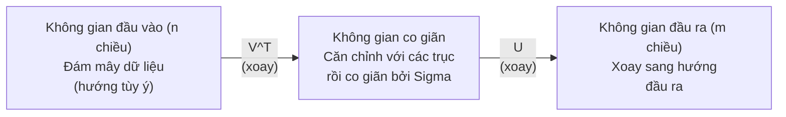
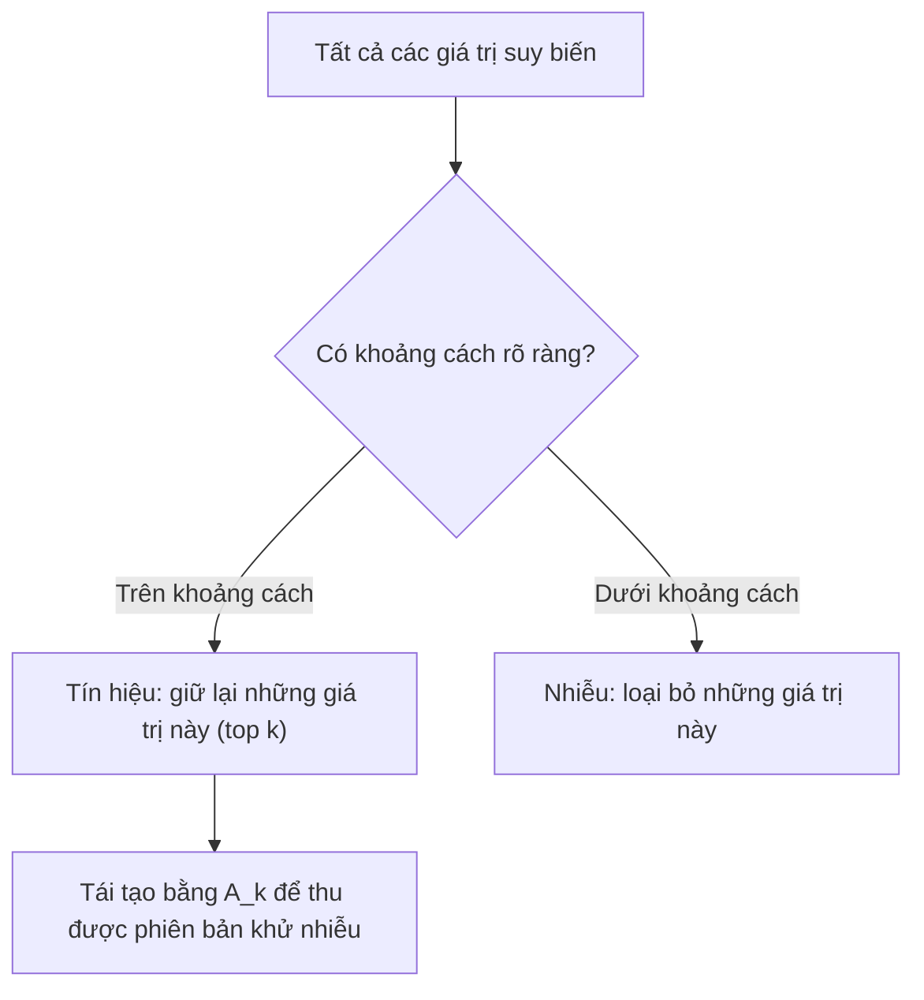

# Phân rã giá trị suy biến (Singular Value Decomposition - SVD)

> SVD là con dao đa năng Thụy Sĩ của đại số tuyến tính. Mọi ma trận đều có phân rã SVD. Mọi nhà khoa học dữ liệu đều cần đến nó.

**Type:** Build
**Languages:** Python, Julia
**Prerequisites:** Phase 1, Lessons 01 (Linear Algebra Intuition), 02 (Vectors & Matrices Operations), 03 (Matrix Transformations)
**Time:** ~120 minutes

## Learning Objectives

- Cài đặt SVD thông qua lặp lũy thừa (power iteration) và giải thích ý nghĩa hình học của $U$, $\Sigma$ và $V^T$
- Áp dụng SVD cắt cụt (truncated SVD) để nén ảnh và đo lường tỷ lệ nén so với sai số tái tạo
- Tính toán giả nghịch đảo Moore-Penrose thông qua SVD để giải hệ phương trình bình phương tối thiểu thừa định (overdetermined)
- Kết nối SVD với PCA, hệ thống gợi ý (các nhân tố ẩn - latent factors) và Phân tích ngữ nghĩa tiềm ẩn (LSA) trong NLP

## The Problem (Vấn đề)

Bạn có một ma trận kích thước 1000x2000. Có thể đó là ma trận đánh giá phim của người dùng (user-movie ratings). Có thể là bảng tần suất từ trong tài liệu (document-term frequency table). Hoặc là các giá trị điểm ảnh (pixel) của một bức ảnh. Bạn cần nén nó, khử nhiễu, tìm cấu trúc ẩn bên trong, hoặc giải một hệ phương trình bình phương tối thiểu với nó. Phân rã trị riêng (Eigendecomposition) chỉ hoạt động trên các ma trận vuông. Thậm chí ngay cả khi đó, nó đòi hỏi ma trận phải có đủ tập hợp các vector riêng độc lập tuyến tính.

SVD hoạt động trên mọi ma trận. Bất kỳ hình dạng nào. Bất kỳ hạng nào. Không cần điều kiện tiên quyết. Nó phân rã ma trận thành ba nhân tử để hé lộ hình học về cách ma trận biến đổi không gian. Đây là phép phân rã tổng quát và hữu ích nhất trong toàn bộ đại số tuyến tính.

## The Concept (Khái niệm)

### SVD hoạt động như thế nào về mặt hình học

Mọi ma trận, bất kể hình dạng nào, đều thực hiện ba thao tác tuần tự: xoay (rotate), co giãn (scale), xoay (rotate). SVD làm rõ nét phép phân rã này:

```math
\underset{\substack{m \times n \\ \text{(bất kỳ)}}}{A} = \underset{\substack{m \times m \\ \text{(xoay)}}}{U} \cdot \underset{\substack{m \times n \\ \text{(co giãn)}}}{\Sigma} \cdot \underset{\substack{n \times n \\ \text{(xoay)}}}{V^T}
```

Với bất kỳ ma trận $A$ nào, SVD phân rã nó thành:
- $V^T$ xoay các vector trong không gian đầu vào ($n$ chiều)
- $\Sigma$ co giãn dọc theo từng trục (kéo giãn hoặc nén lại)
- $U$ xoay kết quả vào không gian đầu ra ($m$ chiều)



Hãy hình dung theo cách này: Bạn đưa cho SVD một ma trận. Nó cho bạn biết: "Ma trận này nhận một hình cầu các đầu vào, đầu tiên xoay nó bằng $V^T$, sau đó kéo giãn nó thành một hình ellipsoid bằng $\Sigma$, rồi xoay hình ellipsoid đó bằng $U$." Các giá trị suy biến chính là độ dài các trục bán kính của hình ellipsoid.

### Phân rã đầy đủ (Full decomposition)

Đối với một ma trận $A$ có kích thước $m \times n$:

```math
\begin{aligned}
& A = U \cdot \Sigma \cdot V^T \\[6pt]
& \text{trong đó:} \\
& \quad U \text{ có kích thước } m \times m, \text{ trực giao } (U^T U = I) \\
& \quad \Sigma \text{ có kích thước } m \times n, \text{ đường chéo (các giá trị suy biến nằm trên đường chéo)} \\
& \quad V \text{ có kích thước } n \times n, \text{ trực giao } (V^T V = I) \\[6pt]
& \text{Các giá trị suy biến } \sigma_1 \ge \sigma_2 \ge \cdots \ge \sigma_r > 0 \\
& \text{với } r = \mathop{\mathrm{rank}}(A)
\end{aligned}
```

Các cột của $U$ được gọi là các vector suy biến trái (left singular vectors). Các cột của $V$ được gọi là các vector suy biến phải (right singular vectors). Các phần tử trên đường chéo của $\Sigma$ được gọi là các giá trị suy biến (singular values). Chúng luôn không âm và theo quy ước được sắp xếp theo thứ tự giảm dần.

### Vector suy biến trái, giá trị suy biến, vector suy biến phải

Mỗi thành phần của SVD đều mang một ý nghĩa hình học riêng biệt:

**Các vector suy biến phải (các cột của $V$):** Chúng tạo thành một cơ sở trực chuẩn cho không gian đầu vào ($\mathbb{R}^n$). Đây là các hướng trong không gian đầu vào mà ma trận ánh xạ tới các hướng trực giao trong không gian đầu ra. Hãy coi chúng là hệ tọa độ tự nhiên cho miền xác định.

**Các giá trị suy biến (đường chéo của $\Sigma$):** Đây là các hệ số co giãn. Giá trị suy biến thứ $i$ cho bạn biết ma trận kéo giãn các vector dọc theo vector suy biến phải thứ $i$ bao nhiêu lần. Giá trị suy biến bằng 0 nghĩa là ma trận triệt tiêu hoàn toàn hướng đó.

**Các vector suy biến trái (các cột của $U$):** Chúng tạo thành một cơ sở trực chuẩn cho không gian đầu ra ($\mathbb{R}^m$). Vector suy biến trái thứ $i$ là hướng trong không gian đầu ra nơi vector suy biến phải thứ $i$ đáp xuống (sau khi đã được co giãn).

Mối quan hệ giữa chúng:

```
A * v_i = sigma_i * u_i

Ma trận A nhận vector suy biến phải thứ i (v_i),
co giãn nó theo sigma_i, và ánh xạ tới vector suy biến trái thứ i (u_i).
```

Điều này cung cấp cho bạn một bức tranh chi tiết theo từng tọa độ về tác động của ma trận.

### Dạng tích ngoài (Outer product form)

SVD có thể được viết dưới dạng tổng của các ma trận hạng 1:

```
A = sigma_1 * u_1 * v_1^T + sigma_2 * u_2 * v_2^T + ... + sigma_r * u_r * v_r^T

Mỗi số hạng sigma_i * u_i * v_i^T là một ma trận hạng 1 (một tích ngoài).
Ma trận đầy đủ là tổng của r ma trận như vậy, trong đó r là hạng của ma trận.
```

Dạng biểu diễn này là nền tảng của phép xấp xỉ hạng thấp (low-rank approximation). Mỗi số hạng bổ sung một tầng cấu trúc. Số hạng đầu tiên nắm bắt mẫu hình quan trọng nhất. Số hạng thứ hai nắm bắt mẫu hình quan trọng tiếp theo, v.v. Cắt cụt tổng này sẽ cho bạn phép xấp xỉ tối ưu nhất ở bất kỳ mức hạng nào cho trước.

```math
\begin{aligned}
\text{Xấp xỉ hạng 1:} \quad & A_1 = \sigma_1 u_1 v_1^T \\
& \text{(nắm bắt mẫu hình chi phối chủ đạo)} \\[6pt]
\text{Xấp xỉ hạng 2:} \quad & A_2 = \sigma_1 u_1 v_1^T + \sigma_2 u_2 v_2^T \\
& \text{(nắm bắt hai mẫu hình quan trọng nhất)} \\[6pt]
\text{Xấp xỉ hạng }k\text{:} \quad & A_k = \text{tổng của } k \text{ số hạng đầu tiên} \\
& \text{(tối ưu theo định lý Eckart-Young)}
\end{aligned}
```

### Mối liên hệ với phân rã trị riêng (Eigendecomposition)

SVD và phân rã trị riêng có mối liên hệ mật thiết. Các giá trị và vector suy biến của $A$ xuất phát trực tiếp từ các trị riêng và vector riêng của $A^T A$ và $A A^T$.

```
A^T A = V * Sigma^T * U^T * U * Sigma * V^T
      = V * Sigma^T * Sigma * V^T
      = V * D * V^T

trong đó D = Sigma^T * Sigma là ma trận đường chéo với sigma_i^2 trên đường chéo.

Vì vậy:
- Các vector suy biến phải (V) là các vector riêng của A^T A
- Bình phương các giá trị suy biến (sigma_i^2) là các trị riêng của A^T A

Tương tự:
A A^T = U * Sigma * V^T * V * Sigma^T * U^T
      = U * Sigma * Sigma^T * U^T

Vì vậy:
- Các vector suy biến trái (U) là các vector riêng của A A^T
- Các trị riêng của A A^T cũng chính là sigma_i^2
```

Mối liên hệ này cho bạn biết ba điều:
1. Các giá trị suy biến luôn là số thực và không âm (chúng là căn bậc hai của các trị riêng của một ma trận nửa xác định dương).
2. Bạn có thể tính SVD thông qua phân rã trị riêng của $A^T A$, nhưng việc này sẽ bình phương điều kiện số (condition number) và làm mất độ chính xác số học. Các thuật toán SVD chuyên dụng tránh được điều này.
3. Khi $A$ là ma trận vuông, đối xứng và nửa xác định dương, SVD và phân rã trị riêng là như nhau.

### SVD cắt cụt: Xấp xỉ hạng thấp (Truncated SVD)

Định lý Eckart-Young-Mirsky chỉ ra rằng phép xấp xỉ hạng $k$ tốt nhất đối với $A$ (theo cả chuẩn Frobenius và chuẩn phổ spectral norm) nhận được bằng cách chỉ giữ lại $k$ giá trị suy biến lớn nhất và các vector tương ứng của chúng:

```math
\begin{aligned}
& A_k = U_k \cdot \Sigma_k \cdot V_k^T \\[6pt]
& \text{trong đó:} \\
& \quad U_k \text{ có kích thước } m \times k \quad \text{(} k \text{ cột đầu tiên của } U\text{)} \\
& \quad \Sigma_k \text{ có kích thước } k \times k \quad \text{(khối } k \times k \text{ phía trên bên trái của } \Sigma\text{)} \\
& \quad V_k \text{ có kích thước } n \times k \quad \text{(} k \text{ cột đầu tiên của } V\text{)} \\[6pt]
& \text{Sai số xấp xỉ} = \sigma_{k+1} \quad \text{(theo chuẩn phổ)} \\
& \text{Sai số xấp xỉ} = \sqrt{\sigma_{k+1}^2 + \cdots + \sigma_r^2} \quad \text{(theo chuẩn Frobenius)}
\end{aligned}
```

Đây không chỉ đơn thuần là "một xấp xỉ tốt", mà đã được chứng minh là xấp xỉ tốt nhất có thể ở hạng $k$. Không có ma trận hạng $k$ nào khác gần $A$ hơn ma trận này.

| Thành phần | Độ lớn tương đối | Có giữ lại trong xấp xỉ hạng 3? |
|-----------|-------------------|------------------------|
| $\sigma_1$ | Lớn nhất | Có |
| $\sigma_2$ | Lớn | Có |
| $\sigma_3$ | Trung bình lớn | Có |
| $\sigma_4$ | Trung bình | Không (sai số) |
| $\sigma_5$ | Trung bình nhỏ | Không (sai số) |
| $\sigma_6$ | Nhỏ | Không (sai số) |
| $\sigma_7$ | Rất nhỏ | Không (sai số) |
| $\sigma_8$ | Cực nhỏ | Không (sai số) |

Giữ lại top 3: $A_3$ nắm bắt 3 giá trị suy biến lớn nhất. Sai số = các giá trị còn lại ($\sigma_4$ đến $\sigma_8$).

Nếu các giá trị suy biến suy giảm nhanh, một giá trị $k$ nhỏ đã đủ nắm bắt phần lớn ma trận. Nếu chúng suy giảm chậm, ma trận không có cấu trúc hạng thấp.

### Nén ảnh bằng SVD

Một bức ảnh xám là một ma trận gồm các cường độ pixel. Một bức ảnh 800x600 có 480.000 giá trị. SVD cho phép bạn xấp xỉ nó với số lượng giá trị ít hơn rất nhiều.

```
Ảnh gốc: 800 x 600 = 480.000 giá trị

SVD với hạng k:
  U_k:      800 x k giá trị
  Sigma_k:  k giá trị
  V_k:      600 x k giá trị
  Tổng cộng: k * (800 + 600 + 1) = k * 1401 giá trị

  k=10:   14.010 giá trị   (2,9% so với ảnh gốc)
  k=50:   70.050 giá trị  (14,6% so với ảnh gốc)
  k=100: 140.100 giá trị  (29,2% so với ảnh gốc)

  Tỷ lệ nén càng tốt khi k càng nhỏ,
  nhưng chất lượng thị giác sẽ giảm dần.
```

Điểm mấu chốt: ảnh tự nhiên có các giá trị suy biến giảm rất nhanh. Một vài giá trị suy biến đầu tiên nắm bắt cấu trúc tổng quan (hình khối, độ dốc ánh sáng). Các giá trị sau nắm bắt chi tiết nhỏ và nhiễu. Cắt cụt tại hạng 50 thường cho ra bức ảnh gần như giống hệt ảnh gốc nhưng tiết kiệm tới 85% dung lượng lưu trữ.

### SVD trong hệ thống gợi ý (Recommendation Systems)

Giải thưởng Netflix Prize đã làm cho ứng dụng này trở nên nổi tiếng. Bạn có một ma trận đánh giá phim của người dùng, trong đó phần lớn các ô bị bỏ trống (chưa đánh giá).

```
             Phim1   Phim2   Phim3   Phim4   Phim5
   User1     [  5      ?       3       ?       1  ]
   User2     [  ?      4       ?       2       ?  ]
   User3     [  3      ?       5       ?       ?  ]
   User4     [  ?      ?       ?       4       3  ]

   ? = đánh giá chưa biết
```

Ý tưởng: ma trận đánh giá này có hạng thấp. Sở thích của người dùng không hoàn toàn độc lập với nhau. Chỉ có một số lượng nhỏ các nhân tố ẩn (hành động vs tâm lý, phim cũ vs phim mới, tư duy vs giải trí đơn thuần) giải thích phần lớn các sở thích.

SVD trên ma trận đánh giá (sau khi điền giá trị) phân rã nó thành:
- $U$: hồ sơ người dùng trong không gian nhân tố ẩn
- $\Sigma$: tầm quan trọng của từng nhân tố ẩn
- $V^T$: hồ sơ phim trong không gian nhân tố ẩn

Điểm đánh giá dự đoán của người dùng cho một bộ phim là tích vô hướng giữa hồ sơ người dùng với hồ sơ phim (được đánh trọng số bằng các giá trị suy biến). Phép xấp xỉ hạng thấp sẽ điền vào các vị trí còn thiếu.

Trong thực tế, người ta sử dụng các biến thể như SVD tăng dần của Simon Funk hoặc ALS (Alternating Least Squares) để xử lý trực tiếp dữ liệu bị khuyết. Nhưng ý tưởng cốt lõi vẫn giữ nguyên: phân rã nhân tố ẩn thông qua SVD.

### SVD trong NLP: Phân tích ngữ nghĩa tiềm ẩn (LSA)

Phân tích ngữ nghĩa tiềm ẩn (Latent Semantic Analysis - LSA), còn gọi là LSI (Latent Semantic Indexing), áp dụng SVD cho ma trận từ-tài liệu (term-document matrix).

```
             Doc1   Doc2   Doc3   Doc4
  "cat"      [  3      0      1      0  ]
  "dog"      [  2      0      0      1  ]
  "fish"     [  0      4      1      0  ]
  "pet"      [  1      1      1      1  ]
  "ocean"    [  0      3      0      0  ]

Sau SVD với hạng k=2:

  Mỗi tài liệu trở thành một điểm trong "không gian khái niệm" 2D.
  Mỗi từ vựng trở thành một điểm trong cùng không gian 2D đó.
  Các tài liệu có chủ đề tương tự sẽ cụm lại gần nhau.
  Các từ có ý nghĩa tương tự sẽ cụm lại gần nhau.

  "cat" và "dog" nằm gần nhau (thú cưng trên cạn).
  "fish" và "ocean" nằm gần nhau (khái niệm liên quan đến nước).
  Doc1 và Doc3 tạo thành cụm nếu chúng chia sẻ các chủ đề tương tự.
```

LSA là một trong những phương pháp thành công đầu tiên trong việc nắm bắt độ tương đồng ngữ nghĩa từ văn bản thô. Nó hoạt động được vì các từ đồng nghĩa có xu hướng xuất hiện trong các tài liệu tương tự, do đó SVD gom chúng vào cùng các chiều tiềm ẩn. Các kỹ thuật nhúng từ hiện đại (Word2Vec, GloVe) có thể được coi là hậu duệ của ý tưởng này.

### SVD để khử nhiễu (Noise reduction)

Dữ liệu có nhiễu có tín hiệu tập trung ở các giá trị suy biến hàng đầu và nhiễu trải rộng trên toàn bộ các giá trị suy biến. Cắt cụt sẽ loại bỏ phần nền nhiễu.

**Các giá trị suy biến của tín hiệu sạch:**

| Thành phần | Độ lớn | Loại |
|-----------|-----------|------|
| $\sigma_1$ | Rất lớn | Tín hiệu |
| $\sigma_2$ | Lớn | Tín hiệu |
| $\sigma_3$ | Trung bình | Tín hiệu |
| $\sigma_4$ | Gần 0 | Không đáng kể |
| $\sigma_5$ | Gần 0 | Không đáng kể |

**Các giá trị suy biến của tín hiệu có nhiễu (nhiễu cộng thêm vào tất cả):**

| Thành phần | Độ lớn | Loại |
|-----------|-----------|------|
| $\sigma_1$ | Rất lớn | Tín hiệu |
| $\sigma_2$ | Lớn | Tín hiệu |
| $\sigma_3$ | Trung bình | Tín hiệu |
| $\sigma_4$ | Nhỏ | Nhiễu |
| $\sigma_5$ | Nhỏ | Nhiễu |
| $\sigma_6$ | Nhỏ | Nhiễu |
| $\sigma_7$ | Nhỏ | Nhiễu |



Điều này được ứng dụng rộng rãi trong xử lý tín hiệu, đo lường khoa học và làm sạch dữ liệu. Bất cứ khi nào bạn có một ma trận bị sai lệch do nhiễu cộng (additive noise), SVD cắt cụt là một phương pháp chuẩn tắc để tách tín hiệu ra khỏi nhiễu.

### Giả nghịch đảo thông qua SVD

Giả nghịch đảo Moore-Penrose $A^+$ tổng quát hóa phép nghịch đảo ma trận cho các ma trận không vuông và suy biến. SVD làm cho việc tính toán nó trở nên rất đơn giản.

```
Nếu A = U * Sigma * V^T, thì:

A+ = V * Sigma+ * U^T

trong đó Sigma+ được tạo thành bằng cách:
  1. Chuyển vị Sigma (hoán đổi hàng và cột)
  2. Thay thế mỗi phần tử khác 0 trên đường chéo sigma_i bằng 1/sigma_i
  3. Giữ nguyên các phần tử 0

Với A (m x n):      A+ có kích thước (n x m)
Với Sigma (m x n):  Sigma+ có kích thước (n x m)
```

Giả nghịch đảo giải quyết các bài toán bình phương tối thiểu. Nếu $Ax = b$ không có nghiệm chính xác (hệ thừa định), thì $x = A^+ b$ là nghiệm bình phương tối thiểu (làm cực tiểu hóa $\lVert Ax - b \rVert$).

```
Hệ thừa định (số phương trình nhiều hơn số ẩn):

  [1  1]         [3]
  [2  1] x   =   [5]       Không tồn tại nghiệm chính xác.
  [3  1]         [6]

  x_ls = A+ b = V * Sigma+ * U^T * b

  Điều này cho nghiệm x tối thiểu hóa tổng bình phương phần dư.
  Cùng kết quả với phương trình chuẩn tắc (A^T A)^(-1) A^T b,
  nhưng ổn định số học hơn nhiều.
```

### Lợi thế ổn định số học (Numerical stability)

Việc tính toán phân rã trị riêng của $A^T A$ sẽ bình phương các giá trị suy biến (các trị riêng của $A^T A$ là $\sigma_i^2$). Điều này làm bình phương điều kiện số, khuếch đại các sai số số học.

```
Ví dụ:
  A có các giá trị suy biến [1000, 1, 0.001]
  Điều kiện số của A: 1000 / 0.001 = 10^6

  A^T A có các trị riêng [10^6, 1, 10^{-6}]
  Điều kiện số của A^T A: 10^6 / 10^{-6} = 10^{12}

  Tính SVD trực tiếp: làm việc với điều kiện số 10^6
  Tính thông qua A^T A: làm việc với điều kiện số 10^{12}
                        (mất thêm 6 chữ số chính xác)
```

Các thuật toán SVD hiện đại (thuật toán nhị chéo hóa Golub-Kahan) hoạt động trực tiếp trên $A$, không bao giờ hình thành ma trận $A^T A$. Đây là lý do tại sao bạn luôn nên ưu tiên `np.linalg.svd(A)` hơn là `np.linalg.eig(A.T @ A)`.

### Kết nối với PCA

PCA CHÍNH LÀ SVD trên dữ liệu đã được trừ trung bình (centered data). Đây không phải là sự tương tự mang tính hình thức, mà thực sự là cùng một phép tính toán học.

```
Cho ma trận dữ liệu X (n_samples x n_features), đã căn giữa (trừ giá trị trung bình):

Ma trận hiệp phương sai: C = (1/(n-1)) * X^T X

PCA tìm các vector riêng của C. Nhưng:

  X = U * Sigma * V^T    (SVD của X)

  X^T X = V * Sigma^2 * V^T

  C = (1/(n-1)) * V * Sigma^2 * V^T

Vì vậy các thành phần chính (principal components) chính xác là các vector suy biến phải V.
Phương sai giải thích cho mỗi thành phần là sigma_i^2 / (n-1).

Trong sklearn, PCA được cài đặt bằng SVD, không phải phân rã trị riêng.
Nó nhanh hơn và ổn định số học hơn.
```

Điều này có nghĩa là tất cả những gì bạn đã học về giảm số chiều trong Lesson 10 thực chất là SVD bên dưới tầng triển khai. PCA là ứng dụng phổ biến nhất của SVD trong học máy.

```figure
svd-rank-reconstruction
```

## Build It (Thực hành xây dựng)

### Bước 1: SVD từ đầu bằng lặp lũy thừa (power iteration)

Ý tưởng: để tìm giá trị suy biến lớn nhất và các vector tương ứng, hãy sử dụng lặp lũy thừa trên $A^T A$ (hoặc $A A^T$). Sau đó khử (deflate) ma trận và lặp lại cho giá trị suy biến tiếp theo.

```python
import numpy as np

def power_iteration(M, num_iters=100):
    n = M.shape[1]
    v = np.random.randn(n)
    v = v / np.linalg.norm(v)

    for _ in range(num_iters):
        Mv = M @ v
        v = Mv / np.linalg.norm(Mv)

    eigenvalue = v @ M @ v
    return eigenvalue, v

def svd_from_scratch(A, k=None):
    m, n = A.shape
    if k is None:
        k = min(m, n)

    sigmas = []
    us = []
    vs = []

    A_residual = A.copy().astype(float)

    for _ in range(k):
        AtA = A_residual.T @ A_residual
        eigenvalue, v = power_iteration(AtA, num_iters=200)

        if eigenvalue < 1e-10:
            break

        sigma = np.sqrt(eigenvalue)
        u = A_residual @ v / sigma

        sigmas.append(sigma)
        us.append(u)
        vs.append(v)

        A_residual = A_residual - sigma * np.outer(u, v)

    U = np.column_stack(us) if us else np.empty((m, 0))
    S = np.array(sigmas)
    V = np.column_stack(vs) if vs else np.empty((n, 0))

    return U, S, V
```

### Bước 2: Kiểm thử và so sánh với NumPy

```python
np.random.seed(42)
A = np.random.randn(5, 4)

U_ours, S_ours, V_ours = svd_from_scratch(A)
U_np, S_np, Vt_np = np.linalg.svd(A, full_matrices=False)

print("Our singular values:", np.round(S_ours, 4))
print("NumPy singular values:", np.round(S_np, 4))

A_reconstructed = U_ours @ np.diag(S_ours) @ V_ours.T
print(f"Reconstruction error: {np.linalg.norm(A - A_reconstructed):.8f}")
```

### Bước 3: Demo nén ảnh

```python
def compress_image_svd(image_matrix, k):
    U, S, Vt = np.linalg.svd(image_matrix, full_matrices=False)
    compressed = U[:, :k] @ np.diag(S[:k]) @ Vt[:k, :]
    return compressed

image = np.random.seed(42)
rows, cols = 200, 300
image = np.random.randn(rows, cols)

for k in [1, 5, 10, 20, 50]:
    compressed = compress_image_svd(image, k)
    error = np.linalg.norm(image - compressed) / np.linalg.norm(image)
    original_size = rows * cols
    compressed_size = k * (rows + cols + 1)
    ratio = compressed_size / original_size
    print(f"k={k:>3d}  error={error:.4f}  storage={ratio:.1%}")
```

### Bước 4: Khử nhiễu

```python
np.random.seed(42)
clean = np.outer(np.sin(np.linspace(0, 4*np.pi, 100)),
                 np.cos(np.linspace(0, 2*np.pi, 80)))
noise = 0.3 * np.random.randn(100, 80)
noisy = clean + noise

U, S, Vt = np.linalg.svd(noisy, full_matrices=False)
denoised = U[:, :5] @ np.diag(S[:5]) @ Vt[:5, :]

print(f"Noisy error:    {np.linalg.norm(noisy - clean):.4f}")
print(f"Denoised error: {np.linalg.norm(denoised - clean):.4f}")
print(f"Improvement:    {(1 - np.linalg.norm(denoised - clean) / np.linalg.norm(noisy - clean)):.1%}")
```

### Bước 5: Giả nghịch đảo

```python
A = np.array([[1, 1], [2, 1], [3, 1]], dtype=float)
b = np.array([3, 5, 6], dtype=float)

U, S, Vt = np.linalg.svd(A, full_matrices=False)
S_inv = np.diag(1.0 / S)
A_pinv = Vt.T @ S_inv @ U.T

x_svd = A_pinv @ b
x_lstsq = np.linalg.lstsq(A, b, rcond=None)[0]
x_pinv = np.linalg.pinv(A) @ b

print(f"SVD pseudoinverse solution:  {x_svd}")
print(f"np.linalg.lstsq solution:   {x_lstsq}")
print(f"np.linalg.pinv solution:    {x_pinv}")
```

## Use It (Ứng dụng thực tế)

Các mã nguồn demo hoàn chỉnh nằm trong `code/svd.py`. Hãy chạy nó để xem SVD được áp dụng vào nén ảnh, hệ thống gợi ý, phân tích ngữ nghĩa tiềm ẩn và khử nhiễu:

```bash
python svd.py
```

Phiên bản Julia trong `code/svd.jl` minh họa cùng các khái niệm này bằng hàm `svd()` có sẵn của Julia và gói `LinearAlgebra`:

```bash
julia svd.jl
```

## Ship It (Sản phẩm bàn giao)

Bài học này xuất xưởng:
- `outputs/skill-svd.md` - kỹ năng nhận biết thời điểm và phương pháp áp dụng SVD trong các dự án thực tế

## Exercises (Bài tập)

1. Cài đặt đầy đủ SVD từ đầu mà không dùng lặp lũy thừa. Thay vào đó, tính phân rã trị riêng của $A^T A$ để thu được $V$ và các giá trị suy biến, sau đó tính $U = A V \Sigma^{-1}$. So sánh độ chính xác số học với phiên bản lặp lũy thừa của bạn và với NumPy.

2. Tải một bức ảnh xám thực tế (hoặc chuyển đổi một ảnh màu sang ảnh xám). Nén nó ở các mức hạng 1, 5, 10, 25, 50, 100. Với mỗi hạng, tính tỷ lệ nén và sai số tương đối. Tìm mức hạng mà tại đó bức ảnh bắt đầu chấp nhận được về mặt thị giác.

3. Xây dựng một hệ thống gợi ý nhỏ. Tạo một ma trận đánh giá người dùng - phim kích thước 10x8 với một số ô đã có giá trị. Điền các ô còn trống bằng giá trị trung bình của từng hàng. Tính SVD và tái tạo ma trận xấp xỉ hạng 3. Dùng ma trận tái tạo này để dự đoán các điểm đánh giá bị thiếu. Kiểm tra xem các dự đoán có hợp lý không.

4. Tạo một ma trận tài liệu - từ kích thước 100x50 với 3 chủ đề giả lập. Mỗi chủ đề có 5 từ vựng liên kết. Thêm nhiễu. Áp dụng SVD và kiểm tra xem 3 giá trị suy biến đầu tiên có lớn hơn hẳn các giá trị còn lại hay không. Chiếu các tài liệu vào không gian tiềm ẩn 3D và kiểm tra xem các tài liệu cùng chủ đề có cụm lại với nhau hay không.

5. Sinh một ma trận sạch có hạng thấp (hạng 3, kích thước 50x40) và thêm nhiễu Gauss ở các mức khác nhau ($\sigma$ = 0.1, 0.5, 1.0, 2.0). Với mỗi mức nhiễu, tìm mức hạng cắt cụt tối ưu bằng cách quét $k$ từ 1 đến 40 và đo sai số tái tạo so với ma trận sạch ban đầu. Vẽ đồ thị sự thay đổi của $k$ tối ưu theo mức nhiễu.

### Gợi ý (Hints)

**Bài tập 1.** Tính $A^T A$, lấy các trị riêng và vector riêng bằng `np.linalg.eigh`, rồi sắp xếp theo thứ tự giảm dần. Các giá trị suy biến là căn bậc hai của các trị riêng; kiểm tra xem $U \Sigma V^T$ có tái tạo lại $A$ hay không và so sánh sai số với `svd_from_scratch` và `np.linalg.svd`.

**Bài tập 2.** Gọi `truncated_svd` cho từng hạng, tái tạo lại ảnh bằng `reconstruct`, và dùng `compression_ratio(m, n, k)` để tính kích thước. Sai số tương đối phải giảm dần khi hạng tăng, và hạng đầu tiên bạn không còn thấy các khối mờ rõ rệt chính là kết quả cần tìm.

**Bài tập 3.** Đánh dấu các ô bị thiếu, điền bằng trung bình hàng, sau đó tái tạo xấp xỉ hạng 3 bằng `truncated_svd` và `reconstruct`. Sau đó đo lường kết quả: đếm các dự đoán nằm ngoài thang điểm đánh giá, và in ra sự thay đổi lớn nhất ở các ô đã biết trước đó. Xấp xỉ hạng 3 không đảm bảo giữ nguyên thang điểm, vì vậy hãy kẹp (clip) các dự đoán vào khoảng thang điểm nếu cần giá trị hợp lệ.

**Bài tập 4.** Gán cho mỗi chủ đề một khối gồm 5 từ vựng có tần suất cao đối với các tài liệu của nó, sau đó thêm nhiễu nhỏ. In các giá trị suy biến: 3 giá trị đầu phải lớn hơn hẳn giá trị thứ 4. Sau đó tô màu tọa độ 3D theo chủ đề và kiểm tra xem mỗi chủ đề có tạo thành một nhóm hay không.

**Bài tập 5.** Tạo ma trận sạch bằng tích của ma trận ngẫu nhiên kích thước 50x3 và 3x40, sau đó thêm nhiễu cho từng $\sigma$. Với mỗi $k$, so sánh bản tái tạo hạng $k$ với ma trận sạch; kỳ vọng mức $k$ tốt nhất sẽ quanh 3 khi nhiễu thấp và nhỏ hơn khi nhiễu cao.

## Key Terms (Thuật ngữ chính)

| Thuật ngữ | Cách gọi thông thường | Ý nghĩa bản chất |
|------|----------------|----------------------|
| SVD | "Phân rã bất kỳ ma trận nào" | Phân rã $A$ thành $U \Sigma V^T$ trong đó $U$ và $V$ trực giao còn $\Sigma$ là đường chéo với các phần tử không âm. Hoạt động trên mọi ma trận ở bất kỳ kích thước nào. |
| Singular value (Giá trị suy biến) | "Độ quan trọng của thành phần này" | Phần tử trên đường chéo thứ $i$ của $\Sigma$. Đo lường độ kéo giãn của ma trận dọc theo hướng chính thứ $i$. Luôn không âm, sắp xếp giảm dần. |
| Left singular vector (Vector suy biến trái) | "Hướng đầu ra" | Một cột của $U$. Hướng trong không gian đầu ra mà vector suy biến phải thứ $i$ được ánh xạ tới (sau khi co giãn bởi $\sigma_i$). |
| Right singular vector (Vector suy biến phải) | "Hướng đầu vào" | Một cột của $V$. Hướng trong không gian đầu vào mà ma trận ánh xạ tới vector suy biến trái thứ $i$ (sau khi co giãn bởi $\sigma_i$). |
| Truncated SVD (SVD cắt cụt) | "Xấp xỉ hạng thấp" | Chỉ giữ lại $k$ giá trị suy biến hàng đầu và các vector của chúng. Tạo ra phép xấp xỉ hạng $k$ tốt nhất có thể cho ma trận gốc (định lý Eckart-Young). |
| Rank (Hạng) | "Số chiều thực sự" | Số lượng giá trị suy biến khác 0. Cho biết ma trận thực sự sử dụng bao nhiêu hướng độc lập. |
| Pseudoinverse (Giả nghịch đảo) | "Nghịch đảo tổng quát" | $V \Sigma^+ U^T$. Nghịch đảo các giá trị suy biến khác 0, giữ nguyên các giá trị 0. Giải bài toán bình phương tối thiểu cho ma trận không vuông hoặc suy biến. |
| Condition number (Điều kiện số) | "Mức độ nhạy cảm với sai số" | $\sigma_{\max} / \sigma_{\min}$. Điều kiện số lớn đồng nghĩa với việc thay đổi nhỏ ở đầu vào dẫn đến thay đổi lớn ở đầu ra. SVD trực tiếp hé lộ điều này. |
| Latent factor (Nhân tố ẩn) | "Biến ẩn" | Một chiều trong không gian hạng thấp được SVD phát hiện. Trong hệ thống gợi ý, nhân tố ẩn có thể tương ứng với sở thích thể loại. Trong NLP, nó có thể là chủ đề. |
| Frobenius norm (Chuẩn Frobenius) | "Độ lớn tổng thể của ma trận" | Căn bậc hai của tổng bình phương các phần tử. Bằng căn bậc hai của tổng bình phương các giá trị suy biến. Dùng để đo sai số xấp xỉ. |
| Eckart-Young theorem (Định lý Eckart-Young) | "SVD cho khả năng nén tốt nhất" | Với bất kỳ hạng mục tiêu $k$ nào, SVD cắt cụt sẽ tối thiểu hóa sai số xấp xỉ trên toàn bộ các ma trận hạng $k$ có thể có. |
| Power iteration (Lặp lũy thừa) | "Tìm vector riêng lớn nhất" | Liên tục nhân ma trận với một vector ngẫu nhiên rồi chuẩn hóa. Hội tụ về vector riêng có trị riêng lớn nhất. Khối xây dựng cơ bản của nhiều thuật toán SVD. |

## Further Reading (Tài liệu đọc thêm)

- [Gilbert Strang: Linear Algebra and Its Applications, Chapter 7](https://math.mit.edu/~gs/linearalgebra/) - Khảo sát toàn diện về SVD và các ứng dụng
- [3Blue1Brown: But what is the SVD?](https://www.youtube.com/watch?v=vSczTbgc8Rc) - Trực quan hình học sinh động về SVD
- [We Recommend a Singular Value Decomposition](https://www.ams.org/publicoutreach/feature-column/fcarc-svd) - Tổng quan dễ tiếp cận từ Hội Toán học Hoa Kỳ (AMS)
- [Netflix Prize and Matrix Factorization](https://sifter.org/~simon/journal/20061211.html) - Bài viết gốc nổi tiếng của Simon Funk về phân rã ma trận trong Netflix Prize
- [Latent Semantic Analysis](https://en.wikipedia.org/wiki/Latent_semantic_analysis) - Ứng dụng SVD kinh điển đầu tiên trong NLP
- [Numerical Linear Algebra by Trefethen and Bau](https://people.maths.ox.ac.uk/trefethen/text.html) - Chuẩn mực vàng để hiểu sâu về các thuật toán SVD và tính chất số học của chúng
