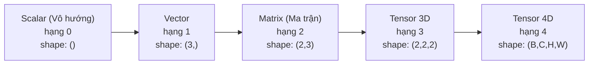
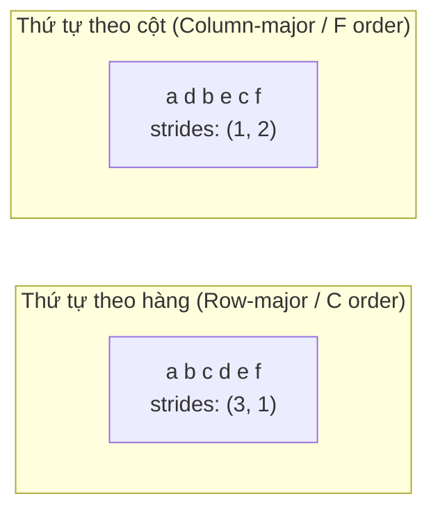
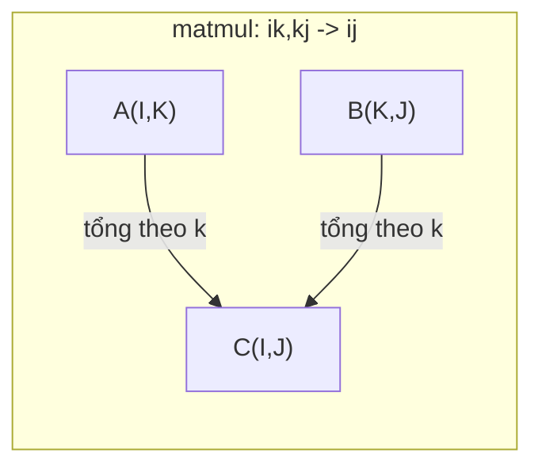

# Các thao tác với Tensor (Tensor Operations)

> Tensor là ngôn ngữ chung kết nối giữa dữ liệu và học sâu (deep learning). Mọi hình ảnh, mọi câu văn, mọi gradient đều chảy qua chúng.

**Type:** Build
**Language:** Python
**Prerequisites:** Phase 1, Lessons 01 (Linear Algebra Intuition), 02 (Vectors, Matrices & Operations)
**Time:** ~90 minutes

## Learning Objectives

- Tự xây dựng từ đầu một lớp Tensor với các thuộc tính shape, strides, reshape, transpose và các phép toán theo từng phần tử (element-wise)
- Áp dụng các quy tắc broadcasting để thực hiện phép toán trên các tensor có kích thước khác nhau mà không cần sao chép dữ liệu
- Viết các biểu thức einsum cho tích vô hướng (dot product), nhân ma trận, tích ngoài (outer product) và các thao tác theo lô (batched operations)
- Truy vết chính xác kích thước tensor qua từng bước của cơ chế multi-head attention

## The Problem (Vấn đề)

Bạn xây dựng một mô hình transformer. Lượt truyền xuôi (forward pass) trông rất chỉn chu. Bạn chạy thử và nhận được lỗi: `RuntimeError: mat1 and mat2 shapes cannot be multiplied (32x768 and 512x768)`. Bạn nhìn chằm chằm vào các chiều kích thước. Bạn thử dùng transpose. Bây giờ thông báo lỗi thành: `Expected 4D input (got 3D input)`. Bạn thêm `unsqueeze`. Một thứ khác lại đổ vỡ.

Lỗi kích thước (shape errors) là loại lỗi phổ biến nhất trong mã nguồn học sâu. Về mặt khái niệm, chúng không hề khó hiểu -- mỗi thao tác đều có một ràng buộc kích thước (shape contract) rõ ràng -- nhưng chúng nhân lên rất nhanh. Một khối transformer có hàng tá phép biến đổi reshape, transpose và broadcast nối tiếp nhau. Chỉ cần sai một trục tọa độ, lỗi sẽ lan truyền dây chuyền. Tệ hơn nữa, một số lỗi kích thước không hề ném ra thông báo lỗi nào. Chúng âm thầm tạo ra kết quả rác do broadcast sai chiều hoặc lấy tổng sai trục.

Ma trận chỉ xử lý các mối quan hệ theo cặp giữa hai tập hợp phần tử. Dữ liệu thực tế không chỉ nằm gọn trong hai chiều. Một lô gồm 32 bức ảnh RGB kích thước 224x224 là một tensor 4D: `(32, 3, 224, 224)`. Cơ chế self-attention với 12 head cũng là 4D: `(batch, heads, seq_len, head_dim)`. Bạn cần một cấu trúc dữ liệu có thể tổng quát hóa lên số chiều bất kỳ, cùng với các phép toán kết hợp nhịp nhàng trên toàn bộ các chiều đó. Cấu trúc đó chính là tensor. Nắm vững các thao tác trên tensor sẽ giúp việc gỡ lỗi kích thước trở nên cực kỳ dễ dàng.

## The Concept (Khái niệm)

### Tensor là gì

Tensor là một mảng đa chiều chứa các con số có cùng một kiểu dữ liệu (uniform data type). Số chiều được gọi là **hạng** (rank hoặc order). Mỗi chiều được gọi là một **trục** (axis). **Kích thước** (shape) là một tuple liệt kê kích thước dọc theo từng trục.



Tổng số phần tử = tích của tất cả các kích thước trục. Một shape `(2, 3, 4)` chứa $2 \cdot 3 \cdot 4 = 24$ phần tử.

### Kích thước tensor trong học sâu

Theo quy ước, các loại dữ liệu khác nhau được biểu diễn dưới các shape tensor cụ thể.

```mermaid
graph TD
    subgraph Vision (Thị giác máy tính)
        V1["(B, C, H, W)<br/>32, 3, 224, 224"]
    end
    subgraph NLP (Xử lý ngôn ngữ tự nhiên)
        N1["(B, T, D)<br/>16, 128, 768"]
    end
    subgraph Attention
        A1["(B, H, T, D)<br/>16, 12, 128, 64"]
    end
    subgraph Trọng số (Weights)
        W1["Linear: (out, in)<br/>Conv2D: (out_c, in_c, kH, kW)<br/>Embedding: (vocab, dim)"]
    end
```

PyTorch sử dụng định dạng NCHW (kênh đứng trước - channels-first). TensorFlow mặc định dùng NHWC (kênh đứng sau - channels-last). Sự không khớp bố cục bộ nhớ dẫn đến việc giảm hiệu năng hoặc phát sinh lỗi tiềm ẩn.

### Bố cục bộ nhớ hoạt động như thế nào (Memory Layout)

Một mảng 2D trong bộ nhớ thực chất là một chuỗi byte 1D liên tục. **Bước nhảy** (Strides) cho bạn biết cần phải bỏ qua bao nhiêu phần tử để dịch chuyển một bước dọc theo mỗi trục.



Phép chuyển vị (transpose) không di chuyển dữ liệu thực sự trong bộ nhớ. Nó chỉ hoán đổi các bước nhảy (strides), làm cho tensor trở thành **không liền kề** (non-contiguous) -- các phần tử của một hàng không còn nằm cạnh nhau trong bộ nhớ vật lý.

### Các quy tắc Broadcasting

Broadcasting cho phép bạn thực hiện phép tính trên các tensor có kích thước khác nhau mà không cần sao chép dữ liệu. Quy tắc: Căn chỉnh các chiều từ phải sang trái. Hai chiều tương thích khi chúng bằng nhau hoặc có một chiều bằng 1. Những tensor có ít chiều hơn sẽ được chèn thêm chiều 1 ở phía bên trái.

```
Tensor A:     (8, 1, 6, 1)
Tensor B:        (7, 1, 5)
B đệm thêm:   (1, 7, 1, 5)
Kết quả:      (8, 7, 6, 5)
```

### Einsum: Phép toán tensor vạn năng

Ký hiệu tổng Einstein (Einstein summation) gán mỗi trục bằng một chữ cái. Các trục xuất hiện ở đầu vào nhưng không có ở đầu ra sẽ được lấy tổng (thu gọn - contraction). Các trục xuất hiện ở cả hai sẽ được giữ lại.



Các mẫu hình kinh điển: `i,i->` (tích vô hướng), `i,j->ij` (tích ngoài), `ii->` (vết ma trận - trace), `ij->ji` (chuyển vị), `bij,bjk->bik` (nhân ma trận theo lô), `bhtd,bhsd->bhts` (điểm tương đồng attention scores).

```figure
tensor-broadcast
```

## Build It (Thực hành xây dựng)

Mã nguồn được lưu tại `code/tensors.py`. Mỗi bước dưới đây tham chiếu đến phần cài đặt trong tệp đó.

### Bước 1: Lưu trữ tensor và bước nhảy (strides)

Một tensor lưu trữ một danh sách phẳng các số kèm theo metadata về hình dạng (shape). Strides cho logic lập chỉ mục biết cách ánh xạ các chỉ số đa chiều thành vị trí phẳng trong mảng 1D.

```python
class Tensor:
    def __init__(self, data, shape=None):
        if isinstance(data, (list, tuple)):
            self._data, self._shape = self._flatten_nested(data)
        elif isinstance(data, np.ndarray):
            self._data = data.flatten().tolist()
            self._shape = tuple(data.shape)
        else:
            self._data = [data]
            self._shape = ()

        if shape is not None:
            total = reduce(lambda a, b: a * b, shape, 1)
            if total != len(self._data):
                raise ValueError(
                    f"Cannot reshape {len(self._data)} elements into shape {shape}"
                )
            self._shape = tuple(shape)

        self._strides = self._compute_strides(self._shape)

    @staticmethod
    def _compute_strides(shape):
        if len(shape) == 0:
            return ()
        strides = [1] * len(shape)
        for i in range(len(shape) - 2, -1, -1):
            strides[i] = strides[i + 1] * shape[i + 1]
        return tuple(strides)
```

Đối với shape `(3, 4)`, strides là `(4, 1)` -- cần nhảy qua 4 phần tử để sang hàng tiếp theo, và nhảy 1 phần tử để sang cột tiếp theo.

### Bước 2: Reshape, squeeze, unsqueeze

Reshape thay đổi kích thước các trục mà không thay đổi thứ tự phần tử. Tổng số phần tử phải được bảo toàn. Có thể sử dụng `-1` cho một chiều để tự động suy luận kích thước của chiều đó.

```python
t = Tensor(list(range(12)), shape=(2, 6))
r = t.reshape((3, 4))
r = t.reshape((-1, 3))
```

Squeeze loại bỏ các trục có kích thước bằng 1. Unsqueeze chèn thêm một trục có kích thước bằng 1. Unsqueeze cực kỳ quan trọng cho broadcasting -- chẳng hạn cộng một vector bias `(D,)` vào một lô `(B, T, D)` cần unsqueeze bias thành `(1, 1, D)`.

```python
t = Tensor(list(range(6)), shape=(1, 3, 1, 2))
s = t.squeeze()
v = Tensor([1, 2, 3])
u = v.unsqueeze(0)
```

### Bước 3: Transpose và permute

Transpose hoán đổi hai trục. Permute sắp xếp lại toàn bộ thứ tự các trục. Đây là cách bạn chuyển đổi qua lại giữa NCHW và NHWC.

```python
mat = Tensor(list(range(6)), shape=(2, 3))
tr = mat.transpose(0, 1)

t4d = Tensor(list(range(24)), shape=(1, 2, 3, 4))
perm = t4d.permute((0, 2, 3, 1))
```

Sau khi transpose hoặc permute, tensor trở thành không liền kề trong bộ nhớ. Trong PyTorch, phương thức `view` sẽ thất bại trên các tensor không liền kề -- bạn cần dùng `reshape` hoặc gọi `.contiguous()` trước.

### Bước 4: Các thao tác theo từng phần tử và phép thu gọn (reductions)

Các phép toán theo phần tử (cộng, nhân, trừ) áp dụng độc lập cho từng phần tử và giữ nguyên kích thước. Phép thu gọn (sum, mean, max) gộp và triệt tiêu một hoặc nhiều trục.

```python
a = Tensor([[1, 2], [3, 4]])
b = Tensor([[10, 20], [30, 40]])
c = a + b
d = a * 2
s = a.sum(axis=0)
```

Global average pooling trong mạng CNN: `(B, C, H, W).mean(axis=[2, 3])` tạo ra `(B, C)`. Sequence mean pooling trong NLP: `(B, T, D).mean(axis=1)` tạo ra `(B, D)`.

### Bước 5: Broadcasting với NumPy

Hàm `demo_broadcasting_numpy()` trong `tensors.py` minh họa các mẫu hình cốt lõi:

```python
activations = np.random.randn(4, 3)
bias = np.array([0.1, 0.2, 0.3])
result = activations + bias

images = np.random.randn(2, 3, 4, 4)
scale = np.array([0.5, 1.0, 1.5]).reshape(1, 3, 1, 1)
result = images * scale

a = np.array([1, 2, 3]).reshape(-1, 1)
b = np.array([10, 20, 30, 40]).reshape(1, -1)
outer = a * b
```

Tính khoảng cách từng cặp điểm bằng broadcasting: reshape `(M, 2)` thành `(M, 1, 2)` và `(N, 2)` thành `(1, N, 2)`, trừ nhau, bình phương, lấy tổng dọc theo trục cuối cùng, rồi lấy căn bậc hai. Kết quả nhận được có kích thước `(M, N)`.

### Bước 6: Các thao tác Einsum

Các hàm `demo_einsum()` và `demo_einsum_gallery()` duyệt qua mọi mẫu hình thông dụng:

```python
a = np.array([1.0, 2.0, 3.0])
b = np.array([4.0, 5.0, 6.0])
dot = np.einsum("i,i->", a, b)

A = np.array([[1, 2], [3, 4], [5, 6]], dtype=float)
B = np.array([[7, 8, 9], [10, 11, 12]], dtype=float)
matmul = np.einsum("ik,kj->ij", A, B)

batch_A = np.random.randn(4, 3, 5)
batch_B = np.random.randn(4, 5, 2)
batch_mm = np.einsum("bij,bjk->bik", batch_A, batch_B)
```

Chi phí tính toán của một phép thu gọn là tích kích thước của tất cả các chỉ số (cả giữ lại lẫn lấy tổng). Đối với `bij,bjk->bik` với $B=32$, $I=128$, $J=64$, $K=128$: cần $32 \cdot 128 \cdot 64 \cdot 128 = 33{,}554{,}432$ phép nhân-cộng.

### Bước 7: Cơ chế Attention qua einsum

Hàm `demo_attention_einsum()` cài đặt cơ chế multi-head attention từ đầu đến cuối:

```python
B, H, T, D = 2, 4, 8, 16
E = H * D

X = np.random.randn(B, T, E)
W_q = np.random.randn(E, E) * 0.02

Q = np.einsum("bte,ek->btk", X, W_q)
Q = Q.reshape(B, T, H, D).transpose(0, 2, 1, 3)

scores = np.einsum("bhtd,bhsd->bhts", Q, K) / np.sqrt(D)
weights = softmax(scores, axis=-1)
attn_output = np.einsum("bhts,bhsd->bhtd", weights, V)

concat = attn_output.transpose(0, 2, 1, 3).reshape(B, T, E)
output = np.einsum("bte,ek->btk", concat, W_o)
```

Mỗi bước đều là một thao tác tensor: chiếu tuyến tính (matmul qua einsum), tách head (reshape + transpose), tính điểm attention (batch matmul qua einsum), tổng có trọng số (batch matmul qua einsum), gộp head (transpose + reshape), chiếu đầu ra (matmul qua einsum).

## Use It (Ứng dụng thực tế)

### Tự viết từ đầu (Scratch) vs NumPy

| Thao tác | Scratch (lớp Tensor) | NumPy |
|---|---|---|
| Tạo mới | `Tensor([[1,2],[3,4]])` | `np.array([[1,2],[3,4]])` |
| Reshape | `t.reshape((3,4))` | `a.reshape(3,4)` |
| Transpose | `t.transpose(0,1)` | `a.T` hoặc `a.transpose(0,1)` |
| Squeeze | `t.squeeze(0)` | `np.squeeze(a, 0)` |
| Lấy tổng | `t.sum(axis=0)` | `a.sum(axis=0)` |
| Einsum | Không hỗ trợ | `np.einsum("ij,jk->ik", a, b)` |

### Scratch vs PyTorch

```python
import torch

t = torch.tensor([[1, 2, 3], [4, 5, 6]], dtype=torch.float32)
t.shape
t.stride()
t.is_contiguous()

t.reshape(3, 2)
t.unsqueeze(0)
t.transpose(0, 1)
t.transpose(0, 1).contiguous()

torch.einsum("ik,kj->ij", A, B)
```

PyTorch bổ sung thêm tính năng tính toán tự động đạo hàm (autograd), tăng tốc phần cứng trên GPU và các kernel BLAS được tối ưu hóa cao. Ngữ nghĩa về hình dạng kích thước là hoàn toàn giống nhau. Nếu bạn hiểu rõ phiên bản tự dựng, các lỗi kích thước trong PyTorch sẽ trở nên cực kỳ trực quan và dễ sửa.

### Mọi lớp mạng nơ-ron đều là một thao tác tensor

| Thao tác | Dạng biểu diễn Tensor | Biểu thức Einsum |
|---|---|---|
| Lớp tuyến tính (Linear layer) | `Y = X @ W.T + b` | `"bd,od->bo"` + bias |
| QKV trong Attention | `Q = X @ W_q` | `"btd,dh->bth"` |
| Điểm tương đồng Attention | `Q @ K.T / sqrt(d)` | `"bhtd,bhsd->bhts"` |
| Đầu ra Attention | `softmax(scores) @ V` | `"bhts,bhsd->bhtd"` |
| Batch norm | `(X - mu) / sigma * gamma` | element-wise + broadcast |
| Softmax | `exp(x) / sum(exp(x))` | element-wise + reduction |

## Ship It (Sản phẩm bàn giao)

Bài học này xuất xưởng hai mẫu prompt tái sử dụng:

1. **`outputs/prompt-tensor-shapes.md`** -- Prompt có hệ thống để gỡ lỗi sai lệch kích thước tensor. Bao gồm các bảng quyết định cho mọi thao tác thông dụng (matmul, broadcast, cat, Linear, Conv2d, BatchNorm, softmax) và bảng tra cứu cách khắc phục nhanh.

2. **`outputs/prompt-tensor-debugger.md`** -- Prompt gỡ lỗi từng bước để dán vào bất kỳ trợ lý AI nào khi bạn gặp bế tắc vì lỗi kích thước tensor. Cung cấp thông báo lỗi cùng kích thước các tensor hiện tại, bạn sẽ nhận được phương án sửa lỗi chính xác.

## Exercises (Bài tập)

1. **Dễ -- Chu trình Reshape khép kín.** Lấy một tensor có shape `(2, 3, 4)`. Reshape nó thành `(6, 4)`, sau đó thành `(24,)`, rồi đưa trở lại `(2, 3, 4)`. Xác minh rằng thứ tự các phần tử được bảo toàn ở mỗi bước bằng cách in dữ liệu mảng phẳng.

2. **Trung bình -- Tự cài đặt broadcasting.** Mở rộng lớp `Tensor` với phương thức `broadcast_to(shape)` giúp mở rộng các chiều có kích thước bằng 1 để khớp với shape mục tiêu. Sau đó sửa đổi `_elementwise_op` để tự động broadcast trước khi tính toán. Kiểm thử với các shape `(3, 1)` và `(1, 4)` để tạo ra shape `(3, 4)`.

3. **Khó -- Xây dựng hàm einsum từ đầu.** Cài đặt một hàm `einsum(subscripts, *tensors)` cơ bản hỗ trợ ít nhất các phép toán: tích vô hướng (`i,i->`), nhân ma trận (`ij,jk->ik`), tích ngoài (`i,j->ij`) và chuyển vị (`ij->ji`). Phân tích chuỗi ký tự subscript, xác định các chỉ số cần thu gọn và lặp qua toàn bộ các tổ hợp chỉ số. So sánh kết quả của bạn với `np.einsum`.

4. **Khó -- Bộ theo dõi kích thước Attention.** Viết một hàm nhận `batch_size`, `seq_len`, `embed_dim` và `num_heads` làm đầu vào rồi in ra chính xác kích thước ở từng bước của multi-head attention: đầu vào, phép chiếu Q/K/V, tách head, điểm attention scores, trọng số softmax, tổng có trọng số, gộp head, phép chiếu đầu ra. So khớp với kết quả từ `demo_attention_einsum()`.

### Gợi ý (Hints)

**Bài tập 1.** Tạo tensor từ `list(range(24))` để mỗi phần tử hiển thị chính vị trí của nó. Sau mỗi lần gọi `reshape`, in `flatten().to_list()` và kiểm tra xem danh sách có vẫn giữ đúng thứ tự từ 0 đến 23 hay không.

**Bài tập 2.** Một chiều chỉ có thể broadcast khi hai kích thước bằng nhau hoặc một trong hai bằng 1, do đó hãy kiểm tra quy tắc này trước và ném lỗi nếu không thỏa mãn. Với các kích thước `(3, 1)` và `(1, 4)`, kiểm tra xem phần tử `[i][j]` của kết quả có bằng `a[i][0] + b[0][j]` hay không, và so sánh kết quả toàn diện với NumPy.

**Bài tập 3.** Tách chuỗi subscripts tại ký hiệu `->`. Chữ cái xuất hiện ở đầu vào nhưng không có ở đầu ra là chỉ số cần thu gọn (lấy tổng), do đó hãy lặp qua tất cả giá trị của từng chữ cái và cộng dồn vào vị trí đầu ra tương ứng. Kiểm thử từng trường hợp trong số 4 trường hợp trên các mảng ngẫu nhiên nhỏ bằng `np.allclose(mine, np.einsum(...))`.

**Bài tập 4.** Bắt đầu với kích thước mỗi head `embed_dim // num_heads` và xác nhận (assert) rằng `embed_dim % num_heads == 0`. Điểm attention scores có shape `(batch_size, num_heads, seq_len, seq_len)`, do đó hãy đối chiếu kết quả in của bạn với shape này và với các shape mà `demo_attention_einsum()` hiển thị.

## Key Terms (Thuật ngữ chính)

| Thuật ngữ | Cách gọi thông thường | Ý nghĩa bản chất |
|---|---|---|
| Tensor | "Một ma trận nhưng nhiều chiều hơn" | Một mảng đa chiều có kiểu dữ liệu đồng nhất cùng kích thước (shape), bước nhảy (strides) và các phép toán được xác định rõ ràng |
| Rank (Hạng tensor) | "Số chiều" | Số lượng trục tọa độ. Một ma trận có rank tensor bằng 2 (khác với hạng của ma trận trong đại số tuyến tính) |
| Shape (Kích thước) | "Kích thước của tensor" | Một tuple liệt kê kích thước dọc theo từng trục. Ví dụ `(2, 3)` nghĩa là 2 hàng, 3 cột |
| Stride (Bước nhảy) | "Cách bố trí trong bộ nhớ" | Số lượng phần tử cần bỏ qua trong bộ nhớ để tiến lên một vị trí dọc theo từng trục |
| Broadcasting | "Tự động tương thích kích thước" | Tập quy tắc nghiêm ngặt: căn chỉnh từ bên phải, các chiều phải bằng nhau hoặc có ít nhất một chiều bằng 1 |
| Contiguous (Liền kề) | "Tensor bình thường" | Các phần tử được lưu trữ tuần tự liên tục trong bộ nhớ mà không có khoảng trống hay đảo lộn so với bố cục logic |
| Einsum | "Cách viết nhân ma trận kiểu gọn" | Một ký hiệu tổng quát thể hiện bất kỳ phép thu gọn tensor, tích ngoài, vết ma trận hay chuyển vị nào chỉ trong một dòng |
| View | "Giống như reshape" | Một tensor dùng chung vùng đệm bộ nhớ nhưng mang metadata kích thước/bước nhảy khác. Bị lỗi trên dữ liệu không liền kề |
| Contraction (Thu gọn) | "Lấy tổng theo một chỉ số" | Thao tác tổng quát khi một chỉ số chung giữa các tensor được nhân và lấy tổng, tạo ra kết quả có hạng thấp hơn |
| NCHW / NHWC | "Định dạng PyTorch vs TensorFlow" | Quy ước bố cục bộ nhớ cho tensor hình ảnh. NCHW đặt kênh trước chiều không gian, NHWC đặt sau |

## Further Reading (Tài liệu đọc thêm)

- [NumPy Broadcasting](https://numpy.org/doc/stable/user/basics.broadcasting.html) -- Các quy tắc chuẩn tắc kèm ví dụ trực quan
- [PyTorch Tensor Views](https://pytorch.org/docs/stable/tensor_view.html) -- Khi nào view hoạt động và khi nào nó phải sao chép bộ nhớ
- [einops](https://github.com/arogozhnikov/einops) -- Thư viện giúp các thao tác biến đổi tensor trở nên rõ ràng và an toàn hơn
- [The Illustrated Transformer](https://jalammar.github.io/illustrated-transformer/) -- Minh họa trực quan các kích thước tensor dịch chuyển qua khối attention
- [Einstein Summation in NumPy](https://numpy.org/doc/stable/reference/generated/numpy.einsum.html) -- Tài liệu hướng dẫn đầy đủ về hàm einsum kèm ví dụ
