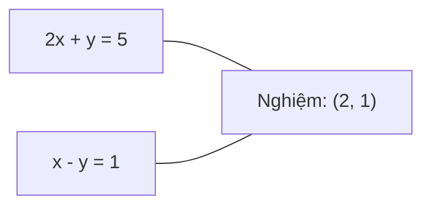
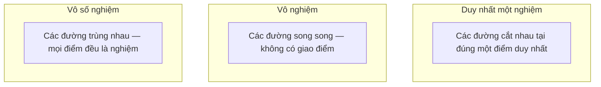

# Các hệ phương trình tuyến tính (Linear Systems)

> Giải phương trình $Ax = b$ là bài toán cổ xưa nhất trong toán học vẫn đang âm thầm vận hành mạng nơ-ron của bạn mỗi ngày.

**Type:** Build
**Language:** Python
**Prerequisites:** Phase 1, Lessons 01 (Linear Algebra Intuition), 02 (Vectors & Matrices), 03 (Matrix Transformations)
**Time:** ~120 minutes

## Learning Objectives

- Giải hệ phương trình $Ax = b$ bằng phương pháp khử Gauss có chọn phần tử trục một phần (partial pivoting) và thế ngược (back substitution)
- Phân rã ma trận bằng các phép phân tích LU, QR và Cholesky, đồng thời giải thích thời điểm thích hợp để sử dụng từng loại
- Thiết lập phương trình chuẩn tắc (normal equations) cho bài toán bình phương tối thiểu và kết nối chúng với hồi quy tuyến tính và hồi quy Ridge
- Chẩn đoán các hệ phương trình kém điều kiện (ill-conditioned) bằng điều kiện số (condition number) và áp dụng kỹ thuật điều chuẩn để ổn định hóa chúng

## The Problem (Vấn đề)

Mỗi lần bạn huấn luyện một mô hình hồi quy tuyến tính, bạn đang giải một hệ phương trình tuyến tính. Mỗi khi bạn khớp một mô hình bình phương tối thiểu, bạn giải một hệ tuyến tính. Mỗi khi một tầng mạng nơ-ron tính toán `y = Wx + b`, nó đang đánh giá một vế của một hệ tuyến tính. Khi bạn thêm kỹ thuật điều chuẩn (regularization), bạn biến đổi hệ tuyến tính đó. Khi bạn dùng quy trình Gauss (Gaussian processes), bạn phân rã một ma trận. Khi bạn nghịch đảo một ma trận hiệp phương sai để tính khoảng cách Mahalanobis, bạn đang giải một hệ phương trình tuyến tính.

Phương trình $Ax = b$ xuất hiện ở mọi ngóc ngách của học máy. $A$ là ma trận các hệ số đã biết. $b$ là vector đầu ra đã biết. $x$ là vector các ẩn số bạn cần tìm. Trong hồi quy tuyến tính, $A$ là ma trận dữ liệu, $b$ là vector nhãn mục tiêu, và $x$ là vector trọng số. Toàn bộ bài toán quy về: Tìm $x$ sao cho $Ax$ càng gần $b$ càng tốt.

Bài học này sẽ tự tay xây dựng mọi phương pháp quan trọng để giải phương trình đó từ đầu. Bạn sẽ hiểu vì sao một số phương pháp rất nhanh nhưng phương pháp khác lại ổn định số học hơn; vì sao một số phương pháp chỉ dùng cho ma trận vuông trong khi phương pháp khác xử lý được các hệ thừa định; và vì sao điều kiện số của ma trận quyết định xem kết quả tính ra có mang lại giá trị thực tế nào hay chỉ là rác số học.

## The Concept (Khái niệm)

### Ý nghĩa hình học của Ax = b

Một hệ phương trình tuyến tính mang ý nghĩa hình học rõ nét: Mỗi phương trình định nghĩa một siêu phẳng (hyperplane). Nghiệm của hệ là điểm (hoặc tập hợp các điểm) nơi tất cả các siêu phẳng đó giao nhau.

```
2x + y = 5          Hai đường thẳng trong không gian 2D.
x - y  = 1          Chúng cắt nhau tại điểm x=2, y=1.
```



Có ba khả năng xảy ra đối với hệ phương trình:



Dưới dạng ma trận, "duy nhất một nghiệm" nghĩa là ma trận $A$ khả nghịch. "Vô nghiệm" nghĩa là hệ phương trình mâu thuẫn. "Vô số nghiệm" nghĩa là $A$ có không gian hạt nhân (null space) khác rỗng. Hầu hết các bài toán ML rơi vào trường hợp "không có nghiệm chính xác tuyệt đối" (hệ thừa định) vì số phương trình (số điểm dữ liệu) nhiều hơn số ẩn số (số tham số). Đó là lúc phương pháp bình phương tối thiểu (least squares) bước vào sân khấu.

### Bức tranh theo hàng vs Bức tranh theo cột (Row Picture vs Column Picture)

Có hai góc nhìn khi quan sát $Ax = b$:

**Bức tranh theo hàng (Row picture):** Mỗi hàng của $A$ định nghĩa một phương trình, tương ứng một siêu phẳng. Nghiệm là điểm giao nhau của toàn bộ các siêu phẳng đó.

**Bức tranh theo cột (Column picture):** Mỗi cột của $A$ là một vector. Bài toán trở thành: Tổ hợp tuyến tính nào của các cột trong $A$ sẽ tạo ra vector $b$?

```
A = | 2  1 |    b = | 5 |
    | 1 -1 |        | 1 |

Góc nhìn hàng: Giải đồng thời 2x + y = 5 và x - y = 1.

Góc nhìn cột: Tìm x1, x2 sao cho:
  x1 * [2, 1] + x2 * [1, -1] = [5, 1]
  2 * [2, 1] + 1 * [1, -1] = [4+1, 2-1] = [5, 1]   chính xác.
```

Góc nhìn theo cột mang tính nền tảng hơn trong học máy. Nếu $b$ nằm trong không gian cột của $A$, hệ có nghiệm. Nếu $b$ không nằm trong không gian cột, bạn tìm điểm gần $b$ nhất nằm trong không gian cột đó. Điểm gần nhất đó chính là nghiệm bình phương tối thiểu.

### Phép khử Gauss (Gaussian Elimination)

Phép khử Gauss biến đổi hệ $Ax = b$ thành hệ tam giác trên $Ux = c$, sau đó giải dễ dàng bằng phép thế ngược (back substitution). Đây là phương pháp trực tiếp kinh điển nhất.

Thuật toán:
```
1. Với mỗi cột k (cột trục - pivot column):
   a. Tìm phần tử có giá trị tuyệt đối lớn nhất trong cột k từ hàng k trở xuống (chọn trục một phần - partial pivoting).
   b. Hoán đổi hàng đó với hàng k.
   c. Với mỗi hàng i nằm dưới hàng k:
      - Tính hệ số nhân m = A[i][k] / A[k][k]
      - Lấy hàng i trừ đi m lần hàng k.
2. Thế ngược: Giải từ phương trình cuối cùng ngược lên phương trình đầu tiên.
```

Ví dụ:
```
Ban đầu:
| 2  1  1 | 8 |       R2 = R2 - (2)R1     | 2  1   1 |  8 |
| 4  3  3 |20 |  -->  R3 = R3 - (1)R1 --> | 0  1   1 |  4 |
| 2  3  1 |12 |                            | 0  2   0 |  4 |

                       R3 = R3 - (2)R2     | 2  1   1 |  8 |
                                       --> | 0  1   1 |  4 |
                                           | 0  0  -2 | -4 |

Thế ngược:
  -2 * x3 = -4    -->  x3 = 2
  x2 + 2  = 4     -->  x2 = 2
  2*x1 + 2 + 2 = 8 --> x1 = 2
```

Khử Gauss tốn chi phí tính toán $O(n^3)$. Với một hệ $1000 \times 1000$, cần khoảng 1 tỷ phép tính dấu phẩy động. Rất nhanh, nhưng nếu bạn cần giải nhiều hệ phương trình có cùng ma trận $A$ với các vector $b$ khác nhau, bạn có thể làm tốt hơn nhiều bằng cách phân rã ma trận.

### Chọn trục một phần: Vì sao lại quan trọng (Partial Pivoting)

Nếu không chọn trục, phép khử Gauss có thể sụp đổ hoặc sinh ra kết quả sai lệch hoàn toàn. Nếu phần tử trục bằng 0, bạn sẽ chia cho 0. Nếu nó là số rất nhỏ, bạn sẽ khuếch đại sai số làm tròn lên mức khổng lồ.

```
Trục xấu (không đổi hàng):        Có chọn trục (Partial pivoting):
| 0.001  1 | 1.001 |            Đổi hàng trước:
| 1      1 | 2     |            | 1      1 | 2     |
                                 | 0.001  1 | 1.001 |
m = 1/0.001 = 1000              m = 0.001/1 = 0.001
R2 = R2 - 1000*R1               R2 = R2 - 0.001*R1
| 0.001  1     | 1.001   |      | 1      1     | 2     |
| 0     -999   | -999.0  |      | 0      0.999 | 0.999 |

x2 = 1.000 (đúng)               x2 = 1.000 (đúng)
x1 = (1.001 - 1)/0.001          x1 = (2 - 1)/1 = 1.000 (đúng)
   = 0.001/0.001 = 1.000        Rất ổn định vì hệ số nhân m cực nhỏ.
```

Trong tính toán số thực dấu phẩy động với độ chính xác giới hạn, phiên bản không chọn trục có thể đánh mất toàn bộ các chữ số có nghĩa. Kỹ thuật chọn trục một phần luôn đưa phần tử có độ lớn cực đại lên vị trí trục để triệt tiêu sự khuếch đại sai số.

### Phân rã LU (LU Decomposition)

Phân rã LU tách ma trận $A$ thành tích của ma trận tam giác dưới $L$ và ma trận tam giác trên $U$: $A = LU$. Ma trận $L$ lưu trữ các hệ số nhân từ quá trình khử Gauss, còn $U$ là kết quả ma trận tam giác trên sau khi khử.

```
A = L @ U

| 2  1  1 |   | 1  0  0 |   | 2  1   1 |
| 4  3  3 | = | 2  1  0 | @ | 0  1   1 |
| 2  3  1 |   | 1  2  1 |   | 0  0  -2 |
```

Tại sao nên phân rã thay vì chỉ khử trực tiếp? Vì một khi bạn đã có $L$ và $U$, việc giải $Ax = b$ cho bất kỳ vector $b$ mới nào chỉ tốn độ phức tạp $O(n^2)$:

```math
\begin{aligned}
Ax &= b \\
LUx &= b \\
&\text{Đặt } y = Ux\text{:} \\
Ly &= b \quad \text{(thế xuôi - forward substitution, } O(n^2)\text{)} \\
Ux &= y \quad \text{(thế ngược - back substitution, } O(n^2)\text{)}
\end{aligned}
```

Chi phí $O(n^3)$ chỉ phải trả một lần duy nhất lúc phân rã ma trận. Mọi lần giải tiếp theo chỉ tốn $O(n^2)$. Nếu bạn cần giải 1000 hệ phương trình cùng ma trận $A$ nhưng khác $b$, LU giúp giảm tổng khối lượng tính toán đi khoảng 300 lần.

Khi có chọn trục một phần, ta thu được phương trình $PA = LU$, trong đó $P$ là ma trận hoán vị ghi lại các phép đổi hàng.

### Phân rã QR (QR Decomposition)

Phân rã QR phân tích $A$ thành ma trận trực giao $Q$ và ma trận tam giác trên $R$: $A = QR$.

Một ma trận trực giao có tính chất $Q^T Q = I$. Các cột của nó là các vector trực chuẩn. Phép nhân với $Q$ bảo toàn độ dài vector và góc giữa các vector.

```
A = Q @ R

Q có các cột trực chuẩn: Q^T Q = I
R là ma trận tam giác trên

Để giải Ax = b:
  QRx = b
  Rx = Q^T b    (chỉ cần nhân với Q^T, không cần nghịch đảo)
  Thế ngược để tìm x.
```

QR ổn định số học hơn nhiều so với LU khi giải các bài toán bình phương tối thiểu. Quá trình trực chuẩn hóa Gram-Schmidt xây dựng $Q$ theo từng cột:

```
Cho các cột a1, a2, ... của A:

q1 = a1 / ||a1||

q2 = a2 - (a2 . q1) * q1        (trừ hình chiếu lên q1)
q2 = q2 / ||q2||                (chuẩn hóa)

q3 = a3 - (a3 . q1) * q1 - (a3 . q2) * q2
q3 = q3 / ||q3||

R[i][j] = qi . aj    với i <= j
```

Mỗi bước triệt tiêu thành phần dọc theo toàn bộ các vector $q$ trước đó, chỉ giữ lại hướng trực giao mới.

### Phân rã Cholesky (Cholesky Decomposition)

Khi $A$ là ma trận đối xứng ($A = A^T$) và xác định dương (toàn bộ trị riêng đều dương), bạn có thể phân rã nó thành $A = L L^T$ với $L$ là ma trận tam giác dưới. Đây chính là phân tích Cholesky.

```
A = L @ L^T

| 4  2 |   | 2  0 |   | 2  1 |
| 2  5 | = | 1  2 | @ | 0  2 |

L[i][i] = sqrt(A[i][i] - sum(L[i][k]^2 cho k < i))
L[i][j] = (A[i][j] - sum(L[i][k]*L[j][k] cho k < j)) / L[j][j]    cho i > j
```

Cholesky nhanh gấp đôi so với LU và chỉ tốn một nửa dung lượng bộ nhớ lưu trữ. Nó chỉ áp dụng được cho ma trận đối xứng xác định dương, nhưng các ma trận loại này xuất hiện liên tục trong học máy:
- Ma trận hiệp phương sai luôn đối xứng nửa xác định dương (và xác định dương khi có thêm điều chuẩn).
- Ma trận nhân (Kernel matrix) trong Gaussian Process luôn đối xứng xác định dương.
- Ma trận Hessian của một hàm lồi tại điểm cực tiểu luôn đối xứng xác định dương.
- $A^T A$ luôn đối xứng nửa xác định dương.

Trong Gaussian Process, bạn phân rã ma trận kernel $K$ bằng Cholesky, rồi giải $K \alpha = y$ để thu được kỳ vọng dự đoán. Phân rã Cholesky cũng cho phép tính nhanh log định thức cho hàm hợp lý biên: $\log \det(K) = 2 \sum \log(\mathop{\mathrm{diag}}(L))$.

### Bình phương tối thiểu: Khi Ax = b không có nghiệm chính xác

Nếu $A$ có kích thước $m \times n$ với $m > n$ (số phương trình nhiều hơn số ẩn số), hệ thừa định và không có nghiệm chính xác. Thay vào đó, bạn cực tiểu hóa tổng bình phương sai số phần dư:

```
minimize ||Ax - b||^2

Đây là tổng bình phương các phần dư:
  sum((A[i,:] @ x - b[i])^2 cho i chạy từ 0 đến m-1)
```

Nghiệm tối ưu thỏa mãn phương trình chuẩn tắc (Normal Equations):

```math
A^T A x = A^T b
```

Chứng minh: Khai triển $\lVert Ax - b \rVert^2 = (Ax - b)^T (Ax - b) = x^T A^T A x - 2 x^T A^T b + b^T b$. Lấy gradient theo $x$ và cho bằng 0: $2 A^T A x - 2 A^T b = 0$.

```
Hệ ban đầu (thừa định, 4 phương trình, 2 ẩn):
| 1  1 |         | 3 |
| 1  2 | x     = | 5 |       Không có nghiệm x nào thỏa mãn cả 4 phương trình cùng lúc.
| 1  3 |         | 6 |
| 1  4 |         | 8 |

Phương trình chuẩn tắc:
A^T A = | 4  10 |    A^T b = | 22 |
        | 10 30 |            | 63 |

Giải hệ thu được: x = [1.5, 1.7]

Đây chính là hồi quy tuyến tính: x[0] là hệ số chặn (intercept), x[1] là hệ số góc (slope).
```

### Phương trình chuẩn tắc = Hồi quy tuyến tính

Mối liên hệ này là tuyệt đối. Trong hồi quy tuyến tính, ma trận dữ liệu $X$ có mỗi hàng là một mẫu dữ liệu và mỗi cột là một đặc trưng. Vector mục tiêu $y$ có một phần tử cho mỗi mẫu. Vector trọng số $w$ thỏa mãn:

```math
\begin{aligned}
X^T X w &= X^T y \\
w &= (X^T X)^{-1} X^T y
\end{aligned}
```

Đây là nghiệm giải tích dạng đóng của hồi quy tuyến tính. Mọi lệnh gọi `LinearRegression.fit()` trong Scikit-Learn đều tính toán công thức này (hoặc phiên bản tương đương qua QR/SVD).

Thêm vào một số hạng điều chuẩn $\lambda I$ ta thu được hồi quy Ridge:

```math
\begin{aligned}
(X^T X + \lambda I) w &= X^T y \\
w &= (X^T X + \lambda I)^{-1} X^T y
\end{aligned}
```

Điều chuẩn giúp ma trận có điều kiện số tốt hơn (dễ nghịch đảo chuẩn xác hơn) và chống quá khớp (overfitting) bằng cách co các trọng số về gần 0. Ma trận $X^T X + \lambda I$ luôn đối xứng xác định dương khi $\lambda > 0$, do đó bạn luôn có thể dùng Cholesky để giải nó một cách tối ưu.

### Giả nghịch đảo Moore-Penrose

Giả nghịch đảo $A^+$ tổng quát hóa phép nghịch đảo cho các ma trận không vuông hoặc suy biến:

```math
\begin{aligned}
x &= A^+ b \\[4pt]
\text{với } A^+ &= V \Sigma^+ U^T \quad \text{(tính thông qua SVD)}
\end{aligned}
```

$\Sigma^+$ nhận được bằng cách nghịch đảo các giá trị suy biến khác 0 và chuyển vị ma trận kết quả.

```
A = U Sigma V^T        (SVD)

Sigma = | 5  0 |       Sigma+ = | 1/5  0  0 |
        | 0  2 |                | 0  1/2  0 |
        | 0  0 |

A+ = V Sigma+ U^T
```

Giả nghịch đảo đem lại nghiệm bình phương tối thiểu có chuẩn nhỏ nhất. Nếu hệ:
- Có duy nhất nghiệm: $A^+ b$ trả về đúng nghiệm đó.
- Vô nghiệm: $A^+ b$ trả về nghiệm bình phương tối thiểu.
- Vô số nghiệm: $A^+ b$ chọn nghiệm có chuẩn $\lVert x \rVert$ nhỏ nhất.

Cả `np.linalg.lstsq` lẫn `np.linalg.pinv` của NumPy đều sử dụng SVD bên dưới.

### Điều kiện số (Condition Number)

Điều kiện số đo lường mức độ nhạy cảm của nghiệm đối với những biến động nhỏ ở đầu vào. Với ma trận $A$, điều kiện số được định nghĩa là:

```math
\kappa(A) = \lVert A \rVert \cdot \lVert A^{-1} \rVert = \frac{\sigma_{\max}}{\sigma_{\min}}
```

trong đó $\sigma_{\max}$ và $\sigma_{\min}$ là giá trị suy biến lớn nhất và nhỏ nhất.

```
Điều kiện tốt (kappa ~ 1):           Kém điều kiện (kappa ~ 10^15):
Biến đổi nhỏ ở b -->                Biến đổi nhỏ ở b -->
biến đổi nhỏ ở x                     biến đổi khổng lồ ở x

| 2  0 |   kappa = 2/1 = 2          | 1   1          |   kappa ~ 10^15
| 0  1 |   rất an toàn              | 1   1+10^(-15) |   nghiệm hoàn toàn là rác
```

Quy tắc thực tế:
- $\kappa < 100$: Rất an toàn, nghiệm chính xác.
- $\kappa \approx 10^k$: Bạn đánh mất khoảng $k$ chữ số có nghĩa trong tính toán số thực dấu phẩy động.
- $\kappa \approx 10^{16}$ (với float64): Nghiệm hoàn toàn vô nghĩa. Ma trận thực tế đã bị suy biến.

Trong học máy, hiện tượng kém điều kiện xảy ra khi các đặc trưng gần như cộng tuyến (collinear) với nhau. Điều chuẩn (cộng thêm $\lambda I$) cải thiện điều kiện số từ $\sigma_{\max}/\sigma_{\min}$ thành $(\sigma_{\max} + \lambda)/(\sigma_{\min} + \lambda)$.

### Các phương pháp lặp: Gradient liên hợp (Conjugate Gradient)

Với các hệ phương trình thưa cực lớn (hàng triệu ẩn số), các phương pháp trực tiếp như LU hay Cholesky quá tốn kém tài nguyên. Các phương pháp lặp xấp xỉ nghiệm bằng cách tinh chỉnh dần dự đoán qua từng bước.

Phương pháp Gradient liên hợp (Conjugate Gradient - CG) giải $Ax = b$ khi $A$ đối xứng xác định dương. Nó tìm ra nghiệm chính xác trong tối đa $n$ bước lặp (trên lý thuyết toán học chính xác), nhưng thường hội tụ nhanh hơn nhiều nếu các trị riêng của $A$ phân bố thành cụm.

```
Phác thảo thuật toán:
  x0 = dự đoán ban đầu (thường là vector 0)
  r0 = b - A x0           (phần dư)
  p0 = r0                 (hướng tìm kiếm)

  Với k = 0, 1, 2, ...:
    alpha = (rk . rk) / (pk . A pk)
    x_{k+1} = xk + alpha * pk
    r_{k+1} = rk - alpha * A pk
    beta = (r_{k+1} . r_{k+1}) / (rk . rk)
    p_{k+1} = r_{k+1} + beta * pk
    nếu ||r_{k+1}|| < sai số cho phép: dừng
```

CG được ứng dụng trong:
- Tối ưu hóa quy mô lớn (thuật toán Newton-CG)
- Giải các phương trình đạo hàm riêng rời rạc hóa (PDE)
- Các phương pháp Kernel khi ma trận nhân quá lớn để phân rã trực tiếp
- Tiền điều kiện hóa (Preconditioning) cho các bộ giải lặp khác

### Bảng tra cứu: Khi nào dùng phương pháp nào

| Phương pháp | Điều kiện áp dụng | Độ phức tạp | Tình huống sử dụng |
|--------|-------------|------|----------|
| Khử Gauss | Ma trận vuông, không suy biến | $O(n^3)$ | Giải một lần duy nhất cho hệ vuông |
| Phân rã LU | Ma trận vuông, không suy biến | $O(n^3)$ phân rã + $O(n^2)$ giải | Giải nhiều lần với cùng ma trận $A$ |
| Phân rã QR | Mọi ma trận $A$ ($m \ge n$) | $O(mn^2)$ | Bình phương tối thiểu, rất ổn định số học |
| Cholesky | Đối xứng xác định dương | $O(n^3/3)$ | Ma trận hiệp phương sai, Gaussian Process, hồi quy Ridge |
| Phương trình chuẩn tắc | Hệ thừa định ($m > n$) | $O(mn^2 + n^3)$ | Hồi quy tuyến tính ($n$ nhỏ) |
| SVD / Giả nghịch đảo | Mọi ma trận $A$ | $O(mn^2)$ | Ma trận thiếu hạng, nghiệm có chuẩn nhỏ nhất |
| Gradient liên hợp | Đối xứng xác định dương, ma trận thưa | $O(n \cdot k \cdot \text{nnz})$ | Hệ thưa quy mô lớn, $k$ là số vòng lặp |

### Ứng dụng sâu sắc trong Machine Learning

Mọi phương pháp trong bài học này đều là xương sống của các thư viện ML hiện đại:

**Hồi quy tuyến tính.** Nghiệm dạng đóng giải phương trình chuẩn tắc $X^T X w = X^T y$. Được thực hiện bằng Cholesky (nếu $n$ nhỏ), QR (nếu cần ổn định số học) hoặc SVD (nếu ma trận có nguy cơ suy biến hạng).

**Hồi quy Ridge.** Bổ sung $\lambda I$ vào $X^T X$. Hệ sau điều chuẩn $(X^T X + \lambda I) w = X^T y$ luôn giải được bằng Cholesky vì $X^T X + \lambda I$ luôn đối xứng xác định dương khi $\lambda > 0$.

**Gaussian Processes.** Kỳ vọng dự đoán yêu cầu giải $K \alpha = y$ với $K$ là ma trận kernel. Phân rã Cholesky của $K$ là chuẩn mực mặc định.

**Khởi tạo trọng số mạng nơ-ron.** Khởi tạo trực giao (Orthogonal initialization) sử dụng phân rã QR để tạo ra ma trận trọng số có các cột trực chuẩn, giúp ngăn chặn hiện tượng triệt tiêu tín hiệu trong các mạng sâu.

**Kỹ thuật đặc trưng (Feature Engineering).** Điều kiện số của $X^T X$ cho biết các đặc trưng có bị đa cộng tuyến hay không. Nếu $\kappa$ lớn, cần loại bớt đặc trưng hoặc bổ sung điều chuẩn.

```figure
linear-system-conditioning
```

## Build It (Thực hành xây dựng)

### Bước 1: Khử Gauss với chọn trục một phần

```python
import numpy as np

def gaussian_elimination(A, b):
    n = len(b)
    Ab = np.hstack([A.astype(float), b.reshape(-1, 1).astype(float)])

    for k in range(n):
        max_row = k + np.argmax(np.abs(Ab[k:, k]))
        Ab[[k, max_row]] = Ab[[max_row, k]]

        if abs(Ab[k, k]) < 1e-12:
            raise ValueError(f"Matrix is singular or nearly singular at pivot {k}")

        for i in range(k + 1, n):
            m = Ab[i, k] / Ab[k, k]
            Ab[i, k:] -= m * Ab[k, k:]

    x = np.zeros(n)
    for i in range(n - 1, -1, -1):
        x[i] = (Ab[i, -1] - Ab[i, i+1:n] @ x[i+1:n]) / Ab[i, i]

    return x
```

### Bước 2: Phân rã LU

```python
def lu_decompose(A):
    n = A.shape[0]
    L = np.eye(n)
    U = A.astype(float).copy()
    P = np.eye(n)

    for k in range(n):
        max_row = k + np.argmax(np.abs(U[k:, k]))
        if max_row != k:
            U[[k, max_row]] = U[[max_row, k]]
            P[[k, max_row]] = P[[max_row, k]]
            if k > 0:
                L[[k, max_row], :k] = L[[max_row, k], :k]

        for i in range(k + 1, n):
            L[i, k] = U[i, k] / U[k, k]
            U[i, k:] -= L[i, k] * U[k, k:]

    return P, L, U

def lu_solve(P, L, U, b):
    n = len(b)
    Pb = P @ b.astype(float)

    y = np.zeros(n)
    for i in range(n):
        y[i] = Pb[i] - L[i, :i] @ y[:i]

    x = np.zeros(n)
    for i in range(n - 1, -1, -1):
        x[i] = (y[i] - U[i, i+1:] @ x[i+1:]) / U[i, i]

    return x
```

### Bước 3: Phân rã Cholesky

```python
def cholesky(A):
    n = A.shape[0]
    L = np.zeros_like(A, dtype=float)

    for i in range(n):
        for j in range(i + 1):
            s = A[i, j] - L[i, :j] @ L[j, :j]
            if i == j:
                if s <= 0:
                    raise ValueError("Matrix is not positive definite")
                L[i, j] = np.sqrt(s)
            else:
                L[i, j] = s / L[j, j]

    return L
```

### Bước 4: Bình phương tối thiểu qua phương trình chuẩn tắc

```python
def least_squares_normal(A, b):
    AtA = A.T @ A
    Atb = A.T @ b
    return gaussian_elimination(AtA, Atb)

def ridge_regression(A, b, lam):
    n = A.shape[1]
    AtA = A.T @ A + lam * np.eye(n)
    Atb = A.T @ b
    L = cholesky(AtA)
    y = np.zeros(n)
    for i in range(n):
        y[i] = (Atb[i] - L[i, :i] @ y[:i]) / L[i, i]
    x = np.zeros(n)
    for i in range(n - 1, -1, -1):
        x[i] = (y[i] - L.T[i, i+1:] @ x[i+1:]) / L.T[i, i]
    return x
```

### Bước 5: Tính điều kiện số

```python
def condition_number(A):
    U, S, Vt = np.linalg.svd(A)
    return S[0] / S[-1]
```

## Use It (Ứng dụng thực tế)

Ghép nối các phần lại với nhau để chạy hồi quy tuyến tính và hồi quy Ridge trên dữ liệu thực tế:

```python
np.random.seed(42)
X_raw = np.random.randn(100, 3)
w_true = np.array([2.0, -1.0, 0.5])
y = X_raw @ w_true + np.random.randn(100) * 0.1

X = np.column_stack([np.ones(100), X_raw])

w_ols = least_squares_normal(X, y)
print(f"OLS weights (ours):    {w_ols}")

w_np = np.linalg.lstsq(X, y, rcond=None)[0]
print(f"OLS weights (numpy):   {w_np}")
print(f"Max difference: {np.max(np.abs(w_ols - w_np)):.2e}")

w_ridge = ridge_regression(X, y, lam=1.0)
print(f"Ridge weights (ours):  {w_ridge}")

from sklearn.linear_model import Ridge
ridge_sk = Ridge(alpha=1.0, fit_intercept=False)
ridge_sk.fit(X, y)
print(f"Ridge weights (sklearn): {ridge_sk.coef_}")
```

## Ship It (Sản phẩm bàn giao)

Bài học này xuất xưởng:
- `code/linear_systems.py` chứa toàn bộ cài đặt từ đầu của phép khử Gauss, phân rã LU, phân rã Cholesky, bình phương tối thiểu và hồi quy Ridge
- Bản demo kiểm chứng rằng phương trình chuẩn tắc và LinearRegression của Scikit-Learn cho ra cùng một bộ trọng số

## Exercises (Bài tập)

1. Giải hệ phương trình `[[1,2,3],[4,5,6],[7,8,10]] x = [6, 15, 27]` bằng bộ giải khử Gauss, bộ giải LU tự viết và `np.linalg.solve`. Xác nhận cả ba đều cho cùng một kết quả trong giới hạn sai số số học.

2. Sinh ma trận ngẫu nhiên 50x5 $X$ và nhãn $y = X w_{\text{true}} + \text{nhiễu}$. Giải tìm $w$ bằng 4 cách: phương trình chuẩn tắc, QR (qua `np.linalg.qr`), SVD (qua `np.linalg.svd`) và `np.linalg.lstsq`. Đo điều kiện số của $X^T X$ và giải thích phương pháp nào đáng tin cậy nhất.

3. Tạo một ma trận gần suy biến bằng cách làm hai cột gần như giống hệt nhau (ví dụ: cột 2 = cột 1 + 1e-10 * nhiễu). Tính điều kiện số của nó. Giải $Ax = b$ khi có và không có điều chuẩn (cộng $0.01 I$). So sánh nghiệm và giải thích vì sao điều chuẩn giải cứu hệ thống.

4. Cài đặt thuật toán Gradient liên hợp cho ma trận đối xứng xác định dương ngẫu nhiên kích thước 100x100. Đếm số vòng lặp để hội tụ về sai số 1e-8 và đối chiếu với con số tối đa $n$ bước trên lý thuyết.

5. Đo thời gian thực thi của bộ giải Cholesky vs bộ giải LU vs `np.linalg.solve` trên các ma trận đối xứng xác định dương kích thước 10, 50, 200, 500. Xác nhận rằng Cholesky nhanh gấp khoảng 2 lần so với LU.

### Gợi ý (Hints)

**Bài tập 1.** Gọi `gaussian_elimination(A, b)`, sau đó gọi `lu_decompose(A)` rồi `lu_solve(P, L, U, b)`, sau đó dùng `np.linalg.solve(A, b)`. Kiểm tra từng nghiệm bằng `np.allclose(A @ x, b)`.

**Bài tập 2.** Dùng `least_squares_normal` cho phương trình chuẩn tắc. So sánh `condition_number(X.T @ X)` với `condition_number(X)`: giá trị đầu là bình phương của giá trị sau, do đó phương trình chuẩn tắc đánh mất nhiều chữ số chính xác nhất.

**Bài tập 3.** Kỳ vọng điều kiện số vượt trên $10^9$. Giải bằng `np.linalg.solve` và bằng `ridge_regression(A, b, 0.01)`, sau đó so sánh `np.linalg.norm(x)` và chuẩn phần dư của từng phương án.

**Bài tập 4.** Tạo ma trận đối xứng xác định dương bằng `B @ B.T + n * np.eye(n)`. Thêm biến đếm vào vòng lặp của hàm `conjugate_gradient`, xác nhận rằng phần dư cuối cùng dưới 1e-8 và số vòng lặp không vượt quá 100.

**Bài tập 5.** Dùng cùng các ma trận `B @ B.T + n * np.eye(n)` cho cả ba bộ giải và đo thời gian bằng `time.perf_counter`. Cholesky thực hiện số phép tính chỉ bằng khoảng một nửa LU, vì vậy sự chênh lệch rõ rệt nhất ở kích thước lớn.

## Key Terms (Thuật ngữ chính)

| Thuật ngữ | Cách gọi thông thường | Ý nghĩa bản chất |
|------|----------------|----------------------|
| Linear system | "Giải tìm x" | Một hệ phương trình tuyến tính $Ax = b$. Tìm $x$ nghĩa là tìm đầu vào tạo ra đầu ra $b$ dưới biến đổi $A$ |
| Gaussian elimination | "Khử hàng" | Triệt tiêu các phần tử dưới đường chéo bằng các phép biến đổi sơ cấp trên hàng, đưa về hệ tam giác trên. $O(n^3)$ |
| Partial pivoting | "Đổi hàng để chống sai số" | Đưa phần tử có giá trị tuyệt đối lớn nhất ở cột trục lên vị trí đường chéo trước khi khử. Ngăn ngừa chia cho số nhỏ |
| LU decomposition | "Phân rã thành hai tam giác" | Biểu diễn $A = LU$ với $L$ là tam giác dưới và $U$ là tam giác trên. Giúp giải nhiều hệ phương trình nhanh chóng với chi phí $O(n^2)$ |
| QR decomposition | "Phân rã trực giao" | Biểu diễn $A = QR$ với $Q$ có các cột trực chuẩn và $R$ là tam giác trên. Ổn định số học hơn LU cho bài toán bình phương tối thiểu |
| Cholesky decomposition | "Căn bậc hai của ma trận" | Phân rã $A = LL^T$ cho ma trận đối xứng xác định dương. Tốc độ nhanh gấp đôi LU |
| Least squares | "Khớp tối ưu khi không có nghiệm đúng" | Cực tiểu hóa tổng bình phương phần dư $\lVert Ax - b \rVert^2$ khi hệ thừa định |
| Normal equations | "Đường tắt giải tích" | $A^T A x = A^T b$. Thiết lập gradient của hàm mất mát bằng 0. Đây chính là nghiệm dạng đóng của hồi quy tuyến tính |
| Pseudoinverse | "Nghịch đảo cho ma trận không vuông" | $A^+ = V \Sigma^+ U^T$ qua SVD. Cung cấp nghiệm bình phương tối thiểu có chuẩn nhỏ nhất |
| Condition number | "Độ tin cậy của nghiệm" | $\kappa = \sigma_{\max} / \sigma_{\min}$. Đo độ nhạy cảm trước biến động đầu vào. Đánh mất khoảng $\log_{10}(\kappa)$ chữ số chính xác |
| Ridge regression | "Bình phương tối thiểu có điều chuẩn" | Giải $(X^T X + \lambda I) w = X^T y$. Thêm $\lambda I$ giúp cải thiện điều kiện số và co trọng số về 0 để chống quá khớp |
| Conjugate gradient | "Giải lặp cho ma trận lớn" | Bộ giải lặp cho ma trận đối xứng xác định dương. Hội tụ trong tối đa $n$ bước. Tối ưu cho hệ ma trận thưa |
| Overdetermined system | "Nhiều dữ liệu hơn tham số" | $m > n$ trong hệ $m \times n$. Không tồn tại nghiệm chính xác, cần tìm nghiệm xấp xỉ tốt nhất |
| Back substitution | "Thế ngược từ dưới lên" | Giải hệ phương trình tam giác trên từ phương trình cuối cùng ngược lên. Chi phí $O(n^2)$ |
| Forward substitution | "Thế xuôi từ trên xuống" | Giải hệ phương trình tam giác dưới từ phương trình đầu tiên xuôi xuống. Chi phí $O(n^2)$ |

## Further Reading (Tài liệu đọc thêm)

- [MIT 18.06: Linear Algebra](https://ocw.mit.edu/courses/18-06-linear-algebra-spring-2010/) (Gilbert Strang) -- Khóa học đại số tuyến tính kinh điển của Giáo sư Gilbert Strang
- [Numerical Linear Algebra](https://people.maths.ox.ac.uk/trefethen/text.html) (Trefethen & Bau) -- Chuẩn mực để hiểu về tính ổn định số học và điều kiện số
- [Matrix Computations](https://www.press.jhu.edu/books/title/10678/matrix-computations) (Golub & Van Loan) -- Bách khoa toàn thư về các thuật toán ma trận
- [3Blue1Brown: Inverse Matrices](https://www.3blue1brown.com/lessons/inverse-matrices) -- Trực quan hóa hình học sinh động về ý nghĩa của việc giải phương trình $Ax = b$
