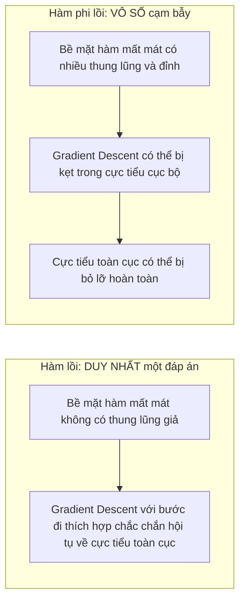
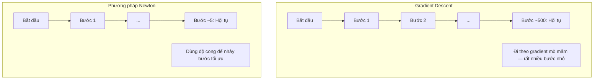
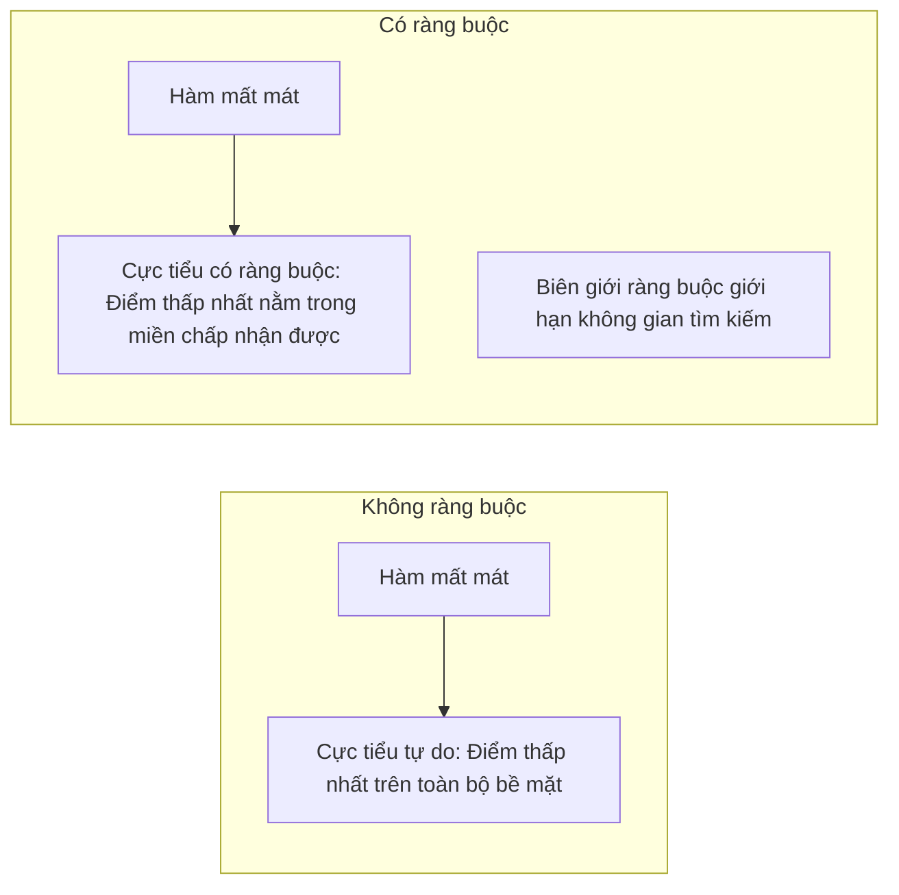
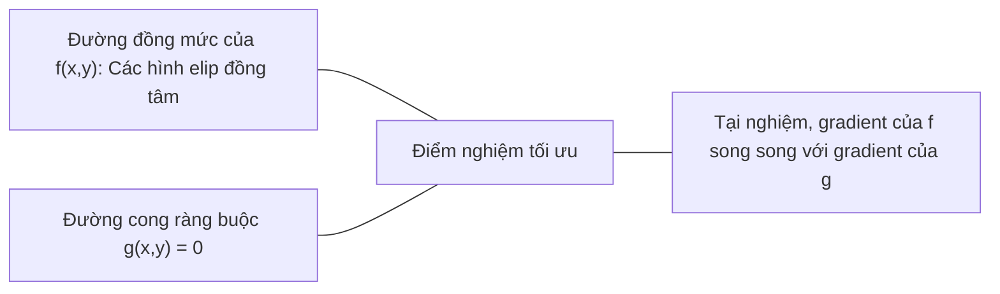

# Tối ưu hóa lồi (Convex Optimization)

> Các bài toán lồi chỉ có một thung lũng duy nhất. Mạng nơ-ron có hàng triệu thung lũng. Hiểu được sự khác biệt này là điều tối quan trọng.

**Type:** Build
**Language:** Python
**Prerequisites:** Phase 1, Lessons 04 (Calculus for ML), 08 (Optimization)
**Time:** ~90 minutes

## Learning Objectives

- Kiểm tra xem một hàm số có phải là hàm lồi hay không bằng định nghĩa, đạo hàm bậc hai và tiêu chuẩn ma trận Hessian
- Tự cài đặt phương pháp Newton và so sánh tốc độ hội tụ bậc hai của nó với thuật toán Gradient Descent
- Giải các bài toán tối ưu hóa có ràng buộc bằng phương pháp nhân tử Lagrange và diễn giải các điều kiện KKT
- Giải thích vì sao bề mặt hàm mất mát của mạng nơ-ron là phi lồi nhưng SGD vẫn tìm được nghiệm chất lượng cao

## The Problem (Vấn đề)

Lesson 08 đã dạy bạn về Gradient Descent, Momentum và Adam. Các thuật toán tối ưu hóa đó lần bước xuống dốc trên mọi bề mặt hàm số. Nhưng chúng không đi kèm với bất kỳ bảo đảm toán học nào. Gradient Descent trên một bề mặt phi lồi (non-convex) có thể rơi vào một điểm cực tiểu cục bộ tồi tệ, mắc kẹt tại điểm yên ngựa (saddle point), hoặc dao động mãi mãi không hội tụ. Dù vậy bạn vẫn phải dùng nó vì mạng nơ-ron là bài toán phi lồi và chúng ta không có lựa chọn nào khác.

Tuy nhiên, rất nhiều bài toán cốt lõi trong học máy lại là các bài toán lồi: Hồi quy tuyến tính, hồi quy logistic, SVM, LASSO, hồi quy Ridge. Đối với những bài toán này, tồn tại một điều mạnh mẽ hơn nhiều: Tối ưu hóa có bảo đảm toán học tuyệt đối. Một bài toán lồi không hề có các thung lũng giả: Mọi điểm cực tiểu cục bộ đều là điểm cực tiểu toàn cục. Đối với một hàm lồi trơn có cực tiểu, Gradient Descent với tốc độ học phù hợp chắc chắn sẽ hội tụ về điểm tối ưu đó. Không cần khởi động lại ngẫu nhiên, không cần lịch trình học phức tạp, không cần phó mặc cho may rủi.

Hiểu về tính lồi mang lại ba lợi ích lớn: Thứ nhất, nó cho biết khi nào bài toán của bạn là dễ (lồi) so với khi nào là khó (phi lồi). Thứ hai, nó cung cấp các công cụ nhanh hơn nhiều như phương pháp Newton cho các bài toán lồi. Thứ ba, nó giải thích các khái niệm xuyên suốt học máy: Điều chuẩn như một bài toán tối ưu ràng buộc, tính đối ngẫu (duality) trong SVM, và lý do vì sao học sâu vẫn hoạt động thần kỳ dù vi phạm mọi tính chất đẹp đẽ của tính lồi.

## The Concept (Khái niệm)

### Tập lồi (Convex Sets)

Một tập hợp $S$ được gọi là tập lồi nếu với bất kỳ hai điểm nào thuộc $S$, đoạn thẳng nối giữa hai điểm đó cũng nằm hoàn toàn bên trong $S$.

| Tập lồi | Không lồi |
|---|---|
| **Hình chữ nhật**: Hai điểm bất kỳ bên trong đều có thể nối bằng một đoạn thẳng nằm trọn bên trong | **Hình ngôi sao / trăng khuyết**: Đoạn thẳng nối hai điểm bên trong có thể cắt ra ngoài tập hợp |
| **Tam giác**: Tính chất tương tự đúng với mọi điểm bên trong | **Hình vành khăn (Donut)**: Cái lỗ ở giữa khiến một số đoạn thẳng bị lọt ra ngoài tập hợp |
| Đoạn thẳng nối 2 điểm bất kỳ luôn nằm trong tập hợp | Đoạn thẳng nối một số cặp điểm bị đi ra ngoài tập hợp |

Kiểm tra bằng định nghĩa toán học: Với mọi điểm $x, y \in S$ và với mọi $t \in [0, 1]$, điểm $tx + (1-t)y$ cũng phải thuộc $S$.

Ví dụ về tập lồi:
- Một đường thẳng, một mặt phẳng, toàn bộ không gian $\mathbb{R}^n$
- Một hình cầu (hình tròn, khối cầu, siêu cầu)
- Một nửa không gian: $\lbrace x : a^T x \le b \rbrace$
- Phần giao của một số lượng bất kỳ các tập lồi

Ví dụ về tập không lồi:
- Hình vành khăn (donut/annulus)
- Hợp của hai hình tròn rời nhau
- Bất kỳ tập hợp nào có vết "lõm" hoặc "lỗ thủng"

### Hàm lồi (Convex Functions)

Một hàm số $f$ được gọi là hàm lồi nếu miền xác định của nó là một tập lồi và với bất kỳ hai điểm $x, y$ thuộc miền xác định và với mọi $t \in [0, 1]$:

```math
f(tx + (1-t)y) \le t f(x) + (1-t) f(y)
```

Ý nghĩa hình học: Đoạn thẳng nối bất kỳ hai điểm nào trên đồ thị hàm số luôn nằm phía trên hoặc nằm trên chính đồ thị đó.

| Tính chất | Hàm lồi | Hàm phi lồi |
|---|---|---|
| **Kiểm tra dây cung** | Đoạn thẳng nối 2 điểm bất kỳ trên đồ thị nằm **phía trên hoặc trên** đường cong | Đoạn thẳng nối một số điểm trên đồ thị nằm **phía dưới** đường cong |
| **Hình dáng** | Một cái bát / thung lũng duy nhất uốn cong lên trên | Nhiều đỉnh và thung lũng với độ cong hỗn tạp |
| **Cực tiểu cục bộ** | Mọi cực tiểu cục bộ đều là cực tiểu toàn cục | Có thể tồn tại nhiều cực tiểu cục bộ ở các độ sâu khác nhau |

Các hàm lồi phổ biến:
- $f(x) = x^2$ (Parabol)
- $f(x) = \lvert x \rvert$ (Giá trị tuyệt đối)
- $f(x) = e^x$ (Hàm mũ)
- $f(x) = \max(0, x)$ (Hàm kích hoạt ReLU, tuyến tính từng đoạn)
- $f(x) = -\log(x)$ với $x > 0$ (Hàm trừ log)
- Mọi hàm tuyến tính $f(x) = a^T x + b$ (vừa lồi vừa lõm)

### Các phép kiểm tra tính lồi

Có ba phép kiểm tra thực tế, từ đơn giản nhất đến chặt chẽ nhất:

**Kiểm tra 1: Đạo hàm bậc hai (cho hàm 1 biến).** Nếu $f''(x) \ge 0$ với mọi $x$, thì $f$ là hàm lồi.
- $f(x) = x^2$: $f''(x) = 2 \ge 0 \implies$ Lồi.
- $f(x) = x^3$: $f''(x) = 6x < 0$ khi $x < 0 \implies$ Không lồi.
- $f(x) = e^x$: $f''(x) = e^x > 0 \implies$ Lồi.

**Kiểm tra 2: Ma trận Hessian (cho hàm nhiều biến).** Nếu ma trận Hessian $H(x)$ là nửa xác định dương với mọi $x$, thì $f$ là hàm lồi. Ma trận Hessian là ma trận gồm các đạo hàm riêng bậc hai.

**Kiểm tra 3: Định nghĩa gốc.** Kiểm tra trực tiếp bất đẳng thức $f(tx + (1-t)y) \le t f(x) + (1-t) f(y)$. Hữu ích cho các hàm không khả vi hoặc khó lấy đạo hàm.

### Vì sao tính lồi lại quan trọng đến vậy

Định lý trung tâm của tối ưu hóa lồi khẳng định:

**Đối với một hàm lồi, mọi điểm cực tiểu cục bộ đều chính là điểm cực tiểu toàn cục.**

Điều này đồng nghĩa với việc Gradient Descent không bao giờ bị mắc bẫy trong một cực tiểu cục bộ tồi tệ. Mọi cực tiểu mà nó chạm tới đều có cùng một giá trị mất mát tối ưu. Đối với hàm lồi trơn có cực tiểu, Gradient Descent với tốc độ học phù hợp chắc chắn sẽ hội tụ về nghiệm tối ưu toàn cục.



Hệ quả to lớn:
- Không cần phải thử nghiệm lại nhiều lần với khởi tạo ngẫu nhiên
- Không cần điều chỉnh lịch trình learning rate quá phức tạp
- Có thể chứng minh được tốc độ hội tụ trên mặt toán học
- Nghiệm là duy nhất (ngoại trừ trường hợp có các vùng phẳng)

### Bài toán nào là Lồi vs Phi lồi trong Machine Learning

| Bài toán | Có lồi không? | Lý do |
|---------|---------|-----|
| Hồi quy tuyến tính (MSE) | Có | Hàm loss là hàm bậc hai theo trọng số |
| Hồi quy Logistic | Có | Hàm log-loss là hàm lồi theo trọng số |
| SVM (Hinge loss) | Có | Cực đại của các hàm tuyến tính là hàm lồi |
| LASSO (Hồi quy L1) | Có | Tổng của các hàm lồi là một hàm lồi |
| Hồi quy Ridge (L2) | Có | Hàm bậc hai + hàm bậc hai = hàm lồi |
| Mạng nơ-ron (bất kỳ loss nào) | Không | Các hàm kích hoạt phi tuyến tính tạo ra bề mặt phi lồi |
| Phân cụm K-means | Không | Bước gán nhãn cụm mang tính rời rạc |
| Phân rã ma trận (Matrix Factorization) | Không | Tích của các ẩn số tạo ra tính phi lồi |

Các mô hình tuyến tính với hàm mất mát lồi luôn là bài toán lồi. Khoảnh khắc bạn thêm các tầng ẩn với hàm kích hoạt phi tuyến, tính lồi bị phá vỡ hoàn toàn.

### Ma trận Hessian

Ma trận Hessian $H$ của một hàm số $f: \mathbb{R}^n \to \mathbb{R}$ là ma trận $n \times n$ chứa các đạo hàm riêng bậc hai:

```math
H_{ij} = \frac{\partial^2 f}{\partial x_i \, \partial x_j}
```

Với $f(x, y) = x^2 + 3xy + y^2$:

```math
\begin{gathered}
\begin{aligned}
\frac{\partial f}{\partial x} &= 2x + 3y & \frac{\partial^2 f}{\partial x^2} &= 2 & \frac{\partial^2 f}{\partial x \, \partial y} &= 3 \\
\frac{\partial f}{\partial y} &= 3x + 2y & \frac{\partial^2 f}{\partial y \, \partial x} &= 3 & \frac{\partial^2 f}{\partial y^2} &= 2
\end{aligned} \\[8pt]
H = \begin{bmatrix} 2 & 3 \\ 3 & 2 \end{bmatrix}
\end{gathered}
```

Ma trận Hessian hé lộ độ cong của không gian:
- Toàn bộ trị riêng dương: Hàm số uốn cong lên trên theo mọi hướng (lồi tại điểm đó)
- Toàn bộ trị riêng âm: Hàm số uốn cong xuống dưới theo mọi hướng (cực đại địa phương)
- Trị riêng mang dấu trái ngược: Điểm yên ngựa (saddle point - uốn lên ở một số hướng, uốn xuống ở hướng khác)
- Có trị riêng bằng 0: Vùng phẳng theo hướng tương ứng

Để hàm số là lồi toàn cục, ma trận Hessian phải là nửa xác định dương (mọi trị riêng $\ge 0$) tại mọi điểm trong miền xác định, chứ không chỉ tại một điểm đơn lẻ.

### Phương pháp Newton (Newton's Method)

Gradient Descent chỉ sử dụng thông tin bậc 1 (gradient). Phương pháp Newton tận dụng thông tin bậc 2 (ma trận Hessian). Nó khớp một xấp xỉ bậc hai (paraboloid) tại điểm hiện tại và nhảy trực tiếp tới đáy của mặt bậc hai đó.

```math
\begin{aligned}
\text{Quy tắc cập nhật của Newton:} \quad & x_{\text{mới}} = x - H^{-1} \cdot \text{gradient} \\
\text{So với Gradient Descent:} \quad & x_{\text{mới}} = x - \text{lr} \cdot \text{gradient}
\end{aligned}
```

Phương pháp Newton thay thế tốc độ học vô hướng bằng nghịch đảo của ma trận Hessian. Điều này tự động điều chỉnh cả độ dài bước nhảy lẫn phương hướng dựa trên độ cong thực tế tại từng tọa độ.



Ưu điểm:
- Tốc độ hội tụ bậc hai (quadratic convergence) gần điểm cực tiểu: Sai số được bình phương (giảm siêu tốc) sau mỗi bước
- Không cần tinh chỉnh tham số learning rate
- Bất biến với thang đo (hoạt động tốt bất kể việc bạn tham số hóa bài toán ra sao)

Nhược điểm:
- Tính ma trận Hessian tốn bộ nhớ $O(n^2)$ và chi phí nghịch đảo tốn $O(n^3)$
- Với mạng nơ-ron có 1 triệu tham số, cần $10^{12}$ phần tử bộ nhớ và $10^{18}$ phép tính số học
- Không khả thi cho các mô hình học sâu quy mô lớn

### Tối ưu hóa có ràng buộc (Constrained Optimization)

Tối ưu hóa không ràng buộc: Cực tiểu hóa $f(x)$ trên toàn bộ không gian $x$.
Tối ưu hóa có ràng buộc: Cực tiểu hóa $f(x)$ thỏa mãn các điều kiện ràng buộc đi kèm.

Các bài toán thực tế luôn có ràng buộc: Bạn muốn tối thiểu hóa chi phí nhưng ngân sách bị giới hạn. Bạn muốn cực tiểu hóa sai số nhưng độ phức tạp của mô hình bị chặn lại.



### Nhân tử Lagrange (Lagrange Multipliers)

Phương pháp nhân tử Lagrange chuyển đổi một bài toán tối ưu có ràng buộc thành một bài toán không ràng buộc.

Bài toán: Cực tiểu hóa $f(x)$ thỏa mãn điều kiện $g(x) = 0$.

Giải pháp: Đưa vào một biến mới (nhân tử Lagrange $\lambda$) và thiết lập hàm Lagrange:

```math
L(x, \lambda) = f(x) + \lambda g(x)
```

Tại điểm tối ưu, gradient của $L$ triệt tiêu bằng 0:

```math
\begin{aligned}
\frac{\partial L}{\partial x} &= \frac{\partial f}{\partial x} + \lambda \frac{\partial g}{\partial x} = 0 \\
\frac{\partial L}{\partial \lambda} &= g(x) = 0
\end{aligned}
```

Ý nghĩa hình học: Tại điểm cực tiểu có ràng buộc, gradient của hàm mục tiêu $f$ phải song song với gradient của hàm ràng buộc $g$. Nếu chúng không song song, bạn luôn có thể trượt dọc theo bề mặt ràng buộc để tiếp tục làm giảm giá trị của $f$.



Ví dụ: Cực tiểu hóa $f(x,y) = x^2 + y^2$ thỏa mãn $x + y = 1$:

```math
\begin{aligned}
L &= x^2 + y^2 + \lambda(x + y - 1) \\[4pt]
\frac{\partial L}{\partial x} &= 2x + \lambda = 0 \implies x = -\lambda/2 \\
\frac{\partial L}{\partial y} &= 2y + \lambda = 0 \implies y = -\lambda/2 \\
\frac{\partial L}{\partial \lambda} &= x + y - 1 = 0 \\[4pt]
&\text{Từ hai phương trình đầu: } x = y \\
&\text{Thay vào phương trình ba: } 2x = 1 \implies x = y = 0.5, \ \lambda = -1
\end{aligned}
```

Điểm gần gốc tọa độ nhất nằm trên đường thẳng $x + y = 1$ là điểm $(0.5, 0.5)$.

### Điều kiện KKT (Karush-Kuhn-Tucker Conditions)

Điều kiện KKT mở rộng phương pháp nhân tử Lagrange cho các bài toán có ràng buộc bất đẳng thức: Cực tiểu hóa $f(x)$ thỏa mãn $g_i(x) \le 0$ với $i = 1, \ldots, m$.

Bốn điều kiện KKT (bắt buộc đối với điểm tối ưu):

```math
\begin{aligned}
&\text{1. Tính dừng (Stationarity):} && \frac{\partial f}{\partial x} + \sum_i \lambda_i \frac{\partial g_i}{\partial x} = 0 \\
&\text{2. Chấp nhận được nguyên thủy (Primal feasibility):} && g_i(x) \le 0 \quad \text{với mọi } i \\
&\text{3. Chấp nhận được đối ngẫu (Dual feasibility):} && \lambda_i \ge 0 \quad \text{với mọi } i \\
&\text{4. Bù trùng khớp (Complementary slackness):} && \lambda_i \, g_i(x) = 0 \quad \text{với mọi } i
\end{aligned}
```

Điều kiện bù trùng khớp (Complementary slackness) là mấu chốt sâu sắc: Hoặc là ràng buộc đang hoạt động ($g_i = 0$, nghiệm nằm ngay trên biên), hoặc nhân tử Lagrange bằng 0 ($\lambda_i = 0$, ràng buộc không ảnh hưởng tới nghiệm).

Điều kiện KKT là trái tim của thuật toán Support Vector Machines (SVM): Các Support Vector chính là các điểm dữ liệu mà tại đó ràng buộc đang hoạt động ($\lambda_i > 0$). Toàn bộ các điểm dữ liệu khác đều có $\lambda_i = 0$ và hoàn toàn không làm thay đổi ranh giới phân loại.

### Kỹ thuật điều chuẩn như một bài toán tối ưu có ràng buộc

Điều chuẩn L1 và L2 không phải là những thủ thuật cộng thêm ngẫu nhiên. Chúng thực chất là các bài toán tối ưu hóa có ràng buộc:

**Điều chuẩn L2 (Ridge):**

```math
\begin{aligned}
&\text{Cực tiểu hóa } \text{Loss}(w) \text{ thỏa mãn } \lVert w \rVert^2 \le t \\[4pt]
&\text{Dạng không ràng buộc tương đương (qua nhân tử Lagrange):} \\
&\text{Cực tiểu hóa } \text{Loss}(w) + \lambda \lVert w \rVert^2
\end{aligned}
```

Ràng buộc $\lVert w \rVert^2 \le t$ định nghĩa một hình cầu (hình tròn trong không gian 2D). Nghiệm là điểm đầu tiên mà các đường đồng mức của hàm loss chạm vào hình cầu này.

**Điều chuẩn L1 (LASSO):**

```math
\begin{aligned}
&\text{Cực tiểu hóa } \text{Loss}(w) \text{ thỏa mãn } \lVert w \rVert_1 \le t \\[4pt]
&\text{Dạng không ràng buộc tương đương:} \\
&\text{Cực tiểu hóa } \text{Loss}(w) + \lambda \lVert w \rVert_1
\end{aligned}
```

Ràng buộc $\lVert w \rVert_1 \le t$ định nghĩa một hình thoi (hình vuông xoay góc trong 2D).

| Đặc tính | Ràng buộc L2 (Hình tròn) | Ràng buộc L1 (Hình thoi) |
|---|---|---|
| **Hình dạng miền ràng buộc** | Hình tròn (hình cầu ở số chiều cao) | Hình thoi (hình vuông xoay trong 2D) |
| **Vị trí đường đồng mức tiếp xúc** | Bề mặt nhẵn cong — bất kỳ điểm nào trên đường tròn | Đỉnh nhọn — nằm thẳng trên các trục tọa độ |
| **Hành vi của nghiệm** | Trọng số nhỏ nhưng hiếm khi bằng 0 | Một số trọng số bị triệt tiêu về chính xác 0 |
| **Kết quả thu được** | Co trọng số (Shrinkage) | Lựa chọn đặc trưng (Feature selection) |

Điều này giải thích vì sao L1 tạo ra các mô hình thưa (sparse models): Hình thoi có các đỉnh nhọn nằm ngay trên trục tọa độ, và đường đồng mức elip của hàm loss rất dễ chạm vào các đỉnh nhọn này trước tiên, triệt tiêu một hoặc nhiều trọng số về đúng bằng 0.

### Tính đối ngẫu (Duality)

Mỗi bài toán tối ưu có ràng buộc (bài toán gốc - Primal) đều đi kèm với một bài toán đồng hành (bài toán đối ngẫu - Dual). Với các bài toán lồi thỏa mãn điều kiện Slater, bài toán gốc và đối ngẫu có cùng một giá trị tối ưu. Đây là tính đối ngẫu mạnh (strong duality).

Hàm đối ngẫu Lagrange:

```math
\begin{aligned}
&\text{Bài toán gốc (Primal):} && \text{Cực tiểu hóa } f(x) \text{ thỏa mãn } g(x) \le 0 \\
&\text{Hàm Lagrange:} && L(x, \lambda) = f(x) + \lambda g(x) \\
&\text{Hàm đối ngẫu:} && d(\lambda) = \min_x L(x, \lambda) \\
&\text{Bài toán đối ngẫu (Dual):} && \text{Cực đại hóa } d(\lambda) \text{ thỏa mãn } \lambda \ge 0
\end{aligned}
```

Vì sao tính đối ngẫu quan trọng:
- Đôi khi bài toán đối ngẫu dễ giải hơn bài toán gốc rất nhiều
- SVM được giải ở dạng đối ngẫu, nơi bài toán chỉ còn phụ thuộc vào tích vô hướng giữa các điểm dữ liệu (tạo tiền đề cho Kernel trick ra đời)
- Bài toán đối ngẫu cung cấp một cận dưới cho bài toán gốc, giúp kiểm tra khoảng cách đến nghiệm tối ưu (duality gap)

### Vì sao Deep Learning hoạt động tốt dù hàm mất mát phi lồi

Hàm mất mát của mạng nơ-ron cực kỳ phi lồi. Theo mọi chuẩn mực toán học cổ điển, việc tối ưu chúng phải thất bại thảm hại. Nhưng thuật toán SGD vẫn tìm ra các nghiệm chất lượng cao một cách nhất quán. Các nghiên cứu hiện đại đã chỉ ra các nguyên nhân then chốt:

**Phần lớn cực tiểu cục bộ đều đủ tốt.** Trong không gian nhiều chiều, các điểm tới hạn ngẫu nhiên (nơi gradient bằng 0) áp đảo là các điểm yên ngựa (saddle points), chứ không phải cực tiểu cục bộ. Số ít cực tiểu cục bộ tồn tại đều có giá trị mất mát rất gần với cực tiểu toàn cục. Nguy cơ bị kẹt trong một cực tiểu tồi tệ là cực kỳ thấp khi không gian tham số có hàng triệu chiều.

**Điểm yên ngựa, chứ không phải cực tiểu cục bộ, mới là trở ngại chính.** Với một hàm có $n$ tham số, xác suất để một điểm tới hạn ngẫu nhiên có toàn bộ $n$ trị riêng đều dương (cực tiểu cục bộ) chỉ là $2^{-n}$. Gần như toàn bộ là điểm yên ngựa. Nhiễu ngẫu nhiên của SGD giúp mô hình dễ dàng thoát khỏi các điểm yên ngựa này.

**Siêu tham số hóa (Overparameterization) làm mượt bề mặt hàm loss.** Mạng nơ-ron có số lượng tham số lớn hơn nhiều so với số lượng mẫu huấn luyện sẽ có bề mặt loss phẳng phiu và liên kết hơn. Mạng càng rộng thì càng ít cực tiểu xấu.

| Đặc tính | Không gian số chiều thấp | Không gian số chiều cao |
|---|---|---|
| **Cảnh quan (Landscape)** | Nhiều đỉnh và thung lũng cô lập | Các thung lũng được kết nối mượt mà |
| **Cực tiểu** | Nhiều cực tiểu cục bộ cô lập | Rất ít cực tiểu xấu; đa số gần tối ưu |
| **Điều hướng** | Rất khó tìm cực tiểu toàn cục | Có nhiều con đường dẫn tới nghiệm tốt |
| **Điểm tới hạn** | Pha trộn cực tiểu và điểm yên ngựa | Đa số áp đảo là điểm yên ngựa |

**Nhiễu ngẫu nhiên đóng vai trò như một bộ điều chuẩn ngầm.** Mini-batch SGD bổ sung nhiễu giúp ngăn mô hình rơi vào các cực tiểu sắc nhọn (sharp minima - dễ bị quá khớp). Nhiễu điều hướng tối ưu hóa tiến về các vùng thung lũng phẳng (flat minima), nơi mô hình có khả năng tổng quát hóa (generalization) vượt trội.

### Các phương pháp bậc hai trong thực tế

Phương pháp Newton thuần túy là bất khả thi cho mô hình lớn. Các xấp xỉ sau giúp tận dụng thông tin độ cong:

**L-BFGS (Limited-memory BFGS):** Xấp xỉ nghịch đảo Hessian bằng $m$ bước chênh lệch gradient gần nhất. Chỉ tốn bộ nhớ $O(mn)$ thay vì $O(n^2)$. Hoạt động rất tốt cho bài toán dưới 10.000 tham số trong ML cổ điển (logistic regression, CRF).

**Natural Gradient:** Sử dụng ma trận thông tin Fisher thay cho ma trận Hessian thông thường. K-FAC xấp xỉ ma trận Fisher dưới dạng tích Kronecker, giúp áp dụng được cho mạng nơ-ron.

**Hessian-free optimization:** Dùng gradient liên hợp để giải $Hx = g$ mà không cần lưu ma trận $H$, chỉ cần tính tích Hessian-vector qua đạo hàm tự động trong thời gian $O(n)$.

**Xấp xỉ đường chéo:** Thành phần động lượng bậc hai của Adam chính là xấp xỉ đường chéo của Hessian. AdaHessian mở rộng ý tưởng này bằng cách ước lượng trực tiếp các phần tử trên đường chéo Hessian qua bộ ước lượng Hutchinson.

| Phương pháp | Bộ nhớ | Chi phí mỗi bước | Khi nào nên dùng |
|--------|--------|--------------|-------------|
| Gradient Descent | $O(n)$ | $O(n)$ | Mặc định, mô hình lớn |
| Newton's method | $O(n^2)$ | $O(n^3)$ | Bài toán lồi quy mô nhỏ |
| L-BFGS | $O(mn)$ | $O(mn)$ | Bài toán lồi quy mô vừa |
| Adam | $O(n)$ | $O(n)$ | Chuẩn mực cho Deep Learning |
| K-FAC | $O(n)$ | $O(n)$ mỗi layer | Nghiên cứu, huấn luyện batch lớn |

```figure
convex-vs-nonconvex
```

## Build It (Thực hành xây dựng)

### Bước 1: Bộ kiểm tra tính lồi thực nghiệm

```python
import random
import math

def check_convexity(f, dim, bounds=(-5, 5), samples=1000):
    violations = 0
    for _ in range(samples):
        x = [random.uniform(*bounds) for _ in range(dim)]
        y = [random.uniform(*bounds) for _ in range(dim)]
        t = random.uniform(0, 1)
        mid = [t * xi + (1 - t) * yi for xi, yi in zip(x, y)]
        lhs = f(mid)
        rhs = t * f(x) + (1 - t) * f(y)
        if lhs > rhs + 1e-10:
            violations += 1
    return violations == 0, violations
```

### Bước 2: Phương pháp Newton cho không gian 2D

```python
def newtons_method(f, grad_f, hessian_f, x0, steps=50, tol=1e-12):
    x = list(x0)
    history = [x[:]]
    for _ in range(steps):
        g = grad_f(x)
        H = hessian_f(x)
        det = H[0][0] * H[1][1] - H[0][1] * H[1][0]
        if abs(det) < 1e-15:
            break
        H_inv = [
            [H[1][1] / det, -H[0][1] / det],
            [-H[1][0] / det, H[0][0] / det],
        ]
        dx = [
            H_inv[0][0] * g[0] + H_inv[0][1] * g[1],
            H_inv[1][0] * g[0] + H_inv[1][1] * g[1],
        ]
        x = [x[0] - dx[0], x[1] - dx[1]]
        history.append(x[:])
        if sum(gi ** 2 for gi in g) < tol:
            break
    return history
```

### Bước 3: Bộ giải nhân tử Lagrange

```python
def lagrange_solve(f_grad, g_val, g_grad, x0, lr=0.01,
                   lr_lambda=0.01, steps=5000):
    x = list(x0)
    lam = 0.0
    history = []
    for _ in range(steps):
        fg = f_grad(x)
        gv = g_val(x)
        gg = g_grad(x)
        x = [
            xi - lr * (fgi + lam * ggi)
            for xi, fgi, ggi in zip(x, fg, gg)
        ]
        lam = lam + lr_lambda * gv
        history.append((x[:], lam, gv))
    return history
```

### Bước 4: So sánh phương pháp bậc 1 vs bậc 2

```python
def quadratic(x):
    return 5 * x[0] ** 2 + x[1] ** 2

def quadratic_grad(x):
    return [10 * x[0], 2 * x[1]]

def quadratic_hessian(x):
    return [[10, 0], [0, 2]]
```

Phương pháp Newton hội tụ chỉ sau đúng 1 bước (chính xác tuyệt đối cho hàm bậc hai). Trong khi đó, Gradient Descent cần hàng trăm bước vì các trị riêng của Hessian chênh nhau gấp 5 lần, tạo ra một thung lũng kéo dài khiến bước đi bị ngoằn ngoèo.

## Use It (Ứng dụng thực tế)

Áp dụng phân tích tính lồi khi lựa chọn mô hình và bộ giải:

Với bài toán lồi (Logistic Regression, SVM, LASSO):
- Dùng bộ giải chuyên dụng (liblinear, CVXPY, scipy.optimize.minimize với `L-BFGS-B`)
- Đảm bảo tìm ra nghiệm toàn cục duy nhất
- Các phương pháp bậc hai chạy cực nhanh

Với bài toán phi lồi (Mạng nơ-ron):
- Dùng phương pháp bậc một (SGD, Adam)
- Chấp nhận rằng nghiệm phụ thuộc vào khởi tạo ngẫu nhiên
- Tận dụng siêu tham số hóa và nhiễu ngẫu nhiên như bộ điều chuẩn tự nhiên

```python
from scipy.optimize import minimize

result = minimize(
    fun=lambda w: sum((y - X @ w) ** 2) + 0.1 * sum(w ** 2),
    x0=np.zeros(d),
    method='L-BFGS-B',
    jac=lambda w: -2 * X.T @ (y - X @ w) + 0.2 * w,
)
```

Với SVM, công thức đối ngẫu cho phép tận dụng Kernel trick:

```python
from sklearn.svm import SVC

svm = SVC(kernel='rbf', C=1.0)
svm.fit(X_train, y_train)
print(f"Số lượng Support vectors: {svm.n_support_}")
```

## Exercises (Bài tập)

1. **Bộ sưu tập tính lồi.** Kiểm tra tính lồi của các hàm số sau bằng bộ kiểm tra tự viết: $f(x) = x^4$, $f(x) = \sin(x)$, $f(x,y) = x^2 + y^2$, $f(x,y) = xy$, $f(x) = \max(x, 0)$. Giải thích vì sao kết quả thu được là hợp lý về mặt toán học.

2. **Cuộc đua Newton vs Gradient Descent.** Chạy cả hai phương pháp trên $f(x,y) = 50x^2 + y^2$ từ điểm xuất phát $(10, 10)$. Cần bao nhiêu bước để đạt loss < 1e-10? Điều gì xảy ra với Gradient Descent khi điều kiện số của ma trận Hessian tăng cao?

3. **Hình học của nhân tử Lagrange.** Cực tiểu hóa $f(x,y) = (x-3)^2 + (y-3)^2$ thỏa mãn $x + 2y = 4$. Xác minh nghiệm bằng cách kiểm tra xem gradient của $f$ có song song với gradient của $g$ tại điểm nghiệm hay không.

4. **Ràng buộc điều chuẩn.** Cài đặt bài toán tối ưu có ràng buộc L1: Cực tiểu hóa $(x-3)^2 + (y-2)^2$ thỏa mãn $\lvert x \rvert + \lvert y \rvert \le 1$. Chứng minh rằng nghiệm có một tọa độ bằng đúng 0 (tính thưa thớt từ ràng buộc hình thoi).

5. **Phân tích trị riêng ma trận Hessian.** Tính ma trận Hessian của hàm Rosenbrock tại (1,1) và (-1,1). Tính các trị riêng tại hai điểm này. Các trị riêng nói lên điều gì về độ cong tại điểm cực tiểu so với điểm ở xa cực tiểu?

### Gợi ý (Hints)

**Bài tập 1.** Dự đoán kết quả trước khi chạy `check_convexity`: Ở 1 chiều, xem xét dấu của $f''(x)$; ở 2 chiều, xem xét các trị riêng của Hessian. Với $f(x,y) = xy$, Hessian có các trị riêng 1 và -1, do đó bộ kiểm tra phải báo không lồi.

**Bài tập 2.** Gọi `optimize_gd` và `newtons_method`. Phương pháp Newton giải hàm bậc hai trong 1 bước. Với Gradient Descent, learning rate phải nhỏ hơn $2/100$ do số hạng $50x^2$, khiến việc di chuyển theo trục $y$ diễn ra cực kỳ chậm chạp.

**Bài tập 3.** Dùng `lagrange_solve` với $g(x,y) = x + 2y - 4$. Tại nghiệm, kiểm tra xem $x + 2y = 4$ và $\nabla f = (2(x-3), 2(y-3))$ có phải là bội số của $\nabla g = (1, 2)$ hay không.

**Bài tập 4.** Cực tiểu tự do (3, 2) nằm ngoài hình thoi, nên nghiệm chắc chắn nằm trên biên. Dùng Projected Gradient Descent: Bước theo gradient rồi chiếu ngược lại miền $\lvert x \rvert + \lvert y \rvert \le 1$.

**Bài tập 5.** Gọi `rosenbrock_hessian` tại từng điểm và truyền vào `hessian_eigenvalues_2d`. Tại (1, 1), cả hai trị riêng đều dương và tỷ số giữa chúng rất lớn, cho thấy thung lũng rất hẹp theo một hướng và rất thoải theo hướng còn lại.

## Key Terms (Thuật ngữ chính)

| Thuật ngữ | Ý nghĩa bản chất |
|------|---------------|
| Convex set (Tập lồi) | Tập hợp mà đoạn thẳng nối bất kỳ 2 điểm nào trong tập đều nằm trọn vẹn trong tập đó |
| Convex function (Hàm lồi) | Hàm số có đoạn thẳng nối 2 điểm bất kỳ trên đồ thị luôn nằm phía trên đồ thị. Tương đương với việc ma trận Hessian nửa xác định dương khắp nơi |
| Local minimum (Cực tiểu cục bộ) | Điểm có giá trị thấp hơn mọi điểm xung quanh. Với hàm lồi, mọi cực tiểu cục bộ đều là cực tiểu toàn cục |
| Global minimum (Cực tiểu toàn cục) | Điểm có giá trị thấp nhất trên toàn bộ miền xác định của hàm số |
| Hessian matrix | Ma trận gồm toàn bộ các đạo hàm riêng bậc hai. Mã hóa toàn diện thông tin về độ cong của không gian |
| Positive semidefinite | Ma trận có toàn bộ các trị riêng đều không âm. Bản sao đa chiều của điều kiện "đạo hàm bậc hai >= 0" |
| Condition number (Điều kiện số) | Tỷ số giữa trị riêng lớn nhất và nhỏ nhất của Hessian. Điều kiện số cao tạo ra thung lũng kéo dài khiến Gradient Descent di chuyển rất chậm |
| Newton's method | Thuật toán tối ưu bậc hai sử dụng nghịch đảo Hessian để định hướng và bước nhảy. Tốc độ hội tụ bậc hai gần điểm cực tiểu |
| Lagrange multiplier | Biến phụ được đưa vào để biến bài toán tối ưu có ràng buộc thành bài toán không ràng buộc |
| KKT conditions | Các điều kiện cần cho tính tối ưu đối với bài toán có ràng buộc bất đẳng thức. Mở rộng của nhân tử Lagrange |
| Complementary slackness | Tại điểm nghiệm, hoặc là ràng buộc đang hoạt động hoặc nhân tử Lagrange bằng 0 |
| Duality (Tính đối ngẫu) | Mỗi bài toán ràng buộc đều có một bài toán đối ngẫu đồng hành. Với bài toán lồi, cả hai có cùng giá trị tối ưu |
| Strong duality | Giá trị tối ưu của bài toán gốc và bài toán đối ngẫu bằng nhau hoàn toàn |
| L-BFGS | Phương pháp bậc hai xấp xỉ lưu trữ $m$ bước gradient gần nhất thay vì toàn bộ ma trận Hessian |
| Saddle point (Điểm yên ngựa) | Điểm có gradient bằng 0 nhưng là cực tiểu theo hướng này và cực đại theo hướng khác |
| Overparameterization | Sử dụng số lượng tham số nhiều hơn số mẫu dữ liệu. Giúp làm mượt bề mặt hàm loss và giảm thiểu cực tiểu xấu |

## Further Reading (Tài liệu đọc thêm)

- [Boyd & Vandenberghe: Convex Optimization](https://web.stanford.edu/~boyd/cvxbook/) - Giáo trình tối ưu hóa lồi chuẩn mực quốc tế của Đại học Stanford (miễn phí trực tuyến)
- [Bottou, Curtis, Nocedal: Optimization Methods for Large-Scale Machine Learning (2018)](https://arxiv.org/abs/1606.04838) - Cầu nối lý thuyết tối ưu hóa lồi và thực tiễn Deep Learning
- [Choromanska et al.: The Loss Surfaces of Multilayer Networks (2015)](https://arxiv.org/abs/1412.0233) - Phân tích bề mặt hàm loss của mạng nơ-ron nhiều tầng
- [Nocedal & Wright: Numerical Optimization](https://link.springer.com/book/10.1007/978-0-387-40065-5) - Sách tham khảo toàn diện về phương pháp Newton, L-BFGS và tối ưu hóa có ràng buộc
