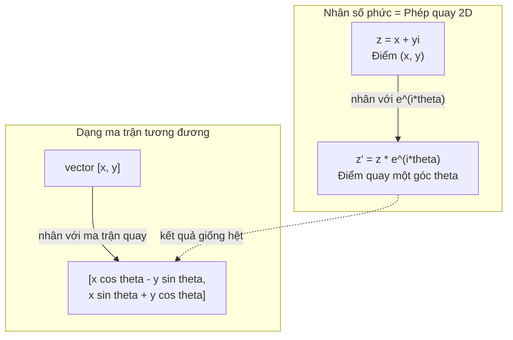
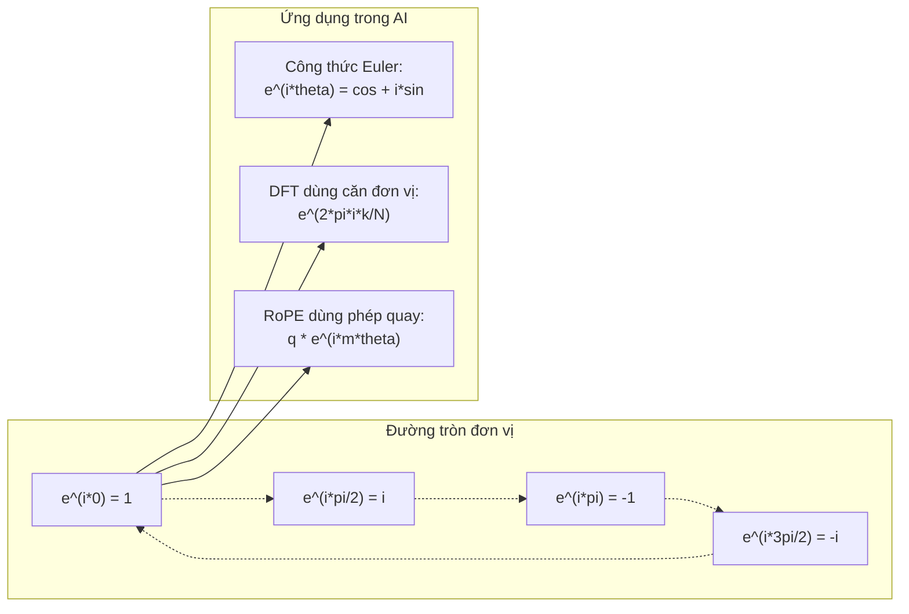

# Số phức cho AI (Complex Numbers for AI)

> Căn bậc hai của -1 không hề là "ảo". Nó là chìa khóa mở ra các phép quay, tần số, và một nửa ngành xử lý tín hiệu.

**Type:** Learn
**Language:** Python
**Prerequisites:** Phase 1, Lessons 01-04 (linear algebra, calculus)
**Time:** ~60 minutes

## Learning Objectives

- Thực hiện các phép tính số phức (cộng, nhân, chia, liên hợp) ở cả dạng đại số (rectangular) và dạng cực (polar)
- Áp dụng công thức Euler để chuyển đổi qua lại giữa hàm mũ phức và các hàm lượng giác
- Tự cài đặt biến đổi Fourier rời rạc (DFT) sử dụng các căn đơn vị phức (complex roots of unity)
- Giải thích cách thức các phép quay số phức làm nền tảng cho RoPE và mã hóa vị trí hình sin trong Transformer

## The Problem (Vấn đề)

Bạn mở một bài báo khoa học về biến đổi Fourier và thấy ký hiệu $i$ xuất hiện khắp nơi. Bạn nhìn vào các phép mã hóa vị trí (positional encoding) của Transformer và thấy $\sin$ cùng $\cos$ ở các tần số khác nhau — chính là phần thực và phần ảo của các hàm mũ phức. Bạn đọc về điện toán lượng tử và thấy mọi thứ đều được biểu diễn trong không gian vector phức.

Số phức thoạt nhìn có vẻ rất trừu tượng. Một hệ thống số được xây dựng trên căn bậc hai của -1 tạo cảm giác như một trò mẹo toán học thuần túy. Nhưng nó hoàn toàn không phải là mẹo. Đó là ngôn ngữ tự nhiên của các phép quay (rotations) và dao động (oscillations). Bất cứ khi nào có thứ gì đó quay tròn, rung động, hay dao động sóng, số phức luôn là công cụ chuẩn xác nhất.

Nếu không hiểu số phức, bạn không thể hiểu được Biến đổi Fourier rời rạc (DFT). Bạn không thể hiểu được thuật toán FFT. Bạn không thể hiểu cách RoPE (Rotary Position Embedding) hoạt động trong các mô hình ngôn ngữ lớn hiện đại. Bạn cũng không thể hiểu vì sao các phép mã hóa vị trí hình sin trong bài báo Transformer gốc lại sử dụng các dải tần số đặc thù như vậy.

Bài học này xây dựng số học phức từ đầu, kết nối nó với hình học, và chỉ cho bạn thấy chính xác số phức xuất hiện ở đâu trong học máy.

## The Concept (Khái niệm)

### Số phức là gì?

Một số phức gồm hai phần: phần thực (real part) và phần ảo (imaginary part).

```
z = a + bi

trong đó:
  a là phần thực
  b là phần ảo
  i là đơn vị ảo, được định nghĩa bởi i^2 = -1
```

Chỉ đơn giản như vậy. Bạn mở rộng trục số một chiều thành một mặt phẳng hai chiều. Các số thực nằm trên một trục (trục hoành). Các số ảo nằm trên trục còn lại (trục tung). Mỗi số phức là một điểm tọa độ trong mặt phẳng này.

### Các phép toán số học trên số phức

**Phép cộng.** Cộng các phần thực với nhau, cộng các phần ảo với nhau.

```math
\begin{aligned}
(a + bi) + (c + di) &= (a + c) + (b + d)i \\[4pt]
\text{Ví dụ: } (3 + 2i) + (1 + 4i) &= 4 + 6i
\end{aligned}
```

**Phép nhân.** Sử dụng luật phân phối và ghi nhớ rằng $i^2 = -1$.

```math
\begin{aligned}
(a + bi)(c + di) &= ac + adi + bci + bdi^2 \\
&= ac + adi + bci - bd \\
&= (ac - bd) + (ad + bc)i \\[8pt]
\text{Ví dụ: } (3 + 2i)(1 + 4i) &= 3 + 12i + 2i + 8i^2 \\
&= 3 + 14i - 8 \\
&= -5 + 14i
\end{aligned}
```

**Số phức liên hợp (Conjugate).** Đảo dấu của phần ảo.

```math
\text{Liên hợp của } (a + bi) = a - bi
```

Tích của một số phức với số phức liên hợp của nó luôn luôn là một số thực:

```math
(a + bi)(a - bi) = a^2 + b^2
```

**Phép chia.** Nhân cả tử số và mẫu số với số phức liên hợp của mẫu số.

```math
\frac{a + bi}{c + di} = \frac{(a + bi)(c - di)}{c^2 + d^2}
```

Thao tác này triệt tiêu phần ảo ở mẫu số, giúp bạn thu được một số phức dạng chuẩn gọn gàng.

### Mặt phẳng phức (The Complex Plane)

Mặt phẳng phức ánh xạ mỗi số phức thành một điểm trong không gian 2D. Trục hoành là trục thực, trục tung là trục ảo.

```
z = 3 + 2i  tương ứng với điểm (3, 2)
z = -1 + 0i tương ứng với điểm (-1, 0) trên trục thực
z = 0 + 4i  tương ứng với điểm (0, 4) trên trục ảo
```

Một số phức vừa đồng thời là một điểm tọa độ, vừa là một vector chỉ hướng xuất phát từ gốc tọa độ. Bản chất kép này chính là lý do khiến số phức trở nên cực kỳ hữu ích trong hình học.

### Dạng cực (Polar Form)

Bất kỳ điểm nào trên mặt phẳng đều có thể được mô tả bằng khoảng cách từ gốc tọa độ đến điểm đó (độ lớn) và góc hợp bởi đoạn thẳng nối đó với chiều dương của trục thực.

```math
\begin{aligned}
z &= r (\cos\theta + i \sin\theta) \\[4pt]
\text{trong đó: } r &= |z| = \sqrt{a^2 + b^2} \quad \text{(độ lớn / mô-đun)} \\
\theta &= \mathop{\mathrm{atan2}}(b, a) \quad \text{(pha / argument)}
\end{aligned}
```

Dạng đại số $(a + bi)$ rất thuận tiện cho phép cộng. Dạng cực $(r, \theta)$ lại tối ưu tuyệt đối cho phép nhân.

**Phép nhân ở dạng cực.** Nhân hai độ lớn với nhau, cộng hai góc lại với nhau.

```math
\begin{aligned}
z_1 &= r_1 e^{i\theta_1} \\
z_2 &= r_2 e^{i\theta_2} \\[4pt]
z_1 z_2 &= (r_1 r_2) \, e^{i(\theta_1 + \theta_2)}
\end{aligned}
```

Đây là lý do số phức hoàn hảo cho các phép quay: Nhân với một số phức có độ lớn bằng 1 chính là một phép quay thuần túy (pure rotation).

### Công thức Euler (Euler's Formula)

Cây cầu nối giữa hàm mũ phức và lượng giác:

```math
e^{i\theta} = \cos\theta + i \sin\theta
```

Đây là công thức quan trọng nhất trong bài học này. Khi $\theta = \pi$:

```math
\begin{aligned}
e^{i\pi} &= \cos\pi + i \sin\pi = -1 + 0i = -1 \\[4pt]
\text{Do đó: } e^{i\pi} + 1 &= 0
\end{aligned}
```

Năm hằng số nền tảng của toán học ($e$, $i$, $\pi$, 1, 0) được liên kết trong một phương trình duy nhất tuyệt đẹp.

### Vì sao công thức Euler lại quan trọng đối với ML

Công thức Euler cho thấy $e^{i\theta}$ vạch ra đường tròn đơn vị khi $\theta$ thay đổi. Tại $\theta = 0$, bạn ở tọa độ $(1, 0)$. Tại $\theta = \pi/2$, bạn ở $(0, 1)$. Tại $\theta = \pi$, bạn ở $(-1, 0)$. Tại $\theta = 3\pi/2$, bạn ở $(0, -1)$. Một vòng quay trọn vẹn tương ứng với $\theta = 2\pi$.

Điều này có nghĩa: các hàm mũ phức CHÍNH LÀ các phép quay. Và các phép quay hiện diện ở khắp mọi nơi trong xử lý tín hiệu và học máy.

### Kết nối với phép quay 2D

Nhân số phức $(x + yi)$ với $e^{i\theta}$ sẽ quay điểm $(x, y)$ một góc $\theta$ quanh gốc tọa độ.

```math
\begin{aligned}
&\text{Quay qua phép nhân số phức:} \\
&\quad (x + yi)(\cos\theta + i \sin\theta) = (x \cos\theta - y \sin\theta) + (x \sin\theta + y \cos\theta)i \\[8pt]
&\text{Quay qua phép nhân ma trận:} \\
&\quad \begin{bmatrix} \cos\theta & -\sin\theta \\ \sin\theta & \cos\theta \end{bmatrix} \begin{bmatrix} x \\ y \end{bmatrix} = \begin{bmatrix} x \cos\theta - y \sin\theta \\ x \sin\theta + y \cos\theta \end{bmatrix}
\end{aligned}
```

Cả hai cách tiếp cận đều cho kết quả hoàn toàn giống nhau. Phép nhân số phức CHÍNH LÀ phép quay trong không gian 2D. Ma trận quay thực chất chỉ là phép nhân số phức được viết lại dưới dạng ký hiệu ma trận.



### Phasor và tín hiệu quay (Rotating Signals)

Một hàm mũ phức $e^{i\omega t}$ biểu diễn một điểm đang quay quanh đường tròn đơn vị với vận tốc góc $\omega$. Khi thời gian $t$ tăng dần, điểm này sẽ quét liên tục trên đường tròn.

Phần thực của điểm quay này là $\cos(\omega t)$. Phần ảo của nó là $\sin(\omega t)$. Một tín hiệu hình sin dao động trên trục thực chính là bóng chiếu (shadow) của một số phức đang quay tròn trong không gian phức.

```math
\begin{aligned}
e^{i\omega t} &= \cos(\omega t) + i \sin(\omega t) \\[4pt]
\text{Phần thực: } & \cos(\omega t) \quad \text{-- sóng cos} \\
\text{Phần ảo: } & \sin(\omega t) \quad \text{-- sóng sin}
\end{aligned}
```

Đây chính là biểu diễn Phasor. Thay vì phải theo dõi một sóng sin uốn lượn phức tạp, bạn chỉ cần theo dõi một mũi tên vector đang quay đều đặn. Sự lệch pha (phase shift) trở thành độ lệch góc quay. Thay đổi biên độ trở thành thay đổi độ dài vector. Phép cộng hai sóng dao động trở thành phép cộng vector đơn giản.

### Căn đơn vị (Roots of Unity)

Các căn bậc $N$ của đơn vị là $N$ điểm phân bố cách đều nhau trên đường tròn đơn vị:

```math
w_k = e^{2\pi i k/N} \quad \text{với } k = 0, 1, 2, \ldots, N-1
```

Với $N = 4$, các căn là: $1, i, -1, -i$ (bốn hướng chính diện trên mặt phẳng).
Với $N = 8$, bạn có thêm 4 điểm nằm trên các đường chéo.

Các căn đơn vị là nền móng của Biến đổi Fourier rời rạc (DFT). Thuật toán DFT phân tích một tín hiệu thành các thành phần tại $N$ tần số cách đều nhau này.

### Kết nối với DFT

Biến đổi Fourier rời rạc của một tín hiệu rời rạc $x[0], x[1], \ldots, x[N-1]$ được định nghĩa là:

```math
X[k] = \sum_{n=0}^{N-1} x[n] \, e^{-2\pi i k n/N}
```

Mỗi giá trị $X[k]$ đo lường mức độ tương quan giữa tín hiệu với căn đơn vị thứ $k$ — một sóng hình sin phức tại tần số $k$. DFT phân rã tín hiệu thành $N$ phasor quay và cho bạn biết biên độ cùng pha dao động của từng thành phần.

### Vì sao "i" không hề là số ảo

Từ "ảo" (imaginary) là một sự hiểu lầm mang tính lịch sử. Nhà toán học Descartes từng dùng từ này với hàm ý chê bai, xem nhẹ. Nhưng $i$ không hề mang tính "ảo tưởng" hơn số âm so với thời điểm con người lần đầu từ chối số âm. Số âm trả lời câu hỏi: "Lấy 3 trừ đi 5 thì được mấy?". Đơn vị ảo trả lời câu hỏi: "Bình phương số nào thì ra -1?".

Cụ thể hơn: $i$ chính là một toán tử quay một góc 90 độ. Nhân một số thực với $i$ một lần, bạn quay 90 độ lên trục ảo. Nhân với $i$ một lần nữa ($i^2$), bạn quay tiếp 90 độ nữa — lúc này bạn chỉ thẳng vào chiều âm của trục thực. Đó chính là lý do vì sao $i^2 = -1$. Hoàn toàn không có gì huyền bí: Đó là một nửa vòng quay được tạo nên từ hai lần quay góc một phần tư vòng.

Đó là lý do số phức xuất hiện khắp mọi nơi trong kỹ thuật: Sóng điện từ, trạng thái lượng tử, dao động tín hiệu, và mã hóa vị trí trong AI đều được mô tả tự nhiên nhất bằng số phức.

### Hàm mũ phức vs Hàm lượng giác

Trước khi có công thức Euler, các kỹ sư phải viết tín hiệu dưới dạng $A \cos(\omega t + \phi)$ — gồm biên độ $A$, tần số $\omega$, pha $\phi$. Cách này dùng được nhưng khiến các phép tính đại số cực kỳ cồng kềnh. Việc cộng hai sóng cos lệch pha đòi hỏi các đồng nhất thức lượng giác phức tạp.

Với hàm mũ phức, tín hiệu đó được biểu diễn ngắn gọn thành $A e^{i(\omega t + \phi)}$. Phép cộng hai tín hiệu chỉ là cộng hai số phức. Phép nhân (điều chế) chỉ là nhân biên độ và cộng góc. Lệch pha trở thành phép cộng góc. Dịch tần số trở thành phép nhân với một phasor.

Toàn bộ ngành xử lý tín hiệu chuyển sang ký hiệu hàm mũ phức vì toán học của nó mạch lạc hơn rất nhiều. Tín hiệu thực tế luôn luôn chỉ là phần thực của biểu diễn phức. Phần ảo được mang theo như một công cụ sổ sách kế toán giúp mọi phép đại số diễn ra tự nhiên.

### Kết nối với Transformers

**Sinusoidal Positional Encodings** (Mã hóa vị trí hình sin trong bài báo Transformer gốc):

```math
\begin{aligned}
PE(pos, 2i) &= \sin\left(pos / 10000^{2i/d}\right) \\
PE(pos, 2i+1) &= \cos\left(pos / 10000^{2i/d}\right)
\end{aligned}
```

Các cặp sin và cos chính là phần thực và phần ảo của các hàm mũ phức tại các tần số khác nhau. Mỗi tần số cung cấp một "độ phân giải" khác nhau để mã hóa vị trí. Tần số thấp biến đổi chậm (vị trí thô). Tần số cao biến đổi nhanh (vị trí tinh). Khi kết hợp lại, chúng cung cấp cho mỗi vị trí một "dấu vân tay tần số" duy nhất.

**RoPE (Rotary Position Embedding)** nâng tầm ý tưởng này: Nó trực tiếp nhân các vector query và key với các ma trận quay số phức. Vị trí tương đối giữa hai token trở thành một góc quay. Cơ chế Attention được tính toán thông qua các vector đã quay này, giúp mô hình nhận thức trực tiếp khoảng cách tương đối thông qua phép nhân số phức.

| Phép toán | Dạng đại số | Ý nghĩa hình học |
|-----------|---------------|-------------------|
| Cộng | $(a+c) + (b+d)i$ | Cộng vector trong mặt phẳng 2D |
| Nhân | $(ac-bd) + (ad+bc)i$ | Quay góc và phóng to/thu nhỏ |
| Liên hợp | $a - bi$ | Đối xứng gương qua trục thực |
| Độ lớn | $\sqrt{a^2 + b^2}$ | Khoảng cách từ gốc tọa độ |
| Pha | $\mathop{\mathrm{atan2}}(b, a)$ | Góc hợp với chiều dương trục thực |
| Chia | Nhân với số liên hợp | Quay ngược chiều và đổi tỷ lệ |
| Lũy thừa | $r^n e^{in\theta}$ | Quay $n$ lần góc $\theta$, tỷ lệ phóng $r^n$ |



```figure
roots-of-unity
```

## Build It (Thực hành xây dựng)

### Bước 1: Xây dựng class Complex

Xây dựng lớp số phức hỗ trợ các phép tính số học, độ lớn, pha, và chuyển đổi giữa dạng đại số và dạng cực.

```python
import math

class Complex:
    def __init__(self, real, imag=0.0):
        self.real = real
        self.imag = imag

    def __add__(self, other):
        return Complex(self.real + other.real, self.imag + other.imag)

    def __mul__(self, other):
        r = self.real * other.real - self.imag * other.imag
        i = self.real * other.imag + self.imag * other.real
        return Complex(r, i)

    def __truediv__(self, other):
        denom = other.real ** 2 + other.imag ** 2
        r = (self.real * other.real + self.imag * other.imag) / denom
        i = (self.imag * other.real - self.real * other.imag) / denom
        return Complex(r, i)

    def magnitude(self):
        return math.sqrt(self.real ** 2 + self.imag ** 2)

    def phase(self):
        return math.atan2(self.imag, self.real)

    def conjugate(self):
        return Complex(self.real, -self.imag)
```

### Bước 2: Chuyển đổi dạng cực và công thức Euler

```python
def to_polar(z):
    return z.magnitude(), z.phase()

def from_polar(r, theta):
    return Complex(r * math.cos(theta), r * math.sin(theta))

def euler(theta):
    return Complex(math.cos(theta), math.sin(theta))
```

Xác minh: `euler(theta).magnitude()` luôn luôn bằng 1.0. `euler(0)` cho ra (1, 0). `euler(pi)` cho ra (-1, 0).

### Bước 3: Phép quay 2D

Quay một điểm $(x, y)$ đi một góc $\theta$ chỉ là một phép nhân số phức:

```python
point = Complex(3, 4)
rotated = point * euler(math.pi / 4)
```

Độ lớn được giữ nguyên hoàn toàn. Chỉ có góc quay bị thay đổi.

### Bước 4: DFT từ các phép toán số phức

```python
def dft(signal):
    N = len(signal)
    result = []
    for k in range(N):
        total = Complex(0, 0)
        for n in range(N):
            angle = -2 * math.pi * k * n / N
            total = total + Complex(signal[n], 0) * euler(angle)
        result.append(total)
    return result
```

Đây là thuật toán DFT độ phức tạp $O(N^2)$. Mỗi đầu ra $X[k]$ là tổng các mẫu tín hiệu nhân với các căn đơn vị.

### Bước 5: Biến đổi Fourier rời rạc ngược (Inverse DFT)

Biến đổi ngược tái tạo lại tín hiệu gốc từ phổ tần số của nó. Điểm khác biệt duy nhất so với DFT thuận: đảo dấu số mũ và chia cho $N$.

```python
def idft(spectrum):
    N = len(spectrum)
    result = []
    for n in range(N):
        total = Complex(0, 0)
        for k in range(N):
            angle = 2 * math.pi * k * n / N
            total = total + spectrum[k] * euler(angle)
        result.append(Complex(total.real / N, total.imag / N))
    return result
```

Điều này cho phép tái tạo tín hiệu chuẩn xác tuyệt đối đến độ chính xác số học máy. Không có thông tin nào bị thất thoát.

### Bước 6: Các căn đơn vị

```python
def roots_of_unity(N):
    return [euler(2 * math.pi * k / N) for k in range(N)]
```

Hai tính chất quan trọng cần xác minh:
- Mọi căn đều có độ lớn bằng đúng 1.
- Tổng của tất cả $N$ căn luôn bằng 0 (chúng triệt tiêu lẫn nhau nhờ tính đối xứng).

Những tính chất này giúp phép biến đổi DFT có thể đảo ngược được. Các căn đơn vị tạo thành một hệ cơ sở trực giao cho miền tần số.

## Use It (Ứng dụng thực tế)

Python tích hợp sẵn kiểu dữ liệu số phức. Ký tự `j` biểu thị đơn vị ảo.

```python
z = 3 + 2j
w = 1 + 4j

print(z + w)
print(z * w)
print(abs(z))

import cmath
print(cmath.phase(z))
print(cmath.exp(1j * cmath.pi))
```

Với mảng số, NumPy hỗ trợ xử lý số phức tự nhiên:

```python
import numpy as np

z = np.array([1+2j, 3+4j, 5+6j])
print(np.abs(z))
print(np.angle(z))
print(np.conj(z))
print(np.real(z))
print(np.imag(z))

signal = np.sin(2 * np.pi * 5 * np.linspace(0, 1, 128))
spectrum = np.fft.fft(signal)
freqs = np.fft.fftfreq(128, d=1/128)
```

## Ship It (Triển khai)

Chạy file `code/complex_numbers.py` để tạo ra artifact `outputs/skill-complex-arithmetic.md`.

## Exercises (Bài tập)

1. **Tính toán số phức bằng tay.** Tính $(2 + 3i)(4 - i)$ và đối chiếu với code. Sau đó tính $(5 + 2i) / (1 - 3i)$. Vẽ cả hai kết quả lên mặt phẳng phức và kiểm tra xem phép nhân đã quay và co giãn số ban đầu như thế nào.

2. **Chuỗi quay liên tiếp.** Bắt đầu từ điểm $(1, 0)$. Nhân với $e^{i\pi/6}$ liên tiếp 12 lần. Xác minh rằng bạn quay trở về đúng $(1, 0)$ sau 12 lần nhân. In tọa độ tại mỗi bước và kiểm tra xem chúng có vạch nên một hình thập nhị giác đều (12 cạnh) hay không.

3. **DFT của một tín hiệu đã biết.** Tạo một tín hiệu là tổng của $\sin(2\pi \cdot 3t)$ và $0.5 \sin(2\pi \cdot 7t)$ được lấy mẫu tại 32 điểm. Chạy thuật toán DFT của bạn. Xác minh rằng phổ biên độ có hai đỉnh nhọn tại tần số 3 và 7, với đỉnh ở tần số 7 có chiều cao bằng một nửa đỉnh ở tần số 3.

4. **Trực quan hóa căn đơn vị.** Tính các căn bậc 8 của đơn vị. Xác minh rằng tổng của chúng bằng 0. Kiểm tra xem việc nhân bất kỳ căn nào với căn nguyên thủy $e^{2\pi i/8}$ có tạo ra căn tiếp theo hay không.

5. **Tính tương đương với ma trận quay.** Với 10 góc ngẫu nhiên và 10 điểm ngẫu nhiên, xác minh rằng phép nhân số phức cho kết quả giống hệt như phép nhân vector-ma trận với ma trận quay 2x2. In ra độ lệch số học lớn nhất.

### Gợi ý (Hints)

**Bài tập 1.** Khai triển tích với quy tắc $i^2 = -1$, sau đó chia bằng cách nhân cả tử và mẫu với số liên hợp $1 + 3i$. Kiểm tra tích bằng `Complex(2, 3) * Complex(4, -1)`: `magnitude()` của nó phải bằng tích hai độ lớn, và `phase()` phải bằng tổng hai góc pha.

**Bài tập 2.** Tạo bước quay bằng `euler(math.pi / 6)` và nhân 12 lần. Tại mỗi bước, kiểm tra xem độ lớn có giữ nguyên bằng 1 và góc có tăng thêm 30 độ hay không. Tọa độ điểm cuối cùng phải cách (1, 0) không quá 1e-12.

**Bài tập 3.** Tạo các mốc thời gian với $t = n/32$ và gọi hàm `dft`. Chỉ cần quan sát các bin từ 0 đến 15 (vì nửa trên là ảnh đối xứng qua gương). Biên độ tại bin $k$ đối với sóng sin biên độ $A$ là $AN/2$, do đó kỳ vọng giá trị xấp xỉ 16 tại bin 3 và xấp xỉ 8 tại bin 7.

**Bài tập 4.** Gọi `roots_of_unity(8)` và cộng dồn các căn: độ lớn của tổng phải xấp xỉ 0. Chia từng căn cho căn đứng trước nó và kiểm tra xem kết quả có bằng `euler(2 * math.pi / 8)` hay không.

**Bài tập 5.** Ma trận quay là [[cos t, -sin t], [sin t, cos t]]. Với mỗi góc và điểm, tính `euler(t) * Complex(x, y)` và tích ma trận, sau đó ghi nhận độ lệch tuyệt đối lớn nhất. Kết quả chênh lệch thường ở cấp độ $10^{-15}$.

## Key Terms (Thuật ngữ chính)

| Thuật ngữ | Ý nghĩa bản chất |
|------|---------------|
| Complex number (Số phức) | Một số có dạng $a + bi$, trong đó $a$ là phần thực, $b$ là phần ảo, và $i^2 = -1$ |
| Imaginary unit (Đơn vị ảo) | Số $i$, được định nghĩa bởi $i^2 = -1$. Về mặt bản chất nó là toán tử quay 90 độ |
| Complex plane (Mặt phẳng phức) | Mặt phẳng 2D với trục hoành là thực và trục tung là ảo (còn gọi là mặt phẳng Argand) |
| Magnitude / Modulus (Độ lớn) | Khoảng cách từ điểm tới gốc tọa độ: $\sqrt{a^2 + b^2}$. Ký hiệu là $\lvert z \rvert$ |
| Phase / Argument (Pha) | Góc hợp với chiều dương trục thực: $\mathop{\mathrm{atan2}}(b, a)$. Ký hiệu là $\arg(z)$ |
| Conjugate (Số phức liên hợp) | Ảnh phản chiếu qua trục thực: liên hợp của $a + bi$ là $a - bi$ |
| Polar form (Dạng cực) | Biểu diễn $z$ dưới dạng $r e^{i\theta}$ thay vì $a + bi$. Giúp phép nhân trở nên cực kỳ đơn giản |
| Euler's formula (Công thức Euler) | $e^{i\theta} = \cos\theta + i \sin\theta$. Nối liền hàm mũ với các hàm lượng giác |
| Phasor | Một số phức quay $e^{i\omega t}$ biểu diễn cho một tín hiệu hình sin |
| Roots of unity (Căn đơn vị) | Tập hợp $N$ số phức $e^{2\pi i k/N}$ với $k = 0 \ldots N-1$. Là $N$ điểm cách đều nhau trên đường tròn đơn vị |
| DFT | Biến đổi Fourier rời rạc. Phân tích tín hiệu thành các thành phần hình sin phức nhờ các căn đơn vị |
| RoPE | Rotary Position Embedding. Cơ chế dùng phép nhân số phức để mã hóa vị trí tương đối trong Transformer |

## Further Reading (Tài liệu đọc thêm)

- [Visual Introduction to Euler's Formula](https://betterexplained.com/articles/intuitive-understanding-of-eulers-formula/) - Xây dựng trực giác hình học về công thức Euler mà không bị ngợp bởi các ký hiệu nặng nề
- [Su et al.: RoFormer (2021)](https://arxiv.org/abs/2104.09864) - Bài báo gốc giới thiệu Rotary Position Embedding dựa trên các phép quay số phức
- [Vaswani et al.: Attention Is All You Need (2017)](https://arxiv.org/abs/1706.03762) - Bài báo khai sinh kiến trúc Transformer với kỹ thuật mã hóa vị trí hình sin
- [3Blue1Brown: Euler's formula with introductory group theory](https://www.youtube.com/watch?v=mvmuCPvRoWQ) - Giải thích trực quan vì sao $e^{i\pi} = -1$
- [Needham: Visual Complex Analysis](https://global.oup.com/academic/product/visual-complex-analysis-9780198534464) - Cuốn sách xuất sắc nhất về giải tích phức trực quan, ngập tràn trực giác hình học sâu sắc
- [Strang: Introduction to Linear Algebra, Ch. 10](https://math.mit.edu/~gs/linearalgebra/) - Số phức trong bối cảnh đại số tuyến tính và trị riêng
