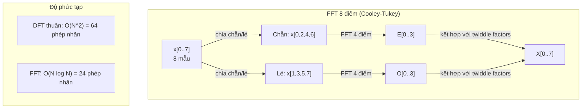
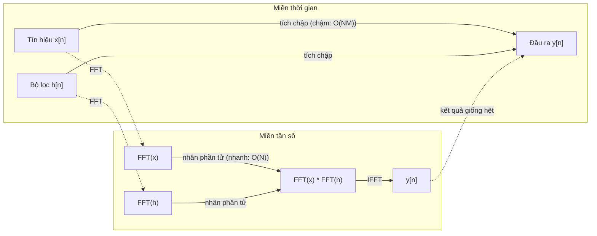

# Biến đổi Fourier (The Fourier Transform)

> Mọi tín hiệu đều là tổng của các sóng hình sin. Biến đổi Fourier cho bạn biết chính xác đó là những sóng nào.

**Type:** Build
**Language:** Python
**Prerequisites:** Phase 1, Lessons 01-04, 19 (complex numbers)
**Time:** ~90 minutes

## Learning Objectives

- Tự cài đặt biến đổi Fourier rời rạc (DFT) từ đầu và đối chiếu với thuật toán Cooley-Tukey FFT độ phức tạp $O(N \log N)$
- Diễn giải các hệ số tần số: trích xuất biên độ, pha và phổ công suất (power spectrum) từ một tín hiệu
- Áp dụng định lý tích chập (convolution theorem) để thực hiện phép tích chập thông qua phép nhân FFT
- Kết nối sự phân tích tần số Fourier với mã hóa vị trí trong Transformer và các tầng tích chập của CNN

## The Problem (Vấn đề)

Một bản ghi âm là một chuỗi các phép đo áp suất không khí biến đổi theo thời gian. Giá một mã cổ phiếu là một chuỗi giá trị biến đổi qua các ngày. Một bức ảnh số là một lưới cường độ pixel biến đổi theo không gian 2D. Tất cả những dữ liệu này đều tồn tại trong miền thời gian (time domain) hoặc miền không gian (space domain). Bạn chỉ nhìn thấy các giá trị thay đổi dọc theo một chỉ số nào đó.

Thế nhưng, rất nhiều mẫu hình quy luật bị che giấu hoàn toàn trong miền thời gian. Tín hiệu âm thanh này là một âm thanh đơn sắc hay là một hợp âm phức tạp? Giá cổ phiếu này có chu kỳ dao động theo tuần hay không? Bức ảnh này có cấu trúc vân họa tiết lặp lại không? Những câu hỏi này hoàn toàn liên quan đến nội dung tần số (frequency content), và miền thời gian che giấu chúng.

Biến đổi Fourier chuyển đổi dữ liệu từ miền thời gian sang miền tần số. Nó lấy một tín hiệu và phân rã nó thành các sóng hình sin ở các tần số khác nhau. Mỗi sóng sin có một biên độ (độ mạnh yếu) và một góc pha (thời điểm bắt đầu dao động). Biến đổi Fourier cho bạn biết cả hai thông số đó.

Điều này cực kỳ quan trọng đối với AI/ML vì tư duy trong miền tần số xuất hiện khắp mọi nơi: Mạng nơ-ron tích chập (CNN) thực hiện phép tích chập — vốn chính là phép nhân trong miền tần số. Mã hóa vị trí trong Transformer sử dụng sự phân rã tần số để biểu diễn vị trí của từ. Các mô hình âm thanh (nhận dạng giọng nói, tạo nhạc) hoạt động trực tiếp trên phổ đồ (spectrogram) — biểu diễn tần số của âm thanh. Các mô hình chuỗi thời gian tìm kiếm các mẫu hình chu kỳ. Hiểu được biến đổi Fourier cung cấp cho bạn ngôn ngữ cốt lõi để làm việc với tất cả các mô hình này.

## The Concept (Khái niệm)

### Định nghĩa DFT (Biến đổi Fourier rời rạc)

Cho $N$ mẫu dữ liệu $x[0], x[1], \ldots, x[N-1]$, biến đổi Fourier rời rạc tạo ra $N$ hệ số tần số $X[0], X[1], \ldots, X[N-1]$:

```math
X[k] = \sum_{n=0}^{N-1} x[n] \, e^{-2\pi i k n/N} \qquad \text{với } k = 0, 1, \ldots, N-1
```

Mỗi giá trị $X[k]$ là một số phức. Độ lớn của nó $\lvert X[k] \rvert$ tỷ lệ thuận với biên độ của thành phần tần số $k$. Nếu không chuẩn hóa, một sóng sin thực có biên độ $A$ rơi trúng vào bin $k$ sẽ cho $\lvert X[k] \rvert = AN/2$, vì vậy chia cho $N/2$ sẽ cho bạn biên độ thực tế. Pha của nó $\angle X[k]$ cho bạn biết độ lệch pha của tần số đó.

Trực giác mấu chốt: $e^{-2\pi i k n/N}$ là một phasor quay với tần số $k$. DFT tính toán độ tương quan (correlation) giữa tín hiệu và từng sóng hình sin trong số $N$ tần số cách đều nhau. Nếu tín hiệu chứa năng lượng tại tần số $k$, độ tương quan sẽ rất lớn. Nếu không, nó sẽ xấp xỉ bằng 0.

### Ý nghĩa của từng hệ số tần số

**$X[0]$: Thành phần một chiều (DC component).** Đây là tổng của tất cả các mẫu dữ liệu — tỷ lệ thuận với giá trị trung bình. Nó đại diện cho mức dịch chuyển hằng số (tần số bằng 0) của tín hiệu.

```math
X[0] = \sum_{n=0}^{N-1} x[n] \, e^0 = \text{tổng toàn bộ các mẫu}
```

**$X[k]$ với $1 \le k \le N/2$: Tần số dương.** $X[k]$ biểu diễn tần số có $k$ chu kỳ dao động trên $N$ mẫu dữ liệu. $k$ càng lớn nghĩa là tần số càng cao (dao động càng nhanh).

**$X[N/2]$: Tần số Nyquist.** Tần số cao nhất mà bạn có thể biểu diễn được với $N$ mẫu dữ liệu. Vượt quá tần số này, hiện tượng chồng phổ (aliasing) sẽ xảy ra — các tần số cao bị giả dạng thành các tần số thấp.

**$X[k]$ với $N/2 < k < N$: Tần số âm.** Đối với tín hiệu có giá trị thực, $X[N-k] = \overline{X[k]}$ (liên hợp phức). Các tần số âm là ảnh phản chiếu qua gương của các tần số dương. Đó là lý do toàn bộ thông tin hữu ích nằm gọn trong $N/2 + 1$ hệ số đầu tiên.

### Biến đổi Fourier rời rạc ngược (Inverse DFT)

Biến đổi Fourier ngược tái tạo lại tín hiệu ban đầu từ các hệ số tần số của nó:

```math
x[n] = \frac{1}{N} \sum_{k=0}^{N-1} X[k] \, e^{2\pi i k n/N} \qquad \text{với } n = 0, 1, \ldots, N-1
```

Điểm khác biệt duy nhất so với DFT thuận: dấu trong số mũ là dấu dương (không phải dấu âm), và có thêm thừa số chuẩn hóa $1/N$.

Biến đổi ngược mang tính tái tạo hoàn hảo. Hoàn toàn không có thông tin nào bị mất. Bạn có thể chuyển từ miền thời gian sang miền tần số rồi quay ngược lại mà không hề có sai số. DFT thực chất là một phép đổi cơ sở — nó biểu diễn cùng một lượng thông tin trong một hệ tọa độ khác.

### FFT: Thuật toán biến đổi siêu tốc

Công thức DFT nguyên thủy có độ phức tạp $O(N^2)$: với mỗi hệ số đầu ra trong số $N$ hệ số, bạn phải tính tổng trên $N$ mẫu đầu vào. Với $N$ = 1 triệu, đó là $10^{12}$ phép tính.

Biến đổi Fourier nhanh (FFT - Fast Fourier Transform) tính toán cùng một kết quả nhưng chỉ tốn $O(N \log N)$ phép tính. Với $N$ = 1 triệu, chỉ tốn khoảng 20 triệu phép tính thay vì một nghìn tỷ. Đây chính là bước đột phá đưa phân tích tần số vào ứng dụng thực tiễn.

Thuật toán Cooley-Tukey (dạng FFT phổ biến nhất) hoạt động theo nguyên lý chia để trị (divide and conquer):

1. Tách tín hiệu thành hai chuỗi mẫu có chỉ số chẵn và chỉ số lẻ.
2. Tính đệ quy DFT của từng nửa tín hiệu.
3. Ghép hai kết quả DFT nửa kích thước đó lại bằng các "hệ số xoay" (twiddle factors) $e^{-2\pi i k/N}$.

```math
\begin{aligned}
X[k] &= E[k] + e^{-2\pi i k/N} \, O[k] && \text{với } k = 0, \ldots, N/2 - 1 \\
X[k + N/2] &= E[k] - e^{-2\pi i k/N} \, O[k] && \text{với } k = 0, \ldots, N/2 - 1 \\[6pt]
\text{trong đó } E &= \text{DFT của các mẫu chỉ số chẵn} \\
O &= \text{DFT của các mẫu chỉ số lẻ}
\end{aligned}
```

Nhờ tính đối xứng, mỗi tầng đệ quy chỉ thực hiện lượng công việc $O(N)$, và có tổng cộng $\log_2(N)$ tầng. Tổng độ phức tạp: $O(N \log N)$.



Thuật toán radix-2 FFT được xây dựng ở đây đạt tốc độ cao nhất khi độ dài tín hiệu là một lũy thừa của 2. Bất cứ khi nào bài toán con có độ dài lẻ, nó sẽ lùi về hàm `dft` thông thường, do đó các tín hiệu thường được chèn thêm số 0 (zero-padding) cho đủ lũy thừa của 2. Các thư viện như `numpy.fft` hỗ trợ mọi kích thước bằng các thuật toán hỗn hợp (mixed-radix), nhưng luôn nhanh nhất với các kích thước có thừa số nguyên tố nhỏ.

### Phân tích phổ (Spectral Analysis)

**Phổ công suất (Power spectrum)** là $\lvert X[k] \rvert^2$ — bình phương độ lớn của mỗi hệ số tần số. Nó cho biết lượng năng lượng phân bổ tại mỗi tần số.

**Phổ pha (Phase spectrum)** là $\angle X[k]$ — góc pha ban đầu của mỗi tần số. Trong phần lớn các bài toán phân tích, người ta chỉ quan tâm đến phổ công suất và bỏ qua pha.

```math
\begin{aligned}
\text{Công suất tại tần số } k: \quad P[k] &= |X[k]|^2 = \mathop{\mathrm{Re}}(X[k])^2 + \mathop{\mathrm{Im}}(X[k])^2 \\
\text{Pha tại tần số } k: \quad \phi[k] &= \mathop{\mathrm{atan2}}(\mathop{\mathrm{Im}}(X[k]), \mathop{\mathrm{Re}}(X[k]))
\end{aligned}
```

### Độ phân giải tần số (Frequency Resolution)

Độ phân giải tần số của DFT phụ thuộc vào số lượng mẫu $N$ và tần số lấy mẫu $f_s$.

```math
\begin{aligned}
\text{Tần số của bin } k: \quad & f_k = k \cdot f_s / N \\
\text{Độ phân giải tần số:} \quad & \Delta f = f_s / N \\
\text{Tần số tối đa:} \quad & f_{\max} = f_s / 2 \quad \text{(Nyquist)}
\end{aligned}
```

Để phân biệt hai tần số nằm rất sát nhau, bạn cần nhiều mẫu dữ liệu hơn (tăng thời gian quan sát). Để thu nhận được các tần số rất cao, bạn cần tần số lấy mẫu cao hơn.

### Định lý tích chập (The Convolution Theorem)

Đây là một trong những định lý quan trọng nhất của ngành xử lý tín hiệu và liên quan mật thiết đến mạng nơ-ron tích chập (CNN).

**Phép tích chập trong miền thời gian tương đương với phép nhân từng phần tử trong miền tần số.**

```math
\begin{aligned}
& x * h = \text{IFFT}(\text{FFT}(x) \cdot \text{FFT}(h)) \\[4pt]
& \text{trong đó } * \text{ là tích chập và } \cdot \text{ là phép nhân từng phần tử}
\end{aligned}
```

Ý nghĩa to lớn:
- Tích chập trực tiếp hai tín hiệu độ dài $N$ và $M$ tốn $O(NM)$ phép tính.
- Tích chập qua FFT chỉ tốn $O(N \log N)$: biến đổi cả hai, nhân chúng lại, rồi biến đổi ngược.
- Với các bộ lọc (kernel) kích thước lớn, tích chập bằng FFT nhanh hơn vượt trội.
- Đây chính xác là cơ chế vận hành trong các tầng tích chập có trường tiếp nhận (receptive field) lớn.

Lưu ý: DFT mặc định tính tích chập vòng (circular convolution - tín hiệu bị quấn vòng). Để có tích chập tuyến tính (linear convolution - không quấn vòng), hãy chèn số 0 (zero-pad) cả hai tín hiệu lên độ dài $N + M - 1$ trước khi biến đổi.



### Hàm cửa sổ (Windowing)

DFT mặc định coi tín hiệu là có tính chu kỳ — nó coi $N$ mẫu là một chu kỳ của một tín hiệu lặp lại vô tận. Nếu tín hiệu không bắt đầu và kết thúc tại cùng một giá trị, điều này tạo ra một điểm gián đoạn đột ngột tại ranh giới, biểu hiện thành các thành phần tần số cao giả tạo. Hiện tượng này gọi là rò rỉ phổ (spectral leakage).

Áp dụng hàm cửa sổ giúp giảm rò rỉ phổ bằng cách làm mượt biên độ của tín hiệu về 0 ở cả hai đầu trước khi tính DFT.

Các loại cửa sổ phổ biến:

| Cửa sổ | Hình dạng | Độ rộng búp sóng chính | Mức búp sóng phụ | Trường hợp sử dụng |
|--------|-------|----------------|-----------------|----------|
| Chữ nhật | Phẳng (không dùng cửa sổ) | Hẹp nhất | Cao nhất (-13 dB) | Khi tín hiệu có chu kỳ trọn vẹn trong đúng $N$ mẫu |
| Hann | Hình cos nâng | Vừa phải | Thấp (-31 dB) | Phân tích phổ đa dụng |
| Hamming | Cos hiệu chỉnh | Vừa phải | Thấp hơn (-42 dB) | Xử lý âm thanh, phân tích tiếng nói |
| Blackman | Ba sóng cos | Rộng | Rất thấp (-58 dB) | Khi việc triệt tiêu búp sóng phụ là tối quan trọng |

```math
\begin{aligned}
\text{Cửa sổ Hann:} \quad & w[n] = 0.5 \left(1 - \cos\frac{2\pi n}{N-1}\right) \\
\text{Cửa sổ Hamming:} \quad & w[n] = 0.54 - 0.46 \cos\frac{2\pi n}{N-1}
\end{aligned}
```

Áp dụng cửa sổ bằng cách nhân từng phần tử của nó với tín hiệu trước khi tính DFT: `X = DFT(x * w)`.

### Các tính chất của DFT

| Tính chất | Miền thời gian | Miền tần số |
|----------|-------------|-----------------|
| Tuyến tính | $ax + by$ | $aX + bY$ |
| Dịch thời gian | $x[n - k]$ | $X[f] e^{-2\pi i f k/N}$ |
| Dịch tần số | $x[n] e^{2\pi i f_0 n/N}$ | $X[f - f_0]$ |
| Tích chập | $x * h$ | $X \cdot H$ (nhân từng phần tử) |
| Phép nhân | $x \cdot h$ (nhân từng phần tử) | $X * H$ (tích chập vòng, chia tỷ lệ $1/N$) |
| Định lý Parseval | $\sum \lvert x[n] \rvert^2$ | $\frac{1}{N} \sum \lvert X[k] \rvert^2$ |
| Đối xứng liên hợp (với đầu vào thực) | $x[n]$ thực | $X[k] = \overline{X[N-k]}$ |

Định lý Parseval khẳng định: tổng năng lượng của tín hiệu là như nhau ở cả hai miền. Năng lượng được bảo toàn nguyên vẹn qua phép biến đổi Fourier.

### Kết nối với mã hóa vị trí (Positional Encodings)

Kiến trúc Transformer gốc sử dụng mã hóa vị trí hình sin:

```math
\begin{aligned}
PE(pos, 2i) &= \sin\left(pos / 10000^{2i/d_{\text{model}}}\right) \\
PE(pos, 2i+1) &= \cos\left(pos / 10000^{2i/d_{\text{model}}}\right)
\end{aligned}
```

Mỗi cặp chiều không gian $(2i, 2i+1)$ dao động ở một tần số khác nhau. Các tần số được phân bố theo cấp số nhân từ cao (ở chiều 0, 1) xuống thấp (ở các chiều cuối). Điều này mang lại cho mỗi vị trí một mẫu hình độc nhất vô nhị trên toàn bộ các dải tần số — tương tự như cách các hệ số Fourier định danh duy nhất một tín hiệu.

Các tính chất quan trọng mà cơ chế này mang lại:
- **Tính duy nhất:** Không có hai vị trí nào có cùng mã hóa.
- **Giá trị bị chặn:** Hàm sin và cos luôn nằm trong đoạn $[-1, 1]$.
- **Vị trí tương đối:** Mã hóa của vị trí $p+k$ có thể được biểu diễn dưới dạng hàm tuyến tính của mã hóa tại vị trí $p$. Mô hình có thể dễ dàng học cách chú ý tới các vị trí tương đối.

### Kết nối với CNNs

Một tầng tích chập áp dụng một bộ lọc đã học (kernel) lên đầu vào bằng cách trượt nó qua tín hiệu hoặc bức ảnh. Về mặt toán học, đây chính là phép tích chập.

Theo định lý tích chập, thao tác này tương đương với:
1. FFT đầu vào
2. FFT bộ lọc (kernel)
3. Nhân từng phần tử trong miền tần số
4. IFFT kết quả trở lại miền không gian

Các thư viện CNN tiêu chuẩn thường dùng tích chập trực tiếp (nhanh hơn cho các kernel nhỏ $3 \times 3$). Nhưng với kernel lớn hoặc tích chập toàn cục, các phương pháp dựa trên FFT chạy nhanh hơn đáng kể. Một số kiến trúc hiện đại (như FNet) thậm chí thay thế hoàn toàn cơ chế self-attention bằng FFT, đạt độ chính xác tương đương nhưng giảm độ phức tạp từ $O(N^2)$ xuống $O(N \log N)$.

### Phổ đồ (Spectrograms) và biến đổi Fourier thời gian ngắn (STFT)

Một phép FFT đơn lẻ cho bạn biết nội dung tần số của toàn bộ tín hiệu, nhưng hoàn toàn không cho biết các tần số đó xuất hiện vào thời điểm nào. Một tiếng huýt sáo trượt tần (chirp - tần số tăng dần theo thời gian) và một hợp âm (toàn bộ các nốt phát ra đồng thời) có thể có phổ biên độ hoàn toàn giống nhau.

Biến đổi Fourier thời gian ngắn (STFT) giải quyết vấn đề này bằng cách tính FFT trên các khung cửa sổ gối đầu nhau của tín hiệu. Kết quả thu được là một phổ đồ (spectrogram): biểu diễn 2D với trục hoành là thời gian và trục tung là tần số. Cường độ sáng tại mỗi điểm biểu thị năng lượng của tần số đó tại thời điểm tương ứng.

```
Quy trình tính STFT:
1. Chọn kích thước cửa sổ (ví dụ: 1024 mẫu)
2. Chọn bước nhảy hop size (ví dụ: 256 mẫu -- gối đầu 75%)
3. Với mỗi vị trí cửa sổ:
   a. Trích xuất đoạn tín hiệu trong cửa sổ
   b. Áp dụng cửa sổ Hann / Hamming
   c. Tính FFT
   d. Lưu phổ biên độ thành một cột của phổ đồ
```

Phổ đồ là dạng biểu diễn đầu vào chuẩn mực cho các mô hình AI âm thanh. Các mô hình nhận dạng tiếng nói (như Whisper, DeepSpeech) hoạt động trên mel-spectrogram — phổ đồ với các tần số được ánh xạ sang thang đo mel để mô phỏng chính xác cảm nhận thính giác của con người.

### Hiện tượng chồng phổ (Aliasing)

Nếu tín hiệu chứa các tần số cao hơn $f_s/2$ (tần số Nyquist), việc lấy mẫu ở tốc độ $f_s$ sẽ tạo ra các bản sao bị chồng phổ. Một tín hiệu 90 Hz khi lấy mẫu ở tốc độ 100 Hz trông giống hệt như một tín hiệu 10 Hz. Không có cách nào phân biệt được chúng chỉ dựa vào các mẫu rời rạc.

```
Ví dụ:
  Tín hiệu thực tế: Sóng sin 90 Hz
  Tần số lấy mẫu: 100 Hz
  Tần số biểu kiến: 100 - 90 = 10 Hz

  Các mẫu thu được từ sóng 90 Hz ở tốc độ 100 Hz
  hoàn toàn trùng khớp với các mẫu thu được từ sóng 10 Hz.
  Không có thuật toán toán học nào có thể khôi phục lại tần số 90 Hz ban đầu.
```

Đó là lý do các bộ chuyển đổi tương tự - số (ADC) luôn tích hợp bộ lọc chống chồng phổ (anti-aliasing filter) để triệt tiêu các tần số cao hơn Nyquist trước khi lấy mẫu. Trong ML, hiện tượng chồng phổ xuất hiện khi giảm mẫu (downsample) các bản đồ đặc trưng mà không có bộ lọc thông thấp phù hợp — một số kiến trúc giải quyết vấn đề này bằng các tầng pooling chống chồng phổ (anti-aliased pooling).

### Zero-padding không làm tăng độ phân giải thực

Một hiểu lầm phổ biến: chèn thêm các số 0 (zero-padding) vào tín hiệu trước khi tính FFT sẽ cải thiện độ phân giải tần số. Thực tế không phải vậy. Zero-padding chỉ nội suy giữa các bin tần số sẵn có, tạo ra một đường phổ trông mượt mà hơn. Nhưng nó hoàn toàn không thể hé lộ thêm chi tiết tần số mới nào vốn không tồn tại trong các mẫu dữ liệu gốc.

Độ phân giải tần số thực sự chỉ phụ thuộc vào tổng thời gian quan sát $T = N / f_s$. Để phân biệt hai tần số cách nhau $\Delta f$, bạn cần ít nhất $T = 1 / \Delta f$ giây dữ liệu. Không có kỹ thuật zero-padding nào có thể vượt qua giới hạn vật lý căn bản này.

```figure
fourier-synthesis
```

## Build It (Thực hành xây dựng)

### Bước 1: Cài đặt DFT từ đầu

Hàm DFT $O(N^2)$ xuất phát trực tiếp từ định nghĩa toán học:

```python
import math

class Complex:
    ...

def dft(x):
    N = len(x)
    result = []
    for k in range(N):
        total = Complex(0, 0)
        for n in range(N):
            angle = -2 * math.pi * k * n / N
            w = Complex(math.cos(angle), math.sin(angle))
            xn = x[n] if isinstance(x[n], Complex) else Complex(x[n])
            total = total + xn * w
        result.append(total)
    return result
```

### Bước 2: Biến đổi Fourier ngược (Inverse DFT)

Cùng cấu trúc, đổi dấu số mũ thành dương, và chia cho $N$:

```python
def idft(X):
    N = len(X)
    result = []
    for n in range(N):
        total = Complex(0, 0)
        for k in range(N):
            angle = 2 * math.pi * k * n / N
            w = Complex(math.cos(angle), math.sin(angle))
            total = total + X[k] * w
        result.append(Complex(total.real / N, total.imag / N))
    return result
```

### Bước 3: Thuật toán FFT (Cooley-Tukey)

FFT đệ quy đòi hỏi độ dài tín hiệu là lũy thừa của 2. Chia tín hiệu thành hai nửa chẵn và lẻ, đệ quy, rồi kết hợp lại bằng các hệ số xoay (twiddle factors):

```python
def fft(x):
    N = len(x)
    if N <= 1:
        return [x[0] if isinstance(x[0], Complex) else Complex(x[0])]
    if N % 2 != 0:
        return dft(x)

    even = fft([x[i] for i in range(0, N, 2)])
    odd = fft([x[i] for i in range(1, N, 2)])

    result = [Complex(0)] * N
    for k in range(N // 2):
        angle = -2 * math.pi * k / N
        twiddle = Complex(math.cos(angle), math.sin(angle))
        t = twiddle * odd[k]
        result[k] = even[k] + t
        result[k + N // 2] = even[k] - t
    return result
```

### Bước 4: Các hàm hỗ trợ phân tích phổ

```python
def power_spectrum(X):
    return [xk.real ** 2 + xk.imag ** 2 for xk in X]

def convolve_fft(x, h):
    N = len(x) + len(h) - 1
    padded_N = 1
    while padded_N < N:
        padded_N *= 2

    x_padded = x + [0.0] * (padded_N - len(x))
    h_padded = h + [0.0] * (padded_N - len(h))

    X = fft(x_padded)
    H = fft(h_padded)

    Y = [xk * hk for xk, hk in zip(X, H)]

    y = idft(Y)
    return [y[n].real for n in range(N)]
```

## Use It (Ứng dụng thực tế)

Trong công việc thực tế, hãy sử dụng thư viện FFT của NumPy vốn được tối ưu hóa bằng C:

```python
import numpy as np

signal = np.sin(2 * np.pi * 5 * np.arange(256) / 256)
spectrum = np.fft.fft(signal)
freqs = np.fft.fftfreq(256, d=1/256)

power = np.abs(spectrum) ** 2

positive_freqs = freqs[:len(freqs)//2]
positive_power = power[:len(power)//2]
```

Để áp dụng cửa sổ và phân tích phổ nâng cao:

```python
from scipy.signal import windows, stft

window = windows.hann(256)
windowed = signal * window
spectrum = np.fft.fft(windowed)
```

Để thực hiện tích chập nhanh:

```python
from scipy.signal import fftconvolve

result = fftconvolve(signal, kernel, mode='full')
```

Để trích xuất phổ đồ (spectrogram):

```python
from scipy.signal import stft

frequencies, times, Zxx = stft(signal, fs=sample_rate, nperseg=256)
spectrogram = np.abs(Zxx) ** 2
```

Ma trận spectrogram có kích thước (n_frequencies, n_time_frames). Mỗi cột là phổ công suất tại một cửa sổ thời gian. Đây chính là dữ liệu đầu vào cho các mô hình AI âm thanh.

## Ship It (Triển khai)

Chạy file `code/fourier.py` để tạo ra artifact `outputs/prompt-spectral-analyzer.md`.

## Exercises (Bài tập)

1. **Nhận dạng âm đơn sắc.** Tạo một tín hiệu chứa một sóng sin duy nhất ở tần số chưa biết (nằm trong khoảng 1 đến 50 Hz), lấy mẫu ở tốc độ 128 Hz trong 1 giây. Dùng hàm DFT của bạn để xác định tần số đó. Xác minh kết quả. Sau đó thêm nhiễu Gauss với độ lệch chuẩn 0.5 và lặp lại. Nhiễu ảnh hưởng đến phổ tần số như thế nào?

2. **Xác minh FFT vs DFT.** Tạo một tín hiệu ngẫu nhiên độ dài 64. Tính cả DFT ($O(N^2)$) và FFT. Xác minh rằng toàn bộ các hệ số khớp nhau trong phạm vi sai số 1e-10. Đo thời gian thực thi của cả hai hàm trên các tín hiệu độ dài 256, 512, 1024, và 2048. Vẽ đồ thị tỷ lệ thời gian giữa DFT và FFT.

3. **Kiểm chứng định lý tích chập bằng ví dụ.** Tạo tín hiệu x = [1, 2, 3, 4, 0, 0, 0, 0] và bộ lọc h = [1, 1, 1, 0, 0, 0, 0, 0]. Tính tích chập vòng trực tiếp (vòng lặp lồng nhau). Sau đó tính qua FFT (biến đổi, nhân, biến đổi ngược). Xác minh hai kết quả trùng khớp hoàn toàn. Sau đó thực hiện tích chập tuyến tính bằng cách zero-padding thích hợp.

4. **Tác động của hàm cửa sổ.** Tạo một tín hiệu là tổng của hai sóng sin ở tần số 10 Hz và 12 Hz (rất gần nhau). Lấy mẫu ở 128 Hz trong 1 giây. Tính phổ công suất khi không dùng cửa sổ, dùng cửa sổ Hann, và dùng cửa sổ Hamming. Loại cửa sổ nào giúp phân biệt hai đỉnh nhọn dễ nhất? Vì sao?

5. **Phân tích mã hóa vị trí Transformer.** Tạo các mã hóa vị trí hình sin cho d_model = 128 và max_pos = 512. Với mỗi cặp vị trí $(p_1, p_2)$, tính tích vô hướng giữa hai vector mã hóa của chúng. Chứng minh rằng tích vô hướng chỉ phụ thuộc vào khoảng cách $\lvert p_1 - p_2 \rvert$, chứ không phụ thuộc vào vị trí tuyệt đối. Điều gì xảy ra với tích vô hướng khi khoảng cách giữa hai từ tăng dần?

### Gợi ý (Hints)

**Bài tập 1.** Với 128 mẫu trong 1 giây, bin $k$ chính là $k$ Hz. Do đó, với tần số nguyên, chỉ số của giá trị lớn nhất trong các bin từ 1 đến 63 chính là tần số cần tìm. Chọn tần số nguyên. Một tần số nằm giữa hai bin sẽ lan sang các bin lân cận. Dùng `generate_signal` và `magnitude_spectrum`. Sau khi thêm nhiễu, kiểm tra xem đỉnh nhọn có giữ nguyên vị trí trong khi nền các bin khác nâng cao lên không.

**Bài tập 2.** Sử dụng độ dài là lũy thừa của 2 vì `fft` chia đôi tín hiệu liên tục. Kiểm tra `max(abs(a - b))` trên toàn bộ các hệ số. Tỷ lệ thời gian sẽ tăng xấp xỉ theo hàm $N / \log_2 N$.

**Bài tập 3.** Với tích chập vòng, tính $y[n] = \sum_k h[k] x[(n-k) \bmod 8]$ bằng tay cho $n$ = 0, 1, và 2, rồi so sánh ba giá trị đầu tiên của `convolve_direct` và `convolve_fft`. Tích chập tuyến tính có độ dài 4 + 3 - 1 = 6, nên hãy kiểm tra xem độ dài 8 đã đủ lớn chưa.

**Bài tập 4.** Dùng `hann_window`, `hamming_window`, `apply_window`, và `power_spectrum`, rồi đếm các đỉnh riêng biệt trong khoảng 9 đến 13 Hz. Cả 10 Hz và 12 Hz đều hoàn thành số chu kỳ nguyên vẹn trong 1 giây, nên khi không dùng cửa sổ có thể trông rõ nét nhất. Thử lặp lại với 10.5 Hz và 12.5 Hz để quan sát hiện tượng rò rỉ phổ mà các cửa sổ giúp khắc phục.

**Bài tập 5.** Tính từng vector mã hóa với `positional_encoding(pos, 128)`. So sánh tích vô hướng giữa các vị trí (0, 10) với tích vô hướng giữa (100, 110): hai giá trị phải khớp nhau tới khoảng 1e-10. Sau đó vẽ đồ thị tích vô hướng theo $\lvert p_1 - p_2 \rvert$ với một vị trí $p_1$ cố định.

## Key Terms (Thuật ngữ chính)

| Thuật ngữ | Ý nghĩa bản chất |
|------|---------------|
| DFT (Biến đổi Fourier rời rạc) | Chuyển đổi $N$ mẫu trong miền thời gian thành $N$ hệ số trong miền tần số. Mỗi hệ số là độ tương quan với một sóng hình sin phức tại tần số đó |
| FFT (Biến đổi Fourier nhanh) | Thuật toán $O(N \log N)$ để tính DFT. Thuật toán Cooley-Tukey chia đệ quy các chỉ số chẵn/lẻ |
| Inverse DFT (DFT ngược) | Khôi phục tín hiệu miền thời gian từ các hệ số tần số. Cùng công thức với DFT nhưng đảo dấu số mũ và chia chuẩn hóa $1/N$ |
| Frequency bin | Mỗi chỉ số $k$ trong đầu ra của DFT biểu diễn tần số $k f_s/N$ Hz. Bin là "ngăn chứa" tần số rời rạc |
| DC component | $X[0]$, hệ số tại tần số 0. Tỷ lệ thuận với giá trị trung bình của toàn bộ tín hiệu |
| Nyquist frequency | $f_s/2$, tần số tối đa có thể biểu diễn được ở tốc độ lấy mẫu $f_s$. Các tần số cao hơn mức này sẽ bị chồng phổ |
| Power spectrum (Phổ công suất) | $\lvert X[k] \rvert^2$, bình phương độ lớn của mỗi hệ số tần số. Cho biết sự phân bổ năng lượng theo tần số |
| Phase spectrum (Phổ pha) | $\angle X[k]$, góc lệch pha của từng thành phần tần số. Thường được bỏ qua trong các bài toán nhận dạng |
| Spectral leakage (Rò rỉ phổ) | Năng lượng tần số giả tạo xuất hiện do giả định tín hiệu tuần hoàn bị gián đoạn ở biên. Được giảm thiểu bằng hàm cửa sổ |
| Window function (Hàm cửa sổ) | Hàm làm mượt (Hann, Hamming, Blackman) được nhân với tín hiệu trước khi tính DFT để giảm rò rỉ phổ |
| Twiddle factor | Hệ số hàm mũ phức $e^{-2\pi i k/N}$ dùng để kết hợp các bài toán con DFT trong phép tính cánh bướm của FFT |
| Convolution theorem | Tích chập trong miền thời gian bằng phép nhân từng phần tử trong miền tần số. Cốt lõi của xử lý tín hiệu và mạng CNN |
| Circular convolution (Tích chập vòng) | Dạng tích chập mà tín hiệu bị quấn vòng quanh chu kỳ. Đây là phép toán tự nhiên mà DFT tính toán |
| Linear convolution (Tích chập tuyến tính) | Phép tích chập tiêu chuẩn không quấn vòng. Thực hiện bằng cách chèn số 0 (zero-padding) trước khi tính DFT |
| Parseval's theorem | Định lý bảo toàn năng lượng qua phép biến đổi Fourier. $\sum \lvert x[n] \rvert^2 = \frac{1}{N} \sum \lvert X[k] \rvert^2$ |
| Aliasing (Chồng phổ) | Hiện tượng các tần số cao hơn Nyquist xuất hiện dưới dạng tần số thấp hơn do tốc độ lấy mẫu không đủ nhanh |

## Further Reading (Tài liệu đọc thêm)

- [Cooley & Tukey: An Algorithm for the Machine Calculation of Complex Fourier Series (1965)](https://www.ams.org/journals/mcom/1965-19-090/S0025-5718-1965-0178586-1/) - Bài báo FFT kinh điển làm thay đổi diện mạo ngành điện toán thế giới
- [3Blue1Brown: But what is the Fourier Transform?](https://www.youtube.com/watch?v=spUNpyF58BY) - Video trực quan xuất sắc nhất giải thích trực giác đằng sau biến đổi Fourier
- [Lee-Thorp et al.: FNet: Mixing Tokens with Fourier Transforms (2021)](https://arxiv.org/abs/2105.03824) - Nghiên cứu thay thế self-attention bằng biến đổi Fourier trong Transformer
- [Smith: The Scientist and Engineer's Guide to Digital Signal Processing](http://www.dspguide.com/) - Giáo trình trực tuyến miễn phí giải thích chuyên sâu về FFT, hàm cửa sổ và phân tích phổ
- [Vaswani et al.: Attention Is All You Need (2017)](https://arxiv.org/abs/1706.03762) - Cơ chế mã hóa vị trí hình sin xuất phát từ sự phân rã tần số Fourier
- [Radford et al.: Whisper (2022)](https://arxiv.org/abs/2212.04356) - Mô hình nhận dạng giọng nói sử dụng mel-spectrogram làm đầu vào chuẩn mực
