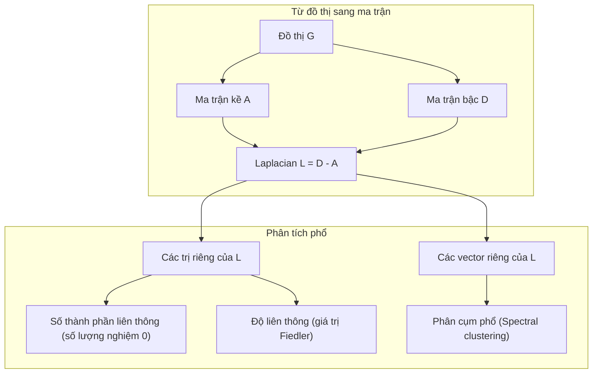
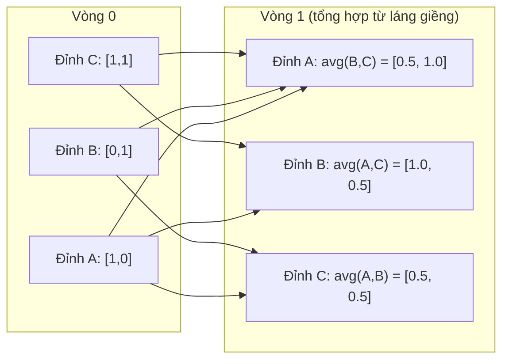

# Lý thuyết đồ thị cho Machine Learning (Graph Theory for Machine Learning)

> Đồ thị là cấu trúc dữ liệu của các mối quan hệ. Nếu dữ liệu của bạn có các kết nối, bạn chắc chắn cần đến lý thuyết đồ thị.

**Type:** Build
**Language:** Python
**Prerequisites:** Phase 1, Lessons 01-03 (linear algebra, matrices)
**Time:** ~90 minutes

## Learning Objectives

- Xây dựng lớp Graph từ đầu với các biểu diễn ma trận kề / danh sách kề và cài đặt các thuật toán duyệt đồ thị BFS, DFS
- Tính toán ma trận Laplacian của đồ thị và sử dụng các trị riêng của nó để phát hiện các thành phần liên thông và phân cụm nút
- Cài đặt một vòng truyền thông điệp (message passing) kiểu GNN dưới dạng phép nhân ma trận kề chuẩn hóa
- Áp dụng kỹ thuật phân cụm phổ (spectral clustering) để phân hoạch đồ thị bằng vector Fiedler

## The Problem (Vấn đề)

Mạng xã hội, cấu trúc phân tử, đồ thị tri thức, mạng lưới trích dẫn khoa học, bản đồ giao thông — tất cả đều là các đồ thị. Các phương pháp học máy truyền thống thường xem dữ liệu như các bảng phẳng độc lập: mỗi hàng là một mẫu dữ liệu riêng biệt, mỗi cột là một đặc trưng. Nhưng khi cấu trúc của các mối liên kết đóng vai trò quyết định, mô hình dạng bảng hoàn toàn thất bại.

Hãy xem xét một mạng xã hội: Bạn muốn dự đoán sản phẩm mà một người dùng sẽ mua. Lịch sử mua hàng của chính họ là quan trọng, nhưng lịch sử mua hàng của bạn bè họ thậm chí còn mang nhiều tín hiệu giá trị hơn. Chính các mối liên kết mang theo tín hiệu dự báo.

Hoặc hãy xem xét một phân tử hóa học: Bạn muốn dự đoán liệu nó có liên kết được với một protein mục tiêu hay không. Bản thân các nguyên tử là quan trọng, nhưng điều thực sự quyết định tính chất hóa học lại là cách các nguyên tử liên kết với nhau trong không gian. Cấu trúc đồ thị chính là dữ liệu.

Mạng nơ-ron đồ thị (Graph Neural Networks - GNNs) là một trong những lĩnh vực phát triển nhanh nhất trong học sâu hiện đại. Chúng là động lực cốt lõi phía sau việc khám phá thuốc mới, hệ thống gợi ý mạng xã hội, phát hiện gian lận tài chính, và suy luận trên đồ thị tri thức. Mọi kiến trúc GNN đều được xây dựng trên một nền tảng chung: lý thuyết đồ thị căn bản.

Bạn cần làm chủ bốn trụ cột:
1. Cách biểu diễn đồ thị dưới dạng ma trận (để có thể thực hiện các phép nhân đại số)
2. Các thuật toán duyệt đồ thị để khám phá cấu trúc liên kết
3. Ma trận Laplacian — ma trận quan trọng bậc nhất trong lý thuyết đồ thị phổ
4. Cơ chế truyền thông điệp (message passing) — thao tác then chốt giúp các mạng GNN hoạt động

## The Concept (Khái niệm)

### Đồ thị: Đỉnh (Nút) và Cạnh

Một đồ thị $G = (V, E)$ bao gồm tập hợp các đỉnh (vertices / nodes) $V$ và tập hợp các cạnh (edges) $E$. Mỗi cạnh kết nối hai đỉnh lại với nhau.

**Có hướng vs Vô hướng.** Trong đồ thị vô hướng, cạnh $(u, v)$ có nghĩa là $u$ kết nối với $v$ VÀ $v$ cũng kết nối với $u$. Trong đồ thị có hướng (digraph), cạnh $(u, v)$ có nghĩa là $u$ trỏ tới $v$, nhưng không nhất thiết có chiều ngược lại.

**Có trọng số vs Không trọng số.** Trong đồ thị không trọng số, cạnh đơn giản là tồn tại hoặc không tồn tại. Trong đồ thị có trọng số, mỗi cạnh mang một giá trị số — biểu thị khoảng cách, chi phí, hoặc độ mạnh của kết nối.

| Loại đồ thị | Ví dụ thực tế |
|-----------|---------|
| Vô hướng, không trọng số | Mạng lưới bạn bè Facebook |
| Có hướng, không trọng số | Mạng lưới theo dõi trên Twitter / X |
| Vô hướng, có trọng số | Bản đồ đường bộ (khoảng cách km) |
| Có hướng, có trọng số | Liên kết trang web (điểm số PageRank) |

### Ma trận kề (The Adjacency Matrix)

Ma trận kề $A$ là dạng biểu diễn ma trận cốt lõi. Đối với đồ thị có $n$ đỉnh:

```math
A[i][j] = \begin{cases} 1 & \text{nếu có cạnh nối từ đỉnh } i \text{ đến đỉnh } j \\ 0 & \text{nếu không có cạnh} \end{cases}
```

Đối với đồ thị vô hướng, $A$ là ma trận đối xứng: $A[i][j] = A[j][i]$. Đối với đồ thị có trọng số, $A[i][j]$ chính là trọng số của cạnh $(i, j)$.

**Ví dụ — Đồ thị tam giác:**

```
Đỉnh: 0, 1, 2
Cạnh: (0,1), (1,2), (0,2)

A = [[0, 1, 1],
     [1, 0, 1],
     [1, 1, 0]]
```

Ma trận kề chính là đầu vào cho mọi mạng GNN. Các thao tác ma trận trên $A$ tương ứng với các phép biến đổi hình học trên đồ thị.

### Bậc của đỉnh (Degree)

Bậc của một đỉnh là số lượng cạnh kết nối với đỉnh đó. Với đồ thị có hướng, ta phân biệt bán bậc vào (in-degree - số cạnh trỏ vào) và bán bậc ra (out-degree - số cạnh trỏ ra).

Ma trận bậc $D$ là một ma trận đường chéo:

```math
\begin{aligned}
D[i][i] &= \text{bậc của đỉnh } i \\
D[i][j] &= 0 \quad \text{với mọi } i \ne j
\end{aligned}
```

Với ví dụ tam giác ở trên: $D = \mathop{\mathrm{diag}}(2, 2, 2)$ vì mỗi đỉnh đều kết nối với 2 đỉnh còn lại.

Bậc của đỉnh phản ánh tầm quan trọng của nút đó: Nút có bậc lớn là nút trung tâm (hub node). Phân phối bậc của mạng lưới hé lộ cấu trúc tổng thể: Mạng xã hội thường tuân theo luật lũy thừa (power laws - một số ít nút hub khổng lồ, vô số nút lá nhỏ). Đồ thị ngẫu nhiên lại có phân phối bậc dạng Poisson.

### Thuật toán duyệt BFS và DFS

Hai thuật toán duyệt đồ thị kinh điển mà bạn bắt buộc phải nắm vững:

**Tìm kiếm theo chiều rộng (Breadth-First Search - BFS):** Khám phá toàn bộ các láng giềng trực tiếp trước, sau đó mới khám phá láng giềng của láng giềng. Sử dụng cấu trúc hàng đợi Queue (FIFO).

```
BFS xuất phát từ đỉnh 0:
  Thăm 0
  Hàng đợi: [1, 2]        (các láng giềng của 0)
  Thăm 1
  Hàng đợi: [2, 3]        (thêm láng giềng của 1)
  Thăm 2
  Hàng đợi: [3]           (láng giềng của 2 đã được thăm)
  Thăm 3
  Hàng đợi: []            (hoàn tất)
```

BFS tìm đường đi ngắn nhất trong đồ thị không trọng số. Khoảng cách từ đỉnh xuất phát tới bất kỳ đỉnh nào chính bằng tầng thứ tự BFS mà tại đó đỉnh đó được phát hiện lần đầu tiên. Đó là lý do BFS được dùng để tính khoảng cách bước nhảy (hop-count) trong mạng xã hội.

**Tìm kiếm theo chiều sâu (Depth-First Search - DFS):** Đi sâu nhất có thể theo một nhánh trước khi quay lui (backtracking). Sử dụng cấu trúc ngăn xếp Stack (LIFO) hoặc đệ quy.

```
DFS xuất phát từ đỉnh 0:
  Thăm 0
  Ngăn xếp: [1, 2]        (các láng giềng của 0)
  Thăm 2                  (pop từ ngăn xếp)
  Ngăn xếp: [1, 3]        (thêm láng giềng của 2)
  Thăm 3                  (pop từ ngăn xếp)
  Ngăn xếp: [1]
  Thăm 1                  (pop từ ngăn xếp)
  Ngăn xếp: []            (hoàn tất)
```

DFS đặc biệt hữu ích cho:
- Tìm các thành phần liên thông (chạy DFS từ các đỉnh chưa được thăm)
- Phát hiện chu trình (cycle detection - dựa vào các cạnh ngược trong cây DFS)
- Sắp xếp topo (topological sorting - dựa vào thứ tự kết thúc ngược của DFS)

| Thuật toán | Cấu trúc dữ liệu | Mục tiêu tìm kiếm | Ứng dụng tiêu biểu |
|-----------|---------------|-------|----------|
| BFS | Hàng đợi (Queue) | Đường đi ngắn nhất | Khoảng cách mạng xã hội, truy vấn đồ thị tri thức |
| DFS | Ngăn xếp (Stack) | Thành phần liên thông, chu trình | Kiểm tra liên thông, sắp xếp topo DAG |

### Ma trận Laplacian của đồ thị (The Graph Laplacian)

$L = D - A$. Đây là ma trận quan trọng nhất trong lý thuyết đồ thị phổ (spectral graph theory).

Với đồ thị tam giác:

```math
D = \begin{bmatrix} 2 & 0 & 0 \\ 0 & 2 & 0 \\ 0 & 0 & 2 \end{bmatrix} \qquad A = \begin{bmatrix} 0 & 1 & 1 \\ 1 & 0 & 1 \\ 1 & 1 & 0 \end{bmatrix} \qquad L = \begin{bmatrix} 2 & -1 & -1 \\ -1 & 2 & -1 \\ -1 & -1 & 2 \end{bmatrix}
```

Ma trận Laplacian sở hữu những tính chất toán học kỳ diệu:

1. **$L$ là ma trận nửa xác định dương.** Mọi trị riêng đều thỏa mãn $\lambda \ge 0$.
2. **Số lượng trị riêng bằng 0 chính bằng số thành phần liên thông của đồ thị.** Đồ thị liên thông hoàn toàn có đúng một trị riêng bằng 0. Đồ thị có 3 cụm rời rạc sẽ có đúng 3 trị riêng bằng 0.
3. **Trị riêng dương nhỏ nhất (giá trị Fiedler / Fiedler value) đo lường độ liên thông đại số.** Giá trị Fiedler lớn chứng tỏ đồ thị liên kết rất chặt chẽ. Giá trị Fiedler nhỏ báo hiệu đồ thị có một điểm nút thắt cổ chai yếu ớt.
4. **Vector riêng tương ứng với giá trị Fiedler (vector Fiedler) hé lộ nhát cắt chia đôi đồ thị tối ưu nhất.** Các đỉnh có giá trị dương thuộc về một nhóm, các đỉnh có giá trị âm thuộc về nhóm còn lại. Đây chính là thuật toán phân cụm phổ (spectral clustering).



### Các tính chất phổ (Spectral Properties)

Các trị riêng của ma trận kề và ma trận Laplacian hé lộ toàn bộ cấu trúc topo của đồ thị mà không cần thực hiện bất kỳ thuật toán duyệt nào.

**Thuật toán phân cụm phổ (Spectral clustering):**
1. Tính ma trận Laplacian $L$
2. Tìm $k$ vector riêng ứng với các trị riêng nhỏ nhất của $L$ (bỏ qua vector đầu tiên vì nó là vector toàn số 1 đối với đồ thị liên thông)
3. Dùng các vector riêng đó làm tọa độ biểu diễn mới cho từng đỉnh
4. Chạy thuật toán $k$-means trên các tọa độ mới này

Vì sao cách này lại hiệu quả? Các vector riêng của $L$ mã hóa các hàm "mượt nhất" trên đồ thị. Những đỉnh kết nối chặt chẽ với nhau sẽ có giá trị vector riêng gần giống nhau. Những đỉnh bị ngăn cách bởi một nút thắt cổ chai sẽ nhận các giá trị khác nhau. Các vector riêng tự nhiên tách rời các cụm dữ liệu.

**Kết nối với bước đi ngẫu nhiên (Random Walk).** Ma trận Laplacian chuẩn hóa liên hệ trực tiếp với các bước đi ngẫu nhiên trên đồ thị. Phân phối dừng (stationary distribution) của một bước đi ngẫu nhiên tỷ lệ thuận với bậc của đỉnh. Thời gian hòa trộn (mixing time - tốc độ hội tụ của bước đi) phụ thuộc trực tiếp vào khoảng cách phổ (spectral gap).

### Truyền thông điệp (Message Passing)

Thao tác cốt lõi của mạng nơ-ron đồ thị (GNN): Mỗi đỉnh thu thập thông điệp từ các đỉnh láng giềng, tổng hợp (aggregate) chúng lại, và cập nhật (update) trạng thái nhúng của chính mình.

```math
h_v^{(k+1)} = \text{UPDATE}\left(h_v^{(k)}, \text{AGGREGATE}\left(\{h_u^{(k)} : u \in \text{neighbors}(v)\}\right)\right)
```

Ở dạng đơn giản nhất, AGGREGATE là phép lấy trung bình (mean), còn UPDATE là phép biến đổi tuyến tính kết hợp hàm kích hoạt:

```math
h_v^{(k+1)} = \sigma\left(W \cdot \text{mean}\left(\{h_u^{(k)} : u \in \text{neighbors}(v)\}\right)\right)
```

Đây thực chất chính là phép nhân ma trận. Nếu $H$ là ma trận đặc trưng của toàn bộ các đỉnh và $A$ là ma trận kề:

```math
H^{(k+1)} = \sigma\left(A_{\text{norm}} H^{(k)} W\right)
```

trong đó $A_{\text{norm}}$ là ma trận kề đã chuẩn hóa (sao cho tổng mỗi hàng bằng 1).

Một vòng truyền thông điệp cho phép mỗi đỉnh "nhìn thấy" các láng giềng trực tiếp của nó (1-hop). Hai vòng truyền thông điệp cho phép nó nhìn thấy láng giềng của láng giềng (2-hop). $K$ vòng giúp mỗi đỉnh tích hợp thông tin từ toàn bộ vùng lân cận $K$-hop xung quanh nó.



### Các khái niệm và ứng dụng trong ML

| Khái niệm | Ứng dụng trong ML |
|---------|---------------|
| Ma trận kề | Biểu diễn đầu vào cho mạng GNN |
| Graph Laplacian | Phân cụm phổ, phát hiện cộng đồng mạng |
| BFS / DFS | Duyệt đồ thị tri thức, tìm đường đi ngắn nhất |
| Phân phối bậc | Đo độ quan trọng của nút, kỹ thuật đặc trưng |
| Message passing | Các tầng GNN (GCN, GAT, GraphSAGE) |
| Trị riêng của L | Phát hiện cộng đồng, phân hoạch đồ thị |
| Spectral clustering | Gom cụm đỉnh không giám sát |
| PageRank | Xếp hạng tầm quan trọng của nút, tìm kiếm web |

```figure
graph-degree-distribution
```

## Build It (Thực hành xây dựng)

### Bước 1: Xây dựng lớp Graph từ đầu

```python
class Graph:
    def __init__(self, n_nodes, directed=False):
        self.n = n_nodes
        self.directed = directed
        self.adj = {i: {} for i in range(n_nodes)}

    def add_edge(self, u, v, weight=1.0):
        self.adj[u][v] = weight
        if not self.directed:
            self.adj[v][u] = weight

    def neighbors(self, node):
        return list(self.adj[node].keys())

    def degree(self, node):
        return len(self.adj[node])

    def weighted_degree(self, node):
        return sum(self.adj[node].values())

    def adjacency_matrix(self):
        import numpy as np
        A = np.zeros((self.n, self.n))
        for u in range(self.n):
            for v, w in self.adj[u].items():
                A[u][v] = w
        return A

    def degree_matrix(self):
        import numpy as np
        D = np.zeros((self.n, self.n))
        for i in range(self.n):
            D[i][i] = self.weighted_degree(i)
        return D

    def laplacian(self):
        return self.degree_matrix() - self.adjacency_matrix()
```

Cấu trúc danh sách kề (`self.adj`) giúp lưu trữ láng giềng cực kỳ tiết kiệm bộ nhớ. Việc chuyển đổi sang ma trận kề dùng NumPy để phục vụ các phép tính giải tích phổ tiếp theo.

### Bước 2: Cài đặt BFS và DFS

```python
from collections import deque

def bfs(graph, start):
    visited = set()
    order = []
    distances = {}
    queue = deque([(start, 0)])
    visited.add(start)
    while queue:
        node, dist = queue.popleft()
        order.append(node)
        distances[node] = dist
        for neighbor in graph.neighbors(node):
            if neighbor not in visited:
                visited.add(neighbor)
                queue.append((neighbor, dist + 1))
    return order, distances


def dfs(graph, start):
    visited = set()
    order = []
    stack = [start]
    while stack:
        node = stack.pop()
        if node in visited:
            continue
        visited.add(node)
        order.append(node)
        for neighbor in reversed(graph.neighbors(node)):
            if neighbor not in visited:
                stack.append(neighbor)
    return order
```

BFS dùng `deque` để có thao tác `popleft` với chi phí $O(1)$. DFS dùng danh sách như một ngăn xếp. Cả hai thuật toán đều thăm mỗi đỉnh đúng một lần, đạt thời gian $O(V + E)$.

### Bước 3: Tìm thành phần liên thông và tính trị riêng Laplacian

```python
def connected_components(graph):
    visited = set()
    components = []
    for node in range(graph.n):
        if node not in visited:
            order, _ = bfs(graph, node)
            visited.update(order)
            components.append(order)
    return components


def laplacian_eigenvalues(graph):
    import numpy as np
    L = graph.laplacian()
    eigenvalues = np.linalg.eigvalsh(L)
    return eigenvalues
```

Hàm `eigvalsh` chuyên dùng cho ma trận đối xứng (ma trận Laplacian luôn đối xứng trên đồ thị vô hướng). Nó trả về các trị riêng theo thứ tự tăng dần. Đếm số lượng trị riêng bằng 0 sẽ cho bạn biết chính xác số lượng thành phần liên thông.

### Bước 4: Phân cụm phổ (Spectral Clustering)

```python
def spectral_clustering(graph, k=2):
    import numpy as np
    L = graph.laplacian()
    eigenvalues, eigenvectors = np.linalg.eigh(L)
    features = eigenvectors[:, 1:k+1]

    labels = np.zeros(graph.n, dtype=int)
    for i in range(graph.n):
        if features[i, 0] >= 0:
            labels[i] = 0
        else:
            labels[i] = 1
    return labels
```

Với $k=2$, dấu của vector Fiedler chia đôi đồ thị thành 2 cụm. Với $k>2$, bạn chỉ cần chạy thuật toán $k$-means trên $k$ vector riêng đầu tiên (bỏ qua vector tầm thường chứa toàn số 1).

### Bước 5: Truyền thông điệp (Message Passing)

```python
def message_passing(graph, features, weight_matrix):
    import numpy as np
    A = graph.adjacency_matrix()
    row_sums = A.sum(axis=1, keepdims=True)
    row_sums[row_sums == 0] = 1
    A_norm = A / row_sums
    aggregated = A_norm @ features
    output = aggregated @ weight_matrix
    return output
```

Đây là một vòng truyền thông điệp hoàn chỉnh của GNN. Đặc trưng mới của mỗi đỉnh là trung bình có trọng số từ các đỉnh láng giềng, sau đó được biến đổi qua ma trận trọng số. Xếp chồng nhiều vòng sẽ truyền thông tin đi xa hơn trên mạng lưới.

## Use It (Ứng dụng thực tế)

Với thư viện `networkx` và `numpy`, các thao tác trên trở thành những lệnh một dòng ngắn gọn:

```python
import networkx as nx
import numpy as np

G = nx.karate_club_graph()

A = nx.adjacency_matrix(G).toarray()
L = nx.laplacian_matrix(G).toarray()

eigenvalues = np.linalg.eigvalsh(L.astype(float))
print(f"Trị riêng nhỏ nhất: {eigenvalues[:5]}")
print(f"Số thành phần liên thông: {nx.number_connected_components(G)}")

communities = nx.community.greedy_modularity_communities(G)
print(f"Số lượng cộng đồng tìm được: {len(communities)}")

pr = nx.pagerank(G)
top_nodes = sorted(pr.items(), key=lambda x: x[1], reverse=True)[:5]
print(f"Top 5 đỉnh có PageRank cao nhất: {top_nodes}")
```

`networkx` xử lý các đồ thị quy mô lớn với mã nguồn C tối ưu. Hãy dùng nó trong môi trường sản phẩm thực tế, và dùng mã nguồn tự viết ở trên để hiểu sâu sắc bản chất toán học bên dưới.

### Phân tích phổ với NumPy

```python
import numpy as np

A = np.array([
    [0, 1, 1, 0, 0],
    [1, 0, 1, 0, 0],
    [1, 1, 0, 1, 0],
    [0, 0, 1, 0, 1],
    [0, 0, 0, 1, 0]
])

D = np.diag(A.sum(axis=1))
L = D - A

eigenvalues, eigenvectors = np.linalg.eigh(L)
print(f"Trị riêng: {np.round(eigenvalues, 4)}")
print(f"Giá trị Fiedler: {eigenvalues[1]:.4f}")
print(f"Vector Fiedler: {np.round(eigenvectors[:, 1], 4)}")

fiedler = eigenvectors[:, 1]
group_a = np.where(fiedler >= 0)[0]
group_b = np.where(fiedler < 0)[0]
print(f"Cụm A: {group_a}")
print(f"Cụm B: {group_b}")
```

Vector Fiedler gánh vác toàn bộ công việc phức tạp: Các phần tử mang dấu dương thuộc về một cụm, các phần tử mang dấu âm thuộc về cụm còn lại. Không cần thuật toán tối ưu hóa lặp — chỉ cần một phép phân rã trị riêng duy nhất.

## Ship It (Triển khai)

Bài học này tạo ra:
- `outputs/skill-graph-analysis.md` -- tài liệu tra cứu kỹ năng phân tích dữ liệu dạng đồ thị

## Connections (Kết nối chuyên sâu)

| Khái niệm | Vị trí xuất hiện trong AI |
|---------|------------------|
| Ma trận kề | Đầu vào của GCN, GAT, GraphSAGE |
| Laplacian | Phân cụm phổ, bộ lọc ChebNet trong đồ thị |
| BFS | Duyệt đồ thị tri thức, truy vấn đường đi ngắn nhất |
| Message passing | Mọi tầng kiến trúc GNN |
| Khoảng cách phổ (Spectral gap) | Đo độ liên thông đồ thị, thời gian hòa trộn của bước đi ngẫu nhiên |
| Phân phối bậc | Mạng tuân theo luật lũy thừa, kỹ thuật trích xuất đặc trưng nút |
| Thành phần liên thông | Tiền xử lý dữ liệu, xử lý đồ thị bị phân mảnh |
| PageRank | Xếp hạng tầm quan trọng của nút, khởi tạo cơ chế Attention |

Kiến trúc GNN đặc biệt đáng chú ý. Phép tích chập đồ thị trong GCN (Kipf & Welling, 2017) sử dụng ma trận kề bổ sung thêm các liên kết tự thân (self-loops), $\hat{A} = A + I$:

```math
H^{(l+1)} = \sigma\left(\hat{D}^{-1/2} \hat{A} \hat{D}^{-1/2} H^{(l)} W^{(l)}\right)
```

trong đó $\hat{A} = A + I$ (ma trận kề cộng thêm ma trận đơn vị) và $\hat{D}$ là ma trận bậc của $\hat{A}$. Các liên kết tự thân đảm bảo mỗi nút vẫn giữ lại đặc trưng của chính nó trong quá trình tổng hợp thông tin từ láng giềng. Đây chính xác là cơ chế truyền thông điệp với sự chuẩn hóa đối xứng. Ma trận $\hat{D}^{-1/2} \hat{A} \hat{D}^{-1/2}$ chính là ma trận kề chuẩn hóa. Ma trận Laplacian xuất hiện vì phép chuẩn hóa này liên hệ mật thiết với $L_{\text{sym}} = I - D^{-1/2} A D^{-1/2}$. Hiểu rõ ma trận Laplacian đồng nghĩa với việc hiểu trọn vẹn lý do vì sao mạng GCN hoạt động kỳ diệu.

## Exercises (Bài tập)

1. **Cài đặt PageRank từ đầu.** Bắt đầu với điểm số đồng đều cho mọi nút. Tại mỗi bước: $score(v) = (1-d)/n + d \sum_{u \to v} score(u) / out\_degree(u)$ với mọi $u$ trỏ tới $v$. Dùng hệ số suy giảm $d=0.85$. Lặp cho đến khi hội tụ (độ thay đổi < 1e-6). Kiểm tra trên một đồ thị web nhỏ.

2. **Tìm cộng đồng bằng phân cụm phổ.** Tạo một đồ thị gồm hai cụm tách biệt rõ ràng (ví dụ: hai đồ thị đầy đủ - clique kết nối với nhau qua đúng 1 cạnh). Chạy thuật toán phân cụm phổ và xác minh rằng nó tìm ra chính xác nhát cắt. Điều gì xảy ra khi bạn bổ sung thêm nhiều cạnh liên kết giữa hai cụm?

3. **Cài đặt thuật toán Dijkstra** tìm đường đi ngắn nhất trên đồ thị có trọng số. So sánh kết quả thu được với thuật toán BFS trên cùng đồ thị nhưng gán trọng số đồng nhất bằng 1.

4. **Xây dựng mạng truyền thông điệp 2 tầng.** Áp dụng hàm `message_passing` hai lần liên tiếp với các ma trận trọng số khác nhau. Chứng minh rằng sau 2 vòng truyền, mỗi nút đều tích hợp được thông tin từ toàn bộ vùng lân cận 2-hop của nó.

5. **Phân tích đồ thị thế giới thực Karate Club.** Sử dụng đồ thị Karate Club kinh điển (34 đỉnh, 78 cạnh). Tính phân phối bậc, các trị riêng của Laplacian, và phân cụm phổ. Đối chiếu kết quả phân cụm phổ với nhãn phân chia thực tế (ground truth) của câu lạc bộ.

### Gợi ý (Hints)

**Bài tập 1.** Dùng công thức từ đề bài. Một nút không có cạnh đi ra (dangling node) phải chia đều điểm số của nó cho toàn bộ các nút trong mạng, nếu không tổng điểm sẽ bị sụt giảm nhỏ hơn 1. Kiểm tra xem tổng điểm có bằng 1 sau mỗi bước không và so sánh với `pagerank(graph)`.

**Bài tập 2.** Xây dựng hai đồ thị đầy đủ bằng `add_edge`, nối chúng bằng một cạnh duy nhất, rồi gọi `spectral_clustering(graph, k=2)`. Xác minh mỗi nhóm nhận một nhãn. Khi thêm các cạnh chéo, hãy in trị riêng nhỏ thứ hai của `laplacian()`, giá trị này sẽ tăng dần khi hai nhóm hợp nhất chặt hơn.

**Bài tập 3.** Duy trì một hàng đợi ưu tiên bằng thư viện `heapq` và luôn lấy ra đỉnh có khoảng cách tạm thời nhỏ nhất. Gán mọi trọng số bằng 1 và kiểm tra xem khoảng cách Dijkstra có trùng khớp với số tầng BFS trong `bfs(graph, start)` hay không.

**Bài tập 4.** Dùng ma trận đơn vị làm ma trận đặc trưng `features`, sao cho mỗi cột đại diện cho một đỉnh, rồi áp dụng `message_passing` hai lần. Khi đó, các phần tử khác 0 ở hàng của đỉnh $v$ sẽ chỉ ra những đỉnh nào đã truyền được thông tin tới $v$. So sánh tập hợp đó với các đỉnh nằm trong bán kính khoảng cách 2 tìm được từ BFS.

**Bài tập 5.** Hàm `networkx.karate_club_graph()` cung cấp danh sách cạnh và nhãn thực tế trong thuộc tính nút `club`. Sao chép các cạnh vào lớp `Graph` của bạn và kiểm tra xem có đúng 34 nút và 78 cạnh không. So sánh nhãn từ `spectral_clustering` với giá trị thuộc tính `club` (chấp nhận hai nhãn 0 và 1 có thể bị hoán đổi cho nhau).

## Key Terms (Thuật ngữ chính)

| Thuật ngữ | Cách nói thông thường | Bản chất kỹ thuật |
|------|----------------|----------------------|
| Graph (Đồ thị) | "Các nút và liên kết" | Cấu trúc toán học $G=(V,E)$ mã hóa các mối quan hệ từng cặp |
| Adjacency matrix (Ma trận kề) | "Bảng kết nối" | Ma trận $n \times n$ với $A[i][j] = 1$ nếu có cạnh nối giữa nút $i$ và nút $j$ |
| Degree (Bậc) | "Mức độ kết nối của nút" | Số lượng cạnh nối trực tiếp với một đỉnh |
| Laplacian | "D trừ A" | $L = D - A$, ma trận mà các trị riêng hé lộ toàn bộ cấu trúc topo của đồ thị |
| Fiedler value | "Độ liên thông đại số" | Trị riêng dương nhỏ nhất của $L$, đo lường mức độ liên kết chặt chẽ của mạng lưới |
| BFS | "Tìm kiếm theo tầng" | Thuật toán duyệt qua toàn bộ láng giềng trước khi đi sâu, tìm đường đi ngắn nhất |
| DFS | "Đi sâu trước" | Thuật toán duyệt đi hết một nhánh trước khi quay lui |
| Message passing | "Các nút trò chuyện với láng giềng" | Mỗi nút tổng hợp thông tin từ láng giềng, thao tác cốt lõi của GNN |
| Spectral clustering | "Gom cụm bằng vector riêng" | Thuật toán phân hoạch đồ thị dựa trên các vector riêng của ma trận Laplacian |
| Connected component | "Một mảnh tách rời" | Một đồ thị con cực đại mà trong đó mọi đỉnh đều có thể đi tới nhau |

## Further Reading (Tài liệu đọc thêm)

- **Kipf & Welling (2017)** -- "Semi-Supervised Classification with Graph Convolutional Networks." Bài báo nền tảng khai sinh kiến trúc GNN hiện đại, chứng minh tích chập đồ thị phổ có thể xấp xỉ thành truyền thông điệp.
- **Spielman (2012)** -- "Spectral Graph Theory" lecture notes. Giáo trình đỉnh cao về ma trận Laplacian, khoảng cách phổ và phân hoạch đồ thị.
- **Hamilton (2020)** -- "Graph Representation Learning." Cuốn sách kinh điển bao quát toàn bộ GNN từ lý thuyết cơ bản đến ứng dụng thực tiễn.
- **Bronstein et al. (2021)** -- "Geometric Deep Learning: Grids, Groups, Graphs, Geodesics, and Gauges." Khung lý thuyết thống nhất học sâu hình học.
- **Veličković et al. (2018)** -- "Graph Attention Networks (GAT)." Mở rộng cơ chế truyền thông điệp bằng cơ chế chú ý (attention).
