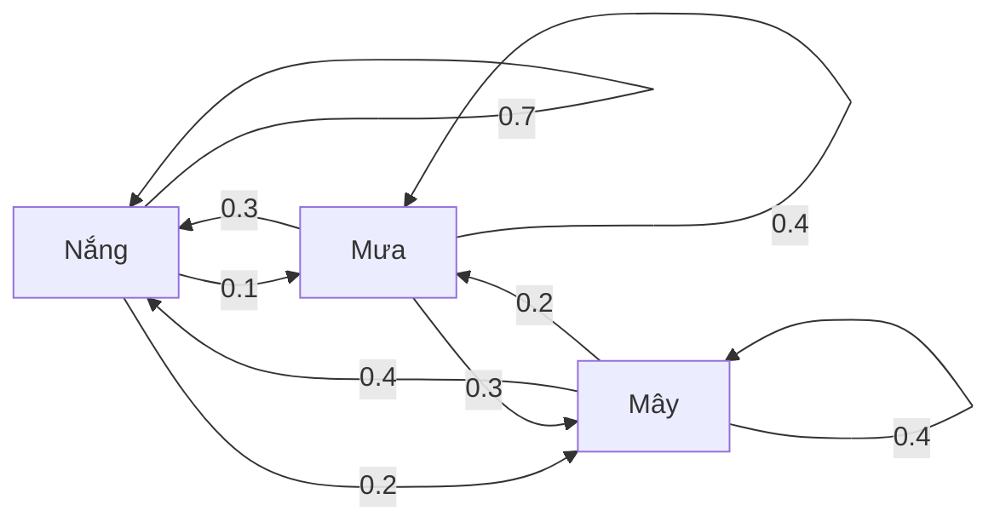
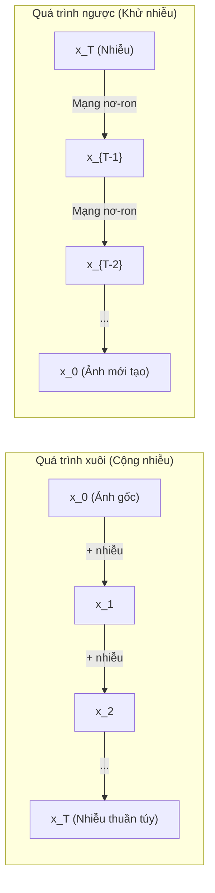

# Quá trình ngẫu nhiên (Stochastic Processes)

> Tính ngẫu nhiên có cấu trúc. Nền tảng toán học đằng sau bước đi ngẫu nhiên, chuỗi Markov, và các mô hình khuếch tán (diffusion models).

**Type:** Learn
**Language:** Python
**Prerequisites:** Phase 1, Lessons 06-07 (probability, Bayes)
**Time:** ~75 minutes

## Learning Objectives

- Mô phỏng bước đi ngẫu nhiên (random walk) 1D và 2D và kiểm chứng quy luật tỷ lệ dịch chuyển $\sqrt{n}$
- Xây dựng bộ mô phỏng chuỗi Markov và tính toán phân phối dừng thông qua phân rã trị riêng
- Cài đặt thuật toán MCMC Metropolis-Hastings và động lực học Langevin để lấy mẫu từ phân phối mục tiêu
- Kết nối quá trình khuếch tán xuôi (forward diffusion) với chuyển động Brown và giải thích cách quá trình ngược sinh ra dữ liệu mới

## The Problem (Vấn đề)

Rất nhiều hệ thống AI hiện đại liên quan đến tính ngẫu nhiên tiến hóa theo thời gian. Đây không phải là sự ngẫu nhiên tĩnh tại — mà là tính ngẫu nhiên tuần tự, có cấu trúc, nơi mỗi bước đi phụ thuộc chặt chẽ vào những gì đã xảy ra trước đó.

Các mô hình ngôn ngữ lớn (LLM) sinh từ từng token một. Mỗi token phụ thuộc vào ngữ cảnh phía trước. Mô hình dự đoán một phân phối xác suất, lấy mẫu một token, rồi tiếp tục bước tiếp theo. Đó chính là một quá trình ngẫu nhiên (stochastic process).

Các mô hình khuếch tán (Diffusion Models) thêm nhiễu vào bức ảnh từng bước một cho tới khi nó biến thành nhiễu trắng thuần túy. Sau đó, chúng đảo ngược quá trình này, khử nhiễu từng bước một để tạo ra một bức ảnh mới hoàn toàn. Quá trình xuôi là một chuỗi Markov. Quá trình ngược là một chuỗi Markov đã học chạy lùi thời gian.

Các tác tử học tăng cường (Reinforcement Learning) thực hiện hành động trong môi trường. Mỗi hành động dẫn tới một trạng thái mới với một xác suất nhất định. Tác tử tuân theo một chính sách ngẫu nhiên trong một thế giới ngẫu nhiên. Toàn bộ hệ thống đó là một quá trình quyết định Markov (MDP).

Phương pháp lấy mẫu MCMC — xương sống của suy luận Bayes — xây dựng một chuỗi Markov có phân phối dừng chính là phân phối hậu nghiệm mà bạn muốn lấy mẫu.

Tất cả các hệ thống này đều được xây dựng dựa trên bốn ý tưởng nền tảng:
1. Bước đi ngẫu nhiên (Random walks) — quá trình ngẫu nhiên đơn giản nhất
2. Chuỗi Markov (Markov chains) — tính ngẫu nhiên có cấu trúc với ma trận chuyển trạng thái
3. Động lực học Langevin (Langevin dynamics) — gradient descent kết hợp với nhiễu
4. Metropolis-Hastings — lấy mẫu từ bất kỳ phân phối xác suất nào

## The Concept (Khái niệm)

### Bước đi ngẫu nhiên (Random Walks)

Bắt đầu tại vị trí 0. Tại mỗi bước, tung một đồng xu công bằng. Mặt ngửa: bước sang phải (+1). Mặt sấp: bước sang trái (-1).

Sau $n$ bước, vị trí của bạn là tổng của $n$ giá trị ngẫu nhiên $\pm 1$. Giá trị kỳ vọng của vị trí là 0 (bước đi hoàn toàn không thiên vị). Nhưng khoảng cách kỳ vọng từ vị trí hiện tại đến gốc tọa độ lại tăng dần theo tỷ lệ $\sqrt{n}$.

Điều này thoạt nhìn có vẻ phản trực giác: Bước đi hoàn toàn công bằng, không có xu hướng lệch về phía nào. Nhưng theo thời gian, nó lại đi lang thang ngày càng xa điểm xuất phát. Độ lệch chuẩn sau $n$ bước là $\sqrt{n}$.

```
Bước 0:     Vị trí = 0
Bước 1:     Vị trí = +1 hoặc -1
Bước 2:     Vị trí = +2, 0, hoặc -2
...
Bước 100:   Khoảng cách kỳ vọng tới gốc ~ 10 (sqrt(100))
Bước 10000: Khoảng cách kỳ vọng tới gốc ~ 100 (sqrt(10000))
```

**Trong không gian 2D**, bước đi di chuyển lên, xuống, trái, hoặc phải với xác suất bằng nhau. Tỷ lệ $\sqrt{n}$ tương tự vẫn áp dụng cho khoảng cách tới gốc tọa độ. Đường đi tạo nên một hình dạng phân mảnh (fractal).

**Vì sao lại là $\sqrt{n}$?** Mỗi bước đi nhận giá trị +1 hoặc -1 với xác suất 0.5. Sau $n$ bước, vị trí $S_n = X_1 + X_2 + \cdots + X_n$, trong đó mỗi $X_i \in \lbrace -1, +1 \rbrace$. Phương sai của mỗi bước là 1, và các bước độc lập với nhau, do đó $\mathop{\mathrm{Var}}(S_n) = n$. Độ lệch chuẩn = $\sqrt{n}$. Theo định lý giới hạn trung tâm, $S_n / \sqrt{n}$ sẽ hội tụ về phân phối chuẩn tắc $\mathcal{N}(0, 1)$.

Quy luật tỷ lệ $\sqrt{n}$ này hiện diện ở khắp nơi trong ML: Nhiễu của thuật toán SGD tỷ lệ nghịch với $1/\sqrt{\text{batch\_size}}$. Số chiều embedding tăng theo $\sqrt{d}$. Căn bậc hai là "chữ ký" đặc trưng của các phép cộng ngẫu nhiên độc lập.

**Kết nối với chuyển động Brown (Brownian Motion).** Xét một bước đi ngẫu nhiên với độ dài mỗi bước là $1/\sqrt{n}$ và có $n$ bước trong mỗi đơn vị thời gian. Khi $n$ tiến tới vô cùng, bước đi này hội tụ về chuyển động Brown $B(t)$ — một quá trình ngẫu nhiên trong thời gian liên tục, nơi $B(t)$ tuân theo phân phối chuẩn với kỳ vọng 0 và phương sai $t$.

Chuyển động Brown là nền móng toán học của lý thuyết khuếch tán. Nó mô tả chuyển động hỗn loạn của các hạt trong chất lỏng, sự biến động của giá cổ phiếu, và đặc biệt là quá trình thêm nhiễu trong các mô hình khuếch tán (diffusion models).

**Bài toán kẻ cờ bạc khánh kiệt (Gambler's Ruin).** Một người đi bộ ngẫu nhiên bắt đầu từ vị trí $k$, với hai rào cản hấp thụ tại 0 và $N$. Xác suất chạm tới rào cản $N$ trước khi chạm về 0 là bao nhiêu? Với bước đi công bằng: $P(\text{chạm } N) = k/N$. Đây là một kết quả cực kỳ thanh lịch kết nối với lý thuyết Martingale (nơi giá trị kỳ vọng trong tương lai bằng chính giá trị hiện tại).

### Chuỗi Markov (Markov Chains)

Chuỗi Markov là một hệ thống chuyển đổi giữa các trạng thái theo các xác suất cố định. Tính chất mấu chốt: Trạng thái tiếp theo chỉ phụ thuộc duy nhất vào trạng thái hiện tại, hoàn toàn không phụ thuộc vào lịch sử quá khứ.

```math
P(X_{t+1} = j \mid X_t = i, X_{t-1} = \ldots) = P(X_{t+1} = j \mid X_t = i)
```

Đây chính là tính chất Markov (không nhớ). Nó cho phép bạn mô tả toàn bộ động lực học của hệ thống thông qua một ma trận chuyển trạng thái (transition matrix) $P$:

```math
P[i][j] = \text{xác suất chuyển từ trạng thái } i \text{ sang trạng thái } j
```

Tổng của mỗi hàng trong $P$ luôn bằng đúng 1 (bạn bắt buộc phải chuyển tới một trạng thái nào đó).

**Ví dụ — Mô hình thời tiết:**

```
Trạng thái: Nắng (0), Mưa (1), Nhiều mây (2)

P = [[0.7, 0.1, 0.2],    (nếu nắng: 70% nắng, 10% mưa, 20% mây)
     [0.3, 0.4, 0.3],    (nếu mưa: 30% nắng, 40% mưa, 30% mây)
     [0.4, 0.2, 0.4]]    (nếu mây: 40% nắng, 20% mưa, 40% mây)
```

Dù bạn bắt đầu ở bất kỳ trạng thái nào, sau nhiều bước chuyển đổi, phân phối trạng thái sẽ hội tụ về một phân phối dừng (stationary distribution) $\pi$, thỏa mãn: $\pi P = \pi$. Đây chính là vector riêng trái của ma trận $P$ ứng với trị riêng bằng 1.

Với chuỗi thời tiết ở trên, phân phối dừng là [0.55, 0.18, 0.27] — về lâu dài, trời nắng 55% thời gian bất kể ngày đầu tiên bạn quan sát là ngày nắng hay ngày mưa.



**Tính toán phân phối dừng.** Có hai phương pháp:
1. **Phương pháp lũy thừa (Power method):** Nhân liên tiếp một phân phối ban đầu bất kỳ với $P$. Sau một số bước đủ lớn, nó sẽ hội tụ về $\pi$.
2. **Phương pháp trị riêng:** Tìm vector riêng trái của $P$ ứng với trị riêng 1 (tương đương với vector riêng phải của $P^T$ với trị riêng 1).

**Điều kiện hội tụ.** Một chuỗi Markov chắc chắn hội tụ về một phân phối dừng duy nhất nếu nó thỏa mãn:
- **Bất khả quy (Irreducible):** Từ bất kỳ trạng thái nào cũng có thể đi tới bất kỳ trạng thái nào khác.
- **Phi chu kỳ (Aperiodic):** Chuỗi không bị lặp lại theo một chu kỳ thời gian cố định.

Hầu hết các chuỗi Markov bạn gặp trong học máy đều thỏa mãn cả hai điều kiện này.

**Trạng thái hấp thụ (Absorbing states).** Một trạng thái được gọi là hấp thụ nếu một khi đã bước vào, bạn sẽ không bao giờ rời khỏi nó ($P[i][i] = 1$). Chuỗi Markov hấp thụ mô hình hóa các quá trình có trạng thái kết thúc — trò chơi kết thúc, khách hàng hủy dịch vụ hoàn toàn, hoặc mô hình ngôn ngữ sinh ra token kết thúc văn bản `<end-of-text>`.

**Thời gian hòa trộn (Mixing time).** Cần bao nhiêu bước để chuỗi tiến "đủ gần" tới phân phối dừng? Với các chuỗi khả nghịch, khoảng cách phổ (spectral gap - hiệu số giữa 1 và độ lớn của trị riêng lớn thứ hai) kiểm soát thời gian hòa trộn. Khoảng cách phổ càng lớn, chuỗi hòa trộn càng nhanh.

### Kết nối với các mô hình ngôn ngữ (LLMs)

Quá trình sinh token trong mô hình ngôn ngữ thực chất là một quá trình Markov xấp xỉ. Dựa trên ngữ cảnh hiện tại, mô hình đưa ra một phân phối xác suất cho token tiếp theo. Tham số nhiệt độ (temperature) kiểm soát độ sắc nhọn của phân phối này:

```math
P(\text{token}_i) = \frac{\exp(\text{logit}_i / \text{temperature})}{\sum_j \exp(\text{logit}_j / \text{temperature})}
```

- Temperature = 1.0: Phân phối softmax tiêu chuẩn
- Temperature < 1.0: Phân phối sắc nhọn hơn (mang tính tất định cao hơn, ít sáng tạo hơn)
- Temperature > 1.0: Phân phối phẳng hơn (ngẫu nhiên hơn, phong phú hơn)
- Temperature $\to 0$: Trở thành phép chọn Greedy (argmax)

Lấy mẫu Top-k cắt tỉa phân phối chỉ giữ lại $k$ token có xác suất cao nhất. Lấy mẫu Top-p (nucleus sampling) giữ lại tập hợp các token có tổng xác suất tích lũy vừa vượt quá ngưỡng $p$. Cả hai kỹ thuật này đều điều chỉnh trực tiếp các xác suất chuyển trạng thái của chuỗi Markov.

### Chuyển động Brown (Brownian Motion)

Giới hạn thời gian liên tục của bước đi ngẫu nhiên. Vị trí $B(t)$ thỏa mãn ba tính chất:
1. $B(0) = 0$
2. Gia số $B(t) - B(s)$ tuân theo phân phối chuẩn với kỳ vọng 0 và phương sai $t - s$ (với $t > s$)
3. Các gia số trên các khoảng thời gian không chồng lấn là hoàn toàn độc lập

Chuyển động Brown là một hàm liên tục nhưng không khả vi ở bất kỳ điểm nào — nó rung lắc dữ dội ở mọi thang đo kích thước.

Trong mô phỏng số rời rạc, ta xấp xỉ chuyển động Brown bằng công thức:

```math
B(t + dt) = B(t) + \sqrt{dt} \, z, \quad \text{trong đó } z \sim \mathcal{N}(0, 1)
```

Thừa số tỷ lệ $\sqrt{dt}$ là cực kỳ quan trọng, bắt nguồn từ định lý giới hạn trung tâm áp dụng cho bước đi ngẫu nhiên.

### Động lực học Langevin (Langevin Dynamics)

Gradient descent tìm điểm cực tiểu của một hàm số. Động lực học Langevin tìm phân phối xác suất tỷ lệ thuận với $\exp(-U(x)/T)$, trong đó $U$ là hàm năng lượng và $T$ là nhiệt độ.

```math
x_{t+1} = x_t - dt \, \nabla U(x_t) + \sqrt{2 T \, dt} \, z_t
```

Có hai lực tác động đồng thời lên chất điểm:
1. **Lực gradient** ($-dt \cdot \nabla U$): Đẩy chất điểm về phía vùng có năng lượng thấp (tương tự Gradient Descent)
2. **Lực ngẫu nhiên** ($\sqrt{2T dt} \cdot z$): Đẩy chất điểm theo các hướng ngẫu nhiên (thúc đẩy sự khám phá - exploration)

Tại nhiệt độ $T = 0$, phương trình trở thành Gradient Descent thuần túy. Ở nhiệt độ rất cao, nó gần như là một bước đi ngẫu nhiên tự do. Ở nhiệt độ phù hợp, chất điểm sẽ lang thang khám phá toàn bộ bề mặt hàm năng lượng và dành nhiều thời gian hơn ở các vùng thung lũng có năng lượng thấp.

**Kết nối với các mô hình khuếch tán (Diffusion Models).** Quá trình khuếch tán xuôi được định nghĩa bởi:

```math
x_t = \sqrt{\alpha_t} \, x_{t-1} + \sqrt{1 - \alpha_t} \cdot \text{noise}
```

Đây là một chuỗi Markov làm mờ dần dữ liệu gốc bằng cách trộn thêm nhiễu Gauss. Sau một số bước đủ lớn, $x_T$ trở thành nhiễu Gauss thuần túy.

Quá trình ngược — đi từ nhiễu quay trở lại bức ảnh dữ liệu rõ nét — cũng là một chuỗi Markov, nhưng các xác suất chuyển trạng thái của nó được học bởi một mạng nơ-ron sâu. Mạng nơ-ron học cách dự đoán lượng nhiễu đã được cộng vào ở mỗi bước và trừ nó đi.



### MCMC: Markov Chain Monte Carlo

Đôi khi bạn cần lấy mẫu từ một phân phối xác suất phức tạp $p(x)$ mà bạn chỉ có thể tính được giá trị tỷ lệ (chưa chuẩn hóa) chứ không thể lấy mẫu trực tiếp. Phân phối hậu nghiệm trong thống kê Bayes là ví dụ điển hình — bạn biết tích của likelihood và prior, nhưng mẫu số tích phân chuẩn hóa là bất khả tính.

Thuật toán **Metropolis-Hastings** xây dựng một chuỗi Markov sao cho phân phối dừng của nó chính là phân phối $p(x)$ mục tiêu:

1. Bắt đầu tại vị trí $x$
2. Đề xuất một vị trí mới $x'$ từ một phân phối đề xuất $Q(x' \mid x)$
3. Tính tỷ số chấp nhận: $a = \frac{p(x') Q(x \mid x')}{p(x) Q(x' \mid x)}$
4. Chấp nhận $x'$ với xác suất $\min(1, a)$. Nếu từ chối, giữ nguyên vị trí tại $x$.
5. Lặp lại quá trình.

Nếu $Q$ là phân phối đối xứng (ví dụ: $Q(x' \mid x) = \mathcal{N}(x, \sigma^2)$), tỷ số đơn giản hóa thành $a = p(x') / p(x)$. Bạn chỉ cần tỷ số giữa hai xác suất — hằng số chuẩn hóa triệt tiêu hoàn toàn!

Chuỗi chắc chắn hội tụ về $p(x)$ dưới các điều kiện thông thường. Tỷ lệ chấp nhận tối ưu trong không gian nhiều chiều thường rơi vào khoảng 23% - 50%.

**Các lưu ý thực tế:**
- **Burn-in:** Bỏ qua $N$ mẫu đầu tiên để chuỗi có thời gian tiến từ điểm xuất phát ban đầu đến vùng phân phối dừng.
- **Thinning:** Chỉ giữ lại mẫu thứ $k$ một lần để giảm tính tự tương quan (autocorrelation) giữa các mẫu liên tiếp.
- **Nhiều chuỗi (Multiple chains):** Chạy nhiều chuỗi độc lập từ các điểm xuất phát khác nhau để kiểm tra sự hội tụ đồng nhất.

### Các quá trình ngẫu nhiên trong AI

| Quá trình | Ứng dụng trong AI |
|---------|---------------|
| Bước đi ngẫu nhiên | Khám phá trong RL, tạo embedding đồ thị Node2Vec |
| Chuỗi Markov | Sinh văn bản trong LLM, lấy mẫu MCMC |
| Chuyển động Brown | Quá trình khuếch tán xuôi trong Diffusion Models |
| Động lực học Langevin | Mô hình sinh dựa trên Score (SGLD), ước lượng độ bất định |
| Quá trình quyết định Markov (MDP) | Học tăng cường (Reinforcement Learning) |
| Metropolis-Hastings | Suy luận Bayes, lấy mẫu phân phối phức tạp |

```figure
random-walk-diffusion
```

## Build It (Thực hành xây dựng)

### Bước 1: Bộ mô phỏng bước đi ngẫu nhiên

```python
import numpy as np

def random_walk_1d(n_steps, seed=None):
    rng = np.random.RandomState(seed)
    steps = rng.choice([-1, 1], size=n_steps)
    positions = np.concatenate([[0], np.cumsum(steps)])
    return positions


def random_walk_2d(n_steps, seed=None):
    rng = np.random.RandomState(seed)
    directions = rng.choice(4, size=n_steps)
    dx = np.zeros(n_steps)
    dy = np.zeros(n_steps)
    dx[directions == 0] = 1   # phải
    dx[directions == 1] = -1  # trái
    dy[directions == 2] = 1   # lên
    dy[directions == 3] = -1  # xuống
    x = np.concatenate([[0], np.cumsum(dx)])
    y = np.concatenate([[0], np.cumsum(dy)])
    return x, y
```

Bước đi 1D lưu trữ tổng tích lũy. Mỗi bước là +1 hoặc -1. Phương sai tăng tuyến tính theo $n$, do đó độ lệch chuẩn tăng theo $\sqrt{n}$.

### Bước 2: Chuỗi Markov

```python
class MarkovChain:
    def __init__(self, transition_matrix, state_names=None):
        self.P = np.array(transition_matrix, dtype=float)
        self.n_states = len(self.P)
        self.state_names = state_names or [str(i) for i in range(self.n_states)]

    def step(self, current_state, rng=None):
        if rng is None:
            rng = np.random.RandomState()
        probs = self.P[current_state]
        return rng.choice(self.n_states, p=probs)

    def simulate(self, start_state, n_steps, seed=None):
        rng = np.random.RandomState(seed)
        states = [start_state]
        current = start_state
        for _ in range(n_steps):
            current = self.step(current, rng)
            states.append(current)
        return states

    def stationary_distribution(self):
        eigenvalues, eigenvectors = np.linalg.eig(self.P.T)
        idx = np.argmin(np.abs(eigenvalues - 1.0))
        stationary = np.real(eigenvectors[:, idx])
        stationary = stationary / stationary.sum()
        return np.abs(stationary)
```

Phân phối dừng là vector riêng trái của $P$ ứng với trị riêng 1. Chúng ta tìm nó bằng cách tính các vector riêng của $P^T$ (phép chuyển vị biến vector riêng trái thành vector riêng phải).

### Bước 3: Động lực học Langevin

```python
def langevin_dynamics(grad_U, x0, dt, temperature, n_steps, seed=None):
    rng = np.random.RandomState(seed)
    x = np.array(x0, dtype=float)
    trajectory = [x.copy()]
    for _ in range(n_steps):
        noise = rng.randn(*x.shape)
        x = x - dt * grad_U(x) + np.sqrt(2 * temperature * dt) * noise
        trajectory.append(x.copy())
    return np.array(trajectory)
```

Gradient kéo $x$ về vùng năng lượng thấp. Nhiễu ngẫu nhiên ngăn chất điểm không bị mắc kẹt tại điểm cực tiểu cục bộ. Tại trạng thái cân bằng nhiệt, phân phối của các mẫu tỷ lệ với $\exp(-U(x)/\text{temperature})$.

### Bước 4: Lấy mẫu Metropolis-Hastings

```python
def metropolis_hastings(target_log_prob, proposal_std, x0, n_samples, seed=None):
    rng = np.random.RandomState(seed)
    x = np.array(x0, dtype=float)
    samples = [x.copy()]
    accepted = 0
    for _ in range(n_samples - 1):
        x_proposed = x + rng.randn(*x.shape) * proposal_std
        log_ratio = target_log_prob(x_proposed) - target_log_prob(x)
        if np.log(rng.rand()) < log_ratio:
            x = x_proposed
            accepted += 1
        samples.append(x.copy())
    acceptance_rate = accepted / (n_samples - 1)
    return np.array(samples), acceptance_rate
```

Thuật toán đề xuất một điểm mới, kiểm tra xem nó có xác suất cao hơn hay không (hoặc chấp nhận theo tỷ lệ xác suất), và lặp lại. Tỷ lệ chấp nhận nên nằm trong khoảng 23-50% để đảm bảo chuỗi hòa trộn tốt.

## Use It (Ứng dụng thực tế)

Trong thực tế, bạn thường sử dụng các thư viện chuyên dụng, nhưng hiểu rõ cơ chế toán học bên dưới là điều bắt buộc để tinh chỉnh mô hình:

```python
import numpy as np

rng = np.random.RandomState(42)
walk = np.cumsum(rng.choice([-1, 1], size=10000))
print(f"Vị trí cuối cùng: {walk[-1]}")
print(f"Khoảng cách kỳ vọng: {np.sqrt(10000):.1f}")
print(f"Khoảng cách thực tế: {abs(walk[-1])}")
```

### Tính phân phối dừng với NumPy

```python
import numpy as np

P = np.array([[0.7, 0.1, 0.2],
              [0.3, 0.4, 0.3],
              [0.4, 0.2, 0.4]])

distribution = np.array([1.0, 0.0, 0.0])
for _ in range(100):
    distribution = distribution @ P

print(f"Phân phối dừng: {np.round(distribution, 4)}")
```

Nhân lặp lại phân phối ban đầu với ma trận $P$. Sau một số bước đủ lớn, nó sẽ tự động hội tụ về phân phối dừng duy nhất bất kể bạn xuất phát từ điểm nào.

### Kết nối với các framework AI thực tế

- **PyTorch Diffusion:** Lớp `DDPMScheduler` trong thư viện `diffusers` của Hugging Face cài đặt chính xác các chuỗi Markov xuôi và ngược.
- **NumPyro / PyMC:** Sử dụng thuật toán NUTS (một dạng nâng cấp mạnh mẽ của Metropolis-Hastings) để thực hiện suy luận Bayes.
- **Gymnasium (RL):** Hàm `step` của môi trường xác định một quá trình quyết định Markov (MDP).

### Kiểm tra sự hội tụ của chuỗi Markov

```python
import numpy as np

P = np.array([[0.9, 0.1], [0.3, 0.7]])

eigenvalues = np.linalg.eigvals(P)
spectral_gap = 1 - sorted(np.abs(eigenvalues))[-2]
print(f"Trị riêng: {eigenvalues}")
print(f"Khoảng cách phổ: {spectral_gap:.4f}")
print(f"Thời gian hòa trộn ước tính: {1/spectral_gap:.1f} bước")
```

Khoảng cách phổ cho biết chuỗi Markov "quên" trạng thái khởi đầu nhanh đến mức nào. Khoảng cách bằng 0.2 nghĩa là cần khoảng 5 bước để hòa trộn. Khoảng cách bằng 0.01 đòi hỏi tới 100 bước.

## Ship It (Triển khai)

Bài học này tạo ra:
- `outputs/prompt-stochastic-process-advisor.md` -- prompt chuyên gia giúp định hình khung quá trình ngẫu nhiên phù hợp cho một bài toán kỹ thuật AI

## Connections (Kết nối chuyên sâu)

| Khái niệm | Vị trí xuất hiện trong AI |
|---------|------------------|
| Random walk | Graph embedding Node2Vec, thăm dò trong RL |
| Chuỗi Markov | Sinh token trong LLM, lấy mẫu MCMC |
| Chuyển động Brown | Quá trình khuếch tán xuôi trong DDPM, mô hình SDE |
| Động lực học Langevin | Mô hình sinh dựa trên Score, SGLD |
| Phân phối dừng | Mục tiêu hội tụ của MCMC, thuật toán PageRank |
| Metropolis-Hastings | Lấy mẫu phân phối hậu nghiệm Bayes, Simulated Annealing |
| Nhiệt độ (Temperature) | Điều chỉnh lấy mẫu LLM, Boltzmann exploration trong RL |
| Mixing time | Tốc độ hội tụ của thuật toán MCMC |
| Trạng thái hấp thụ | Token kết thúc câu `<eos>`, trạng thái kết thúc trong game |
| Cân bằng chi tiết | Bảo đảm toán học cho tính đúng đắn của bộ lấy mẫu MCMC |

Các mô hình khuếch tán (DDPM - Ho et al., 2020) định nghĩa chuỗi Markov xuôi:

```math
q(x_t \mid x_{t-1}) = \mathcal{N}\left(x_t; \sqrt{1-\beta_t} \, x_{t-1}, \beta_t I\right)
```

trong đó $\beta_t$ là lịch trình nhiễu. Sau $T$ bước, $x_T \approx \mathcal{N}(0, I)$. Quá trình ngược được tham số hóa bằng một mạng nơ-ron học cách dự đoán nhiễu:

```math
p_\theta(x_{t-1} \mid x_t) = \mathcal{N}\left(x_{t-1}; \mu_\theta(x_t, t), \sigma_t^2 I\right)
```

Mỗi bước tạo ảnh là một bước đi trong một chuỗi Markov đã học. Hiểu rõ chuỗi Markov chính là chìa khóa thấu suốt cách thức hoạt động của các mô hình sinh ảnh tiên tiến nhất hiện nay.

Thuật toán SGLD (Stochastic Gradient Langevin Dynamics) kết hợp mini-batch SGD với nhiễu Langevin. Thay vì tính toàn bộ gradient trên toàn bộ tập dữ liệu, bạn dùng ước lượng stochastic và bổ sung một lượng nhiễu đã hiệu chuẩn. Khi learning rate giảm dần, SGLD chuyển dịch nhịp nhàng từ quá trình tối ưu hóa sang quá trình lấy mẫu — bạn nhận được các mẫu phân phối hậu nghiệm Bayes gần như miễn phí để ước lượng độ bất định (uncertainty) của mạng nơ-ron.

## Exercises (Bài tập)

1. **Mô phỏng 1000 bước đi ngẫu nhiên 10.000 bước.** Vẽ biểu đồ phân phối vị trí cuối cùng của các bước đi. Xác minh rằng phân phối này xấp xỉ phân phối Gauss với kỳ vọng 0 và độ lệch chuẩn $\sqrt{10000} = 100$.

2. **Xây dựng bộ sinh văn bản bằng chuỗi Markov.** Huấn luyện trên một đoạn văn bản ngắn: với mỗi từ, đếm số lần chuyển tiếp tới từ tiếp theo. Xây dựng ma trận chuyển trạng thái. Sinh các câu mới bằng cách lấy mẫu tuần tự từ chuỗi.

3. **Cài đặt thuật toán tôi luyện thép (Simulated Annealing)** sử dụng nguyên lý Metropolis-Hastings. Bắt đầu ở nhiệt độ cao (chấp nhận hầu như mọi bước đi) và làm nguội dần dần (chỉ chấp nhận các bước cải thiện). Dùng nó để tìm cực tiểu toàn cục của một hàm số có rất nhiều cực tiểu cục bộ.

4. **So sánh động lực học Langevin ở các nhiệt độ khác nhau.** Lấy mẫu từ hàm thế hai thung lũng (double-well potential) $U(x) = (x^2 - 1)^2$. Ở nhiệt độ thấp, các mẫu tập trung ở một thung lũng. Ở nhiệt độ cao, chúng tràn qua cả hai bên. Tìm nhiệt độ tới hạn nơi chuỗi bắt đầu nhảy qua lại giữa hai thung lũng một cách mượt mà.

5. **Cài đặt quá trình khuếch tán xuôi (Forward Diffusion).** Bắt đầu với tín hiệu 1D (ví dụ: sóng hình sin). Thêm nhiễu lũy tiến qua 100 bước với lịch trình tuyến tính. Quan sát tín hiệu thoái hóa dần thành nhiễu trắng thuần túy. Sau đó cài đặt một bộ khử nhiễu đơn giản để đảo ngược quá trình.

### Gợi ý (Hints)

**Bài tập 1.** Gọi `random_walk_1d(10000, seed=i)` với 1000 seed ngẫu nhiên và lưu lại vị trí cuối cùng của mỗi lần chạy. Kiểm tra xem giá trị trung bình có xấp xỉ 0, độ lệch chuẩn có xấp xỉ 100, và khoảng 68% số vị trí cuối cùng có nằm trong khoảng $[-100, 100]$ hay không.

**Bài tập 2.** Đếm số cặp từ xuất hiện liên tiếp, sau đó chia mỗi hàng cho tổng của nó để tổng mỗi hàng bằng 1. Truyền ma trận này vào `MarkovChain(transition_matrix, state_names)` và gọi hàm `simulate`. Kiểm tra xem mọi cặp từ trong văn bản sinh ra có xuất hiện trong tập văn bản gốc hay không.

**Bài tập 3.** Chấp nhận một điểm tồi hơn với xác suất $\exp(-\Delta / T)$ và nhân $T$ với hệ số làm nguội ví dụ $0.99$ sau mỗi bước. Thử nghiệm trên một hàm số đã biết trước nghiệm cực tiểu để kiểm tra độ chính xác so với tìm kiếm trên lưới.

**Bài tập 4.** Gradient của hàm thế là $4x(x^2 - 1)$, truyền đạo hàm này vào `langevin_dynamics(grad_U, x0, dt, temperature, n_steps)`. Rào cản thế tại $x = 0$ có độ cao bằng 1, do đó hãy đếm tần suất đổi dấu của $x$ với các nhiệt độ từ $0.05$ đến $1.0$ để tìm điểm bùng nổ tần suất.

**Bài tập 5.** Gọi `diffusion_forward(signal, 100)` và tính $\bar{\alpha}$ tại bước cuối cùng dưới dạng tích của $(1 - \beta_t)$. Nếu $\bar{\alpha}$ chưa đủ gần 0, tín hiệu chưa hoàn toàn thành nhiễu trắng, hãy nâng giá trị `beta_end`. Kiểm tra bộ khử nhiễu trước tiên với lượng nhiễu thực: khi đó $(x_t - \sqrt{1 - \bar{\alpha}_t} \epsilon)/\sqrt{\bar{\alpha}_t}$ phải khôi phục lại tín hiệu gốc chính xác tuyệt đối.

## Key Terms (Thuật ngữ chính)

| Thuật ngữ | Cách nói thông thường | Bản chất kỹ thuật |
|------|----------------|----------------------|
| Random walk | "Bước đi tung đồng xu" | Quá trình mà vị trí thay đổi theo các gia số ngẫu nhiên tại mỗi bước |
| Markov property | "Không nhớ quá khứ" | Tương lai chỉ phụ thuộc vào trạng thái hiện tại, không phụ thuộc lịch sử |
| Transition matrix | "Bảng xác suất chuyển" | $P[i][j]$ = xác suất chuyển từ trạng thái $i$ sang trạng thái $j$ |
| Stationary distribution | "Tỷ lệ dài hạn" | Phân phối $\pi$ thỏa mãn $\pi P = \pi$ — trạng thái cân bằng của chuỗi |
| Brownian motion | "Rung lắc ngẫu nhiên" | Giới hạn thời gian liên tục của bước đi ngẫu nhiên, $B(t) \sim \mathcal{N}(0, t)$ |
| Langevin dynamics | "Gradient descent có nhiễu" | Quy tắc cập nhật kết hợp giữa gradient tất định và nhiễu ngẫu nhiên |
| MCMC | "Bước đi tới mục tiêu" | Kỹ thuật xây dựng chuỗi Markov có phân phối dừng là phân phối cần lấy mẫu |
| Metropolis-Hastings | "Đề xuất và chấp nhận/từ chối" | Thuật toán MCMC dùng tỷ số chấp nhận để bảo đảm sự hội tụ chuẩn xác |
| Temperature (Nhiệt độ) | "Núm điều chỉnh ngẫu nhiên" | Tham số kiểm soát sự cân bằng giữa khám phá (exploration) và khai thác (exploitation) |
| Diffusion process | "Thêm nhiễu và khử nhiễu" | Quá trình xuôi thêm nhiễu dần dần, quá trình ngược khử nhiễu để sinh dữ liệu |

## Further Reading (Tài liệu đọc thêm)

- **Ho, Jain, Abbeel (2020)** -- "Denoising Diffusion Probabilistic Models." Bài báo DDPM mở màn cho cuộc cách mạng mô hình khuếch tán trong AI, suy diễn toán học mẫu mực về chuỗi Markov xuôi và ngược.
- **Song & Ermon (2019)** -- "Generative Modeling by Estimating Gradients of the Data Distribution." Hướng tiếp cận mô hình sinh dựa trên Score sử dụng động lực học Langevin để lấy mẫu.
- **Roberts & Rosenthal (2004)** -- "General state space Markov chains and MCMC algorithms." Lý thuyết nền tảng giải thích vì sao và khi nào MCMC hội tụ.
- **Norris (1997)** -- "Markov Chains." Giáo trình kinh điển chuẩn mực về chuỗi Markov, phân phối dừng và thời gian hòa trộn.
- **Welling & Teh (2011)** -- "Bayesian Learning via Stochastic Gradient Langevin Dynamics." Kết hợp SGD với động lực học Langevin để suy luận Bayes quy mô lớn.
