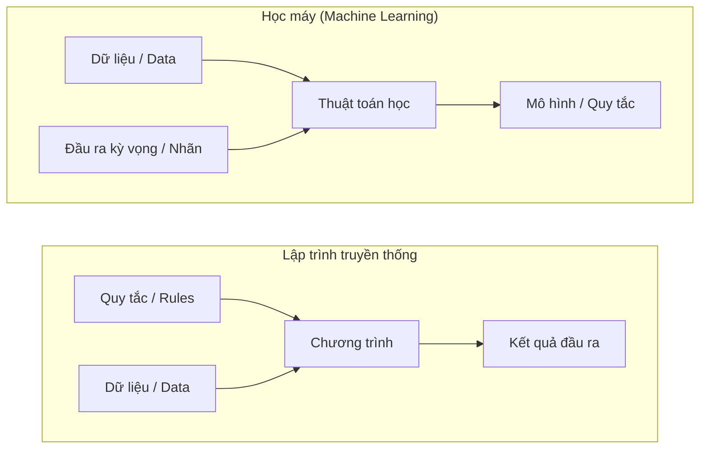
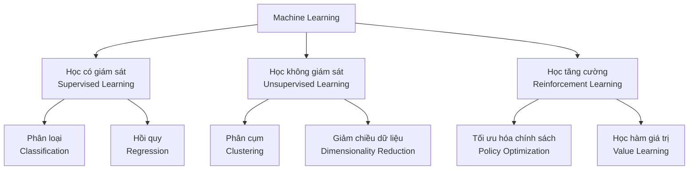
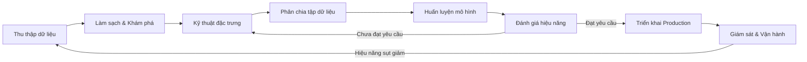
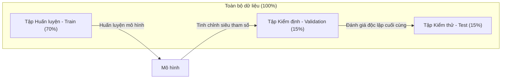
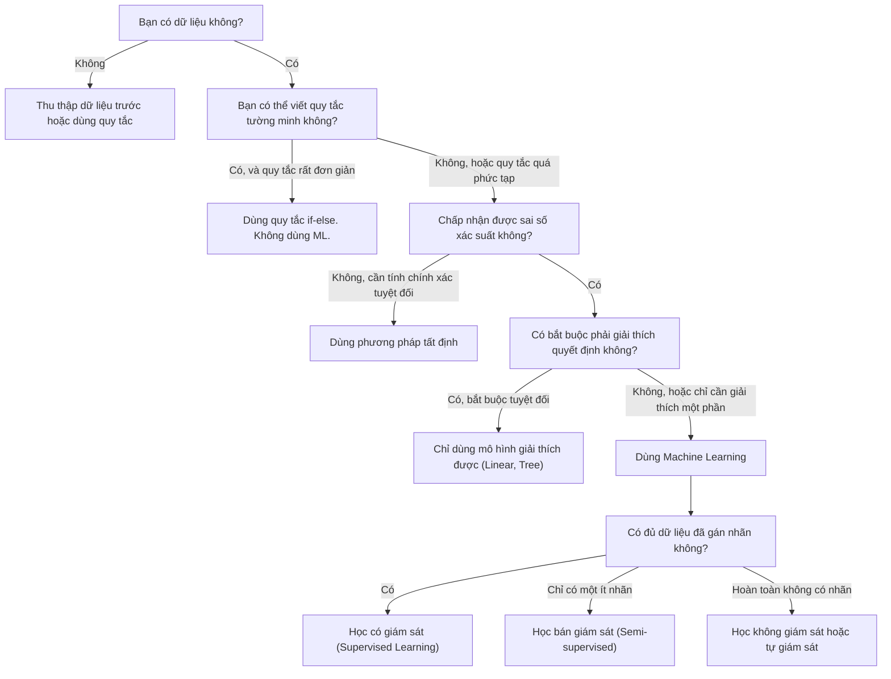

# Học máy là gì? (What Is Machine Learning)

> Học máy là việc dạy cho máy tính tìm ra các mẫu hình quy luật trong dữ liệu thay vì phải viết luật thủ công bằng tay.

**Type:** Learn
**Languages:** Python
**Prerequisites:** Phase 1 (Math Foundations)
**Time:** ~45 minutes

## Learning Objectives

- Phân biệt sự khác biệt giữa học có giám sát (supervised), học không giám sát (unsupervised), và học tăng cường (reinforcement learning), đồng thời xác định dạng học nào áp dụng cho một bài toán cụ thể
- Tự cài đặt bộ phân loại Nearest Centroid từ đầu và đánh giá hiệu năng so với baseline ngẫu nhiên
- Phân biệt giữa bài toán phân loại (classification) và bài toán hồi quy (regression), lựa chọn hàm mất mát (loss function) phù hợp cho từng loại
- Đánh giá xem một bài toán thực tế có nên giải bằng học máy hay giải tốt hơn bằng các quy tắc tất định

## The Problem (Vấn đề)

Bạn muốn xây dựng một bộ lọc thư rác (spam filter). Cách tiếp cận truyền thống: ngồi xuống và viết hàng trăm quy tắc thủ công: "Nếu email chứa từ 'TIỀN MIỄN PHÍ', hãy đánh dấu là spam. Nếu có nhiều hơn 3 dấu chấm than, hãy đánh dấu là spam." Bạn dành nhiều tuần để viết luật. Sau đó, những kẻ gửi thư rác thay đổi cách dùng từ. Toàn bộ quy tắc của bạn bị phá vỡ. Bạn lại phải viết thêm quy tắc mới. Vòng lặp này không bao giờ có hồi kết.

Học máy đảo ngược hoàn toàn quy trình này. Thay vì tự tay viết luật, bạn cung cấp cho máy tính hàng nghìn email đã được gán nhãn ("spam" hoặc "không phải spam") và để thuật toán tự động tìm ra các quy tắc ẩn giấu. Máy tính sẽ phát hiện ra những mẫu hình tinh vi mà bạn thậm chí chưa từng nghĩ tới. Khi kẻ gửi thư rác đổi chiêu thức, bạn chỉ cần huấn luyện lại mô hình trên dữ liệu mới thay vì phải viết lại toàn bộ mã nguồn.

Sự chuyển dịch từ "lập trình quy tắc" sang "học từ dữ liệu" chính là trái tim của học máy. Mọi công cụ gợi ý nội dung, trợ lý ảo giọng nói, xe tự lái và mô hình ngôn ngữ lớn hiện nay đều vận hành theo nguyên lý này.

## The Concept (Khái niệm)

### Học từ dữ liệu, không phải từ quy tắc

Lập trình truyền thống và học máy giải quyết vấn đề theo hai chiều hoàn toàn trái ngược nhau:



Lập trình truyền thống: Bạn viết quy tắc. Chương trình áp dụng quy tắc đó lên dữ liệu để sinh ra đầu ra.

Học máy: Bạn cung cấp dữ liệu và đầu ra mong muốn. Thuật toán tự động khám phá ra các quy tắc.

"Mô hình" (model) thu được sau quá trình huấn luyện CHÍNH LÀ tập hợp các quy tắc, được mã hóa dưới dạng các con số (trọng số, tham số). Nó tổng quát hóa từ các ví dụ đã thấy để đưa ra dự đoán chính xác trên dữ liệu hoàn toàn mới chưa từng gặp.

### Ba trụ cột chính của Machine Learning



**Học có giám sát (Supervised Learning)**: Bạn có sẵn các cặp dữ liệu vào-ra (input-output). Mô hình học cách ánh xạ từ đầu vào sang đầu ra.
- "Đây là 10.000 bức ảnh được gán nhãn mèo hoặc chó. Hãy học cách phân biệt chúng."
- "Đây là các đặc trưng của ngôi nhà và giá bán tương ứng. Hãy học cách dự đoán giá nhà."

**Học không giám sát (Unsupervised Learning)**: Bạn chỉ có dữ liệu đầu vào. Hoàn toàn không có nhãn. Mô hình tự động tìm ra cấu trúc ẩn bên trong dữ liệu.
- "Đây là lịch sử mua sắm của 10.000 khách hàng. Hãy tìm ra các nhóm khách hàng tự nhiên."
- "Đây là các điểm dữ liệu 1.000 chiều. Hãy giảm xuống 2 chiều nhưng vẫn bảo toàn cấu trúc dữ liệu."

**Học tăng cường (Reinforcement Learning)**: Một tác tử (agent) thực hiện các hành động trong môi trường và nhận về phần thưởng (reward) hoặc hình phạt (penalty). Tác tử học một chiến lược (policy) để tối đa hóa tổng phần thưởng tích lũy.
- "Chơi trò chơi này: Thắng được +1, thua bị -1. Hãy tự tìm ra chiến lược tối ưu."
- "Điều khiển cánh tay robot: Nhặt được vật thể được +1, lãng phí mỗi giây bị -0.01."

Hầu hết các bài toán thực tế bạn xây dựng đều dựa trên học có giám sát. Học không giám sát rất phổ biến trong bước tiền xử lý và khám phá dữ liệu. Học tăng cường là động lực cho AI chơi game, điều khiển robot và phương pháp căn chỉnh RLHF trong các mô hình ngôn ngữ lớn.

### Vượt ra ngoài ba trụ cột truyền thống

Ba phân loại trên rất rành mạch, nhưng trong thực tế ranh giới này thường giao thoa với nhau:

**Học bán giám sát (Semi-supervised learning)** sử dụng một lượng nhỏ dữ liệu có nhãn kết hợp với một lượng khổng lồ dữ liệu không nhãn (ví dụ: 100 ảnh y tế có bác sĩ dán nhãn và 100.000 ảnh thô). Các kỹ thuật tiêu biểu:
- **Lan truyền nhãn (Label propagation):** Xây dựng đồ thị liên kết các điểm dữ liệu tương tự. Nhãn lan từ các nút có nhãn sang các nút láng giềng chưa có nhãn.
- **Tự gán nhãn giả (Pseudo-labeling):** Huấn luyện mô hình trên dữ liệu có nhãn, dùng nó để dự đoán nhãn cho dữ liệu chưa gán nhãn, rồi gộp lại huấn luyện tiếp.
- **Điều chuẩn tính nhất quán (Consistency regularization):** Mô hình phải đưa ra cùng một kết quả dự đoán cho một mẫu đầu vào và một phiên bản bị nhiễu nhẹ của mẫu đó.

**Học tự giám sát (Self-supervised learning)** tự động tạo tín hiệu giám sát từ chính cấu trúc nội tại của dữ liệu mà không cần con người gán nhãn:
- **Masked language modeling (BERT):** Che đi 15% số từ trong câu, huấn luyện mô hình dự đoán từ bị thiếu. Nhãn chính là từ gốc trong văn bản.
- **Học tương phản (Contrastive learning - SimCLR):** Lấy một bức ảnh, tạo ra hai phiên bản biến đổi (crop, xoay). Huấn luyện mô hình nhận ra chúng xuất phát từ cùng một bức ảnh gốc.
- **Dự đoán token tiếp theo (Next-token prediction - GPT):** Dự đoán từ tiếp theo dựa trên tất cả các từ đứng trước. Mỗi tài liệu văn bản tự trở thành một tập dữ liệu huấn luyện hoàn chỉnh.

### Phân loại vs Hồi quy (Classification vs Regression)

Đây là hai nhiệm vụ trọng tâm của học có giám sát:

| Tiêu chí | Phân loại (Classification) | Hồi quy (Regression) |
|---|---|---|
| Đầu ra | Danh mục rời rạc | Giá trị số liên tục |
| Ví dụ | "Email này có phải spam không?" | "Ngôi nhà này có giá bao nhiêu?" |
| Không gian đầu ra | {mèo, chó, chim} | Bất kỳ số thực nào |
| Hàm mất mát | Cross-entropy, Accuracy | Mean Squared Error (MSE), MAE |
| Quyết định | Ranh giới phân chia giữa các lớp | Một đường cong khớp với dữ liệu |

Phân loại trả lời câu hỏi "Thuộc danh mục nào?". Hồi quy trả lời câu hỏi "Bao nhiêu?".

Một số bài toán có thể được thiết lập theo cả hai cách: Dự đoán giá cổ phiếu ngày mai tăng hay giảm là bài toán phân loại. Dự đoán chính xác mức giá đóng cửa là bài toán hồi quy.

### Quy trình kỹ thuật học máy (The ML Workflow)

Mọi dự án học máy đều tuân theo quy trình chuẩn khép kín sau:



**Thu thập dữ liệu (Collect Data)**: Thu thập dữ liệu thô. Nhiều dữ liệu hơn thường tốt hơn, nhưng chất lượng dữ liệu luôn quan trọng hơn số lượng.

**Làm sạch & Khám phá (Clean & Explore)**: Xử lý giá trị bị thiếu, loại bỏ trùng lặp, trực quan hóa phân phối, phát hiện điểm bất thường. Bước này thường chiếm 60–80% tổng thời gian dự án.

**Kỹ thuật đặc trưng (Feature Engineering)**: Biến đổi dữ liệu thô thành các đặc trưng mà mô hình có thể hiểu được: Chuyển ngày tháng thành ngày trong tuần, chuẩn hóa các cột số, mã hóa biến phân loại. Đặc trưng tốt quan trọng hơn thuật toán phức tạp.

**Phân chia dữ liệu (Split Data)**: Chia thành các tập Train, Validation và Test. Mô hình học từ tập Train, bạn tinh chỉnh siêu tham số trên tập Validation, và báo cáo kết quả cuối cùng trên tập Test.

**Huấn luyện mô hình (Train Model)**: Nạp dữ liệu Train vào thuật toán. Thuật toán tinh chỉnh các tham số nội tại để tối thiểu hóa hàm mất mát.

**Đánh giá (Evaluate)**: Đo lường hiệu năng trên tập Validation và Test. Nếu chưa đạt, quay lại thử nghiệm các đặc trưng, thuật toán hoặc siêu tham số khác.

**Triển khai (Deploy)**: Đưa mô hình lên hệ thống thực tế để phục vụ dự đoán thời gian thực hoặc dự đoán hàng loạt.

**Giám sát (Monitor)**: Theo dõi chất lượng mô hình theo thời gian. Phân phối dữ liệu trong thực tế luôn biến đổi (data drift), khiến mô hình bị suy thoái. Khi hiệu năng tụt giảm, cần cập nhật và huấn luyện lại.

### Phân chia Train, Validation, và Test

Đây là khái niệm quan trọng nhất mà người mới bắt đầu hay mắc sai lầm: Bạn BẮT BUỘC phải đánh giá mô hình trên dữ liệu mà nó CHƯA TỪNG THẤY trong lúc huấn luyện. Nếu không, bạn chỉ đang đo khả năng học vẹt (ghi nhớ), chứ không phải khả năng học hỏi và tổng quát hóa.



| Tập | Mục đích | Thời điểm sử dụng | Tỷ lệ phổ biến |
|---|---|---|---|
| Train | Mô hình học hỏi các trọng số từ tập này | Trong suốt quá trình huấn luyện | 60–80% |
| Validation | Tinh chỉnh siêu tham số, so sánh các mô hình | Sau mỗi đợt huấn luyện | 10–20% |
| Test | Ước lượng hiệu năng khách quan cuối cùng | Đúng một lần duy nhất ở bước kết thúc | 10–20% |

Tập Test là "bất khả xâm phạm". Bạn chỉ được mở ra kiểm tra đúng một lần duy nhất. Nếu bạn liên tục điều chỉnh mô hình dựa trên kết quả kiểm tra của tập Test, bạn thực chất đã vô tình biến tập Test thành tập huấn luyện, và con số báo cáo sẽ hoàn toàn mất đi tính trung thực.

Với các tập dữ liệu nhỏ, hãy dùng phương pháp kiểm định chéo $k$-fold (k-fold cross-validation): Chia dữ liệu thành $k$ phần bằng nhau, huấn luyện trên $k-1$ phần, đánh giá trên 1 phần còn lại, hoán đổi liên tục $k$ lần rồi lấy điểm trung bình.

### Quá khớp (Overfitting) vs Thiếu khớp (Underfitting)

```mermaid
flowchart LR
    subgraph UF["Thiếu khớp (Underfitting)"]
        U1["Mô hình quá đơn giản"]
        U2["Độ chệch cao (High bias)"]
        U3["Bỏ lỡ các quy luật thực"]
    end

    subgraph GF["Khớp tối ưu (Good Fit)"]
        G1["Độ phức tạp vừa đủ"]
        G2["Cân bằng hoàn hảo"]
        G3["Khả năng tổng quát hóa cao"]
    end

    subgraph OF["Quá khớp (Overfitting)"]
        O1["Mô hình quá phức tạp"]
        O2["Phương sai cao (High variance)"]
        O3["Ghi nhớ cả nhiễu ngẫu nhiên"]
    end

    UF -->|Tăng độ phức tạp| GF
    GF -->|Độ phức tạp quá mức| OF
```



**Thiếu khớp (Underfitting)**: Mô hình quá đơn giản, không học nổi các mẫu hình trong dữ liệu. Ví dụ: Dùng một đường thẳng tuyến tính để khớp với một mối quan hệ hình parabol uốn cong. Sai số trên tập Train cao, sai số trên tập Test cũng cao.

**Quá khớp (Overfitting)**: Mô hình quá phức tạp và ghi nhớ toàn bộ dữ liệu huấn luyện, bao gồm cả các nhiễu ngẫu nhiên. Ví dụ: Một đường cong ngoằn ngoèo đi qua chính xác từng điểm huấn luyện nhưng dự đoán sai lệch hoàn toàn khi gặp dữ liệu mới. Sai số trên tập Train rất thấp, nhưng sai số trên tập Test lại rất cao.

**Khớp tối ưu (Good fit)**: Mô hình nắm bắt được các quy luật bản chất thực sự mà không học vẹt nhiễu. Sai số trên cả tập Train và Test đều thấp một cách hợp lý.

Dấu hiệu nhận biết quá khớp:
- Độ chính xác trên tập Train cao hơn nhiều so với tập Validation
- Mô hình chạy rất tốt trên dữ liệu cũ nhưng dự đoán rất kém trên dữ liệu mới
- Bổ sung thêm dữ liệu huấn luyện giúp cải thiện rõ rệt kết quả

Cách khắc phục quá khớp:
- Thu thập thêm dữ liệu huấn luyện
- Giảm độ phức tạp của mô hình (ít tham số hơn, giảm độ sâu của cây)
- Áp dụng kỹ thuật điều chuẩn (Regularization - phạt các trọng số quá lớn)
- Dropout (ngắt ngẫu nhiên một số nơ-ron trong quá trình huấn luyện)
- Dừng sớm (Early stopping - ngừng huấn luyện ngay khi lỗi validation bắt đầu tăng lên)

Cách khắc phục thiếu khớp:
- Sử dụng mô hình phức tạp hơn, biểu đạt mạnh hơn
- Thêm các đặc trưng (features) mới có ý nghĩa
- Giảm mức độ điều chuẩn
- Huấn luyện lâu hơn (tăng số epoch)

### Sự đánh đổi Độ chệch - Phương sai (The Bias-Variance Tradeoff)

Đây là khung lý thuyết toán học nền tảng giải thích nguyên nhân sâu xa của quá khớp và thiếu khớp:

**Độ chệch (Bias)**: Sai số phát sinh do các giả định quá ngây thơ của mô hình. Mô hình tuyến tính có độ chệch cao khi quy luật thực tế là phi tuyến. Độ chệch cao dẫn đến hiện tượng thiếu khớp (underfitting).

**Phương sai (Variance)**: Sai số phát sinh do mô hình quá nhạy cảm với những biến động ngẫu nhiên nhỏ trong dữ liệu huấn luyện. Mô hình có phương sai cao sẽ cho ra các dự đoán hoàn toàn khác biệt khi được huấn luyện trên các tập con dữ liệu khác nhau. Phương sai cao dẫn đến hiện tượng quá khớp (overfitting).

| Độ phức tạp mô hình | Độ chệch (Bias) | Phương sai (Variance) | Kết quả |
|---|---|---|---|
| Quá thấp (mô hình tuyến tính cho dữ liệu cong) | Cao | Thấp | Thiếu khớp (Underfitting) |
| Vừa vặn tối ưu | Vừa phải | Vừa phải | Tổng quát hóa tốt (Good generalization) |
| Quá cao (đa thức bậc 20 cho 10 điểm dữ liệu) | Thấp | Cao | Quá khớp (Overfitting) |

```math
\text{Tổng sai số} = \text{Bias}^2 + \text{Variance} + \text{Nhiễu bất khả quy (Irreducible noise)}
```

Bạn không thể triệt tiêu nhiễu bất khả quy (đó là tính ngẫu nhiên tự nhiên của thế giới thực). Mục tiêu của kỹ sư AI là tìm ra điểm cân bằng tối ưu ("sweet spot"), nơi mà tổng $\text{Bias}^2 + \text{Variance}$ đạt giá trị nhỏ nhất.

### Định lý Bữa trưa Miễn phí không Tồn tại (No Free Lunch Theorem)

Không có bất kỳ một thuật toán duy nhất nào hoạt động tốt nhất cho mọi bài toán. Một thuật toán vượt trội trên lớp bài toán này chắc chắn sẽ thể hiện kém cỏi trên lớp bài toán khác. Đó là lý do các kỹ sư dữ liệu luôn phải thử nghiệm nhiều thuật toán và so sánh hiệu năng thực tế.

Trong thực tiễn, việc lựa chọn mô hình phụ thuộc vào:
- Bạn có bao nhiêu mẫu dữ liệu
- Dữ liệu có bao nhiêu chiều đặc trưng
- Mối quan hệ mang tính tuyến tính hay phi tuyến tính
- Bạn có cần khả năng giải thích quyết định của mô hình (interpretability) hay không
- Giới hạn về tài nguyên tính toán và độ trễ phản hồi (latency)

### Khi nào KHÔNG NÊN dùng Machine Learning

Machine Learning rất mạnh mẽ nhưng không phải lúc nào cũng là giải pháp đúng đắn. Trước khi bắt tay xây dựng mô hình, hãy tự hỏi liệu bạn có thực sự cần đến nó hay không.

**Không nên dùng ML khi:**

- **Các quy tắc rất đơn giản và đã được xác định rõ ràng:** Tính thuế thu nhập, thuật toán sắp xếp, chuyển đổi đơn vị đo lường. Nếu bạn có thể viết logic bằng vài câu lệnh if-else, việc thêm một mô hình học máy chỉ làm tăng độ phức tạp mà không đem lại lợi ích gì.
- **Bạn không có dữ liệu hoặc có quá ít dữ liệu:** Học máy bắt buộc phải có dữ liệu để học hỏi. Với 10 dòng dữ liệu, bạn không thể huấn luyện được bất kỳ thứ gì có ý nghĩa. Hãy thu thập dữ liệu trước.
- **Cái giá của sai sót là thảm họa và bạn cần sự chính xác tuyệt đối:** Tính liều lượng thuốc xạ trị, điều khiển lò phản ứng hạt nhân, xác thực mã hóa bảo mật. Mô hình học máy mang tính xác suất — chúng chắc chắn sẽ có lúc dự đoán sai. Nếu một sai sót nhỏ là không thể chấp nhận được, hãy sử dụng các phương pháp tất định (deterministic).
- **Một bảng tra cứu (lookup table) hoặc một công thức kinh nghiệm đã giải quyết xong bài toán:** Nếu một ngưỡng đơn giản đã đáp ứng được 99% trường hợp, việc đưa mô hình ML vào chỉ làm đội chi phí bảo trì hệ thống.
- **Bạn không thể giải thích được quyết định nhưng luật pháp bắt buộc phải giải thích:** Các ngành chịu sự giám sát chặt chẽ như ngân hàng (cho vay tín dụng), bảo hiểm, y tế, tòa án đòi hỏi mọi quyết định phải được diễn giải minh bạch. Nhiều mô hình học sâu là "hộp đen" rất khó giải thích.
- **Môi trường bài toán thay đổi nhanh hơn tốc độ huấn luyện lại:** Nếu quy luật thay đổi theo từng ngày trong khi việc huấn luyện lại mất cả tuần, mô hình của bạn sẽ luôn luôn bị lỗi thời.

Lưu đồ quyết định:



```figure
f3-learning-boundary
```

## Build It (Thực hành xây dựng)

Mã nguồn trong `code/ml_intro.py` tự cài đặt bộ phân loại Nearest Centroid từ đầu — thuật toán ML đơn giản nhất có thể. Nó thể hiện trực quan tư tưởng cốt lõi: học biểu diễn từ dữ liệu, rồi dự đoán trên dữ liệu mới.

### Bước 1: Cài đặt Nearest Centroid Classifier từ đầu

Bộ phân loại Nearest Centroid tính toán điểm trung tâm (tâm cụm - mean) của từng lớp trong dữ liệu huấn luyện. Để dự đoán, nó gán điểm mới vào lớp có tâm cụm gần nhất.

```python
class NearestCentroid:
    def fit(self, X, y):
        self.classes = np.unique(y)
        self.centroids = np.array([
            X[y == c].mean(axis=0) for c in self.classes
        ])

    def predict(self, X):
        distances = np.array([
            np.sqrt(((X - c) ** 2).sum(axis=1))
            for c in self.centroids
        ])
        return self.classes[distances.argmin(axis=0)]
```

Đó là toàn bộ thuật toán! Bước `fit` tính trung bình của các lớp. Bước `predict` tính khoảng cách Euclid. Không cần Gradient Descent, không cần vòng lặp lặp lại, không có siêu tham số phức tạp.

### Bước 2: Huấn luyện trên dữ liệu mô phỏng

Tạo một tập dữ liệu phân loại 2D với 2 lớp có độ chồng lấn nhẹ. Bộ phân loại sẽ vẽ ra một ranh giới quyết định tuyến tính phân tách giữa hai tâm cụm:

```python
rng = np.random.RandomState(42)
X_class0 = rng.randn(100, 2) + np.array([1.0, 1.0])
X_class1 = rng.randn(100, 2) + np.array([-1.0, -1.0])
X = np.vstack([X_class0, X_class1])
y = np.array([0] * 100 + [1] * 100)
```

### Bước 3: So sánh với Baseline ngẫu nhiên

Mọi mô hình ML đều phải được đối chiếu với một baseline đơn giản. Ở đây, baseline dự đoán ngẫu nhiên một lớp. Nếu mô hình của bạn không đánh bại được phép đoán mò ngẫu nhiên, hệ thống của bạn chắc chắn đang gặp sự cố nghiêm trọng.

```python
baseline_preds = rng.choice([0, 1], size=len(y_test))
baseline_acc = np.mean(baseline_preds == y_test)
```

Bộ phân loại Centroid đạt độ chính xác khoảng 90%+ trên tập dữ liệu này, trong khi baseline ngẫu nhiên chỉ đạt khoảng 50%.

### Vì sao điều này quan trọng?

Bộ phân loại Nearest Centroid tuy cực kỳ đơn giản, nhưng nó nắm bắt trọn vẹn mẫu hình nền tảng của mọi hệ thống ML:

1. **Học (Learn):** Rút trích một biểu diễn tri thức từ dữ liệu huấn luyện (các tâm cụm)
2. **Dự đoán (Predict):** Áp dụng biểu diễn đó lên dữ liệu mới chưa từng thấy (tìm khoảng cách gần nhất)
3. **Đánh giá (Evaluate):** So sánh hiệu năng thực tế với một mốc chuẩn tham chiếu (baseline)

Mọi thuật toán học máy từ Hồi quy Logistic đến kiến trúc Transformer đều tuân thủ chính xác chu trình 3 bước này. Chỉ có biểu diễn tri thức là trở nên sâu sắc và phức tạp hơn, còn bản chất quy trình làm việc thì hoàn toàn giữ nguyên.

### Bước 4: Những giới hạn của thuật toán Centroid

Bộ phân loại Nearest Centroid giả định mỗi lớp tạo thành một đám mây hình cầu duy nhất. Nó chỉ vẽ được các ranh giới tuyến tính phẳng và sẽ thất bại khi:
- Một lớp gồm nhiều cụm rời rạc (ví dụ: chữ số "1" có thể viết thẳng đứng hoặc có dấu gạch chéo)
- Ranh giới quyết định mang tính phi tuyến (ví dụ: một lớp bao bọc quanh lớp kia)
- Các đặc trưng có thang đo chênh lệch nhau quá lớn (khoảng cách bị chi phối hoàn toàn bởi đặc trưng có giá trị lớn nhất)

Những hạn chế này chính là động lực thôi thúc sự ra đời của toàn bộ các thuật toán tiếp theo mà bạn sẽ học: K-nearest neighbors giải quyết bài toán đa cụm. Decision Trees giải quyết ranh giới phi tuyến. Feature scaling giải quyết vấn đề chênh lệch thang đo. Mỗi bài học sau sẽ khắc phục giới hạn của bài học trước.

## Use It (Ứng dụng thực tế)

Thư viện Scikit-learn cung cấp sẵn `NearestCentroid` cùng các bộ tạo dữ liệu thử nghiệm:

```python
from sklearn.neighbors import NearestCentroid
from sklearn.datasets import make_classification
from sklearn.model_selection import train_test_split

X, y = make_classification(
    n_samples=500, n_features=2, n_redundant=0,
    n_clusters_per_class=1, random_state=42
)
X_train, X_test, y_train, y_test = train_test_split(X, y, test_size=0.3)

clf = NearestCentroid()
clf.fit(X_train, y_train)
print(f"Độ chính xác (Accuracy): {clf.score(X_test, y_test):.3f}")
```

## Ship It (Triển khai)

Bài học này tạo ra artifact `outputs/prompt-ml-problem-framer.md` -- một prompt chuyên gia giúp chuyển đổi các yêu cầu kinh doanh mơ hồ thành các bài toán ML cụ thể. Bạn đưa vào mô tả nghiệp vụ (ví dụ: "chúng tôi muốn giảm tỷ lệ khách hàng rời bỏ" hoặc "dự báo nhu cầu hàng hóa quý tới"), prompt sẽ giúp xác định dạng bài toán (classification/regression), định nghĩa biến mục tiêu, liệt kê đặc trưng tiềm năng, chọn metric đo lường phù hợp, thiết lập baseline và cảnh báo các bẫy rò rỉ dữ liệu (data leakage).

## Key Terms (Thuật ngữ chính)

| Thuật ngữ | Cách nói thông thường | Bản chất kỹ thuật |
|------|----------------|----------------------|
| Model (Mô hình) | "Hệ thống AI" | Hàm toán học có các tham số có thể học được để ánh xạ từ đầu vào sang đầu ra |
| Training (Huấn luyện) | "Dạy AI" | Chạy thuật toán tối ưu để tinh chỉnh tham số mô hình sao cho dự đoán khớp với nhãn |
| Feature (Đặc trưng) | "Cột đầu vào" | Một thuộc tính đo lường được của dữ liệu mà mô hình dùng để đưa ra dự đoán |
| Label (Nhãn) | "Đáp án đúng" | Đầu ra đã biết của một mẫu dữ liệu dùng để tính toán tín hiệu sai số khi học |
| Hyperparameter (Siêu tham số) | "Cài đặt tinh chỉnh" | Tham số do kỹ sư thiết lập trước khi huấn luyện để kiểm soát quá trình học (learning rate, độ sâu cây) |
| Loss function (Hàm mất mát) | "Mức độ sai lệch" | Hàm số đo lường khoảng cách giữa kết quả dự đoán và nhãn thực tế mà quá trình huấn luyện cần tối thiểu hóa |
| Overfitting (Quá khớp) | "Học vẹt đề thi" | Mô hình học thuộc lòng cả các nhiễu ngẫu nhiên trong tập huấn luyện nên dự đoán kém trên dữ liệu mới |
| Underfitting (Thiếu khớp) | "Chưa học được gì" | Mô hình quá đơn giản, không nắm bắt nổi các quy luật thực sự trong dữ liệu |
| Generalization (Tổng quát hóa) | "Dùng tốt cho dữ liệu mới" | Khả năng đưa ra dự đoán chính xác của mô hình trên các dữ liệu chưa từng gặp |
| Cross-validation (Kiểm định chéo) | "Kiểm tra xoay vòng" | Phương pháp chia dữ liệu thành nhiều phần để huấn luyện và kiểm định luân phiên, cho đánh giá đáng tin cậy |
| Regularization (Điều chuẩn) | "Hạn chế trọng số quá lớn" | Kỹ thuật cộng thêm số hạng phạt vào hàm mất mát để ngăn mô hình trở nên quá phức tạp |
| Data drift (Trôi dạt dữ liệu) | "Thế giới đã đổi thay" | Phân phối thống kê của dữ liệu thực tế thay đổi theo thời gian, làm suy giảm chất lượng mô hình |

## Exercises (Bài tập)

1. Lấy một tập dữ liệu bất kỳ (ví dụ: Iris hoặc Titanic). Chia tập dữ liệu theo tỷ lệ 70/15/15 thành train/validation/test. Giải thích cặn kẽ vì sao bạn không bao giờ được phép tinh chỉnh siêu tham số trên tập test.
2. Liệt kê ba bài toán thực tế trong doanh nghiệp. Với mỗi bài toán, hãy xác định nó thuộc dạng phân loại (classification), hồi quy (regression), hay phân cụm (clustering), và nó là học có giám sát hay không giám sát.
3. Một mô hình đạt độ chính xác 99% trên tập train nhưng chỉ đạt 60% trên tập test. Hãy chẩn đoán nguyên nhân và đề xuất ba giải pháp cụ thể để khắc phục.

## Further Reading (Tài liệu đọc thêm)

- [An Introduction to Statistical Learning (ISLR)](https://www.statlearning.com/) - Giáo trình kinh điển miễn phí về các phương pháp học máy cổ điển với các ví dụ thực tiễn
- [Google's Machine Learning Crash Course](https://developers.google.com/machine-learning/crash-course) - Khóa học nhập môn trực quan và súc tích của Google về các khái niệm ML
- [Scikit-learn User Guide](https://scikit-learn.org/stable/user_guide.html) - Cẩm nang tra cứu thực tiễn toàn diện về cài đặt các thuật toán học máy trong Python
