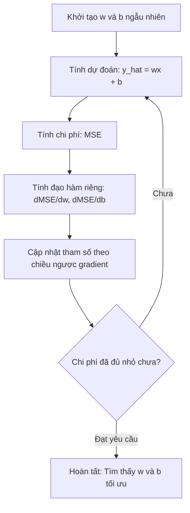

# Hồi quy tuyến tính (Linear Regression)

> Hồi quy tuyến tính vẽ ra đường thẳng phù hợp nhất đi qua các điểm dữ liệu của bạn. Nó chính là chương trình "Hello World" của thế giới Machine Learning.

**Type:** Build
**Languages:** Python
**Prerequisites:** Phase 1 (Linear Algebra, Calculus, Optimization), Phase 2 Lesson 1
**Time:** ~90 minutes

## Learning Objectives

- Suy diễn quy tắc cập nhật của Gradient Descent cho sai số bình phương trung bình (MSE) và tự cài đặt thuật toán hồi quy tuyến tính từ đầu
- So sánh thuật toán Gradient Descent và phương trình pháp tuyến (Normal Equation) về độ phức tạp tính toán và thời điểm nên sử dụng từng phương pháp
- Xây dựng mô hình hồi quy tuyến tính đa biến với kỹ thuật chuẩn hóa đặc trưng (standardization) và diễn giải các trọng số đã học
- Giải thích cách hồi quy Ridge (điều chuẩn L2) ngăn ngừa hiện tượng quá khớp (overfitting) bằng cách phạt các trọng số có độ lớn cao

## The Problem (Vấn đề)

Bạn có tập dữ liệu: diện tích nhà và giá bán tương ứng. Bạn muốn dự đoán giá của một ngôi nhà mới khi biết diện tích của nó. Bạn có thể ước lượng bằng mắt trên biểu đồ phân tán (scatter plot), nhưng bạn cần một công thức toán học chính xác. Bạn cần một đường thẳng khớp nhất với dữ liệu để có thể đưa vào bất kỳ diện tích nào và nhận lại mức giá dự đoán tương ứng.

Hồi quy tuyến tính mang lại cho bạn đường thẳng đó. Quan trọng hơn, nó giới thiệu trọn vẹn chu trình huấn luyện cốt lõi của Machine Learning: định nghĩa mô hình, định nghĩa hàm chi phí (cost function), và tối ưu hóa các tham số. Mọi thuật toán học máy từ đơn giản đến phức tạp đều tuân theo chính xác mẫu hình này. Làm chủ nó ở đây trong trường hợp đơn giản nhất, bạn sẽ nhận diện được nó ở khắp mọi nơi.

Hồi quy tuyến tính không chỉ dành cho các bài toán đồ chơi. Nó đang được vận hành trong các hệ thống sản xuất thực tế để dự báo nhu cầu thị trường, phân tích kết quả thử nghiệm A/B, lập mô hình tài chính, và đóng vai trò làm mốc chuẩn (baseline) bắt buộc cho mọi bài toán hồi quy.

## The Concept (Khái niệm)

### Mô hình (The Model)

Hồi quy tuyến tính giả định mối quan hệ tuyến tính thẳng hàng giữa đầu vào ($x$) và đầu ra ($y$):

```math
y = wx + b
```

- `w` (trọng số / độ dốc - weight/slope): giá trị $y$ thay đổi bao nhiêu khi $x$ tăng thêm 1 đơn vị
- `b` (độ lệch / hệ số tự do - bias/intercept): giá trị của $y$ khi $x = 0$

Đối với bài toán có nhiều đặc trưng đầu vào (hồi quy đa biến), mô hình mở rộng thành:

```math
y = w_1 x_1 + w_2 x_2 + \cdots + w_n x_n + b
```

Hoặc viết gọn dưới dạng vector: $y = w^T x + b$.

Mục tiêu tối thượng: Tìm ra các giá trị $w$ và $b$ sao cho giá trị dự đoán $\hat{y}$ gần sát nhất có thể với giá trị thực tế $y$ trên toàn bộ các mẫu huấn luyện.

### Hàm chi phí (Mean Squared Error - MSE)

Làm thế nào để định lượng mức độ "gần sát nhất có thể"? Bạn cần một con số duy nhất đo lường mức độ sai lệch của các dự đoán. Thước đo phổ biến nhất là Sai số bình phương trung bình (Mean Squared Error - MSE):

```math
\text{MSE} = \frac{1}{n} \sum (y_{\text{dự đoán}} - y_{\text{thực tế}})^2
```

Vì sao lại dùng bình phương? Có hai lý do then chốt:
1. Nó phạt các sai số lớn nặng nề hơn nhiều so với sai số nhỏ (sai số bằng 10 sẽ bị phạt nặng gấp 100 lần sai số bằng 1, chứ không phải gấp 10 lần).
2. Hàm bình phương là một hàm trơn và khả vi tại mọi điểm, giúp việc tối ưu hóa đạo hàm diễn ra vô cùng thuận lợi.

Hàm chi phí tạo nên một bề mặt hình học. Với một trọng số $w$ và một hệ số tự do $b$, bề mặt hàm MSE có hình một cái bát úp (mặt paraboloid lồi). Điểm đáy của cái bát chính là nơi sai số MSE đạt cực tiểu. Quá trình huấn luyện chính là hành trình tìm đường đi tới đáy cái bát đó.

### Thuật toán Gradient Descent

Gradient Descent tìm đáy của cái bát bằng cách lần bước đi xuống dốc theo hướng dốc nhất:



Gradient cung cấp cho bạn hai thông tin cốt tử: hướng cần di chuyển tham số, và biên độ di chuyển lớn hay nhỏ.

Với hàm MSE và mô hình $\hat{y} = wx + b$:

```math
\begin{aligned}
\frac{\partial \text{MSE}}{\partial w} &= \frac{2}{n} \sum (\hat{y} - y) \, x \\
\frac{\partial \text{MSE}}{\partial b} &= \frac{2}{n} \sum (\hat{y} - y)
\end{aligned}
```

Quy tắc cập nhật trọng số:

```math
\begin{aligned}
w &= w - \text{learning\_rate} \cdot \frac{\partial \text{MSE}}{\partial w} \\
b &= b - \text{learning\_rate} \cdot \frac{\partial \text{MSE}}{\partial b}
\end{aligned}
```

Tốc độ học (learning rate) kiểm soát độ dài bước nhảy. Nếu quá lớn, bạn sẽ nhảy vọt qua đáy và phân kỳ. Nếu quá nhỏ, mô hình sẽ mất hàng giờ để bò tới đích. Giá trị khởi đầu điển hình thường là 0.01, 0.001 hoặc 0.0001.

### Phương trình pháp tuyến (Normal Equation - Nghiệm đóng)

Riêng đối với bài toán hồi quy tuyến tính, tồn tại một công thức đại số trực tiếp cho phép tính ra ngay nghiệm tối ưu mà không cần trải qua bất kỳ vòng lặp nào:

```math
w = (X^T X)^{-1} X^T y
```

Phương trình này tính nghịch đảo ma trận để tìm ra $w$ chỉ trong đúng một bước tính. Nó hoạt động hoàn hảo cho các tập dữ liệu vừa và nhỏ. Với các tập dữ liệu khổng lồ (hàng triệu dòng hoặc hàng chục nghìn đặc trưng), Gradient Descent được ưu tiên hơn vì phép nghịch đảo ma trận có độ phức tạp tới $O(d^3)$ theo số lượng đặc trưng $d$.

### Hồi quy tuyến tính đa biến (Multiple Linear Regression)

Khi có nhiều đặc trưng, mô hình trở thành:

```math
y = w_1 x_1 + w_2 x_2 + \cdots + w_n x_n + b
```

Mọi thứ đều vận hành tương tự: MSE vẫn là hàm chi phí, Gradient Descent cập nhật đồng thời tất cả các trọng số. Điểm khác biệt duy nhất là bạn đang khớp một siêu phẳng (hyperplane) nhiều chiều thay vì một đường thẳng 2D.

Chuẩn hóa đặc trưng (Feature Scaling) ở đây là bắt buộc: Nếu một đặc trưng dao động từ 0 đến 1 còn đặc trưng khác dao động từ 0 đến 1.000.000, bề mặt hàm chi phí sẽ bị kéo giãn thành một khe núi hẹp khiến Gradient Descent dao động ngoằn ngoèo rất chậm. Hãy chuẩn hóa đặc trưng (trừ đi giá trị trung bình, chia cho độ lệch chuẩn) trước khi nạp vào huấn luyện.

### Hồi quy đa thức (Polynomial Regression)

Nếu mối quan hệ trong dữ liệu không phải là đường thẳng thì sao? Bạn vẫn có thể sử dụng hồi quy tuyến tính bằng cách tạo ra các đặc trưng đa thức:

```math
y = w_1 x + w_2 x^2 + w_3 x^3 + b
```

Đây VẪN LÀ hồi quy "tuyến tính" vì mô hình mang tính tuyến tính đối với các trọng số ($w_1, w_2, w_3$). Bạn chỉ đang sử dụng các đặc trưng phi tuyến của biến $x$.

Đa thức bậc càng cao có thể khớp được các đường cong càng phức tạp, nhưng lại tiềm ẩn nguy cơ quá khớp rất lớn. Đa thức bậc 10 sẽ đi qua hoàn hảo 10 điểm dữ liệu trong tập train nhưng sẽ dự đoán sai lệch thảm hại khi gặp điểm dữ liệu mới.

### Hệ số xác định R-Squared ($R^2$)

MSE cho bạn biết độ lớn của sai số, nhưng con số đó phụ thuộc vào đơn vị đo của $y$. Hệ số $R^2$ cung cấp một thang đo không phụ thuộc vào đơn vị:

```math
\begin{aligned}
R^2 &= 1 - \frac{\text{tổng bình phương sai số}}{\text{tổng bình phương độ lệch so với trung bình}} \\
&= 1 - \frac{SS_{\text{res}}}{SS_{\text{tot}}}
\end{aligned}
```

- $R^2 = 1.0$: Mô hình dự đoán chính xác tuyệt đối không tì vết
- $R^2 = 0.0$: Mô hình không tốt hơn việc luôn dự đoán giá trị trung bình của $y$
- $R^2 < 0.0$: Mô hình thậm chí còn tệ hơn cả phép đoán giá trị trung bình

### Giới thiệu về Điều chuẩn (Hồi quy Ridge)

Khi có rất nhiều đặc trưng, mô hình rất dễ bị quá khớp do gán các trọng số quá lớn. Hồi quy Ridge (điều chuẩn L2) cộng thêm một số hạng phạt độ lớn trọng số vào hàm mất mát:

```math
\text{Cost} = \text{MSE} + \lambda \sum w_i^2
```

Số hạng phạt này ngăn cản các trọng số tăng quá mức. Siêu tham số $\lambda$ kiểm soát sự đánh đổi: $\lambda$ càng lớn, các trọng số càng bị co về gần 0 và mô hình càng được điều chuẩn mạnh mẽ hơn.

```figure
linear-regression-fit
```

## Build It (Thực hành xây dựng)

### Bước 1: Tạo dữ liệu mẫu

```python
import random
import math

random.seed(42)

TRUE_W = 3.0
TRUE_B = 7.0
N_SAMPLES = 100

X = [random.uniform(0, 10) for _ in range(N_SAMPLES)]
y = [TRUE_W * x + TRUE_B + random.gauss(0, 2.0) for x in X]

print(f"Đã tạo {N_SAMPLES} mẫu dữ liệu")
print(f"Mối quan hệ thực: y = {TRUE_W}x + {TRUE_B} (+ nhiễu)")
print(f"5 điểm đầu tiên: {[(round(X[i], 2), round(y[i], 2)) for i in range(5)]}")
```

### Bước 2: Hồi quy tuyến tính từ đầu với Gradient Descent

```python
class LinearRegression:
    def __init__(self, learning_rate=0.01):
        self.w = 0.0
        self.b = 0.0
        self.lr = learning_rate
        self.cost_history = []

    def predict(self, X):
        return [self.w * x + self.b for x in X]

    def compute_cost(self, X, y):
        predictions = self.predict(X)
        n = len(y)
        cost = sum((pred - actual) ** 2 for pred, actual in zip(predictions, y)) / n
        return cost

    def compute_gradients(self, X, y):
        predictions = self.predict(X)
        n = len(y)
        dw = (2 / n) * sum((pred - actual) * x for pred, actual, x in zip(predictions, y, X))
        db = (2 / n) * sum(pred - actual for pred, actual in zip(predictions, y))
        return dw, db

    def fit(self, X, y, epochs=1000, print_every=200):
        for epoch in range(epochs):
            dw, db = self.compute_gradients(X, y)
            self.w -= self.lr * dw
            self.b -= self.lr * db
            cost = self.compute_cost(X, y)
            self.cost_history.append(cost)
            if epoch % print_every == 0:
                print(f"  Epoch {epoch:4d} | Cost: {cost:.4f} | w: {self.w:.4f} | b: {self.b:.4f}")
        return self

    def r_squared(self, X, y):
        predictions = self.predict(X)
        y_mean = sum(y) / len(y)
        ss_res = sum((actual - pred) ** 2 for actual, pred in zip(y, predictions))
        ss_tot = sum((actual - y_mean) ** 2 for actual in y)
        return 1 - (ss_res / ss_tot)


print("=== Huấn luyện Hồi quy tuyến tính (Gradient Descent) ===")
model = LinearRegression(learning_rate=0.005)
model.fit(X, y, epochs=1000, print_every=200)
print(f"\nHọc được: y = {model.w:.4f}x + {model.b:.4f}")
print(f"Thực tế:  y = {TRUE_W}x + {TRUE_B}")
print(f"R-squared: {model.r_squared(X, y):.4f}")
```

### Bước 3: Phương trình pháp tuyến (Nghiệm đóng)

```python
class LinearRegressionNormal:
    def __init__(self):
        self.w = 0.0
        self.b = 0.0

    def fit(self, X, y):
        n = len(X)
        x_mean = sum(X) / n
        y_mean = sum(y) / n
        numerator = sum((X[i] - x_mean) * (y[i] - y_mean) for i in range(n))
        denominator = sum((X[i] - x_mean) ** 2 for i in range(n))
        self.w = numerator / denominator
        self.b = y_mean - self.w * x_mean
        return self

    def predict(self, X):
        return [self.w * x + self.b for x in X]

    def r_squared(self, X, y):
        predictions = self.predict(X)
        y_mean = sum(y) / len(y)
        ss_res = sum((actual - pred) ** 2 for actual, pred in zip(y, predictions))
        ss_tot = sum((actual - y_mean) ** 2 for actual in y)
        return 1 - (ss_res / ss_tot)


print("\n=== Phương trình pháp tuyến (Normal Equation) ===")
model_normal = LinearRegressionNormal()
model_normal.fit(X, y)
print(f"Học được: y = {model_normal.w:.4f}x + {model_normal.b:.4f}")
print(f"R-squared: {model_normal.r_squared(X, y):.4f}")
```

### Bước 4: Hồi quy tuyến tính đa biến

```python
class MultipleLinearRegression:
    def __init__(self, n_features, learning_rate=0.01):
        self.weights = [0.0] * n_features
        self.bias = 0.0
        self.lr = learning_rate
        self.cost_history = []

    def predict_single(self, x):
        return sum(w * xi for w, xi in zip(self.weights, x)) + self.bias

    def predict(self, X):
        return [self.predict_single(x) for x in X]

    def compute_cost(self, X, y):
        predictions = self.predict(X)
        n = len(y)
        return sum((pred - actual) ** 2 for pred, actual in zip(predictions, y)) / n

    def fit(self, X, y, epochs=1000, print_every=200):
        n = len(y)
        n_features = len(X[0])
        for epoch in range(epochs):
            predictions = self.predict(X)
            errors = [pred - actual for pred, actual in zip(predictions, y)]
            for j in range(n_features):
                grad = (2 / n) * sum(errors[i] * X[i][j] for i in range(n))
                self.weights[j] -= self.lr * grad
            grad_b = (2 / n) * sum(errors)
            self.bias -= self.lr * grad_b
            cost = self.compute_cost(X, y)
            self.cost_history.append(cost)
            if epoch % print_every == 0:
                print(f"  Epoch {epoch:4d} | Cost: {cost:.4f}")
        return self

    def r_squared(self, X, y):
        predictions = self.predict(X)
        y_mean = sum(y) / len(y)
        ss_res = sum((actual - pred) ** 2 for actual, pred in zip(y, predictions))
        ss_tot = sum((actual - y_mean) ** 2 for actual in y)
        return 1 - (ss_res / ss_tot)


random.seed(42)
N = 100
X_multi = []
y_multi = []
for _ in range(N):
    size = random.uniform(500, 3000)
    bedrooms = random.randint(1, 5)
    age = random.uniform(0, 50)
    price = 50 * size + 10000 * bedrooms - 1000 * age + 50000 + random.gauss(0, 20000)
    X_multi.append([size, bedrooms, age])
    y_multi.append(price)


def standardize(X):
    n_features = len(X[0])
    means = [sum(X[i][j] for i in range(len(X))) / len(X) for j in range(n_features)]
    stds = []
    for j in range(n_features):
        variance = sum((X[i][j] - means[j]) ** 2 for i in range(len(X))) / len(X)
        stds.append(variance ** 0.5)
    X_scaled = []
    for i in range(len(X)):
        row = [(X[i][j] - means[j]) / stds[j] if stds[j] > 0 else 0 for j in range(n_features)]
        X_scaled.append(row)
    return X_scaled, means, stds


y_mean_val = sum(y_multi) / len(y_multi)
y_std_val = (sum((yi - y_mean_val) ** 2 for yi in y_multi) / len(y_multi)) ** 0.5
y_scaled = [(yi - y_mean_val) / y_std_val for yi in y_multi]

X_scaled, x_means, x_stds = standardize(X_multi)

print("\n=== Hồi quy tuyến tính đa biến (3 đặc trưng) ===")
print("Đặc trưng: diện tích nhà, số phòng ngủ, số năm tuổi")
multi_model = MultipleLinearRegression(n_features=3, learning_rate=0.01)
multi_model.fit(X_scaled, y_scaled, epochs=1000, print_every=200)

print(f"\nTrọng số (đã chuẩn hóa): {[round(w, 4) for w in multi_model.weights]}")
print(f"Độ lệch b (đã chuẩn hóa): {multi_model.bias:.4f}")
print(f"R-squared: {multi_model.r_squared(X_scaled, y_scaled):.4f}")
```

### Bước 5: Hồi quy đa thức (Polynomial Regression)

```python
class PolynomialRegression:
    def __init__(self, degree, learning_rate=0.01):
        self.degree = degree
        self.weights = [0.0] * degree
        self.bias = 0.0
        self.lr = learning_rate

    def make_features(self, X):
        return [[x ** (d + 1) for d in range(self.degree)] for x in X]

    def predict(self, X):
        features = self.make_features(X)
        return [sum(w * f for w, f in zip(self.weights, row)) + self.bias for row in features]

    def fit(self, X, y, epochs=1000, print_every=200):
        features = self.make_features(X)
        n = len(y)
        for epoch in range(epochs):
            predictions = [sum(w * f for w, f in zip(self.weights, row)) + self.bias for row in features]
            errors = [pred - actual for pred, actual in zip(predictions, y)]
            for j in range(self.degree):
                grad = (2 / n) * sum(errors[i] * features[i][j] for i in range(n))
                self.weights[j] -= self.lr * grad
            grad_b = (2 / n) * sum(errors)
            self.bias -= self.lr * grad_b
            if epoch % print_every == 0:
                cost = sum(e ** 2 for e in errors) / n
                print(f"  Epoch {epoch:4d} | Cost: {cost:.6f}")
        return self

    def r_squared(self, X, y):
        predictions = self.predict(X)
        y_mean = sum(y) / len(y)
        ss_res = sum((actual - pred) ** 2 for actual, pred in zip(y, predictions))
        ss_tot = sum((actual - y_mean) ** 2 for actual in y)
        return 1 - (ss_res / ss_tot)


random.seed(42)
X_poly = [x / 10.0 for x in range(0, 50)]
y_poly = [0.5 * x ** 2 - 2 * x + 3 + random.gauss(0, 1.0) for x in X_poly]

x_max = max(abs(x) for x in X_poly)
X_poly_norm = [x / x_max for x in X_poly]
y_poly_mean = sum(y_poly) / len(y_poly)
y_poly_std = (sum((yi - y_poly_mean) ** 2 for yi in y_poly) / len(y_poly)) ** 0.5
y_poly_norm = [(yi - y_poly_mean) / y_poly_std for yi in y_poly]

print("\n=== Hồi quy đa thức (Bậc 2 vs Bậc 5) ===")
print("Quan hệ thực: y = 0.5x^2 - 2x + 3")

print("\nBậc 2:")
poly2 = PolynomialRegression(degree=2, learning_rate=0.1)
poly2.fit(X_poly_norm, y_poly_norm, epochs=2000, print_every=500)
print(f"  R-squared: {poly2.r_squared(X_poly_norm, y_poly_norm):.4f}")

print("\nBậc 5:")
poly5 = PolynomialRegression(degree=5, learning_rate=0.1)
poly5.fit(X_poly_norm, y_poly_norm, epochs=2000, print_every=500)
print(f"  R-squared: {poly5.r_squared(X_poly_norm, y_poly_norm):.4f}")
```

Đa thức bậc 2 khớp hoàn hảo với đường cong thực tế. Đa thức bậc 5 khớp trên tập train tốt hơn một chút nhưng có nguy cơ rất cao bị quá khớp khi gặp dữ liệu mới.

### Bước 6: Hồi quy Ridge (Điều chuẩn L2)

```python
class RidgeRegression:
    def __init__(self, n_features, learning_rate=0.01, alpha=1.0):
        self.weights = [0.0] * n_features
        self.bias = 0.0
        self.lr = learning_rate
        self.alpha = alpha

    def predict_single(self, x):
        return sum(w * xi for w, xi in zip(self.weights, x)) + self.bias

    def predict(self, X):
        return [self.predict_single(x) for x in X]

    def fit(self, X, y, epochs=1000, print_every=200):
        n = len(y)
        n_features = len(X[0])
        for epoch in range(epochs):
            predictions = self.predict(X)
            errors = [pred - actual for pred, actual in zip(predictions, y)]
            mse = sum(e ** 2 for e in errors) / n
            reg_term = self.alpha * sum(w ** 2 for w in self.weights)
            cost = mse + reg_term
            for j in range(n_features):
                grad = (2 / n) * sum(errors[i] * X[i][j] for i in range(n))
                grad += 2 * self.alpha * self.weights[j]
                self.weights[j] -= self.lr * grad
            grad_b = (2 / n) * sum(errors)
            self.bias -= self.lr * grad_b
            if epoch % print_every == 0:
                print(f"  Epoch {epoch:4d} | Cost: {cost:.4f} | Phạt L2: {reg_term:.4f}")
        return self


print("\n=== Hồi quy Ridge (Điều chuẩn L2) ===")
ridge = RidgeRegression(n_features=3, learning_rate=0.01, alpha=0.1)
ridge.fit(X_scaled, y_scaled, epochs=1000, print_every=200)
print(f"\nTrọng số Ridge: {[round(w, 4) for w in ridge.weights]}")
print(f"Trọng số gốc:  {[round(w, 4) for w in multi_model.weights]}")
```

Các trọng số trong hồi quy Ridge nhỏ hơn rõ rệt (được co về gần 0) nhờ số hạng phạt L2.

## Use It (Ứng dụng thực tế)

Trong môi trường thực tế, hãy sử dụng thư viện `scikit-learn` đã được tối ưu hóa bằng C:

```python
from sklearn.linear_model import LinearRegression as SklearnLR
from sklearn.linear_model import Ridge
from sklearn.preprocessing import PolynomialFeatures, StandardScaler
from sklearn.model_selection import train_test_split
from sklearn.metrics import mean_squared_error, r2_score
import numpy as np

np.random.seed(42)
X_sk = np.random.uniform(0, 10, (100, 1))
y_sk = 3.0 * X_sk.squeeze() + 7.0 + np.random.normal(0, 2.0, 100)

X_train, X_test, y_train, y_test = train_test_split(X_sk, y_sk, test_size=0.2, random_state=42)

lr = SklearnLR()
lr.fit(X_train, y_train)
y_pred = lr.predict(X_test)

print("=== Scikit-learn Linear Regression ===")
print(f"Hệ số góc (w): {lr.coef_[0]:.4f}")
print(f"Hệ số tự do (b): {lr.intercept_:.4f}")
print(f"R-squared (test): {r2_score(y_test, y_pred):.4f}")
print(f"MSE (test): {mean_squared_error(y_test, y_pred):.4f}")

poly = PolynomialFeatures(degree=2, include_bias=False)
X_poly_sk = poly.fit_transform(X_train)
X_poly_test = poly.transform(X_test)

lr_poly = SklearnLR()
lr_poly.fit(X_poly_sk, y_train)
print(f"\nPolynomial bậc 2 R-squared: {r2_score(y_test, lr_poly.predict(X_poly_test)):.4f}")

scaler = StandardScaler()
X_train_scaled = scaler.fit_transform(X_train)
X_test_scaled = scaler.transform(X_test)

ridge = Ridge(alpha=1.0)
ridge.fit(X_train_scaled, y_train)
print(f"Ridge R-squared: {r2_score(y_test, ridge.predict(X_test_scaled)):.4f}")
print(f"Hệ số Ridge: {ridge.coef_[0]:.4f}")
```

Bản cài đặt từ đầu và thư viện `scikit-learn` cho kết quả hoàn toàn trùng khớp. Bản thư viện xử lý tốt các trường hợp biên và tối ưu hiệu năng cho hệ thống lớn.

## Ship It (Triển khai)

Bài học này tạo ra artifact:
- `outputs/skill-regression.md` - cẩm nang hướng dẫn lựa chọn phương pháp hồi quy chuẩn xác cho từng dạng bài toán

## Key Terms (Thuật ngữ chính)

| Thuật ngữ | Cách nói thông thường | Bản chất kỹ thuật |
|------|----------------|----------------------|
| Linear regression | "Vẽ đường thẳng qua dữ liệu" | Tìm trọng số $w$ và độ lệch $b$ tối thiểu hóa tổng bình phương sai lệch giữa $wx+b$ và $y$ thực tế |
| Cost function | "Độ tệ của mô hình" | Hàm toán học đo lường sai số dự đoán mà quá trình tối ưu hóa cần cực tiểu hóa |
| Mean squared error (MSE) | "Trung bình bình phương sai số" | $\frac{1}{n} \sum (\text{dự đoán} - \text{thực tế})^2$, phạt nặng các sai số lớn |
| Gradient descent | "Đi xuống dốc" | Thuật toán lặp điều chỉnh tham số theo hướng làm giảm hàm chi phí nhờ đạo hàm riêng |
| Learning rate | "Độ dài bước nhảy" | Hệ số vô hướng kiểm soát mức độ thay đổi của tham số sau mỗi bước cập nhật |
| Normal equation | "Nghiệm đóng trực tiếp" | Công thức đại số $w = (X^T X)^{-1} X^T y$ tìm ngay trọng số tối ưu mà không cần lặp |
| R-squared | "Độ khớp của mô hình" | Tỷ lệ phương sai của $y$ được giải thích bởi mô hình, nằm trong khoảng từ âm vô cùng tới 1.0 |
| Feature scaling | "Đưa đặc trưng về cùng thang đo" | Biến đổi đặc trưng về cùng phạm vi (ví dụ: mean 0, variance 1) để Gradient Descent hội tụ nhanh |
| Regularization (Điều chuẩn) | "Phạt độ phức tạp" | Bổ sung số hạng vào hàm chi phí để hạn chế trọng số lớn, ngăn ngừa quá khớp |
| Ridge regression | "Điều chuẩn L2" | Hồi quy tuyến tính cộng thêm số hạng phạt $\lambda \sum w_i^2$ vào hàm MSE |
| Polynomial regression | "Khớp đường cong bằng đại số tuyến tính" | Hồi quy trên các đặc trưng lũy thừa ($x, x^2, x^3$), vẫn mang tính tuyến tính theo trọng số |
| Overfitting (Quá khớp) | "Học vẹt dữ liệu train" | Mô hình quá phức tạp khớp cả nhiễu của tập train và dự đoán kém trên dữ liệu mới |

## Exercises (Bài tập)

1. Cài đặt ba biến thể: Batch Gradient Descent, Stochastic Gradient Descent (SGD) và Mini-batch Gradient Descent. So sánh tốc độ hội tụ trên cùng một tập dữ liệu. Biến thể nào hội tụ nhanh nhất? Biến thể nào có đường cong hàm chi phí mượt mà nhất?
2. Tạo dữ liệu từ một hàm bậc ba ($y = ax^3 + bx^2 + cx + d + \text{nhiễu}$). Khớp các đa thức bậc 1, bậc 3 và bậc 10. So sánh $R^2$ trên tập train và tập test. Ở bậc nào hiện tượng quá khớp trở nên rõ ràng nhất?
3. Cài đặt hồi quy Lasso (điều chuẩn L1: $\text{phạt} = \alpha \sum \lvert w_i \rvert$). Huấn luyện trên dữ liệu nhà đất đa biến. So sánh những trọng số nào bị triệt tiêu về 0 so với Ridge. Vì sao L1 tạo ra nghiệm thưa (sparse) còn L2 thì không?

## Further Reading (Tài liệu đọc thêm)

- [An Introduction to Statistical Learning (ISLR)](https://www.statlearning.com/) -- Chương 3 và 6 trình bày hồi quy tuyến tính và các kỹ thuật điều chuẩn với các ví dụ thực tiễn
- [The Elements of Statistical Learning (ESL)](https://hastie.su.domains/ElemStatLearn/) -- Cuốn sách nâng cao đi sâu vào nền tảng toán học của Ridge và Lasso
- [Stanford CS229 Lecture Notes on Linear Regression](https://cs229.stanford.edu/main_notes.pdf) -- Bài giảng của GS Andrew Ng suy diễn phương trình pháp tuyến và Gradient Descent từ các nguyên lý đầu tiên
- [scikit-learn LinearRegression documentation](https://scikit-learn.org/stable/modules/linear_model.html) -- Tài liệu tra cứu chính thức của Scikit-learn về LinearRegression, Ridge, Lasso và ElasticNet
