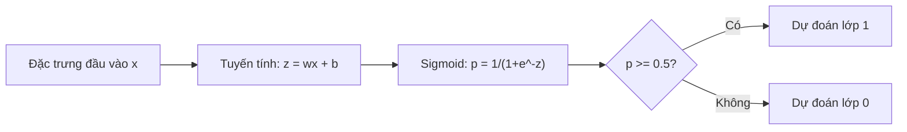
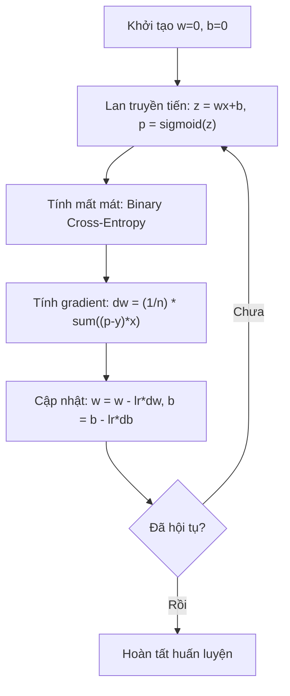

# Hồi quy Logistic (Logistic Regression)

> Hồi quy Logistic uốn một đường thẳng thành một đường cong chữ S để trả lời các câu hỏi Có-hoặc-Không bằng xác suất.

**Type:** Build
**Languages:** Python
**Prerequisites:** Phase 2 Lesson 1-2 (What Is ML, Linear Regression)
**Time:** ~90 minutes

## Learning Objectives

- Tự cài đặt thuật toán hồi quy logistic từ đầu sử dụng hàm sigmoid và hàm mất mát binary cross-entropy
- Tính toán và diễn giải các chỉ số Precision, Recall, F1 Score cùng ma trận nhầm lẫn (confusion matrix) cho bài toán phân loại nhị phân
- Giải thích vì sao hàm MSE thất bại trong bài toán phân loại và vì sao binary cross-entropy lại tạo ra một bề mặt chi phí lồi (convex)
- Xây dựng mô hình hồi quy Softmax cho bài toán phân loại đa lớp và đánh giá sự đánh đổi khi tinh chỉnh ngưỡng quyết định (threshold tuning)

## The Problem (Vấn đề)

Bạn muốn dự đoán xem một khối u là ác tính hay lành tính dựa trên kích thước của nó. Bạn thử áp dụng hồi quy tuyến tính. Mô hình trả về những con số như 0.3, 1.7 hay -0.5. Những con số này có ý nghĩa gì? Liệu 1.7 có phải là "rất ác tính"? Còn -0.5 là "rất lành tính"? Hồi quy tuyến tính tạo ra các con số không bị chặn. Trong khi đó, bài toán phân loại đòi hỏi các giá trị xác suất nằm gọn trong khoảng từ 0 đến 1, cùng một quyết định dứt khoát: Có hoặc Không.

Hồi quy Logistic giải quyết triệt để vấn đề này. Nó lấy cùng một tổ hợp tuyến tính ($wx + b$) và truyền qua hàm sigmoid — một hàm ép mọi số thực bất kỳ vào khoảng $(0, 1)$. Đầu ra lúc này trở thành một xác suất chuẩn mực. Bạn chỉ cần đặt một ngưỡng cắt (thường là 0.5) để đưa ra quyết định phân loại.

Đây là một trong những thuật toán được sử dụng rộng rãi nhất trong công nghiệp. Mặc dù mang tên là "hồi quy" (regression), hồi quy logistic thực chất là một thuật toán **phân loại** (classification). Cái tên này bắt nguồn từ hàm logistic (sigmoid) mà nó sử dụng.

## The Concept (Khái niệm)

### Vì sao Hồi quy tuyến tính thất bại trong bài toán phân loại

Hãy tưởng tượng bạn cần dự đoán kết quả Đậu/Rớt (1/0) dựa trên số giờ ôn thi. Hồi quy tuyến tính khớp một đường thẳng đi qua dữ liệu:

```text
giờ học:  1   2   3   4   5   6   7   8   9   10
thực tế:  0   0   0   0   1   1   1   1   1   1
```

Một đường thẳng tuyến tính có thể dự đoán giá trị -0.2 tại 1 giờ học và 1.3 tại 10 giờ học. Những con số này không phải là xác suất vì chúng vọt ra ngoài đoạn $[0, 1]$. Tệ hơn nữa, chỉ cần xuất hiện một điểm ngoại lai (outlier — ví dụ một sinh viên học 50 giờ) sẽ kéo lệch toàn bộ đường thẳng, làm thay đổi ngưỡng quyết định và khiến dự đoán cho tất cả những người khác bị sai lệch theo.

Bài toán phân loại cần một hàm số:
- Luôn xuất ra giá trị nằm giữa 0 và 1 (xác suất)
- Tạo ra một vùng chuyển tiếp rõ nét (ranh giới quyết định)
- Không bị biến dạng bởi các điểm ngoại lai nằm xa ranh giới

### Hàm Sigmoid (The Sigmoid Function)

Hàm sigmoid thực hiện chính xác nhiệm vụ này:

```math
\sigma(z) = \frac{1}{1 + e^{-z}}
```

Các tính chất quan trọng:
- Khi $z$ dương và rất lớn, $\sigma(z)$ tiến sát về 1
- Khi $z$ âm và rất lớn, $\sigma(z)$ tiến sát về 0
- Khi $z = 0$, $\sigma(z) = 0.5$
- Đầu ra luôn luôn bị chặn trong khoảng $(0, 1)$
- Hàm số trơn và khả vi tại mọi điểm

Đạo hàm của hàm sigmoid có dạng cực kỳ đẹp mắt: $\sigma'(z) = \sigma(z) (1 - \sigma(z))$. Nhờ tính chất này, việc tính toán gradient trở nên vô cùng gọn nhẹ.

### Hồi quy Logistic = Mô hình tuyến tính + Sigmoid

Mô hình tính $z = wx + b$ (giống hệt hồi quy tuyến tính), sau đó áp dụng hàm sigmoid:



Đầu ra $p$ được hiểu là $P(y=1 \mid x)$ — xác suất để mẫu đầu vào thuộc về lớp 1. Ranh giới quyết định (decision boundary) nằm tại vị trí $wx + b = 0$, nơi hàm sigmoid cho giá trị đúng bằng 0.5.

### Hàm mất mát Binary Cross-Entropy

Bạn không thể dùng hàm MSE cho hồi quy logistic. Khi kết hợp MSE với hàm phi tuyến sigmoid, bề mặt hàm chi phí trở thành phi lồi (non-convex) với nhiều điểm cực tiểu cục bộ và các vùng phẳng khiến gradient bị triệt tiêu. Thay vào đó, chúng ta sử dụng hàm Binary Cross-Entropy (còn gọi là Log Loss):

```math
\text{Loss} = -\frac{1}{n} \sum \left( y \log(p) + (1-y) \log(1-p) \right)
```

Cơ chế hoạt động của hàm mất mát này:
- Khi $y=1$ và $p$ gần 1: $\log(1) = 0$, mất mát gần bằng 0 (dự đoán đúng, chi phí thấp)
- Khi $y=1$ và $p$ gần 0: $\log(0) \to -\infty$, mất mát tăng vọt lên cực lớn (dự đoán tự tin nhưng sai, phạt cực nặng)
- Khi $y=0$ và $p$ gần 0: $\log(1-0) = 0$, mất mát gần bằng 0 (dự đoán đúng, chi phí thấp)
- Khi $y=0$ và $p$ gần 1: $\log(1-1) \to -\infty$, mất mát tăng vọt lên cực lớn (dự đoán sai, phạt cực nặng)

Hàm mất mát này là **hàm lồi** (convex) đối với hồi quy logistic, do đó mọi cực tiểu cục bộ đều là cực tiểu toàn cục và thuật toán Gradient Descent không bao giờ bị kẹt ở một thung lũng giả. Trên dữ liệu khả tách tuyến tính hoàn toàn, hàm mất mát sẽ giảm mãi khi trọng số tiến ra vô cùng; việc bổ sung điều chuẩn L2 giúp cố định một điểm cực tiểu hữu hạn duy nhất.

### Gradient Descent cho Hồi quy Logistic

Đạo hàm riêng của hàm Binary Cross-Entropy kết hợp với sigmoid rút gọn về một biểu thức vô cùng thanh lịch:

```math
\begin{aligned}
\frac{\partial L}{\partial w} &= \frac{1}{n} \sum (p - y) \, x \\
\frac{\partial L}{\partial b} &= \frac{1}{n} \sum (p - y)
\end{aligned}
```

Biểu thức này trông giống hệt như đạo hàm của hồi quy tuyến tính! Điểm khác biệt nằm ở chỗ $p = \sigma(wx + b)$ thay vì $p = wx + b$. Hàm sigmoid đưa tính phi tuyến vào dự đoán, nhưng quy tắc cập nhật gradient giữ nguyên cấu trúc.



### Ranh giới quyết định (The Decision Boundary)

Đối với đầu vào 2 chiều (hai đặc trưng $x_1, x_2$), ranh giới quyết định là đường thẳng thỏa mãn phương trình:

```math
w_1 x_1 + w_2 x_2 + b = 0
```

Các điểm nằm ở một phía của đường thẳng được phân loại là 1, phía bên kia là 0. Hồi quy logistic luôn luôn tạo ra một ranh giới quyết định tuyến tính (đường thẳng trong 2D, mặt phẳng trong 3D, siêu phẳng trong nhiều chiều). Nếu muốn có ranh giới uốn cong, bạn cần bổ sung các đặc trưng đa thức hoặc chuyển sang mô hình phi tuyến.

### Phân loại đa lớp với hàm Softmax

Hồi quy logistic nhị phân giải quyết bài toán 2 lớp. Khi có $k$ lớp ($k > 2$), chúng ta tổng quát hóa hàm sigmoid thành hàm **Softmax**:

```math
\text{softmax}(z_i) = \frac{e^{z_i}}{\sum_j e^{z_j}}
```

Mỗi lớp sẽ có một vector trọng số riêng. Mô hình tính điểm số (logit) $z_i$ cho từng lớp, sau đó hàm softmax chuyển đổi toàn bộ các điểm số đó thành một phân phối xác suất có tổng bằng đúng 1. Lớp được dự đoán là lớp có xác suất cao nhất.

Hàm mất mát tương ứng là **Categorical Cross-Entropy**:

```math
\text{Loss} = -\frac{1}{n} \sum \sum_k y_k \log(p_k)
```

trong đó $y_k = 1$ đối với lớp đúng thực tế và $y_k = 0$ đối với tất cả các lớp còn lại (mã hóa one-hot).

### Các chỉ số đánh giá (Evaluation Metrics)

Độ chính xác (Accuracy) đơn thuần là không đủ để đánh giá mô hình phân loại. Với một tập dữ liệu có 95% mẫu âm tính và chỉ 5% mẫu dương tính, một mô hình "lười biếng" luôn đoán âm tính sẽ đạt 95% Accuracy nhưng hoàn toàn vô dụng trong thực tế.

**Ma trận nhầm lẫn (Confusion Matrix)**:

| | Dự đoán Dương tính (Pos) | Dự đoán Âm tính (Neg) |
|---|---|---|
| **Thực tế Dương tính (Pos)** | Dương tính thật — True Positive (TP) | Âm tính giả — False Negative (FN) |
| **Thực tế Âm tính (Neg)** | Dương tính giả — False Positive (FP) | Âm tính thật — True Negative (TN) |

**Precision (Độ chuẩn xác)**: Trong tất cả các mẫu mô hình dự đoán là dương tính, có bao nhiêu phần trăm thực sự là dương tính?
```math
\text{Precision} = \frac{TP}{TP + FP}
```

**Recall (Độ phủ / Độ nhạy - Sensitivity)**: Trong tất cả các mẫu dương tính thực tế, mô hình bắt trúng được bao nhiêu phần trăm?
```math
\text{Recall} = \frac{TP}{TP + FN}
```

**F1 Score**: Trung bình điều hòa (harmonic mean) của Precision và Recall, giúp cân bằng cả hai chỉ số:
```math
F_1 = 2 \cdot \frac{\text{Precision} \cdot \text{Recall}}{\text{Precision} + \text{Recall}}
```

Khi nào nên ưu tiên chỉ số nào:
- **Ưu tiên Precision**: Khi chi phí của Dương tính giả (FP) rất đắt đỏ (ví dụ: bộ lọc thư rác — bạn không muốn email công việc quan trọng bị ném nhầm vào thùng rác).
- **Ưu tiên Recall**: Khi chi phí của Âm tính giả (FN) là thảm họa (ví dụ: tầm soát ung thư — bạn tuyệt đối không muốn bỏ sót bất kỳ bệnh nhân nào có khối u ác tính).
- **Ưu tiên F1**: Khi bạn cần một thước đo tổng hợp cân bằng cả hai yếu tố.

```figure
logistic-sigmoid
```

## Build It (Thực hành xây dựng)

### Bước 1: Hàm Sigmoid và tạo dữ liệu mẫu

```python
import random
import math

def sigmoid(z):
    z = max(-500, min(500, z))
    return 1.0 / (1.0 + math.exp(-z))


random.seed(42)
N = 200
X = []
y = []

for _ in range(N // 2):
    X.append([random.gauss(2, 1), random.gauss(2, 1)])
    y.append(0)

for _ in range(N // 2):
    X.append([random.gauss(5, 1), random.gauss(5, 1)])
    y.append(1)

combined = list(zip(X, y))
random.shuffle(combined)
X, y = zip(*combined)
X = list(X)
y = list(y)

print(f"Đã tạo {N} mẫu (2 lớp, 2 đặc trưng)")
print(f"Tâm lớp 0: (2, 2), Tâm lớp 1: (5, 5)")
print(f"5 mẫu đầu tiên:")
for i in range(5):
    print(f"  Đặc trưng: [{X[i][0]:.2f}, {X[i][1]:.2f}], Nhãn: {y[i]}")
```

### Bước 2: Hồi quy Logistic từ đầu

```python
class LogisticRegression:
    def __init__(self, n_features, learning_rate=0.01):
        self.weights = [0.0] * n_features
        self.bias = 0.0
        self.lr = learning_rate
        self.loss_history = []

    def predict_proba(self, x):
        z = sum(w * xi for w, xi in zip(self.weights, x)) + self.bias
        return sigmoid(z)

    def predict(self, x, threshold=0.5):
        return 1 if self.predict_proba(x) >= threshold else 0

    def compute_loss(self, X, y):
        n = len(y)
        total = 0.0
        for i in range(n):
            p = self.predict_proba(X[i])
            p = max(1e-15, min(1 - 1e-15, p))
            total += y[i] * math.log(p) + (1 - y[i]) * math.log(1 - p)
        return -total / n

    def fit(self, X, y, epochs=1000, print_every=200):
        n = len(y)
        n_features = len(X[0])
        for epoch in range(epochs):
            dw = [0.0] * n_features
            db = 0.0
            for i in range(n):
                p = self.predict_proba(X[i])
                error = p - y[i]
                for j in range(n_features):
                    dw[j] += error * X[i][j]
                db += error
            for j in range(n_features):
                self.weights[j] -= self.lr * (dw[j] / n)
            self.bias -= self.lr * (db / n)
            loss = self.compute_loss(X, y)
            self.loss_history.append(loss)
            if epoch % print_every == 0:
                print(f"  Epoch {epoch:4d} | Loss: {loss:.4f} | w: [{self.weights[0]:.3f}, {self.weights[1]:.3f}] | b: {self.bias:.3f}")
        return self

    def accuracy(self, X, y):
        correct = sum(1 for i in range(len(y)) if self.predict(X[i]) == y[i])
        return correct / len(y)


split = int(0.8 * N)
X_train, X_test = X[:split], X[split:]
y_train, y_test = y[:split], y[split:]

print("\n=== Huấn luyện Hồi quy Logistic ===")
model = LogisticRegression(n_features=2, learning_rate=0.1)
model.fit(X_train, y_train, epochs=1000, print_every=200)

print(f"\nĐộ chính xác tập Train: {model.accuracy(X_train, y_train):.4f}")
print(f"Độ chính xác tập Test:  {model.accuracy(X_test, y_test):.4f}")
print(f"Trọng số: [{model.weights[0]:.4f}, {model.weights[1]:.4f}]")
print(f"Độ lệch (Bias): {model.bias:.4f}")
```

### Bước 3: Ma trận nhầm lẫn và các chỉ số từ đầu

```python
class ClassificationMetrics:
    def __init__(self, y_true, y_pred):
        self.tp = sum(1 for t, p in zip(y_true, y_pred) if t == 1 and p == 1)
        self.tn = sum(1 for t, p in zip(y_true, y_pred) if t == 0 and p == 0)
        self.fp = sum(1 for t, p in zip(y_true, y_pred) if t == 0 and p == 1)
        self.fn = sum(1 for t, p in zip(y_true, y_pred) if t == 1 and p == 0)

    def accuracy(self):
        total = self.tp + self.tn + self.fp + self.fn
        return (self.tp + self.tn) / total if total > 0 else 0

    def precision(self):
        denom = self.tp + self.fp
        return self.tp / denom if denom > 0 else 0

    def recall(self):
        denom = self.tp + self.fn
        return self.tp / denom if denom > 0 else 0

    def f1(self):
        p = self.precision()
        r = self.recall()
        return 2 * p * r / (p + r) if (p + r) > 0 else 0

    def print_confusion_matrix(self):
        print(f"\n  Confusion Matrix:")
        print(f"                  Dự đoán")
        print(f"                  Pos   Neg")
        print(f"  Thực tế Pos    {self.tp:4d}  {self.fn:4d}")
        print(f"  Thực tế Neg    {self.fp:4d}  {self.tn:4d}")

    def print_report(self):
        self.print_confusion_matrix()
        print(f"\n  Accuracy:  {self.accuracy():.4f}")
        print(f"  Precision: {self.precision():.4f}")
        print(f"  Recall:    {self.recall():.4f}")
        print(f"  F1 Score:  {self.f1():.4f}")


y_pred_test = [model.predict(x) for x in X_test]
print("\n=== Báo cáo Phân loại (Tập Test) ===")
metrics = ClassificationMetrics(y_test, y_pred_test)
metrics.print_report()
```

### Bước 4: Phân tích ranh giới quyết định

```python
print("\n=== Ranh giới Quyết định ===")
w1, w2 = model.weights
b = model.bias
print(f"Phương trình ranh giới: {w1:.4f}*x1 + {w2:.4f}*x2 + {b:.4f} = 0")
if abs(w2) > 1e-10:
    print(f"Giải theo x2:           x2 = {-w1/w2:.4f}*x1 + {-b/w2:.4f}")

print("\nDự đoán mẫu gần đường ranh giới:")
test_points = [
    [3.0, 3.0],
    [3.5, 3.5],
    [4.0, 4.0],
    [2.5, 2.5],
    [5.0, 5.0],
]
for point in test_points:
    prob = model.predict_proba(point)
    pred = model.predict(point)
    print(f"  [{point[0]}, {point[1]}] -> xác suất={prob:.4f}, lớp={pred}")
```

### Bước 5: Phân loại đa lớp với Softmax

```python
class SoftmaxRegression:
    def __init__(self, n_features, n_classes, learning_rate=0.01):
        self.n_features = n_features
        self.n_classes = n_classes
        self.lr = learning_rate
        self.weights = [[0.0] * n_features for _ in range(n_classes)]
        self.biases = [0.0] * n_classes

    def softmax(self, scores):
        max_score = max(scores)
        exp_scores = [math.exp(s - max_score) for s in scores]
        total = sum(exp_scores)
        return [e / total for e in exp_scores]

    def predict_proba(self, x):
        scores = [
            sum(self.weights[k][j] * x[j] for j in range(self.n_features)) + self.biases[k]
            for k in range(self.n_classes)
        ]
        return self.softmax(scores)

    def predict(self, x):
        probs = self.predict_proba(x)
        return probs.index(max(probs))

    def fit(self, X, y, epochs=1000, print_every=200):
        n = len(y)
        for epoch in range(epochs):
            grad_w = [[0.0] * self.n_features for _ in range(self.n_classes)]
            grad_b = [0.0] * self.n_classes
            total_loss = 0.0
            for i in range(n):
                probs = self.predict_proba(X[i])
                for k in range(self.n_classes):
                    target = 1.0 if y[i] == k else 0.0
                    error = probs[k] - target
                    for j in range(self.n_features):
                        grad_w[k][j] += error * X[i][j]
                    grad_b[k] += error
                true_prob = max(probs[y[i]], 1e-15)
                total_loss -= math.log(true_prob)
            for k in range(self.n_classes):
                for j in range(self.n_features):
                    self.weights[k][j] -= self.lr * (grad_w[k][j] / n)
                self.biases[k] -= self.lr * (grad_b[k] / n)
            if epoch % print_every == 0:
                print(f"  Epoch {epoch:4d} | Loss: {total_loss / n:.4f}")
        return self

    def accuracy(self, X, y):
        correct = sum(1 for i in range(len(y)) if self.predict(X[i]) == y[i])
        return correct / len(y)


random.seed(42)
X_3class = []
y_3class = []

centers = [(1, 1), (5, 1), (3, 5)]
for label, (cx, cy) in enumerate(centers):
    for _ in range(50):
        X_3class.append([random.gauss(cx, 0.8), random.gauss(cy, 0.8)])
        y_3class.append(label)

combined = list(zip(X_3class, y_3class))
random.shuffle(combined)
X_3class, y_3class = zip(*combined)
X_3class = list(X_3class)
y_3class = list(y_3class)

split_3 = int(0.8 * len(X_3class))
X_train_3 = X_3class[:split_3]
y_train_3 = y_3class[:split_3]
X_test_3 = X_3class[split_3:]
y_test_3 = y_3class[split_3:]

print("\n=== Hồi quy Softmax Đa lớp (3 lớp) ===")
softmax_model = SoftmaxRegression(n_features=2, n_classes=3, learning_rate=0.1)
softmax_model.fit(X_train_3, y_train_3, epochs=1000, print_every=200)
print(f"\nĐộ chính xác tập Train: {softmax_model.accuracy(X_train_3, y_train_3):.4f}")
print(f"Độ chính xác tập Test:  {softmax_model.accuracy(X_test_3, y_test_3):.4f}")

print("\nDự đoán mẫu:")
for i in range(5):
    probs = softmax_model.predict_proba(X_test_3[i])
    pred = softmax_model.predict(X_test_3[i])
    print(f"  Nhãn thực: {y_test_3[i]}, Dự đoán: {pred}, Xác suất: [{', '.join(f'{p:.3f}' for p in probs)}]")
```

### Bước 6: Tinh chỉnh ngưỡng quyết định (Threshold Tuning)

```python
print("\n=== Tinh chỉnh Ngưỡng Quyết định ===")
print("Ngưỡng mặc định: 0.5. Thay đổi ngưỡng giúp đánh đổi giữa Precision và Recall.\n")

thresholds = [0.3, 0.4, 0.5, 0.6, 0.7]
print(f"{'Threshold':>10} {'Accuracy':>10} {'Precision':>10} {'Recall':>10} {'F1':>10}")
print("-" * 52)

for t in thresholds:
    y_pred_t = [1 if model.predict_proba(x) >= t else 0 for x in X_test]
    m = ClassificationMetrics(y_test, y_pred_t)
    print(f"{t:>10.1f} {m.accuracy():>10.4f} {m.precision():>10.4f} {m.recall():>10.4f} {m.f1():>10.4f}")
```

## Use It (Ứng dụng thực tế)

Sử dụng thư viện `scikit-learn` trong thực tế:

```python
from sklearn.linear_model import LogisticRegression as SklearnLR
from sklearn.metrics import accuracy_score, precision_score, recall_score, f1_score
from sklearn.metrics import confusion_matrix, classification_report
from sklearn.model_selection import train_test_split
from sklearn.preprocessing import StandardScaler
import numpy as np

np.random.seed(42)
X_0 = np.random.randn(100, 2) + [2, 2]
X_1 = np.random.randn(100, 2) + [5, 5]
X_sk = np.vstack([X_0, X_1])
y_sk = np.array([0] * 100 + [1] * 100)

X_tr, X_te, y_tr, y_te = train_test_split(X_sk, y_sk, test_size=0.2, random_state=42)

scaler = StandardScaler()
X_tr_sc = scaler.fit_transform(X_tr)
X_te_sc = scaler.transform(X_te)

lr = SklearnLR()
lr.fit(X_tr_sc, y_tr)
y_pred = lr.predict(X_te_sc)

print("=== Scikit-learn Logistic Regression ===")
print(f"Accuracy:  {accuracy_score(y_te, y_pred):.4f}")
print(f"Precision: {precision_score(y_te, y_pred):.4f}")
print(f"Recall:    {recall_score(y_te, y_pred):.4f}")
print(f"F1:        {f1_score(y_te, y_pred):.4f}")
print(f"\nConfusion Matrix:\n{confusion_matrix(y_te, y_pred)}")
print(f"\nClassification Report:\n{classification_report(y_te, y_pred)}")
```

Bản tự cài đặt từ đầu tạo ra cùng ranh giới quyết định và các chỉ số đánh giá. Scikit-learn bổ sung thêm các bộ giải bậc cao (`liblinear`, `lbfgs`, `saga`), tự động điều chuẩn L2, các chiến lược đa lớp (one-vs-rest, multinomial), và tối ưu hóa độ ổn định số học.

## Ship It (Triển khai)

Bài học này tạo ra:
- `code/logistic_regression.py` - cài đặt hồi quy logistic từ đầu cùng bộ đo lường chỉ số phân loại

## Exercises (Bài tập)

1. Tạo một tập dữ liệu KHÔNG khả tách tuyến tính (ví dụ: hai đường tròn đồng tâm). Huấn luyện hồi quy logistic thông thường và quan sát sự thất bại của nó. Sau đó bổ sung các đặc trưng đa thức ($x_1^2, x_2^2, x_1 x_2$) rồi huấn luyện lại. Chứng minh độ chính xác được cải thiện rõ rệt.
2. Cài đặt ma trận nhầm lẫn đa lớp (3x3) cho mô hình Softmax 3 lớp. Tính Precision và Recall cho từng lớp riêng biệt. Lớp nào khó phân loại nhất?
3. Xây dựng đường cong ROC từ đầu: Với 100 giá trị ngưỡng từ 0 đến 1, tính tỷ lệ dương tính thật (TPR) và tỷ lệ dương tính giả (FPR). Tính diện tích dưới đường cong (AUC) bằng quy tắc hình thang.

## Key Terms (Thuật ngữ chính)

| Thuật ngữ | Cách nói thông thường | Bản chất kỹ thuật |
|------|----------------|----------------------|
| Logistic regression | "Hồi quy dùng cho phân loại" | Mô hình tuyến tính kết hợp với hàm sigmoid để xuất ra xác suất thuộc về lớp |
| Sigmoid function | "Đường cong chữ S" | Hàm toán học $1/(1+e^{-z})$ ánh xạ mọi số thực vào khoảng $(0, 1)$ |
| Binary cross-entropy | "Hàm Log Loss" | Hàm mất mát $-[y \log(p) + (1-y) \log(1-p)]$ phạt cực nặng các dự đoán sai mà tự tin |
| Decision boundary | "Đường ranh giới phân chia" | Bề mặt nơi xác suất đầu ra của mô hình bằng 0.5, ngăn cách giữa các lớp dự đoán |
| Softmax | "Sigmoid cho đa lớp" | Hàm chuyển đổi một vector điểm số thành phân phối xác suất có tổng bằng 1 |
| Precision | "Độ chuẩn xác dương tính" | $TP / (TP + FP)$, tỷ lệ các dự đoán dương tính thực sự đúng |
| Recall | "Độ phủ dương tính" | $TP / (TP + FN)$, tỷ lệ các mẫu dương tính thực tế được mô hình phát hiện |
| F1 score | "Độ chính xác cân bằng" | Trung bình điều hòa của Precision và Recall: $2PR / (P+R)$ |
| Confusion matrix | "Bảng phân tích lỗi" | Bảng thống kê số lượng TP, TN, FP, FN cho từng cặp lớp thực tế và dự đoán |
| Threshold | "Ngưỡng cắt quyết định" | Mức xác suất mà trên đó mô hình dự đoán là lớp 1 (mặc định 0.5, có thể tinh chỉnh) |
| One-hot encoding | "Cột nhị phân cho danh mục" | Biểu diễn lớp thứ $k$ thành một vector toàn số 0 và duy nhất số 1 tại vị trí $k$ |
| Categorical cross-entropy | "Log loss đa lớp" | Mở rộng của binary cross-entropy cho $k$ lớp sử dụng nhãn mã hóa one-hot |

