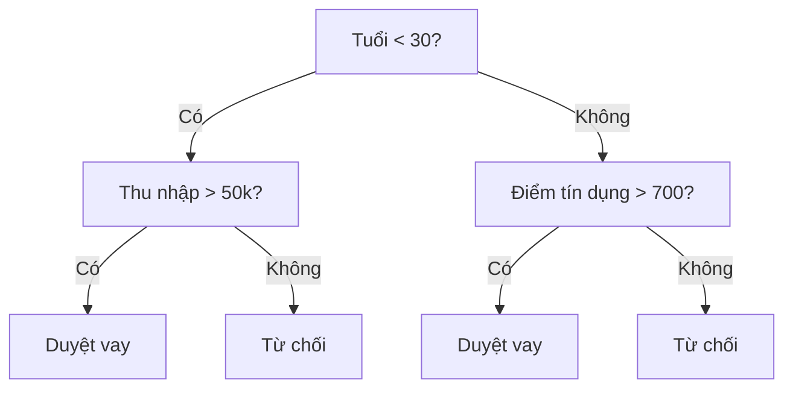
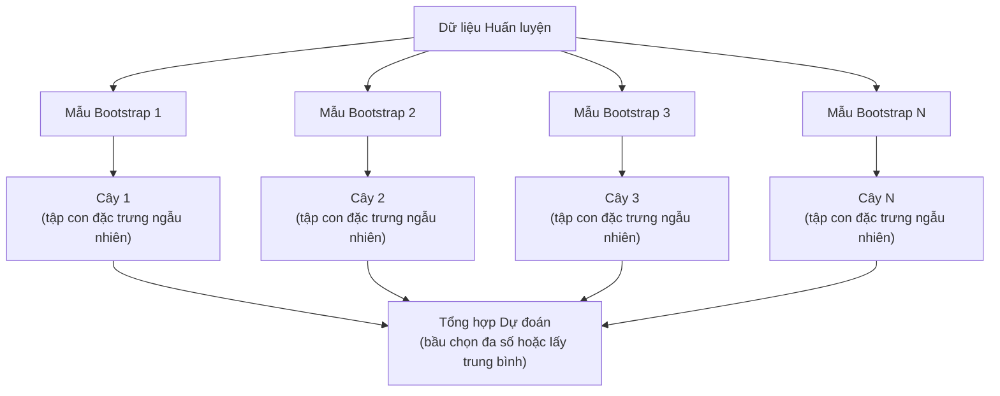

# Cây Quyết định và Rừng Ngẫu nhiên (Decision Trees and Random Forests)

> Một cây quyết định thực chất chỉ là một lưu đồ if-else. Nhưng một cánh rừng gồm hàng trăm cây như vậy lại là một trong những công cụ mạnh mẽ nhất trong Machine Learning.

**Type:** Build
**Language:** Python
**Prerequisites:** Phase 1 (Lessons 09 Information Theory, 06 Probability)
**Time:** ~90 minutes

## Learning Objectives

- Tự cài đặt công thức tính độ tạp chất Gini (Gini impurity), Entropy và độ lợi thông tin (Information Gain) để tìm điểm chia tối ưu trên cây quyết định
- Xây dựng bộ phân loại Cây Quyết định (Decision Tree) từ đầu với các cơ chế cắt tỉa sớm (pre-pruning: độ sâu tối đa, số mẫu tối thiểu)
- Xây dựng mô hình Rừng Ngẫu nhiên (Random Forest) sử dụng kỹ thuật lấy mẫu Bootstrap và ngẫu nhiên hóa đặc trưng, đồng thời giải thích vì sao nó giúp giảm phương sai
- So sánh độ quan trọng đặc trưng MDI (Mean Decrease in Impurity) với độ quan trọng hoán vị (Permutation Importance) và nhận diện khi nào MDI bị thiên lệch

## The Problem (Vấn đề)

Bạn có một tập dữ liệu dạng bảng (tabular data). Các hàng là các mẫu dữ liệu, các cột là các đặc trưng, và có một cột mục tiêu mà bạn muốn dự đoán. Bạn có thể nghĩ ngay đến việc đưa một mạng nơ-ron sâu vào giải quyết. Thế nhưng, đối với dữ liệu dạng bảng, các mô hình dựa trên cây quyết định (Decision Trees, Random Forests, Gradient Boosted Trees) luôn luôn đánh bại mạng học sâu một cách thuyết phục. Các cuộc thi trên Kaggle với dữ liệu có cấu trúc đều bị thống trị tuyệt đối bởi XGBoost và LightGBM chứ không phải Transformer.

Vì sao lại như vậy? Cây quyết định xử lý mượt mà các kiểu đặc trưng hỗn hợp (cả số thực lẫn biến phân loại) mà hầu như không cần tiền xử lý phức tạp. Chúng nắm bắt các mối quan hệ phi tuyến mà không cần kỹ thuật tạo đặc trưng cầu kỳ. Chúng hoàn toàn minh bạch và giải thích được: bạn có thể nhìn thẳng vào cấu trúc cây để biết chính xác vì sao một dự đoán được đưa ra. Và Rừng Ngẫu nhiên (Random Forest) — thông qua việc lấy trung bình dự đoán của hàng trăm cây — có khả năng chống quá khớp (overfitting) cực kỳ ấn tượng trên các tập dữ liệu quy mô vừa và nhỏ.

Bài học này xây dựng Cây Quyết định từ đầu bằng phương pháp chia đệ quy, sau đó ghép chúng lại thành một Rừng Ngẫu nhiên hoàn chỉnh. Bạn sẽ tự cài đặt toán học đằng sau các tiêu chuẩn chia nút (Gini impurity, Entropy, Information Gain) và hiểu vì sao một tập hợp các mô hình yếu lại kết tinh thành một mô hình cực mạnh.

## The Concept (Khái niệm)

### Cây quyết định hoạt động như thế nào?

Một cây quyết định phân hoạch không gian đặc trưng thành các vùng hình chữ nhật bằng cách đặt ra một chuỗi các câu hỏi Có/Không nối tiếp nhau:



Mỗi nút bên trong (internal node) kiểm tra một đặc trưng so với một ngưỡng giá trị. Mỗi nút lá (leaf node) đưa ra một quyết định dự đoán cuối cùng. Để phân loại một điểm dữ liệu mới, bạn bắt đầu từ nút gốc (root) và đi theo các nhánh trả lời tương ứng cho đến khi chạm tới một nút lá.

Cây được xây dựng từ trên xuống (top-down) bằng cách tại mỗi nút, chọn ra đặc trưng và ngưỡng chia giúp phân tách dữ liệu tốt nhất. Khái niệm "tốt nhất" được định lượng bằng một tiêu chuẩn chia (split criterion).

### Tiêu chuẩn chia: Đo lường độ tạp chất (Impurity)

Tại mỗi nút, chúng ta có một tập hợp các mẫu dữ liệu. Chúng ta muốn chia chúng thành hai nhánh con sao cho các nút con thu được "thuần khiết" (pure) nhất có thể — nghĩa là mỗi nút con chỉ chứa chủ yếu một lớp duy nhất.

**Độ tạp chất Gini (Gini impurity)** đo lường xác suất một mẫu được chọn ngẫu nhiên tại nút đó bị gán nhãn sai nếu ta gán nhãn ngẫu nhiên theo đúng phân phối lớp tại nút đó:

```math
\text{Gini}(S) = 1 - \sum_k p_k^2 \quad \text{trong đó } p_k \text{ là tỷ lệ của lớp } k \text{ trong tập } S.
```

Đối với một nút thuần khiết hoàn toàn (100% cùng một lớp), $\text{Gini} = 0$. Đối với nút nhị phân chia đều 50/50 giữa hai lớp, $\text{Gini} = 0.5$. Giá trị càng thấp càng tốt.

```text
Ví dụ: 6 mèo, 4 chó (tổng 10 mẫu)

Gini = 1 - (0.6^2 + 0.4^2) = 1 - (0.36 + 0.16) = 0.48
```

**Entropy** đo lường hàm lượng thông tin (mức độ hỗn loạn) bên trong một nút (đã học ở Phase 1, Bài 09):

```math
\text{Entropy}(S) = -\sum_k p_k \log_2(p_k)
```

Đối với một nút thuần khiết hoàn toàn, $\text{Entropy} = 0$. Đối với nút nhị phân chia đều 50/50, $\text{Entropy} = 1.0$. Giá trị càng thấp càng tốt.

```text
Ví dụ: 6 mèo, 4 chó

Entropy = -(0.6 * log2(0.6) + 0.4 * log2(0.4))
        = -(0.6 * -0.737 + 0.4 * -1.322)
        = 0.442 + 0.529
        = 0.971 bits
```

**Độ lợi thông tin (Information Gain)** là mức độ sụt giảm của độ tạp chất (Entropy hoặc Gini) sau khi thực hiện phép chia:

```math
\begin{aligned}
& IG(S, \text{feature}, \text{threshold}) = \text{Impurity}(S) - \text{weighted\_avg}(\text{Impurity}(S_{\text{left}}), \text{Impurity}(S_{\text{right}})) \\[4pt]
& \text{trong đó trọng số là tỷ lệ số mẫu rơi vào từng nút con.}
\end{aligned}
```

Thuật toán tham lam (greedy) tại mỗi nút: Thử tất cả các đặc trưng và tất cả các ngưỡng chia khả dĩ. Chọn cặp `(feature, threshold)` nào mang lại độ lợi thông tin (Information Gain) lớn nhất.

### Cơ chế tìm điểm chia (Splitting)

Đối với một tập dữ liệu có $n$ đặc trưng và $m$ mẫu tại nút hiện tại:

1. Với từng đặc trưng $j$ ($j = 1 \ldots n$):
   - Sắp xếp các mẫu tăng dần theo giá trị của đặc trưng $j$
   - Thử mọi điểm chính giữa (midpoint) nằm giữa hai giá trị khác nhau liên tiếp làm ngưỡng chia ứng viên
   - Tính toán độ lợi thông tin (Information Gain) cho từng ngưỡng đó
2. Chọn ra đặc trưng và ngưỡng chia có Information Gain cao nhất
3. Tách dữ liệu thành nhánh trái ($\text{feature} \le \text{threshold}$) và nhánh phải ($\text{feature} > \text{threshold}$)
4. Gọi đệ quy tiếp tục quá trình trên từng nút con

Cách tiếp cận tham lam này không đảm bảo tìm được cây tối ưu toàn cục (bài toán tìm cây quyết định tối ưu toàn cục là bài toán NP-hard). Tuy nhiên, phương pháp chia tham lam hoạt động cực kỳ hiệu quả trong thực tế.

### Điều kiện dừng và Cắt tỉa cây (Pruning)

Nếu không có điều kiện dừng, cây sẽ tiếp tục mọc sâu cho đến khi mọi nút lá đều thuần khiết hoàn toàn hoặc không thể chia thêm được nữa — thường là mỗi nút lá chỉ chứa đúng 1 mẫu dữ liệu. Khi đó, cây sẽ học vẹt 100% dữ liệu huấn luyện (bao gồm cả nhiễu) và thất bại thảm hại trên dữ liệu mới.

**Cắt tỉa sớm (Pre-pruning)** chặn không cho cây mọc quá sâu ngay trong lúc xây dựng:
- Độ sâu tối đa (`max_depth`): Ngừng chia khi cây chạm tới độ sâu giới hạn
- Số mẫu tối thiểu để chia (`min_samples_split`): Không chia nếu một nút có ít hơn $k$ mẫu
- Số mẫu tối thiểu tại nút lá (`min_samples_leaf`): Không chấp nhận phép chia nếu một trong hai nhánh con có ít hơn $m$ mẫu
- Độ lợi thông tin tối thiểu (`min_impurity_decrease`): Ngừng chia nếu phép chia tốt nhất không cải thiện độ thuần khiết vượt qua ngưỡng quy định

**Cắt tỉa hậu kỳ (Post-pruning)** cho phép cây mọc tối đa trước, sau đó mới cắt bỏ dần các nhánh thừa:
- Cắt tỉa chi phí - độ phức tạp (Cost-complexity pruning — được dùng trong scikit-learn): Cộng thêm một số hạng phạt tỷ lệ thuận với số lượng nút lá.
- Cắt tỉa giảm lỗi (Reduced error pruning): Cắt bỏ một cây con nếu việc loại bỏ nó không làm tăng lỗi trên tập kiểm định (validation set).

Cắt tỉa sớm đơn giản và chạy nhanh hơn rất nhiều. Cắt tỉa hậu kỳ đôi khi tạo ra cây tốt hơn vì nó không vô tình chặn mất một phép chia bước đệm ở tầng trên vốn mở đường cho một phép chia cực tốt ở tầng dưới.

### Cây quyết định cho bài toán Hồi quy (Regression Trees)

Đối với bài toán hồi quy (dự đoán số thực liên tục), giá trị dự đoán tại mỗi nút lá chính là **giá trị trung bình (mean)** của biến mục tiêu của các mẫu rơi vào nút lá đó. Tiêu chuẩn chia cũng thay đổi tương ứng:

**Mức giảm phương sai (Variance Reduction)** thay thế cho độ lợi thông tin:

```math
VR(S, \text{feature}, \text{threshold}) = \text{Var}(S) - \text{weighted\_avg}(\text{Var}(S_{\text{left}}), \text{Var}(S_{\text{right}}))
```

Thuật toán chọn phép chia nào giúp làm giảm phương sai của các nút con nhiều nhất. Cây hồi quy chia không gian đầu vào thành các vùng chữ nhật và dự đoán một hằng số (giá trị trung bình) trong từng vùng.

### Rừng Ngẫu nhiên (Random Forests): Sức mạnh của học kết hợp

Một cây quyết định đơn lẻ có phương sai (variance) rất cao: Chỉ cần thay đổi nhẹ dữ liệu huấn luyện là cấu trúc cây sinh ra đã thay đổi hoàn toàn. Rừng Ngẫu nhiên khắc phục triệt để nhược điểm này bằng cách huấn luyện nhiều cây khác nhau rồi lấy trung bình kết quả của chúng.



Hai nguồn ngẫu nhiên giúp đảm bảo các cây trong rừng thực sự đa dạng và khác biệt nhau:

1. **Bagging (Bootstrap Aggregating):** Mỗi cây được huấn luyện trên một mẫu bootstrap — một tập mẫu được bốc ngẫu nhiên **có hoàn lại** (sampling with replacement) từ tập dữ liệu gốc. Trung bình khoảng 63.2% các mẫu gốc sẽ xuất hiện trong mỗi mẫu bootstrap (36.8% còn lại gọi là các mẫu *out-of-bag*, có thể dùng luôn để kiểm định chéo mà không cần tách tập validation riêng).
2. **Ngẫu nhiên hóa đặc trưng (Feature randomization):** Tại mỗi lần chia nút, thuật toán chỉ xem xét một tập con ngẫu nhiên gồm $k$ đặc trưng thay vì toàn bộ các đặc trưng. Đối với phân loại, mặc định là $k = \sqrt{n_{\text{features}}}$. Đối với hồi quy, $k = n_{\text{features}} / 3$. Cơ chế này ngăn không cho tất cả các cây đều chọn cùng một đặc trưng mạnh nhất ở nút gốc, giúp các cây khử tương quan (decorrelate) với nhau.

Trực giác cốt lõi: Việc lấy trung bình nhiều cây không tương quan nhau giúp **giảm mạnh phương sai (variance) mà không làm tăng độ chệch (bias)**. Từng cây riêng lẻ có thể không xuất sắc, nhưng cả khu rừng hợp lại sẽ vô cùng chính xác và vững vàng.

### Độ quan trọng của đặc trưng (Feature Importance)

Rừng Ngẫu nhiên tự nhiên cung cấp điểm số đánh giá tầm quan trọng của từng đặc trưng. Hai phương pháp phổ biến nhất là:

**Mean Decrease in Impurity (MDI):** Với mỗi đặc trưng, cộng tổng mức giảm độ tạp chất (có nhân trọng số theo tỷ lệ mẫu đi qua nút) trên toàn bộ các nút và toàn bộ các cây sử dụng đặc trưng đó:

```math
\text{importance}(\text{feature}_j) = \sum_{\text{các nút dùng feature}_j} \frac{n_{\text{mẫu tại nút}}}{n_{\text{tổng số mẫu}}} \cdot \text{impurity\_decrease}
```

MDI tính toán cực nhanh (có sẵn ngay trong lúc huấn luyện) nhưng có nhược điểm là bị thiên vị (biased) về phía các đặc trưng liên tục hoặc có nhiều giá trị khác nhau (high-cardinality), vì chúng có nhiều điểm chia ứng viên hơn.

**Permutation Importance (Độ quan trọng hoán vị)** là giải pháp thay thế đáng tin cậy hơn: Giữ nguyên mô hình đã huấn luyện, xáo trộn ngẫu nhiên các giá trị của một cột đặc trưng trên tập kiểm định và đo xem độ chính xác của mô hình bị sụt giảm bao nhiêu. Sụt giảm càng lớn chứng tỏ đặc trưng đó càng quan trọng.

### Khi nào mô hình Cây đánh bại Mạng Nơ-ron?

Trên dữ liệu dạng bảng (tabular data), các mô hình dựa trên cây chiếm ưu thế rõ rệt so với mạng nơ-ron nhờ các yếu tố:

| Yếu tố | Mô hình Cây (Trees / Forests) | Mạng Nơ-ron (Neural Networks) |
|--------|-------|----------------|
| Kiểu dữ liệu hỗn hợp (số + phân loại) | Hỗ trợ tự nhiên | Cần mã hóa và chuẩn hóa kỹ |
| Tập dữ liệu nhỏ (< 10.000 dòng) | Hoạt động rất tốt | Rất dễ bị quá khớp (Overfit) |
| Tương tác giữa các đặc trưng | Tự động tìm thấy qua các nhánh chia | Cần thiết kế kiến trúc phù hợp |
| Khả năng giải thích (Interpretability) | Minh bạch, dễ hiểu | Hộp đen (Black box) |
| Thời gian huấn luyện | Vài giây đến vài phút (trên CPU) | Hàng giờ (cần GPU) |
| Độ nhạy với siêu tham số | Thấp (chạy tốt ngay với mặc định) | Rất cao |

Mạng nơ-ron chiến thắng khi dữ liệu có cấu trúc không gian hoặc tuần tự đồng nhất (hình ảnh, văn bản, âm thanh, video). Còn với bảng dữ liệu kinh doanh phẳng, các mô hình cây luôn là lựa chọn số một.

```figure
decision-tree-depth
```

## Build It (Thực hành xây dựng)

### Bước 1: Tính độ tạp chất Gini và Entropy

Xây dựng cả hai tiêu chuẩn đo độ tạp chất từ đầu:

```python
import math

def gini_impurity(labels):
    n = len(labels)
    if n == 0:
        return 0.0
    counts = {}
    for label in labels:
        counts[label] = counts.get(label, 0) + 1
    return 1.0 - sum((c / n) ** 2 for c in counts.values())

def entropy(labels):
    n = len(labels)
    if n == 0:
        return 0.0
    counts = {}
    for label in labels:
        counts[label] = counts.get(label, 0) + 1
    return -sum(
        (c / n) * math.log2(c / n) for c in counts.values() if c > 0
    )
```

### Bước 2: Tính độ lợi thông tin (Information Gain)

```python
def information_gain(parent_labels, left_labels, right_labels, criterion="gini"):
    measure = gini_impurity if criterion == "gini" else entropy
    n = len(parent_labels)
    n_left = len(left_labels)
    n_right = len(right_labels)
    if n_left == 0 or n_right == 0:
        return 0.0
    parent_impurity = measure(parent_labels)
    child_impurity = (
        (n_left / n) * measure(left_labels) +
        (n_right / n) * measure(right_labels)
    )
    return parent_impurity - child_impurity
```

### Bước 3: Xây dựng lớp DecisionTree

Cài đặt chia đệ quy, dự đoán và theo dõi độ quan trọng của đặc trưng. Hàm `_build` là trái tim của cây: nó dừng lại khi nút đã thuần khiết hoặc chạm ngưỡng cắt tỉa sớm, ngược lại nó tìm phép chia tốt nhất và đệ quy xuống hai nhánh con.

```python
import random

class DecisionTree:
    def __init__(self, max_depth=None, min_samples_split=2,
                 min_samples_leaf=1, criterion="gini",
                 max_features=None):
        self.max_depth = max_depth
        self.min_samples_split = min_samples_split
        self.min_samples_leaf = min_samples_leaf
        self.criterion = criterion
        self.max_features = max_features
        self.tree = None
        self.feature_importances_ = None

    def fit(self, X, y):
        self.n_features = len(X[0])
        self.feature_importances_ = [0.0] * self.n_features
        self.n_samples = len(X)
        self.tree = self._build(X, y, depth=0)
        total = sum(self.feature_importances_)
        if total > 0:
            self.feature_importances_ = [
                fi / total for fi in self.feature_importances_
            ]

    def predict(self, X):
        return [self._predict_one(x, self.tree) for x in X]

    def _build(self, X, y, depth):
        if len(set(y)) == 1:
            return {"leaf": True, "value": y[0]}

        if self.max_depth is not None and depth >= self.max_depth:
            return self._make_leaf(y)

        if len(y) < self.min_samples_split:
            return self._make_leaf(y)

        best_feature, best_threshold, best_gain = self._best_split(X, y)

        if best_feature is None or best_gain <= 0:
            return self._make_leaf(y)

        left_X, left_y, right_X, right_y = self._split_data(
            X, y, best_feature, best_threshold
        )

        if len(left_y) < self.min_samples_leaf or len(right_y) < self.min_samples_leaf:
            return self._make_leaf(y)

        weight = len(y) / self.n_samples
        self.feature_importances_[best_feature] += weight * best_gain

        return {
            "leaf": False,
            "feature": best_feature,
            "threshold": best_threshold,
            "left": self._build(left_X, left_y, depth + 1),
            "right": self._build(right_X, right_y, depth + 1),
        }

    def _make_leaf(self, y):
        counts = {}
        for label in y:
            counts[label] = counts.get(label, 0) + 1
        return {"leaf": True, "value": max(counts, key=counts.get)}

    def _best_split(self, X, y):
        best_feature = None
        best_threshold = None
        best_gain = -1.0

        if self.max_features == "sqrt":
            k = max(1, int(math.sqrt(self.n_features)))
            feature_indices = random.sample(range(self.n_features), k)
        elif isinstance(self.max_features, int):
            if self.max_features < 1:
                raise ValueError("max_features must be at least 1 when given as an integer")
            k = min(self.max_features, self.n_features)
            feature_indices = random.sample(range(self.n_features), k)
        else:
            feature_indices = list(range(self.n_features))

        for feature_idx in feature_indices:
            values = sorted(set(X[i][feature_idx] for i in range(len(X))))
            if len(values) <= 1:
                continue

            for i in range(len(values) - 1):
                threshold = (values[i] + values[i + 1]) / 2.0
                left_y = [y[j] for j in range(len(X)) if X[j][feature_idx] <= threshold]
                right_y = [y[j] for j in range(len(X)) if X[j][feature_idx] > threshold]

                if len(left_y) < self.min_samples_leaf or len(right_y) < self.min_samples_leaf:
                    continue

                gain = information_gain(y, left_y, right_y, self.criterion)
                if gain > best_gain:
                    best_gain = gain
                    best_feature = feature_idx
                    best_threshold = threshold

        return best_feature, best_threshold, best_gain

    def _split_data(self, X, y, feature, threshold):
        left_X, left_y, right_X, right_y = [], [], [], []
        for i in range(len(X)):
            if X[i][feature] <= threshold:
                left_X.append(X[i])
                left_y.append(y[i])
            else:
                right_X.append(X[i])
                right_y.append(y[i])
        return left_X, left_y, right_X, right_y

    def _predict_one(self, x, node):
        if node["leaf"]:
            return node["value"]
        if x[node["feature"]] <= node["threshold"]:
            return self._predict_one(x, node["left"])
        return self._predict_one(x, node["right"])
```

### Bước 4: Xây dựng lớp RandomForest

Kết hợp lấy mẫu Bootstrap, chọn tập con đặc trưng ngẫu nhiên và bầu chọn theo đa số (majority voting):

```python
class RandomForest:
    def __init__(self, n_trees=100, max_depth=None,
                 min_samples_split=2, max_features="sqrt",
                 criterion="gini"):
        self.n_trees = n_trees
        self.max_depth = max_depth
        self.min_samples_split = min_samples_split
        self.max_features = max_features
        self.criterion = criterion
        self.trees = []

    def fit(self, X, y):
        n = len(X)
        for _ in range(self.n_trees):
            indices = [random.randint(0, n - 1) for _ in range(n)]
            X_boot = [X[i] for i in indices]
            y_boot = [y[i] for i in indices]
            tree = DecisionTree(
                max_depth=self.max_depth,
                min_samples_split=self.min_samples_split,
                max_features=self.max_features,
                criterion=self.criterion,
            )
            tree.fit(X_boot, y_boot)
            self.trees.append(tree)

    def predict(self, X):
        all_preds = [tree.predict(X) for tree in self.trees]
        predictions = []
        for i in range(len(X)):
            votes = {}
            for preds in all_preds:
                v = preds[i]
                votes[v] = votes.get(v, 0) + 1
            predictions.append(max(votes, key=votes.get))
        return predictions
```

Xem toàn bộ mã nguồn hoàn chỉnh cùng các phương thức phụ trợ trong `code/trees.py`.

## Use It (Ứng dụng thực tế)

Với `scikit-learn`, việc huấn luyện một Rừng Ngẫu nhiên chỉ gói gọn trong vài dòng code:

```python
from sklearn.ensemble import RandomForestClassifier
from sklearn.datasets import load_iris
from sklearn.model_selection import train_test_split

X, y = load_iris(return_X_y=True)
X_train, X_test, y_train, y_test = train_test_split(X, y, random_state=42)

rf = RandomForestClassifier(n_estimators=100, random_state=42)
rf.fit(X_train, y_train)
print(f"Độ chính xác: {rf.score(X_test, y_test):.4f}")
print(f"Độ quan trọng đặc trưng: {rf.feature_importances_}")
```

Trong thực tế, các mô hình Gradient Boosted Trees (XGBoost, LightGBM, CatBoost) thường đạt độ chính xác cao hơn Random Forest một bậc vì chúng xây dựng các cây nối tiếp nhau — mỗi cây sau tập trung sửa lỗi của các cây trước đó. Tuy nhiên, Random Forest cực kỳ an toàn, rất khó cấu hình sai và hầu như không đòi hỏi phải tinh chỉnh siêu tham số phức tạp.

## Ship It (Triển khai)

Bài học này tạo ra artifact `outputs/prompt-tree-interpreter.md` -- một prompt chuyên gia giúp diễn giải các nhánh quyết định của mô hình cây thành ngôn ngữ nghiệp vụ dễ hiểu cho các bên liên quan. Cung cấp cấu trúc cây đã huấn luyện (độ sâu, đặc trưng, ngưỡng chia, độ chính xác), prompt sẽ dịch thành các quy tắc kinh doanh rõ ràng, xếp hạng độ quan trọng đặc trưng và cảnh báo nguy cơ rò rỉ dữ liệu hoặc quá khớp.

## Exercises (Bài tập)

1. Huấn luyện một cây quyết định đơn lẻ trên tập dữ liệu 2D gồm 3 lớp. Tự tay lần theo các ngưỡng chia và vẽ các đường ranh giới hình chữ nhật trên mặt phẳng. So sánh ranh giới khi `max_depth=2` và `max_depth=10`.
2. Cài đặt tiêu chuẩn giảm phương sai (variance reduction) cho cây hồi quy. Tạo dữ liệu $y = \sin(x) + \text{nhiễu}$ với 200 điểm và khớp cây hồi quy của bạn. Vẽ đường dự đoán hằng số từng đoạn của cây đè lên đường cong hình sin thực tế.
3. Xây dựng một Random Forest với số lượng cây lần lượt là 1, 5, 10, 50 và 200. Vẽ biểu đồ độ chính xác trên tập Train và tập Test theo số lượng cây. Quan sát hiện tượng độ chính xác tập Test tăng lên rồi đi ngang chứ không bị sụt giảm (Random Forest chống quá khớp khi tăng số cây).
4. So sánh Gini impurity và Entropy trên 5 tập dữ liệu khác nhau. Đo độ chính xác và độ sâu cây. Giải thích vì sao trong đại đa số trường hợp chúng cho ra kết quả gần như giống hệt nhau.
5. Cài đặt hàm tính Permutation Importance. So sánh nó với MDI trên một tập dữ liệu mà trong đó bạn cố tình chèn thêm một cột số thực ngẫu nhiên hoàn toàn (nhiễu thuần túy nhưng có nhiều giá trị khác nhau). Quan sát cách MDI chấm điểm cột nhiễu này rất cao trong khi Permutation Importance chấm điểm gần bằng 0.

## Key Terms (Thuật ngữ chính)

| Thuật ngữ | Cách nói thông thường | Bản chất kỹ thuật |
|------|----------------|----------------------|
| Decision tree | "Lưu đồ dự đoán" | Mô hình chia không gian đặc trưng thành các vùng hình chữ nhật bằng chuỗi điều kiện if/else |
| Gini impurity | "Độ lẫn lộn của nút" | Xác suất phân loại sai một mẫu chọn ngẫu nhiên tại nút. 0 = thuần khiết, 0.5 = lẫn lộn cực đại (nhị phân) |
| Entropy | "Độ hỗn loạn thông tin" | Hàm lượng thông tin tại một nút. 0 = thuần khiết, 1.0 = bất định cực đại (nhị phân) |
| Information gain | "Độ hiệu quả của phép chia" | Mức giảm độ tạp chất sau khi chia nút. Tiêu chuẩn tham lam để chọn ngưỡng chia tốt nhất |
| Pre-pruning | "Dừng cây sớm" | Ngăn cây mọc quá sâu bằng cách đặt giới hạn max_depth, min_samples_split, min_samples_leaf |
| Post-pruning | "Cắt tỉa sau khi mọc" | Cho cây mọc tối đa rồi cắt bỏ các nhánh con không giúp cải thiện hiệu năng trên tập validation |
| Bagging | "Huấn luyện trên các mẫu con ngẫu nhiên" | Bootstrap Aggregating: huấn luyện mỗi mô hình trên một tập mẫu bốc ngẫu nhiên có hoàn lại |
| Random forest | "Một rừng các cây quyết định" | Tập hợp nhiều cây quyết định được huấn luyện qua Bagging kết hợp chọn ngẫu nhiên tập con đặc trưng tại mỗi nút |
| Feature importance (MDI) | "Đặc trưng nào quan trọng nhất" | Tổng mức giảm độ tạp chất có trọng số mà mỗi đặc trưng đóng góp trên toàn bộ các cây |
| Permutation importance | "Xáo trộn rồi kiểm tra" | Mức sụt giảm độ chính xác của mô hình khi xáo trộn ngẫu nhiên một cột đặc trưng. Đáng tin cậy hơn MDI |
| Variance reduction | "Information gain cho hồi quy" | Tiêu chuẩn chia của cây hồi quy: chọn phép chia làm giảm phương sai biến mục tiêu nhiều nhất |
| Bootstrap sample | "Mẫu bốc có hoàn lại" | Tập mẫu cùng kích thước được rút ngẫu nhiên có hoàn lại từ tập dữ liệu gốc (chứa các bản sao trùng lặp) |

## Further Reading (Tài liệu đọc thêm)

- [Breiman: Random Forests (2001)](https://link.springer.com/article/10.1023/A:1010933404324) - Bài báo gốc kinh điển của Leo Breiman khai sinh thuật toán Random Forest
- [Grinsztajn et al.: Why do tree-based models still outperform deep learning on tabular data? (2022)](https://arxiv.org/abs/2207.08815) - Nghiên cứu thực nghiệm lý giải vì sao các mô hình cây vẫn vượt trội hơn Deep Learning trên dữ liệu bảng
- [scikit-learn Decision Trees documentation](https://scikit-learn.org/stable/modules/tree.html) - Hướng dẫn thực hành kèm công cụ trực quan hóa cây quyết định
- [XGBoost: A Scalable Tree Boosting System (Chen & Guestrin, 2016)](https://arxiv.org/abs/1603.02754) - Bài báo về hệ thống Gradient Boosting thống trị các giải đấu dữ liệu bảng

