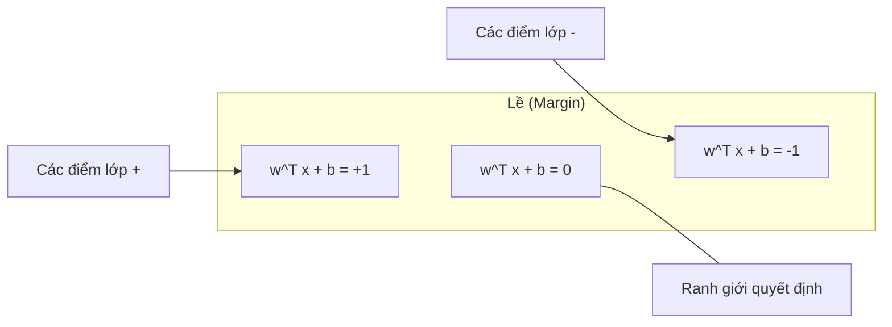
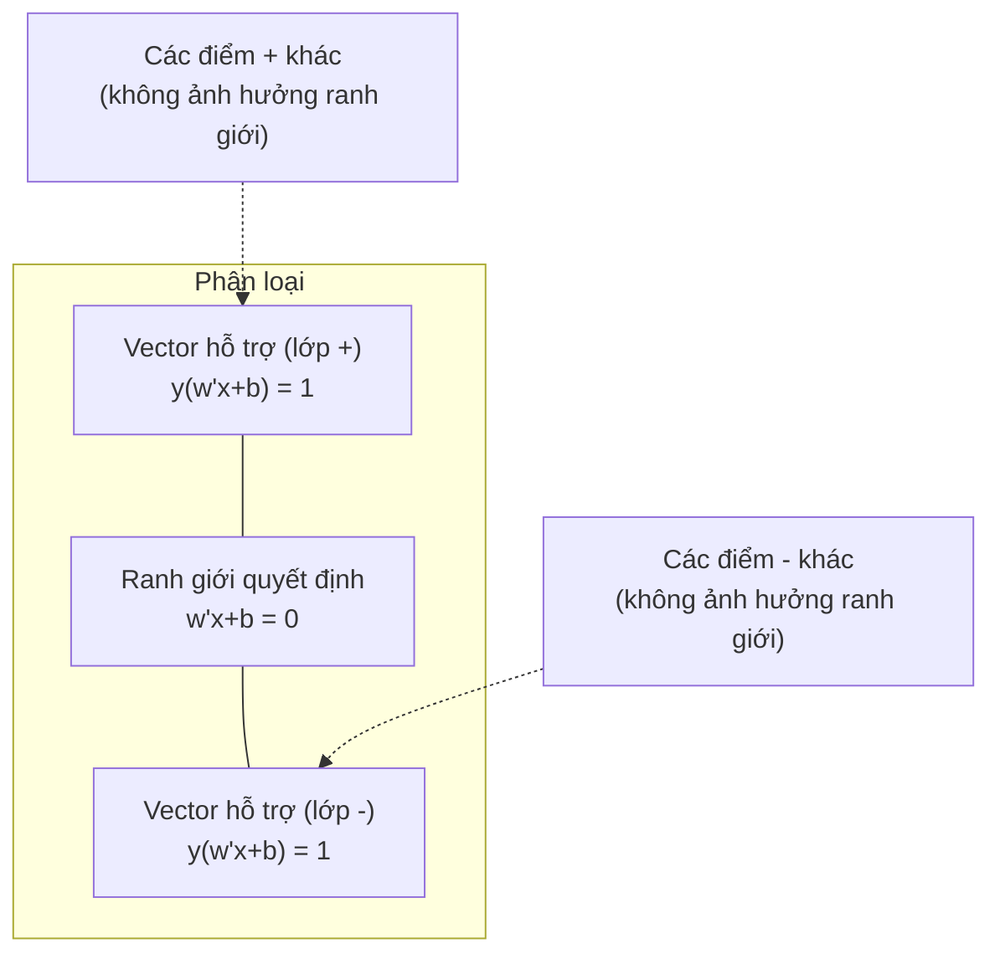
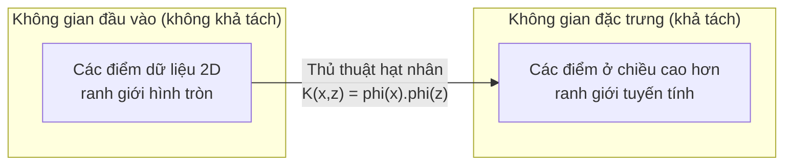

# Máy Vector Hỗ trợ (Support Vector Machines)

> Tìm con phố rộng nhất ngăn cách giữa hai lớp. Đó là toàn bộ ý tưởng cốt lõi.

**Type:** Build
**Language:** Python
**Prerequisites:** Phase 1 (Lessons 08 Optimization, 14 Norms and Distances, 18 Convex Optimization)
**Time:** ~90 minutes

## Learning Objectives

- Cài đặt SVM tuyến tính (linear SVM) từ đầu bằng hàm mất mát bản lề (hinge loss) và hạ gradient (gradient descent) trên bài toán gốc (primal formulation)
- Giải thích nguyên lý lề cực đại (maximum margin principle) và xác định các vector hỗ trợ (support vectors) từ một mô hình đã huấn luyện
- So sánh các nhân (kernels) tuyến tính (linear), đa thức (polynomial), và RBF cũng như giải thích cách thủ thuật hạt nhân (kernel trick) tránh việc ánh xạ tường minh sang không gian chiều cao
- Đánh giá sự đánh đổi được kiểm soát bởi tham số $C$ giữa độ rộng lề (margin width) và lỗi phân loại

## Vấn đề (The Problem)

Bạn có hai lớp điểm dữ liệu và cần vẽ một đường thẳng (hoặc siêu phẳng - hyperplane) ngăn cách chúng. Có vô số đường thẳng có thể làm được điều đó. Bạn nên chọn đường nào?

Hãy chọn đường có **lề (margin)** lớn nhất. Lề là khoảng cách giữa ranh giới quyết định (decision boundary) và các điểm dữ liệu gần nhất ở mỗi phía. Lề càng rộng đồng nghĩa với việc bộ phân loại càng tự tin và khái quát hóa tốt hơn trên dữ liệu chưa từng gặp.

Trực giác này dẫn đến **Máy Vector Hỗ trợ (Support Vector Machines - SVM)**, một trong những thuật toán thanh lịch nhất về mặt toán học trong Học máy (ML). SVM từng là phương pháp phân loại thống trị trước kỷ nguyên học sâu (deep learning) và hiện vẫn là lựa chọn tốt nhất cho các tập dữ liệu nhỏ, dữ liệu nhiều chiều (high-dimensional data), và các bài toán đòi hỏi một mô hình có nguyên lý chặt chẽ, dễ hiểu cùng các đảm bảo về mặt lý thuyết.

SVM kết nối trực tiếp với Phase 1: bài toán tối ưu hóa là lồi (Bài 18), độ rộng lề được đo bằng chuẩn (norms - Bài 14), và thủ thuật hạt nhân (kernel trick) khai thác tích vô hướng (dot products) để xử lý các ranh giới phi tuyến mà không cần tính toán trực tiếp trong không gian chiều cao.

## Khái niệm (The Concept)

### Bộ phân loại lề cực đại (The maximum margin classifier)

Cho dữ liệu khả tách tuyến tính (linearly separable) với nhãn $y_i \in \lbrace -1, +1 \rbrace$ và các vector đặc trưng $x_i$, chúng ta muốn tìm một siêu phẳng $w^T x + b = 0$ phân tách hai lớp.

Khoảng cách từ một điểm $x_i$ đến siêu phẳng là:

```math
\text{distance} = \frac{\lvert w^T x_i + b \rvert}{\lVert w \rVert}
```

Đối với một điểm được phân loại đúng: $y_i (w^T x_i + b) > 0$. Độ rộng lề (margin) bằng hai lần khoảng cách từ siêu phẳng đến điểm gần nhất ở mỗi phía.



Bài toán tối ưu hóa:

```math
\begin{aligned}
\text{maximize} \quad & \frac{2}{\lVert w \rVert} \quad \text{(the margin width)} \\
\text{subject to} \quad & y_i (w^T x_i + b) \ge 1 \quad \text{for all } i
\end{aligned}
```

Tương đương với (việc cực tiểu hóa $\lVert w \rVert^2$ dễ tối ưu hơn):

```math
\begin{aligned}
\text{minimize} \quad & \frac{1}{2} \lVert w \rVert^2 \\
\text{subject to} \quad & y_i (w^T x_i + b) \ge 1 \quad \text{for all } i
\end{aligned}
```

Đây là một bài toán quy hoạch toàn phương lồi (convex quadratic program - QP). Nó có một nghiệm toàn cục duy nhất. Các điểm dữ liệu nằm ngay trên ranh giới lề (nơi $y_i (w^T x_i + b) = 1$) chính là các **vector hỗ trợ (support vectors)**. Chúng là những điểm duy nhất quyết định ranh giới phân loại. Nếu bạn di chuyển hoặc xóa bất kỳ điểm nào không phải là vector hỗ trợ, ranh giới quyết định sẽ không hề thay đổi.

### Vector hỗ trợ: Số ít đóng vai trò quyết định (Support vectors: the critical few)



Hầu hết các điểm huấn luyện đều không quan trọng; chỉ có các vector hỗ trợ mới tạo nên sự khác biệt. Đó là lý do tại sao SVM tiết kiệm bộ nhớ ở thời điểm dự đoán: bạn chỉ cần lưu trữ các vector hỗ trợ chứ không cần lưu toàn bộ tập huấn luyện.

Số lượng vector hỗ trợ cũng cung cấp một cận trên cho lỗi khái quát hóa (generalization error). Càng ít vector hỗ trợ so với quy mô tập dữ liệu thì khả năng khái quát hóa càng tốt.

### Lề mềm: Xử lý nhiễu với tham số C (Soft margin: handling noise with the C parameter)

Dữ liệu thực tế hiếm khi khả tách hoàn hảo. Một số điểm có thể nằm sai phía của ranh giới, hoặc nằm bên trong lề. Công thức **lề mềm (soft margin)** cho phép các vi phạm bằng cách đưa vào các biến bù (slack variables).

```math
\begin{aligned}
\text{minimize} \quad & \frac{1}{2} \lVert w \rVert^2 + C \sum_i \xi_i \\
\text{subject to} \quad & y_i (w^T x_i + b) \ge 1 - \xi_i \\
& \xi_i \ge 0 \quad \text{for all } i
\end{aligned}
```

Biến bù $\xi_i$ đo lường mức độ điểm $i$ vi phạm lề. Tham số $C$ kiểm soát sự đánh đổi:

| Giá trị $C$ | Hành vi |
|---------|----------|
| $C$ lớn | Phạt nặng các vi phạm. Lề hẹp, ít lỗi phân loại hơn. Dễ quá khớp (overfits) |
| $C$ nhỏ | Cho phép nhiều vi phạm hơn. Lề rộng, nhiều lỗi phân loại hơn. Dễ dưới khớp (underfits) |

$C$ chính là nghịch đảo của cường độ điều chuẩn (regularization strength). $C$ lớn = ít điều chuẩn hơn. $C$ nhỏ = nhiều điều chuẩn hơn.

### Hàm mất mát bản lề: Hàm mất mát của SVM (Hinge loss: the SVM loss function)

SVM lề mềm có thể được viết lại dưới dạng một bài toán tối ưu hóa không ràng buộc:

```math
\text{minimize} \quad \frac{1}{2} \lVert w \rVert^2 + C \sum_i \max(0, 1 - y_i (w^T x_i + b))
```

Số hạng $\max(0, 1 - y_i f(x_i))$ được gọi là **hàm mất mát bản lề (hinge loss)**. Nó bằng 0 khi điểm dữ liệu được phân loại đúng và nằm ngoài lề. Nó tăng tuyến tính khi điểm dữ liệu nằm trong lề hoặc bị phân loại sai.

```text
Hàm mất mát bản lề (Hinge loss) cho một điểm đơn lẻ:

loss
  |
  | \
  |  \
  |   \
  |    \
  |     \_______________
  |
  +-----|-----|-------->  y * f(x)
       0     1

Mất mát bằng 0 khi y*f(x) >= 1 (phân loại đúng, nằm ngoài lề).
Phạt tuyến tính khi y*f(x) < 1.
```

So sánh với hàm mất mát logistic (trong hồi quy logistic):

```math
\begin{aligned}
\text{Hinge:} \quad & \max(0, 1 - y f(x)) && \text{Hard cutoff at margin} \\
\text{Logistic:} \quad & \log(1 + \exp(-y f(x))) && \text{Smooth, never exactly zero}
\end{aligned}
```

Hinge loss tạo ra các nghiệm thưa (sparse solutions — chỉ các vector hỗ trợ mới có đóng góp khác không). Logistic loss sử dụng tất cả các điểm dữ liệu. Điều này giúp SVM tiết kiệm bộ nhớ hơn khi dự đoán.

### Huấn luyện SVM tuyến tính bằng hạ gradient (Training a linear SVM with gradient descent)

Bạn có thể huấn luyện một SVM tuyến tính bằng hạ gradient trên hàm mất mát bản lề cộng với điều chuẩn L2 mà không cần giải bài toán quy hoạch toàn phương có ràng buộc (constrained QP):

```math
\begin{aligned}
& L(w, b) = \frac{\lambda}{2} \lVert w \rVert^2 + \frac{1}{n} \sum_i \max(0, 1 - y_i (w^T x_i + b)) \\[6pt]
& \text{Gradient with respect to } w\text{:} \\
& \quad \text{If } y_i (w^T x_i + b) \ge 1\text{:} \quad \frac{\partial L}{\partial w} = \lambda w \\
& \quad \text{If } y_i (w^T x_i + b) < 1\text{:} \quad \frac{\partial L}{\partial w} = \lambda w - y_i x_i \\[6pt]
& \text{Gradient with respect to } b\text{:} \\
& \quad \text{If } y_i (w^T x_i + b) \ge 1\text{:} \quad \frac{\partial L}{\partial b} = 0 \\
& \quad \text{If } y_i (w^T x_i + b) < 1\text{:} \quad \frac{\partial L}{\partial b} = -y_i
\end{aligned}
```

Đây được gọi là **bài toán gốc (primal formulation)**. Nó chạy với độ phức tạp $O(n \cdot d)$ mỗi epoch, trong đó $n$ là số lượng mẫu và $d$ là số lượng đặc trưng. Đối với dữ liệu lớn, thưa và nhiều chiều (như phân loại văn bản), phương pháp này cực kỳ nhanh.

### Bài toán đối ngẫu và thủ thuật hạt nhân (The dual formulation and the kernel trick)

Bài toán đối ngẫu Lagrange của SVM (từ Phase 1 Bài 18, điều kiện KKT) là:

```math
\begin{aligned}
\text{maximize} \quad & \sum_i \alpha_i - \frac{1}{2} \sum_{i,j} \alpha_i \alpha_j y_i y_j (x_i \cdot x_j) \\
\text{subject to} \quad & 0 \le \alpha_i \le C \\
& \sum_i \alpha_i y_i = 0
\end{aligned}
```

Bài toán đối ngẫu chỉ chứa các tích vô hướng $x_i \cdot x_j$ giữa các cặp điểm dữ liệu. Đây chính là phát hiện then chốt. Hãy thay thế mọi tích vô hướng bằng một **hàm hạt nhân (kernel function)** $K(x_i, x_j)$, và SVM có thể học được các ranh giới phi tuyến mà không bao giờ cần tính toán phép biến đổi tọa độ một cách tường minh.

```math
\begin{aligned}
\text{Linear kernel:} \quad & K(x, z) = x \cdot z \\
\text{Polynomial kernel:} \quad & K(x, z) = (x \cdot z + c)^d \\
\text{RBF (Gaussian):} \quad & K(x, z) = \exp(-\gamma \lVert x - z \rVert^2)
\end{aligned}
```

Nhân RBF (Radial Basis Function) ánh xạ dữ liệu vào một không gian vô hạn chiều. Các điểm ở gần nhau trong không gian đầu vào có giá trị kernel gần bằng 1. Các điểm ở xa nhau có giá trị kernel gần bằng 0. Nó có thể học bất kỳ ranh giới quyết định trơn (smooth) nào.



Thủ thuật hạt nhân (kernel trick) tính tích vô hướng trong không gian chiều cao mà không cần thực sự bước vào không gian đó. Đối với nhân đa thức bậc $d$ trong $D$ chiều, không gian đặc trưng tường minh có tới $O(D^d)$ chiều. Nhưng $K(x, z)$ chỉ mất thời gian $O(D)$ để tính.

### SVM cho bài toán hồi quy (SVR)

**Hồi quy Vector Hỗ trợ (Support Vector Regression - SVR)** khớp một hình ống (tube) có bán kính $\epsilon$ bao quanh dữ liệu. Các điểm nằm bên trong ống có độ mất mát bằng 0. Các điểm nằm ngoài ống bị phạt tuyến tính.

```math
\begin{aligned}
\text{minimize} \quad & \frac{1}{2} \lVert w \rVert^2 + C \sum_i (\xi_i + \xi_i^*) \\
\text{subject to} \quad & y_i - (w^T x_i + b) \le \epsilon + \xi_i \\
& (w^T x_i + b) - y_i \le \epsilon + \xi_i^* \\
& \xi_i, \xi_i^* \ge 0
\end{aligned}
```

Tham số $\epsilon$ kiểm soát độ rộng của ống. Ống càng rộng = càng ít vector hỗ trợ = đường khớp càng mượt. Ống càng hẹp = càng nhiều vector hỗ trợ = đường khớp càng bám sát dữ liệu.

### Tại sao SVM thất thế trước Deep Learning (và khi nào chúng vẫn chiến thắng)

SVM thống trị ngành Học máy từ cuối thập niên 1990 đến đầu thập niên 2010. Học sâu (deep learning) đã vượt qua chúng vì một số lý do:

| Yếu tố | SVM | Deep learning |
|--------|-----|---------------|
| Kỹ thuật đặc trưng (Feature engineering) | Bắt buộc phải có | Tự học đặc trưng |
| Khả năng mở rộng (Scalability) | $O(n^2)$ đến $O(n^3)$ với kernel | $O(n)$ mỗi epoch với SGD |
| Ảnh / văn bản / âm thanh | Cần đặc trưng thiết kế thủ công | Học trực tiếp từ dữ liệu thô |
| Tập dữ liệu lớn (>100k) | Chậm | Mở rộng tốt |
| Tăng tốc bằng GPU | Lợi ích hạn chế | Tăng tốc vượt trội |

SVM vẫn giành chiến thắng trong các tình huống sau:
- Tập dữ liệu nhỏ (từ vài trăm đến vài nghìn mẫu)
- Dữ liệu thưa nhiều chiều (văn bản với đặc trưng TF-IDF)
- Khi bạn cần các đảm bảo toán học (cận lề - margin bounds)
- Khi thời gian huấn luyện phải tối thiểu (linear SVM cực kỳ nhanh)
- Phân loại nhị phân có cấu trúc lề rõ ràng
- Phát hiện bất thường (One-class SVM)

```figure
svm-margin
```

## Xây dựng (Build It)

### Bước 1: Hàm mất mát bản lề và gradient

Nền tảng cốt lõi: tính hàm mất mát bản lề (hinge loss) cho một lô dữ liệu và gradient của nó.

```python
def hinge_loss(X, y, w, b):
    n = len(X)
    total_loss = 0.0
    for i in range(n):
        margin = y[i] * (dot(w, X[i]) + b)
        total_loss += max(0.0, 1.0 - margin)
    return total_loss / n
```

### Bước 2: SVM tuyến tính qua hạ gradient

Huấn luyện bằng cách cực tiểu hóa hàm mất mát bản lề có điều chuẩn. Không cần bộ giải QP.

```python
class LinearSVM:
    def __init__(self, lr=0.001, lambda_param=0.01, n_epochs=1000):
        self.lr = lr
        self.lambda_param = lambda_param
        self.n_epochs = n_epochs
        self.w = None
        self.b = 0.0

    def fit(self, X, y):
        n_features = len(X[0])
        self.w = [0.0] * n_features
        self.b = 0.0

        for epoch in range(self.n_epochs):
            for i in range(len(X)):
                margin = y[i] * (dot(self.w, X[i]) + self.b)
                if margin >= 1:
                    self.w = [wj - self.lr * self.lambda_param * wj
                              for wj in self.w]
                else:
                    self.w = [wj - self.lr * (self.lambda_param * wj - y[i] * X[i][j])
                              for j, wj in enumerate(self.w)]
                    self.b -= self.lr * (-y[i])

    def predict(self, X):
        return [1 if dot(self.w, x) + self.b >= 0 else -1 for x in X]
```

### Bước 3: Các hàm hạt nhân (Kernel functions)

Cài đặt nhân tuyến tính (linear), đa thức (polynomial), và RBF.

```python
def linear_kernel(x, z):
    return dot(x, z)

def polynomial_kernel(x, z, degree=3, c=1.0):
    return (dot(x, z) + c) ** degree

def rbf_kernel(x, z, gamma=0.5):
    diff = [xi - zi for xi, zi in zip(x, z)]
    return math.exp(-gamma * dot(diff, diff))
```

### Bước 4: Xác định lề và các vector hỗ trợ

Sau khi huấn luyện, xác định những điểm nào là vector hỗ trợ và tính toán độ rộng lề.

```python
def find_support_vectors(X, y, w, b, tol=1e-3):
    support_vectors = []
    for i in range(len(X)):
        margin = y[i] * (dot(w, X[i]) + b)
        if abs(margin - 1.0) < tol:
            support_vectors.append(i)
    return support_vectors
```

Xem `code/svm.py` để biết bản cài đặt đầy đủ cùng tất cả các bản chạy thử (demos).

## Sử dụng (Use It)

Với scikit-learn:

```python
from sklearn.svm import SVC, LinearSVC, SVR
from sklearn.preprocessing import StandardScaler
from sklearn.pipeline import Pipeline

clf = Pipeline([
    ("scaler", StandardScaler()),
    ("svm", SVC(kernel="rbf", C=1.0, gamma="scale")),
])
clf.fit(X_train, y_train)
print(f"Accuracy: {clf.score(X_test, y_test):.4f}")
print(f"Support vectors: {clf['svm'].n_support_}")
```

Lưu ý quan trọng: luôn co giãn đặc trưng (scale features) trước khi huấn luyện SVM. SVM rất nhạy cảm với độ lớn của đặc trưng vì độ rộng lề phụ thuộc vào $\lVert w \rVert$, và các đặc trưng chưa được co giãn sẽ làm biến dạng hình học của không gian.

Đối với các tập dữ liệu lớn, hãy dùng `LinearSVC` (bài toán gốc, $O(n \cdot d)$ mỗi epoch, tuyến tính theo $n$) thay vì `SVC` (bài toán đối ngẫu, $O(n^2)$ đến $O(n^3){}$):

```python
from sklearn.svm import LinearSVC

clf = Pipeline([
    ("scaler", StandardScaler()),
    ("svm", LinearSVC(C=1.0, max_iter=10000)),
])
```

## Bài tập (Exercises)

1. Tạo một tập dữ liệu 2D khả tách tuyến tính. Huấn luyện lớp `LinearSVM` của bạn và xác định các vector hỗ trợ. Kiểm chứng rằng các vector hỗ trợ chính là những điểm nằm gần ranh giới quyết định nhất.

2. Thay đổi $C$ từ 0.001 đến 1000 trên một tập dữ liệu có nhiễu. Vẽ ranh giới quyết định cho từng giá trị $C$. Quan sát sự chuyển dịch từ lề rộng (dưới khớp - underfitting) sang lề hẹp (quá khớp - overfitting).

3. Tạo một tập dữ liệu có ranh giới lớp hình tròn (phi tuyến). Chỉ ra rằng SVM tuyến tính thất bại. Tính ma trận nhân RBF và chỉ ra rằng các lớp trở nên khả tách trong không gian đặc trưng do kernel tạo ra.

4. So sánh hàm mất mát bản lề (hinge loss) và hàm mất mát logistic (logistic loss) trên cùng một tập dữ liệu. Huấn luyện một SVM tuyến tính và một mô hình hồi quy logistic. Đếm xem có bao nhiêu điểm huấn luyện đóng góp vào ranh giới quyết định của mỗi mô hình (các vector hỗ trợ so với toàn bộ các điểm).

5. Cài đặt SVR (hàm mất mát không nhạy epsilon - epsilon-insensitive loss). Khớp mô hình với hàm $y = \sin(x) + \text{noise}$. Vẽ ống epsilon bao quanh các dự đoán và làm nổi bật các vector hỗ trợ (các điểm nằm ngoài ống).

## Thuật ngữ chính (Key Terms)

| Thuật ngữ | Ý nghĩa thực sự |
|-----------|-----------------|
| Support vectors (Vector hỗ trợ) | Các điểm huấn luyện nằm gần ranh giới quyết định nhất. Những điểm duy nhất xác định siêu phẳng |
| Margin (Lề) | Khoảng cách giữa ranh giới quyết định và các vector hỗ trợ gần nhất. SVM tối đa hóa khoảng cách này |
| Hinge loss (Hàm mất mát bản lề) | $\max(0, 1 - y f(x))$. Bằng 0 khi được phân loại đúng và nằm ngoài lề. Phạt tuyến tính trong các trường hợp còn lại |
| C parameter (Tham số C) | Sự đánh đổi giữa độ rộng lề và lỗi phân loại. $C$ lớn = lề hẹp, $C$ nhỏ = lề rộng |
| Soft margin (Lề mềm) | Công thức SVM cho phép vi phạm lề thông qua các biến bù. Xử lý dữ liệu không khả tách hoàn hảo |
| Kernel trick (Thủ thuật hạt nhân) | Tính tích vô hướng trong không gian đặc trưng chiều cao mà không cần ánh xạ tường minh sang không gian đó |
| Linear kernel (Nhân tuyến tính) | $K(x, z) = x \cdot z$. Tương đương với tích vô hướng tiêu chuẩn. Dùng cho dữ liệu khả tách tuyến tính |
| RBF kernel (Nhân RBF) | $K(x, z) = \exp(-\gamma \Vert x-z \Vert^2)$. Ánh xạ sang không gian vô hạn chiều. Học được mọi ranh giới trơn |
| Polynomial kernel (Nhân đa thức) | $K(x, z) = (x \cdot z + c)^d$. Ánh xạ sang không gian đặc trưng gồm các tổ hợp đa thức |
| Dual formulation (Bài toán đối ngẫu) | Cách phát biểu lại bài toán SVM chỉ phụ thuộc vào tích vô hướng giữa các điểm dữ liệu. Cho phép dùng kernel |
| SVR (Hồi quy Vector Hỗ trợ) | Support Vector Regression. Khớp một ống epsilon quanh dữ liệu. Các điểm trong ống có mất mát bằng 0 |
| Slack variables (Biến bù) | $\xi_i$: đo mức độ một điểm vi phạm lề. Bằng 0 đối với các điểm được phân loại đúng và nằm ngoài lề |
| Maximum margin (Lề cực đại) | Nguyên lý chọn siêu phẳng tối đa hóa khoảng cách tới các điểm gần nhất của mỗi lớp |

## Đọc thêm (Further Reading)

- [Vapnik: The Nature of Statistical Learning Theory (1995)](https://link.springer.com/book/10.1007/978-1-4757-3264-1) - cuốn sách nền tảng về SVM và lý thuyết học thống kê
- [Cortes & Vapnik: Support-vector networks (1995)](https://link.springer.com/article/10.1007/BF00994018) - bài báo gốc giới thiệu SVM
- [Platt: Sequential Minimal Optimization (1998)](https://www.microsoft.com/en-us/research/publication/sequential-minimal-optimization-a-fast-algorithm-for-training-support-vector-machines/) - thuật toán SMO giúp việc huấn luyện SVM trở nên khả thi trong thực tế
- [scikit-learn SVM documentation](https://scikit-learn.org/stable/modules/svm.html) - hướng dẫn thực hành kèm chi tiết cài đặt
- [LIBSVM: A Library for Support Vector Machines](https://www.csie.ntu.edu.tw/~cjlin/libsvm/) - thư viện C++ đứng sau hầu hết các bản cài đặt SVM hiện nay

