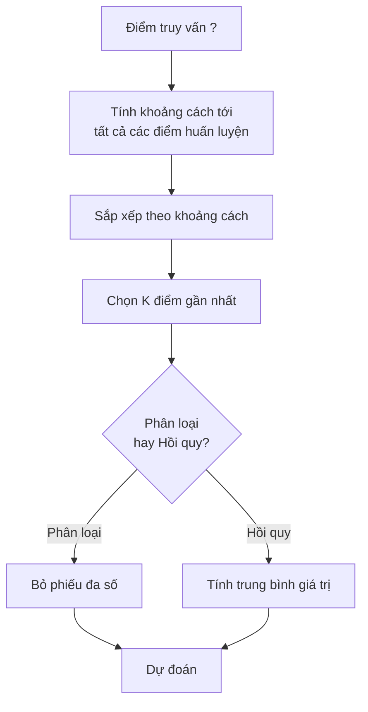
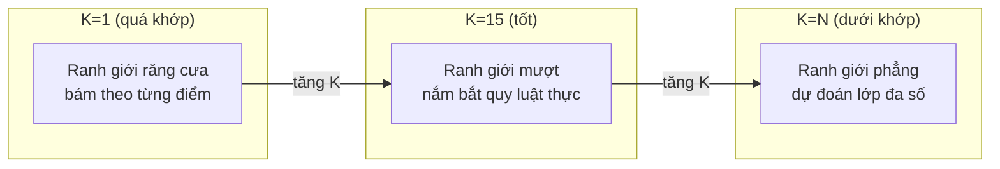
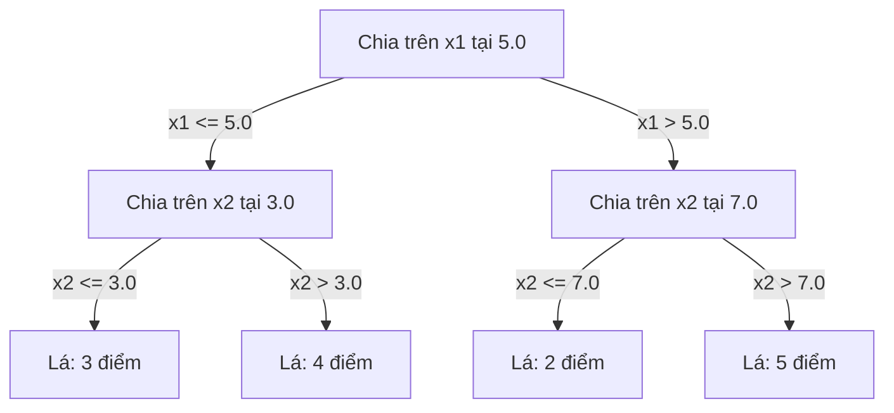

# K Láng giềng Gần nhất và Khoảng cách (K-Nearest Neighbors and Distances)

> Lưu trữ mọi thứ. Dự đoán bằng cách nhìn vào những người hàng xóm xung quanh. Thuật toán đơn giản nhất nhưng thực sự hiệu quả.

**Type:** Build
**Language:** Python
**Prerequisites:** Phase 1 (Lesson 14 Norms and Distances)
**Time:** ~90 minutes

## Learning Objectives

- Cài đặt phân loại và hồi quy KNN từ đầu với tham số $K$ tùy chỉnh và bỏ phiếu có trọng số khoảng cách (distance-weighted voting)
- So sánh các thước đo khoảng cách L1, L2, cosine, và Minkowski cũng như chọn thước đo phù hợp cho từng loại dữ liệu
- Giải thích lời nguyền chiều dữ liệu (curse of dimensionality) và chứng minh tại sao KNN suy giảm hiệu năng trong không gian nhiều chiều
- Xây dựng cây KD (KD-tree) để tìm kiếm láng giềng gần nhất hiệu quả và phân tích khi nào nó vượt trội hơn phương pháp vét cạn (brute-force)

## Vấn đề (The Problem)

Bạn có một tập dữ liệu. Một điểm dữ liệu mới xuất hiện. Bạn cần phân loại hoặc dự đoán giá trị của nó. Thay vì học các tham số từ dữ liệu (như hồi quy tuyến tính hay SVM), bạn chỉ cần tìm $K$ điểm huấn luyện gần nhất với điểm mới đó và để chúng bỏ phiếu biểu quyết.

Đó chính là **K Láng giềng Gần nhất (K-Nearest Neighbors - KNN)**. Không có giai đoạn huấn luyện. Không có tham số nào cần học. Không có hàm mất mát nào cần cực tiểu hóa. Bạn lưu trữ toàn bộ tập huấn luyện và tính toán khoảng cách ngay tại thời điểm dự đoán.

Nghe có vẻ quá đơn giản để có thể hoạt động tốt. Thế nhưng KNN lại có sức cạnh tranh đáng ngạc nhiên trong nhiều bài toán, đặc biệt là với các tập dữ liệu vừa và nhỏ. Việc hiểu sâu về nó sẽ làm sáng tỏ những khái niệm nền tảng: cách chọn thước đo khoảng cách (kết nối với Phase 1 Bài 14), lời nguyền chiều dữ liệu (curse of dimensionality), và sự khác biệt giữa học lười (lazy learning) và học chủ động (eager learning).

KNN cũng xuất hiện ở khắp mọi nơi trong AI hiện đại, chỉ là dưới những cái tên khác nhau. Cơ sở dữ liệu vector (vector databases) thực hiện tìm kiếm KNN trên các vector nhúng (embeddings). Kỹ thuật Tạo sinh Tăng cường Truy xuất (RAG) tìm $K$ đoạn tài liệu gần nhất. Các hệ thống gợi ý tìm kiếm những người dùng hoặc mặt hàng tương đồng. Thuật toán cốt lõi vẫn là một; chỉ có quy mô và cấu trúc dữ liệu là khác nhau.

## Khái niệm (The Concept)

### Cách KNN hoạt động

Cho một tập dữ liệu gồm các điểm đã gán nhãn và một điểm truy vấn (query point) mới:

1. Tính khoảng cách từ điểm truy vấn đến mọi điểm trong tập dữ liệu
2. Sắp xếp theo khoảng cách tăng dần
3. Lấy $K$ điểm gần nhất
4. Đối với bài toán phân loại (classification): lấy biểu quyết theo đa số (majority vote) trong số $K$ láng giềng
5. Đối với bài toán hồi quy (regression): lấy trung bình (hoặc trung bình có trọng số) các giá trị của $K$ láng giềng



Đó là toàn bộ thuật toán. Không khớp mô hình (fitting). Không hạ gradient. Không có các vòng lặp epoch.

### Chọn K

$K$ là siêu tham số (hyperparameter) duy nhất. Nó kiểm soát sự đánh đổi giữa độ chệch và phương sai (bias-variance trade-off):

| $K$ | Hành vi |
|---|----------|
| $K = 1$ | Ranh giới quyết định uốn theo từng điểm. Lỗi huấn luyện bằng 0. Phương sai cao. Quá khớp (overfits) |
| $K$ nhỏ (3–5) | Nhạy với cấu trúc cục bộ. Có thể nắm bắt các ranh giới phức tạp |
| $K$ lớn | Ranh giới mượt hơn. Bền vững hơn trước nhiễu. Có thể dưới khớp (underfits) |
| $K = N$ | Dự đoán lớp chiếm đa số cho mọi điểm. Độ chệch (bias) cực đại |

Một điểm khởi đầu phổ biến là $K = \sqrt{N}$ đối với tập dữ liệu có $N$ điểm. Hãy chọn $K$ lẻ cho bài toán phân loại nhị phân để tránh kết quả hòa khi bỏ phiếu.



### Các thước đo khoảng cách (Distance metrics)

Hàm khoảng cách định nghĩa thế nào là "gần". Các thước đo khác nhau sẽ tạo ra các tập láng giềng khác nhau và dẫn đến những dự đoán khác nhau.

**Khoảng cách L2 (Euclidean)** là lựa chọn mặc định. Đó là khoảng cách đường thẳng.

```math
d(a, b) = \sqrt{\sum_i (a_i - b_i)^2}
```

Rất nhạy cảm với thang đo của đặc trưng (feature scale). Hãy luôn chuẩn hóa (standardize) các đặc trưng trước khi sử dụng L2 với KNN.

**Khoảng cách L1 (Manhattan)** tính tổng các độ lệch tuyệt đối. Bền vững trước các điểm ngoại lai (outliers) hơn L2 vì nó không bình phương các độ lệch.

```math
d(a, b) = \sum_i \lvert a_i - b_i \rvert
```

**Khoảng cách Cosine (Cosine distance)** đo góc giữa các vector, bỏ qua độ lớn. Cực kỳ quan trọng đối với dữ liệu văn bản và vector nhúng (embeddings).

```math
d(a, b) = 1 - \frac{a \cdot b}{\lVert a \rVert \, \lVert b \rVert}
```

**Khoảng cách Minkowski** tổng quát hóa L1 và L2 bằng tham số $p$.

```math
\begin{aligned}
& d(a, b) = \left( \sum_i \lvert a_i - b_i \rvert^p \right)^{1/p} \\[6pt]
& p=1\text{: Manhattan} \\
& p=2\text{: Euclidean} \\
& p \to \infty\text{: Chebyshev (max absolute difference)}
\end{aligned}
```

Việc sử dụng thước đo nào phụ thuộc vào bản chất dữ liệu:

| Loại dữ liệu | Thước đo tốt nhất | Lý do |
|--------------|-------------------|-------|
| Đặc trưng số, cùng thang đo | L2 (Euclidean) | Mặc định, hoạt động tốt cho dữ liệu không gian |
| Đặc trưng số, có điểm ngoại lai | L1 (Manhattan) | Bền vững, không khuếch đại các khoảng chênh lệch lớn |
| Vector nhúng văn bản (Text embeddings) | Cosine | Độ lớn là nhiễu, hướng của vector mới mang ý nghĩa |
| Dữ liệu thưa nhiều chiều | Cosine hoặc L1 | L2 chịu ảnh hưởng nặng nề bởi lời nguyền chiều dữ liệu |
| Dữ liệu hỗn hợp (Mixed types) | Khoảng cách tùy chỉnh | Kết hợp các thước đo riêng cho từng kiểu đặc trưng |

### KNN có trọng số (Weighted KNN)

KNN tiêu chuẩn trao quyền biểu quyết ngang nhau cho cả $K$ láng giềng. Nhưng một láng giềng ở khoảng cách 0.1 lẽ ra phải có tiếng nói quan trọng hơn một láng giềng ở khoảng cách 5.0.

**KNN có trọng số khoảng cách (Distance-weighted KNN)** gán trọng số cho mỗi láng giềng tỷ lệ nghịch với khoảng cách:

```math
\begin{aligned}
& \text{weight}_i = \frac{1}{\text{distance}_i + \epsilon} \\[6pt]
& \text{For classification: weighted vote} \\
& \text{For regression: weighted average} = \frac{\sum_i w_i y_i}{\sum_i w_i}
\end{aligned}
```

Hằng số nhỏ $\epsilon$ giúp ngăn lỗi chia cho 0 khi điểm truy vấn trùng khớp hoàn toàn với một điểm huấn luyện.

KNN có trọng số ít nhạy cảm hơn với việc chọn $K$ bởi vì các láng giềng ở xa dù sao cũng chỉ đóng góp một phần rất nhỏ.

### Lời nguyền chiều dữ liệu (The curse of dimensionality)

Hiệu năng của KNN suy giảm mạnh trong không gian nhiều chiều. Đây không phải là một nỗi lo mơ hồ mà là một sự thật toán học.

**Vấn đề 1: Khoảng cách hội tụ.** Khi số chiều tăng lên, tỷ số giữa khoảng cách lớn nhất và khoảng cách nhỏ nhất tiến dần về 1. Mọi điểm trở nên "xa" điểm truy vấn như nhau.

```text
Trong không gian d chiều, đối với các điểm phân phối đều ngẫu nhiên:

d=2:    max_dist / min_dist = biến thiên rất rộng
d=100:  max_dist / min_dist ~ 1.01
d=1000: max_dist / min_dist ~ 1.001

Khi mọi khoảng cách đều xấp xỉ bằng nhau, khái niệm "gần nhất" trở nên vô nghĩa.
```

**Vấn đề 2: Thể tích bùng nổ.** Để thu thập đủ $K$ láng giềng chiếm một tỷ lệ cố định của dữ liệu, bạn phải mở rộng bán kính tìm kiếm ra một phần lớn hơn rất nhiều của không gian đặc trưng. "Vùng lân cận" trong không gian nhiều chiều bao trùm gần như toàn bộ không gian.

**Vấn đề 3: Các góc chiếm ưu thế.** Trong một siêu lập phương đơn vị (unit hypercube) $d$ chiều, phần lớn thể tích tập trung ở gần các góc chứ không phải ở tâm. Một hình cầu nội tiếp bên trong siêu lập phương chỉ chứa một phần thể tích tiến dần về 0 khi $d$ tăng lên.

Hệ quả thực tế: KNN hoạt động tốt với khoảng 20–50 đặc trưng trở xuống. Vượt quá ngưỡng đó, bạn cần giảm chiều dữ liệu (PCA, UMAP, t-SNE) trước khi áp dụng KNN, hoặc phải sử dụng các cấu trúc tìm kiếm dạng cây khai thác số chiều nội tại (intrinsic dimensionality) thấp hơn của dữ liệu.

### Cây KD: Tìm kiếm láng giềng gần nhất tốc độ cao (KD-trees: fast nearest neighbor search)

KNN vét cạn (brute-force) tính khoảng cách từ điểm truy vấn đến mọi điểm huấn luyện, tốn $O(n \cdot d)$ cho mỗi truy vấn. Với các tập dữ liệu lớn, cách này quá chậm.

Một **cây KD (KD-tree)** phân hoạch đệ quy không gian dọc theo các trục đặc trưng. Ở mỗi tầng, nó chia đôi theo một chiều tại giá trị trung vị (median).



Để tìm láng giềng gần nhất, ta duyệt cây xuống nút lá chứa điểm truy vấn, sau đó quay lui (backtrack) và chỉ kiểm tra các vùng phân hoạch lân cận nếu chúng có khả năng chứa các điểm gần hơn.

Thời gian truy vấn trung bình: $O(\log n)$ đối với số chiều thấp. Nhưng cây KD suy biến về $O(n)$ trong không gian nhiều chiều ($d > 20$) vì quá trình quay lui ngày càng loại bỏ được ít nhánh hơn.

### Cây cầu: Tốt hơn cho số chiều trung bình (Ball trees: better for moderate dimensions)

**Cây cầu (Ball trees)** phân hoạch dữ liệu thành các siêu cầu (hyperspheres) lồng nhau thay vì các hình hộp căn chỉnh theo trục tọa độ. Mỗi nút xác định một hình cầu (tâm + bán kính) chứa toàn bộ các điểm thuộc cây con đó.

Ưu điểm so với cây KD:
- Hoạt động tốt hơn ở số chiều trung bình (lên đến ~50 chiều)
- Xử lý được các cấu trúc không căn chỉnh theo trục tọa độ
- Thể tích bao (bounding volumes) ôm sát hơn giúp cắt tỉa được nhiều nhánh hơn trong quá trình tìm kiếm

Cả cây KD và cây cầu đều là các thuật toán chính xác (exact algorithms). Đối với tìm kiếm quy mô thực sự lớn (hàng triệu điểm, hàng trăm chiều), các phương pháp tìm kiếm láng giềng gần nhất xấp xỉ (Approximate Nearest Neighbor - ANN như HNSW, IVF, Product Quantization) được sử dụng thay thế. Những phương pháp này đã được giới thiệu trong Phase 1 Bài 14.

### Học lười so với học chủ động (Lazy learning vs eager learning)

KNN là một thuật toán **học lười (lazy learner)**: nó không làm việc ở thời điểm huấn luyện mà dồn toàn bộ tính toán sang thời điểm dự đoán. Hầu hết các thuật toán khác (hồi quy tuyến tính, SVM, mạng nơ-ron) là các thuật toán **học chủ động (eager learners)**: chúng thực hiện tính toán nặng nề lúc huấn luyện để đúc kết thành một mô hình nhỏ gọn, nhờ đó việc dự đoán diễn ra rất nhanh.

| Khía cạnh | Học lười (KNN) | Học chủ động (SVM, mạng nơ-ron) |
|-----------|----------------|---------------------------------|
| Thời gian huấn luyện | $O(1)$ — chỉ lưu trữ dữ liệu | $O(n \cdot \text{epochs})$ |
| Thời gian dự đoán | $O(n \cdot d)$ mỗi truy vấn | $O(d)$ hoặc $O(\text{parameters})$ |
| Bộ nhớ lúc dự đoán | Lưu toàn bộ tập huấn luyện | Chỉ lưu các tham số mô hình |
| Thích ứng với dữ liệu mới | Thêm điểm ngay lập tức | Phải huấn luyện lại mô hình |
| Ranh giới quyết định | Ngầm định, tính toán tức thời (on the fly) | Tường minh, cố định sau khi huấn luyện |

Học lười là lựa chọn lý tưởng khi:
- Tập dữ liệu thay đổi thường xuyên (thêm/xóa điểm mà không cần huấn luyện lại)
- Bạn chỉ cần dự đoán cho một số lượng rất ít truy vấn
- Bạn muốn thời gian huấn luyện bằng 0
- Tập dữ liệu đủ nhỏ để tìm kiếm vét cạn chạy nhanh

### KNN cho bài toán hồi quy (KNN for regression)

Thay vì bỏ phiếu đa số, KNN cho hồi quy lấy trung bình giá trị mục tiêu của $K$ láng giềng.

```math
\begin{aligned}
& \text{prediction} = \frac{1}{K} \sum_{i \in K \text{ nearest neighbors}} y_i \\[6pt]
& \text{Or with distance weighting:} \\
& \text{prediction} = \frac{\sum_i w_i y_i}{\sum_i w_i} \quad \text{where } w_i = \frac{1}{\text{distance}_i + \epsilon}
\end{aligned}
```

Hồi quy KNN tạo ra các dự đoán hằng từng khúc (piecewise-constant) hoặc trơn từng khúc (piecewise-smooth khi có trọng số). Nó không thể ngoại suy (extrapolate) vượt ra ngoài phạm vi của dữ liệu huấn luyện. Nếu các giá trị mục tiêu trong tập huấn luyện đều nằm từ 0 đến 100, KNN sẽ không bao giờ dự đoán ra 200.

```figure
knn-smoothness
```

## Xây dựng (Build It)

### Bước 1: Các hàm khoảng cách

Cài đặt khoảng cách L1, L2, cosine, và Minkowski. Những hàm này kết nối trực tiếp với Phase 1 Bài 14.

```python
import math

def l2_distance(a, b):
    return math.sqrt(sum((ai - bi) ** 2 for ai, bi in zip(a, b)))

def l1_distance(a, b):
    return sum(abs(ai - bi) for ai, bi in zip(a, b))

def cosine_distance(a, b):
    dot_val = sum(ai * bi for ai, bi in zip(a, b))
    norm_a = math.sqrt(sum(ai ** 2 for ai in a))
    norm_b = math.sqrt(sum(bi ** 2 for bi in b))
    if norm_a == 0 or norm_b == 0:
        return 1.0
    return 1.0 - dot_val / (norm_a * norm_b)

def minkowski_distance(a, b, p=2):
    if p == float('inf'):
        return max(abs(ai - bi) for ai, bi in zip(a, b))
    return sum(abs(ai - bi) ** p for ai, bi in zip(a, b)) ** (1 / p)
```

### Bước 2: Bộ phân loại và hồi quy KNN

Xây dựng lớp KNN hoàn chỉnh với tham số $K$, thước đo khoảng cách tùy chỉnh và tùy chọn trọng số khoảng cách.

```python
class KNN:
    def __init__(self, k=5, distance_fn=l2_distance, weighted=False,
                 task="classification"):
        self.k = k
        self.distance_fn = distance_fn
        self.weighted = weighted
        self.task = task
        self.X_train = None
        self.y_train = None

    def fit(self, X, y):
        self.X_train = X
        self.y_train = y

    def predict(self, X):
        return [self._predict_one(x) for x in X]
```

### Bước 3: Cây KD giúp tìm kiếm hiệu quả

Xây dựng cây KD từ đầu bằng cách chia đệ quy theo trung vị (median) của từng chiều.

```python
class KDTree:
    def __init__(self, X, indices=None, depth=0):
        # Phân hoạch đệ quy dữ liệu
        self.axis = depth % len(X[0])
        # Chia tại trung vị của trục hiện tại
        ...

    def query(self, point, k=1):
        # Duyệt tới nút lá, sau đó quay lui
        ...
```

Xem `code/knn.py` để biết bản cài đặt đầy đủ cùng tất cả các phương thức bổ trợ và bản chạy thử (demos).

### Bước 4: Co giãn đặc trưng (Feature scaling)

KNN bắt buộc phải co giãn đặc trưng vì khoảng cách rất nhạy với độ lớn của từng đặc trưng. Một đặc trưng trải từ 0 đến 1000 sẽ lấn át hoàn toàn một đặc trưng trải từ 0 đến 1.

```python
def standardize(X):
    n = len(X)
    d = len(X[0])
    means = [sum(X[i][j] for i in range(n)) / n for j in range(d)]
    stds = [
        max(1e-10, (sum((X[i][j] - means[j]) ** 2 for i in range(n)) / n) ** 0.5)
        for j in range(d)
    ]
    return [[((X[i][j] - means[j]) / stds[j]) for j in range(d)] for i in range(n)], means, stds
```

## Sử dụng (Use It)

Với scikit-learn:

```python
from sklearn.neighbors import KNeighborsClassifier
from sklearn.preprocessing import StandardScaler
from sklearn.pipeline import Pipeline

clf = Pipeline([
    ("scaler", StandardScaler()),
    ("knn", KNeighborsClassifier(n_neighbors=5, metric="euclidean")),
])
clf.fit(X_train, y_train)
print(f"Accuracy: {clf.score(X_test, y_test):.4f}")
```

Scikit-learn tự động sử dụng cây KD hoặc cây cầu khi tập dữ liệu đủ lớn và số chiều đủ thấp. Đối với dữ liệu nhiều chiều, nó sẽ quay về tìm kiếm vét cạn (brute force). Bạn có thể kiểm soát cơ chế này bằng tham số `algorithm`.

Đối với bài toán tìm kiếm láng giềng gần nhất quy mô lớn (hàng triệu vector), hãy sử dụng FAISS, Annoy, hoặc một cơ sở dữ liệu vector:

```python
import faiss

index = faiss.IndexFlatL2(dimension)
index.add(embeddings)
distances, indices = index.search(query_vectors, k=5)
```

## Bài tập (Exercises)

1. Cài đặt phân loại KNN trên một tập dữ liệu 2D gồm 3 lớp. Vẽ ranh giới quyết định ứng với $K=1$, $K=5$, $K=15$, và $K=N$. Quan sát sự chuyển dịch từ quá khớp (overfitting) sang dưới khớp (underfitting).

2. Tạo 1000 điểm ngẫu nhiên trong không gian 2, 5, 10, 50, 100, và 500 chiều. Với mỗi số chiều, hãy tính tỷ số giữa khoảng cách từng cặp lớn nhất và khoảng cách từng cặp nhỏ nhất. Vẽ biểu đồ tỷ số này theo số chiều để trực quan hóa lời nguyền chiều dữ liệu.

3. So sánh khoảng cách L1, L2, và cosine cho KNN trên một bài toán phân loại văn bản (sử dụng các vector TF-IDF). Thước đo nào cho độ chính xác cao nhất? Tại sao khoảng cách cosine thường chiến thắng đối với dữ liệu văn bản?

4. Cài đặt cây KD và đo thời gian truy vấn so với tìm kiếm vét cạn trên các tập dữ liệu 1k, 10k, và 100k điểm trong không gian 2D, 10D, và 50D. Ở số chiều nào thì cây KD không còn nhanh hơn vét cạn nữa?

5. Xây dựng bộ hồi quy KNN có trọng số cho hàm $y = \sin(x) + \text{noise}$. So sánh nó với KNN không trọng số tại $K=3, 10, 30$. Chỉ ra rằng việc đánh trọng số tạo ra các đường dự đoán mượt hơn, đặc biệt khi $K$ lớn.

## Thuật ngữ chính (Key Terms)

| Thuật ngữ | Ý nghĩa thực sự |
|-----------|-----------------|
| K-nearest neighbors (K láng giềng gần nhất) | Thuật toán phi tham số dự đoán bằng cách tìm $K$ điểm huấn luyện gần nhất với một điểm truy vấn |
| Lazy learning (Học lười) | Không tính toán ở thời điểm huấn luyện. Mọi công việc diễn ra lúc dự đoán. KNN là ví dụ kinh điển |
| Eager learning (Học chủ động) | Tính toán nặng nề lúc huấn luyện để xây dựng mô hình nhỏ gọn. Hầu hết các thuật toán ML đều thuộc nhóm này |
| Curse of dimensionality (Lời nguyền chiều dữ liệu) | Trong không gian nhiều chiều, các khoảng cách hội tụ về nhau và vùng lân cận phình to bao phủ hầu hết không gian, làm KNN mất hiệu quả |
| KD-tree (Cây KD) | Cây nhị phân phân hoạch đệ quy không gian dọc theo các trục đặc trưng. Truy vấn mất $O(\log n)$ ở số chiều thấp |
| Ball tree (Cây cầu) | Cây gồm các siêu cầu lồng nhau. Hoạt động tốt hơn cây KD ở số chiều trung bình (lên tới ~50) |
| Weighted KNN (KNN có trọng số) | Các láng giềng được đánh trọng số tỷ lệ nghịch với khoảng cách. Láng giềng càng gần càng có nhiều ảnh hưởng lên dự đoán |
| Feature scaling (Co giãn đặc trưng) | Chuẩn hóa các đặc trưng về các miền giá trị tương đương nhau. Bắt buộc phải có đối với các phương pháp dựa trên khoảng cách như KNN |
| Majority vote (Bỏ phiếu đa số) | Phân loại bằng cách đếm xem lớp nào xuất hiện nhiều nhất trong số $K$ láng giềng |
| Brute force search (Tìm kiếm vét cạn) | Tính khoảng cách tới mọi điểm huấn luyện. Tốn $O(n \cdot d)$ mỗi truy vấn. Chính xác nhưng chậm khi $n$ lớn |
| Approximate nearest neighbor (Láng giềng gần nhất xấp xỉ) | Các thuật toán (HNSW, LSH, IVF) tìm các điểm gần nhất một cách xấp xỉ nhưng nhanh hơn rất nhiều so với tìm kiếm chính xác |
| Voronoi diagram (Biểu đồ Voronoi) | Phép phân hoạch không gian thành các vùng sao cho mỗi vùng chứa tất cả các điểm gần với một điểm huấn luyện hơn bất kỳ điểm nào khác. KNN với $K=1$ tạo ra các ranh giới Voronoi |

## Đọc thêm (Further Reading)

- [Cover & Hart: Nearest Neighbor Pattern Classification (1967)](https://ieeexplore.ieee.org/document/1053964) - bài báo nền tảng về KNN chứng minh tỷ lệ lỗi của nó tối đa bằng hai lần mức tối ưu Bayes
- [Friedman, Bentley, Finkel: An Algorithm for Finding Best Matches in Logarithmic Expected Time (1977)](https://dl.acm.org/doi/10.1145/355744.355745) - bài báo gốc giới thiệu cấu trúc cây KD
- [Beyer et al.: When Is "Nearest Neighbor" Meaningful? (1999)](https://link.springer.com/chapter/10.1007/3-540-49257-7_15) - phân tích hình thức về lời nguyền chiều dữ liệu đối với bài toán tìm láng giềng gần nhất
- [scikit-learn Nearest Neighbors documentation](https://scikit-learn.org/stable/modules/neighbors.html) - hướng dẫn thực hành kèm cách lựa chọn thuật toán tìm kiếm
- [FAISS: A Library for Efficient Similarity Search](https://github.com/facebookresearch/faiss) - thư viện của Meta phục vụ tìm kiếm láng giềng gần nhất xấp xỉ ở quy mô hàng tỷ vector

