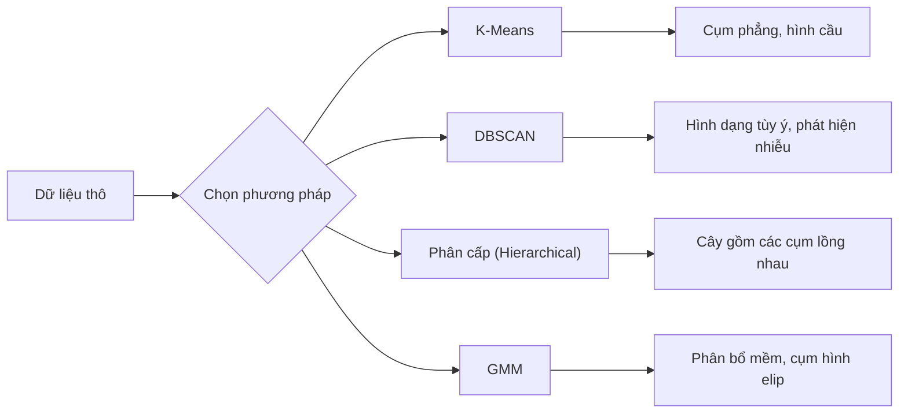

# Học Không Giám sát (Unsupervised Learning)

> Không nhãn, không người thầy. Thuật toán tự mình tìm ra cấu trúc ẩn giấu.

**Type:** Build
**Languages:** Python
**Prerequisites:** Phase 1 (Norms & Distances, Probability & Distributions), Phase 2 Lessons 1-6
**Time:** ~90 minutes

## Learning Objectives

- Cài đặt K-Means, DBSCAN, và Mô hình Hỗn hợp Gauss (Gaussian Mixture Models - GMM) từ đầu cũng như so sánh hành vi phân cụm của chúng
- Đánh giá chất lượng cụm bằng điểm bóng dáng (silhouette score) và phương pháp khuỷu tay (elbow method) để chọn số cụm $K$ tối ưu
- Giải thích khi nào DBSCAN vượt trội hơn K-Means và xác định thuật toán nào xử lý được các cụm không có dạng hình cầu cùng các điểm ngoại lai (outliers)
- Xây dựng đường ống phát hiện bất thường (anomaly detection pipeline) sử dụng các phương pháp phân cụm để gắn cờ những điểm chệch khỏi quy luật thông thường

## Vấn đề (The Problem)

Mọi bài học Học máy từ đầu đến giờ đều giả định dữ liệu đã được gán nhãn: "đây là đầu vào, còn đây là đầu ra đúng." Trong thế giới thực, nhãn dữ liệu rất đắt đỏ. Một bệnh viện có hàng triệu hồ sơ bệnh nhân nhưng chưa ai gắn thẻ thủ công từng hồ sơ vào một danh mục bệnh. Một trang thương mại điện tử có hàng triệu phiên truy cập của người dùng nhưng chưa ai gán nhãn tay các phân khúc khách hàng. Một đội ngũ an ninh mạng có nhật ký mạng khổng lồ nhưng không ai đánh dấu sẵn từng hành vi bất thường.

**Học không giám sát (Unsupervised learning)** tìm kiếm các quy luật mà không cần được chỉ bảo trước phải tìm kiếm điều gì. Nó nhóm các điểm dữ liệu tương đồng lại với nhau, khám phá các cấu trúc ẩn, và làm lộ diện các điểm bất thường. Nếu học có giám sát giống như học từ sách giáo khoa có sẵn đáp án, thì học không giám sát giống như việc nhìn chăm chú vào dữ liệu thô cho đến khi các quy luật tự hiện ra.

Điểm khó khăn là: khi không có nhãn, bạn không thể đo lường trực tiếp "đúng" hay "sai". Bạn cần những công cụ khác để đánh giá xem liệu cấu trúc mà thuật toán tìm thấy có thực sự mang ý nghĩa hay không.

## Khái niệm (The Concept)

### Phân cụm: Nhóm những thứ tương đồng lại với nhau (Clustering: Grouping Similar Things Together)

Phân cụm (Clustering) gán mỗi điểm dữ liệu vào một nhóm (cụm - cluster) sao cho các điểm trong cùng một nhóm tương đồng với nhau hơn so với các điểm thuộc nhóm khác. Câu hỏi đặt ra luôn là: "tương đồng" có nghĩa là gì?



### K-Means: Chú ngựa thồ bền bỉ (The Workhorse)

K-Means phân hoạch dữ liệu thành đúng $K$ cụm. Mỗi cụm có một **tâm cụm (centroid)** — tức tâm khối lượng của nó — và mọi điểm dữ liệu đều thuộc về tâm cụm gần nhất.

Thuật toán Lloyd (Lloyd's algorithm):

1. Chọn ngẫu nhiên $K$ điểm làm các tâm cụm ban đầu
2. Gán mỗi điểm dữ liệu về tâm cụm gần nhất
3. Tính lại mỗi tâm cụm bằng trung bình cộng (mean) của các điểm được gán vào cụm đó
4. Lặp lại bước 2–3 cho đến khi việc phân bổ cụm không còn thay đổi

Hàm mục tiêu (**quán tính - inertia**) đo tổng bình phương khoảng cách từ mỗi điểm đến tâm cụm được gán của nó. K-Means cực tiểu hóa đại lượng này, nhưng chỉ tìm được cực tiểu cục bộ (local minimum). Các cách khởi tạo khác nhau có thể dẫn đến những kết quả khác nhau.

### Chọn K

Hai phương pháp tiêu chuẩn:

**Phương pháp khuỷu tay (Elbow method):** Chạy K-Means với $K = 1, 2, 3, \ldots, n$. Vẽ biểu đồ inertia theo $K$. Tìm điểm "khuỷu tay" (elbow) — nơi việc tăng thêm số cụm không còn giúp giảm inertia một cách đáng kể nữa.

**Điểm bóng dáng (Silhouette score):** Đối với mỗi điểm, đo mức độ tương đồng của nó với cụm của chính nó ($a$) so với cụm khác gần nhất ($b$). Hệ số silhouette là $(b - a) / \max(a, b)$, nằm trong khoảng từ $-1$ (sai cụm) đến $+1$ (phân cụm rất tốt). Lấy trung bình trên toàn bộ các điểm để có điểm số tổng thể.

### DBSCAN: Phân cụm dựa trên mật độ (Density-Based Clustering)

K-Means giả định các cụm có dạng hình cầu và đòi hỏi bạn phải chọn trước $K$. **DBSCAN** không cần cả hai giả định đó. Nó tìm kiếm các cụm dưới dạng những vùng có mật độ dày đặc được ngăn cách bởi các vùng thưa thớt.

Hai siêu tham số:
- **eps**: bán kính của vùng lân cận
- **min_samples**: số lượng điểm tối thiểu cần thiết để tạo thành một vùng đặc (dense region)

Ba loại điểm:
- **Điểm lõi (Core point)**: có ít nhất `min_samples` điểm nằm trong khoảng cách `eps`
- **Điểm biên (Border point)**: nằm trong bán kính `eps` của một điểm lõi nhưng bản thân nó không phải là điểm lõi
- **Điểm nhiễu (Noise point)**: không phải điểm lõi cũng không phải điểm biên. Đây chính là các điểm ngoại lai (outliers).

DBSCAN kết nối các điểm lõi nằm trong khoảng cách `eps` của nhau vào chung một cụm. Các điểm biên gia nhập vào cụm của điểm lõi lân cận. Các điểm nhiễu không thuộc về bất kỳ cụm nào.

Điểm mạnh: tìm được các cụm có hình dạng bất kỳ, tự động xác định số lượng cụm, và phát hiện được điểm ngoại lai. Điểm yếu: gặp khó khăn khi các cụm có mật độ chênh lệch nhau lớn.

### Phân cụm phân cấp (Hierarchical Clustering)

Xây dựng một cây (**biểu đồ nhánh cây - dendrogram**) gồm các cụm lồng nhau.

Phương pháp tích tụ (Agglomerative — từ dưới lên):
1. Bắt đầu với việc coi mỗi điểm là một cụm riêng biệt
2. Hợp nhất hai cụm gần nhau nhất
3. Lặp lại cho đến khi chỉ còn duy nhất một cụm
4. Cắt dendrogram tại mức mong muốn để thu được $K$ cụm

Độ "gần nhau" giữa hai cụm có thể được đo bằng:
- **Liên kết đơn (Single linkage)**: khoảng cách nhỏ nhất giữa hai điểm bất kỳ thuộc hai cụm
- **Liên kết đầy đủ (Complete linkage)**: khoảng cách lớn nhất giữa hai điểm bất kỳ thuộc hai cụm
- **Liên kết trung bình (Average linkage)**: khoảng cách trung bình giữa tất cả các cặp điểm
- **Phương pháp Ward (Ward's method)**: phép hợp nhất làm tăng tổng phương sai nội cụm (within-cluster variance) ít nhất

### Mô hình Hỗn hợp Gauss (Gaussian Mixture Models - GMM)

K-Means đưa ra các **phép gán cứng (hard assignments)**: mỗi điểm chỉ thuộc về duy nhất một cụm. **GMM** đưa ra các **phép gán mềm (soft assignments)**: mỗi điểm có một xác suất thuộc về từng cụm.

GMM giả định dữ liệu được sinh ra từ một hỗn hợp gồm $K$ phân phối chuẩn (Gaussian distributions), mỗi phân phối có kỳ vọng (mean) và ma trận hiệp phương sai (covariance) riêng. Thuật toán **Kỳ vọng - Cực đại hóa (Expectation-Maximization - EM)** luân phiên thực hiện hai bước:

- **Bước E (E-step)**: tính xác suất để mỗi điểm dữ liệu thuộc về từng phân phối Gauss
- **Bước M (M-step)**: cập nhật kỳ vọng, phương sai/hiệp phương sai, và trọng số pha trộn (mixing weight) của từng phân phối Gauss nhằm tối đa hóa hàm hợp lý (likelihood) của dữ liệu

GMM có thể mô hình hóa các cụm hình elip (chứ không chỉ hình cầu như K-Means) và xử lý tự nhiên các cụm chồng lấn lên nhau.

### Khi nào nên dùng phương pháp nào (When to Use Which)

| Phương pháp | Tốt nhất cho | Tránh dùng khi |
|-------------|--------------|----------------|
| K-Means | Tập dữ liệu lớn, cụm hình cầu, đã biết trước $K$ | Hình dạng cụm bất quy tắc, có nhiều điểm ngoại lai |
| DBSCAN | Chưa biết $K$, hình dạng tùy ý, cần phát hiện ngoại lai | Các cụm có mật độ khác nhau, số chiều quá cao |
| Hierarchical | Tập dữ liệu nhỏ, cần biểu đồ dendrogram, chưa biết $K$ | Tập dữ liệu lớn (tốn bộ nhớ $O(n^2)$) |
| GMM | Các cụm chồng lấn, cần gán cụm theo xác suất (soft assignments) | Tập dữ liệu cực lớn, quá nhiều chiều |

### Phát hiện bất thường bằng Phân cụm (Anomaly Detection with Clustering)

Phân cụm hỗ trợ tự nhiên cho bài toán phát hiện bất thường:
- **K-Means**: các điểm nằm quá xa mọi tâm cụm là điểm bất thường
- **DBSCAN**: các điểm nhiễu (noise points) nghiễm nhiên là điểm bất thường theo định nghĩa
- **GMM**: các điểm có mật độ xác suất thấp dưới tất cả các phân phối Gauss là điểm bất thường

```figure
kmeans-step
```

## Xây dựng (Build It)

### Bước 1: K-Means từ đầu

```python
import math
import random


def euclidean_distance(a, b):
    return math.sqrt(sum((ai - bi) ** 2 for ai, bi in zip(a, b)))


def kmeans(data, k, max_iterations=100, seed=42):
    random.seed(seed)
    n_features = len(data[0])

    centroids = random.sample(data, k)

    for iteration in range(max_iterations):
        clusters = [[] for _ in range(k)]
        assignments = []

        for point in data:
            distances = [euclidean_distance(point, c) for c in centroids]
            nearest = distances.index(min(distances))
            clusters[nearest].append(point)
            assignments.append(nearest)

        new_centroids = []
        for cluster in clusters:
            if len(cluster) == 0:
                new_centroids.append(random.choice(data))
                continue
            centroid = [
                sum(point[j] for point in cluster) / len(cluster)
                for j in range(n_features)
            ]
            new_centroids.append(centroid)

        if all(
            euclidean_distance(old, new) < 1e-6
            for old, new in zip(centroids, new_centroids)
        ):
            print(f"  Converged at iteration {iteration + 1}")
            break

        centroids = new_centroids

    return assignments, centroids
```

### Bước 2: Phương pháp khuỷu tay và điểm bóng dáng (Elbow method and silhouette score)

```python
def compute_inertia(data, assignments, centroids):
    total = 0.0
    for point, cluster_id in zip(data, assignments):
        total += euclidean_distance(point, centroids[cluster_id]) ** 2
    return total


def silhouette_score(data, assignments):
    n = len(data)
    if n < 2:
        return 0.0

    clusters = {}
    for i, c in enumerate(assignments):
        clusters.setdefault(c, []).append(i)

    if len(clusters) < 2:
        return 0.0

    scores = []
    for i in range(n):
        own_cluster = assignments[i]
        own_members = [j for j in clusters[own_cluster] if j != i]

        if len(own_members) == 0:
            scores.append(0.0)
            continue

        a = sum(euclidean_distance(data[i], data[j]) for j in own_members) / len(own_members)

        b = float("inf")
        for cluster_id, members in clusters.items():
            if cluster_id == own_cluster:
                continue
            avg_dist = sum(euclidean_distance(data[i], data[j]) for j in members) / len(members)
            b = min(b, avg_dist)

        if max(a, b) == 0:
            scores.append(0.0)
        else:
            scores.append((b - a) / max(a, b))

    return sum(scores) / len(scores)


def find_best_k(data, max_k=10):
    print("Elbow method:")
    inertias = []
    for k in range(1, max_k + 1):
        assignments, centroids = kmeans(data, k)
        inertia = compute_inertia(data, assignments, centroids)
        inertias.append(inertia)
        print(f"  K={k}: inertia={inertia:.2f}")

    print("\nSilhouette scores:")
    for k in range(2, max_k + 1):
        assignments, centroids = kmeans(data, k)
        score = silhouette_score(data, assignments)
        print(f"  K={k}: silhouette={score:.4f}")

    return inertias
```

### Bước 3: DBSCAN từ đầu

```python
def dbscan(data, eps, min_samples):
    n = len(data)
    labels = [-1] * n
    cluster_id = 0

    def region_query(point_idx):
        neighbors = []
        for i in range(n):
            if euclidean_distance(data[point_idx], data[i]) <= eps:
                neighbors.append(i)
        return neighbors

    visited = [False] * n

    for i in range(n):
        if visited[i]:
            continue
        visited[i] = True

        neighbors = region_query(i)

        if len(neighbors) < min_samples:
            labels[i] = -1
            continue

        labels[i] = cluster_id
        seed_set = list(neighbors)
        seed_set.remove(i)

        j = 0
        while j < len(seed_set):
            q = seed_set[j]

            if not visited[q]:
                visited[q] = True
                q_neighbors = region_query(q)
                if len(q_neighbors) >= min_samples:
                    for nb in q_neighbors:
                        if nb not in seed_set:
                            seed_set.append(nb)

            if labels[q] == -1:
                labels[q] = cluster_id

            j += 1

        cluster_id += 1

    return labels
```

### Bước 4: Mô hình Hỗn hợp Gauss (Thuật toán EM)

```python
def gmm(data, k, max_iterations=100, seed=42):
    random.seed(seed)
    n = len(data)
    d = len(data[0])

    indices = random.sample(range(n), k)
    means = [list(data[i]) for i in indices]
    variances = [1.0] * k
    weights = [1.0 / k] * k

    def gaussian_pdf(x, mean, variance):
        d = len(x)
        coeff = 1.0 / ((2 * math.pi * variance) ** (d / 2))
        exponent = -sum((xi - mi) ** 2 for xi, mi in zip(x, mean)) / (2 * variance)
        return coeff * math.exp(max(exponent, -500))

    for iteration in range(max_iterations):
        responsibilities = []
        for i in range(n):
            probs = []
            for j in range(k):
                probs.append(weights[j] * gaussian_pdf(data[i], means[j], variances[j]))
            total = sum(probs)
            if total == 0:
                total = 1e-300
            responsibilities.append([p / total for p in probs])

        old_means = [list(m) for m in means]

        for j in range(k):
            r_sum = sum(responsibilities[i][j] for i in range(n))
            if r_sum < 1e-10:
                continue

            weights[j] = r_sum / n

            for dim in range(d):
                means[j][dim] = sum(
                    responsibilities[i][j] * data[i][dim] for i in range(n)
                ) / r_sum

            variances[j] = sum(
                responsibilities[i][j]
                * sum((data[i][dim] - means[j][dim]) ** 2 for dim in range(d))
                for i in range(n)
            ) / (r_sum * d)
            variances[j] = max(variances[j], 1e-6)

        shift = sum(
            euclidean_distance(old_means[j], means[j]) for j in range(k)
        )
        if shift < 1e-6:
            print(f"  GMM converged at iteration {iteration + 1}")
            break

    assignments = []
    for i in range(n):
        assignments.append(responsibilities[i].index(max(responsibilities[i])))

    return assignments, means, weights, responsibilities
```

### Bước 5: Tạo dữ liệu kiểm thử và chạy toàn bộ

```python
def make_blobs(centers, n_per_cluster=50, spread=0.5, seed=42):
    random.seed(seed)
    data = []
    true_labels = []
    for label, (cx, cy) in enumerate(centers):
        for _ in range(n_per_cluster):
            x = cx + random.gauss(0, spread)
            y = cy + random.gauss(0, spread)
            data.append([x, y])
            true_labels.append(label)
    return data, true_labels


def make_moons(n_samples=200, noise=0.1, seed=42):
    random.seed(seed)
    data = []
    labels = []
    n_half = n_samples // 2
    for i in range(n_half):
        angle = math.pi * i / n_half
        x = math.cos(angle) + random.gauss(0, noise)
        y = math.sin(angle) + random.gauss(0, noise)
        data.append([x, y])
        labels.append(0)
    for i in range(n_half):
        angle = math.pi * i / n_half
        x = 1 - math.cos(angle) + random.gauss(0, noise)
        y = 1 - math.sin(angle) - 0.5 + random.gauss(0, noise)
        data.append([x, y])
        labels.append(1)
    return data, labels


if __name__ == "__main__":
    centers = [[2, 2], [8, 3], [5, 8]]
    data, true_labels = make_blobs(centers, n_per_cluster=50, spread=0.8)

    print("=== K-Means on 3 blobs ===")
    assignments, centroids = kmeans(data, k=3)
    print(f"  Centroids: {[[round(c, 2) for c in cent] for cent in centroids]}")
    sil = silhouette_score(data, assignments)
    print(f"  Silhouette score: {sil:.4f}")

    print("\n=== Elbow Method ===")
    find_best_k(data, max_k=6)

    print("\n=== DBSCAN on 3 blobs ===")
    db_labels = dbscan(data, eps=1.5, min_samples=5)
    n_clusters = len(set(db_labels) - {-1})
    n_noise = db_labels.count(-1)
    print(f"  Found {n_clusters} clusters, {n_noise} noise points")

    print("\n=== GMM on 3 blobs ===")
    gmm_assignments, gmm_means, gmm_weights, _ = gmm(data, k=3)
    print(f"  Means: {[[round(m, 2) for m in mean] for mean in gmm_means]}")
    print(f"  Weights: {[round(w, 3) for w in gmm_weights]}")
    gmm_sil = silhouette_score(data, gmm_assignments)
    print(f"  Silhouette score: {gmm_sil:.4f}")

    print("\n=== DBSCAN on moons (non-spherical clusters) ===")
    moon_data, moon_labels = make_moons(n_samples=200, noise=0.1)
    moon_db = dbscan(moon_data, eps=0.3, min_samples=5)
    n_moon_clusters = len(set(moon_db) - {-1})
    n_moon_noise = moon_db.count(-1)
    print(f"  Found {n_moon_clusters} clusters, {n_moon_noise} noise points")

    print("\n=== K-Means on moons (will fail to separate) ===")
    moon_km, moon_centroids = kmeans(moon_data, k=2)
    moon_sil = silhouette_score(moon_data, moon_km)
    print(f"  Silhouette score: {moon_sil:.4f}")
    print("  K-Means splits moons poorly because they are not spherical")

    print("\n=== Anomaly detection with DBSCAN ===")
    anomaly_data = list(data)
    anomaly_data.append([20.0, 20.0])
    anomaly_data.append([-5.0, -5.0])
    anomaly_data.append([15.0, 0.0])
    anomaly_labels = dbscan(anomaly_data, eps=1.5, min_samples=5)
    anomalies = [
        anomaly_data[i]
        for i in range(len(anomaly_labels))
        if anomaly_labels[i] == -1
    ]
    print(f"  Detected {len(anomalies)} anomalies")
    for a in anomalies[-3:]:
        print(f"    Point {[round(v, 2) for v in a]}")
```

## Sử dụng (Use It)

Với scikit-learn, cùng những thuật toán trên chỉ gói gọn trong một dòng lệnh:

```python
from sklearn.cluster import KMeans, DBSCAN, AgglomerativeClustering
from sklearn.mixture import GaussianMixture
from sklearn.metrics import silhouette_score as sklearn_silhouette

km = KMeans(n_clusters=3, random_state=42).fit(data)
db = DBSCAN(eps=1.5, min_samples=5).fit(data)
agg = AgglomerativeClustering(n_clusters=3).fit(data)
gmm_model = GaussianMixture(n_components=3, random_state=42).fit(data)
```

Các phiên bản tự viết từ đầu giúp bạn thấy chính xác những gì các thư viện này tính toán bên dưới. K-Means lặp đi lặp lại giữa việc gán cụm và tính lại tâm cụm. DBSCAN mở rộng các cụm từ những hạt giống có mật độ cao. GMM luân phiên giữa bước kỳ vọng (E) và bước cực đại hóa (M). Các phiên bản thư viện bổ sung thêm tính ổn định số học, cách khởi tạo thông minh hơn (K-Means++), và tăng tốc phần cứng, nhưng logic cốt lõi hoàn toàn giống nhau.

## Đóng gói (Ship It)

Bài học này tạo ra các bản cài đặt hoạt động hoàn chỉnh cho K-Means, DBSCAN, và GMM từ đầu. Mã nguồn phân cụm này có thể được tái sử dụng làm nền tảng cho các phương pháp học không giám sát nâng cao hơn.

## Bài tập (Exercises)

1. Cài đặt phương pháp khởi tạo **K-Means++**: thay vì chọn ngẫu nhiên toàn bộ các tâm cụm, hãy chọn tâm cụm đầu tiên ngẫu nhiên và chọn mỗi tâm cụm tiếp theo với xác suất tỷ lệ thuận với bình phương khoảng cách từ điểm đó đến tâm cụm hiện có gần nhất. So sánh tốc độ hội tụ với cách khởi tạo ngẫu nhiên.
2. Bổ sung thuật toán phân cụm phân cấp tích tụ (hierarchical agglomerative clustering) vào mã nguồn. Cài đặt liên kết Ward (Ward's linkage) và tạo ra một biểu đồ dendrogram (dưới dạng một danh sách lồng nhau lưu các bước hợp nhất). Cắt cây ở các mức khác nhau và so sánh với kết quả của K-Means.
3. Xây dựng một đường ống phát hiện bất thường đơn giản: chạy cả DBSCAN và GMM trên cùng một tập dữ liệu, gắn cờ các điểm mà cả hai phương pháp đều đồng thuận là điểm ngoại lai (điểm nhiễu trong DBSCAN, điểm có xác suất thấp trong GMM). Đo mức độ giao thoa và thảo luận xem khi nào hai phương pháp này bất đồng.

## Thuật ngữ chính (Key Terms)

| Thuật ngữ | Cách mọi người thường gọi | Ý nghĩa thực sự |
|-----------|--------------------------|-----------------|
| Clustering (Phân cụm) | "Nhóm những thứ tương đồng lại" | Phân hoạch dữ liệu thành các tập con sao cho độ tương đồng nội nhóm lớn hơn độ tương đồng liên nhóm, được đo bằng một thước đo khoảng cách cụ thể |
| Centroid (Tâm cụm) | "Tâm của một cụm" | Trung bình cộng của tất cả các điểm được gán vào một cụm; được K-Means sử dụng làm đại diện cho cụm đó |
| Inertia (Quán tính) | "Độ chặt của các cụm" | Tổng bình phương khoảng cách từ mỗi điểm đến tâm cụm được gán của nó; càng thấp thì cụm càng gom chặt |
| Silhouette score (Điểm bóng dáng) | "Độ tách biệt giữa các cụm" | Với mỗi điểm, $(b - a) / \max(a, b)$ trong đó $a$ là khoảng cách trung bình nội cụm và $b$ là khoảng cách trung bình tới cụm khác gần nhất |
| Core point (Điểm lõi) | "Điểm nằm trong vùng đặc" | Một điểm có ít nhất `min_samples` láng giềng trong khoảng cách `eps` đối với thuật toán DBSCAN |
| EM algorithm (Thuật toán EM) | "K-Means mềm" | Expectation-Maximization: lặp đi lặp lại việc tính xác suất thành viên (bước E) và cập nhật các tham số phân phối (bước M) |
| Dendrogram (Biểu đồ nhánh cây) | "Cây phân cụm" | Sơ đồ hình cây biểu diễn thứ tự và khoảng cách mà tại đó các cụm được hợp nhất trong phân cụm phân cấp |
| Anomaly (Điểm bất thường) | "Điểm ngoại lai (outlier)" | Một điểm dữ liệu không tuân theo quy luật kỳ vọng, được xác định là nhiễu bởi DBSCAN hoặc có xác suất thấp bởi GMM |

## Đọc thêm (Further Reading)

- [Stanford CS229 - Unsupervised Learning](https://cs229.stanford.edu/notes2022fall/main_notes.pdf) - bài giảng của Andrew Ng về phân cụm và thuật toán EM
- [scikit-learn Clustering Guide](https://scikit-learn.org/stable/modules/clustering.html) - so sánh thực tế tất cả các thuật toán phân cụm kèm ví dụ trực quan
- [DBSCAN original paper (Ester et al., 1996)](https://www.aaai.org/Papers/KDD/1996/KDD96-037.pdf) - bài báo gốc giới thiệu phương pháp phân cụm dựa trên mật độ

