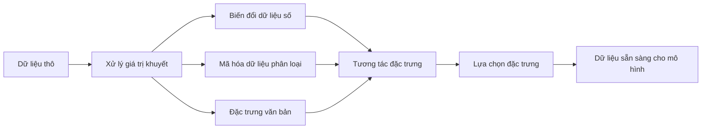

# Kỹ thuật & Lựa chọn Đặc trưng (Feature Engineering & Selection)

> Một đặc trưng tốt đáng giá bằng cả nghìn điểm dữ liệu.

**Type:** Build
**Languages:** Python
**Prerequisites:** Phase 1 (Statistics for ML, Linear Algebra), Phase 2 Lessons 1-7
**Time:** ~90 minutes

## Learning Objectives

- Cài đặt các phép biến đổi số học (chuẩn hóa z-score, co giãn min-max, biến đổi log, chia thùng binning) và giải thích khi nào nên áp dụng từng phép
- Xây dựng mã hóa one-hot, label, và target encoding cho các đặc trưng phân loại cũng như nhận diện rủi ro rò rỉ dữ liệu (data leakage) trong target encoding
- Tự xây dựng bộ vector hóa TF-IDF từ đầu và giải thích tại sao nó vượt trội hơn phép đếm từ thô trong bài toán phân loại văn bản
- Áp dụng các phương pháp lọc để lựa chọn đặc trưng (ngưỡng phương sai, hệ số tương quan, thông tin tương hỗ mutual information) nhằm giảm chiều dữ liệu

## Vấn đề (The Problem)

Bạn có một tập dữ liệu. Bạn chọn một thuật toán. Bạn huấn luyện nó. Kết quả thu được chỉ ở mức bình thường. Bạn thử một thuật toán phức tạp hơn. Kết quả vẫn bình thường. Bạn dành cả tuần để tinh chỉnh siêu tham số (hyperparameters). Hiệu quả chỉ nhích thêm một chút.

Thế rồi ai đó biến đổi dữ liệu thô thành các đặc trưng tốt hơn, và một mô hình hồi quy logistic đơn giản bỗng đánh bại cả mô hình tổ hợp gradient boosting đã được tinh chỉnh kỳ công của bạn.

Điều này xảy ra liên tục. Trong học máy cổ điển (classical ML), cách biểu diễn dữ liệu quan trọng hơn nhiều so với việc lựa chọn thuật toán. Một mô hình định giá nhà với các đặc trưng "diện tích sàn" và "số phòng ngủ" sẽ luôn vượt trội một mô hình chỉ nhận "địa chỉ dưới dạng chuỗi thô", bất kể thuật toán học phức tạp đến đâu. Thuật toán chỉ có thể làm việc với những gì bạn cung cấp cho nó.

**Kỹ thuật đặc trưng (Feature engineering)** là quá trình biến đổi dữ liệu thô thành các dạng biểu diễn giúp mô hình dễ dàng tìm ra quy luật hơn. **Lựa chọn đặc trưng (Feature selection)** là quá trình loại bỏ các đặc trưng chỉ làm tăng nhiễu mà không cung cấp thêm tín hiệu hữu ích. Kết hợp lại, đây chính là hoạt động có đòn bẩy cao nhất trong học máy cổ điển.

## Khái niệm (The Concept)

### Đường ống xử lý đặc trưng (The Feature Pipeline)



### Đặc trưng số học (Numerical Features)

Các con số thô hiếm khi sẵn sàng để đưa thẳng vào mô hình. Các phép biến đổi phổ biến:

**Co giãn (Scaling):** Đưa các đặc trưng về cùng một miền giá trị để các thuật toán dựa trên khoảng cách (K-Means, KNN, SVM) đối xử công bằng với mọi đặc trưng. Co giãn Min-max đưa dữ liệu về khoảng $[0, 1]$. Chuẩn hóa hóa (Standardization / z-score) đưa dữ liệu về kỳ vọng mean = 0, độ lệch chuẩn std = 1.

**Biến đổi Log (Log transform):** Nén các phân phối bị lệch phải (thu nhập, dân số, số lần xuất hiện của từ). Biến đổi các mối quan hệ dạng nhân thành dạng cộng.

**Chia thùng (Binning):** Chuyển đổi các giá trị liên tục thành các danh mục rời rạc. Hữu ích khi mối quan hệ giữa đặc trưng và mục tiêu có dạng bậc thang phi tuyến (ví dụ: các nhóm tuổi).

**Đặc trưng đa thức (Polynomial features):** Tạo ra các số hạng bậc cao như $x^2$, $x^3$, $x_1 x_2$. Cho phép các mô hình tuyến tính nắm bắt được các mối quan hệ phi tuyến với cái giá phải trả là số lượng đặc trưng tăng lên.

### Đặc trưng phân loại (Categorical Features)

Mô hình chỉ hiểu các con số. Dữ liệu phân loại (danh mục) cần phải được mã hóa.

**Mã hóa One-hot (One-hot encoding):** Tạo một cột nhị phân cho mỗi danh mục. "Màu sắc = đỏ/xanh dương/xanh lá" trở thành ba cột: `is_red`, `is_blue`, `is_green`. Hoạt động tốt cho các đặc trưng có ít danh mục (low cardinality), nhưng sẽ bùng nổ số chiều nếu có quá nhiều danh mục.

**Mã hóa nhãn (Label encoding):** Ánh xạ mỗi danh mục thành một số nguyên: đỏ=0, xanh dương=1, xanh lá=2. Cách này vô tình tạo ra thứ tự giả (mô hình có thể hiểu nhầm là xanh lá > xanh dương > đỏ). Chỉ phù hợp cho các mô hình dạng cây quyết định vốn phân tách trên từng giá trị riêng lẻ.

**Mã hóa theo mục tiêu (Target encoding):** Thay thế mỗi danh mục bằng giá trị trung bình của biến mục tiêu ứng với danh mục đó. Rất mạnh mẽ nhưng nguy hiểm vì rủi ro rò rỉ dữ liệu (data leakage) cao. Phép tính này chỉ được phép tính trên tập huấn luyện rồi áp dụng sang tập kiểm thử.

### Đặc trưng văn bản (Text Features)

**Bộ vector hóa đếm (Count vectorizer):** Đếm số lần mỗi từ xuất hiện trong một tài liệu. Chuỗi "the cat sat on the mat" trở thành `{the: 2, cat: 1, sat: 1, on: 1, mat: 1}`.

**TF-IDF:** Tần suất từ - Nghịch đảo tần suất văn bản (Term Frequency-Inverse Document Frequency). Đánh trọng số cho từ dựa trên độ đặc trưng của nó trên toàn bộ tập văn bản. Những từ phổ biến như "the" nhận trọng số thấp. Những từ hiếm, mang tính nhận diện cao nhận trọng số lớn.

```math
\begin{aligned}
\text{TF}(\text{word}, \text{doc}) &= \frac{\text{count(word in doc)}}{\text{total words in doc}} \\
\text{IDF}(\text{word}) &= \log \frac{\text{total docs}}{\text{docs containing word}} \\
\text{TF-IDF} &= \text{TF} \cdot \text{IDF}
\end{aligned}
```

### Xử lý giá trị khuyết (Missing Values)

Dữ liệu thực tế luôn có lỗ hổng. Các chiến lược phổ biến:

- **Xóa dòng (Drop rows):** Chỉ nên dùng khi dữ liệu khuyết rất hiếm và ngẫu nhiên hoàn toàn.
- **Điền trung bình / trung vị (Mean/median imputation):** Đơn giản, giữ được tâm của phân phối (trung vị bền vững hơn trước ngoại lai), nhưng làm giảm phương sai và gom tất cả các giá trị điền vào một điểm đột biến, làm thay đổi hình dạng phân phối.
- **Điền yếu vị (Mode imputation):** Dùng giá trị xuất hiện nhiều nhất cho các đặc trưng phân loại.
- **Cột chỉ báo (Indicator column):** Thêm một cột nhị phân `was_this_missing` trước khi điền khuyết. Bản thân việc dữ liệu bị khuyết đôi khi lại mang thông tin quan trọng.
- **Điền tiến / điền lùi (Forward/backward fill):** Áp dụng cho dữ liệu chuỗi thời gian (time series).

### Tương tác đặc trưng (Feature Interaction)

Đôi khi mối quan hệ chỉ bộc lộ khi kết hợp các đặc trưng lại với nhau. "Chiều cao" và "cân nặng" đứng riêng rẽ sẽ kém dự đoán hơn chỉ số $\text{BMI} = \text{cân nặng} / \text{chiều cao}^2$. Tương tác đặc trưng làm bùng nổ không gian chiều, do đó hãy tận dụng hiểu biết chuyên ngành (domain knowledge) để chọn những tổ hợp hợp lý.

### Lựa chọn đặc trưng (Feature Selection)

Nhiều đặc trưng hơn không phải lúc nào cũng tốt hơn. Các đặc trưng thừa thãi mang lại nhiễu, làm tăng thời gian huấn luyện và có thể gây ra hiện tượng quá khớp (overfitting).

**Phương pháp lọc (Filter methods — độc lập với mô hình):**
- Tương quan (Correlation): loại bỏ các đặc trưng có độ tương quan quá cao với nhau (trùng lặp).
- Thông tin tương hỗ (Mutual information): đo lường mức độ giảm độ bất định của biến mục tiêu khi biết giá trị của một đặc trưng.
- Ngưỡng phương sai (Variance threshold): loại bỏ các đặc trưng gần như không biến thiên.

**Phương pháp bao bọc & nhúng (Wrapper / Embedded methods — dựa trên mô hình):**
- Điều chuẩn L1 (Lasso): triệt tiêu trọng số của các đặc trưng không quan trọng về đúng bằng 0.
- Loại bỏ đặc trưng đệ quy (Recursive feature elimination - RFE): huấn luyện mô hình, loại bỏ đặc trưng ít quan trọng nhất, lặp lại.

**Tại sao việc lựa chọn lại quan trọng:** Một mô hình với 10 đặc trưng tốt thường sẽ vượt trội hơn một mô hình có 10 đặc trưng tốt cộng thêm 90 đặc trưng nhiễu. Các đặc trưng nhiễu trao cho mô hình cơ hội để học vẹt những quy luật ngẫu nhiên trên tập huấn luyện mà không thể khái quát hóa.

```figure
feature-scaling
```

## Xây dựng (Build It)

### Bước 1: Các phép biến đổi số học từ đầu

```python
import math


def min_max_scale(values):
    min_val = min(values)
    max_val = max(values)
    if max_val == min_val:
        return [0.0] * len(values)
    return [(v - min_val) / (max_val - min_val) for v in values]


def standardize(values):
    n = len(values)
    mean = sum(values) / n
    variance = sum((v - mean) ** 2 for v in values) / n
    std = math.sqrt(variance) if variance > 0 else 1.0
    return [(v - mean) / std for v in values]


def log_transform(values):
    return [math.log(v + 1) for v in values]


def bin_values(values, n_bins=5):
    min_val = min(values)
    max_val = max(values)
    bin_width = (max_val - min_val) / n_bins
    if bin_width == 0:
        return [0] * len(values)
    result = []
    for v in values:
        bin_idx = int((v - min_val) / bin_width)
        bin_idx = min(bin_idx, n_bins - 1)
        result.append(bin_idx)
    return result


def polynomial_features(row, degree=2):
    n = len(row)
    result = list(row)
    if degree >= 2:
        for i in range(n):
            result.append(row[i] ** 2)
        for i in range(n):
            for j in range(i + 1, n):
                result.append(row[i] * row[j])
    return result
```

### Bước 2: Mã hóa biến phân loại từ đầu

```python
def one_hot_encode(values):
    categories = sorted(set(values))
    cat_to_idx = {cat: i for i, cat in enumerate(categories)}
    n_cats = len(categories)

    encoded = []
    for v in values:
        row = [0] * n_cats
        row[cat_to_idx[v]] = 1
        encoded.append(row)

    return encoded, categories


def label_encode(values):
    categories = sorted(set(values))
    cat_to_int = {cat: i for i, cat in enumerate(categories)}
    return [cat_to_int[v] for v in values], cat_to_int


def target_encode(feature_values, target_values, smoothing=10):
    global_mean = sum(target_values) / len(target_values)

    category_stats = {}
    for feat, target in zip(feature_values, target_values):
        if feat not in category_stats:
            category_stats[feat] = {"sum": 0.0, "count": 0}
        category_stats[feat]["sum"] += target
        category_stats[feat]["count"] += 1

    encoding = {}
    for cat, stats in category_stats.items():
        cat_mean = stats["sum"] / stats["count"]
        weight = stats["count"] / (stats["count"] + smoothing)
        encoding[cat] = weight * cat_mean + (1 - weight) * global_mean

    return [encoding[v] for v in feature_values], encoding
```

### Bước 3: Đặc trưng văn bản từ đầu

```python
def count_vectorize(documents):
    vocab = {}
    idx = 0
    for doc in documents:
        for word in doc.lower().split():
            if word not in vocab:
                vocab[word] = idx
                idx += 1

    vectors = []
    for doc in documents:
        vec = [0] * len(vocab)
        for word in doc.lower().split():
            vec[vocab[word]] += 1
        vectors.append(vec)

    return vectors, vocab


def tfidf(documents):
    n_docs = len(documents)

    vocab = {}
    idx = 0
    for doc in documents:
        for word in doc.lower().split():
            if word not in vocab:
                vocab[word] = idx
                idx += 1

    doc_freq = {}
    for doc in documents:
        seen = set()
        for word in doc.lower().split():
            if word not in seen:
                doc_freq[word] = doc_freq.get(word, 0) + 1
                seen.add(word)

    vectors = []
    for doc in documents:
        words = doc.lower().split()
        word_count = len(words)
        tf_map = {}
        for word in words:
            tf_map[word] = tf_map.get(word, 0) + 1

        vec = [0.0] * len(vocab)
        for word, count in tf_map.items():
            tf = count / word_count
            idf = math.log(n_docs / doc_freq[word])
            vec[vocab[word]] = tf * idf
        vectors.append(vec)

    return vectors, vocab
```

### Bước 4: Xử lý giá trị khuyết từ đầu

```python
def impute_mean(values):
    present = [v for v in values if v is not None]
    if not present:
        return [0.0] * len(values), 0.0
    mean = sum(present) / len(present)
    return [v if v is not None else mean for v in values], mean


def impute_median(values):
    present = sorted(v for v in values if v is not None)
    if not present:
        return [0.0] * len(values), 0.0
    n = len(present)
    if n % 2 == 0:
        median = (present[n // 2 - 1] + present[n // 2]) / 2
    else:
        median = present[n // 2]
    return [v if v is not None else median for v in values], median


def impute_mode(values):
    present = [v for v in values if v is not None]
    if not present:
        return values, None
    counts = {}
    for v in present:
        counts[v] = counts.get(v, 0) + 1
    mode = max(counts, key=counts.get)
    return [v if v is not None else mode for v in values], mode


def add_missing_indicator(values):
    return [0 if v is not None else 1 for v in values]
```

### Bước 5: Lựa chọn đặc trưng từ đầu

```python
def correlation(x, y):
    n = len(x)
    mean_x = sum(x) / n
    mean_y = sum(y) / n
    cov = sum((xi - mean_x) * (yi - mean_y) for xi, yi in zip(x, y)) / n
    std_x = math.sqrt(sum((xi - mean_x) ** 2 for xi in x) / n)
    std_y = math.sqrt(sum((yi - mean_y) ** 2 for yi in y) / n)
    if std_x == 0 or std_y == 0:
        return 0.0
    return cov / (std_x * std_y)


def mutual_information(feature, target, n_bins=10):
    feat_min = min(feature)
    feat_max = max(feature)
    bin_width = (feat_max - feat_min) / n_bins if feat_max != feat_min else 1.0
    feat_binned = [
        min(int((f - feat_min) / bin_width), n_bins - 1) for f in feature
    ]

    n = len(feature)
    target_classes = sorted(set(target))

    feat_bins = sorted(set(feat_binned))
    p_feat = {}
    for b in feat_bins:
        p_feat[b] = feat_binned.count(b) / n

    p_target = {}
    for t in target_classes:
        p_target[t] = target.count(t) / n

    mi = 0.0
    for b in feat_bins:
        for t in target_classes:
            joint_count = sum(
                1 for fb, tv in zip(feat_binned, target) if fb == b and tv == t
            )
            p_joint = joint_count / n
            if p_joint > 0:
                mi += p_joint * math.log(p_joint / (p_feat[b] * p_target[t]))

    return mi


def variance_threshold(features, threshold=0.01):
    n_features = len(features[0])
    n_samples = len(features)
    selected = []

    for j in range(n_features):
        col = [features[i][j] for i in range(n_samples)]
        mean = sum(col) / n_samples
        var = sum((v - mean) ** 2 for v in col) / n_samples
        if var >= threshold:
            selected.append(j)

    return selected


def remove_correlated(features, threshold=0.9):
    n_features = len(features[0])
    n_samples = len(features)

    to_remove = set()
    for i in range(n_features):
        if i in to_remove:
            continue
        col_i = [features[r][i] for r in range(n_samples)]
        for j in range(i + 1, n_features):
            if j in to_remove:
                continue
            col_j = [features[r][j] for r in range(n_samples)]
            corr = abs(correlation(col_i, col_j))
            if corr >= threshold:
                to_remove.add(j)

    return [i for i in range(n_features) if i not in to_remove]
```

### Bước 6: Đường ống hoàn chỉnh và Demo

```python
import random


def make_housing_data(n=200, seed=42):
    random.seed(seed)
    data = []
    for _ in range(n):
        sqft = random.uniform(500, 5000)
        bedrooms = random.choice([1, 2, 3, 4, 5])
        age = random.uniform(0, 50)
        neighborhood = random.choice(["downtown", "suburbs", "rural"])
        has_pool = random.choice([True, False])

        sqft_with_missing = sqft if random.random() > 0.05 else None
        age_with_missing = age if random.random() > 0.08 else None

        price = (
            50 * sqft
            + 20000 * bedrooms
            - 1000 * age
            + (50000 if neighborhood == "downtown" else 10000 if neighborhood == "suburbs" else 0)
            + (15000 if has_pool else 0)
            + random.gauss(0, 20000)
        )

        data.append({
            "sqft": sqft_with_missing,
            "bedrooms": bedrooms,
            "age": age_with_missing,
            "neighborhood": neighborhood,
            "has_pool": has_pool,
            "price": price,
        })
    return data


if __name__ == "__main__":
    data = make_housing_data(200)

    print("=== Dữ liệu thô mẫu ===")
    for row in data[:3]:
        print(f"  {row}")

    sqft_raw = [d["sqft"] for d in data]
    age_raw = [d["age"] for d in data]
    prices = [d["price"] for d in data]

    print("\n=== Xử lý giá trị khuyết ===")
    sqft_missing = sum(1 for v in sqft_raw if v is None)
    age_missing = sum(1 for v in age_raw if v is None)
    print(f"  sqft khuyết: {sqft_missing}/{len(sqft_raw)}")
    print(f"  age khuyết: {age_missing}/{len(age_raw)}")

    sqft_indicator = add_missing_indicator(sqft_raw)
    age_indicator = add_missing_indicator(age_raw)
    sqft_imputed, sqft_fill = impute_median(sqft_raw)
    age_imputed, age_fill = impute_mean(age_raw)
    print(f"  sqft điền bằng trung vị: {sqft_fill:.0f}")
    print(f"  age điền bằng trung bình: {age_fill:.1f}")

    print("\n=== Biến đổi số học ===")
    sqft_scaled = standardize(sqft_imputed)
    age_scaled = min_max_scale(age_imputed)
    sqft_log = log_transform(sqft_imputed)
    age_binned = bin_values(age_imputed, n_bins=5)
    print(f"  sqft chuẩn hóa: mean={sum(sqft_scaled)/len(sqft_scaled):.4f}, std={math.sqrt(sum(v**2 for v in sqft_scaled)/len(sqft_scaled)):.4f}")
    print(f"  age min-max: [{min(age_scaled):.2f}, {max(age_scaled):.2f}]")
    print(f"  age chia thùng: {sorted(set(age_binned))}")

    print("\n=== Mã hóa biến phân loại ===")
    neighborhoods = [d["neighborhood"] for d in data]

    ohe, ohe_cats = one_hot_encode(neighborhoods)
    print(f"  Các danh mục One-hot: {ohe_cats}")
    print(f"  Mã hóa mẫu: {neighborhoods[0]} -> {ohe[0]}")

    le, le_map = label_encode(neighborhoods)
    print(f"  Ánh xạ Label encoding: {le_map}")

    te, te_map = target_encode(neighborhoods, prices, smoothing=10)
    print(f"  Target encoding: {({k: round(v) for k, v in te_map.items()})}")

    print("\n=== Đặc trưng văn bản ===")
    descriptions = [
        "large modern house with pool",
        "small cozy cottage near downtown",
        "spacious family home with large yard",
        "modern apartment downtown with view",
        "rustic cabin in rural area",
    ]
    cv, cv_vocab = count_vectorize(descriptions)
    print(f"  Kích thước từ vựng: {len(cv_vocab)}")
    print(f"  Văn bản 0 có đặc trưng khác 0: {sum(1 for v in cv[0] if v > 0)}")

    tf, tf_vocab = tfidf(descriptions)
    print(f"  Kích thước từ vựng TF-IDF: {len(tf_vocab)}")
    top_words = sorted(tf_vocab.keys(), key=lambda w: tf[0][tf_vocab[w]], reverse=True)[:3]
    print(f"  Các từ TF-IDF cao nhất trong văn bản 0: {top_words}")

    print("\n=== Đặc trưng đa thức ===")
    sample_row = [sqft_scaled[0], age_scaled[0]]
    poly = polynomial_features(sample_row, degree=2)
    print(f"  Đầu vào: {[round(v, 4) for v in sample_row]}")
    print(f"  Đa thức: {[round(v, 4) for v in poly]}")
    print(f"  Các đặc trưng: [x1, x2, x1^2, x2^2, x1*x2]")

    print("\n=== Lựa chọn đặc trưng ===")
    feature_matrix = [
        [sqft_scaled[i], age_scaled[i], float(sqft_indicator[i]), float(age_indicator[i])]
        + ohe[i]
        for i in range(len(data))
    ]

    print(f"  Tổng số đặc trưng: {len(feature_matrix[0])}")

    surviving_var = variance_threshold(feature_matrix, threshold=0.01)
    print(f"  Sau khi lọc ngưỡng phương sai (0.01): giữ lại {len(surviving_var)} đặc trưng")

    surviving_corr = remove_correlated(feature_matrix, threshold=0.9)
    print(f"  Sau khi lọc tương quan (0.9): giữ lại {len(surviving_corr)} đặc trưng")

    binary_prices = [1 if p > sum(prices) / len(prices) else 0 for p in prices]
    print("\n  Thông tin tương hỗ với mục tiêu:")
    feature_names = ["sqft", "age", "sqft_missing", "age_missing"] + [f"neigh_{c}" for c in ohe_cats]
    for j in range(len(feature_matrix[0])):
        col = [feature_matrix[i][j] for i in range(len(feature_matrix))]
        mi = mutual_information(col, binary_prices, n_bins=10)
        print(f"    {feature_names[j]}: MI={mi:.4f}")

    print("\n  Tương quan tuyến tính với giá nhà:")
    for j in range(len(feature_matrix[0])):
        col = [feature_matrix[i][j] for i in range(len(feature_matrix))]
        corr = correlation(col, prices)
        print(f"    {feature_names[j]}: r={corr:.4f}")
```

## Sử dụng (Use It)

Với scikit-learn, các phép biến đổi này được kết nối thành các pipeline trực quan:

```python
from sklearn.preprocessing import StandardScaler, OneHotEncoder, PolynomialFeatures
from sklearn.impute import SimpleImputer
from sklearn.feature_extraction.text import TfidfVectorizer
from sklearn.feature_selection import mutual_info_classif, VarianceThreshold
from sklearn.compose import ColumnTransformer
from sklearn.pipeline import Pipeline

numeric_pipe = Pipeline([
    ("imputer", SimpleImputer(strategy="median")),
    ("scaler", StandardScaler()),
])

categorical_pipe = Pipeline([
    ("encoder", OneHotEncoder(sparse_output=False)),
])

preprocessor = ColumnTransformer([
    ("num", numeric_pipe, ["sqft", "age"]),
    ("cat", categorical_pipe, ["neighborhood"]),
])
```

Các phiên bản tự viết từ đầu giúp bạn hiểu chính xác điều gì xảy ra bên trong từng phép biến đổi. Phiên bản thư viện bổ sung việc xử lý các trường hợp biên, hỗ trợ ma trận thưa (sparse matrix) và ghép nối đường ống, nhưng bản chất toán học là hoàn toàn như nhau.

## Đóng gói (Ship It)

Bài học này cung cấp:
- `outputs/prompt-feature-engineer.md` — một bản prompt hướng dẫn kỹ thuật kiến tạo đặc trưng từ dữ liệu thô một cách có hệ thống.

## Bài tập (Exercises)

1. Bổ sung phép co giãn bền vững (Robust scaling — sử dụng trung vị và khoảng tứ phân vị IQR thay vì trung bình và độ lệch chuẩn). So sánh với chuẩn hóa thông thường trên dữ liệu có các điểm ngoại lai cực đoan.
2. Cài đặt mã hóa mục tiêu leave-one-out: với mỗi dòng, tính giá trị trung bình mục tiêu ngoại trừ chính dòng đó. Chứng minh cách này làm giảm quá khớp so với target encoding ngây thơ.
3. Xây dựng một đường ống lựa chọn đặc trưng tự động kết hợp ngưỡng phương sai, lọc tương quan và xếp hạng thông tin tương hỗ. Áp dụng cho tập dữ liệu nhà ở và so sánh hiệu năng mô hình (dùng hồi quy tuyến tính) giữa việc dùng tất cả đặc trưng so với các đặc trưng được chọn lọc.

## Thuật ngữ chính (Key Terms)

| Thuật ngữ | Cách gọi thông thường | Ý nghĩa thực sự |
|-----------|----------------------|-----------------|
| Feature engineering (Kỹ thuật đặc trưng) | "Tạo thêm cột mới" | Biến đổi dữ liệu thô thành các dạng biểu diễn làm lộ rõ các quy luật cho mô hình học |
| Standardization (Chuẩn hóa z-score) | "Đưa về dạng chuẩn" | Trừ đi kỳ vọng và chia cho độ lệch chuẩn để đặc trưng có mean=0 và std=1 |
| One-hot encoding (Mã hóa One-hot) | "Tạo biến giả (dummy variables)" | Tạo một cột nhị phân cho mỗi danh mục, mỗi dòng chỉ có đúng một cột mang giá trị 1 |
| Target encoding (Mã hóa theo mục tiêu) | "Dùng đáp án để mã hóa" | Thay thế mỗi danh mục bằng trung bình biến mục tiêu của danh mục đó, kèm hệ số làm trơn để chống quá khớp |
| TF-IDF | "Đếm từ nâng cao" | Term Frequency nhân với Inverse Document Frequency: từ được đánh trọng số theo mức độ đặc trưng trên toàn tập văn bản |
| Imputation (Điền giá trị khuyết) | "Điền vào chỗ trống" | Thay thế các giá trị bị khuyết bằng ước lượng hợp lý (mean, median, mode, hoặc dự đoán từ mô hình) |
| Feature selection (Lựa chọn đặc trưng) | "Bỏ bớt cột xấu" | Loại bỏ các đặc trưng chỉ thêm nhiễu hoặc dư thừa, chỉ giữ lại các đặc trưng mang tín hiệu |
| Mutual information (Thông tin tương hỗ) | "Một biến tiết lộ bao nhiêu về biến kia" | Thước đo mức độ giảm độ bất định của biến Y khi biết biến X |
| Data leakage (Rò rỉ dữ liệu) | "Vô tình gian lận" | Sử dụng các thông tin trong lúc huấn luyện mà trên thực tế sẽ không có sẵn ở thời điểm dự đoán, dẫn đến kết quả ảo tưởng |

## Đọc thêm (Further Reading)

- [Feature Engineering and Selection (Max Kuhn & Kjell Johnson)](http://www.feat.engineering/) — sách trực tuyến miễn phí bao quát toàn cảnh kỹ thuật đặc trưng
- [scikit-learn Preprocessing Guide](https://scikit-learn.org/stable/modules/preprocessing.html) — tài liệu tham khảo thực hành cho các phép biến đổi chuẩn
- [Target Encoding Done Right (Micci-Barreca, 2001)](https://dl.acm.org/doi/10.1145/507533.507538) — bài báo gốc về mã hóa mục tiêu có làm trơn (smoothing)

