# Đánh giá Mô hình (Model Evaluation)

> Một mô hình chỉ tốt ngang với cách bạn đo lường nó.

**Type:** Build
**Languages:** Python
**Prerequisites:** Phase 1 (Probability & Distributions, Statistics for ML), Phase 2 Lessons 1-8
**Time:** ~90 minutes

## Learning Objectives

- Cài đặt kiểm định chéo K-fold và Stratified K-fold từ đầu cũng như giải thích tại sao việc phân tầng lại tối quan trọng với dữ liệu mất cân bằng
- Tự tính toán độ chính xác (precision), độ thu hồi (recall), điểm F1, AUC-ROC và các thước đo hồi quy (MSE, RMSE, MAE, R-squared) từ đầu
- Phân tích đường cong học tập (learning curves) để chẩn đoán xem mô hình đang bị chệch cao (high bias) hay phương sai cao (high variance)
- Nhận diện các sai lầm đánh giá phổ biến bao gồm rò rỉ dữ liệu (data leakage), chọn sai thước đo, và làm ô nhiễm tập kiểm thử (test set contamination)

## Vấn đề (The Problem)

Bạn vừa huấn luyện xong một mô hình. Nó đạt độ chính xác (accuracy) 95% trên dữ liệu của bạn. Liệu nó có thực sự tốt?

Có thể có. Nhưng cũng có thể không. Nếu 95% dữ liệu của bạn thuộc về một lớp duy nhất, một mô hình ngớ ngẩn luôn luôn dự đoán lớp đó cũng sẽ đạt độ chính xác 95% trong khi hoàn toàn vô dụng. Nếu bạn đánh giá mô hình trên chính dữ liệu đã dùng để huấn luyện nó, con số 95% chẳng mang ý nghĩa gì vì mô hình chỉ đơn giản là học vẹt đáp án. Nếu dữ liệu có yếu tố thời gian và bạn xáo trộn ngẫu nhiên trước khi chia tập, mô hình có thể đã dùng dữ liệu tương lai để dự đoán quá khứ.

Đánh giá mô hình là nơi hầu hết các dự án học máy gặp thất bại. Chọn sai thước đo sẽ khiến một mô hình tồi trông có vẻ tuyệt vời. Chia dữ liệu sai cách sẽ để mô hình gian lận. So sánh sai phương pháp sẽ khiến bạn chọn nhầm mô hình kém hơn. Đánh giá đúng đắn không phải là tùy chọn — đó là lằn ranh phân định giữa một mô hình chạy trơn tru trong thực tế và một mô hình sụp đổ ngay khi gặp dữ liệu đời thực.

## Khái niệm (The Concept)

### Tập Huấn luyện, Thẩm định, Kiểm thử (Train, Validation, Test)


Ba tập phân chia với ba mục đích rạch ròi:

- **Tập huấn luyện (Training set):** Mô hình học trực tiếp từ dữ liệu này. Nó nhìn thấy các ví dụ này trong suốt quá trình huấn luyện.
- **Tập thẩm định (Validation set):** Dùng để tinh chỉnh siêu tham số và chọn lựa giữa các mô hình khác nhau. Mô hình không bao giờ trực tiếp học trên tập này, nhưng các quyết định kỹ thuật của bạn bị ảnh hưởng bởi nó.
- **Tập kiểm thử (Test set):** Chỉ được chạm vào đúng một lần duy nhất ở bước cuối cùng để báo cáo hiệu năng thực tế. Nếu bạn nhìn vào kết quả trên tập kiểm thử rồi quay lại điều chỉnh mô hình, nó không còn là tập kiểm thử nữa — nó đã trở thành một tập thẩm định thứ hai!

Tập kiểm thử là sự đảm bảo độc lập giúp phản ánh đúng hiệu năng của mô hình khi đối mặt với dữ liệu hoàn toàn mới lạ trong tương lai.

### Kiểm định chéo K-Fold (K-Fold Cross-Validation)

Với các tập dữ liệu nhỏ, việc chỉ chia một lần (train/val split) sẽ gây lãng phí dữ liệu và cho ra các ước lượng có độ nhiễu cao. Kiểm định chéo K-fold tận dụng tối đa dữ liệu cho cả việc huấn luyện và thẩm định:

```mermaid
flowchart TB
    subgraph Fold1["Fold 1"]
        direction LR
        V1["Val"] --- T1a["Train"] --- T1b["Train"] --- T1c["Train"] --- T1d["Train"]
    end
    subgraph Fold2["Fold 2"]
        direction LR
        T2a["Train"] --- V2["Val"] --- T2b["Train"] --- T2c["Train"] --- T2d["Train"]
    end
    subgraph Fold3["Fold 3"]
        direction LR
        T3a["Train"] --- T3b["Train"] --- V3["Val"] --- T3c["Train"] --- T3d["Train"]
    end
    subgraph Fold4["Fold 4"]
        direction LR
        T4a["Train"] --- T4b["Train"] --- T4c["Train"] --- V4["Val"] --- T4d["Train"]
    end
    subgraph Fold5["Fold 5"]
        direction LR
        T5a["Train"] --- T5b["Train"] --- T5c["Train"] --- T5d["Train"] --- V5["Val"]
    end
    Fold1 --> R["Trung bình điểm số"]
    Fold2 --> R
    Fold3 --> R
    Fold4 --> R
    Fold5 --> R
```



1. Chia dữ liệu thành $K$ phần (folds) có kích thước bằng nhau
2. Với mỗi phần, huấn luyện trên $K-1$ phần còn lại và thẩm định trên phần đó
3. Tính trung bình điểm số thẩm định của cả $K$ lần chạy

$K=5$ hoặc $K=10$ là các lựa chọn tiêu chuẩn. Mọi điểm dữ liệu đều được dùng để thẩm định đúng một lần. Điểm trung bình là một ước lượng ổn định hơn nhiều so với bất kỳ phép chia đơn lẻ nào.

**Phân tầng (Stratified K-fold):** Bảo toàn tỷ lệ phân bố giữa các lớp trong từng fold. Nếu dữ liệu có 70% lớp A và 30% lớp B, mỗi fold cũng sẽ duy trì xấp xỉ tỷ lệ đó. Điều này đặc biệt quan trọng với dữ liệu mất cân bằng (imbalanced data), nơi việc chia ngẫu nhiên có thể dồn toàn bộ các mẫu lớp thiểu số vào một fold duy nhất.

### Các thước đo phân loại (Classification Metrics)

**Ma trận nhầm lẫn (Confusion matrix):** Nền tảng của mọi thước đo. Với bài toán phân loại nhị phân:

|  | Dự đoán Dương (Positive) | Dự đoán Âm (Negative) |
|--|---|---|
| Thực tế Dương | Dương thật - True Positive (TP) | Âm giả - False Negative (FN) |
| Thực tế Âm | Dương giả - False Positive (FP) | Âm thật - True Negative (TN) |

Từ ma trận này, các thước đo khác được tính toán:

- **Accuracy (Độ chính xác tổng thể):** $(TP + TN) / (TP + TN + FP + FN)$. Tỷ lệ dự đoán đúng. Dễ gây hiểu lầm nghiêm trọng khi dữ liệu bị mất cân bằng lớp.
- **Precision (Độ chuẩn xác):** $TP / (TP + FP)$. Trong số tất cả những mẫu được dự đoán là Dương, có bao nhiêu mẫu thực sự là Dương? Dùng khi cái giá của dương tính giả (FP) là rất đắt (ví dụ: bộ lọc thư rác đánh dấu nhầm email quan trọng của khách hàng).
- **Recall (Độ thu hồi / Độ nhạy):** $TP / (TP + FN)$. Trong số tất cả các mẫu thực sự là Dương, mô hình đã bắt được bao nhiêu mẫu? Dùng khi cái giá của âm tính giả (FN) là chết người (ví dụ: tầm soát ung thư bỏ sót khối u).
- **F1-score:** $2 \cdot \text{precision} \cdot \text{recall} / (\text{precision} + \text{recall})$. Trung bình điều hòa giữa Precision và Recall. Cân bằng cả hai khi không có yêu cầu thiên lệch rõ rệt.
- **AUC-ROC:** Diện tích dưới đường cong ROC (Receiver Operating Characteristic). Biểu diễn tỷ lệ dương tính thật (TPR) so với tỷ lệ dương tính giả (FPR) ở nhiều ngưỡng phân loại khác nhau. AUC = 0.5 tương đương đoán mò ngẫu nhiên, AUC = 1.0 là phân tách hoàn hảo. Thước đo này không phụ thuộc vào một ngưỡng cụ thể nào: nó đo lường khả năng xếp hạng mẫu Dương cao hơn mẫu Âm của mô hình.

### Các thước đo hồi quy (Regression Metrics)

- **MSE (Sai số toàn phương trung bình):** $\text{mean}((y_{\text{thực}} - y_{\text{dự đoán}})^2)$. Phạt lỗi lớn theo hàm bậc hai. Rất nhạy cảm với các điểm ngoại lai.
- **RMSE (Căn bậc hai sai số toàn phương trung bình):** $\sqrt{\text{MSE}}$. Cùng đơn vị đo với biến mục tiêu, giúp việc diễn giải trực quan hơn nhiều so với MSE.
- **MAE (Sai số tuyệt đối trung bình):** $\text{mean}(\lvert y_{\text{thực}} - y_{\text{dự đoán}} \rvert)$. Đối xử công bằng và tuyến tính với mọi sai số. Bền vững trước các điểm ngoại lai hơn MSE.
- **R-squared ($R^2$ - Hệ số xác định):** $1 - SS_{\text{res}} / SS_{\text{tot}}$, với $SS_{\text{res}} = \sum (y_{\text{thực}} - y_{\text{dự đoán}})^2$ và $SS_{\text{tot}} = \sum (y_{\text{thực}} - y_{\text{trung bình}})^2$. Tỷ lệ phương sai của biến mục tiêu được giải thích bởi mô hình. $R^2 = 1.0$ là hoàn hảo. $R^2 = 0.0$ có nghĩa là mô hình không hơn gì việc luôn luôn dự đoán giá trị trung bình. $R^2$ có thể mang giá trị âm nếu mô hình còn tệ hơn cả mức trung bình.

### Đường cong học tập (Learning Curves)

Vẽ biểu đồ điểm số trên tập huấn luyện và tập thẩm định theo quy mô tập huấn luyện:

- **Độ chệch cao (High bias - Underfitting):** Cả hai đường cong đều hội tụ về một điểm số thấp. Việc bổ sung thêm dữ liệu sẽ không giúp ích gì. Bạn cần một mô hình phức tạp hơn.
- **Phương sai cao (High variance - Overfitting):** Điểm số trên tập huấn luyện rất cao nhưng trên tập thẩm định lại thấp hơn nhiều. Khoảng cách (gap) giữa hai đường là rất lớn. Việc thu thập thêm dữ liệu sẽ giúp thu hẹp khoảng cách này.

### Đường cong thẩm định (Validation Curves)

Vẽ biểu đồ điểm huấn luyện và thẩm định theo sự thay đổi của một siêu tham số:

- Ở độ phức tạp thấp: Cả hai điểm số đều thấp (dưới khớp - underfitting).
- Ở độ phức tạp phù hợp: Cả hai điểm số đều cao và áp sát nhau.
- Ở độ phức tạp quá cao: Điểm huấn luyện vẫn cao nhưng điểm thẩm định tụt dốc (quá khớp - overfitting).

Giá trị siêu tham số tối ưu chính là nơi điểm thẩm định đạt đỉnh cao nhất.

### Những sai lầm phổ biến khi đánh giá mô hình

**Rò rỉ dữ liệu (Data leakage):** Thông tin từ tập kiểm thử bị lọt vào quá trình huấn luyện. Ví dụ: khớp bộ co giãn (scaler) trên toàn bộ dữ liệu trước khi chia tập, dùng dữ liệu tương lai trong bài toán chuỗi thời gian, hoặc dùng một đặc trưng được phái sinh từ biến mục tiêu. Nguyên tắc vàng: luôn chia tập dữ liệu trước, sau đó mới tiền xử lý.

**Mất cân bằng lớp (Class imbalance):** 99% giao dịch là hợp lệ, chỉ 1% là gian lận. Một mô hình luôn đoán "hợp lệ" sẽ đạt 99% accuracy. Hãy dùng Precision, Recall, F1 hoặc AUC-ROC thay thế.

**Chọn sai thước đo:** Tối ưu hóa accuracy khi bạn cần tối ưu recall (trong chẩn đoán y tế), hoặc cố ép giảm RMSE khi dữ liệu có nhiều ngoại lai cực đoan (nên dùng MAE).

**Không dùng phân tầng (Stratification):** Với dữ liệu mất cân bằng, việc chia ngẫu nhiên có thể khiến tập thẩm định có rất ít mẫu thuộc lớp thiểu số, dẫn đến kết quả đánh giá không đáng tin cậy.

**Kiểm thử quá thường xuyên:** Mỗi lần bạn nhìn vào kết quả trên tập kiểm thử rồi quay lại tinh chỉnh, bạn đang dần biến mô hình thành kẻ quá khớp với chính tập kiểm thử đó. Tập kiểm thử chỉ được dùng đúng một lần.

```figure
precision-recall-threshold
```

## Xây dựng (Build It)

### Bước 1: Chia tập Huấn luyện / Thẩm định / Kiểm thử

```python
import random
import math


def train_val_test_split(X, y, train_ratio=0.6, val_ratio=0.2, seed=42):
    random.seed(seed)
    n = len(X)
    indices = list(range(n))
    random.shuffle(indices)

    train_end = int(n * train_ratio)
    val_end = int(n * (train_ratio + val_ratio))

    train_idx = indices[:train_end]
    val_idx = indices[train_end:val_end]
    test_idx = indices[val_end:]

    X_train = [X[i] for i in train_idx]
    y_train = [y[i] for i in train_idx]
    X_val = [X[i] for i in val_idx]
    y_val = [y[i] for i in val_idx]
    X_test = [X[i] for i in test_idx]
    y_test = [y[i] for i in test_idx]

    return X_train, y_train, X_val, y_val, X_test, y_test
```

### Bước 2: Kiểm định chéo K-fold và Stratified K-fold

```python
def kfold_split(n, k=5, seed=42):
    random.seed(seed)
    indices = list(range(n))
    random.shuffle(indices)

    fold_size = n // k
    folds = []

    for i in range(k):
        start = i * fold_size
        end = start + fold_size if i < k - 1 else n
        val_idx = indices[start:end]
        train_idx = indices[:start] + indices[end:]
        folds.append((train_idx, val_idx))

    return folds


def stratified_kfold_split(y, k=5, seed=42):
    random.seed(seed)

    class_indices = {}
    for i, label in enumerate(y):
        class_indices.setdefault(label, []).append(i)

    for label in class_indices:
        random.shuffle(class_indices[label])

    folds = [{"train": [], "val": []} for _ in range(k)]

    for label, indices in class_indices.items():
        fold_size = len(indices) // k
        for i in range(k):
            start = i * fold_size
            end = start + fold_size if i < k - 1 else len(indices)
            val_part = indices[start:end]
            train_part = indices[:start] + indices[end:]
            folds[i]["val"].extend(val_part)
            folds[i]["train"].extend(train_part)

    return [(f["train"], f["val"]) for f in folds]


def cross_validate(X, y, model_fn, k=5, metric_fn=None, stratified=False):
    n = len(X)

    if stratified:
        folds = stratified_kfold_split(y, k)
    else:
        folds = kfold_split(n, k)

    scores = []
    for train_idx, val_idx in folds:
        X_train = [X[i] for i in train_idx]
        y_train = [y[i] for i in train_idx]
        X_val = [X[i] for i in val_idx]
        y_val = [y[i] for i in val_idx]

        model = model_fn()
        model.fit(X_train, y_train)
        predictions = [model.predict(x) for x in X_val]

        if metric_fn:
            score = metric_fn(y_val, predictions)
        else:
            score = sum(1 for yt, yp in zip(y_val, predictions) if yt == yp) / len(y_val)
        scores.append(score)

    return scores
```

### Bước 3: Ma trận nhầm lẫn và các thước đo phân loại

```python
def confusion_matrix(y_true, y_pred):
    tp = sum(1 for yt, yp in zip(y_true, y_pred) if yt == 1 and yp == 1)
    tn = sum(1 for yt, yp in zip(y_true, y_pred) if yt == 0 and yp == 0)
    fp = sum(1 for yt, yp in zip(y_true, y_pred) if yt == 0 and yp == 1)
    fn = sum(1 for yt, yp in zip(y_true, y_pred) if yt == 1 and yp == 0)
    return tp, tn, fp, fn


def accuracy(y_true, y_pred):
    tp, tn, fp, fn = confusion_matrix(y_true, y_pred)
    total = tp + tn + fp + fn
    return (tp + tn) / total if total > 0 else 0.0


def precision(y_true, y_pred):
    tp, tn, fp, fn = confusion_matrix(y_true, y_pred)
    return tp / (tp + fp) if (tp + fp) > 0 else 0.0


def recall(y_true, y_pred):
    tp, tn, fp, fn = confusion_matrix(y_true, y_pred)
    return tp / (tp + fn) if (tp + fn) > 0 else 0.0


def f1_score(y_true, y_pred):
    p = precision(y_true, y_pred)
    r = recall(y_true, y_pred)
    return 2 * p * r / (p + r) if (p + r) > 0 else 0.0


def roc_curve(y_true, y_scores):
    thresholds = sorted(set(y_scores), reverse=True)
    tpr_list = []
    fpr_list = []

    total_positives = sum(y_true)
    total_negatives = len(y_true) - total_positives

    for threshold in thresholds:
        y_pred = [1 if s >= threshold else 0 for s in y_scores]
        tp = sum(1 for yt, yp in zip(y_true, y_pred) if yt == 1 and yp == 1)
        fp = sum(1 for yt, yp in zip(y_true, y_pred) if yt == 0 and yp == 1)

        tpr = tp / total_positives if total_positives > 0 else 0.0
        fpr = fp / total_negatives if total_negatives > 0 else 0.0

        tpr_list.append(tpr)
        fpr_list.append(fpr)

    return fpr_list, tpr_list, thresholds


def auc_roc(y_true, y_scores):
    fpr_list, tpr_list, _ = roc_curve(y_true, y_scores)

    pairs = sorted(zip(fpr_list, tpr_list))
    fpr_sorted = [p[0] for p in pairs]
    tpr_sorted = [p[1] for p in pairs]

    area = 0.0
    for i in range(1, len(fpr_sorted)):
        width = fpr_sorted[i] - fpr_sorted[i - 1]
        height = (tpr_sorted[i] + tpr_sorted[i - 1]) / 2
        area += width * height

    return area
```

### Bước 4: Các thước đo hồi quy

```python
def mse(y_true, y_pred):
    n = len(y_true)
    return sum((yt - yp) ** 2 for yt, yp in zip(y_true, y_pred)) / n


def rmse(y_true, y_pred):
    return math.sqrt(mse(y_true, y_pred))


def mae(y_true, y_pred):
    n = len(y_true)
    return sum(abs(yt - yp) for yt, yp in zip(y_true, y_pred)) / n


def r_squared(y_true, y_pred):
    mean_y = sum(y_true) / len(y_true)
    ss_res = sum((yt - yp) ** 2 for yt, yp in zip(y_true, y_pred))
    ss_tot = sum((yt - mean_y) ** 2 for yt in y_true)
    if ss_tot == 0:
        return 0.0
    return 1.0 - ss_res / ss_tot
```

### Bước 5: Đường cong học tập (Learning curves)

```python
def learning_curve(X, y, model_fn, metric_fn, train_sizes=None, val_ratio=0.2, seed=42):
    random.seed(seed)
    n = len(X)
    indices = list(range(n))
    random.shuffle(indices)

    val_size = int(n * val_ratio)
    val_idx = indices[:val_size]
    pool_idx = indices[val_size:]

    X_val = [X[i] for i in val_idx]
    y_val = [y[i] for i in val_idx]

    if train_sizes is None:
        train_sizes = [int(len(pool_idx) * r) for r in [0.1, 0.2, 0.4, 0.6, 0.8, 1.0]]

    train_scores = []
    val_scores = []

    for size in train_sizes:
        subset = pool_idx[:size]
        X_train = [X[i] for i in subset]
        y_train = [y[i] for i in subset]

        model = model_fn()
        model.fit(X_train, y_train)

        train_pred = [model.predict(x) for x in X_train]
        val_pred = [model.predict(x) for x in X_val]

        train_scores.append(metric_fn(y_train, train_pred))
        val_scores.append(metric_fn(y_val, val_pred))

    return train_sizes, train_scores, val_scores
```

### Bước 6: Mô hình thử nghiệm và Demo toàn diện

```python
class SimpleLogistic:
    def __init__(self, lr=0.1, epochs=100):
        self.lr = lr
        self.epochs = epochs
        self.weights = None
        self.bias = 0.0

    def sigmoid(self, z):
        z = max(-500, min(500, z))
        return 1.0 / (1.0 + math.exp(-z))

    def fit(self, X, y):
        n_features = len(X[0])
        self.weights = [0.0] * n_features
        self.bias = 0.0

        for _ in range(self.epochs):
            for xi, yi in zip(X, y):
                z = sum(w * x for w, x in zip(self.weights, xi)) + self.bias
                pred = self.sigmoid(z)
                error = yi - pred
                for j in range(n_features):
                    self.weights[j] += self.lr * error * xi[j]
                self.bias += self.lr * error

    def predict_proba(self, x):
        z = sum(w * xi for w, xi in zip(self.weights, x)) + self.bias
        return self.sigmoid(z)

    def predict(self, x):
        return 1 if self.predict_proba(x) >= 0.5 else 0


class SimpleLinearRegression:
    def __init__(self, lr=0.001, epochs=200):
        self.lr = lr
        self.epochs = epochs
        self.weights = None
        self.bias = 0.0

    def fit(self, X, y):
        n_features = len(X[0])
        self.weights = [0.0] * n_features
        self.bias = 0.0
        n = len(X)

        for _ in range(self.epochs):
            for xi, yi in zip(X, y):
                pred = sum(w * x for w, x in zip(self.weights, xi)) + self.bias
                error = yi - pred
                for j in range(n_features):
                    self.weights[j] += self.lr * error * xi[j] / n
                self.bias += self.lr * error / n

    def predict(self, x):
        return sum(w * xi for w, xi in zip(self.weights, x)) + self.bias


def standardize(values):
    n = len(values)
    mean = sum(values) / n
    var = sum((v - mean) ** 2 for v in values) / n
    std = math.sqrt(var) if var > 0 else 1.0
    return [(v - mean) / std for v in values], mean, std


def make_classification_data(n=300, seed=42):
    random.seed(seed)
    X = []
    y = []
    for _ in range(n):
        x1 = random.gauss(0, 1)
        x2 = random.gauss(0, 1)
        label = 1 if (x1 + x2 + random.gauss(0, 0.5)) > 0 else 0
        X.append([x1, x2])
        y.append(label)
    return X, y


def make_regression_data(n=200, seed=42):
    random.seed(seed)
    X = []
    y = []
    for _ in range(n):
        x1 = random.uniform(0, 10)
        x2 = random.uniform(0, 5)
        target = 3 * x1 + 2 * x2 + random.gauss(0, 2)
        X.append([x1, x2])
        y.append(target)
    return X, y


def make_imbalanced_data(n=300, minority_ratio=0.05, seed=42):
    random.seed(seed)
    X = []
    y = []
    for _ in range(n):
        if random.random() < minority_ratio:
            x1 = random.gauss(3, 0.5)
            x2 = random.gauss(3, 0.5)
            label = 1
        else:
            x1 = random.gauss(0, 1)
            x2 = random.gauss(0, 1)
            label = 0
        X.append([x1, x2])
        y.append(label)
    return X, y


if __name__ == "__main__":
    X_clf, y_clf = make_classification_data(300)

    print("=== Phân chia Train/Validation/Test ===")
    X_train, y_train, X_val, y_val, X_test, y_test = train_val_test_split(X_clf, y_clf)
    print(f"  Train: {len(X_train)}, Val: {len(X_val)}, Test: {len(X_test)}")
    print(f"  Tỷ lệ lớp trong tập Train: {sum(y_train)}/{len(y_train)} positive")
    print(f"  Tỷ lệ lớp trong tập Val: {sum(y_val)}/{len(y_val)} positive")

    model = SimpleLogistic(lr=0.1, epochs=200)
    model.fit(X_train, y_train)

    print("\n=== Các thước đo phân loại ===")
    y_pred = [model.predict(x) for x in X_test]
    tp, tn, fp, fn = confusion_matrix(y_test, y_pred)
    print(f"  Ma trận nhầm lẫn: TP={tp}, TN={tn}, FP={fp}, FN={fn}")
    print(f"  Accuracy:  {accuracy(y_test, y_pred):.4f}")
    print(f"  Precision: {precision(y_test, y_pred):.4f}")
    print(f"  Recall:    {recall(y_test, y_pred):.4f}")
    print(f"  F1 Score:  {f1_score(y_test, y_pred):.4f}")

    y_scores = [model.predict_proba(x) for x in X_test]
    auc = auc_roc(y_test, y_scores)
    print(f"  AUC-ROC:   {auc:.4f}")

    print("\n=== Kiểm định chéo K-Fold (K=5) ===")
    cv_scores = cross_validate(
        X_clf, y_clf,
        model_fn=lambda: SimpleLogistic(lr=0.1, epochs=200),
        k=5,
        metric_fn=accuracy,
    )
    mean_cv = sum(cv_scores) / len(cv_scores)
    std_cv = math.sqrt(sum((s - mean_cv) ** 2 for s in cv_scores) / len(cv_scores))
    print(f"  Điểm từng fold: {[round(s, 4) for s in cv_scores]}")
    print(f"  Trung bình: {mean_cv:.4f} (+/- {std_cv:.4f})")

    print("\n=== Kiểm định chéo Stratified K-Fold (K=5) ===")
    strat_scores = cross_validate(
        X_clf, y_clf,
        model_fn=lambda: SimpleLogistic(lr=0.1, epochs=200),
        k=5,
        metric_fn=accuracy,
        stratified=True,
    )
    strat_mean = sum(strat_scores) / len(strat_scores)
    strat_std = math.sqrt(sum((s - strat_mean) ** 2 for s in strat_scores) / len(strat_scores))
    print(f"  Điểm từng fold: {[round(s, 4) for s in strat_scores]}")
    print(f"  Trung bình: {strat_mean:.4f} (+/- {strat_std:.4f})")

    print("\n=== Dữ liệu mất cân bằng: Tại sao Accuracy đánh lừa chúng ta ===")
    X_imb, y_imb = make_imbalanced_data(300, minority_ratio=0.05)
    positives = sum(y_imb)
    print(f"  Phân bố lớp: {positives} positive, {len(y_imb) - positives} negative ({positives/len(y_imb)*100:.1f}% positive)")

    always_negative = [0] * len(y_imb)
    print(f"  Mô hình cơ sở luôn đoán Negative:")
    print(f"    Accuracy:  {accuracy(y_imb, always_negative):.4f}")
    print(f"    Precision: {precision(y_imb, always_negative):.4f}")
    print(f"    Recall:    {recall(y_imb, always_negative):.4f}")
    print(f"    F1 Score:  {f1_score(y_imb, always_negative):.4f}")

    X_tr_i, y_tr_i, X_v_i, y_v_i, X_te_i, y_te_i = train_val_test_split(X_imb, y_imb)
    model_imb = SimpleLogistic(lr=0.5, epochs=500)
    model_imb.fit(X_tr_i, y_tr_i)
    y_pred_imb = [model_imb.predict(x) for x in X_te_i]
    print(f"\n  Mô hình thực sự huấn luyện trên dữ liệu mất cân bằng:")
    print(f"    Accuracy:  {accuracy(y_te_i, y_pred_imb):.4f}")
    print(f"    Precision: {precision(y_te_i, y_pred_imb):.4f}")
    print(f"    Recall:    {recall(y_te_i, y_pred_imb):.4f}")
    print(f"    F1 Score:  {f1_score(y_te_i, y_pred_imb):.4f}")

    print("\n=== Các thước đo hồi quy ===")
    X_reg, y_reg = make_regression_data(200)

    col0 = [x[0] for x in X_reg]
    col1 = [x[1] for x in X_reg]
    col0_s, m0, s0 = standardize(col0)
    col1_s, m1, s1 = standardize(col1)
    X_reg_scaled = [[col0_s[i], col1_s[i]] for i in range(len(X_reg))]

    X_tr_r, y_tr_r, X_v_r, y_v_r, X_te_r, y_te_r = train_val_test_split(X_reg_scaled, y_reg)
    reg_model = SimpleLinearRegression(lr=0.01, epochs=500)
    reg_model.fit(X_tr_r, y_tr_r)
    y_pred_r = [reg_model.predict(x) for x in X_te_r]

    print(f"  MSE:       {mse(y_te_r, y_pred_r):.4f}")
    print(f"  RMSE:      {rmse(y_te_r, y_pred_r):.4f}")
    print(f"  MAE:       {mae(y_te_r, y_pred_r):.4f}")
    print(f"  R-squared: {r_squared(y_te_r, y_pred_r):.4f}")

    mean_baseline = [sum(y_tr_r) / len(y_tr_r)] * len(y_te_r)
    print(f"\n  Mô hình cơ sở dự đoán giá trị trung bình:")
    print(f"    MSE:       {mse(y_te_r, mean_baseline):.4f}")
    print(f"    R-squared: {r_squared(y_te_r, mean_baseline):.4f}")

    print("\n=== Đường cong học tập (Learning Curve) ===")
    sizes, train_sc, val_sc = learning_curve(
        X_clf, y_clf,
        model_fn=lambda: SimpleLogistic(lr=0.1, epochs=200),
        metric_fn=accuracy,
    )
    print(f"  {'Size':>6} {'Train':>8} {'Val':>8}")
    for s, tr, va in zip(sizes, train_sc, val_sc):
        print(f"  {s:>6} {tr:>8.4f} {va:>8.4f}")

    print("\n=== So sánh mô hình có ý nghĩa thống kê ===")
    model_a_scores = cross_validate(
        X_clf, y_clf,
        model_fn=lambda: SimpleLogistic(lr=0.1, epochs=100),
        k=5, metric_fn=accuracy,
    )
    model_b_scores = cross_validate(
        X_clf, y_clf,
        model_fn=lambda: SimpleLogistic(lr=0.1, epochs=500),
        k=5, metric_fn=accuracy,
    )
    diffs = [a - b for a, b in zip(model_a_scores, model_b_scores)]
    mean_diff = sum(diffs) / len(diffs)
    std_diff = math.sqrt(sum((d - mean_diff) ** 2 for d in diffs) / len(diffs))
    t_stat = mean_diff / (std_diff / math.sqrt(len(diffs))) if std_diff > 0 else 0.0
    print(f"  Mô hình A (100 epochs) trung bình: {sum(model_a_scores)/len(model_a_scores):.4f}")
    print(f"  Mô hình B (500 epochs) trung bình: {sum(model_b_scores)/len(model_b_scores):.4f}")
    print(f"  Độ chênh lệch trung bình: {mean_diff:.4f}")
    print(f"  Thống kê t bắt cặp (paired t-statistic): {t_stat:.4f}")
    print(f"  (|t| > 2.78 để đạt ý nghĩa thống kê tại p<0.05 với df=4)")
```

## Sử dụng (Use It)

Với scikit-learn, việc đánh giá được tích hợp sẵn:

```python
from sklearn.model_selection import cross_val_score, StratifiedKFold, learning_curve
from sklearn.metrics import (
    accuracy_score, precision_score, recall_score, f1_score,
    roc_auc_score, confusion_matrix, mean_squared_error, r2_score,
)
from sklearn.linear_model import LogisticRegression

model = LogisticRegression()
scores = cross_val_score(model, X, y, cv=StratifiedKFold(5), scoring="f1")
```

Các phiên bản tự viết từ đầu làm sáng tỏ bản chất của kiểm định chéo (chỉ là các vòng lặp for và theo dõi chỉ số chỉ mục), cách tính từng thước đo (chỉ là đếm TP/FP/TN/FN) và tại sao việc phân tầng lại quan trọng. Thư viện scikit-learn bổ sung thêm khả năng chạy song song, hỗ trợ nhiều thước đo tính điểm và tích hợp chặt chẽ với các pipeline.

## Đóng gói (Ship It)

Bài học này cung cấp:
- `outputs/skill-evaluation.md` — kỹ năng bao quát toàn diện chiến lược đánh giá cho cả mô hình phân loại và hồi quy.

## Bài tập (Exercises)

1. Cài đặt đường cong Precision-Recall: vẽ đồ thị biểu diễn Precision theo Recall tại các ngưỡng khác nhau. Tính điểm Average Precision (diện tích dưới đường cong PR). So sánh đường cong PR với đường cong ROC trên dữ liệu mất cân bằng và phân tích khi nào đường cong PR hữu ích hơn.
2. Xây dựng vòng lặp kiểm định chéo lồng nhau (Nested cross-validation): vòng lặp ngoài dùng để đánh giá hiệu năng mô hình, vòng lặp trong dùng để tinh chỉnh siêu tham số. Dùng nó để so sánh công bằng giữa hai mô hình mà không làm rò rỉ dữ liệu thẩm định.
3. Cài đặt kiểm định hoán vị (Permutation test) để so sánh mô hình: xáo trộn nhãn ngẫu nhiên, huấn luyện lại và đo hiệu năng. Lặp lại 100 lần để xây dựng phân phối giả thuyết không (null distribution). Tính giá trị p-value cho hiệu năng thực tế của mô hình so với phân phối này.

## Thuật ngữ chính (Key Terms)

| Thuật ngữ | Cách gọi thông thường | Ý nghĩa thực sự |
|-----------|----------------------|-----------------|
| Overfitting (Quá khớp) | "Học vẹt dữ liệu huấn luyện" | Mô hình bắt cả các nhiễu ngẫu nhiên trong dữ liệu train, hoạt động tốt lúc học nhưng tệ trên dữ liệu mới |
| Cross-validation (Kiểm định chéo) | "Thử nghiệm trên các tập con khác nhau" | Phương pháp luân phiên phần dữ liệu dùng để thẩm định và lấy trung bình kết quả trên tất cả các lượt |
| Precision (Độ chuẩn xác) | "Có bao nhiêu dự đoán dương là đúng" | $TP / (TP + FP)$: tỷ lệ các dự đoán Dương thực sự mang nhãn Dương |
| Recall (Độ thu hồi) | "Đã tóm được bao nhiêu trường hợp dương thực tế" | $TP / (TP + FN)$: tỷ lệ các mẫu Dương thực tế được mô hình phát hiện |
| AUC-ROC | "Khả năng phân tách giữa các lớp" | Diện tích dưới đường cong TPR-FPR trên mọi ngưỡng cắt, từ 0.5 (đoán mò) đến 1.0 (hoàn hảo) |
| R-squared ($R^2$) | "Giải thích được bao nhiêu phương sai" | $1 - (SS_{\text{res}} / SS_{\text{tot}})$: tỷ lệ biến thiên của biến mục tiêu được giải thích bởi mô hình |
| Data leakage (Rò rỉ dữ liệu) | "Mô hình gian lận" | Sử dụng các thông tin trong khi huấn luyện mà thực tế không có sẵn ở thời điểm dự đoán, dẫn đến kết quả ảo tưởng |
| Learning curve (Đường cong học tập) | "Hiệu năng biến đổi thế nào khi thêm dữ liệu" | Biểu đồ biểu diễn điểm train và validation theo kích thước tập train, giúp phát hiện underfitting hoặc overfitting |
| Stratified split (Phân chia phân tầng) | "Giữ cân bằng tỷ lệ các lớp" | Chia dữ liệu sao cho mỗi tập con đều duy trì tỷ lệ lớp giống như tập dữ liệu gốc |

## Đọc thêm (Further Reading)

- [scikit-learn Model Selection Guide](https://scikit-learn.org/stable/model_selection.html) — tài liệu tham khảo toàn diện về kiểm định chéo, thước đo và tinh chỉnh siêu tham số
- [Beyond Accuracy: Precision and Recall (Google ML Crash Course)](https://developers.google.com/machine-learning/crash-course/classification/precision-and-recall) — giải thích trực quan kèm ví dụ tương tác
- [A Survey of Cross-Validation Procedures (Arlot & Celisse, 2010)](https://projecteuclid.org/journals/statistics-surveys/volume-4/issue-none/A-survey-of-cross-validation-procedures-for-model-selection/10.1214/09-SS054.full) — nghiên cứu chặt chẽ về lý thuyết và tính hiệu quả của các chiến lược kiểm định chéo

