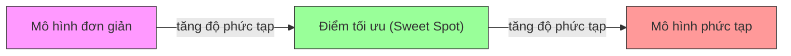
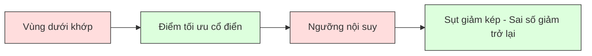
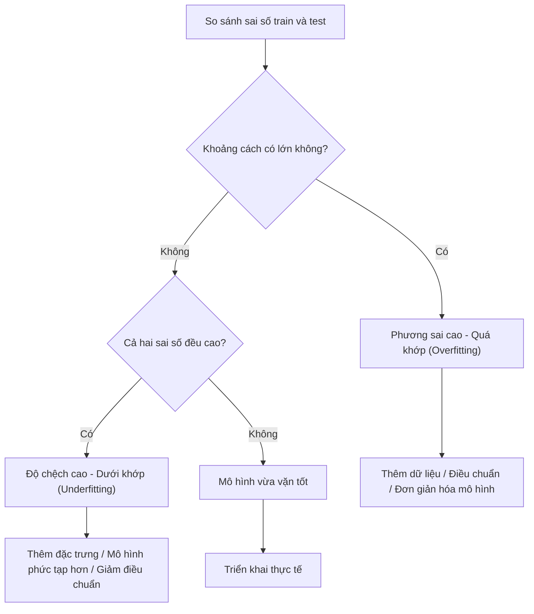
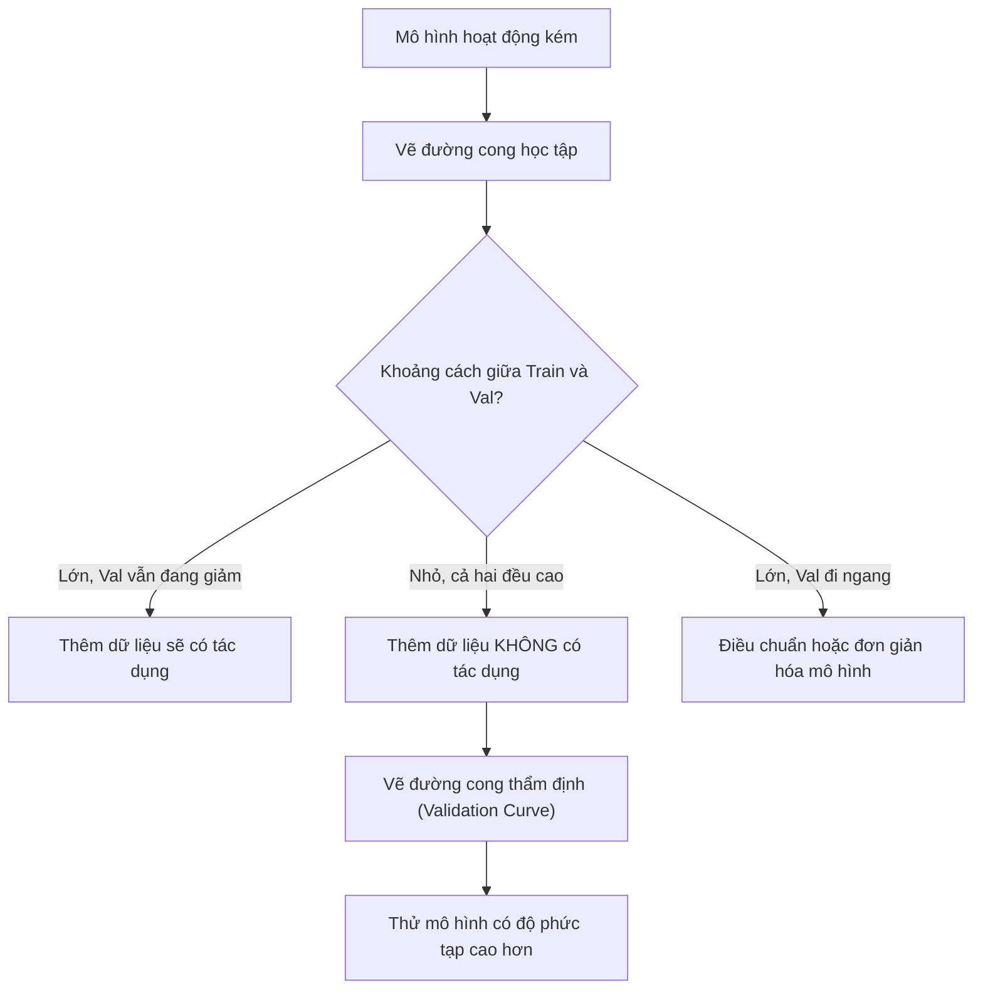

# Sự Đánh đổi giữa Độ chệch và Phương sai (Bias-Variance Tradeoff)

> Mọi sai số của mô hình đều bắt nguồn từ một trong ba nguồn: độ chệch (bias), phương sai (variance), hoặc nhiễu (noise). Bạn chỉ có thể kiểm soát hai nguồn đầu tiên.

**Type:** Learn
**Language:** Python
**Prerequisites:** Phase 2, Lessons 01-09 (ML basics, regression, classification, evaluation)
**Time:** ~75 minutes

## Learning Objectives

- Suy diễn phép phân rã sai số dự đoán kỳ vọng thành độ chệch - phương sai và giải thích vai trò của nhiễu không thể triệt tiêu (irreducible noise)
- Chẩn đoán xem một mô hình đang chịu ảnh hưởng của độ chệch cao hay phương sai cao thông qua các mẫu hình sai số trên tập huấn luyện và tập kiểm thử
- Giải thích cách các kỹ thuật điều chuẩn (L1, L2, dropout, early stopping) đánh đổi độ chệch lấy việc giảm phương sai
- Cài đặt các thực nghiệm trực quan hóa sự đánh đổi độ chệch - phương sai trên các mô hình có độ phức tạp tăng dần

## Vấn đề (The Problem)

Bạn vừa huấn luyện một mô hình. Nó có sai số nhất định trên tập kiểm thử. Sai số đó từ đâu mà ra?

Nếu mô hình của bạn quá đơn giản (ví dụ: dùng hồi quy tuyến tính cho dữ liệu có dạng đường cong), nó sẽ liên tục bỏ lỡ quy luật thực sự. Đó là **độ chệch (bias)**. Nếu mô hình của bạn quá phức tạp (dùng đa thức bậc 20 cho tập dữ liệu chỉ có 15 điểm), nó sẽ khớp hoàn hảo trên dữ liệu huấn luyện nhưng lại đưa ra những dự đoán hoang đường trên dữ liệu mới. Đó là **phương sai (variance)**.

Bạn không thể cực tiểu hóa cả hai cùng một lúc với một dung lượng mô hình (model capacity) cố định. Ép độ chệch giảm xuống thì phương sai sẽ tăng lên. Ép phương sai giảm xuống thì độ chệch sẽ tăng lên. Việc hiểu sâu sự đánh đổi này là kỹ năng chẩn đoán hữu ích nhất trong học máy. Nó mách bảo bạn biết khi nào nên làm mô hình phức tạp hơn hay đơn giản đi, khi nào nên thu thập thêm dữ liệu hay tạo thêm đặc trưng, khi nào cần điều chuẩn nhiều hơn hay ít đi.

## Khái niệm (The Concept)

### Độ chệch: Sai số mang tính hệ thống (Bias: Systematic Error)

Độ chệch đo lường mức độ sai lệch giữa dự đoán trung bình của mô hình so với giá trị thực tế. Nếu bạn huấn luyện cùng một mô hình trên nhiều tập dữ liệu huấn luyện khác nhau được rút ra từ cùng một phân phối rồi lấy trung bình các dự đoán, độ chệch chính là khoảng cách giữa giá trị trung bình đó và sự thật khách quan.

Độ chệch cao đồng nghĩa với việc mô hình quá cứng nhắc để có thể nắm bắt được quy luật thực tế. Một đường thẳng cố khớp vào một parabol sẽ luôn luôn trượt khỏi đường cong, bất kể bạn cung cấp cho nó bao nhiêu dữ liệu đi chăng nữa. Đây là hiện tượng **dưới khớp (underfitting)**.

```text
Độ chệch cao (Underfitting):
  Mô hình luôn dự đoán gần như cùng một kết quả sai lệch.
  Sai số huấn luyện (Training error): CAO
  Sai số kiểm thử (Test error): CAO
  Khoảng cách giữa hai sai số: NHỎ
```

### Phương sai: Sự nhạy cảm với dữ liệu huấn luyện (Variance: Sensitivity to Training Data)

Phương sai đo lường mức độ biến động của các dự đoán khi bạn huấn luyện mô hình trên các tập dữ liệu con khác nhau. Nếu những thay đổi nhỏ trong tập huấn luyện dẫn đến những thay đổi lớn trong mô hình, phương sai đang ở mức cao.

Phương sai cao có nghĩa là mô hình đang khớp vào cả những nhiễu ngẫu nhiên trong dữ liệu huấn luyện thay vì học tín hiệu cốt lõi. Một đa thức bậc 20 sẽ luồn lách qua từng điểm dữ liệu huấn luyện nhưng dao động dữ dội ở các khoảng giữa chúng. Đây là hiện tượng **quá khớp (overfitting)**.

```text
Phương sai cao (Overfitting):
  Mô hình khớp hoàn hảo dữ liệu huấn luyện nhưng thất bại trên dữ liệu mới.
  Sai số huấn luyện (Training error): THẤP
  Sai số kiểm thử (Test error): CAO
  Khoảng cách giữa hai sai số: LỚN
```

### Phép phân rã toán học (The Decomposition)

Đối với một điểm $x$ bất kỳ, sai số dự đoán kỳ vọng dưới hàm mất mát bình phương sai số được phân rã chính xác như sau:

```math
\begin{aligned}
& \text{Expected Error} = \text{Bias}^2 + \text{Variance} + \text{Irreducible Noise} \\[6pt]
& \text{where:} \\
& \quad \text{Bias}^2 = (\mathbb{E}[\hat{f}(x)] - f(x))^2 \\
& \quad \text{Variance} = \mathbb{E}[(\hat{f}(x) - \mathbb{E}[\hat{f}(x)])^2] \\
& \quad \text{Noise} = \mathbb{E}[(y - f(x))^2] \quad (\sigma^2)
\end{aligned}
```

- $f(x)$ là hàm quy luật thực sự
- $\hat{f}(x)$ là dự đoán của mô hình
- $\mathbb{E}[\ldots]$ là kỳ vọng lấy trên nhiều tập huấn luyện khác nhau
- $y$ là nhãn quan sát được (hàm thực sự cộng với nhiễu ngẫu nhiên)

Số hạng nhiễu $\sigma^2$ là **không thể triệt tiêu (irreducible noise)**. Không mô hình nào có thể đạt sai số thấp hơn $\sigma^2$ trên dữ liệu có nhiễu. Công việc của bạn là tìm kiếm sự cân bằng hoàn hảo giữa $\text{bias}^2$ và variance.

### Độ phức tạp của mô hình so với Sai số (Model Complexity vs Error)



Đường cong chữ U kinh điển:

| Độ phức tạp | Độ chệch (Bias) | Phương sai (Variance) | Tổng sai số |
|-------------|-----------------|-----------------------|-------------|
| Quá thấp | CAO | THẤP | CAO (underfitting) |
| Vừa vặn | VỪA PHẢI | VỪA PHẢI | THẤP NHẤT |
| Quá cao | THẤP | CAO | CAO (overfitting) |

### Điều chuẩn: Kiểm soát Độ chệch & Phương sai (Regularization as Bias-Variance Control)

Điều chuẩn (Regularization) chủ động làm tăng nhẹ độ chệch để đổi lấy việc giảm mạnh phương sai. Nó đặt ra các ràng buộc để mô hình không thể tự do chạy theo nhiễu.

- **L2 (Ridge):** Kéo các trọng số về gần 0. Giữ lại tất cả đặc trưng nhưng tiết chế tầm ảnh hưởng của chúng.
- **L1 (Lasso):** Triệt tiêu hoàn toàn một số trọng số về đúng bằng 0. Đóng vai trò như một bộ lựa chọn đặc trưng.
- **Dropout:** Tắt ngẫu nhiên các nơ-ron trong quá trình huấn luyện mạng nơ-ron. Ép mô hình học các biểu diễn dư thừa bền vững.
- **Dừng sớm (Early stopping):** Dừng huấn luyện trước khi mô hình kịp ghi nhớ và khớp hết dữ liệu huấn luyện.

Cường độ điều chuẩn (hệ số lambda, tỷ lệ dropout, số lượng epoch) trực tiếp quyết định vị trí của bạn trên đường cong bias-variance. Điều chuẩn càng mạnh đồng nghĩa với bias càng tăng, variance càng giảm.

### Hiện tượng sụt giảm kép: Góc nhìn hiện đại (Double Descent: The Modern Perspective)

Lý thuyết cổ điển cho rằng: sau điểm ngọt tối ưu (sweet spot), độ phức tạp tăng lên sẽ luôn làm tăng sai số. Nhưng các nghiên cứu từ năm 2019 trở lại đây đã phát hiện một điều bất ngờ: Nếu bạn tiếp tục tăng dung lượng mô hình vượt xa **ngưỡng nội suy (interpolation threshold)** — nơi mô hình có vừa đủ tham số để khớp hoàn hảo 100% dữ liệu huấn luyện — sai số kiểm thử có thể giảm trở lại!



Hiện tượng **"sụt giảm kép" (double descent)** giải thích tại sao các mạng nơ-ron được tham số hóa cực lớn (overparameterized — có số tham số nhiều hơn gấp bội số lượng mẫu huấn luyện) vẫn có khả năng khái quát hóa đáng kinh ngạc. Lý thuyết bias-variance cổ điển không hề sai, chỉ là nó chưa hoàn chỉnh trong kỷ nguyên học sâu hiện đại.

Những quan sát cốt lõi về hiện tượng sụt giảm kép:
- Hiện tượng này xuất hiện ở cả mô hình tuyến tính, cây quyết định và mạng nơ-ron
- Bổ sung thêm dữ liệu đôi khi lại làm tăng sai số ở ngay vùng lân cận ngưỡng nội suy (sample-wise double descent)
- Huấn luyện thêm epoch cũng có thể gây ra hiện tượng này (epoch-wise double descent)
- Điều chuẩn có thể làm phẳng đỉnh nhọn của sai số nhưng không xóa bỏ hoàn toàn hiện tượng này

Tại sao điều này xảy ra? Tại ngưỡng nội suy, mô hình chỉ vừa đủ dung lượng để khớp mọi điểm dữ liệu, buộc nó phải chọn một nghiệm méo mó luồn lách qua từng điểm, khiến các biến động nhỏ trong dữ liệu gây ra xáo trộn lớn — đây là nơi phương sai đạt đỉnh cực đại. Vượt qua ngưỡng đó, mô hình có vô số nghiệm khác nhau đều khớp hoàn hảo dữ liệu. Các thuật toán tối ưu (như gradient descent với điều chuẩn ngầm định) sẽ có xu hướng chọn nghiệm đơn giản, mượt mà nhất trong số đó.

| Vùng | Tham số so với Số mẫu | Hành vi |
|------|-----------------------|---------|
| Dưới tham số hóa (Underparameterized) | $p \ll n$ | Áp dụng lý thuyết đánh đổi cổ điển |
| Ngưỡng nội suy (Interpolation threshold) | $p \sim n$ | Phương sai đạt đỉnh, sai số kiểm thử vọt cao |
| Quá tham số hóa (Overparameterized) | $p \gg n$ | Điều chuẩn ngầm phát huy tác dụng, sai số kiểm thử giảm |

Lời khuyên thực tế: nếu bạn sử dụng mạng nơ-ron hoặc các mô hình rừng cây lớn, đừng dừng lại ở ngay ngưỡng nội suy. Hoặc là duy trì mô hình nằm dưới ngưỡng này (với điều chuẩn rõ ràng), hoặc là tiến xa hẳn qua ngưỡng đó. Vị trí tồi tệ nhất chính là nằm ngay tại ranh giới ngưỡng nội suy.

### Chẩn đoán mô hình của bạn (Diagnosing Your Model)



| Triệu chứng | Chẩn đoán | Hướng xử lý |
|-------------|-----------|-------------|
| Sai số train cao, sai số test cao | Độ chệch cao (Bias) | Thêm đặc trưng, dùng mô hình phức tạp hơn, giảm điều chuẩn |
| Sai số train thấp, sai số test cao | Phương sai cao (Variance) | Thu thập thêm dữ liệu, tăng điều chuẩn, giảm bớt đặc trưng, dùng dropout |
| Sai số train thấp, sai số test thấp | Khớp tốt | Sẵn sàng đóng gói sản phẩm |
| Sai số train giảm dần, sai số test bắt đầu tăng | Đang bắt đầu quá khớp | Áp dụng dừng sớm (early stopping) |

### Chiến lược thực tế (Practical Strategies)

**Khi gặp vấn đề về Độ chệch (Bias):**
- Bổ sung đặc trưng đa thức hoặc tương tác đặc trưng
- Chuyển sang mô hình linh hoạt hơn (dùng tổ hợp cây thay vì mô hình tuyến tính)
- Giảm bớt cường độ điều chuẩn
- Huấn luyện lâu hơn (nếu mô hình chưa hội tụ)

**Khi gặp vấn đề về Phương sai (Variance):**
- Thu thập thêm dữ liệu huấn luyện
- Áp dụng kỹ thuật Bagging (như Random Forests)
- Tăng cường độ điều chuẩn (tăng lambda, tăng dropout)
- Lựa chọn đặc trưng (loại bỏ các đặc trưng gây nhiễu)
- Dùng kiểm định chéo để phát hiện sớm

### Các phương pháp tổ hợp và Giảm phương sai (Ensemble Methods and Variance Reduction)

Các phương pháp tổ hợp (Ensemble methods) là công cụ thực chiến mạnh nhất để triệt tiêu phương sai.

**Bagging (Bootstrap Aggregating):** Huấn luyện nhiều mô hình trên các tập mẫu bootstrap khác nhau rồi lấy trung bình dự đoán. Mỗi mô hình đơn lẻ có thể có phương sai cao, nhưng phép lấy trung bình sẽ triệt tiêu phương sai đó. Random Forests chính là bagging áp dụng cho cây quyết định.

Cơ sở toán học: Nếu bạn lấy trung bình $N$ dự đoán độc lập, mỗi dự đoán có phương sai $\sigma^2$, phương sai của giá trị trung bình sẽ giảm xuống chỉ còn $\sigma^2 / N$. Dù các mô hình không hoàn toàn độc lập (do học trên dữ liệu tương tự), mức độ suy giảm phương sai vẫn rất đáng kể.

**Boosting:** Tập trung giảm độ chệch bằng cách xây dựng các mô hình nối tiếp nhau, mỗi mô hình sau tập trung sửa chữa sai số của các mô hình đi trước (như Gradient Boosting, AdaBoost).

| Phương pháp | Tác dụng chính | Biến đổi Độ chệch | Biến đổi Phương sai |
|-------------|----------------|-------------------|---------------------|
| Bagging | Giảm phương sai | Không đổi | Giảm mạnh |
| Boosting | Giảm độ chệch | Giảm mạnh | Có thể tăng |
| Stacking | Giảm cả hai | Phụ thuộc vào meta-learner | Phụ thuộc vào base models |
| Dropout | Bagging ngầm định | Tăng nhẹ | Giảm |

**Quy tắc thực hành:** Nếu mô hình cơ sở của bạn có phương sai cao (cây quyết định rất sâu), hãy dùng Bagging. Nếu mô hình cơ sở có độ chệch cao (cây cụt nông, mô hình tuyến tính đơn giản), hãy dùng Boosting.

### Đọc hiểu đường cong học tập (Learning Curves)


Bảng hướng dẫn đọc kết quả:

| Tình huống | Sai số Train | Sai số Validation | Khoảng cách (Gap) | Ý nghĩa | Hành động tiếp theo |
|------------|--------------|-------------------|-------------------|---------|---------------------|
| Độ chệch cao | Cao | Cao | Nhỏ | Mô hình không thể học nổi quy luật | Thêm đặc trưng, dùng mô hình phức tạp hơn |
| Phương sai cao | Thấp | Cao | Lớn | Mô hình học vẹt dữ liệu train | Thêm dữ liệu, tăng điều chuẩn, đơn giản hóa mô hình |
| Khớp tốt | Vừa phải | Vừa phải | Nhỏ | Mô hình khái quát hóa tốt | Đóng gói triển khai |
| Phương sai cao đang cải thiện | Thấp | Giảm dần khi thêm dữ liệu | Thu hẹp dần | Vấn đề phương sai mà dữ liệu có thể giải quyết | Tiếp tục thu thập thêm dữ liệu |
| Độ chệch cao đi ngang | Cao | Cao và đi ngang phẳng lì | Nhỏ và phẳng lì | Thêm dữ liệu KHÔNG có tác dụng | Bắt buộc phải đổi kiến trúc mô hình |



```figure
bias-variance
```

## Xây dựng (Build It)

Mã nguồn trong `code/bias_variance.py` thực hiện toàn bộ thí nghiệm phân rã bias-variance. Dưới đây là các bước tiếp cận:

### Bước 1: Tạo dữ liệu tổng hợp từ một hàm đã biết

Chúng ta sử dụng hàm $f(x) = \sin(1.5x) + 0.5x$ cộng với nhiễu Gauss. Việc biết trước hàm thực tế giúp chúng ta tính toán chính xác độ chệch và phương sai.

```python
def true_function(x):
    return np.sin(1.5 * x) + 0.5 * x

def generate_data(n_samples=30, noise_std=0.5, x_range=(-3, 3), seed=None):
    rng = np.random.RandomState(seed)
    x = rng.uniform(x_range[0], x_range[1], n_samples)
    y = true_function(x) + rng.normal(0, noise_std, n_samples)
    return x, y
```

### Bước 2: Lấy mẫu Bootstrap và khớp đa thức

Với mỗi bậc đa thức, chúng ta rút nhiều tập mẫu bootstrap, khớp đa thức và ghi lại dự đoán trên một lưới kiểm thử cố định.

```python
def fit_polynomial(x_train, y_train, degree, lam=0.0):
    X = np.column_stack([x_train ** d for d in range(degree + 1)])
    if lam > 0:
        penalty = lam * np.eye(X.shape[1])
        penalty[0, 0] = 0
        w = np.linalg.solve(X.T @ X + penalty, X.T @ y_train)
    else:
        w = np.linalg.lstsq(X, y_train, rcond=None)[0]
    return w
```

Chúng ta khớp trên 200 tập mẫu bootstrap khác nhau.

### Bước 3: Tính toán phân rã Bias^2 và Variance

```python
mean_pred = predictions.mean(axis=0)
bias_sq = np.mean((mean_pred - y_true) ** 2)
variance = np.mean(predictions.var(axis=0))
total_error = np.mean(np.mean((predictions - y_true) ** 2, axis=1))
```

- `mean_pred` là ước lượng của $\mathbb{E}[\hat{f}(x)]$ từ các mẫu bootstrap
- `bias_sq` là bình phương khoảng cách giữa dự đoán trung bình và chân lý khách quan
- `variance` là độ phân tán trung bình của các dự đoán giữa các lượt bootstrap
- `total_error` xấp xỉ bằng $\text{bias}^2 + \text{variance} + \text{noise}$

### Bước 4: Tạo đường cong học tập

```python
def demo_learning_curves():
    sizes = [10, 15, 20, 30, 50, 75, 100, 150, 200, 300]
    degree = 5

    for n in sizes:
        train_errors = []
        test_errors = []
        for seed in range(50):
            x_train, y_train = generate_data(n_samples=n, seed=seed * 100)
            w = fit_polynomial(x_train, y_train, degree)
            train_pred = predict_polynomial(x_train, w)
            train_mse = np.mean((train_pred - y_train) ** 2)
            test_pred = predict_polynomial(x_test, w)
            test_mse = np.mean((test_pred - y_test) ** 2)
            train_errors.append(train_mse)
            test_errors.append(test_mse)
```

### Bước 5: Quét qua các mức điều chuẩn (Regularization Sweep)

```python
def demo_regularization_sweep():
    alphas = [0.001, 0.005, 0.01, 0.05, 0.1, 0.5, 1.0, 5.0, 10.0, 50.0, 100.0]
    for alpha in alphas:
        results = bias_variance_decomposition([15], lam=alpha)
        r = results[15]
        print(f"alpha={alpha:.3f}  bias={r['bias_sq']:.4f}  var={r['variance']:.4f}")
```

Tại alpha nhỏ, phương sai áp đảo. Tại alpha lớn, độ chệch áp đảo. Giá trị alpha tối ưu nằm ở khoảng giữa hai thái cực này.

## Sử dụng (Use It)

scikit-learn cung cấp sẵn `learning_curve` và `validation_curve`:

```python
from sklearn.model_selection import validation_curve
from sklearn.pipeline import make_pipeline
from sklearn.preprocessing import PolynomialFeatures
from sklearn.linear_model import Ridge

degrees = list(range(1, 16))
train_scores_all = []
val_scores_all = []

for d in degrees:
    pipe = make_pipeline(PolynomialFeatures(d), Ridge(alpha=0.01))
    train_scores, val_scores = validation_curve(
        pipe, X, y, param_name="polynomialfeatures__degree",
        param_range=[d], cv=5, scoring="neg_mean_squared_error"
    )
    train_scores_all.append(-train_scores.mean())
    val_scores_all.append(-val_scores.mean())
```

### Quy trình chẩn đoán toàn diện trong thực tế:
1. Huấn luyện mô hình, tính sai số train và test.
2. Nếu cả hai đều cao: bạn gặp vấn đề về **độ chệch (bias)**. Chuyển sang bước 4.
3. Nếu train thấp nhưng test cao: bạn gặp vấn đề về **phương sai (variance)**. Hãy vẽ đường cong học tập để xem thêm dữ liệu có giúp ích không. Nếu không, hãy điều chuẩn.
4. Vẽ đường cong thẩm định (validation curve) quét qua tham số độ phức tạp chính để tìm điểm ngọt (sweet spot).
5. Thử nghiệm Ridge/Lasso với các giá trị alpha khác nhau qua `cross_val_score`. Chọn alpha có sai số kiểm định chéo thấp nhất.

## Đóng gói (Ship It)

Bài học này cung cấp: `outputs/prompt-model-diagnostics.md` — bản prompt chuẩn hóa quy trình chẩn đoán mô hình.

## Bài tập (Exercises)

1. Chạy phép phân rã với `noise_std=0` (không có nhiễu). Điều gì xảy ra với số hạng sai số không thể triệt tiêu? Độ phức tạp tối ưu có thay đổi không?
2. Tăng kích thước tập huấn luyện từ 30 lên 300 mẫu. Điều này tác động thế nào tới thành phần phương sai? Bậc đa thức tối ưu có bị dịch chuyển không?
3. Bổ sung điều chuẩn L2 (hồi quy Ridge) vào thí nghiệm. Với một đa thức bậc cao cố định (bậc 15), quét lambda từ 0 đến 100. Vẽ biểu đồ biểu diễn $\text{bias}^2$ và variance theo lambda.
4. Thay đổi hàm mục tiêu thực tế từ đa thức sang hàm $\sin(x)$. Sự phân rã bias-variance thay đổi như thế nào? Còn tồn tại một bậc đa thức tối ưu rõ rệt không?
5. Cài đặt một bộ đóng gói bootstrap aggregating (bagging) đơn giản: huấn luyện 10 mô hình trên các mẫu bootstrap và lấy trung bình dự đoán. Chứng minh rằng cách này giảm phương sai mà hầu như không làm tăng độ chệch.

## Thuật ngữ chính (Key Terms)

| Thuật ngữ | Cách gọi thông thường | Ý nghĩa thực sự |
|-----------|----------------------|-----------------|
| Bias (Độ chệch) | "Mô hình quá đơn giản" | Sai số hệ thống do các giả định sai lầm. Khoảng cách giữa dự đoán trung bình của mô hình và sự thật. |
| Variance (Phương sai) | "Mô hình bị quá khớp" | Sai số do sự nhạy cảm với dữ liệu huấn luyện. Mức độ biến động của dự đoán trên các tập train khác nhau. |
| Irreducible error (Nhiễu không thể triệt tiêu) | "Nhiễu trong dữ liệu" | Sai số bắt nguồn từ tính ngẫu nhiên tự nhiên của quá trình sinh dữ liệu. Không mô hình nào xóa bỏ được. |
| Underfitting (Dưới khớp) | "Chưa học tới nơi tới chốn" | Mô hình có độ chệch cao, bỏ lỡ quy luật thực tế ngay trên chính tập huấn luyện. |
| Overfitting (Quá khớp) | "Học vẹt dữ liệu" | Mô hình có phương sai cao, khớp cả nhiễu ngẫu nhiên trong tập train và không thể khái quát hóa. |
| Regularization (Điều chuẩn) | "Ràng buộc mô hình" | Bổ sung hàm phạt để giảm độ phức tạp của mô hình, đánh đổi độ chệch để lấy phương sai thấp hơn. |
| Double descent (Sụt giảm kép) | "Nhiều tham số hơn vẫn có thể tốt hơn" | Hiện tượng sai số kiểm thử giảm trở lại khi dung lượng mô hình vượt xa ngưỡng nội suy. |
| Model complexity (Độ phức tạp của mô hình) | "Mức độ linh hoạt của mô hình" | Khả năng khớp các quy luật tùy ý của mô hình, được kiểm soát bởi kiến trúc, đặc trưng hoặc điều chuẩn. |

## Đọc thêm (Further Reading)

- [Hastie, Tibshirani, Friedman: Elements of Statistical Learning, Ch. 7](https://hastie.su.domains/ElemStatLearn/) — tài liệu kinh điển giải thích chi tiết về phân rã bias-variance
- [Belkin et al., Reconciling modern machine learning practice and the bias-variance trade-off (2019)](https://arxiv.org/abs/1812.11118) — bài báo nền tảng về hiện tượng sụt giảm kép
- [Nakkiran et al., Deep Double Descent (2019)](https://arxiv.org/abs/1912.02292) — nghiên cứu về sụt giảm kép theo mẫu và theo epoch
- [Scott Fortmann-Roe: Understanding the Bias-Variance Tradeoff](http://scott.fortmann-roe.com/docs/BiasVariance.html) — bài giải thích trực quan sinh động

