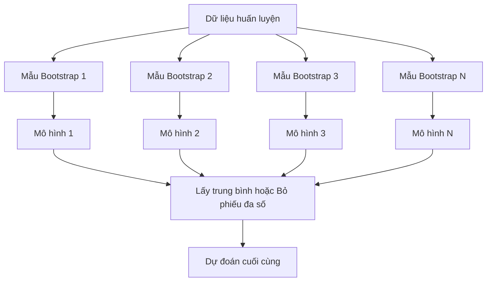
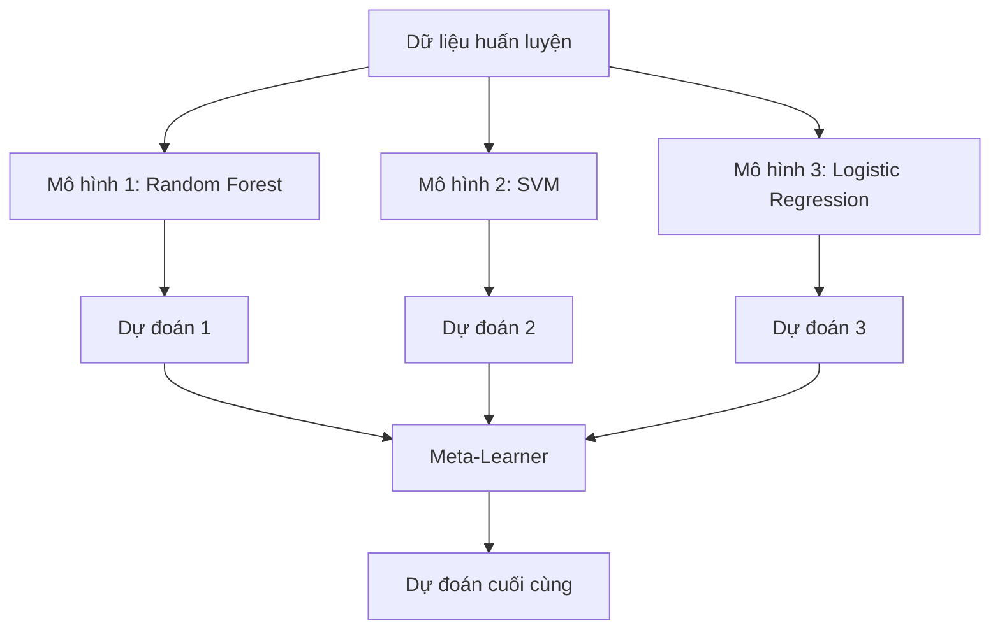

# Các Phương pháp Tổ hợp (Ensemble Methods)

> Một nhóm các bộ học yếu, khi được kết hợp đúng cách, sẽ trở thành một bộ học mạnh. Đây không phải là một phép ẩn dụ. Đây là một định lý toán học.

**Type:** Build
**Language:** Python
**Prerequisites:** Phase 2, Lesson 10 (Bias-Variance Tradeoff)
**Time:** ~120 minutes

## Learning Objectives

- Cài đặt AdaBoost và Gradient Boosting từ đầu cũng như giải thích cách Boosting tuần tự triệt tiêu độ chệch (bias)
- Xây dựng mô hình tổ hợp Bagging và chứng minh cách lấy trung bình các mô hình không tương quan giúp giảm phương sai (variance) mà hầu như không làm tăng độ chệch
- So sánh Bagging, Boosting, và Stacking dưới góc độ từng phương pháp nhắm tới thành phần sai số nào
- Đánh giá tính đa dạng của mô hình tổ hợp và giải thích tại sao độ chính xác của phép bỏ phiếu đa số lại tăng lên khi có thêm nhiều bộ học yếu độc lập

## Vấn đề (The Problem)

Một cây quyết định đơn lẻ chạy rất nhanh và dễ giải thích, nhưng lại rất dễ bị quá khớp (overfitting). Một mô hình tuyến tính đơn lẻ lại dễ bị dưới khớp (underfitting) trước các ranh giới phức tạp. Bạn có thể mất hàng tuần để thiết kế một kiến trúc mô hình hoàn hảo. Hoặc bạn có thể kết hợp một nhóm các mô hình chưa hoàn hảo lại để tạo ra một thực thể vượt trội hơn bất kỳ mô hình riêng lẻ nào.

Các phương pháp tổ hợp (Ensemble methods) làm chính xác điều này. Chúng là vũ khí đáng tin cậy nhất để giành chiến thắng trong các cuộc thi Kaggle trên dữ liệu bảng (tabular data), vận hành hầu hết các hệ thống ML trong môi trường sản xuất, và là minh chứng sống động nhất cho sự đánh đổi giữa độ chệch và phương sai (bias-variance tradeoff). Bagging giúp giảm phương sai. Boosting giúp giảm độ chệch. Stacking học cách biết nên tin tưởng mô hình nào trên từng đầu vào cụ thể.

## Khái niệm (The Concept)

### Tại sao mô hình tổ hợp lại hiệu quả

Giả sử bạn có $N$ bộ phân loại độc lập với nhau, mỗi bộ có độ chính xác $p > 0.5$. Độ chính xác của phép bỏ phiếu biểu quyết theo đa số (majority vote) là:

```math
P(\text{majority correct}) = \sum_{k > N/2} \binom{N}{k} p^k (1-p)^{N-k}
```

Với 21 bộ phân loại độc lập, mỗi bộ chỉ cần đạt độ chính xác 60%, độ chính xác khi bỏ phiếu đa số sẽ vọt lên khoảng 74%. Với 101 bộ phân loại, con số này tăng lên 84%! Các sai số sẽ triệt tiêu lẫn nhau khi các mô hình mắc phải những sai lầm khác nhau.

Yêu cầu tiên quyết ở đây là **tính đa dạng (diversity)**. Nếu tất cả các mô hình đều mắc cùng một lỗi sai ở cùng một chỗ, việc kết hợp chúng lại chẳng mang lại lợi ích gì. Các phương pháp tổ hợp phát huy tác dụng nhờ việc tạo ra các mô hình đa dạng thông qua:

- Các tập con dữ liệu huấn luyện khác nhau (Bagging)
- Các tập con đặc trưng khác nhau (Random Forests)
- Sửa sai tuần tự từng bước (Boosting)
- Các họ mô hình thuật toán hoàn toàn khác nhau (Stacking)

### Bagging (Bootstrap Aggregating)

Bagging tạo ra tính đa dạng bằng cách huấn luyện mỗi mô hình trên một tập mẫu bootstrap khác nhau được rút ra từ tập huấn luyện gốc.



Một tập mẫu bootstrap được rút ngẫu nhiên có hoàn lại (with replacement) từ dữ liệu gốc, với kích thước bằng đúng kích thước dữ liệu gốc. Khoảng 63.2% các mẫu dữ liệu duy nhất sẽ xuất hiện trong mỗi lượt rút bootstrap. 36.8% dữ liệu còn lại không được chọn (gọi là mẫu ngoài túi — out-of-bag samples) cung cấp một tập thẩm định hoàn toàn miễn phí.

Bagging giảm mạnh phương sai mà hầu như không làm tăng độ chệch. Từng cây quyết định đơn lẻ có thể bị quá khớp trên tập mẫu bootstrap của riêng nó, nhưng sự quá khớp ở mỗi cây là khác nhau, do đó phép lấy trung bình sẽ triệt tiêu các dao động nhiễu.

**Rừng ngẫu nhiên (Random Forests)** là Bagging có thêm một cải tiến quan trọng: tại mỗi điểm phân nhánh của cây, thuật toán chỉ xem xét một tập con ngẫu nhiên các đặc trưng. Điều này ép các cây phải trở nên đa dạng hơn nữa và không bị phụ thuộc vào một vài đặc trưng quá mạnh. Số lượng đặc trưng ứng viên thường chọn là $\sqrt{\text{n\_features}}$ cho bài toán phân loại và $\text{n\_features} / 3$ cho bài toán hồi quy.

### Boosting (Sửa sai tuần tự)

Boosting huấn luyện các mô hình theo dạng nối tiếp tuần tự. Mỗi mô hình mới sinh ra sẽ tập trung toàn lực vào những mẫu dữ liệu mà các mô hình đi trước đã đoán sai.


Boosting tập trung giảm độ chệch (bias). Mỗi mô hình mới sửa chữa các sai số mang tính hệ thống của tổ hợp trước đó. Dự đoán cuối cùng là tổng có trọng số của tất cả các mô hình, trong đó những mô hình có độ chính xác cao hơn sẽ nhận trọng số biểu quyết lớn hơn.

Sự đánh đổi: Boosting có thể bị quá khớp (overfitting) nếu bạn cho chạy quá nhiều vòng lặp, bởi vì nó sẽ cố chấp khớp cả những điểm dữ liệu cực khó vốn dĩ chỉ là nhiễu ngẫu nhiên.

### AdaBoost

AdaBoost (Adaptive Boosting) là thuật toán boosting thực tế đầu tiên. Nó có thể hoạt động với bất kỳ bộ học cơ sở nào, nhưng phổ biến nhất là các gốc cây quyết định (decision stumps — cây chỉ có độ sâu bằng 1).

Thuật toán:

```text
1. Khởi tạo trọng số mẫu: w_i = 1/N cho mọi i

2. Với t = 1 đến T:
   a. Huấn luyện bộ học yếu h_t trên dữ liệu có trọng số
   b. Tính sai số có trọng số:
      err_t = sum(w_i * I(h_t(x_i) != y_i)) / sum(w_i)
   c. Tính trọng số của mô hình:
      alpha_t = 0.5 * ln((1 - err_t) / err_t)
   d. Cập nhật trọng số của từng mẫu dữ liệu:
      w_i = w_i * exp(-alpha_t * y_i * h_t(x_i))
   e. Chuẩn hóa để tổng các trọng số bằng 1

3. Dự đoán cuối cùng: H(x) = sign(sum(alpha_t * h_t(x)))
```

Mô hình có sai số càng thấp sẽ nhận $\alpha$ càng cao. Các mẫu bị đoán sai sẽ được tăng trọng số để mô hình kế tiếp tập trung xử lý chúng.

### Gradient Boosting

Gradient Boosting tổng quát hóa ý tưởng boosting cho các hàm mất mát bất kỳ. Thay vì điều chỉnh lại trọng số của các mẫu dữ liệu, nó khớp mỗi mô hình mới vào phần dư (residuals — tức gradient âm của hàm mất mát) của tổ hợp hiện tại.

```text
1. Khởi tạo: F_0(x) = argmin_c sum(L(y_i, c))

2. Với t = 1 đến T:
   a. Tính các phần dư giả (pseudo-residuals):
      r_i = -dL(y_i, F_{t-1}(x_i)) / dF_{t-1}(x_i)
   b. Khớp một cây h_t vào các phần dư r_i
   c. Tìm kích thước bước đi tối ưu:
      gamma_t = argmin_gamma sum(L(y_i, F_{t-1}(x_i) + gamma * h_t(x_i)))
   d. Cập nhật tổ hợp:
      F_t(x) = F_{t-1}(x) + learning_rate * gamma_t * h_t(x)

3. Dự đoán cuối cùng: F_T(x)
```

Với hàm mất mát sai số bình phương, phần dư giả chính là sai số thực tế: $r_i = y_i - F_{t-1}(x_i)$. Mỗi cây mới theo đúng nghĩa đen là đang đi dự đoán và bù đắp phần lỗi của các cây trước.

Tốc độ học (learning rate / shrinkage) kiểm soát mức độ đóng góp của từng cây. Tốc độ học nhỏ đòi hỏi nhiều cây hơn nhưng mang lại khả năng khái quát hóa tốt hơn. Giá trị điển hình: từ 0.01 đến 0.3.

### XGBoost: Tại sao nó thống trị dữ liệu bảng

XGBoost (eXtreme Gradient Boosting) là thuật toán gradient boosting được tối ưu hóa ở cấp độ kỹ thuật hệ thống giúp nó chạy cực nhanh, chính xác và có khả năng chống quá khớp mạnh mẽ:

- **Hàm mục tiêu có điều chuẩn (Regularized objective):** Phạt L1 và L2 trên trọng số của các nút lá giúp ngăn các cây riêng lẻ quá tự tin.
- **Xấp xỉ đạo hàm bậc hai (Second-order approximation):** Sử dụng cả đạo hàm bậc một (gradient) và đạo hàm bậc hai (hessian) của hàm mất mát để đưa ra quyết định phân nhánh chính xác hơn.
- **Phân nhánh nhận biết tính thưa (Sparsity-aware splits):** Tự động xử lý dữ liệu khuyết tật bằng cách học hướng đi tối ưu cho các giá trị khuyết tại mỗi nhánh.
- **Lấy mẫu cột (Column subsampling):** Tương tự như random forest, lấy mẫu ngẫu nhiên các đặc trưng tại mỗi nhánh để tăng tính đa dạng.
- **Phác họa phân vị có trọng số (Weighted quantile sketch):** Tìm nhanh các điểm cắt cho đặc trưng liên tục trên dữ liệu phân tán.
- **Cấu trúc khối nhận biết bộ nhớ đệm (Cache-aware block structure):** Bố trí bộ nhớ tối ưu hóa cho các đường dẫn cache của CPU.

Đối với dữ liệu dạng bảng, XGBoost (và thế hệ sau của nó là LightGBM) liên tục vượt mặt mạng nơ-ron. Nếu bài toán của bạn nằm trong các bảng dữ liệu có hàng và cột, hãy luôn bắt đầu với Gradient Boosting.

### Stacking (Meta-Learning)

Stacking sử dụng các dự đoán của nhiều mô hình cơ sở (base models) làm đặc trưng đầu vào cho một mô hình cấp cao hơn gọi là **bộ học siêu cấp (meta-learner)**.



Meta-learner học xem nên tin tưởng mô hình cơ sở nào trên những vùng dữ liệu nào. Nếu Random Forest giỏi ở một miền đặc trưng và SVM giỏi ở miền khác, meta-learner sẽ tự học cách điều phối trọng số tương ứng.

Để tránh rò rỉ dữ liệu (data leakage), các dự đoán của mô hình cơ sở phải được tạo ra thông qua kiểm định chéo (out-of-fold predictions) trên tập huấn luyện. Tuyệt đối không huấn luyện mô hình cơ sở và tạo đặc trưng cho meta-learner trên cùng một tập dữ liệu thô.

### Bỏ phiếu (Voting)

Cách tổ hợp đơn giản nhất: gộp trực tiếp các dự đoán độc lập.

- **Bỏ phiếu cứng (Hard voting):** Bỏ phiếu đa số dựa trên nhãn lớp dự đoán.
- **Bỏ phiếu mềm (Soft voting):** Tính trung bình xác suất dự đoán của các mô hình, chọn lớp có xác suất trung bình cao nhất. Thường mang lại kết quả tốt hơn vì tận dụng được thông tin về độ tự tin của từng mô hình.

```figure
f3-ensemble-average
```

## Xây dựng (Build It)

### Bước 1: Gốc cây quyết định (Decision Stump)

Mã nguồn trong `code/ensembles.py` cài đặt toàn bộ từ đầu. Chúng ta bắt đầu với một gốc cây quyết định: một cây chỉ có đúng một phép phân nhánh duy nhất.

```python
class DecisionStump:
    def __init__(self):
        self.feature_idx = None
        self.threshold = None
        self.polarity = 1
        self.alpha = None

    def fit(self, X, y, weights):
        n_samples, n_features = X.shape
        best_error = float("inf")

        for f in range(n_features):
            thresholds = np.unique(X[:, f])
            for thresh in thresholds:
                for polarity in [1, -1]:
                    pred = np.ones(n_samples)
                    pred[polarity * X[:, f] < polarity * thresh] = -1
                    error = np.sum(weights[pred != y])
                    if error < best_error:
                        best_error = error
                        self.feature_idx = f
                        self.threshold = thresh
                        self.polarity = polarity

    def predict(self, X):
        n = X.shape[0]
        pred = np.ones(n)
        idx = self.polarity * X[:, self.feature_idx] < self.polarity * self.threshold
        pred[idx] = -1
        return pred
```

### Bước 2: AdaBoost từ đầu

```python
class AdaBoostScratch:
    def __init__(self, n_estimators=50):
        self.n_estimators = n_estimators
        self.stumps = []
        self.alphas = []

    def fit(self, X, y):
        n = X.shape[0]
        weights = np.full(n, 1 / n)

        for _ in range(self.n_estimators):
            stump = DecisionStump()
            stump.fit(X, y, weights)
            pred = stump.predict(X)

            err = np.sum(weights[pred != y])
            err = np.clip(err, 1e-10, 1 - 1e-10)

            alpha = 0.5 * np.log((1 - err) / err)
            weights *= np.exp(-alpha * y * pred)
            weights /= weights.sum()

            stump.alpha = alpha
            self.stumps.append(stump)
            self.alphas.append(alpha)

    def predict(self, X):
        total = sum(a * s.predict(X) for a, s in zip(self.alphas, self.stumps))
        return np.sign(total)
```

### Bước 3: Gradient Boosting từ đầu

```python
class GradientBoostingScratch:
    def __init__(self, n_estimators=100, learning_rate=0.1, max_depth=3):
        self.n_estimators = n_estimators
        self.lr = learning_rate
        self.max_depth = max_depth
        self.trees = []
        self.initial_pred = None

    def fit(self, X, y):
        self.initial_pred = np.mean(y)
        current_pred = np.full(len(y), self.initial_pred)

        for _ in range(self.n_estimators):
            residuals = y - current_pred
            tree = SimpleRegressionTree(max_depth=self.max_depth)
            tree.fit(X, residuals)
            update = tree.predict(X)
            current_pred += self.lr * update
            self.trees.append(tree)

    def predict(self, X):
        pred = np.full(X.shape[0], self.initial_pred)
        for tree in self.trees:
            pred += self.lr * tree.predict(X)
        return pred
```

### Bước 4: So sánh với scikit-learn

Mã nguồn trong thư mục `code/` kiểm chứng rằng các bản tự cài đặt đạt độ chính xác tương đương với `AdaBoostClassifier` và `GradientBoostingClassifier` của scikit-learn, đồng thời so sánh trực diện tất cả các phương pháp với nhau.

## Sử dụng (Use It)

### Khi nào nên dùng phương pháp nào

| Phương pháp | Giảm thành phần | Tốt nhất cho | Cần cảnh giác |
|-------------|-----------------|--------------|---------------|
| Bagging / Random Forest | Phương sai (Variance) | Dữ liệu nhiều nhiễu, nhiều đặc trưng | Không giúp cải thiện độ chệch |
| AdaBoost | Độ chệch (Bias) | Dữ liệu sạch, bộ học cơ sở đơn giản | Rất nhạy cảm với ngoại lai và nhiễu |
| Gradient Boosting | Độ chệch (Bias) | Dữ liệu bảng, các cuộc thi ML | Huấn luyện chậm, dễ quá khớp nếu không tinh chỉnh |
| XGBoost / LightGBM | Cả hai | Môi trường sản xuất dữ liệu bảng | Nhiều siêu tham số cần cấu hình |
| Stacking | Cả hai | Cố gắng vắt kiệt 1–2% độ chính xác cuối cùng | Phức tạp, dễ làm quá khớp meta-learner |
| Voting | Phương sai (Variance) | Gộp nhanh các mô hình đa dạng | Chỉ hiệu quả nếu các mô hình thực sự đa dạng |

### Bộ công cụ tiêu chuẩn cho dữ liệu bảng trong sản xuất:
1. **LightGBM hoặc XGBoost** với các tham số mặc định.
2. Tinh chỉnh `n_estimators`, `learning_rate`, `max_depth`, `min_child_weight`.
3. Nếu cần cải thiện thêm 0.5% cuối cùng, xây dựng một tổ hợp Stacking kết hợp từ 3–5 mô hình đa dạng.
4. Luôn sử dụng kiểm định chéo trong suốt quá trình.

## Đóng gói (Ship It)

Bài học này cung cấp:
- `outputs/prompt-ensemble-selector.md` — bản prompt hỗ trợ lựa chọn đúng phương pháp tổ hợp cho từng tập dữ liệu cụ thể.
- `outputs/skill-ensemble-builder.md` — kỹ năng hướng dẫn xây dựng mô hình tổ hợp hoàn chỉnh.

## Bài tập (Exercises)

1. Chỉnh sửa bản cài đặt AdaBoost để theo dõi độ chính xác huấn luyện sau từng vòng lặp. Vẽ biểu đồ biểu diễn độ chính xác theo số lượng estimators. Mô hình hội tụ sau bao nhiêu vòng?
2. Cài đặt Rừng ngẫu nhiên (Random Forest) từ đầu bằng cách thêm cơ chế lấy mẫu ngẫu nhiên các đặc trưng vào cây hồi quy. Huấn luyện 100 cây với `max_features = sqrt(n_features)` và lấy trung bình dự đoán. So sánh mức độ giảm phương sai so với một cây đơn lẻ.
3. Trong bản cài đặt Gradient Boosting, bổ sung cơ chế dừng sớm (early stopping): theo dõi hàm mất mát trên tập thẩm định sau mỗi vòng và dừng lại nếu nó không cải thiện sau 10 vòng liên tiếp. Thực tế mô hình cần bao nhiêu cây?
4. Xây dựng một mô hình Stacking kết hợp ba mô hình cơ sở (hồi quy logistic, cây quyết định, KNN) và dùng hồi quy logistic làm meta-learner. Sử dụng kiểm định chéo 5-fold để tạo đặc trưng cho meta-learner. So sánh hiệu năng với từng mô hình đơn lẻ.
5. Chạy XGBoost trên cùng tập dữ liệu với các tham số mặc định. So sánh độ chính xác và đo thời gian thực thi so với bản Gradient Boosting tự viết từ đầu. Tốc độ chênh lệch bao nhiêu lần?

## Thuật ngữ chính (Key Terms)

| Thuật ngữ | Cách gọi thông thường | Ý nghĩa thực sự |
|-----------|----------------------|-----------------|
| Bagging | "Học trên các tập con ngẫu nhiên" | Bootstrap aggregating: huấn luyện các mô hình trên các mẫu bootstrap, lấy trung bình để giảm phương sai |
| Boosting | "Tập trung vào các ca khó" | Huấn luyện các mô hình tuần tự, mô hình sau sửa lỗi cho mô hình trước để giảm độ chệch |
| AdaBoost | "Cân lại trọng số dữ liệu" | Thuật toán boosting cập nhật trọng số mẫu; các điểm đoán sai nhận trọng số lớn hơn ở vòng kế tiếp |
| Gradient boosting | "Khớp vào phần dư" | Thuật toán boosting khớp từng mô hình mới vào gradient âm của hàm mất mát |
| XGBoost | "Vũ khí thi đấu Kaggle" | Gradient boosting được tối ưu hóa điều chuẩn, xấp xỉ bậc hai và tăng tốc ở cấp độ hệ thống |
| Stacking | "Mô hình chồng lên mô hình" | Dùng dự đoán của các mô hình cơ sở làm đặc trưng đầu vào cho một bộ học siêu cấp (meta-learner) |
| Random forest | "Nhiều cây ngẫu nhiên" | Bagging áp dụng cho cây quyết định, bổ sung phép lấy mẫu ngẫu nhiên đặc trưng tại mỗi nhánh phân tách |
| Ensemble diversity | "Sai lầm theo những cách khác nhau" | Các mô hình phải có sai số không tương quan với nhau thì tổ hợp mới vượt trội hơn từng cá nhân |
| Out-of-bag error | "Thẩm định miễn phí" | Các mẫu không nằm trong lượt rút bootstrap (~36.8%) đóng vai trò như tập thẩm định tự nhiên |

## Đọc thêm (Further Reading)

- [Schapire & Freund: Boosting: Foundations and Algorithms](https://mitpress.mit.edu/9780262526036/) — cuốn sách kinh điển của những người sáng tạo ra AdaBoost
- [Friedman: Greedy Function Approximation: A Gradient Boosting Machine (2001)](https://doi.org/10.1214/aos/1013203451) — bài báo gốc giới thiệu thuật toán Gradient Boosting
- [Chen & Guestrin: XGBoost (2016)](https://arxiv.org/abs/1603.02754) — bài báo gốc giới thiệu hệ thống XGBoost
- [Wolpert: Stacked Generalization (1992)](https://www.sciencedirect.com/science/article/abs/pii/S0893608005800231) — bài báo nền tảng về kỹ thuật Stacking
- [scikit-learn Ensemble Methods](https://scikit-learn.org/stable/modules/ensemble.html) — hướng dẫn thực hành chi tiết

