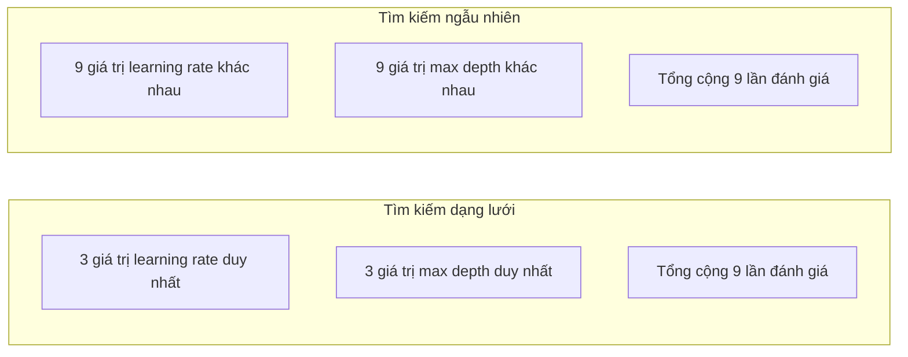
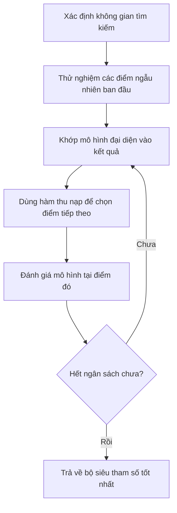
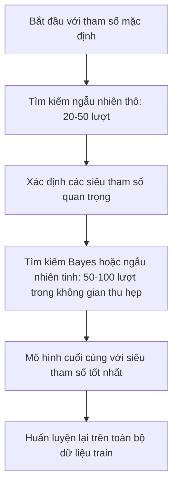
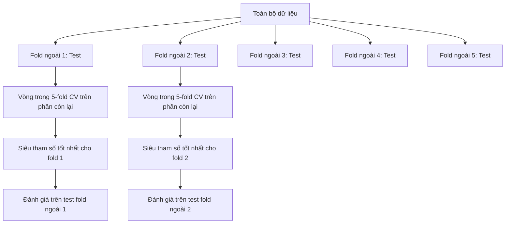

# Tinh chỉnh Siêu tham số (Hyperparameter Tuning)

> Siêu tham số là những núm vặn bạn xoay trước khi quá trình huấn luyện bắt đầu. Vặn chúng chuẩn xác là ranh giới giữa một mô hình tầm thường và một mô hình xuất sắc.

**Type:** Build
**Language:** Python
**Prerequisites:** Phase 2, Lesson 11 (Ensemble Methods)
**Time:** ~90 minutes

## Learning Objectives

- Cài đặt tìm kiếm dạng lưới (grid search), tìm kiếm ngẫu nhiên (random search), và tối ưu hóa Bayes (Bayesian optimization) từ đầu cũng như so sánh hiệu quả lấy mẫu của chúng
- Giải thích tại sao tìm kiếm ngẫu nhiên lại vượt trội hơn tìm kiếm dạng lưới khi phần lớn các siêu tham số có số chiều hiệu dụng thấp
- Xây dựng một vòng lặp tối ưu hóa Bayes sử dụng mô hình đại diện (surrogate model) và hàm thu nạp (acquisition function) để định hướng tìm kiếm
- Thiết kế chiến lược tinh chỉnh siêu tham số tránh hiện tượng quá khớp tập thẩm định thông qua kiểm định chéo đúng chuẩn

## Vấn đề (The Problem)

Mô hình gradient boosting của bạn có tốc độ học, số lượng cây, độ sâu tối đa, số mẫu tối thiểu ở nút lá, tỷ lệ lấy mẫu hàng, và tỷ lệ lấy mẫu cột. Đó là sáu siêu tham số. Nếu mỗi tham số chỉ cần thử 5 giá trị hợp lý, lưới tham số sẽ có $5^6 = 15{,}625$ tổ hợp. Mỗi lần huấn luyện mô hình mất 10 giây. Để thử hết toàn bộ lưới đó, bạn cần tới 43 giờ tính toán liên tục.

Tìm kiếm dạng lưới là cách tiếp cận hiển nhiên nhất và cũng là cách tồi tệ nhất khi mở rộng quy mô. Tìm kiếm ngẫu nhiên mang lại kết quả tốt hơn với chi phí tính toán ít hơn nhiều. Tối ưu hóa Bayes thậm chí còn xuất sắc hơn nhờ khả năng học hỏi từ các kết quả thử nghiệm trong quá khứ. Việc thấu hiểu nên dùng chiến lược nào và những siêu tham số nào thực sự tạo nên sự khác biệt sẽ giúp bạn tiết kiệm hàng ngày trời thời gian GPU quý báu.

## Khái niệm (The Concept)

### Tham số so với Siêu tham số (Parameters vs Hyperparameters)

**Tham số (Parameters)** được mô hình tự học trong quá trình huấn luyện (trọng số, độ chệch bias, ngưỡng phân nhánh của cây). **Siêu tham số (Hyperparameters)** được con người thiết lập trước khi quá trình huấn luyện bắt đầu và quy định cách thức mà việc học sẽ diễn ra.

| Siêu tham số | Kiểm soát điều gì | Dải giá trị điển hình |
|--------------|-------------------|-----------------------|
| Tốc độ học (Learning rate) | Độ lớn bước đi mỗi lần cập nhật | 0.001 đến 1.0 |
| Số lượng cây / epochs | Thời gian huấn luyện kéo dài bao lâu | 10 đến 10,000 |
| Độ sâu tối đa (Max depth) | Độ phức tạp của mô hình cây | 1 đến 30 |
| Điều chuẩn ($\lambda$) | Ngăn ngừa quá khớp | 0.0001 đến 100 |
| Kích thước lô (Batch size) | Độ nhiễu trong ước lượng gradient | 16 đến 512 |
| Tỷ lệ dropout | Tỷ lệ nơ-ron bị tắt ngẫu nhiên | 0.0 đến 0.5 |

### Tìm kiếm dạng lưới (Grid Search)

Tìm kiếm dạng lưới thử nghiệm tất cả các tổ hợp có thể của các giá trị được chỉ định sẵn. Phương pháp này vét cạn và dễ hiểu, nhưng chi phí bùng nổ theo cấp số nhân theo số lượng siêu tham số.

```text
Lưới cho 2 siêu tham số:

  learning_rate: [0.01, 0.1, 1.0]
  max_depth:     [3, 5, 7]

  Số lượt đánh giá: 3 x 3 = 9 tổ hợp

  (0.01, 3)  (0.01, 5)  (0.01, 7)
  (0.1,  3)  (0.1,  5)  (0.1,  7)
  (1.0,  3)  (1.0,  5)  (1.0,  7)
```

Tìm kiếm dạng lưới có một khuyết điểm chết người: Nếu một siêu tham số đóng vai trò quyết định còn siêu tham số kia hầu như không ảnh hưởng, phần lớn các lần chạy đều bị lãng phí. Từ 9 lần đánh giá, bạn thực chất chỉ khám phá được vẻn vẹn 3 giá trị duy nhất của tham số quan trọng đó.

### Tìm kiếm ngẫu nhiên (Random Search)

Tìm kiếm ngẫu nhiên lấy mẫu các siêu tham số từ các phân phối xác suất thay vì một lưới cố định. Với cùng ngân sách 9 lần đánh giá, bạn sẽ khảo sát được 9 giá trị hoàn toàn khác nhau cho từng siêu tham số.



Tại sao tìm kiếm ngẫu nhiên đánh bại tìm kiếm dạng lưới (Bergstra & Bengio, 2012):

- Hầu hết các siêu tham số có số chiều hiệu dụng thấp (low effective dimensionality). Thông thường chỉ có 1–2 trong số 6 siêu tham số thực sự chi phối hiệu năng của bài toán.
- Tìm kiếm dạng lưới lãng phí tài nguyên vào các chiều tham số không quan trọng.
- Tìm kiếm ngẫu nhiên bao phủ các chiều quan trọng dày đặc hơn nhiều với cùng một ngân sách tính toán.
- Chỉ với 60 lượt thử ngẫu nhiên, bạn đã có 95% cơ hội tìm thấy một điểm nằm trong vùng 5% tối ưu nhất của toàn bộ không gian tìm kiếm.

### Tối ưu hóa Bayes (Bayesian Optimization)

Tìm kiếm ngẫu nhiên hoàn toàn bỏ qua các kết quả đã có. Nó không hề rút ra bài học rằng tốc độ học quá cao sẽ làm mô hình phân kỳ hay độ sâu bằng 3 luôn tốt hơn độ sâu bằng 10. Tối ưu hóa Bayes tận dụng lịch sử các lần đánh giá trước để đưa ra quyết định thông minh về điểm tiếp theo cần thử nghiệm.



Hai thành phần cốt lõi:

**Mô hình đại diện (Surrogate model):** Một mô hình có chi phí tính toán cực rẻ (thường là Quá trình Gauss — Gaussian Process) dùng để xấp xỉ hàm mục tiêu đắt đỏ. Nó cung cấp cả giá trị dự đoán lẫn độ bất định (uncertainty) tại mọi điểm trong không gian tìm kiếm.

**Hàm thu nạp (Acquisition function):** Quyết định vị trí tiếp theo cần thử nghiệm bằng cách cân bằng giữa khai thác (exploitation — tìm kiếm quanh các điểm tốt đã biết) và khám phá (exploration — tìm kiếm ở những vùng có độ bất định cao). Các lựa chọn phổ biến:

- **Expected Improvement (EI):** Kỳ vọng mức độ cải thiện so với điểm tốt nhất hiện tại là bao nhiêu?
- **Upper Confidence Bound (UCB):** Giá trị dự đoán cộng với một bội số của độ bất định. UCB cao có nghĩa là điểm đó hoặc rất triển vọng, hoặc chưa từng được khám phá.
- **Probability of Improvement (PI):** Xác suất để điểm này đánh bại điểm tốt nhất hiện tại là bao nhiêu?

Tối ưu hóa Bayes thường tìm thấy bộ siêu tham số tốt hơn tìm kiếm ngẫu nhiên với số lần thử nghiệm ít hơn từ 2 đến 5 lần. Chi phí khớp mô hình đại diện là không đáng kể so với thời gian huấn luyện mô hình thực tế.

### Dừng sớm (Early Stopping)

Không phải mọi lần huấn luyện đều cần chạy đến cùng. Nếu một cấu hình thể hiện kết quả rõ ràng là tồi tệ chỉ sau 10 epoch, hãy ngắt nó ngay lập tức và chuyển sang cấu hình khác.

Các chiến lược phổ biến:
- **Dựa trên tính kiên nhẫn (Patience-based):** Dừng nếu hàm mất mát trên tập thẩm định không cải thiện sau $N$ epoch liên tiếp.
- **Cắt tỉa trung vị (Median pruning):** Dừng nếu kết quả trung gian của lần thử tệ hơn mức trung vị của các lần thử đã hoàn thành tại cùng một bước.
- **Hyperband:** Phân bổ ngân sách nhỏ cho rất nhiều cấu hình, sau đó tăng dần ngân sách cho các cấu hình nằm trong nhóm đứng đầu.

Hyperband đặc biệt hiệu quả. Nó bắt đầu với 81 cấu hình, mỗi cấu hình chỉ chạy 1 epoch, giữ lại 1/3 xuất sắc nhất và cho chạy 3 epoch, tiếp tục giữ lại 1/3 và cho chạy 9 epoch, v.v. Cách này tìm ra cấu hình tốt nhanh hơn từ 10 đến 50 lần so với việc cho tất cả cấu hình chạy hết ngân sách.

### Lịch trình điều chỉnh tốc độ học (Learning Rate Schedulers)

Tốc độ học gần như luôn là siêu tham số quan trọng nhất. Thay vì giữ cố định, các bộ điều phối (schedulers) sẽ biến thiên nó trong suốt quá trình huấn luyện:

| Lịch trình | Công thức / Cơ chế | Khi nào nên dùng |
|------------|-------------------|------------------|
| Giảm theo bậc (Step decay) | Nhân với 0.1 sau mỗi $N$ epoch | Huấn luyện mạng CNN cổ điển |
| Cosine annealing | $\text{lr} \cdot 0.5 \cdot (1 + \cos(\pi t / T))$ | Chuẩn mực mặc định hiện đại |
| Khởi động + suy giảm (Warmup + decay) | Tăng tuyến tính rồi giảm theo cosine | Mô hình Transformers |
| One-cycle | Tăng rồi giảm qua một chu kỳ | Hội tụ siêu nhanh |
| Giảm khi đi ngang (Reduce on plateau) | Giảm một hệ số khi chỉ số bị chững lại | Lựa chọn an toàn mặc định |

### Mức độ quan trọng của các siêu tham số

Không phải mọi siêu tham số đều quan trọng như nhau. Nghiên cứu trên Random Forests (Probst et al., 2019) và Gradient Boosting chỉ ra quy luật nhất quán:

**Rất quan trọng (phải chỉnh đầu tiên):**
- Tốc độ học (Learning rate — luôn tinh chỉnh đầu tiên)
- Số lượng cây / epochs (hãy dùng early stopping thay vì chỉnh thủ công)
- Cường độ điều chuẩn (Regularization)

**Quan trọng vừa phải:**
- Độ sâu tối đa (Max depth) / số lượng tầng
- Số mẫu tối thiểu ở lá (Min samples per leaf) / weight decay
- Tỷ lệ lấy mẫu hàng (Subsample ratio)

**Ít quan trọng:**
- Số đặc trưng tối đa (Max features cho Random Forest)
- Lựa chọn hàm kích hoạt cụ thể
- Kích thước lô (Batch size — miễn là nằm trong khoảng hợp lý)

### Chiến lược thực tế (Practical Strategy)



Quy trình chuẩn:
1. **Bắt đầu với mặc định của thư viện:** Chúng được lựa chọn bởi các chuyên gia dày dạn kinh nghiệm và thường đã đạt được 80% hiệu năng tối đa.
2. **Tìm kiếm ngẫu nhiên thô:** Khảo sát trên dải rộng từ 20–50 lượt thử. Dùng early stopping để loại sớm các cấu hình tồi.
3. **Phân tích kết quả:** Xem siêu tham số nào tương quan mạnh nhất với hiệu năng để thu hẹp không gian tìm kiếm.
4. **Tìm kiếm tinh:** Dùng tối ưu hóa Bayes hoặc tìm kiếm ngẫu nhiên tập trung trong không gian hẹp (50–100 lượt).
5. **Huấn luyện lại trên toàn bộ dữ liệu train** với bộ siêu tham số tốt nhất vừa tìm được.

### Tích hợp kiểm định chéo lồng nhau (Nested Cross-Validation)

Tinh chỉnh siêu tham số trên một tập thẩm định duy nhất rất dễ dẫn đến việc siêu tham số bị quá khớp vào chính tập thẩm định đó. Kiểm định chéo lồng nhau giải quyết vấn đề này bằng hai vòng lặp:

- **Vòng ngoài (Đánh giá):** Chia dữ liệu thành train+val và test. Cung cấp ước lượng hiệu năng khách quan, không thiên vị.
- **Vòng trong (Tinh chỉnh):** Chia train+val thành các fold nhỏ để tìm ra bộ siêu tham số tốt nhất.



Mỗi fold ngoài sẽ tự tìm bộ siêu tham số tối ưu riêng một cách hoàn toàn độc lập. Điểm số ở vòng ngoài là ước lượng không thiên vị về khả năng khái quát hóa.

Với scikit-learn:

```python
from sklearn.model_selection import cross_val_score, GridSearchCV
from sklearn.ensemble import GradientBoostingRegressor

inner_cv = GridSearchCV(
    GradientBoostingRegressor(),
    param_grid={
        "learning_rate": [0.01, 0.05, 0.1],
        "max_depth": [2, 3, 5],
        "n_estimators": [50, 100, 200],
    },
    cv=5,
    scoring="neg_mean_squared_error",
)

outer_scores = cross_val_score(
    inner_cv, X, y, cv=5, scoring="neg_mean_squared_error"
)

print(f"Nested CV MSE: {-outer_scores.mean():.4f} +/- {outer_scores.std():.4f}")
```

### Mẹo thực hành quan trọng:

- **Luôn bắt đầu với tốc độ học (Learning rate).** Tốc độ học sai sẽ khiến mọi tinh chỉnh khác trở nên vô nghĩa.
- **Sử dụng thang đo log (Log-uniform) cho tốc độ học và điều chuẩn.** Khoảng cách giữa 0.001 và 0.01 quan trọng ngang với khoảng cách giữa 0.1 và 1.0. Tìm kiếm theo thang tuyến tính sẽ lãng phí phần lớn ngân sách ở nửa giá trị lớn.
- **Dùng early stopping thay vì cố dò số lượng cây.**
- **Phân bổ ngân sách:** Dành 60% ngân sách tìm kiếm cho 2 siêu tham số quan trọng nhất, 40% còn lại cho tất cả những tham số khác.

```figure
k-fold-cv
```

## Xây dựng (Build It)

### Bước 1: Tìm kiếm dạng lưới từ đầu

```python
def grid_search(model_fn, param_grid, X_train, y_train, X_val, y_val):
    keys = list(param_grid.keys())
    values = list(param_grid.values())
    best_score = -float("inf")
    best_params = None
    n_evals = 0

    for combo in itertools.product(*values):
        params = dict(zip(keys, combo))
        model = model_fn(**params)
        model.fit(X_train, y_train)
        score = evaluate(model, X_val, y_val)
        n_evals += 1

        if score > best_score:
            best_score = score
            best_params = params

    return best_params, best_score, n_evals
```

### Bước 2: Tìm kiếm ngẫu nhiên từ đầu

```python
def random_search(model_fn, param_distributions, X_train, y_train,
                  X_val, y_val, n_iter=50, seed=42):
    rng = np.random.RandomState(seed)
    best_score = -float("inf")
    best_params = None

    for _ in range(n_iter):
        params = {k: sample(v, rng) for k, v in param_distributions.items()}
        model = model_fn(**params)
        model.fit(X_train, y_train)
        score = evaluate(model, X_val, y_val)

        if score > best_score:
            best_score = score
            best_params = params

    return best_params, best_score, n_iter
```

### Bước 3: Tối ưu hóa Bayes đơn giản từ đầu

Ý tưởng cốt lõi: khớp một quá trình Gauss (Gaussian Process) vào các cặp (siêu tham số, điểm số) đã quan sát, sau đó dùng hàm thu nạp Expected Improvement để chọn điểm tiếp theo.

```python
class SimpleBayesianOptimizer:
    def __init__(self, search_space, n_initial=5):
        self.search_space = search_space
        self.n_initial = n_initial
        self.X_observed = []
        self.y_observed = []

    def _kernel(self, x1, x2, length_scale=1.0):
        dists = np.sum((x1[:, None, :] - x2[None, :, :]) ** 2, axis=2)
        return np.exp(-0.5 * dists / length_scale ** 2)

    def _fit_gp(self, X_new):
        X_obs = np.array(self.X_observed)
        y_obs = np.array(self.y_observed)
        y_mean = y_obs.mean()
        y_centered = y_obs - y_mean

        K = self._kernel(X_obs, X_obs) + 1e-4 * np.eye(len(X_obs))
        K_star = self._kernel(X_new, X_obs)

        L = np.linalg.cholesky(K)
        alpha = np.linalg.solve(L.T, np.linalg.solve(L, y_centered))
        mu = K_star @ alpha + y_mean

        v = np.linalg.solve(L, K_star.T)
        var = 1.0 - np.sum(v ** 2, axis=0)
        var = np.maximum(var, 1e-6)

        return mu, var

    def _expected_improvement(self, mu, var, best_y):
        sigma = np.sqrt(var)
        z = (mu - best_y) / (sigma + 1e-10)
        ei = sigma * (z * norm_cdf(z) + norm_pdf(z))
        return ei

    def suggest(self):
        if len(self.X_observed) < self.n_initial:
            return sample_random(self.search_space)

        candidates = [sample_random(self.search_space) for _ in range(500)]
        X_cand = np.array([to_vector(c) for c in candidates])
        mu, var = self._fit_gp(X_cand)
        ei = self._expected_improvement(mu, var, max(self.y_observed))
        return candidates[np.argmax(ei)]

    def observe(self, params, score):
        self.X_observed.append(to_vector(params))
        self.y_observed.append(score)
```

Mô hình GP cung cấp cả giá trị dự đoán `mu` lẫn độ bất định `var`. Hàm Expected Improvement cân bằng hoàn hảo giữa hai yếu tố: ưu tiên những điểm có dự đoán cao HOẶC những vùng còn nhiều bất định chưa được thăm dò.

### Bước 4: So sánh cả ba phương pháp

Mã nguồn trong `code/tuning.py` chạy cả ba phương pháp trên cùng một hàm mục tiêu và so sánh trực diện kết quả:

```python
def synthetic_objective(params):
    lr = params["learning_rate"]
    depth = params["max_depth"]
    return -(np.log10(lr) + 2) ** 2 - (depth - 4) ** 2 + 10

param_grid = {
    "learning_rate": [0.001, 0.01, 0.1, 1.0],
    "max_depth": [2, 3, 4, 5, 6, 7, 8],
}

grid_best = None
grid_score = -float("inf")
grid_history = []
for combo in itertools.product(*param_grid.values()):
    params = dict(zip(param_grid.keys(), combo))
    score = synthetic_objective(params)
    grid_history.append((params, score))
    if score > grid_score:
        grid_score = score
        grid_best = params

param_dist = {
    "learning_rate": ("log_float", 0.001, 1.0),
    "max_depth": ("int", 2, 8),
}

rand_best = None
rand_score = -float("inf")
rand_history = []
rng = np.random.RandomState(42)
for _ in range(28):
    params = {k: sample(v, rng) for k, v in param_dist.items()}
    score = synthetic_objective(params)
    rand_history.append((params, score))
    if score > rand_score:
        rand_score = score
        rand_best = params

optimizer = SimpleBayesianOptimizer(param_dist, n_initial=5)
bayes_history = []
for _ in range(28):
    params = optimizer.suggest()
    score = synthetic_objective(params)
    optimizer.observe(params, score)
    bayes_history.append((params, score))
bayes_score = max(s for _, s in bayes_history)

print(f"{'Phương pháp':<20} {'Điểm tốt nhất':>15} {'Số lần đánh giá':>18}")
print("-" * 55)
print(f"{'Grid Search':<20} {grid_score:>15.4f} {len(grid_history):>18}")
print(f"{'Random Search':<20} {rand_score:>15.4f} {len(rand_history):>18}")
print(f"{'Bayesian Opt':<20} {bayes_score:>15.4f} {len(bayes_history):>18}")
```

Với cùng một ngân sách, tối ưu hóa Bayes tìm ra nghiệm tốt nhất nhanh nhất vì nó không lãng phí số lần chạy vào các vùng rõ ràng là tồi tệ.

## Sử dụng (Use It)

### Optuna trong thực tế

Optuna là thư viện được khuyến nghị hàng đầu hiện nay cho việc tinh chỉnh siêu tham số:

```python
import optuna

def objective(trial):
    lr = trial.suggest_float("learning_rate", 1e-4, 1e-1, log=True)
    n_est = trial.suggest_int("n_estimators", 50, 500)
    max_depth = trial.suggest_int("max_depth", 2, 10)

    model = GradientBoostingRegressor(
        learning_rate=lr,
        n_estimators=n_est,
        max_depth=max_depth,
    )
    model.fit(X_train, y_train)
    return mean_squared_error(y_val, model.predict(X_val))

study = optuna.create_study(direction="minimize")
study.optimize(objective, n_trials=100)

print(f"Siêu tham số tốt nhất: {study.best_params}")
print(f"MSE tốt nhất: {study.best_value:.4f}")
```

### Optuna kết hợp Cắt tỉa (Pruning)

```python
import optuna
from sklearn.model_selection import cross_val_score

def objective(trial):
    params = {
        "learning_rate": trial.suggest_float("lr", 1e-4, 0.5, log=True),
        "max_depth": trial.suggest_int("max_depth", 2, 10),
        "n_estimators": trial.suggest_int("n_estimators", 50, 500),
        "subsample": trial.suggest_float("subsample", 0.5, 1.0),
    }

    model = GradientBoostingRegressor(**params)
    scores = cross_val_score(model, X_train, y_train, cv=3,
                             scoring="neg_mean_squared_error")
    mean_score = -scores.mean()

    trial.report(mean_score, step=0)
    if trial.should_prune():
        raise optuna.TrialPruned()

    return mean_score

pruner = optuna.pruners.MedianPruner(n_startup_trials=10, n_warmup_steps=5)
study = optuna.create_study(direction="minimize", pruner=pruner)
study.optimize(objective, n_trials=200)
```

`MedianPruner` thường giúp tiết kiệm từ 40% đến 60% tổng thời gian tính toán!

## Bài tập (Exercises)

1. Chạy tìm kiếm dạng lưới và tìm kiếm ngẫu nhiên với cùng một ngân sách (ví dụ: 50 lượt đánh giá). So sánh điểm số tốt nhất tìm được. Lặp lại 10 lần với các seed khác nhau. Tỷ lệ số lần tìm kiếm ngẫu nhiên chiến thắng là bao nhiêu?
2. Cài đặt thuật toán Hyperband từ đầu. Bắt đầu với 81 cấu hình, mỗi cấu hình chạy 1 epoch. Giữ lại 1/3 xuất sắc nhất sau mỗi vòng và tăng gấp 3 ngân sách của chúng. So sánh tổng số epoch thực thi so với việc cho cả 81 cấu hình chạy hết ngân sách tối đa.
3. Thêm một bộ điều phối tốc độ học (Cosine annealing) vào bản cài đặt Gradient Boosting từ Bài 11. Nó có giúp cải thiện kết quả so với tốc độ học cố định không?
4. Sử dụng Optuna để tinh chỉnh `RandomForestClassifier` trên một tập dữ liệu thực tế (như bộ dữ liệu ung thư vú của scikit-learn). Dùng `optuna.visualization.plot_param_importances(study)` để trực quan hóa xem siêu tham số nào quan trọng nhất. Kết quả có khớp với bảng xếp hạng trong bài học không?
5. Cài đặt hàm thu nạp Expected Improvement và minh họa sự đánh đổi giữa khám phá và khai thác. Vẽ biểu đồ kỳ vọng và độ bất định của mô hình GP, và chỉ ra vị trí mà EI sẽ chọn để đánh giá tiếp theo.

## Thuật ngữ chính (Key Terms)

| Thuật ngữ | Cách gọi thông thường | Ý nghĩa thực sự |
|-----------|----------------------|-----------------|
| Hyperparameter (Siêu tham số) | "Các thiết lập bạn chọn" | Giá trị được thiết lập trước khi huấn luyện để kiểm soát quá trình học, không được học từ dữ liệu |
| Grid search (Tìm kiếm dạng lưới) | "Thử mọi tổ hợp" | Tìm kiếm vét cạn trên một lưới tham số xác định trước. Chi phí tăng theo hàm mũ. |
| Random search (Tìm kiếm ngẫu nhiên) | "Lấy mẫu ngẫu nhiên" | Lấy mẫu siêu tham số từ các phân phối xác suất. Khảo sát các chiều quan trọng hiệu quả hơn grid search. |
| Bayesian optimization (Tối ưu hóa Bayes) | "Tìm kiếm thông minh" | Dùng mô hình đại diện của hàm mục tiêu để chọn điểm tiếp theo, cân bằng giữa khai thác và khám phá |
| Surrogate model (Mô hình đại diện) | "Mô hình ước lượng giá rẻ" | Mô hình (thường là Quá trình Gauss) dùng để xấp xỉ hàm mục tiêu đắt đỏ dựa trên các điểm đã quan sát |
| Acquisition function (Hàm thu nạp) | "Chỉ ra nơi cần tìm tiếp theo" | Hàm chấm điểm các điểm ứng viên bằng cách cân bằng giữa cải thiện kỳ vọng và độ bất định |
| Early stopping (Dừng sớm) | "Ngắt sớm cho đỡ phí thời gian" | Dừng huấn luyện sớm khi hiệu năng trên tập thẩm định không còn cải thiện |
| Hyperband | "Giải đấu loại trực tiếp cho cấu hình" | Thuật toán phân bổ tài nguyên thích ứng: thử nhiều cấu hình với tài nguyên nhỏ, lọc dần cấu hình tốt và cấp thêm tài nguyên |
| Learning rate scheduler (Lịch trình tốc độ học) | "Thay đổi lr trong lúc train" | Hàm điều chỉnh tốc độ học trong suốt quá trình huấn luyện nhằm đạt được sự hội tụ tốt hơn |

## Đọc thêm (Further Reading)

- [Bergstra & Bengio: Random Search for Hyper-Parameter Optimization (2012)](https://jmlr.org/papers/v13/bergstra12a.html) — bài báo kinh điển chứng minh tìm kiếm ngẫu nhiên đánh bại tìm kiếm dạng lưới
- [Snoek et al., Practical Bayesian Optimization of Machine Learning Algorithms (2012)](https://arxiv.org/abs/1206.2944) — tối ưu hóa Bayes trong học máy
- [Li et al., Hyperband: A Novel Bandit-Based Approach (2018)](https://jmlr.org/papers/v18/16-558.html) — bài báo gốc về thuật toán Hyperband
- [Optuna: A Next-generation Hyperparameter Optimization Framework](https://arxiv.org/abs/1907.10902) — bài báo giới thiệu khung làm việc Optuna
- [Probst et al., Tunability: Importance of Hyperparameters (2019)](https://jmlr.org/papers/v20/18-444.html) — nghiên cứu thực nghiệm về tầm quan trọng của các siêu tham số

