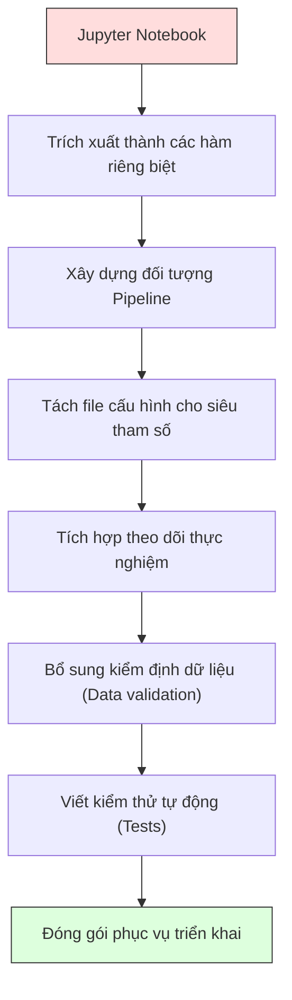

# Đường ống Học máy (ML Pipelines)

> Mô hình không phải là một sản phẩm hoàn chỉnh. Đường ống (Pipeline) mới chính là sản phẩm. Pipeline bao trọn mọi thứ từ dữ liệu thô cho tới dự đoán thực tế được triển khai, và mọi bước đi đều phải có tính tái lập (reproducible).

**Type:** Build
**Language:** Python
**Prerequisites:** Phase 2, Lesson 12 (Hyperparameter Tuning)
**Time:** ~120 minutes

## Learning Objectives

- Xây dựng một đường ống học máy (ML Pipeline) từ đầu liên kết tuần tự các bước điền giá trị khuyết, co giãn đặc trưng, mã hóa biến phân loại và huấn luyện mô hình thành một thực thể duy nhất có tính tái lập
- Nhận diện các kịch bản rò rỉ dữ liệu (data leakage) và giải thích cách Pipeline ngăn chặn chúng bằng cách chỉ khớp (fit) các bộ biến đổi trên dữ liệu huấn luyện
- Xây dựng một `ColumnTransformer` áp dụng các phương pháp tiền xử lý khác nhau cho các đặc trưng số học và phân loại
- Cài đặt tuần tự hóa (serialization) đường ống và chứng minh rằng cùng một pipeline đã khớp sẽ cho ra kết quả dự đoán giống hệt nhau ở cả môi trường huấn luyện và môi trường sản xuất (production)

## Vấn đề (The Problem)

Bạn có một file notebook tải dữ liệu lên, điền các giá trị khuyết bằng trung vị (median), chuẩn hóa co giãn đặc trưng, huấn luyện mô hình và in ra độ chính xác. Mã chạy tốt. Bạn bàn giao nó.

Một tháng sau, ai đó huấn luyện lại mô hình và nhận được kết quả hoàn toàn khác. Giá trị trung vị trước đó đã bị tính trên toàn bộ tập dữ liệu bao gồm cả tập kiểm thử (rò rỉ dữ liệu — data leakage). Các tham số co giãn không được lưu lại, nên khi suy luận thực tế (inference) hệ thống lại dùng các thông số thống kê khác. Đoạn mã kỹ thuật đặc trưng được sao chép-dán giữa quá trình huấn luyện và phục vụ dự đoán đã dần bị sai lệch nhau. Một cột danh mục xuất hiện giá trị mới tinh trong môi trường thực tế mà bộ mã hóa chưa từng thấy bao giờ.

Đây không phải là những giả định viển vông. Chúng là những lý do phổ biến nhất khiến các hệ thống ML thất bại khi đưa vào sản xuất. **Đường ống (Pipelines)** giải quyết triệt để tất cả những vấn đề này bằng cách đóng gói mọi bước biến đổi vào một đối tượng duy nhất, có thứ tự và có khả năng tái lập hoàn hảo.

## Khái niệm (The Concept)

### Đường ống (Pipeline) là gì

Một pipeline là một chuỗi tuần tự có thứ tự gồm các phép biến đổi dữ liệu nối tiếp nhau, kết thúc bằng một mô hình dự đoán. Mỗi bước nhận đầu ra của bước trước làm đầu vào của mình. Toàn bộ pipeline được khớp (fit) một lần duy nhất trên dữ liệu huấn luyện. Ở thời điểm suy luận (dự đoán), chính pipeline đã khớp đó sẽ biến đổi dữ liệu mới và đưa ra dự đoán.


Pipeline đảm bảo:
- Các phép biến đổi chỉ được học (fit) trên tập huấn luyện (không bị rò rỉ dữ liệu)
- Chính xác các phép biến đổi đó được áp dụng ở thời điểm suy luận thực tế
- Toàn bộ đối tượng có thể được tuần tự hóa (lưu trữ) và triển khai dưới dạng một artifact duy nhất
- Kiểm định chéo (cross-validation) áp dụng pipeline riêng biệt cho từng fold, ngăn chặn rò rỉ ngầm

### Rò rỉ dữ liệu: Kẻ sát nhân thầm lặng (Data Leakage: The Silent Killer)

Rò rỉ dữ liệu xảy ra khi thông tin từ tập kiểm thử hoặc từ tương lai làm ô nhiễm quá trình huấn luyện. Pipeline ngăn ngừa các dạng rò rỉ phổ biến nhất.

**Bị rò rỉ (Sai lầm):**
```python
X = df.drop("target", axis=1)
y = df["target"]

scaler = StandardScaler()
X_scaled = scaler.fit_transform(X)

X_train, X_test = X_scaled[:800], X_scaled[800:]
y_train, y_test = y[:800], y[800:]
```

Bộ co giãn `scaler` đã nhìn thấy trước tập kiểm thử. Giá trị trung bình và độ lệch chuẩn đã tính gộp cả các mẫu kiểm thử. Điều này thổi phồng độ chính xác ước lượng một cách giả tạo.

**Đúng chuẩn:**
```python
X_train, X_test = X[:800], X[800:]

scaler = StandardScaler()
X_train_scaled = scaler.fit_transform(X_train)
X_test_scaled = scaler.transform(X_test)
```

Khi sử dụng một pipeline, bạn thậm chí không cần phải bận tâm về điều này — pipeline sẽ tự động xử lý chuẩn xác.

### sklearn Pipeline

Lớp `Pipeline` của scikit-learn xâu chuỗi các bộ biến đổi (transformers) và một bộ ước lượng (estimator). Nó cung cấp các phương thức `.fit()`, `.predict()`, và `.score()` áp dụng tuần tự tất cả các bước theo đúng thứ tự.

```python
from sklearn.pipeline import Pipeline
from sklearn.preprocessing import StandardScaler
from sklearn.linear_model import LogisticRegression

pipe = Pipeline([
    ("scaler", StandardScaler()),
    ("model", LogisticRegression()),
])

pipe.fit(X_train, y_train)
predictions = pipe.predict(X_test)
```

Khi bạn gọi `pipe.fit(X_train, y_train)`:
1. `scaler` gọi `fit_transform` trên `X_train`
2. `model` gọi `fit` trên dữ liệu `X_train` đã được co giãn

Khi bạn gọi `pipe.predict(X_test)`:
1. `scaler` gọi `transform` (chứ KHÔNG gọi `fit_transform`) trên `X_test`
2. `model` gọi `predict` trên dữ liệu `X_test` đã được co giãn

Bộ co giãn không bao giờ nhìn thấy dữ liệu kiểm thử trong lúc học. Đó chính là toàn bộ mấu chốt.

### ColumnTransformer: Xử lý riêng biệt từng cột dữ liệu

Dữ liệu thực tế luôn gồm cả cột số và cột phân loại đòi hỏi các phương pháp tiền xử lý khác nhau. `ColumnTransformer` giải quyết nhiệm vụ này.

```python
from sklearn.compose import ColumnTransformer
from sklearn.preprocessing import StandardScaler, OneHotEncoder
from sklearn.impute import SimpleImputer

numeric_pipe = Pipeline([
    ("impute", SimpleImputer(strategy="median")),
    ("scale", StandardScaler()),
])

categorical_pipe = Pipeline([
    ("impute", SimpleImputer(strategy="most_frequent")),
    ("encode", OneHotEncoder(handle_unknown="ignore")),
])

preprocessor = ColumnTransformer([
    ("num", numeric_pipe, ["age", "income", "score"]),
    ("cat", categorical_pipe, ["city", "gender", "plan"]),
])

full_pipeline = Pipeline([
    ("preprocess", preprocessor),
    ("model", GradientBoostingClassifier()),
])
```

Tùy chọn `handle_unknown="ignore"` trong `OneHotEncoder` là cực kỳ quan trọng đối với môi trường sản xuất. Khi một danh mục mới toanh xuất hiện ở thực tế (ví dụ: một thành phố mà mô hình chưa từng gặp trong tập train), nó sẽ sinh ra một vector toàn số 0 thay vì làm sập toàn bộ hệ thống.

### Theo dõi thực nghiệm (Experiment Tracking)

Pipeline giúp quá trình huấn luyện có tính tái lập, nhưng bạn còn cần theo dõi những gì đã diễn ra qua các lần thử nghiệm: siêu tham số nào đã dùng, phiên bản dữ liệu nào, các chỉ số đạt được ra sao, mã nguồn nào đang chạy.

**MLflow** là giải pháp mã nguồn mở phổ biến nhất:

```python
import mlflow

with mlflow.start_run():
    mlflow.log_param("max_depth", 5)
    mlflow.log_param("n_estimators", 100)
    mlflow.log_param("learning_rate", 0.1)

    pipe.fit(X_train, y_train)
    accuracy = pipe.score(X_test, y_test)

    mlflow.log_metric("accuracy", accuracy)
    mlflow.sklearn.log_model(pipe, "model")
```

Mỗi lần chạy đều được ghi nhận đầy đủ tham số, chỉ số, file artifact và toàn bộ mô hình. Bạn có thể so sánh giữa các lần chạy, tái lập bất kỳ thí nghiệm nào và triển khai bất kỳ phiên bản mô hình nào.

**Weights & Biases (wandb)** cung cấp chức năng tương tự kèm giao diện quản lý trên nền đám mây:

```python
import wandb

wandb.init(project="my-pipeline")
wandb.config.update({"max_depth": 5, "n_estimators": 100})

pipe.fit(X_train, y_train)
accuracy = pipe.score(X_test, y_test)

wandb.log({"accuracy": accuracy})
```

### Quản lý phiên bản mô hình (Model Versioning)

Sau khi theo dõi thực nghiệm, bạn cần quản lý phiên bản mô hình. Mô hình nào đang chạy ở môi trường thực tế (Production)? Bản nào đang thử nghiệm (Staging)? Bản nào là của tuần trước?

Hệ thống Model Registry của MLflow cung cấp:
- **Theo dõi phiên bản:** Mỗi mô hình lưu lại đều được gắn số phiên bản rõ ràng
- **Chuyển đổi trạng thái:** "Staging", "Production", "Archived"
- **Quy trình phê duyệt:** Mô hình phải được phê duyệt trước khi đưa lên Production
- **Hoàn tác (Rollback):** Lập tức khôi phục về phiên bản trước đó nếu có sự cố

### Quản lý phiên bản dữ liệu với DVC (Data Versioning with DVC)

Mã nguồn được quản lý phiên bản bằng Git. Dữ liệu cũng cần được quản lý phiên bản, nhưng Git không thể xử lý các file dữ liệu khổng lồ. **DVC (Data Version Control)** sinh ra để giải quyết việc này.

```bash
dvc init
dvc add data/training.csv
git add data/training.csv.dvc data/.gitignore
git commit -m "Track training data"
dvc push
```

DVC lưu trữ dữ liệu thực sự trên các kho lưu trữ từ xa (S3, GCS, Azure) và chỉ lưu một file `.dvc` nhỏ chứa mã băm (hash) trong Git. Khi bạn chuyển nhánh Git, lệnh `dvc checkout` sẽ khôi phục chính xác phiên bản dữ liệu đã dùng tại thời điểm đó.

Điều này có nghĩa là mỗi commit trong Git ghim chặt cả mã nguồn lẫn dữ liệu tương ứng: đảm bảo tính tái lập 100%.

### Thí nghiệm có tính tái lập (Reproducible Experiments)

Một thí nghiệm có tính tái lập đòi hỏi đủ 4 yếu tố:
1. **Cố định hạt giống ngẫu nhiên (Fixed random seeds):** Thiết lập seed cho numpy, random, và framework (torch, sklearn)
2. **Ghim chặt phiên bản thư viện (Pinned dependencies):** Dùng `requirements.txt` hoặc `poetry.lock` với số phiên bản chính xác
3. **Quản lý phiên bản dữ liệu:** Dùng DVC hoặc hệ thống tương đương
4. **File cấu hình:** Mọi siêu tham số đều đặt trong file cấu hình, không viết cứng (hardcode) trong code

```python
import numpy as np
import random

def set_seed(seed=42):
    random.seed(seed)
    np.random.seed(seed)
    try:
        import torch
        torch.manual_seed(seed)
        torch.cuda.manual_seed_all(seed)
        torch.backends.cudnn.deterministic = True
    except ImportError:
        pass
```

### Từ Notebook tới Pipeline sản xuất (From Notebook to Production Pipeline)



Các bước tiến hóa tiêu biểu:
1. **Khám phá trên Notebook:** Thử nghiệm nhanh, vẽ biểu đồ, nảy sinh ý tưởng đặc trưng
2. **Trích xuất hàm:** Tách tiền xử lý, kiến tạo đặc trưng, đánh giá thành các module Python
3. **Xây dựng Pipeline:** Chuỗi các phép biến đổi thành một Pipeline chuẩn
4. **Quản lý cấu hình:** Chuyển mọi siêu tham số sang file YAML/JSON
5. **Theo dõi thực nghiệm:** Ghi log qua MLflow hoặc wandb
6. **Kiểm tra dữ liệu (Data validation):** Kiểm tra schema, phân phối, giá trị khuyết trước khi huấn luyện
7. **Kiểm thử (Tests):** Viết unit tests cho các transformer, integration tests cho toàn bộ pipeline
8. **Triển khai:** Tuần tự hóa pipeline, bọc trong một API (FastAPI, Flask) và đóng gói container (Docker)

### Những sai lầm phổ biến khi xây dựng Pipeline

| Sai lầm | Tại sao nguy hiểm | Cách khắc phục |
|---------|-------------------|----------------|
| Khớp (fit) trên toàn bộ dữ liệu trước khi chia tập | Rò rỉ dữ liệu (Data leakage) | Dùng `Pipeline` kết hợp với `cross_val_score` |
| Tạo đặc trưng bên ngoài pipeline | Sai lệch phép biến đổi giữa lúc train và lúc serve | Đưa toàn bộ các phép biến đổi vào bên trong `Pipeline` |
| Không xử lý các danh mục mới lạ | Hệ thống sập khi gặp giá trị chưa từng thấy | Dùng `OneHotEncoder(handle_unknown="ignore")` |
| Viết cứng (hardcode) tên các cột | Dễ gãy khi cấu trúc dữ liệu thay đổi | Nhận danh sách tên cột từ file cấu hình |
| Không kiểm định schema dữ liệu | Đưa ra dự đoán sai một cách âm thầm khi dữ liệu lỗi | Thêm bước kiểm tra schema trước khi dự đoán |
| Lệch pha giữa huấn luyện và phục vụ (Training/serving skew) | Mô hình nhìn thấy các đặc trưng khác biệt ở môi trường thực tế | Dùng chung một đối tượng `Pipeline` duy nhất cho cả hai |

```figure
f3-pipeline-flow
```

## Xây dựng (Build It)

Mã nguồn trong `code/pipeline.py` xây dựng một pipeline học máy hoàn chỉnh từ đầu:

### Bước 1: Bộ biến đổi tùy chỉnh (Custom Transformer)

```python
class CustomTransformer:
    def __init__(self):
        self.means = None
        self.stds = None

    def fit(self, X):
        self.means = np.mean(X, axis=0)
        self.stds = np.std(X, axis=0)
        self.stds[self.stds == 0] = 1.0
        return self

    def transform(self, X):
        return (X - self.means) / self.stds

    def fit_transform(self, X):
        return self.fit(X).transform(X)
```

### Bước 2: Pipeline tự xây dựng từ đầu

```python
class PipelineFromScratch:
    def __init__(self, steps):
        self.steps = steps

    def fit(self, X, y=None):
        X_current = X.copy()
        for name, step in self.steps[:-1]:
            X_current = step.fit_transform(X_current)
        name, model = self.steps[-1]
        model.fit(X_current, y)
        return self

    def predict(self, X):
        X_current = X.copy()
        for name, step in self.steps[:-1]:
            X_current = step.transform(X_current)
        name, model = self.steps[-1]
        return model.predict(X_current)
```

### Bước 3: Kiểm định chéo kết hợp với Pipeline

Mã nguồn chứng minh cách kiểm định chéo khi kết hợp với pipeline ngăn chặn rò rỉ dữ liệu như thế nào: bộ co giãn được khớp hoàn toàn độc lập trên từng fold dữ liệu train.

### Bước 4: Pipeline hoàn chỉnh cho sản xuất với scikit-learn

Một pipeline sản xuất hoàn chỉnh sử dụng `ColumnTransformer`, xử lý đa nhánh cho các loại dữ liệu khác nhau, huấn luyện kèm kiểm định chéo và ghi nhận nhật ký thí nghiệm.

## Đóng gói (Ship It)

Bài học này cung cấp:
- `outputs/prompt-ml-pipeline.md` — bản kỹ năng hướng dẫn xây dựng và gỡ lỗi các đường ống ML
- `code/pipeline.py` — mã nguồn hoàn chỉnh xây dựng pipeline từ đầu cho tới scikit-learn

## Bài tập (Exercises)

1. Xây dựng một pipeline xử lý tập dữ liệu có 3 cột số và 2 cột phân loại. Dùng `ColumnTransformer` để áp dụng điền trung vị + co giãn cho cột số, và điền yếu vị + mã hóa one-hot cho cột phân loại. Huấn luyện với kiểm định chéo 5-fold.
2. Chủ động tạo ra lỗi rò rỉ dữ liệu: khớp bộ co giãn trên toàn bộ dữ liệu trước khi chia tập. So sánh điểm kiểm định chéo có rò rỉ với điểm kiểm định chéo chuẩn qua pipeline. Sự chênh lệch lớn đến mức nào?
3. Tuần tự hóa pipeline của bạn bằng `joblib.dump`. Tải lại nó trong một script riêng biệt và thực hiện dự đoán. Kiểm chứng rằng các dự đoán thu được là giống hệt nhau.
4. Thêm một transformer tùy chỉnh vào pipeline để tạo các đặc trưng đa thức (bậc 2) cho 2 cột số quan trọng nhất. Vị trí đặt transformer này ở đâu trong pipeline là hợp lý nhất?
5. Thiết lập theo dõi MLflow cho pipeline. Chạy 5 thực nghiệm với các siêu tham số khác nhau. Mở giao diện MLflow UI (`mlflow ui`) để so sánh các lần chạy và chọn ra mô hình tốt nhất.

## Thuật ngữ chính (Key Terms)

| Thuật ngữ | Cách gọi thông thường | Ý nghĩa thực sự |
|-----------|----------------------|-----------------|
| Pipeline (Đường ống) | "Chuỗi biến đổi + mô hình" | Một chuỗi có thứ tự gồm các bộ biến đổi và mô hình, được thực thi như một khối thống nhất để ngăn rò rỉ dữ liệu |
| Data leakage (Rò rỉ dữ liệu) | "Thông tin kiểm thử bị lọt vào lúc học" | Dùng thông tin nằm ngoài tập huấn luyện để xây dựng mô hình, dẫn đến việc ước tính hiệu năng bị ảo |
| ColumnTransformer | "Tiền xử lý riêng cho từng cột" | Áp dụng các pipeline khác nhau cho từng tập con các cột rồi ghép nối kết quả lại |
| Experiment tracking (Theo dõi thực nghiệm) | "Ghi nhật ký các lần chạy" | Lưu lại tham số, chỉ số, file artifact và phiên bản mã nguồn cho từng lần huấn luyện |
| MLflow | "Nền tảng theo dõi và triển khai" | Khung làm việc mã nguồn mở phục vụ theo dõi thực nghiệm, quản lý phiên bản mô hình và triển khai |
| DVC | "Git dành cho dữ liệu" | Hệ thống quản lý phiên bản cho các file dữ liệu lớn, lưu mã băm trong git và lưu file thực tế trên cloud |
| Model registry (Kho lưu trữ mô hình) | "Danh mục phiên bản mô hình" | Hệ thống theo dõi các phiên bản mô hình kèm nhãn trạng thái (staging, production, archived) |
| Training/serving skew (Lệch pha huấn luyện/phục vụ) | "Chạy được trên notebook nhưng lỗi ngoài thực tế" | Sự sai khác giữa cách dữ liệu được xử lý lúc huấn luyện so với lúc suy luận, gây ra sai số ngầm |
| Reproducibility (Tính tái lập) | "Cùng mã nguồn, cùng kết quả" | Khả năng thu được kết quả giống hệt nhau từ cùng một đoạn mã, dữ liệu và cấu hình |

## Đọc thêm (Further Reading)

- [scikit-learn Pipeline docs](https://scikit-learn.org/stable/modules/compose.html) — tài liệu tham khảo chính thức về pipeline của scikit-learn
- [MLflow documentation](https://mlflow.org/docs/latest/index.html) — theo dõi thực nghiệm và quản lý phiên bản mô hình
- [DVC documentation](https://dvc.org/doc) — quản lý phiên bản dữ liệu
- [Sculley et al., Hidden Technical Debt in Machine Learning Systems (2015)](https://papers.nips.cc/paper/2015/hash/86df7dcfd896fcaf2674f757a2463eba-Abstract.html) — bài báo kinh điển về sự phức tạp và nợ kỹ thuật trong hệ thống ML
- [Google ML Best Practices: Rules of ML](https://developers.google.com/machine-learning/guides/rules-of-ml) — lời khuyên thực chiến khi xây dựng hệ thống ML trong sản xuất
