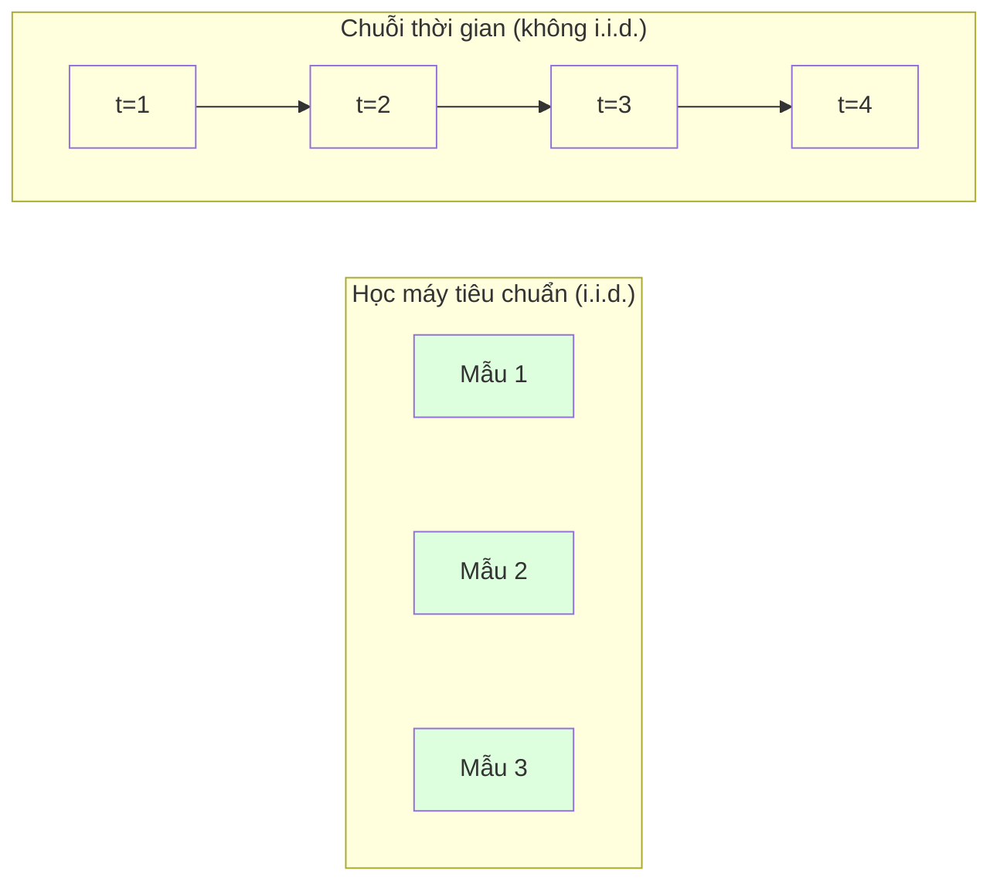
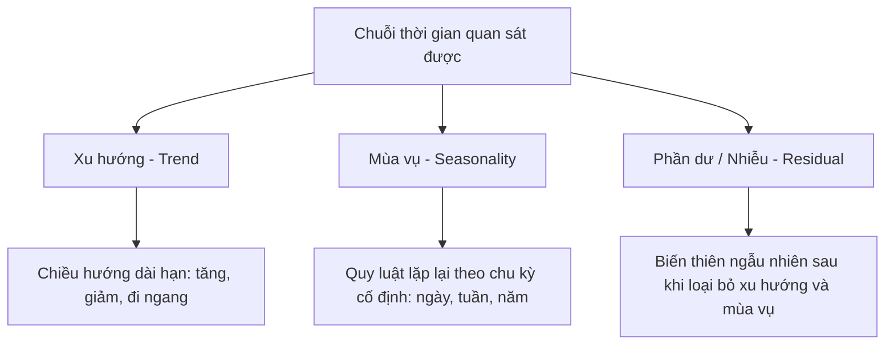
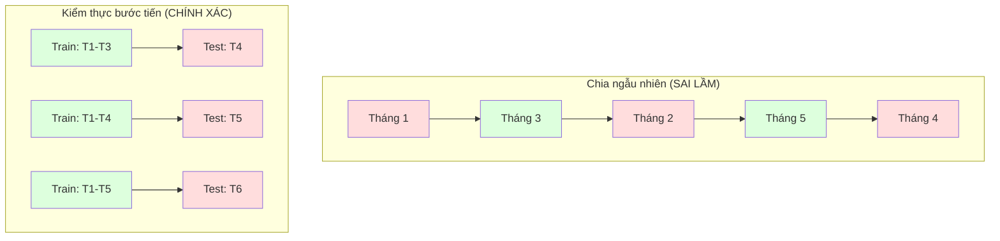

# Nền tảng Chuỗi thời gian (Time Series Fundamentals)

> Hiệu suất trong quá khứ thực sự có thể dự đoán kết quả tương lai -- miễn là bạn kiểm tra tính dừng (stationarity) trước tiên.

**Type:** Build
**Language:** Python
**Prerequisites:** Phase 2, Lessons 01-09
**Time:** ~90 phút

## Learning Objectives

- Phân rã chuỗi thời gian (decompose a time series) thành các thành phần xu hướng (trend), mùa vụ (seasonality) và phần dư (residual), đồng thời kiểm định tính dừng (stationarity)
- Triển khai các đặc trưng trễ (lag features) và thống kê cửa sổ trượt (rolling statistics) để chuyển đổi chuỗi thời gian thành bài toán học có giám sát (supervised learning)
- Xây dựng framework kiểm thực bước tiến (walk-forward validation) giúp ngăn chặn rò rỉ dữ liệu tương lai vào tập huấn luyện
- Giải thích vì sao chia tập train/test ngẫu nhiên là sai lầm nghiêm trọng đối với chuỗi thời gian và chứng minh khoảng cách chênh lệch hiệu năng so với chia theo thời gian thực chuẩn xác

## Vấn đề đặt ra (The Problem)

Bạn có dữ liệu được sắp xếp theo thời gian. Doanh số bán hàng hàng ngày, nhiệt độ hàng giờ, mức sử dụng CPU mỗi phút, giá cổ phiếu hàng tuần. Bạn muốn dự đoán giá trị tiếp theo, tuần tiếp theo, quý tiếp theo.

Bạn với ngay lấy bộ công cụ ML quen thuộc: chia tập train/test ngẫu nhiên, kiểm thực chéo (cross-validation), đưa ma trận đặc trưng vào, nhận dự đoán ra. Từng bước đó đều là sai lầm!

Chuỗi thời gian phá vỡ các giả định cốt lõi mà học máy truyền thống dựa vào. Các mẫu dữ liệu không hề độc lập -- nhiệt độ hôm nay phụ thuộc vào nhiệt độ hôm qua. Việc chia ngẫu nhiên làm rò rỉ thông tin tương lai về quá khứ (future data leakage). Những đặc trưng trông rất tuyệt vời khi backtest lại thất bại ê chề khi đưa lên môi trường sản xuất (production) vì chúng dựa vào các quy luật biến dịch theo thời gian.

Một mô hình đạt độ chính xác 95% khi dùng kiểm thực chéo ngẫu nhiên có thể chỉ đạt 55% khi được đánh giá đúng đắn dựa trên trục thời gian. Sự khác biệt này không phải là chi tiết kỹ thuật nhỏ. Đó là ranh giới giữa một mô hình hoạt động trên lý thuyết và một mô hình thực sự hoạt động trong môi trường sản xuất.

Bài học này bao quát những nền tảng cốt lõi: điều gì làm cho dữ liệu thời gian trở nên khác biệt, cách đánh giá mô hình một cách trung thực và cách chuyển đổi chuỗi thời gian thành các đặc trưng mà các mô hình ML tiêu chuẩn có thể tiếp nhận.

## Khái niệm (The Concept)

### Điểm khác biệt của chuỗi thời gian

Học máy tiêu chuẩn giả định dữ liệu độc lập và phân phối giống nhau (i.i.d. -- independent and identically distributed). Mỗi mẫu được rút ra từ cùng một phân phối, độc lập với các mẫu khác. Chuỗi thời gian vi phạm cả hai điều kiện này:

- **Không độc lập (Not independent):** Giá cổ phiếu hôm nay phụ thuộc vào giá hôm qua. Doanh số tuần này tương quan với doanh số tuần trước.
- **Không phân phối giống nhau (Not identically distributed):** Phân phối dịch chuyển theo thời gian. Doanh số bán hàng tháng 12 trông rất khác với doanh số tháng 3.

Những vi phạm này không hề nhỏ. Chúng thay đổi hoàn toàn cách bạn xây dựng đặc trưng, cách bạn đánh giá mô hình và thuật toán nào có thể phát huy hiệu quả.



Trong học máy tiêu chuẩn, các mẫu có thể hoán đổi cho nhau. Xáo trộn chúng không làm thay đổi điều gì. Nhưng trong chuỗi thời gian, thứ tự là tất cả. Xáo trộn dữ liệu sẽ phá hủy hoàn toàn tín hiệu.

### Các thành phần của chuỗi thời gian

Mọi chuỗi thời gian đều là sự kết hợp của:



- **Xu hướng (Trend):** Chiều hướng dịch chuyển dài hạn. Doanh thu tăng trưởng 10% mỗi năm. Nhiệt độ toàn cầu đang ấm lên.
- **Mùa vụ (Seasonality):** Các mẫu hình lặp lại tại các khoảng thời gian cố định. Doanh số bán lẻ tăng vọt vào tháng 12. Lượng tiêu thụ điện điều hòa đạt đỉnh vào tháng 7.
- **Phần dư (Residual):** Bất cứ thứ gì còn sót lại sau khi loại bỏ xu hướng và mùa vụ. Nếu phần dư trông giống như nhiễu trắng (white noise), điều đó chứng tỏ phép phân rã đã nắm bắt được trọn vẹn tín hiệu có ích.

### Tính dừng (Stationarity)

Một chuỗi thời gian được gọi là dừng (stationary) nếu các đặc tính thống kê của nó (giá trị trung bình - mean, phương sai - variance, tự tương quan - autocorrelation) không thay đổi theo thời gian. Hầu hết các phương pháp dự báo cổ điển đều giả định tính dừng.

**Vì sao tính dừng quan trọng:** Một chuỗi không dừng có giá trị trung bình trôi dạt (drift). Mô hình huấn luyện trên dữ liệu tháng 1 đã học một giá trị trung bình hoàn toàn khác với những gì tháng 2 thể hiện. Dự đoán của nó sẽ bị sai lệch có hệ thống.

**Cách kiểm tra:** Tính giá trị trung bình trượt (rolling mean) và độ lệch chuẩn trượt (rolling standard deviation) trên các cửa sổ thời gian. Nếu chúng trôi dạt theo thời gian, chuỗi đó không dừng.

**Cách khắc phục:** Lấy sai phân (differencing). Thay vì mô hình hóa các giá trị thô, ta mô hình hóa sự thay đổi giữa các giá trị liên tiếp:

```math
\text{diff}[t] = \text{value}[t] - \text{value}[t-1]
```

Nếu một lần lấy sai phân (first-order difference) vẫn chưa làm chuỗi dừng, ta áp dụng thêm lần nữa (sai phân bậc hai - second-order difference). Hầu hết các chuỗi trong thực tế chỉ cần tối đa hai lần lấy sai phân.

**Ví dụ:**

Chuỗi gốc: `[100, 102, 106, 112, 120]`
Sai phân bậc một: `[2, 4, 6, 8]` (vẫn đang có xu hướng tăng)
Sai phân bậc hai: `[2, 2, 2]` (hằng số -- đã đạt tính dừng)

Chuỗi gốc có xu hướng bậc hai (quadratic trend). Sai phân bậc một biến nó thành xu hướng tuyến tính. Sai phân bậc hai làm nó nằm ngang. Trong thực tế, bạn hiếm khi cần nhiều hơn 2 bậc sai phân.

**Kiểm định thống kê chính quy:** Kiểm định Augmented Dickey-Fuller (ADF) là kiểm định thống kê chuẩn để đánh giá tính dừng. Giả thuyết $H_0$ là "chuỗi không có tính dừng". Giá trị p-value dưới 0.05 cho phép bạn bác bỏ giả thuyết $H_0$ và kết luận chuỗi có tính dừng. Chúng ta không tự viết ADF từ đầu (vì nó đòi hỏi bảng phân phối tiệm cận), nhưng phương pháp thống kê trượt trong mã nguồn cung cấp một công cụ trực quan và thực tiễn để kiểm tra.

### Tự tương quan (Autocorrelation)

Tự tương quan đo lường mức độ tương quan giữa một giá trị tại thời điểm $t$ với giá trị tại thời điểm $t-k$ ($k$ bước trong quá khứ). Hàm tự tương quan (ACF - Autocorrelation Function) vẽ biểu đồ tương quan này cho từng bước trễ $k$ (lag $k$).

**ACF cho bạn biết:**
- Chuỗi ghi nhớ bao xa: Nếu ACF giảm về 0 sau lag 5, các giá trị cách quá 5 bước thời gian trở nên không còn liên quan.
- Có tính mùa vụ hay không: Nếu ACF vọt lên tại lag 12 (với dữ liệu hàng tháng), chuỗi có tính mùa vụ hàng năm.
- Cần tạo bao nhiêu đặc trưng trễ (lag features): Dùng các độ trễ cho tới khi ACF trở nên không đáng kể.

**PACF (Partial Autocorrelation Function - Hàm tự tương quan riêng phần):** Loại bỏ các tương quan gián tiếp. Nếu hôm nay tương quan với 3 ngày trước chỉ vì cả hai đều tương quan với hôm qua, PACF tại lag 3 sẽ bằng 0 trong khi ACF tại lag 3 vẫn khác 0.

### Đặc trưng trễ (Lag Features): Biến chuỗi thời gian thành học có giám sát

Các mô hình ML tiêu chuẩn yêu cầu một ma trận đặc trưng $X$ và một biến mục tiêu $y$. Nhưng chuỗi thời gian chỉ cung cấp một cột giá trị duy nhất. Chiếc cầu nối chính là các đặc trưng trễ (lag features).

Xét chuỗi `[10, 12, 14, 13, 15]` và tạo các đặc trưng `lag_1` và `lag_2`:

| lag_2 | lag_1 | target |
|-------|-------|--------|
| 10    | 12    | 14     |
| 12    | 14    | 13     |
| 14    | 13    | 15     |

Giờ đây bạn đã có một bài toán hồi quy tiêu chuẩn. Bất kỳ mô hình ML nào (Linear Regression, Random Forest, Gradient Boosting) đều có thể dự đoán biến mục tiêu từ các giá trị trễ.

Các đặc trưng bổ sung bạn có thể tạo (feature engineering):
- **Thống kê trượt (Rolling statistics):** mean, std, min, max trên $k$ giá trị gần nhất
- **Đặc trưng lịch (Calendar features):** thứ trong tuần, tháng, ngày lễ, ngày cuối tuần
- **Giá trị sai phân (Differenced values):** mức độ thay đổi so với bước trước
- **Thống kê mở rộng (Expanding statistics):** giá trị trung bình tích lũy, tổng tích lũy
- **Đặc trưng tỉ lệ (Ratio features):** giá trị hiện tại / trung bình trượt (đo khoảng cách so với mức trung bình gần đây)
- **Đặc trưng tương tác (Interaction features):** `lag_1 * day_of_week` (tác động của ngày trong tuần lên đà biến động)

**Cần bao nhiêu bước trễ?** Hãy dùng hàm tự tương quan ACF. Nếu ACF có ý nghĩa thống kê tới lag 10, hãy dùng ít nhất 10 lag. Nếu có tính mùa vụ tuần, hãy đưa vào lag 7 (và có thể cả lag 14). Càng nhiều lag càng cung cấp nhiều lịch sử nhưng cũng tạo thêm nhiều đặc trưng, làm tăng nguy cơ quá khớp.

**Cái bẫy căn chỉnh mục tiêu (Target alignment trap):** Khi tạo đặc trưng trễ, biến mục tiêu phải là giá trị tại thời điểm $t$, và tất cả các đặc trưng phải sử dụng giá trị tại thời điểm $t-1$ hoặc sớm hơn. Nếu bạn vô tình đưa giá trị tại thời điểm $t$ vào làm đặc trưng, bạn sẽ có một bộ dự đoán "hoàn hảo" trên giấy tờ -- nhưng hoàn toàn vô dụng trong thực tế. Đây là lỗi phổ biến nhất trong feature engineering cho chuỗi thời gian.

### Kiểm thực bước tiến (Walk-Forward Validation)

Đây là khái niệm quan trọng nhất trong bài học này. K-fold cross-validation thông thường chia ngẫu nhiên các mẫu vào tập huấn luyện và tập kiểm thử. Đối với chuỗi thời gian, việc này làm rò rỉ thông tin tương lai.



Quy trình Walk-Forward Validation:
1. Huấn luyện trên dữ liệu cho tới thời điểm $t$
2. Dự đoán tại thời điểm $t+1$ (hoặc $t+1$ đến $t+k$ cho dự báo nhiều bước)
3. Trượt hoặc mở rộng cửa sổ về phía trước
4. Lặp lại

Mỗi fold kiểm thử chỉ chứa dữ liệu xuất hiện sau toàn bộ dữ liệu huấn luyện. Không có rò rỉ tương lai. Điều này mang lại cho bạn ước tính trung thực về cách mô hình sẽ hoạt động khi triển khai thực tế.

**Cửa sổ mở rộng (Expanding window):** Sử dụng toàn bộ dữ liệu lịch sử để huấn luyện (kích thước cửa sổ tăng dần). **Cửa sổ trượt (Sliding window):** Sử dụng một cửa sổ huấn luyện có kích thước cố định (cửa sổ trượt về phía trước). Hãy dùng expanding khi bạn tin rằng dữ liệu cũ vẫn có giá trị. Hãy dùng sliding khi môi trường thay đổi nhanh và dữ liệu quá khứ xa có thể gây hại.

### Trực giác về ARIMA

ARIMA là mô hình chuỗi thời gian cổ điển. Nó gồm 3 thành phần:

- **AR (Tự hồi quy - Autoregressive):** Dự đoán từ các giá trị quá khứ. AR(p) sử dụng $p$ giá trị gần nhất.
- **I (Tích hợp / Sai phân - Integrated):** Lấy sai phân để đạt tính dừng. I(d) áp dụng $d$ lần sai phân.
- **MA (Trung bình trượt sai số - Moving Average):** Dự đoán từ các sai số dự báo trong quá khứ. MA(q) sử dụng $q$ sai số gần nhất.

ARIMA(p, d, q) kết hợp cả ba thành phần. Bạn chọn $p$, $d$, $q$ dựa trên phân tích ACF/PACF hoặc tìm kiếm tự động (auto-ARIMA).

Chúng ta không tự cài đặt thuật toán ARIMA từ đầu -- vì nó đòi hỏi các phương pháp tối ưu hóa số phức tạp nằm ngoài phạm vi bài học. Điểm mấu chốt là hiểu từng thành phần làm gì để có thể giải thích kết quả và biết khi nào nên áp dụng.

### Khi nào nên dùng phương pháp nào?

| Phương pháp | Phù hợp nhất cho | Xử lý tính mùa vụ | Xử lý đặc trưng ngoại sinh |
|----------|---------|-------------------|------------------------|
| Lag features + ML | Dữ liệu bảng với nhiều đặc trưng ngoài | Tốt (với đặc trưng lịch) | Có |
| ARIMA | Chuỗi đơn biến đơn lẻ, dự báo ngắn hạn | Biến thể SARIMA | Không (ARIMAX hỗ trợ hạn chế) |
| San phẳng hàm mũ (Exponential smoothing) | Xu hướng đơn giản + mùa vụ | Có (Holt-Winters) | Không |
| Prophet | Dự báo kinh doanh, ngày lễ | Có (chuỗi Fourier) | Hạn chế |
| Mạng nơ-ron (LSTM, Transformer) | Chuỗi rất dài, nhiều chuỗi song song | Học tự động | Có |

Với phần lớn các bài toán thực tế, kết hợp **Lag features + Gradient Boosting** là xuất phát điểm mạnh mẽ nhất. Nó xử lý các đặc trưng bên ngoài một cách tự nhiên, không bắt buộc dữ liệu phải dừng hoàn hảo và rất dễ debug.

### Tầm nhìn dự báo (Forecasting Horizons) và chiến lược

Dự báo đơn bước (single-step) dự đoán một bước thời gian tiếp theo. Dự báo đa bước (multi-step) dự đoán nhiều bước về tương lai. Có 3 chiến lược chính:

**Đệ quy (Recursive / Iterated):** Dự đoán bước $t+1$, rồi dùng chính giá trị dự đoán đó làm đầu vào để dự đoán $t+2$. Đơn giản nhưng sai số tích lũy dần theo từng bước (compounding errors).

**Trực tiếp (Direct):** Huấn luyện một mô hình riêng cho từng khoảng thời gian. Model-1 dự đoán $t+1$, Model-5 dự đoán $t+5$. Không bị tích lũy sai số, nhưng mỗi mô hình có ít mẫu huấn luyện hơn và chúng không chia sẻ thông tin cho nhau.

**Đa đầu ra (Multi-output):** Huấn luyện một mô hình duy nhất dự đoán tất cả các bước cùng lúc. Chia sẻ thông tin trên toàn bộ các bước nhưng đòi hỏi mô hình hỗ trợ đầu ra nhiều chiều.

Với hầu hết các bài toán thực tế, hãy bắt đầu với đệ quy cho tầm nhìn ngắn (1-5 bước) và trực tiếp cho tầm nhìn dài hơn.

### Các sai lầm phổ biến trong chuỗi thời gian

| Sai lầm | Nguyên nhân | Cách khắc phục |
|---------|---------------|-----------|
| Chia train/test ngẫu nhiên | Thói quen từ ML thông thường | Dùng walk-forward validation hoặc chia theo mốc thời gian |
| Sử dụng đặc trưng tương lai | Vô tình đưa giá trị tại thời điểm $t$ vào đầu vào | Rà soát cẩn thận sự căn chỉnh thời gian của mọi đặc trưng |
| Quá khớp với tính mùa vụ | Mô hình học vẹt các mẫu hình theo lịch | Giữ lại ít nhất một chu kỳ mùa vụ đầy đủ trong tập test |
| Bỏ qua sự thay đổi quy mô | Doanh thu tăng gấp đôi nhưng chu kỳ vẫn giữ nguyên | Mô hình hóa phần trăm thay đổi thay vì giá trị tuyệt đối |
| Quá nhiều đặc trưng trễ | Nghĩ rằng "càng nhiều lịch sử càng tốt" | Dùng đồ thị ACF để chọn các độ trễ thực sự có ý nghĩa |
| Không lấy sai phân | Tin rằng "mô hình sẽ tự tìm ra quy luật" | Mô hình cây xử lý được xu hướng; mô hình tuyến tính cần tính dừng |

```figure
f3-series-decompose
```

## Tự tay xây dựng (Build It)

Mã nguồn trong `code/time_series.py` triển khai các khối dựng cốt lõi từ đầu.

### Hàm tạo đặc trưng trễ (Lag Feature Creator)

```python
def make_lag_features(series, n_lags):
    n = len(series)
    X = np.full((n, n_lags), np.nan)
    for lag in range(1, n_lags + 1):
        X[lag:, lag - 1] = series[:-lag]
    valid = ~np.isnan(X).any(axis=1)
    return X[valid], series[valid]
```

Hàm này chuyển đổi chuỗi 1D thành ma trận đặc trưng trong đó mỗi hàng chứa `n_lags` giá trị trước đó làm đặc trưng, và giá trị hiện tại làm biến mục tiêu.

### Kiểm thực bước tiến (Walk-Forward Splitter)

```python
def walk_forward_split(n_samples, n_splits=5, min_train=50):
    assert min_train < n_samples, "min_train must be less than n_samples"
    step = max(1, (n_samples - min_train) // n_splits)
    for i in range(n_splits):
        train_end = min_train + i * step
        test_end = min(train_end + step, n_samples)
        if train_end >= n_samples:
            break
        yield slice(0, train_end), slice(train_end, test_end)
```

Mỗi phân đoạn đảm bảo dữ liệu huấn luyện luôn nằm trước dữ liệu kiểm thử theo trục thời gian. Cửa sổ huấn luyện mở rộng dần sau mỗi fold.

### Mô hình tự hồi quy đơn giản (Simple Autoregressive Model)

Một mô hình AR thuần túy thực chất chính là hồi quy tuyến tính trên các đặc trưng trễ:

```python
class SimpleAR:
    def __init__(self, n_lags=5):
        self.n_lags = n_lags
        self.weights = None
        self.bias = None

    def fit(self, series):
        X, y = make_lag_features(series, self.n_lags)
        # Giải phương trình chuẩn tắc (Normal Equations)
        X_b = np.column_stack([np.ones(len(X)), X])
        theta = np.linalg.lstsq(X_b, y, rcond=None)[0]
        self.bias = theta[0]
        self.weights = theta[1:]
        return self
```

Về mặt khái niệm, nó hoàn toàn giống với Hồi quy Tuyến tính từ Bài 02, nhưng được áp dụng lên các phiên bản trễ thời gian của chính biến số đó.

### Kiểm tra tính dừng (Stationarity Check)

Mã nguồn tính toán các đại lượng thống kê trượt để đánh giá tính dừng trực quan và định lượng:

```python
def check_stationarity(series, window=50):
    rolling_mean = np.array([
        series[max(0, i - window):i].mean()
        for i in range(1, len(series) + 1)
    ])
    rolling_std = np.array([
        series[max(0, i - window):i].std()
        for i in range(1, len(series) + 1)
    ])
    return rolling_mean, rolling_std
```

Nếu trung bình trượt trôi dạt hoặc độ lệch chuẩn trượt thay đổi đáng kể, chuỗi đó không có tính dừng. Hãy lấy sai phân và kiểm tra lại.

Mã nguồn cũng kiểm tra tính dừng bằng cách so sánh nửa đầu và nửa sau của chuỗi. Nếu các giá trị trung bình chênh lệch hơn nửa độ lệch chuẩn hoặc tỉ số phương sai vượt quá 2 lần, chuỗi sẽ bị gắn cờ là không dừng.

### Hàm tự tương quan (Autocorrelation)

```python
def autocorrelation(series, max_lag=20):
    n = len(series)
    mean = series.mean()
    var = series.var()
    acf = np.zeros(max_lag + 1)
    for k in range(max_lag + 1):
        cov = np.mean((series[:n-k] - mean) * (series[k:] - mean))
        acf[k] = cov / var if var > 0 else 0
    return acf
```

## Sử dụng trong thực tế (Use It)

Với scikit-learn, bạn có thể dùng các đặc trưng trễ trực tiếp với bất kỳ mô hình hồi quy nào:

```python
from sklearn.linear_model import Ridge
from sklearn.ensemble import GradientBoostingRegressor

X, y = make_lag_features(series, n_lags=10)

for train_idx, test_idx in walk_forward_split(len(X)):
    model = Ridge(alpha=1.0)
    model.fit(X[train_idx], y[train_idx])
    predictions = model.predict(X[test_idx])
```

Đối với ARIMA, sử dụng thư viện statsmodels:

```python
from statsmodels.tsa.arima.model import ARIMA

model = ARIMA(train_series, order=(5, 1, 2))
fitted = model.fit()
forecast = fitted.forecast(steps=30)
```

Mã nguồn trong `time_series.py` minh họa cả hai cách tiếp cận và so sánh chúng thông qua kiểm thực bước tiến.

### `TimeSeriesSplit` trong scikit-learn

scikit-learn cung cấp sẵn `TimeSeriesSplit` triển khai cơ chế walk-forward validation:

```python
from sklearn.model_selection import TimeSeriesSplit

tscv = TimeSeriesSplit(n_splits=5)
for train_index, test_index in tscv.split(X):
    X_train, X_test = X[train_index], X[test_index]
    y_train, y_test = y[train_index], y[test_index]
    model.fit(X_train, y_train)
    score = model.score(X_test, y_test)
```

Bạn có thể kết hợp trực tiếp với `cross_val_score`:

```python
from sklearn.model_selection import cross_val_score

scores = cross_val_score(model, X, y, cv=TimeSeriesSplit(n_splits=5))
print(f"Mean score: {scores.mean():.4f} +/- {scores.std():.4f}")
```

### Các thước đo đánh giá (Evaluation Metrics)

Dự báo chuỗi thời gian sử dụng các thước đo hồi quy, nhưng được đặt trong bối cảnh nhạy cảm về thời gian:

- **MAE (Mean Absolute Error):** Trung bình của $\lvert y_{\text{true}} - y_{\text{pred}} \rvert$. Dễ giải thích theo đơn vị gốc: "Trung bình dự đoán lệch 3.2 độ".
- **RMSE (Root Mean Squared Error):** Căn bậc hai của sai số bình phương trung bình. Phạt nặng các sai số lớn hơn so với MAE. Dùng khi sai số lớn gây hậu quả nghiêm trọng hơn nhiều sai số nhỏ.
- **MAPE (Mean Absolute Percentage Error):** Trung bình của $|(y_{\text{true}} - y_{\text{pred}}) / y_{\text{true}}| \times 100\%$. Không phụ thuộc đơn vị đo, rất hữu ích khi so sánh giữa các chuỗi khác nhau. Nhưng không xác định khi giá trị thực bằng 0.
- **So sánh với baseline ngây thơ:** Luôn so sánh mô hình với các đường cơ sở đơn giản. Dự báo theo mùa ngây thơ (seasonal naive baseline) dự đoán giá trị giống hệt một chu kỳ trước (hôm qua, tuần trước). Nếu mô hình không đánh bại được baseline ngây thơ này, chứng tỏ mô hình có vấn đề.

### Đặc trưng trượt (Rolling Features)

Mã nguồn minh họa việc thêm các thống kê trượt (mean, std, min, max trên cửa sổ 7 và 14 ngày) vào các đặc trưng trễ. Những đặc trưng này cung cấp cho mô hình thông tin về xu hướng và độ biến động gần đây mà bản thân các giá trị trễ đơn lẻ không thể hiện rõ.

Ví dụ: nếu trung bình trượt đang tăng, điều đó báo hiệu một xu hướng đi lên. Nếu độ lệch chuẩn trượt tăng, điều đó báo hiệu biến động thị trường đang mạnh lên. Đây là những quy luật mà các mô hình dạng cây có thể học rất hiệu quả.

## Xuất xưởng (Ship It)

Bài học này tạo ra:
- `outputs/prompt-time-series-advisor.md` -- prompt định hình và đóng khung bài toán chuỗi thời gian
- `code/time_series.py` -- đặc trưng trễ, kiểm thực bước tiến, mô hình AR, kiểm tra tính dừng

### Các Baseline bắt buộc phải vượt qua

Trước khi xây dựng bất kỳ mô hình phức tạp nào, hãy thiết lập các baseline sau:

1. **Giá trị gần nhất (Persistence / Last value):** Dự đoán ngày mai sẽ giống hệt hôm nay. Đối với nhiều chuỗi, baseline này đáng ngạc nhiên là rất khó bị đánh bại.
2. **Ngây thơ theo mùa (Seasonal naive):** Dự đoán hôm nay sẽ giống hệt cùng ngày tuần trước (hoặc năm ngoái). Nếu mô hình ML không vượt qua được mức này, nó chưa học được bất kỳ quy luật hữu ích nào ngoài tính mùa vụ thuần túy.
3. **Trung bình trượt (Moving average):** Dự đoán giá trị trung bình của $k$ giá trị gần nhất. Làm mượt nhiễu nhưng không nắm bắt được những biến đổi đột ngột.

Nếu mô hình học máy đắt đỏ của bạn thua cả baseline ngây thơ, bạn chắc chắn đã gặp lỗi: phổ biến nhất là rò rỉ dữ liệu tương lai, phương pháp đánh giá sai lầm, hoặc chuỗi dữ liệu thực chất hoàn toàn ngẫu nhiên và không thể dự đoán được.

### Lời khuyên thực chiến

1. **Bắt đầu bằng việc vẽ đồ thị.** Trước khi dựng mô hình, hãy vẽ đồ thị chuỗi thô. Quan sát xu hướng, tính mùa vụ, ngoại lai (outliers), và các điểm gãy cấu trúc (structural breaks). 30 giây nhìn đồ thị thường cung cấp nhiều thông tin hơn một giờ chạy phân tích tự động.

2. **Lấy sai phân trước, dựng mô hình sau.** Nếu chuỗi có xu hướng rõ ràng, hãy lấy sai phân trước khi tạo lag features. Các mô hình cây có thể xử lý được xu hướng, nhưng mô hình tuyến tính nếu không có số hạng xu hướng tường minh sẽ thất bại. Dừng lại ngay khi chuỗi đã dừng: mỗi bậc sai phân thừa sẽ đưa thêm nhiễu vào và làm mất thông tin mức nền (level information).

3. **Giữ lại ít nhất một chu kỳ mùa vụ đầy đủ.** Nếu chuỗi có tính mùa vụ theo tuần, tập test cần ít nhất một tuần trọn vẹn. Nếu theo tháng, cần ít nhất một tháng. Nếu không, bạn không thể đánh giá được liệu mô hình có nắm bắt được chu kỳ mùa vụ hay không.

4. **Giám sát trong môi trường sản xuất.** Các mô hình chuỗi thời gian sẽ thoái hóa dần theo thời gian khi thế giới thực thay đổi. Hãy theo dõi sai số dự đoán trên cửa sổ trượt. Khi sai số bắt đầu tăng, hãy huấn luyện lại mô hình trên dữ liệu mới nhất.

5. **Cẩn trọng với sự thay đổi thể chế (Regime changes).** Một mô hình huấn luyện trên dữ liệu trước đại dịch sẽ không thể dự đoán chính xác hành vi sau đại dịch. Hãy bổ sung các chỉ báo về sự thay đổi thể chế làm đặc trưng, hoặc dùng cửa sổ trượt (sliding window) để mô hình quên đi dữ liệu quá xa trong quá khứ.

6. **Biến đổi log cho các chuỗi lệch (Log-transform skewed series).** Doanh thu, giá cả và số lượng giao dịch thường bị lệch phải. Việc lấy logarit giúp ổn định phương sai và biến các quan hệ nhân tính thành cộng tính, giúp các mô hình tuyến tính xử lý dễ dàng hơn. Hãy dự báo trong không gian log, sau đó dùng hàm mũ để đưa về đơn vị gốc.

## Bài tập thực hành (Exercises)

1. **Thử nghiệm tính dừng.** Sinh một chuỗi có xu hướng tuyến tính. Kiểm tra tính dừng bằng các thống kê trượt. Áp dụng sai phân bậc một. Kiểm tra lại. Cần bao nhiêu bậc sai phân cho một chuỗi có xu hướng bậc hai?

2. **Lựa chọn độ trễ (Lag selection).** Tính ACF trên một chuỗi có tính chu kỳ (period=7). Những bước trễ nào có tự tương quan cao nhất? Tạo các đặc trưng trễ chỉ với các bước trễ đó (không dùng các bước trễ liên tiếp). Độ chính xác có được cải thiện so với việc dùng toàn bộ từ lag 1 đến lag 7 không?

3. **Walk-forward vs Random Split.** Huấn luyện hồi quy Ridge trên các đặc trưng trễ. Đánh giá bằng chia ngẫu nhiên 80/20 và bằng walk-forward validation. Phép chia ngẫu nhiên đã thổi phồng hiệu năng lên bao nhiêu?

4. **Kỹ thuật tạo đặc trưng (Feature engineering).** Bổ sung trung bình trượt (window=7), độ lệch chuẩn trượt (window=7) và đặc trưng thứ trong tuần vào các đặc trưng trễ. So sánh độ chính xác khi có và không có các đặc trưng này bằng walk-forward validation.

5. **Dự báo đa bước (Multi-step forecasting).** Sửa đổi mô hình AR để dự đoán 5 bước tiếp theo thay vì 1. So sánh hai chiến lược: (a) dự đoán từng bước và lấy kết quả làm đầu vào cho bước kế tiếp (đệ quy), và (b) huấn luyện các mô hình riêng biệt cho từng bước (trực tiếp). Phương pháp nào chính xác hơn?

## Các thuật ngữ chính (Key Terms)

| Thuật ngữ | Mọi người hay nói | Ý nghĩa thực sự |
|------|----------------|----------------------|
| Stationarity | "Số liệu thống kê không đổi theo thời gian" | Một chuỗi có giá trị trung bình, phương sai và cấu trúc tự tương quan không đổi theo thời gian |
| Differencing | "Trừ các giá trị liên tiếp" | Phép tính $y[t] - y[t-1]$ nhằm loại bỏ xu hướng và đạt được tính dừng |
| Autocorrelation (ACF) | "Độ tương quan của chuỗi với chính nó" | Mối tương quan giữa chuỗi thời gian và bản sao bị dịch trễ của chính nó theo bước trễ |
| Partial autocorrelation (PACF) | "Chỉ đo tương quan trực tiếp" | Tự tương quan tại bước trễ $k$ sau khi đã loại bỏ ảnh hưởng của tất cả các bước trễ ngắn hơn |
| Lag features | "Giá trị quá khứ làm đầu vào" | Sử dụng $y[t-1], y[t-2], \ldots, y[t-k]$ làm các biến đặc trưng để dự đoán $y[t]$ |
| Walk-forward validation | "Kiểm thực chéo tôn trọng trục thời gian" | Phương pháp đánh giá mà dữ liệu huấn luyện luôn xảy ra trước dữ liệu kiểm thử theo thứ tự thời gian |
| ARIMA | "Mô hình chuỗi thời gian cổ điển" | AutoRegressive Integrated Moving Average: kết hợp giá trị quá khứ (AR), sai phân (I) và sai số quá khứ (MA) |
| Seasonality | "Quy luật lặp lại theo lịch" | Các chu kỳ biến động đều đặn, có thể dự đoán trước trong chuỗi thời gian gắn liền với lịch (ngày, tuần, năm) |
| Trend | "Chiều hướng dài hạn" | Sự tăng hoặc giảm kéo dài và bền bỉ trong mức độ của chuỗi theo thời gian |
| Expanding window | "Dùng toàn bộ lịch sử" | Walk-forward validation trong đó tập huấn luyện mở rộng dần sau mỗi fold |
| Sliding window | "Lịch sử kích thước cố định" | Walk-forward validation trong đó tập huấn luyện là một cửa sổ có độ dài cố định trượt dần về phía trước |

## Tài liệu đọc thêm (Further Reading)

- [Hyndman and Athanasopoulos, Forecasting: Principles and Practice (3rd ed.)](https://otexts.com/fpp3/) -- cuốn sách giáo khoa miễn phí xuất sắc nhất về dự báo chuỗi thời gian
- [scikit-learn Time Series Split](https://scikit-learn.org/stable/modules/generated/sklearn.model_selection.TimeSeriesSplit.html) -- bộ chia dữ liệu walk-forward của scikit-learn
- [statsmodels ARIMA docs](https://www.statsmodels.org/stable/generated/statsmodels.tsa.arima.model.ARIMA.html) -- tài liệu triển khai ARIMA kèm các công cụ chẩn đoán
- [Makridakis et al., The M5 Competition (2022)](https://www.sciencedirect.com/science/article/pii/S0169207021001874) -- cuộc thi dự báo quy mô lớn so sánh các phương pháp ML hiện đại với các phương pháp thống kê cổ điển
