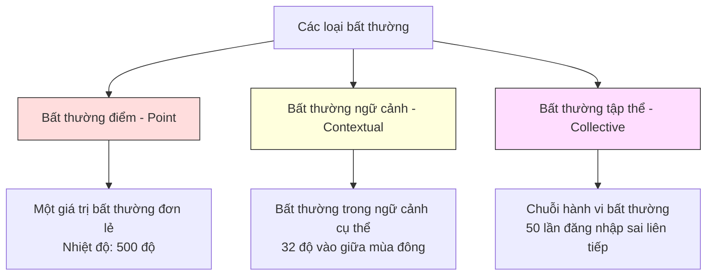
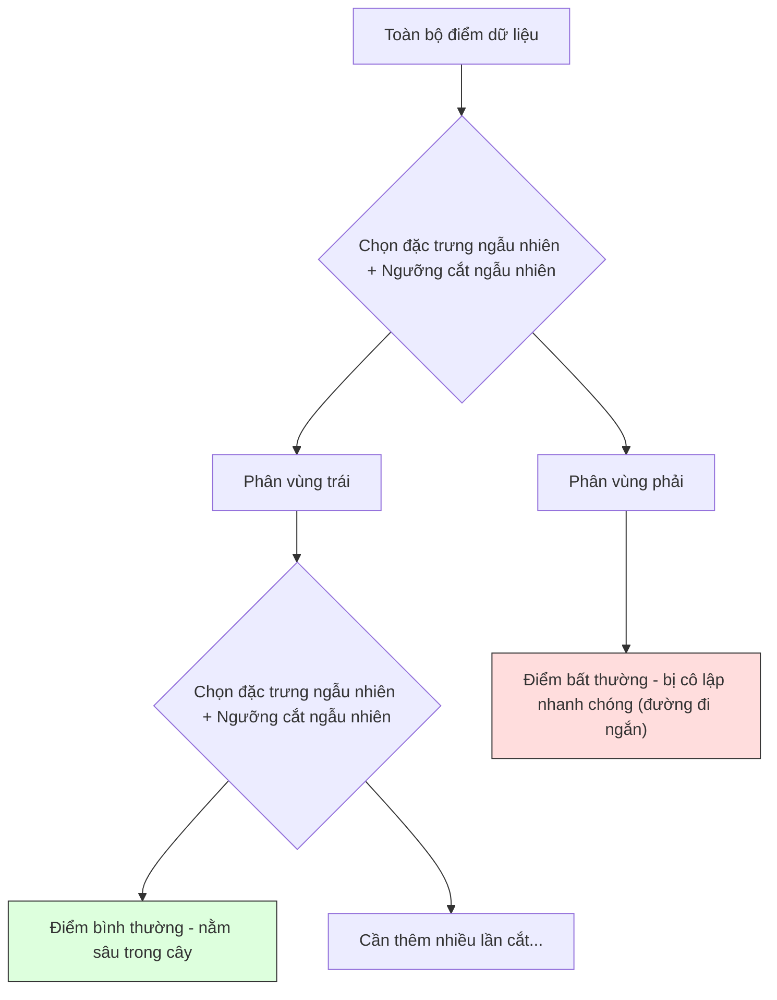
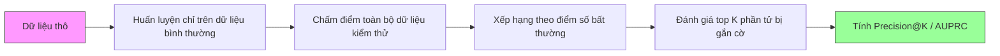

# Phát hiện Bất thường (Anomaly Detection)

> Định nghĩa những gì bình thường thì dễ. Bất thường là bất cứ thứ gì không khớp với khuôn mẫu đó.

**Type:** Build
**Language:** Python
**Prerequisites:** Phase 2, Lessons 01-09
**Time:** ~75 phút

## Learning Objectives

- Tự tay xây dựng các phương pháp phát hiện bất thường: Z-score, IQR và Isolation Forest từ đầu
- Phân biệt giữa bất thường điểm (point), bất thường ngữ cảnh (contextual) và bất thường tập thể (collective), đồng thời chọn phương pháp phát hiện thích hợp cho từng loại
- Giải thích vì sao bài toán phát hiện bất thường được định hình là mô hình hóa dữ liệu bình thường thay vì phân loại sự bất thường
- So sánh phát hiện bất thường không giám sát (unsupervised) với phân loại có giám sát (supervised) và đánh giá sự đánh đổi giữa độ bao phủ các dạng bất thường mới lạ với độ chuẩn xác (precision)

## Vấn đề đặt ra (The Problem)

Một thẻ tín dụng được quẹt tại New York lúc 2:00 chiều, sau đó lại được quẹt tại Tokyo lúc 2:05 chiều. Một cảm biến nhà máy ghi nhận 150 độ trong khi ngưỡng bình thường là 80-120. Một máy chủ gửi đi 50.000 yêu cầu mỗi giây trong khi mức trung bình hàng ngày là 200.

Đó chính là những điểm bất thường (anomalies). Phát hiện ra chúng là việc sống còn. Gian lận gây thiệt hại hàng tỷ đô la. Hỏng hóc thiết bị gây đình trệ sản xuất. Xâm nhập mạng làm rò rỉ dữ liệu quan trọng.

Thách thức ở đây là: bạn rất hiếm khi có sẵn các mẫu dữ liệu bất thường được gắn nhãn (labeled examples). Gian lận chỉ chiếm khoảng 0.1% tổng số giao dịch. Thiết bị chỉ hỏng hóc vài lần trong một năm. Bạn không thể huấn luyện một bộ phân loại tiêu chuẩn vì hầu như không có dữ liệu thuộc lớp "bất thường" để mô hình học tập. Ngay cả khi bạn có một vài nhãn, những kiểu bất thường bạn từng thấy trong quá khứ không phải là tất cả những dạng bạn sẽ gặp. Chiêu trò gian lận ngày mai sẽ khác hoàn toàn với hôm nay.

Phát hiện bất thường lật ngược bài toán. Thay vì học xem thế nào là bất thường, ta học xem thế nào là **bình thường**. Bất kỳ thứ gì lệch khỏi khuôn mẫu bình thường đều đáng ngờ. Cách tiếp cận này hoạt động mà không cần nhãn, tự động thích ứng với các dạng bất thường mới lạ và mở rộng quy mô trên các tập dữ liệu khổng lồ.

## Khái niệm (The Concept)

### Các loại bất thường (Types of Anomalies)

Không phải mọi sự bất thường đều giống nhau:

- **Bất thường điểm (Point anomalies):** Một điểm dữ liệu đơn lẻ khác thường mà không cần xét ngữ cảnh. Ví dụ: Nhiệt độ đọc được là 500 độ C. Một giao dịch 50.000 USD từ tài khoản bình thường chỉ chi tiêu 50 USD.
- **Bất thường ngữ cảnh (Contextual anomalies):** Một điểm dữ liệu bất thường khi đặt trong ngữ cảnh cụ thể của nó. Nhiệt độ 32 độ C là bình thường vào mùa hè nhưng lại là bất thường vào mùa đông. Cùng một giá trị, nhưng ngữ cảnh khác nhau tạo nên sự bất thường.
- **Bất thường tập thể (Collective anomalies):** Một chuỗi các điểm dữ liệu bất thường khi nhìn nhận theo nhóm, mặc dù từng điểm riêng lẻ có thể hoàn toàn bình thường. Năm lần đăng nhập thất bại rải rác là bình thường. Năm mươi lần liên tiếp trong một phút là dấu hiệu của tấn công brute-force.

Hầu hết các phương pháp cơ bản phát hiện bất thường điểm. Bất thường ngữ cảnh cần thêm các đặc trưng thời gian hoặc vị trí. Bất thường tập thể cần các phương pháp nhận biết chuỗi tuần tự.



### Khung bài toán học không giám sát (The Unsupervised Framing)

Trong bài toán phân loại tiêu chuẩn, bạn có nhãn cho cả hai lớp. Trong phát hiện bất thường, bạn thường rơi vào một trong ba tình huống:

1. **Hoàn toàn không giám sát (Fully unsupervised):** Không có nhãn nào cả. Bạn khớp bộ phát hiện trên toàn bộ dữ liệu và kỳ vọng rằng các điểm bất thường đủ hiếm để không làm hỏng mô hình "bình thường".
2. **Bán giám sát (Semi-supervised):** Bạn có một tập dữ liệu sạch chỉ gồm dữ liệu bình thường. Bạn khớp mô hình trên tập sạch này và chấm điểm cho tất cả dữ liệu khác. Đây là kịch bản lý tưởng và mạnh mẽ nhất khi có thể thực hiện.
3. **Giám sát yếu (Weakly supervised):** Bạn có một vài mẫu bất thường có nhãn. Hãy dùng chúng để đánh giá (evaluation), không dùng để huấn luyện. Huấn luyện theo kiểu không giám sát, sau đó đo lường precision/recall trên tập con có nhãn đó.

Điểm mấu chốt: phát hiện bất thường về căn bản khác với phân loại. Bạn đang mô hình hóa phân phối của dữ liệu bình thường, chứ không phải tìm ranh giới quyết định (decision boundary) giữa hai lớp.

### Có giám sát vs Không giám sát: Sự đánh đổi (Supervised vs Unsupervised: The Tradeoff)

Nếu bạn có sẵn các mẫu bất thường có nhãn, bạn nên dùng chúng để huấn luyện (phân loại có giám sát) hay chỉ dùng để đánh giá (phát hiện không giám sát)?

**Có giám sát (xem như bài toán phân loại):**
- Bắt đúng chính xác những dạng bất thường bạn đã từng thấy trước đây
- Độ chuẩn xác (precision) cao hơn trên các dạng bất thường đã biết
- Bỏ sót hoàn toàn các dạng bất thường mới lạ (novel anomaly types)
- Đòi hỏi phải huấn luyện lại khi xuất hiện các kiểu tấn công/gian lận mới
- Cần đủ số lượng mẫu bất thường (thực tế thường quá ít)

**Không giám sát (mô hình hóa bình thường, gắn cờ sai lệch):**
- Phát hiện bất kỳ sự sai lệch nào so với trạng thái bình thường, bao gồm cả các dạng mới lạ chưa từng xuất hiện
- Không yêu cầu nhãn bất thường
- Tỷ lệ cảnh báo giả (false positive rate) cao hơn (không phải cái gì lạ cũng là xấu)
- Chống chịu tốt hơn với sự dịch chuyển phân phối (distribution shift)

Trong thực tế, các hệ thống tốt nhất thường kết hợp cả hai: dùng phát hiện không giám sát để có phạm vi bao phủ rộng, dùng mô hình có giám sát cho các dạng bất thường ưu tiên cao đã biết, và đưa các trường hợp mơ hồ cho con người rà soát.

### Phương pháp Z-Score

Cách tiếp cận đơn giản nhất. Tính giá trị trung bình và độ lệch chuẩn của từng đặc trưng. Gắn cờ bất kỳ điểm nào cách giá trị trung bình quá $k$ lần độ lệch chuẩn.

```text
z_score = (x - mean) / std
bất thường nếu |z_score| > threshold
```

Ngưỡng mặc định thường là 3.0 (99.7% dữ liệu bình thường nằm trong khoảng 3 độ lệch chuẩn đối với phân phối Gaussian chuẩn).

**Ưu điểm:** Đơn giản, cực nhanh, dễ giải thích ("giá trị này cách mức bình thường tới 4.5 độ lệch chuẩn").

**Nhược điểm:** Giả định dữ liệu tuân theo phân phối chuẩn. Nhạy cảm với các điểm ngoại lai ngay trong tập huấn luyện (các ngoại lai làm dịch chuyển giá trị trung bình và thổi phồng độ lệch chuẩn, khiến chúng khó bị phát hiện hơn). Thất bại trên các phân phối đa đỉnh (multimodal).

**Khi nào hoạt động tốt:** Giám sát đặc trưng đơn lẻ nơi dữ liệu có dạng hình chuông tương đối đối xứng. Thời gian phản hồi máy chủ, dung sai sản xuất cơ khí, số đo cảm biến với baseline ổn định.

**Khi nào thất bại:** Dữ liệu nhiều cụm (ví dụ hai văn phòng với nhiệt độ chuẩn khác nhau), dữ liệu lệch (giá trị giao dịch nơi 1.000 USD là hiếm nhưng không phải bất thường), dữ liệu có chứa sẵn ngoại lai trong tập huấn luyện.

### Phương pháp khoảng tứ phân vị IQR (IQR Method)

Mạnh mẽ hơn Z-score. Sử dụng khoảng tứ phân vị (Interquartile Range) thay vì trung bình và độ lệch chuẩn.

```text
Q1 = phân vị thứ 25
Q3 = phân vị thứ 75
IQR = Q3 - Q1
lower_bound = Q1 - factor * IQR
upper_bound = Q3 + factor * IQR
bất thường nếu x < lower_bound hoặc x > upper_bound
```

Hệ số mặc định là 1.5.

**Ưu điểm:** Kháng ngoại lai tốt (các giá trị phân vị không bị ảnh hưởng bởi các giá trị cực trị). Hoạt động tốt trên các phân phối lệch. Không yêu cầu giả định phân phối chuẩn.

**Nhược điểm:** Chỉ áp dụng cho đơn biến (từng đặc trưng riêng lẻ). Không phát hiện được các điểm bất thường chỉ lộ diện khi xét kết hợp nhiều đặc trưng cùng lúc (một điểm có thể bình thường trên từng đặc trưng đơn lẻ nhưng lại bất thường trong không gian đồng thời).

**Lưu ý thực tế:** Hệ số 1.5 trong IQR tương ứng với "râu" của biểu đồ hộp (box plot whiskers). Dùng hệ số 3.0 thay vì 1.5 sẽ làm bộ phát hiện thận trọng hơn (ít gắn cờ hơn, giảm báo động giả). Lựa chọn hệ số tùy thuộc vào mức độ chấp nhận cảnh báo giả của bạn.

### Rừng cô lập (Isolation Forest)

Điểm sáng tạo cốt lõi: các điểm bất thường là thiểu số và khác biệt ("few and different"). Trong một phép phân vùng ngẫu nhiên không gian dữ liệu, các điểm bất thường dễ bị cô lập hơn -- chúng cần ít lần cắt ngẫu nhiên hơn để bị tách biệt khỏi phần còn lại.



**Cách thức hoạt động:**
1. Xây dựng nhiều cây ngẫu nhiên (gọi là Isolation Forest)
2. Tại mỗi nút (node), chọn ngẫu nhiên một đặc trưng và một ngưỡng phân chia ngẫu nhiên nằm giữa giá trị min và max của đặc trưng đó
3. Tiếp tục phân chia cho tới khi mỗi điểm dữ liệu bị cô lập hoàn toàn (ở lá riêng của nó)
4. Các điểm bất thường sẽ có độ dài đường đi trung bình (average path length) ngắn hơn trên toàn bộ các cây

**Vì sao nó hoạt động:** Các điểm bình thường sống trong các vùng đậm đặc. Cần rất nhiều lần cắt ngẫu nhiên mới tách được một điểm ra khỏi các láng giềng xung quanh nó. Các điểm bất thường sống ở vùng thưa thớt. Chỉ cần một hoặc hai lần cắt ngẫu nhiên là đủ để cô lập chúng.

Điểm bất thường (anomaly score) dựa trên độ dài đường đi trung bình qua tất cả các cây, được chuẩn hóa bởi độ dài đường đi kỳ vọng của một cây tìm kiếm nhị phân ngẫu nhiên:

```math
\text{score}(x) = 2^{-\text{average\_path\_length}(x) / c(n)}
```

Trong đó `c(n)` là độ dài đường đi kỳ vọng cho $n$ mẫu. Điểm số gần 1 nghĩa là bất thường cao. Điểm số gần 0.5 nghĩa là bình thường. Điểm số gần 0 nghĩa là cực kỳ bình thường (nằm sâu trong trung tâm cụm đậm đặc).

**Ưu điểm:** Không yêu cầu giả định phân phối. Hoạt động xuất sắc trong không gian nhiều chiều (high dimensions). Tốc độ rất nhanh và mở rộng quy mô tốt (độ phức tạp dưới tuyến tính vì mỗi cây dùng một tập mẫu con - subsample). Xử lý tốt các kiểu đặc trưng hỗn hợp.

**Nhược điểm:** Gặp khó khăn với các điểm bất thường nằm bên trong vùng đậm đặc (hiệu ứng che lấp - masking effect). Việc phân chia ngẫu nhiên kém hiệu quả hơn khi có quá nhiều đặc trưng dư thừa, vô nghĩa.

**Các siêu tham số chính:**
- `n_estimators`: Số lượng cây. 100 cây thường là đủ. Nhiều cây hơn cho điểm số ổn định hơn nhưng tính toán lâu hơn.
- `max_samples`: Số lượng mẫu dùng để dựng mỗi cây. Mặc định theo bài báo gốc là 256. Lấy mẫu con giúp Isolation Forest chạy cực nhanh và tạo tính đa dạng giữa các cây.
- `contamination`: Tỷ lệ phần trăm dự kiến của các điểm bất thường. Chỉ dùng để đặt ngưỡng nhị phân, không làm thay đổi điểm số liên tục.

### Hệ số ngoại lai cục bộ LOF (Local Outlier Factor)

LOF so sánh mật độ cục bộ quanh một điểm với mật độ quanh các điểm láng giềng của nó. Một điểm nằm trong vùng thưa thớt được bao quanh bởi các vùng đậm đặc là điểm bất thường.

**Cách thức hoạt động:**
1. Với mỗi điểm, tìm $k$ láng giềng gần nhất của nó
2. Tính mật độ khả tiếp cận cục bộ (local reachability density)
3. So sánh mật độ của điểm đó với mật độ của các láng giềng
4. Nếu một điểm có mật độ thấp hơn đáng kể so với láng giềng của nó, nó là một ngoại lai

**Điểm số LOF:**
- LOF xấp xỉ 1.0: Mật độ tương đương láng giềng (bình thường)
- LOF > 1.0: Mật độ thấp hơn láng giềng (tiềm ẩn bất thường)
- LOF >> 1.0 (ví dụ 2.0+): Mật độ thấp hơn đáng kể (khả năng cao là bất thường)

Từ "cục bộ" (local) mang tính quyết định. Xét tập dữ liệu gồm 2 cụm: một cụm đậm đặc 1.000 điểm và một cụm thưa 50 điểm. Một điểm nằm ở rìa cụm thưa không hề khác thường trên quy mô toàn cục -- nó vẫn có 50 láng giềng. Nhưng nó bất thường về mặt cục bộ nếu các láng giềng sát sườn của nó đậm đặc hơn nó nhiều. LOF nắm bắt được sắc thái tinh tế này mà các phương pháp toàn cục bỏ qua.

**Ưu điểm:** Phát hiện các điểm bất thường cục bộ (những điểm khác thường trong khu vực lân cận của chúng, ngay cả khi chúng không phải là ngoại lai toàn cục). Xử lý tốt các cụm có mật độ khác nhau.

**Nhược điểm:** Chậm trên các tập dữ liệu lớn (độ phức tạp $O(n^2)$ với cách triển khai cơ bản). Nhạy cảm với việc chọn $k$. Kém hiệu quả trong không gian số chiều rất cao do lời nguyền số chiều ảnh hưởng tới tính khoảng cách.

### Bảng so sánh các phương pháp

| Phương pháp | Giả định dữ liệu | Tốc độ | Xử lý chiều cao | Bắt bất thường cục bộ |
|--------|------------|-------|-------------------|------------------------|
| Z-score | Phân phối chuẩn Gaussian | Cực nhanh | Có (từng đặc trưng) | Không |
| IQR | Không (từng đặc trưng) | Cực nhanh | Có (từng đặc trưng) | Không |
| Isolation Forest | Không giả định | Nhanh | Rất tốt | Một phần |
| LOF | Khoảng cách có ý nghĩa | Chậm | Kém | Rất tốt |

### Thách thức khi đánh giá (Evaluation Challenges)

Đánh giá bộ phát hiện bất thường khó hơn nhiều so với đánh giá bộ phân loại:

- **Mất cân bằng lớp cực đoan:** Với 0.1% bất thường, đoán "bình thường" cho mọi mẫu mang lại độ chính xác 99.9%. Metric Accuracy trở nên vô dụng.
- **AUROC dễ gây ngộ nhận:** Khi mất cân bằng nghiêm trọng, AUROC vẫn có thể rất cao ngay cả khi mô hình bỏ sót hầu hết các điểm bất thường ở các ngưỡng thực tế.
- **Các metric tốt hơn:** Precision@k (trong top $k$ điểm bị gắn cờ đáng ngờ nhất, có bao nhiêu điểm thực sự là bất thường), AUPRC (diện tích dưới đường cong Precision-Recall), và Recall tại một tỷ lệ cảnh báo giả cố định.



### Pipeline phát hiện bất thường trong thực tế

Quy trình phát hiện bất thường thường trải qua các bước:

1. **Thu thập dữ liệu đường cơ sở (Baseline data):** Lý tưởng nhất là giai đoạn bạn biết chắc chắn không có (hoặc cực kỳ ít) bất thường.
2. **Kỹ thuật trích xuất đặc trưng (Feature engineering):** Đặc trưng thô kết hợp với các đặc trưng phái sinh (thống kê trượt, đặc trưng thời gian, tỉ số).
3. **Huấn luyện bộ phát hiện:** Khớp trên dữ liệu baseline. Mô hình học cách nhận biết trạng thái "bình thường".
4. **Chấm điểm dữ liệu mới:** Mỗi quan sát mới nhận được một điểm số bất thường (anomaly score).
5. **Chọn ngưỡng quyết định (Threshold selection):** Chọn điểm cắt ngưỡng điểm số. Đây là quyết định mang tính nghiệp vụ kinh doanh: ngưỡng cao nghĩa là ít báo động giả nhưng bỏ sót nhiều bất thường, ngưỡng thấp thì ngược lại.
6. **Cảnh báo và điều tra:** Các điểm bị gắn cờ được chuyển đến chuyên viên phân tích hoặc kích hoạt phản ứng tự động.
7. **Thu thập phản hồi:** Ghi nhận xem các cảnh báo là đúng hay giả. Dùng dữ liệu này để định kỳ hiệu chỉnh lại ngưỡng và mô hình.

Pipeline phát hiện bất thường không bao giờ kết thúc một lần là xong. Phân phối dữ liệu dịch chuyển, các kiểu bất thường mới liên tục xuất hiện, và các ngưỡng cần được tinh chỉnh thường xuyên. Hãy coi hệ thống phát hiện bất thường là một thực thể sống.

```figure
f3-anomaly-fence
```

## Tự tay xây dựng (Build It)

Mã nguồn trong `code/anomaly_detection.py` triển khai Z-score, IQR và Isolation Forest từ đầu.

### Bộ phát hiện Z-Score

```python
def zscore_detect(X, threshold=3.0):
    mean = X.mean(axis=0)
    std = X.std(axis=0)
    std[std == 0] = 1.0
    z = np.abs((X - mean) / std)
    return z.max(axis=1) > threshold
```

Đơn giản và được vector hóa hoàn toàn. Gắn cờ một điểm nếu bất kỳ đặc trưng nào vượt quá ngưỡng.

### Bộ phát hiện IQR

```python
def iqr_detect(X, factor=1.5):
    q1 = np.percentile(X, 25, axis=0)
    q3 = np.percentile(X, 75, axis=0)
    iqr = q3 - q1
    iqr[iqr == 0] = 1.0
    lower = q1 - factor * iqr
    upper = q3 + factor * iqr
    outside = (X < lower) | (X > upper)
    return outside.any(axis=1)
```

### Xây dựng Isolation Forest từ đầu

Việc triển khai từ đầu xây dựng các cây cô lập (isolation trees) phân vùng ngẫu nhiên không gian đặc trưng:

```python
def _c_factor(n):
    if n <= 1:
        return 0.0
    if n == 2:
        return 1.0
    return 2.0 * (np.log(n - 1) + 0.5772156649) - 2.0 * (n - 1.0) / n


class IsolationTree:
    def __init__(self, max_depth):
        self.max_depth = max_depth

    def fit(self, X, depth=0):
        n, p = X.shape
        if depth >= self.max_depth or n <= 1:
            self.is_leaf = True
            self.size = n
            return self
        self.is_leaf = False
        self.feature = np.random.randint(p)
        x_min = X[:, self.feature].min()
        x_max = X[:, self.feature].max()
        if x_min == x_max:
            self.is_leaf = True
            self.size = n
            return self
        self.threshold = np.random.uniform(x_min, x_max)
        left_mask = X[:, self.feature] < self.threshold
        self.left = IsolationTree(self.max_depth).fit(X[left_mask], depth + 1)
        self.right = IsolationTree(self.max_depth).fit(X[~left_mask], depth + 1)
        return self

    def path_length(self, x, depth=0):
        if self.is_leaf:
            return depth + _c_factor(self.size)
        if x[self.feature] < self.threshold:
            return self.left.path_length(x, depth + 1)
        return self.right.path_length(x, depth + 1)
```

Độ dài đường đi để cô lập một điểm quyết định điểm bất thường của nó. Đường đi càng ngắn thể hiện mức độ bất thường càng cao.

Lớp `IsolationForest` đóng gói nhiều cây cô lập:

```python
class IsolationForest:
    def __init__(self, n_estimators=100, max_samples=256, seed=42):
        self.n_estimators = n_estimators
        self.max_samples = max_samples
        self.seed = seed
        self.trees = []
        self.n_train = 0

    def fit(self, X):
        self.n_train = X.shape[0]
        rng = np.random.RandomState(self.seed)
        self.trees = []
        sample_size = min(self.max_samples, X.shape[0])
        max_depth = int(np.ceil(np.log2(sample_size)))
        for _ in range(self.n_estimators):
            idx = rng.choice(X.shape[0], size=sample_size, replace=False)
            tree = IsolationTree(max_depth=max_depth)
            tree.fit(X[idx])
            self.trees.append(tree)
        return self

    def anomaly_score(self, X):
        avg_path = np.zeros(X.shape[0])
        for tree in self.trees:
            for i in range(X.shape[0]):
                avg_path[i] += tree.path_length(X[i])
        avg_path /= self.n_estimators
        c = _c_factor(min(self.max_samples, self.n_train))
        return 2.0 ** (-avg_path / c) if c > 0 else np.zeros(X.shape[0])
```

Hệ số chuẩn hóa `c(n)` (`_c_factor` trong mã nguồn) là độ dài đường đi kỳ vọng của một lượt tìm kiếm thất bại trong cây tìm kiếm nhị phân với $n$ phần tử. Nó bằng `2 * H(n-1) - 2*(n-1)/n` trong đó `H` là số điều hòa (harmonic number). Mã nguồn dùng xấp xỉ tiêu chuẩn `H(i) ≈ ln(i) + 0.5772` (hằng số Euler), đúng như bài báo gốc về Isolation Forest. Phép chuẩn hóa này đảm bảo điểm số có thể so sánh được giữa các tập dữ liệu có kích thước khác nhau.

### Kịch bản thử nghiệm (Demo Scenarios)

Mã nguồn sinh nhiều kịch bản thử nghiệm:

1. **Cụm đơn lẻ kèm ngoại lai:** Một cụm Gaussian 2D với các điểm bất thường được tiêm vào cách xa tâm cụm. Tất cả các phương pháp đều phát hiện tốt ở kịch bản này.
2. **Dữ liệu đa đỉnh (Multimodal):** Ba cụm có kích thước và mật độ khác nhau. Các điểm nằm giữa các cụm là bất thường. Z-score gặp khó khăn vì dải giá trị trên từng đặc trưng quá rộng.
3. **Dữ liệu nhiều chiều (High-dimensional):** 50 đặc trưng, nhưng các điểm bất thường chỉ khác biệt trên 5 đặc trưng trong số đó. Kiểm tra xem phương pháp nào có thể tìm thấy bất thường trong một không gian con của các đặc trưng.

## Sử dụng trong thực tế (Use It)

Sử dụng scikit-learn với các triển khai thư viện chính thức:

```python
from sklearn.ensemble import IsolationForest
from sklearn.neighbors import LocalOutlierFactor

iso = IsolationForest(n_estimators=100, contamination=0.05, random_state=42)
iso.fit(X_train)
predictions = iso.predict(X_test)

lof = LocalOutlierFactor(n_neighbors=20, contamination=0.05, novelty=True)
lof.fit(X_train)
predictions = lof.predict(X_test)
```

Lưu ý rằng `contamination` thiết lập tỷ lệ bất thường dự kiến. Đặt đúng tỷ lệ này rất quan trọng -- quá thấp sẽ bỏ sót bất thường, quá cao sẽ tạo ra nhiều cảnh báo giả.

### Tham số `contamination` trong scikit-learn

Tham số `contamination` trong scikit-learn xác định ngưỡng để chuyển đổi điểm số bất thường dạng số thực liên tục thành dự đoán nhị phân (1: bình thường, -1: bất thường). Nó không làm thay đổi các điểm số gốc bên dưới:

```python
iso_5 = IsolationForest(contamination=0.05)
iso_10 = IsolationForest(contamination=0.10)
```

Cả hai đều tạo ra cùng một điểm số bất thường. Nhưng `iso_5` gắn cờ top 5% điểm cao nhất trong khi `iso_10` gắn cờ top 10%. Nếu bạn không biết tỷ lệ bất thường thực sự, hãy đặt `contamination="auto"` và làm việc trực tiếp với điểm số thô. Tự chọn ngưỡng của riêng bạn dựa trên sự đánh đổi chi phí giữa dương tính giả và âm tính giả.

### One-Class SVM

Một mô hình phát hiện bất thường không giám sát kinh điển khác: One-Class SVM khớp một đường bao quanh dữ liệu bình thường trong không gian số chiều cao (sử dụng kernel trick):

```python
from sklearn.svm import OneClassSVM

oc_svm = OneClassSVM(kernel="rbf", gamma="auto", nu=0.05)
oc_svm.fit(X_train)
predictions = oc_svm.predict(X_test)
```

Tham số `nu` xấp xỉ tỷ lệ phần trăm các điểm ngoại lai. One-Class SVM hoạt động tốt trên các tập dữ liệu nhỏ đến trung bình nhưng không mở rộng quy mô tốt trên dữ liệu khổng lồ (ma trận kernel tăng theo cấp số nhân bậc hai).

### Hướng tiếp cận Autoencoder (Giới thiệu trước)

Autoencoder là các mạng nơ-ron học cách nén và tái tạo dữ liệu. Huấn luyện mạng trên dữ liệu bình thường. Tại thời điểm kiểm thử, các điểm bất thường sẽ có sai số tái tạo (reconstruction error) rất cao vì mạng chỉ học cách tái tạo các khuôn mẫu bình thường. Hướng tiếp cận này sẽ được đi sâu ở Phase 3 (Deep Learning).

### Kết hợp nhiều bộ phát hiện (Ensemble Anomaly Detection)

Tương tự như các phương pháp ensemble cải thiện bài toán phân loại (Bài 11), việc kết hợp nhiều bộ phát hiện bất thường giúp tăng độ tin cậy đáng kể:

1. Chạy nhiều bộ phát hiện (Z-score, IQR, Isolation Forest, LOF)
2. Chuẩn hóa điểm số của từng bộ phát hiện về đoạn `[0, 1]`
3. Tính trung bình các điểm số đã chuẩn hóa
4. Gắn cờ các điểm vượt ngưỡng trên điểm số trung bình đó

Cách làm này giảm thiểu báo động giả vì các phương pháp khác nhau có các điểm yếu khác nhau. Một điểm bị gắn cờ bởi cả 4 phương pháp gần như chắc chắn là bất thường thực sự.

### Lưu ý khi triển khai thực tế (Production Considerations)

1. **Trôi dạt ngưỡng (Threshold drift):** Khi phân phối dữ liệu biến đổi, ngưỡng cố định sẽ lỗi thời. Hãy giám sát phân phối điểm số bất thường và điều chỉnh định kỳ.
2. **Kiệt sức vì cảnh báo (Alert fatigue):** Quá nhiều cảnh báo giả sẽ khiến đội ngũ vận hành phớt lờ hệ thống. Hãy bắt đầu với một ngưỡng cao (ít cảnh báo hơn nhưng độ tin cậy cao) và hạ dần khi hệ thống đã tạo được sự tin tưởng.
3. **Cách tiếp cận Ensemble:** Trong môi trường sản xuất, hãy kết hợp nhiều bộ phát hiện. Chỉ gắn cờ nếu nhiều phương pháp cùng đồng thuận.
4. **Kỹ thuật trích xuất đặc trưng:** Các đặc trưng thô hiếm khi đủ tốt. Hãy tạo thêm thống kê trượt, tỷ lệ, thời gian kể từ sự kiện gần nhất và các đặc trưng đặc thù của miền nghiệp vụ.
5. **Vòng phản hồi (Feedback loop):** Khi các chuyên viên điều tra các điểm bị gắn cờ và xác nhận hoặc bác bỏ chúng, hãy đưa dữ liệu phản hồi này trở lại hệ thống để tích lũy dữ liệu nhãn theo thời gian.

## Xuất xưởng (Ship It)

Bài học này tạo ra:
- `outputs/skill-anomaly-detector.md` -- kỹ năng ra quyết định để chọn bộ phát hiện bất thường phù hợp
- `code/anomaly_detection.py` -- Z-score, IQR và Isolation Forest tự xây dựng từ đầu kèm so sánh với scikit-learn

### Lựa chọn ngưỡng quyết định (Choosing a Threshold)

Điểm số bất thường là một dải số liên tục. Bạn cần một ngưỡng để đưa ra quyết định nhị phân. Đây là quyết định kinh doanh, không phải quyết định kỹ thuật đơn thuần:

- **Phát hiện gian lận:** Bỏ sót gian lận gây tổn thất lớn (bồi hoàn, mất uy tín khách hàng). Cảnh báo giả chỉ tốn 5 phút của nhân viên phân tích để kiểm tra. Hãy đặt ngưỡng thấp để bắt được nhiều gian lận nhất có thể, chấp nhận thêm cảnh báo giả.
- **Bảo trì thiết bị:** Báo động giả dẫn đến việc dừng nhà máy không cần thiết, tiêu tốn 50.000 USD. Bỏ sót sự cố hỏng hóc tiêu tốn 500.000 USD tiền sửa chữa. Hãy đặt ngưỡng cân bằng giữa hai khoản chi phí này.

Vẽ đồ thị precision và recall ở các ngưỡng khác nhau, áp dụng hàm chi phí nghiệp vụ và chọn điểm có tổng chi phí thấp nhất.

## Bài tập thực hành (Exercises)

1. **Tinh chỉnh ngưỡng.** Chạy bộ phát hiện Z-score với các ngưỡng từ 1.0 đến 5.0 với bước nhảy 0.5. Vẽ đồ thị precision và recall tại từng ngưỡng. Điểm tối ưu cho dữ liệu của bạn nằm ở đâu?

2. **Bất thường đa biến.** Tạo dữ liệu 2D trong đó từng đặc trưng riêng lẻ đều trông bình thường, nhưng sự kết hợp giữa chúng lại bất thường (ví dụ: các điểm nằm xa đường chéo cụm chính). Chứng minh rằng Z-score theo từng đặc trưng sẽ bỏ sót nhưng Isolation Forest sẽ phát hiện ra.

3. **Tự cài đặt LOF.** Triển khai Local Outlier Factor bằng k láng giềng gần nhất. So sánh với `LocalOutlierFactor` của scikit-learn trên cùng tập dữ liệu với $k=10$ và $k=50$. Việc chọn $k$ ảnh hưởng thế nào đến kết quả?

4. **Phát hiện bất thường luồng dữ liệu (Streaming).** Chỉnh sửa bộ phát hiện Z-score để hoạt động trên luồng dữ liệu: cập nhật giá trị trung bình và phương sai chạy khi có các điểm mới đến (sử dụng thuật toán trực tuyến Welford). So sánh với Z-score chạy theo lô trên cùng dữ liệu.

5. **Đánh giá trên dữ liệu thực tế.** Lấy một tập dữ liệu có sẵn nhãn bất thường (ví dụ dữ liệu gian lận thẻ tín dụng trên Kaggle). Đánh giá cả 4 phương pháp bằng precision@100, precision@500 và AUPRC. Phương pháp nào hiệu quả nhất và vì sao?

## Các thuật ngữ chính (Key Terms)

| Thuật ngữ | Mọi người hay nói | Ý nghĩa thực sự |
|------|----------------|----------------------|
| Anomaly | "Ngoại lai, điểm khác thường" | Một điểm dữ liệu lệch đáng kể so với khuôn mẫu kỳ vọng của dữ liệu bình thường |
| Point anomaly | "Một giá trị kỳ quặc đơn lẻ" | Một quan sát riêng lẻ bất thường mà không cần quan tâm đến ngữ cảnh |
| Contextual anomaly | "Giá trị bình thường nhưng sai ngữ cảnh" | Một quan sát bất thường khi đặt trong ngữ cảnh cụ thể (thời gian, vị trí) nhưng lại bình thường ở ngữ cảnh khác |
| Isolation Forest | "Cắt ngẫu nhiên để tìm ngoại lai" | Một tập hợp các cây ngẫu nhiên cô lập điểm bất thường với ít lần cắt hơn so với điểm bình thường |
| Local Outlier Factor | "So sánh mật độ với láng giềng" | Phương pháp gắn cờ các điểm có mật độ cục bộ thấp hơn đáng kể so với mật độ của các láng giềng |
| Z-score | "Số độ lệch chuẩn so với trung bình" | $(x - \text{mean}) / \text{std}$, đo khoảng cách từ một điểm tới tâm theo đơn vị độ lệch chuẩn |
| IQR | "Khoảng tứ phân vị" | $Q3 - Q1$, đo độ phân tán của 50% dữ liệu ở giữa, dùng để phát hiện ngoại lai bền vững |
| Contamination | "Tỷ lệ bất thường dự kiến" | Siêu tham số chỉ định cho bộ phát hiện biết tỷ lệ phần trăm dữ liệu cần gắn cờ là bất thường |
| Precision@k | "Trong top k cảnh báo, bao nhiêu cái là thật" | Độ chuẩn xác chỉ tính trên $k$ điểm đáng ngờ nhất, rất hữu ích cho dữ liệu bất thường mất cân bằng |
| AUPRC | "Diện tích dưới đường cong Precision-Recall" | Thước đo tóm tắt hiệu năng precision-recall trên mọi ngưỡng, tốt hơn AUROC cho dữ liệu mất cân bằng |

## Tài liệu đọc thêm (Further Reading)

- [Liu et al., Isolation Forest (2008)](https://cs.nju.edu.cn/zhouzh/zhouzh.files/publication/icdm08b.pdf) -- bài báo gốc giới thiệu thuật toán Isolation Forest
- [Breunig et al., LOF: Identifying Density-Based Local Outliers (2000)](https://dl.acm.org/doi/10.1145/342009.335388) -- bài báo gốc về LOF
- [scikit-learn Outlier Detection docs](https://scikit-learn.org/stable/modules/outlier_detection.html) -- tổng quan về các bộ phát hiện ngoại lai trong scikit-learn
- [Chandola et al., Anomaly Detection: A Survey (2009)](https://dl.acm.org/doi/10.1145/1541880.1541882) -- bài khảo cứu toàn diện về các phương pháp phát hiện bất thường
- [Goldstein and Uchida, A Comparative Evaluation of Unsupervised Anomaly Detection Algorithms (2016)](https://journals.plos.org/plosone/article?id=10.1371/journal.pone.0152173) -- đánh giá thực nghiệm so sánh 10 phương pháp trên các tập dữ liệu thế giới thực
