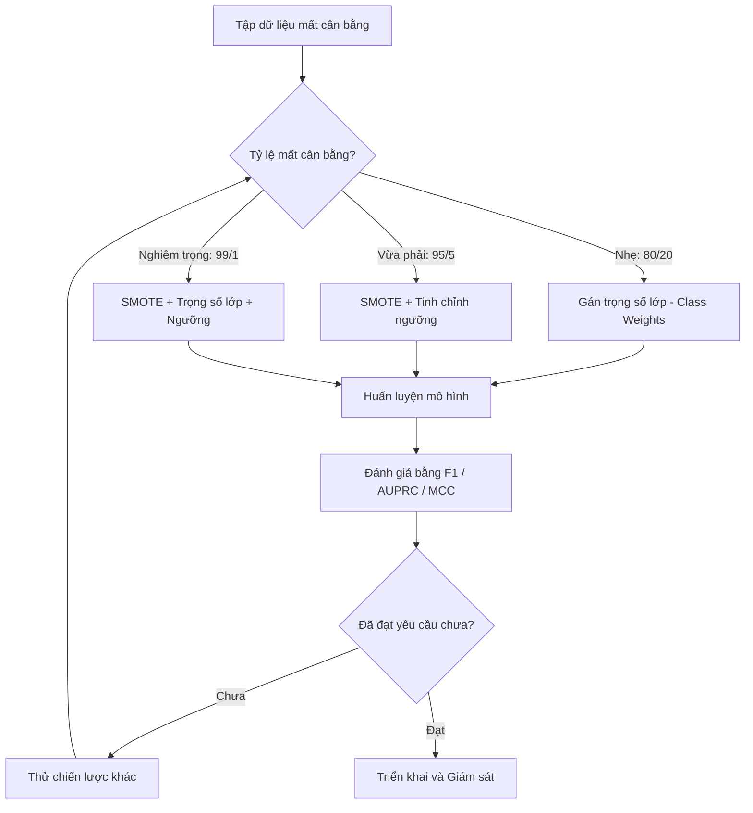
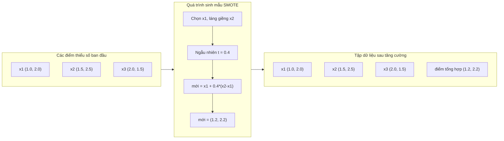
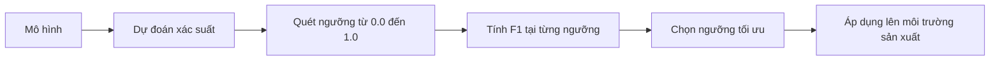
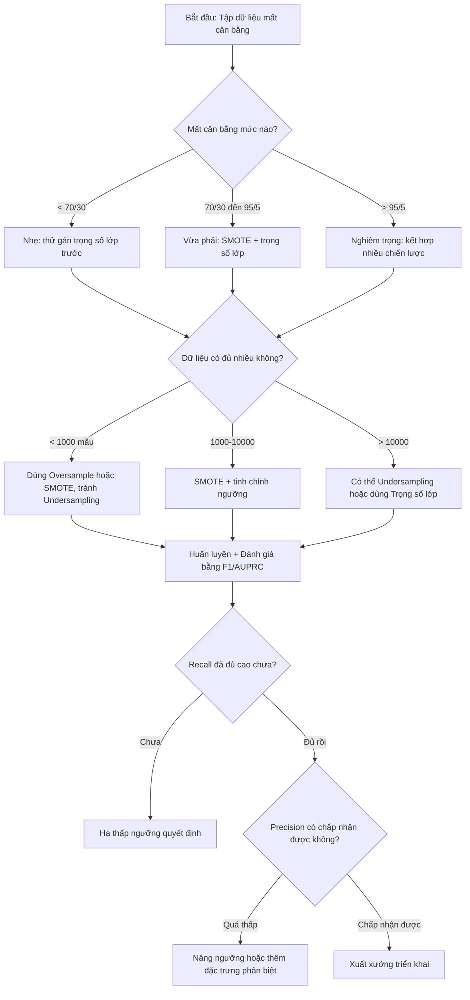

# Xử lý Dữ liệu Mất cân bằng (Handling Imbalanced Data)

> Khi 99% dữ liệu của bạn là "bình thường", độ chính xác (accuracy) chỉ là một lời nói dối.

**Type:** Build
**Language:** Python
**Prerequisites:** Phase 2, Lessons 01-09 (especially evaluation metrics)
**Time:** ~90 phút

## Learning Objectives

- Tự tay xây dựng thuật toán SMOTE từ đầu và giải thích kỹ thuật tạo mẫu tổng hợp khác biệt như thế nào so với nhân bản ngẫu nhiên
- Đánh giá các bộ phân loại dữ liệu mất cân bằng bằng F1, AUPRC và hệ số tương quan Matthews (MCC) thay vì độ chính xác thông thường
- So sánh các chiến lược gán trọng số lớp (class weighting), tinh chỉnh ngưỡng (threshold tuning) và tái lấy mẫu (resampling) để chọn phương án tối ưu cho từng tỉ lệ mất cân bằng
- Xây dựng một pipeline xử lý dữ liệu mất cân bằng hoàn chỉnh kết hợp SMOTE, trọng số lớp và tối ưu hóa ngưỡng quyết định

## Vấn đề đặt ra (The Problem)

Bạn xây dựng một mô hình phát hiện gian lận. Nó đạt độ chính xác 99.9%. Bạn mở tiệc ăn mừng. Rồi bạn bàng hoàng nhận ra nó dự đoán "không gian lận" cho toàn bộ mọi giao dịch.

Đây không phải là lỗi lập trình (bug). Đó là hành vi hoàn toàn hợp lý của mô hình khi chỉ có 0.1% giao dịch là gian lận. Mô hình học được rằng luôn đoán nhãn của lớp đa số (majority class) sẽ giảm thiểu tổng sai số xuống mức thấp nhất. Về mặt kỹ thuật, nó đúng, nhưng về mặt ứng dụng, nó hoàn toàn vô dụng.

Điều này diễn ra ở khắp mọi bài toán phân loại trong thế giới thực. Chẩn đoán bệnh hiểm nghèo: 1% ca dương tính. Xâm nhập mạng: 0.01% lưu lượng là tấn công. Lỗi sản xuất linh kiện: 0.5% sản phẩm lỗi. Bộ lọc thư rác: 20% là spam. Dự đoán khách hàng rời bỏ dịch vụ (churn): 5% người dùng rời bỏ. Lớp thiểu số càng có hậu quả hệ trọng thì lại càng hiếm gặp.

Độ chính xác (Accuracy) thất bại vì nó đối xử với mọi dự đoán đúng như nhau. Phân loại đúng một giao dịch hợp lệ và phát hiện đúng một vụ gian lận đều được tính là 1 điểm chính xác. Nhưng bắt được gian lận mới là lý do duy nhất mô hình tồn tại. Chúng ta cần những thước đo, kỹ thuật và chiến lược huấn luyện buộc mô hình phải chú ý tới lớp thiểu số hiếm hoi nhưng vô cùng quan trọng này.

## Khái niệm (The Concept)

### Vì sao Accuracy thất bại

Xét một tập dữ liệu có 1.000 mẫu: 990 mẫu âm tính (negative), 10 mẫu dương tính (positive). Một mô hình "ngu ngơ" luôn đoán là âm tính:

|  | Dự đoán Dương tính (Positive) | Dự đoán Âm tính (Negative) |
|--|---|---|
| Thực tế Dương tính | 0 (TP) | 10 (FN) |
| Thực tế Âm tính | 0 (FP) | 990 (TN) |

```math
\text{Accuracy} = (0 + 990) / 1000 = 99.0\%
```

Mô hình không bắt được ca gian lận nào, không phát hiện được mầm bệnh nào, không thấy sản phẩm lỗi nào. Nhưng Accuracy vẫn báo 99%! Đó là lý do tại sao Accuracy cực kỳ nguy hiểm trong các bài toán mất cân bằng dữ liệu.

### Các thước đo tốt hơn (Better Metrics)

**Precision (Độ chuẩn xác)** = $\text{TP} / (\text{TP} + \text{FP})$. Trong tất cả những gì mô hình gắn cờ là dương tính, có bao nhiêu phần trăm thực sự là dương tính? Precision cao nghĩa là rất ít cảnh báo giả (false alarms).

**Recall (Độ nhạy / Độ bao phủ)** = $\text{TP} / (\text{TP} + \text{FN})$. Trong tất cả các mẫu thực sự dương tính, mô hình đã tóm được bao nhiêu phần trăm? Recall cao nghĩa là bỏ sót rất ít ca dương tính.

**F1 Score** = $2 \cdot \text{precision} \cdot \text{recall} / (\text{precision} + \text{recall})$. Trung bình điều hòa (harmonic mean) giữa Precision và Recall. Nó phạt rất nặng sự chênh lệch cực đoan giữa Precision và Recall so với trung bình cộng số học.

**F-beta Score** = $(1 + \beta^2) \cdot \text{precision} \cdot \text{recall} / (\beta^2 \cdot \text{precision} + \text{recall})$. Khi $\beta > 1$, Recall được coi trọng hơn. Khi $\beta < 1$, Precision được coi trọng hơn. Điểm F2 thường được dùng trong phát hiện gian lận (bỏ sót gian lận tồi tệ hơn nhiều so với việc kiểm tra nhầm một giao dịch hợp lệ).

**AUPRC (Diện tích dưới đường cong Precision-Recall)**. Tương tự như AUC-ROC nhưng cung cấp nhiều thông tin hơn trên dữ liệu mất cân bằng. Một bộ phân loại ngẫu nhiên sẽ có AUPRC bằng đúng tỷ lệ của lớp dương tính trong tập dữ liệu (chứ không phải 0.5 như ROC). Điều này giúp quan sát sự cải thiện của mô hình rõ ràng hơn nhiều.

**Hệ số tương quan Matthews (MCC)** = $(\text{TP} \cdot \text{TN} - \text{FP} \cdot \text{FN}) / \sqrt{(\text{TP}+\text{FP})(\text{TP}+\text{FN})(\text{TN}+\text{FP})(\text{TN}+\text{FN})}$. Giá trị dao động từ -1 đến +1. Nó chỉ đạt điểm cao khi mô hình dự đoán tốt trên cả hai lớp. Thước đo này duy trì tính cân bằng ngay cả khi các lớp có quy mô chênh lệch nhau trời vực.

Với mô hình "luôn đoán âm tính" ở trên: $\text{precision} = 0/0$ (không xác định, thường quy ước là 0), $\text{recall} = 0/10 = 0$, $\text{F1} = 0$, $\text{MCC} = 0$. Các thước đo này vạch trần ngay lập tức rằng mô hình đó hoàn toàn vô giá trị.

### Pipeline xử lý dữ liệu mất cân bằng



### SMOTE: Kỹ thuật tạo mẫu thiểu số tổng hợp

Tăng cường mẫu ngẫu nhiên (Random Oversampling) đơn thuần nhân bản các mẫu thiểu số hiện có. Cách này có tác dụng nhưng tiềm ẩn nguy cơ quá khớp (overfitting) vì mô hình liên tục nhìn thấy các điểm dữ liệu y hệt nhau.

SMOTE (Synthetic Minority Oversampling Technique) tạo ra các mẫu thiểu số tổng hợp mới hợp lý nhưng không phải bản sao chép. Thuật toán:

1. Với mỗi mẫu thiểu số $x$, tìm $k$ láng giềng gần nhất của nó trong số các mẫu thiểu số khác
2. Chọn ngẫu nhiên một láng giềng
3. Tạo một mẫu mới nằm trên đoạn thẳng nối giữa $x$ và láng giềng đó

Công thức: `new_sample = x + random(0, 1) * (neighbor - x)`

Phép nội suy này nằm trong cùng vùng không gian đặc trưng của lớp thiểu số mà không sao chép nguyên xi dữ liệu cũ.



### So sánh các chiến lược lấy mẫu (Sampling Strategies)

**Tăng mẫu ngẫu nhiên (Random Oversampling)**: Nhân bản các mẫu thiểu số cho bằng số lượng mẫu đa số.
- Ưu điểm: Đơn giản, không làm mất mát thông tin.
- Nhược điểm: Các bản sao giống hệt gây quá khớp, làm tăng thời gian huấn luyện.

**Giảm mẫu ngẫu nhiên (Random Undersampling)**: Loại bỏ các mẫu đa số cho bằng số lượng mẫu thiểu số.
- Ưu điểm: Huấn luyện rất nhanh, đơn giản.
- Nhược điểm: Vứt bỏ dữ liệu đa số có giá trị, làm tăng phương sai (variance) của mô hình.

**SMOTE**: Tạo mẫu thiểu số tổng hợp bằng nội suy.
- Ưu điểm: Sinh dữ liệu mới, giảm thiểu quá khớp so với sao chép ngẫu nhiên.
- Nhược điểm: Có thể tạo ra mẫu nhiễu ở gần ranh giới quyết định, không xét đến phân phối của lớp đa số xung quanh.

| Chiến lược | Thay đổi dữ liệu | Nguy cơ | Khi nào nên dùng |
|----------|-------------|------|-------------|
| Oversample | Nhân bản lớp thiểu số | Quá khớp (Overfitting) | Tập dữ liệu nhỏ, mất cân bằng vừa phải |
| Undersample | Cắt giảm lớp đa số | Mất thông tin | Tập dữ liệu rất lớn, muốn huấn luyện nhanh |
| SMOTE | Thêm mẫu thiểu số tổng hợp | Nhiễu ranh giới | Mất cân bằng vừa, đủ mẫu thiểu số để chạy k-NN |

### Trọng số lớp (Class Weights)

Thay vì thay đổi dữ liệu, hãy thay đổi cách mô hình xử lý sai số. Gán trọng số phạt cao hơn khi mô hình phân loại sai lớp thiểu số.

Với bài toán nhị phân có 950 mẫu âm tính và 50 mẫu dương tính:
- Trọng số cho lớp âm tính = $n_{\text{samples}} / (2 \cdot n_{\text{negative}}) = 1000 / (2 \cdot 950) = 0.526$
- Trọng số cho lớp dương tính = $n_{\text{samples}} / (2 \cdot n_{\text{positive}}) = 1000 / (2 \cdot 50) = 10.0$

Lớp dương tính nhận trọng số gấp 19 lần. Phân loại sai một mẫu dương tính bị phạt nặng tương đương với phân loại sai 19 mẫu âm tính. Mô hình buộc phải dồn sự chú ý vào lớp thiểu số.

Trong hồi quy Logistic, điều này làm thay đổi hàm mất mát (loss function):

```math
\text{weighted\_loss} = -\sum \bigl( w_i \cdot [y_i \log(p_i) + (1-y_i) \log(1-p_i)] \bigr)
```

trong đó $w_i$ phụ thuộc vào nhãn lớp của mẫu $i$.

Về mặt toán học, gán trọng số lớp tương đương với việc tăng mẫu trong kỳ vọng (oversampling in expectation), nhưng không làm phát sinh thêm dữ liệu mới. Nhờ đó nó chạy nhanh hơn và tránh nguy cơ quá khớp do dữ liệu trùng lặp.

### Tinh chỉnh ngưỡng (Threshold Tuning)

Hầu hết các bộ phân loại đều xuất ra xác suất. Ngưỡng mặc định thường là 0.5: nếu $P(\text{positive}) \ge 0.5$, dự đoán là dương tính. Nhưng 0.5 chỉ là một con số quy ước võ đoán. Khi các lớp mất cân bằng, ngưỡng tối ưu thường thấp hơn rất nhiều.

Quy trình:
1. Huấn luyện mô hình
2. Lấy xác suất dự đoán trên tập kiểm thực (validation set)
3. Quét dải ngưỡng từ 0.0 đến 1.0
4. Tính F1 (hoặc metric mục tiêu của bạn) tại từng ngưỡng
5. Chọn ngưỡng mang lại giá trị metric cao nhất



Một mô hình có thể xuất ra $P(\text{fraud}) = 0.15$ cho một giao dịch gian lận. Với ngưỡng 0.5, giao dịch này bị bỏ lọt. Nhưng với ngưỡng 0.10, nó được bắt giữ chính xác. Khả năng xếp hạng thứ tự xác suất quan trọng hơn độ chuẩn xác tuyệt đối của xác suất -- miễn là giao dịch gian lận có xác suất cao hơn giao dịch hợp lệ, luôn tồn tại một ngưỡng giúp phân tách chúng.

### Học nhạy cảm với chi phí (Cost-Sensitive Learning)

Sự mở rộng tổng quát của trọng số lớp. Thay vì chi phí đồng đều, ta gán chi phí thực tế cho từng loại sai lầm:

| | Dự đoán Dương tính | Dự đoán Âm tính |
|--|---|---|
| Thực tế Dương tính | 0 (đúng) | $C_{\text{FN}} = 100$ |
| Thực tế Âm tính | $C_{\text{FP}} = 1$ | 0 (đúng) |

Bỏ lọt một giao dịch gian lận (FN) gây thiệt hại gấp 100 lần so với một cuộc gọi cảnh báo nhầm (FP). Mô hình sẽ tối ưu hóa để tổng chi phí thiệt hại là nhỏ nhất, thay vì tối ưu hóa số lượng lỗi đơn thuần.

### Sơ đồ ra quyết định (Decision Flowchart)



```figure
class-imbalance
```

## Tự tay xây dựng (Build It)

Mã nguồn triển khai đầy đủ các phương pháp từ đầu trong Python thuần và NumPy.

### Bước 1: Tạo dữ liệu giả lập mất cân bằng

```python
import numpy as np


def make_imbalanced_data(n_majority=950, n_minority=50, seed=42):
    rng = np.random.RandomState(seed)

    X_maj = rng.randn(n_majority, 2) * 1.0 + np.array([0.0, 0.0])
    X_min = rng.randn(n_minority, 2) * 0.8 + np.array([2.5, 2.5])

    X = np.vstack([X_maj, X_min])
    y = np.concatenate([np.zeros(n_majority), np.ones(n_minority)])

    shuffle_idx = rng.permutation(len(y))
    return X[shuffle_idx], y[shuffle_idx]
```

### Bước 2: Tự xây dựng SMOTE từ đầu

```python
def euclidean_distance(a, b):
    return np.sqrt(np.sum((a - b) ** 2))


def find_k_neighbors(X, idx, k):
    distances = []
    for i in range(len(X)):
        if i == idx:
            continue
        d = euclidean_distance(X[idx], X[i])
        distances.append((i, d))
    distances.sort(key=lambda x: x[1])
    return [d[0] for d in distances[:k]]


def smote(X_minority, k=5, n_synthetic=100, seed=42):
    rng = np.random.RandomState(seed)
    n_samples = len(X_minority)
    k = min(k, n_samples - 1)
    synthetic = []

    for _ in range(n_synthetic):
        idx = rng.randint(0, n_samples)
        neighbors = find_k_neighbors(X_minority, idx, k)
        neighbor_idx = neighbors[rng.randint(0, len(neighbors))]
        t = rng.random()
        new_point = X_minority[idx] + t * (X_minority[neighbor_idx] - X_minority[idx])
        synthetic.append(new_point)

    return np.array(synthetic)
```

### Bước 3: Random Oversampling và Undersampling

```python
def random_oversample(X, y, seed=42):
    rng = np.random.RandomState(seed)
    classes, counts = np.unique(y, return_counts=True)
    max_count = counts.max()

    X_resampled = list(X)
    y_resampled = list(y)

    for cls, count in zip(classes, counts):
        if count < max_count:
            cls_indices = np.where(y == cls)[0]
            n_needed = max_count - count
            chosen = rng.choice(cls_indices, size=n_needed, replace=True)
            X_resampled.extend(X[chosen])
            y_resampled.extend(y[chosen])

    X_out = np.array(X_resampled)
    y_out = np.array(y_resampled)
    shuffle = rng.permutation(len(y_out))
    return X_out[shuffle], y_out[shuffle]


def random_undersample(X, y, seed=42):
    rng = np.random.RandomState(seed)
    classes, counts = np.unique(y, return_counts=True)
    min_count = counts.min()

    X_resampled = []
    y_resampled = []

    for cls in classes:
        cls_indices = np.where(y == cls)[0]
        chosen = rng.choice(cls_indices, size=min_count, replace=False)
        X_resampled.extend(X[chosen])
        y_resampled.extend(y[chosen])

    X_out = np.array(X_resampled)
    y_out = np.array(y_resampled)
    shuffle = rng.permutation(len(y_out))
    return X_out[shuffle], y_out[shuffle]
```

### Bước 4: Hồi quy Logistic có trọng số lớp (Weighted Logistic Regression)

```python
def sigmoid(z):
    return 1.0 / (1.0 + np.exp(-np.clip(z, -500, 500)))


def logistic_regression_weighted(X, y, weights, lr=0.01, epochs=200):
    n_samples, n_features = X.shape
    w = np.zeros(n_features)
    b = 0.0

    for _ in range(epochs):
        z = X @ w + b
        pred = sigmoid(z)
        error = pred - y
        weighted_error = error * weights

        gradient_w = (X.T @ weighted_error) / n_samples
        gradient_b = np.mean(weighted_error)

        w -= lr * gradient_w
        b -= lr * gradient_b

    return w, b


def compute_class_weights(y):
    classes, counts = np.unique(y, return_counts=True)
    n_samples = len(y)
    n_classes = len(classes)
    weight_map = {}
    for cls, count in zip(classes, counts):
        weight_map[cls] = n_samples / (n_classes * count)
    return np.array([weight_map[yi] for yi in y])
```

### Bước 5: Tìm ngưỡng tối ưu (Threshold Tuning)

```python
def find_optimal_threshold(y_true, y_probs, metric="f1"):
    best_threshold = 0.5
    best_score = -1.0

    for threshold in np.arange(0.05, 0.96, 0.01):
        y_pred = (y_probs >= threshold).astype(int)
        tp = np.sum((y_pred == 1) & (y_true == 1))
        fp = np.sum((y_pred == 1) & (y_true == 0))
        fn = np.sum((y_pred == 0) & (y_true == 1))

        if metric == "f1":
            precision = tp / (tp + fp) if (tp + fp) > 0 else 0.0
            recall = tp / (tp + fn) if (tp + fn) > 0 else 0.0
            score = 2 * precision * recall / (precision + recall) if (precision + recall) > 0 else 0.0
        elif metric == "recall":
            score = tp / (tp + fn) if (tp + fn) > 0 else 0.0
        elif metric == "precision":
            score = tp / (tp + fp) if (tp + fp) > 0 else 0.0

        if score > best_score:
            best_score = score
            best_threshold = threshold

    return best_threshold, best_score
```

## Sử dụng trong thực tế (Use It)

Với scikit-learn và `imbalanced-learn`, các kỹ thuật này chỉ cần vài dòng:

```python
from sklearn.linear_model import LogisticRegression
from sklearn.metrics import classification_report, f1_score
from sklearn.model_selection import train_test_split
from imblearn.over_sampling import SMOTE
from imblearn.under_sampling import RandomUnderSampler
from imblearn.pipeline import Pipeline

X_train, X_test, y_train, y_test = train_test_split(X, y, stratify=y)

# Trọng số lớp cân bằng tự động
model_weighted = LogisticRegression(class_weight="balanced")
model_weighted.fit(X_train, y_train)
print(classification_report(y_test, model_weighted.predict(X_test)))

# SMOTE
smote = SMOTE(random_state=42)
X_resampled, y_resampled = smote.fit_resample(X_train, y_train)
model_smote = LogisticRegression()
model_smote.fit(X_resampled, y_resampled)
print(classification_report(y_test, model_smote.predict(X_test)))

# Kết hợp trong Pipeline
pipeline = Pipeline([
    ("smote", SMOTE()),
    ("model", LogisticRegression(class_weight="balanced")),
])
pipeline.fit(X_train, y_train)
print(classification_report(y_test, pipeline.predict(X_test)))
```

Việc tự cài đặt từ đầu giúp bạn thấy rõ bản chất: SMOTE chỉ là phép nội suy k-NN trên lớp thiểu số; trọng số lớp chỉ là phép nhân ma trận trọng số vào hàm mất mát; tinh chỉnh ngưỡng chỉ là vòng lặp tìm điểm cắt tối ưu. Hoàn toàn không có phép màu nào ở đây cả.

## Xuất xưởng (Ship It)

Bài học này tạo ra:
- `outputs/skill-imbalanced-data.md` -- danh mục kiểm tra ra quyết định để xử lý các bài toán phân loại dữ liệu mất cân bằng

## Bài tập thực hành (Exercises)

1. **Borderline-SMOTE**: Sửa đổi mã nguồn SMOTE để chỉ sinh các mẫu tổng hợp cho những điểm thiểu số nằm gần ranh giới quyết định (những điểm mà trong số k láng giềng gần nhất có chứa các mẫu của lớp đa số). So sánh kết quả với SMOTE tiêu chuẩn trên tập dữ liệu có các lớp chồng lấn lên nhau.

2. **Tối ưu hóa ma trận chi phí**: Triển khai học nhạy cảm chi phí trong đó ma trận chi phí là tham số đầu vào. Viết hàm nhận ma trận chi phí và trả về dự đoán tối ưu giúp giảm thiểu chi phí kỳ vọng. Thử nghiệm với các tỉ lệ chi phí khác nhau (1:10, 1:100, 1:1000) và vẽ đồ thị sự thay đổi của đánh đổi precision-recall.

3. **Hiệu chuẩn xác suất ngưỡng (Platt Scaling)**: Triển khai phương pháp Platt scaling (khớp hồi quy logistic trên đầu ra thô của mô hình để sinh xác suất đã được hiệu chuẩn). So sánh đường cong Precision-Recall trước và sau khi hiệu chuẩn. Chứng minh rằng hiệu chuẩn không làm thay đổi thứ hạng AUC nhưng làm cho xác suất có ý nghĩa thực tế hơn.

4. **Ensemble với Balanced Bagging**: Huấn luyện nhiều mô hình, mỗi mô hình trên một mẫu bootstrap cân bằng (toàn bộ lớp thiểu số + một tập con ngẫu nhiên của lớp đa số). Lấy trung bình dự đoán của chúng. So sánh phương pháp này với mô hình đơn lẻ dùng SMOTE cả về hiệu năng và phương sai qua các lần chạy.

5. **Thử nghiệm tỉ lệ mất cân bằng**: Lấy một tập dữ liệu cân bằng và tăng dần mức độ mất cân bằng (50/50, 70/30, 90/10, 95/5, 99/1). Với mỗi tỉ lệ, huấn luyện khi có và không có SMOTE. Vẽ đồ thị F1 theo tỉ lệ mất cân bằng cho cả hai hướng tiếp cận. Tại tỉ lệ nào SMOTE bắt đầu tạo ra sự khác biệt rõ rệt?

## Các thuật ngữ chính (Key Terms)

| Thuật ngữ | Mọi người hay nói | Ý nghĩa thực sự |
|------|----------------|----------------------|
| Class imbalance | "Một lớp có nhiều dữ liệu hơn hẳn" | Sự phân phối các nhãn lớp bị lệch đáng kể, khiến mô hình thiên vị lớp đa số |
| SMOTE | "Tăng mẫu tổng hợp" | Tạo mẫu thiểu số mới bằng cách nội suy giữa các mẫu thiểu số hiện có và các láng giềng k-NN thiểu số của chúng |
| Class weights | "Phạt nặng hơn lỗi ở lớp hiếm" | Nhân hàm mất mát với trọng số riêng của từng lớp để trừng phạt nặng hơn khi đoán sai lớp thiểu số |
| Threshold tuning | "Dịch chuyển ranh giới quyết định" | Thay đổi điểm cắt xác suất phân loại khỏi mức mặc định 0.5 để tối ưu hóa metric mong muốn |
| Precision-recall tradeoff | "Được cái này mất cái kia" | Hạ ngưỡng giúp bắt được nhiều ca dương tính hơn (tăng recall) nhưng lại tăng cảnh báo sai (giảm precision), và ngược lại |
| AUPRC | "Diện tích dưới đường cong PR" | Tóm tắt đường cong Precision-Recall thành một con số duy nhất; hữu ích hơn nhiều so với AUC-ROC trên dữ liệu mất cân bằng |
| Matthews Correlation Coefficient | "Thước đo cân bằng" | Hệ số tương quan giữa nhãn dự đoán và nhãn thực tế, chỉ đạt điểm cao khi mô hình dự đoán tốt trên cả hai lớp |
| Cost-sensitive learning | "Mỗi sai lầm có giá khác nhau" | Đưa chi phí sai số thực tế vào hàm mục tiêu huấn luyện để mô hình tối ưu hóa tổng chi phí thiệt hại |
| Random oversampling | "Nhân bản lớp thiểu số" | Lặp lại các mẫu lớp thiểu số để cân bằng số lượng; đơn giản nhưng dễ gây quá khớp |

## Tài liệu đọc thêm (Further Reading)

- [SMOTE: Synthetic Minority Over-sampling Technique (Chawla et al., 2002)](https://arxiv.org/abs/1106.1813) -- bài báo gốc về SMOTE, công trình được trích dẫn nhiều nhất về học dữ liệu mất cân bằng
- [Learning from Imbalanced Data (He & Garcia, 2009)](https://ieeexplore.ieee.org/document/5128907) -- khảo cứu toàn diện bao quát các phương pháp lấy mẫu, nhạy cảm chi phí và thuật toán
- [imbalanced-learn documentation](https://imbalanced-learn.org/stable/) -- thư viện Python với các biến thể SMOTE, chiến lược undersampling và tích hợp pipeline
- [The Precision-Recall Plot Is More Informative than the ROC Plot (Saito & Rehmsmeier, 2015)](https://journals.plos.org/plosone/article?id=10.1371/journal.pone.0118432) -- giải thích khi nào và vì sao nên dùng đường cong PR thay cho ROC
