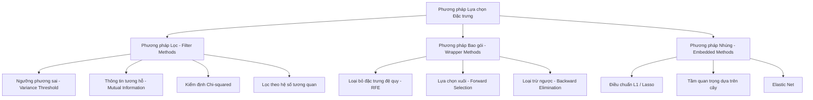
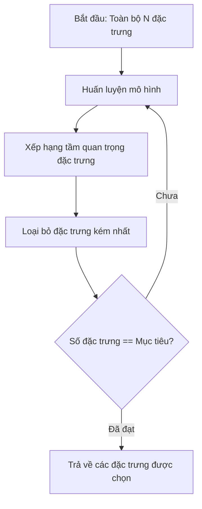
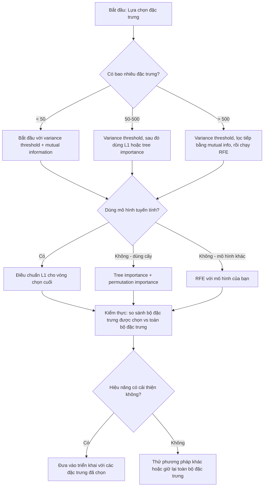

# Lựa chọn Đặc trưng (Feature Selection)

> Nhiều đặc trưng hơn không có nghĩa là tốt hơn. Chọn đúng đặc trưng mới là tốt hơn.

**Type:** Build
**Language:** Python
**Prerequisites:** Phase 2, Lessons 01-09, 08 (feature engineering)
**Time:** ~75 phút

## Learning Objectives

- Tự tay xây dựng các phương pháp lọc (filter: variance threshold, mutual information), phương pháp bao gói (wrapper: RFE) và phương pháp nhúng (embedded: L1, tầm quan trọng của cây) từ đầu, sau đó bổ sung lựa chọn xuôi (forward selection) trong bài tập
- Giải thích vì sao thông tin tương hỗ (Mutual Information) nắm bắt được các mối quan hệ phi tuyến giữa đặc trưng và mục tiêu mà hệ số tương quan bỏ sót
- So sánh điều chuẩn L1 (lựa chọn nhúng) với RFE (lựa chọn bao gói) và đánh giá sự đánh đổi về chi phí tính toán của chúng
- Xây dựng một pipeline lựa chọn đặc trưng hoàn chỉnh kết hợp nhiều phương pháp và chứng minh khả năng tổng quát hóa được cải thiện trên tập dữ liệu kiểm thử độc lập

## Vấn đề đặt ra (The Problem)

Bạn có 500 đặc trưng. Mô hình của bạn huấn luyện chậm chạp, liên tục bị quá khớp (overfit), và không ai có thể giải thích được nó đã học được những gì. Bạn thêm nhiều đặc trưng hơn với hy vọng cải thiện hiệu năng. Kết quả chỉ tệ đi.

Đó chính là lời nguyền số chiều (curse of dimensionality) đang phát tác. Khi số lượng đặc trưng tăng lên, thể tích của không gian đặc trưng bùng nổ theo cấp số nhân. Các điểm dữ liệu trở nên thưa thớt. Khoảng cách giữa các điểm hội tụ về cùng một mức. Mô hình cần lượng dữ liệu nhiều hơn theo cấp số nhân chỉ để tìm ra các quy luật có thật. Các đặc trưng nhiễu nhấn chìm các đặc trưng mang tín hiệu. Quá khớp trở thành điều hiển nhiên.

Lựa chọn đặc trưng (Feature selection) chính là liều thuốc giải. Loại bỏ nhiễu. Cắt bỏ sự dư thừa. Giữ lại những đặc trưng thực sự mang thông tin về biến mục tiêu. Kết quả: huấn luyện nhanh hơn, tổng quát hóa tốt hơn và mô hình có thể giải thích được.

Mục tiêu không phải là tận dụng mọi thông tin có sẵn, mà là sử dụng **đúng** thông tin cần thiết.

## Khái niệm (The Concept)

### Ba nhóm phương pháp lựa chọn đặc trưng

Mọi phương pháp lựa chọn đặc trưng đều thuộc vào một trong ba nhóm chính:



**Phương pháp lọc (Filter methods)**: Đánh giá điểm số cho từng đặc trưng một cách độc lập bằng thước đo thống kê. Chúng không dùng mô hình học máy. Rất nhanh, nhưng bỏ sót sự tương tác giữa các đặc trưng.

**Phương pháp bao gói (Wrapper methods)**: Huấn luyện một mô hình để đánh giá các tập con đặc trưng khác nhau. Dùng chính hiệu năng của mô hình làm tiêu chí lựa chọn. Kết quả tốt hơn, nhưng tốn kém tài nguyên vì phải huấn luyện lại mô hình nhiều lần.

**Phương pháp nhúng (Embedded methods)**: Việc lựa chọn đặc trưng diễn ra như một phần tích hợp sẵn trong quá trình huấn luyện mô hình. Điều chuẩn L1 kéo các trọng số về đúng bằng 0. Cây quyết định ưu tiên phân nhánh trên các đặc trưng hữu ích nhất. Lựa chọn diễn ra ngay khi khớp mô hình, không phải bước tách rời.

### Ngưỡng phương sai (Variance Threshold)

Bộ lọc đơn giản nhất. Nếu một đặc trưng hầu như không biến thiên qua các mẫu, nó gần như không mang thông tin phân biệt nào.

Xét một đặc trưng có giá trị 0.0 ở 999 trên tổng số 1000 mẫu. Phương sai của nó gần bằng 0. Không mô hình nào có thể dựa vào nó để phân loại các lớp. Hãy loại bỏ nó.

```math
\text{variance}(x) = \text{mean}\bigl((x - \text{mean}(x))^2\bigr)
```

Đặt một ngưỡng (ví dụ: 0.01). Loại bỏ mọi đặc trưng có phương sai thấp hơn ngưỡng này. Phương pháp này loại bỏ các đặc trưng hằng số hoặc gần hằng số mà không cần nhìn vào biến mục tiêu.

Khi nào nên dùng: Bước tiền xử lý đầu tiên trước khi áp dụng các phương pháp khác. Nó loại bỏ các đặc trưng vô dụng hiển nhiên với chi phí tính toán gần như bằng 0.

Hạn chế: Một đặc trưng có thể có phương sai cao nhưng vẫn là nhiễu thuần túy. Ngưỡng phương sai là điều kiện cần nhưng không đủ.

### Thông tin tương hỗ (Mutual Information)

Thông tin tương hỗ đo lường mức độ mà việc biết giá trị của đặc trưng $X$ giúp giảm độ bất định về biến mục tiêu $Y$.

```math
I(X; Y) = \sum_x \sum_y p(x, y) \cdot \log \frac{p(x, y)}{p(x) \cdot p(y)}
```

Nếu $X$ và $Y$ độc lập, $p(x, y) = p(x) \cdot p(y)$, số hạng logarit bằng 0 và $I(X; Y) = 0$. Càng biết nhiều về $Y$ thông qua $X$, thông tin tương hỗ càng cao.

Ưu điểm vượt trội so với tương quan tuyến tính (correlation): thông tin tương hỗ nắm bắt được các mối quan hệ phi tuyến. Một đặc trưng có thể có hệ số tương quan bằng 0 với mục tiêu nhưng thông tin tương hỗ lại rất cao vì mối quan hệ có dạng bậc hai hoặc tuần hoàn.

Với các đặc trưng liên tục, ta rời rạc hóa thành các thùng (bins) trước (ước lượng dựa trên histogram). Số lượng thùng ảnh hưởng đến kết quả ước lượng -- quá ít thùng làm mất thông tin, quá nhiều thùng đưa thêm nhiễu. Quy tắc phổ biến: $\sqrt{n}$ thùng hoặc quy tắc Sturges ($1 + \log_2 n$).


### Loại bỏ đặc trưng đệ quy (RFE - Recursive Feature Elimination)

RFE là phương pháp bao gói. Nó sử dụng chính điểm tầm quan trọng của mô hình để loại bỏ dần dần:

1. Huấn luyện mô hình với toàn bộ các đặc trưng
2. Xếp hạng đặc trưng theo tầm quan trọng (trọng số hệ số với mô hình tuyến tính, độ giảm tạp chất với cây)
3. Loại bỏ (các) đặc trưng kém quan trọng nhất
4. Lặp lại quy trình cho đến khi đạt được số lượng đặc trưng mong muốn



RFE xem xét được sự tương tác giữa các đặc trưng vì mô hình quan sát tất cả các đặc trưng còn lại cùng lúc. Việc loại bỏ một đặc trưng sẽ làm thay đổi tầm quan trọng của các đặc trưng khác.

Chi phí: Bạn phải huấn luyện mô hình $N - \text{target}$ lần. Với 500 đặc trưng và muốn giữ lại 10, bạn phải huấn luyện 490 lần. Với các mô hình nặng, cách này rất chậm. Bạn có thể tăng tốc bằng cách loại bỏ nhiều đặc trưng mỗi bước (ví dụ: loại bỏ 10% kém nhất mỗi vòng).

### Điều chuẩn L1 (Lasso)

Điều chuẩn L1 cộng thêm tổng giá trị tuyệt đối của các trọng số vào hàm mất mát:

```math
\text{loss} = \text{prediction\_error} + \alpha \cdot \sum \lvert w_i \rvert
```

Tham số alpha điều khiển mức độ cắt giảm đặc trưng. Alpha càng lớn, càng nhiều trọng số bị ép về đúng bằng 0.

Tại sao lại đúng bằng 0? Hình phạt L1 tạo ra một vùng ràng buộc dạng hình thoi (diamond) trong không gian trọng số. Điểm tối ưu thường chạm vào các đỉnh góc của hình thoi, nơi một hoặc nhiều trọng số bằng 0. Điều chuẩn L2 (Ridge) tạo ra vùng ràng buộc hình tròn nên trọng số co nhỏ lại nhưng hiếm khi chạm mốc 0 tuyệt đối.

Đây là phương pháp lựa chọn nhúng (embedded): mô hình tự học xem đặc trưng nào cần bỏ qua ngay trong quá trình huấn luyện.

Ưu điểm: Chỉ cần một lần huấn luyện duy nhất, xử lý tốt các đặc trưng tương quan (chọn một và triệt tiêu các đặc trưng còn lại về 0), có sẵn trong hầu hết các mô hình tuyến tính.

Hạn chế: Chỉ áp dụng được cho các mô hình tuyến tính. Không nắm bắt được tầm quan trọng phi tuyến tính.

### Tầm quan trọng dựa trên cây (Tree-Based Feature Importance)

Cây quyết định và các mô hình ensemble (Random Forest, Gradient Boosting) tự nhiên xếp hạng các đặc trưng. Mỗi phép phân nhánh đều làm giảm độ tạp chất (impurity - chỉ số Gini/Entropy cho phân loại, phương sai cho hồi quy). Đặc trưng nào tạo ra độ giảm tạp chất lớn hơn sẽ quan trọng hơn.

Với một Random Forest gồm $T$ cây:

```math
\text{importance}(\text{feature}_j) = \frac{1}{T} \sum_{\text{mọi cây}} \; \sum_{\text{mọi nút tách trên } \text{feature}_j} (\text{n\_samples} \cdot \text{impurity\_decrease})
```

Thước đo này tự động xử lý các quan hệ phi tuyến và tương tác giữa các đặc trưng.

Cảnh báo: Tầm quan trọng dựa trên cây bị thiên vị đối với các đặc trưng có nhiều giá trị phân biệt (high cardinality). Một cột ID ngẫu nhiên có thể trông có vẻ quan trọng vì nó phân nhánh hoàn hảo từng mẫu. Hãy dùng Permutation Importance để kiểm chứng lại.

### Tầm quan trọng hoán vị (Permutation Importance)

Phương pháp độc lập với mô hình (model-agnostic):

1. Huấn luyện mô hình và ghi lại hiệu năng cơ sở trên tập kiểm thực
2. Với từng đặc trưng: xáo trộn ngẫu nhiên giá trị của nó, đo lường sự sụt giảm hiệu năng
3. Sự sụt giảm càng lớn, đặc trưng đó càng quan trọng

Nếu xáo trộn một đặc trưng không làm suy giảm hiệu năng, mô hình không hề phụ thuộc vào nó. Nếu hiệu năng sụp đổ, đặc trưng đó đóng vai trò sống còn.

Permutation Importance tránh được sự thiên vị số lượng giá trị của phương pháp cây, nhưng tốn thời gian tính toán hơn.

### Bảng so sánh tổng quan

| Phương pháp | Phân loại | Tốc độ | Phi tuyến | Tương tác đặc trưng |
|--------|------|-------|-----------|---------------------|
| Variance threshold | Filter | Cực nhanh | Không | Không |
| Mutual information | Filter | Nhanh | Có | Không |
| Correlation filter | Filter | Nhanh | Không | Không |
| RFE | Wrapper | Chậm | Tùy mô hình | Có |
| L1 / Lasso | Embedded | Nhanh | Không (tuyến tính) | Không |
| Tree importance | Embedded | Trung bình | Có | Có |
| Permutation importance | Model-agnostic | Chậm | Có | Có |

### Sơ đồ ra quyết định



```figure
f3-feature-prune
```

## Tự tay xây dựng (Build It)

Mã nguồn trong `code/feature_selection.py` triển khai từ đầu đầy đủ các phương pháp.

### Bước 1: Sinh dữ liệu thử nghiệm có cấu trúc đã biết

```python
import numpy as np


def make_feature_selection_data(n_samples=500, seed=42):
    rng = np.random.RandomState(seed)

    x1 = rng.randn(n_samples)
    x2 = rng.randn(n_samples)
    x3 = rng.randn(n_samples)
    x4 = x1 + 0.1 * rng.randn(n_samples)
    x5 = x2 + 0.1 * rng.randn(n_samples)

    informative = np.column_stack([x1, x2, x3, x4, x5])

    correlated = np.column_stack([
        x1 * 0.9 + 0.1 * rng.randn(n_samples),
        x2 * 0.8 + 0.2 * rng.randn(n_samples),
        x3 * 0.7 + 0.3 * rng.randn(n_samples),
        x1 * 0.5 + x2 * 0.5 + 0.1 * rng.randn(n_samples),
        x2 * 0.6 + x3 * 0.4 + 0.1 * rng.randn(n_samples),
    ])

    noise = rng.randn(n_samples, 10) * 0.5

    X = np.hstack([informative, correlated, noise])
    y = (2 * x1 - 1.5 * x2 + x3 + 0.5 * rng.randn(n_samples) > 0).astype(int)

    feature_names = (
        [f"info_{i}" for i in range(5)]
        + [f"corr_{i}" for i in range(5)]
        + [f"noise_{i}" for i in range(10)]
    )

    return X, y, feature_names
```

Chúng ta biết trước chân lý ngầm (ground truth): các đặc trưng 0-4 mang thông tin chính, 5-9 tương quan với các đặc trưng chính, 10-19 là nhiễu thuần túy. Một phương pháp tốt phải xếp hạng 0-4 cao nhất và 10-19 thấp nhất.

### Bước 2: Ngưỡng phương sai (Variance Threshold)

```python
def variance_threshold(X, threshold=0.01):
    variances = np.var(X, axis=0)
    mask = variances > threshold
    return mask, variances
```

### Bước 3: Thông tin tương hỗ (Mutual Information)

```python
def discretize(x, n_bins=10):
    min_val, max_val = x.min(), x.max()
    if max_val == min_val:
        return np.zeros_like(x, dtype=int)
    bin_edges = np.linspace(min_val, max_val, n_bins + 1)
    binned = np.digitize(x, bin_edges[1:-1])
    return binned


def mutual_information(X, y, n_bins=10):
    n_samples, n_features = X.shape
    mi_scores = np.zeros(n_features)

    y_vals, y_counts = np.unique(y, return_counts=True)
    p_y = y_counts / n_samples

    for f in range(n_features):
        x_binned = discretize(X[:, f], n_bins)
        x_vals, x_counts = np.unique(x_binned, return_counts=True)
        p_x = dict(zip(x_vals, x_counts / n_samples))

        mi = 0.0
        for xv in x_vals:
            for yi, yv in enumerate(y_vals):
                joint_mask = (x_binned == xv) & (y == yv)
                p_xy = np.sum(joint_mask) / n_samples
                if p_xy > 0:
                    mi += p_xy * np.log(p_xy / (p_x[xv] * p_y[yi]))
        mi_scores[f] = mi

    return mi_scores
```

### Bước 4: Loại bỏ đặc trưng đệ quy (RFE)

```python
def simple_logistic_importance(X, y, lr=0.1, epochs=100):
    n_samples, n_features = X.shape
    w = np.zeros(n_features)
    b = 0.0

    for _ in range(epochs):
        z = X @ w + b
        pred = 1.0 / (1.0 + np.exp(-np.clip(z, -500, 500)))
        error = pred - y
        w -= lr * (X.T @ error) / n_samples
        b -= lr * np.mean(error)

    return w, b


def rfe(X, y, n_features_to_select=5, lr=0.1, epochs=100):
    n_total = X.shape[1]
    remaining = list(range(n_total))
    rankings = np.ones(n_total, dtype=int)
    rank = n_total

    while len(remaining) > n_features_to_select:
        X_subset = X[:, remaining]
        w, _ = simple_logistic_importance(X_subset, y, lr, epochs)
        importances = np.abs(w)

        least_idx = np.argmin(importances)
        original_idx = remaining[least_idx]
        rankings[original_idx] = rank
        rank -= 1
        remaining.pop(least_idx)

    for idx in remaining:
        rankings[idx] = 1

    selected_mask = rankings == 1
    return selected_mask, rankings
```

### Bước 5: Lựa chọn đặc trưng L1 (Soft Thresholding)

```python
def soft_threshold(w, alpha):
    return np.sign(w) * np.maximum(np.abs(w) - alpha, 0)


def l1_feature_selection(X, y, alpha=0.1, lr=0.01, epochs=500):
    n_samples, n_features = X.shape
    w = np.zeros(n_features)
    b = 0.0

    for _ in range(epochs):
        z = X @ w + b
        pred = 1.0 / (1.0 + np.exp(-np.clip(z, -500, 500)))
        error = pred - y

        gradient_w = (X.T @ error) / n_samples
        gradient_b = np.mean(error)

        w -= lr * gradient_w
        w = soft_threshold(w, lr * alpha)
        b -= lr * gradient_b

    selected_mask = np.abs(w) > 1e-6
    return selected_mask, w
```

### Bước 6: Tầm quan trọng dựa trên cây quyết định

```python
def gini_impurity(y):
    if len(y) == 0:
        return 0.0
    classes, counts = np.unique(y, return_counts=True)
    probs = counts / len(y)
    return 1.0 - np.sum(probs ** 2)


def best_split(X, y, feature_idx):
    values = np.unique(X[:, feature_idx])
    if len(values) <= 1:
        return None, -1.0

    best_threshold = None
    best_gain = -1.0
    parent_gini = gini_impurity(y)
    n = len(y)

    for i in range(len(values) - 1):
        threshold = (values[i] + values[i + 1]) / 2.0
        left_mask = X[:, feature_idx] <= threshold
        right_mask = ~left_mask

        n_left = np.sum(left_mask)
        n_right = np.sum(right_mask)

        if n_left == 0 or n_right == 0:
            continue

        gain = parent_gini - (n_left / n) * gini_impurity(y[left_mask]) - (n_right / n) * gini_impurity(y[right_mask])

        if gain > best_gain:
            best_gain = gain
            best_threshold = threshold

    return best_threshold, best_gain


def tree_importance(X, y, n_trees=50, max_depth=5, seed=42):
    rng = np.random.RandomState(seed)
    n_samples, n_features = X.shape
    importances = np.zeros(n_features)

    for _ in range(n_trees):
        sample_idx = rng.choice(n_samples, size=n_samples, replace=True)
        feature_subset = rng.choice(n_features, size=max(1, int(np.sqrt(n_features))), replace=False)

        X_boot = X[sample_idx]
        y_boot = y[sample_idx]

        tree_imp = _build_tree_importance(X_boot, y_boot, feature_subset, max_depth)
        importances += tree_imp

    total = importances.sum()
    if total > 0:
        importances /= total

    return importances


def _build_tree_importance(X, y, feature_subset, max_depth, depth=0):
    n_features = X.shape[1]
    importances = np.zeros(n_features)

    if depth >= max_depth or len(np.unique(y)) <= 1 or len(y) < 4:
        return importances

    best_feature = None
    best_threshold = None
    best_gain = -1.0

    for f in feature_subset:
        threshold, gain = best_split(X, y, f)
        if gain > best_gain:
            best_gain = gain
            best_feature = f
            best_threshold = threshold

    if best_feature is None or best_gain <= 0:
        return importances

    importances[best_feature] += best_gain * len(y)

    left_mask = X[:, best_feature] <= best_threshold
    right_mask = ~left_mask

    importances += _build_tree_importance(X[left_mask], y[left_mask], feature_subset, max_depth, depth + 1)
    importances += _build_tree_importance(X[right_mask], y[right_mask], feature_subset, max_depth, depth + 1)

    return importances
```

## Sử dụng trong thực tế (Use It)

Với scikit-learn, các kỹ thuật lựa chọn đặc trưng được tích hợp sẵn:

```python
from sklearn.feature_selection import (
    VarianceThreshold,
    mutual_info_classif,
    RFE,
    SelectFromModel,
)
from sklearn.linear_model import Lasso, LogisticRegression
from sklearn.ensemble import RandomForestClassifier

vt = VarianceThreshold(threshold=0.01)
X_filtered = vt.fit_transform(X)

mi_scores = mutual_info_classif(X, y)
top_k = np.argsort(mi_scores)[-10:]

rfe_selector = RFE(LogisticRegression(), n_features_to_select=10)
rfe_selector.fit(X, y)
X_rfe = rfe_selector.transform(X)

lasso_selector = SelectFromModel(Lasso(alpha=0.01))
lasso_selector.fit(X, y)
X_lasso = lasso_selector.transform(X)

rf = RandomForestClassifier(n_estimators=100)
rf.fit(X, y)
importances = rf.feature_importances_
```

## Xuất xưởng (Ship It)

Bài học này tạo ra:
- `outputs/skill-feature-selector.md` -- cây quyết định tra cứu nhanh để chọn đúng phương pháp lựa chọn đặc trưng

## Bài tập thực hành (Exercises)

1. **Lựa chọn xuôi (Forward Selection)**: Triển khai phương pháp ngược lại với RFE. Bắt đầu từ 0 đặc trưng. Tại mỗi bước, thêm vào đặc trưng giúp cải thiện hiệu năng mô hình nhiều nhất. Dừng lại khi việc thêm đặc trưng không còn mang lại lợi ích. So sánh kết quả với RFE về tốc độ và chất lượng.

2. **Lựa chọn ổn định (Stability Selection)**: Chạy lựa chọn đặc trưng L1 50 lần, mỗi lần trên một mẫu con 80% ngẫu nhiên của dữ liệu với các giá trị alpha hơi khác nhau. Đếm tần suất mỗi đặc trưng được chọn. Các đặc trưng được chọn trên 80% số lần là đặc trưng "ổn định". So sánh chúng với một lần chạy L1 đơn lẻ.

3. **Phát hiện đa cộng tuyến (Multicollinearity)**: Tính ma trận tương quan cho toàn bộ các đặc trưng. Viết hàm loại bỏ một đặc trưng trong mỗi cặp có tương quan cao (> 0.9), giữ lại đặc trưng có thông tin tương hỗ cao hơn với biến mục tiêu.

4. **Pipeline kết hợp**: Nối chuỗi Variance Threshold, Mutual Information và RFE vào một pipeline duy nhất. So sánh pipeline này với việc chỉ chạy RFE đơn độc trên toàn bộ đặc trưng.

5. **Tự cài đặt Permutation Importance**: Triển khai Permutation Importance từ đầu. Với mỗi đặc trưng, xáo trộn giá trị 10 lần và đo độ sụt giảm điểm F1. So sánh thứ hạng với tầm quan trọng của cây và giải thích các điểm khác biệt.

## Các thuật ngữ chính (Key Terms)

| Thuật ngữ | Mọi người hay nói | Ý nghĩa thực sự |
|------|----------------|----------------------|
| Filter method | "Chấm điểm từng đặc trưng độc lập" | Phương pháp xếp hạng đặc trưng bằng thước đo thống kê mà không cần huấn luyện mô hình |
| Wrapper method | "Dùng mô hình để chọn đặc trưng" | Phương pháp đánh giá các tập con đặc trưng bằng cách huấn luyện mô hình và lấy hiệu năng làm tiêu chí |
| Embedded method | "Mô hình tự chọn đặc trưng khi học" | Quá trình lựa chọn đặc trưng diễn ra ngay trong lúc khớp mô hình, ví dụ L1 kéo trọng số về 0 |
| Mutual information | "Đặc trưng này tiết lộ bao nhiêu về mục tiêu" | Thước đo mức giảm độ bất định của $Y$ khi biết $X$, nắm bắt cả quan hệ tuyến tính lẫn phi tuyến |
| Recursive Feature Elimination | "Huấn luyện, xếp hạng, cắt tỉa, lặp lại" | Phương pháp bao gói lặp đi lặp lại việc huấn luyện mô hình và loại bỏ đặc trưng kém nhất cho tới khi đạt số lượng mong muốn |
| L1 / Lasso regularization | "Hình phạt triệt tiêu đặc trưng" | Cộng tổng trị tuyệt đối trọng số vào hàm mất mát, ép các trọng số không quan trọng về đúng bằng 0 |
| Variance threshold | "Loại bỏ đặc trưng hằng số" | Bỏ qua các đặc trưng có phương sai qua các mẫu thấp hơn ngưỡng quy định |
| Feature importance | "Đặc trưng nào quan trọng nhất" | Điểm số định lượng đóng góp của đặc trưng vào dự đoán, tính từ độ giảm tạp chất hoặc độ lớn hệ số |
| Permutation importance | "Xáo trộn và đo mức độ thiệt hại" | Đánh giá tầm quan trọng bằng cách xáo trộn ngẫu nhiên một đặc trưng và đo sự suy giảm hiệu năng của mô hình |
| Curse of dimensionality | "Quá nhiều chiều, quá ít dữ liệu" | Hiện tượng thể tích không gian đặc trưng tăng theo cấp số nhân làm dữ liệu trở nên thưa thớt và khoảng cách mất ý nghĩa |

## Tài liệu đọc thêm (Further Reading)

- [An Introduction to Variable and Feature Selection (Guyon & Elisseeff, 2003)](https://jmlr.org/papers/v3/guyon03a.html) -- bài khảo cứu nền tảng kinh điển về lựa chọn biến và đặc trưng
- [scikit-learn Feature Selection Guide](https://scikit-learn.org/stable/modules/feature_selection.html) -- hướng dẫn thực hành của scikit-learn với đầy đủ ví dụ mã nguồn
- [Stability Selection (Meinshausen & Buhlmann, 2010)](https://arxiv.org/abs/0809.2932) -- kết hợp lấy mẫu con với lựa chọn đặc trưng để đạt kết quả bền vững
- [Beware Default Random Forest Importances (Strobl et al., 2007)](https://bmcbioinformatics.biomedcentral.com/articles/10.1186/1471-2105-8-25) -- chỉ ra sự thiên vị số lượng giá trị trong Random Forest và đề xuất giải pháp thay thế
