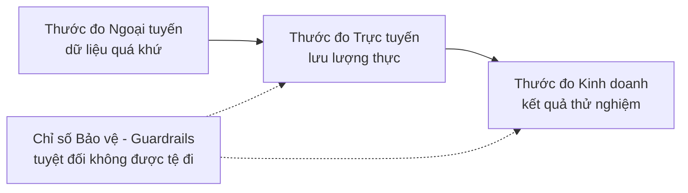

# Thiết kế Hệ thống Học máy (ML System Design) — Từ Bài toán Nghiệp vụ đến Mô hình Triển khai

> Mô hình chỉ là một phần nhỏ của toàn bộ hệ thống. Bản thiết kế sẽ định đoạt mô hình dự đoán cái gì, ai sẽ hành động dựa trên kết quả đó, chi phí vận hành là bao nhiêu và điều gì sẽ xảy ra khi hệ thống gặp sự cố.

**Type:** Build
**Languages:** Python
**Prerequisites:** Phase 2, Lessons 09 (Model Evaluation) and 13 (ML Pipelines)
**Time:** ~110 phút

## Learning Objectives

- Định hình một bài toán kinh doanh thành một tác vụ học máy cụ thể với một dự đoán, một quyết định hành động sử dụng dự đoán đó, và lý do vì sao các hệ thống dựa trên luật (rule-based) là chưa đủ
- Phân biệt rõ ràng các tầng thước đo: ngoại tuyến (offline), trực tuyến (online), kinh doanh (business) và thước đo bảo vệ (guardrail metrics); đồng thời so sánh mọi mô hình với các đường cơ sở tầm thường (trivial) và kinh nghiệm (heuristic)
- Ước tính chi phí vận hành hàng ngày, độ trễ và độ trễ dữ liệu (staleness) của hai phương thức suy luận theo lô (batch) và trực tuyến (online) dựa trên các số liệu lưu lượng truy cập thực tế
- Lựa chọn chiến lược triển khai phù hợp (shadow, canary, A/B test) và thiết lập phương án mặc định an toàn (safe default) cho từng tình huống lỗi hỏng hóc
- Nhận diện các vòng lặp phản hồi (feedback loops) mà trong đó các quyết định của mô hình làm biến đổi chính dữ liệu huấn luyện cho các phiên bản tiếp theo
- Viết một bản tài liệu thiết kế hệ thống học máy (ML design document) và chấm điểm tài liệu đó dựa trên bảng danh mục kiểm tra tiêu chuẩn

## Vấn đề đặt ra (The Problem)

Một công ty dịch vụ theo thuê bao yêu cầu đội ngũ kỹ thuật xây dựng "một mô hình dự đoán rời bỏ (churn model)". Kỹ sư khoa học dữ liệu huấn luyện một mô hình phân loại Gradient Boosting và hồ hởi báo cáo chỉ số AUC đạt 0.91. Ba tháng sau khi bàn giao, mô hình nằm đắp chiếu và không ai đoái hoài sử dụng.

Nguyên nhân thất bại hoàn toàn không liên quan đến thuật toán hay độ chính xác toán học. Không ai trong dự án xác định trước hành động cụ thể nào sẽ được kích hoạt khi có điểm số rủi ro. Điểm dự đoán được xuất ra mỗi tuần một lần, trong khi đội ngũ chăm sóc khách hàng lại thực hiện các cuộc gọi giữ chân người dùng hàng ngày. Nhãn dữ liệu được trích xuất từ một bảng hủy đăng ký có lưu kèm "lý do hủy", dẫn đến việc một đặc trưng vô tình làm rò rỉ đáp án vào tập huấn luyện. Và quan trọng nhất: không ai so sánh mô hình đắt đỏ này với quy tắc kinh nghiệm đơn giản mà đội ngũ hỗ trợ khách hàng vốn vẫn đang áp dụng rất hiệu quả: cứ gọi điện cho bất kỳ ai không đăng nhập tài khoản trong suốt hai tuần.

Mỗi lỗi lầm kể trên đều đã nảy sinh từ trước khi dòng lệnh huấn luyện đầu tiên được kích hoạt. Đó là những thất bại trong khâu **thiết kế hệ thống**. Một bản tài liệu thiết kế vỏn vẹn một trang giấy sẽ buộc bạn phải trả lời thấu đáo từng câu hỏi đó. Bài học này trang bị cho bạn tư duy và các quyết định kỹ thuật cốt lõi trong bản thiết kế đó: từ việc định giá chi phí phục vụ suy luận theo lô (batch) và trực tuyến (online), so sánh mô hình với các đường cơ sở, cho đến công cụ tự động chấm điểm bản thiết kế theo checklist tiêu chuẩn.

## Khái niệm (The Concept)

### Từ mục tiêu kinh doanh đến bài toán Học máy

Một mục tiêu kinh doanh thuần túy chưa phải là một bài toán ML. Bạn chuyển đổi mục tiêu kinh doanh thành tác vụ học máy bằng cách trả lời 4 câu hỏi cốt lõi:

1. Mô hình dự đoán chính xác điều gì, và dự đoán cho thực thể nào (người dùng, giao dịch, cửa hàng, sản phẩm)?
2. Quyết định hành động nào sẽ sử dụng kết quả dự đoán đó, và ai (hoặc hệ thống tự động nào) đưa ra quyết định đó?
3. Khi nào dự đoán cần được đưa ra, và những dữ liệu nào thực sự tồn tại tại đúng thời điểm đó?
4. Làm thế nào để đo lường và chứng minh rằng quyết định đưa ra đã mang lại hiệu quả tốt hơn?

| Mục tiêu kinh doanh | Dự đoán của mô hình | Quyết định hành động sử dụng dự đoán | Tác vụ ML tương ứng |
|---|---|---|---|
| Giảm tỷ lệ người dùng rời bỏ | Xác suất người dùng hủy dịch vụ trong 30 ngày tới | Tự động gửi gói ưu đãi giữ chân tới top 5% người dùng rủi ro cao nhất mỗi đêm | Phân loại nhị phân (Binary classification) |
| Cắt giảm thiệt hại do gian lận | Xác suất giao dịch là gian lận | Phê duyệt, chuyển sang xét duyệt thủ công, hoặc chặn giao dịch trong vòng 100 ms | Phân loại nhị phân |
| Đảm bảo hàng hóa không bị đứt gãy | Số lượng sản phẩm bán ra theo từng cửa hàng mỗi ngày trong tuần tới | Lên kế hoạch đặt hàng và phân phối cho từng kho | Dự báo chuỗi thời gian (Forecasting) |
| Hiển thị nội dung phù hợp cho người dùng | Điểm số mức độ liên quan cho cặp (người dùng, sản phẩm) | Sắp xếp thứ tự các mục hiển thị trên bảng tin (feed) | Xếp hạng (Ranking) |

Cột thứ hai cần sự cẩn trọng nhất. "Dự đoán churn" để ngỏ khung thời gian, thực thể và hành động. Trong khi đó, "Dự đoán liệu người dùng này có hủy gói cước trong 30 ngày tới hay không, để tác vụ chạy đêm nay chọn ra danh sách nhận ưu đãi" đã cố định rõ ràng cả ba yếu tố.

### Khi nào không nên sử dụng Học máy

Quy tắc số 1 trong tài liệu *Rules of Machine Learning* của Google nêu rõ: đừng ngại ngần tung ra một sản phẩm mà không cần đến học máy. ML luôn cần dữ liệu, và một luật heuristic đơn giản thường đã giúp bạn đi được một nửa chặng đường đầu tiên. Bạn tuyệt đối không nên dùng ML trong các trường hợp sau:

- Một vài dòng quy tắc nghiệp vụ ngắn gọn đã đủ đạt mục tiêu và duy trì sự ổn định. Quy tắc đơn giản rẻ hơn nhiều để vận hành, kiểm thử và giải thích.
- Bạn không có dữ liệu nhãn và không có cách thức khả thi nào để thu thập nhãn đáng tin cậy.
- Không có ai hoặc không có hệ thống nào hành động dựa trên dự đoán, nên dự đoán chính xác hơn cũng không làm thay đổi điều gì.
- Dữ liệu tồn tại tại thời điểm cần dự đoán không hề chứa tín hiệu thông tin hữu ích.
- Nghiệp vụ không chấp nhận bất kỳ sai số nào (zero tolerance) và không thể bố trí con người kiểm tra kết quả.
- Chi phí xây dựng, triển khai và bảo trì hệ thống ML tốn kém hơn nhiều so với giá trị kinh tế mà các quyết định tối ưu mang lại.

Chỉ khi các tập luật trở nên quá dài dòng, cồng kềnh và dễ đổ vỡ, ML mới thực sự phát huy giá trị hoàn vốn. Quy tắc số 3 của Google khuyến khích chọn ML thay cho một hệ thống heuristic phức tạp, bởi vì mô hình học máy dễ cập nhật và bảo trì hơn nhiều so với hàng trăm câu lệnh if-else chằng chịt.

### Ba tầng thước đo đánh giá (Three Layers of Metrics)

Bạn cần đo lường hệ thống ML ở ba tầng khác nhau, cùng với một nhóm các chỉ số bảo vệ (guardrails):

| Tầng thước đo | Thời điểm đo lường | Ví dụ cho bài toán Churn |
|---|---|---|
| Ngoại tuyến (Offline metric) | Trước khi ra mắt, trên dữ liệu quá khứ được giữ lại | F1 tại ngưỡng gửi ưu đãi, Precision trong top 5% rủi ro cao nhất |
| Trực tuyến (Online metric) | Trong quá trình triển khai, trên lưu lượng truy cập thực | Tỷ lệ chấp nhận ưu đãi, tỷ lệ người dùng được chấm điểm, phân phối điểm số |
| Kinh doanh (Business metric) | Vài tuần sau triển khai, thông qua thử nghiệm đối chứng | Tỷ lệ rời bỏ sau 30 ngày ở nhóm nhận ưu đãi so với nhóm giữ lại đối chứng (holdout) |
| Chỉ số bảo vệ (Guardrail metric) | Giám sát liên tục mọi lúc | Chi phí ưu đãi trên mỗi người dùng giữ chân được, tỷ lệ hủy đăng ký nhận thư, độ trễ p99 |



Các tầng này thường không đồng nhất với nhau. Thước đo ngoại tuyến chấm điểm trên dữ liệu quá khứ, và quá khứ thì không hề có sự hiện diện của mô hình bạn vừa tạo. Thước đo trực tuyến phụ thuộc vào cách người dùng phản ứng với quyết định can thiệp. Thước đo kinh doanh dịch chuyển rất chậm và bị lẫn nhiễu từ hàng loạt hoạt động khác trong doanh nghiệp.

Hãy chọn thước đo ngoại tuyến khớp sát nhất với quyết định thực tế. Nếu tác vụ chỉ liên hệ với top 5% người dùng, hãy đo Precision ở top 5%. Điểm số AUC lấy trung bình trên toàn bộ mọi ngưỡng quyết định, bao gồm cả những ngưỡng cực đoan mà bạn chẳng bao giờ dùng tới trong thực tế.

### Các đường cơ sở so sánh (Baselines)

Một con số metric đứng trơ trọi không có ý nghĩa gì. Điểm F1 đạt 0.56 là rất tốt nếu giải pháp thay thế tốt nhất chỉ đạt 0.30, nhưng lại là tệ hại nếu một luật nghiệp vụ đơn giản đã đạt 0.60. Luôn so sánh mô hình với 3 loại đường cơ sở:

- **Baseline tầm thường (Trivial baseline):** Luôn đoán nhãn đa số, hoặc luôn đoán giá trị trung bình của tập huấn luyện.
- **Baseline kinh nghiệm (Heuristic baseline):** Một quy tắc dựa trên tri thức chuyên ngành, hoặc ngưỡng trên một đặc trưng đơn lẻ được khớp từ dữ liệu huấn luyện.
- **Hệ thống hiện tại (Current system):** Bất cứ quy trình nào đang đưa ra quyết định ngày hôm nay, kể cả khi đó chỉ là một nhân viên làm việc thủ công trên bảng tính Excel.

Độ nâng (Lift) là điểm số của mô hình trừ đi điểm số của baseline mạnh nhất. Hãy đặt ra ngưỡng nâng tối thiểu trước khi xem xét kết quả, và đảm bảo mức chênh lệch đó đủ lớn để bù đắp chi phí vận hành hệ thống ML phức tạp. Baseline tầm thường thường rất dễ đánh bại. Nhưng baseline kinh nghiệm mới chính là đối thủ thực sự khó vượt qua.

### Yêu cầu về dữ liệu và nhãn

Hãy trả lời dứt khoát các câu hỏi này trước khi bước vào huấn luyện:

- **Nguồn gốc nhãn (Label source):** Bảng dữ liệu hoặc sự kiện nào định nghĩa nhãn, và đội ngũ nào chịu trách nhiệm quản lý nó?
- **Độ trễ của nhãn (Label delay):** Sau bao lâu kể từ thời điểm dự đoán thì kết quả thực tế mới lộ diện? Các khoản bồi hoàn gian lận (chargeback) có thể mất vài tuần mới đến nơi. Nhãn churn chỉ xuất hiện sau khi kết thúc chu kỳ 30 ngày.
- **Chất lượng nhãn (Label quality):** Ai là người gán nhãn, và tỷ lệ gán nhãn sai là bao nhiêu?
- **Tính khả dụng tại thời điểm dự đoán:** Liệu mọi đặc trưng đầu vào có thực sự tồn tại ở đúng thời điểm cần đưa ra dự đoán không? Bất kỳ đặc trưng nào được hệ thống ghi nhận sau khi kết quả đã xảy ra đều sẽ gây rò rỉ dữ liệu (data leakage) nghiêm trọng.
- **Khối lượng dữ liệu theo lớp:** Có bao nhiêu mẫu dương tính thực tế? Vài trăm mẫu dương tính sẽ giới hạn bạn ở các mô hình đơn giản.
- **Chia tập dữ liệu theo thời gian (Time split):** Luôn giữ lại giai đoạn gần đây nhất làm tập kiểm thử để tôn trọng trục thời gian thực.

### Ngân sách độ trễ, thông lượng và chi phí

Ba con số này là ranh giới định hình mọi thiết kế triển khai:

- **Ngân sách độ trễ (Latency budget):** Độ trễ phân vị p99 là mốc thời gian mà 99% các yêu cầu phải hoàn thành dưới mức đó. Kiểm tra gian lận thanh toán đòi hỏi dưới 50 ms. Một báo cáo chạy đêm có thể kéo dài vài giờ.
- **Thông lượng đỉnh (Peak throughput):** Định cỡ hệ thống cho phút bận rộn nhất trong ngày, không phải mức trung bình ngày. QPS giờ cao điểm thường gấp nhiều lần mức trung bình.
- **Ngân sách chi phí:** Thể hiện bằng số USD mỗi ngày hoặc số USD trên 1.000 lượt dự đoán để dễ dàng so sánh các phương án.

Định luật Little (Little's Law) kết nối hai yếu tố đầu: Số lượng yêu cầu đang được xử lý đồng thời bằng thông lượng nhân với độ trễ. Ở mức 400 yêu cầu/giây với độ trễ 50 ms mỗi yêu cầu, trung bình có 20 yêu cầu đang được xử lý đồng thời tại bất kỳ thời điểm nào.

### Suy luận theo lô (Batch) vs Suy luận trực tuyến (Online)

Có hai phương thức cơ bản để phục vụ dự đoán:

- **Suy luận theo lô (Batch inference):** Một tác vụ định kỳ chạy chấm điểm trước cho mọi thực thể và lưu kết quả vào bảng dữ liệu hoặc kho khóa-giá trị (key-value store). Ứng dụng chỉ việc đọc kết quả đã tính sẵn khi có yêu cầu.
- **Suy luận trực tuyến (Online inference):** Ứng dụng gửi các đặc trưng đến dịch vụ mô hình tại đúng thời điểm có yêu cầu và chờ đợi kết quả trả về trong thời gian thực.

| Đặc tính | Batch (Theo lô) | Online (Trực tuyến) |
|---|---|---|
| Độ tươi của dữ liệu (Freshness) | Bằng thời gian từ lần chạy trước cộng thời gian chạy | Sử dụng dữ liệu mới nhất đi kèm với yêu cầu |
| Độ trễ phản hồi yêu cầu | Chỉ là một lượt đọc key-value, vài mili-giây | Thời gian lấy đặc trưng cộng thời gian mô hình suy luận |
| Yếu tố đẩy chi phí | Số lượng thực thể nhân với số lần chạy mỗi ngày | Số lượng bản sao (replicas) phục vụ mức đỉnh QPS |
| Thực thể mới xuất hiện | Chưa có điểm số cho tới lần chạy định kỳ tiếp theo | Được chấm điểm ngay trong lần yêu cầu đầu tiên |
| Khi hệ thống gặp sự cố | Điểm số cũ vẫn đọc được bình thường | Yêu cầu bị lỗi hoặc bị timeout hoàn toàn |

Một thiết kế lai (hybrid) rất phổ biến trong thực tế: tác vụ batch chạy đêm chấm điểm trước cho những người dùng đã biết, còn luồng online sẽ chấm điểm cho người dùng mới hoặc các yêu cầu đòi hỏi dữ liệu tươi mới theo thời gian thực.

### Các mô hình triển khai (Deployment Patterns)

Một mô hình mới tiếp cận người dùng theo từng giai đoạn an toàn:

1. **Triển khai bóng (Shadow deployment):** Mô hình mới nhận một bản sao lưu lượng thực tế. Hệ thống ghi lại các dự đoán của nó nhưng không hề sử dụng để đưa ra quyết định. Bạn so sánh độ trễ, tỷ lệ lỗi và phân phối dự đoán của mô hình mới với mô hình hiện tại.
2. **Triển khai Canary:** Mô hình mới đưa ra quyết định thực tế cho một phần nhỏ lưu lượng (thường từ 1% đến 5%). Bạn mở rộng dần tỷ lệ theo từng nấc và kích hoạt rollback ngay lập tức nếu bất kỳ chỉ số bảo vệ nào bị vi phạm.
3. **Thử nghiệm A/B:** Chia ngẫu nhiên người dùng để trải nghiệm các mô hình khác nhau. Bạn đo lường các thước đo kinh doanh bằng kiểm định thống kê chính quy.

Mọi giai đoạn đều bắt buộc phải có phương án hoàn tác (rollback) có thể thực hiện trong vòng vài phút. Hãy giữ phiên bản mô hình cũ ở trạng thái sẵn sàng và chuyển đổi luồng lưu lượng thông qua cấu hình cờ tính năng (feature flag).

### Các vòng lặp phản hồi (Feedback Loops)

Vòng lặp phản hồi xuất hiện khi các quyết định của mô hình làm thay đổi chính dữ liệu sẽ dùng để huấn luyện phiên bản tiếp theo của nó. Đây là một trong những nguồn nợ kỹ thuật (technical debt) lớn nhất trong hệ thống ML:

- **Sự can thiệp che giấu nhãn thực:** Mô hình churn gửi ưu đãi, và ưu đãi giúp giữ chân một số khách hàng. Tháng sau, những khách hàng có rủi ro cao này lại trông giống như khách hàng trung thành, khiến mô hình huấn luyện lại tưởng rằng các đặc trưng đó không liên quan đến việc rời bỏ.
- **Hành động bị chặn không có kết quả:** Mô hình gian lận chặn một giao dịch, do đó giao dịch đó không bao giờ có cơ hội nhận nhãn chargeback thực tế. Mô hình huấn luyện lại sẽ thấy ít ví dụ gian lận hơn ở vùng dữ liệu bị chặn.
- **Độ hiển thị giới hạn phản hồi:** Mô hình xếp hạng chỉ hiển thị các mục đứng đầu, nên chỉ những mục đó mới có cơ hội nhận được lượt nhấp chuột.

Giải pháp chung: luôn giữ lại một phần dữ liệu không bị mô hình tác động. Dành ra một nhóm ngẫu nhiên nhỏ không bao giờ nhận ưu đãi can thiệp (control group). Dành một tỷ lệ nhỏ lưu lượng cho các quyết định ngẫu nhiên. Luôn ghi lại điểm số và quyết định đi kèm với từng mẫu dữ liệu để phân biệt dữ liệu sạch với dữ liệu đã bị can thiệp.

### Các dạng lỗi và phương án mặc định an toàn (Safe Defaults)

Mọi bộ phận trong hệ thống sớm muộn gì cũng sẽ gặp lỗi. Hãy quyết định hành động mặc định cho từng tình huống lỗi ngay trong khâu thiết kế, chứ không phải đợi đến khi sự cố xảy ra:

| Tình huống lỗi | Hậu quả nếu không có kế hoạch | Phương án mặc định an toàn (Safe default) |
|---|---|---|
| Dịch vụ mô hình bị timeout | Yêu cầu người dùng bị sập lỗi | Chuyển sang sử dụng luật heuristic cơ sở |
| Tác vụ batch chạy đêm bị lỗi | Mất điểm số hoặc điểm số bị cũ | Tiếp tục dùng điểm số cũ trong một khoảng thời gian quy định, sau đó fallback về luật |
| Đặc trưng bị thiếu hoặc vượt ngưỡng | Mô hình suy luận trên dữ liệu rác | Dùng giá trị mặc định được quy định trước và ghi log cảnh báo |
| Thực thể mới chưa có lịch sử | Không có điểm số | Áp dụng luật mặc định hoặc giá trị trung bình quần thể |
| Phân phối điểm số dịch chuyển đột ngột | Đưa ra hàng loạt quyết định sai | Tạm dừng hành động tự động và gửi cảnh báo khẩn cấp cho con người |

Baseline kinh nghiệm (heuristic) từ phần đo lường cũng chính là phương án mặc định an toàn cho hầu hết các lỗi hỏng hóc, vì vậy hãy xây dựng nó đầu tiên!

### Bản tài liệu thiết kế (The Design Document)

Tài liệu thiết kế ghi lại toàn bộ các quyết định kể trên tại một nơi duy nhất trước khi bắt đầu huấn luyện. Sáu mục sau đây sẽ chặn (block) việc phê duyệt nếu bị bỏ trống, vì chúng khiến hệ thống trở nên mất an toàn hoặc vô dụng:

| Mục | Câu hỏi cần trả lời | Yếu tố chặn phê duyệt (Blocking) |
|---|---|---|
| Vấn đề | Dự đoán cái gì, quyết định nào sử dụng nó, vì sao luật là chưa đủ? | Bắt buộc phải có quyết định hành động rõ ràng |
| Thước đo | Thước đo offline, online, kinh doanh và guardrail là gì? | Bắt buộc phải có thước đo kinh doanh |
| Baselines | Các baseline tầm thường, kinh nghiệm và hệ thống hiện tại là gì? | Bắt buộc phải có baseline heuristic hoặc hệ thống hiện tại |
| Dữ liệu | Nhãn từ đâu, trễ bao lâu, đặc trưng có sẵn lúc dự đoán không? | Tuyệt đối không được rò rỉ dữ liệu (no leakage) |
| Ngân sách & Phục vụ | Giới hạn độ trễ, peak QPS, chi phí, độ tươi là gì; dùng batch hay online? | Phải chọn phương thức phục vụ đáp ứng ngân sách |
| Triển khai | Các giai đoạn shadow, canary, A/B là gì; rollback như thế nào? | Phải có shadow hoặc canary, kèm cơ chế rollback |
| Vòng lặp phản hồi | Mô hình có làm sai lệch dữ liệu tương lai không, làm sao giữ dữ liệu sạch? | Không chặn nhưng cần giải trình |
| Tình huống lỗi | Hành động mặc định an toàn cho từng lỗi hỏng hóc là gì? | Bắt buộc phải có hành vi mặc định an toàn cho mọi lỗi |
| Giám sát | Theo dõi những gì sau khi đưa lên production? | Không chặn |

```figure
mlprod-serving-cost
```

## Tự tay xây dựng (Build It)

Mã nguồn trong `code/main.py` chỉ sử dụng thư viện chuẩn của Python. Nó bao gồm 3 công cụ: mô hình tính toán chi phí phục vụ, bộ so sánh baseline và bộ chấm điểm tài liệu thiết kế.

### Bước 1: Mô tả khối lượng công việc và bảng giá

```python
@dataclass(frozen=True)
class Workload:
    name: str
    entities: int
    requests_per_day: int
    peak_qps: float
    max_staleness_hours: float
    latency_budget_ms: float


@dataclass(frozen=True)
class CostModel:
    batch_dollars_per_million: float = 0.40
    batch_job_hours: float = 1.0
    lookup_dollars_per_million: float = 0.25
    lookup_latency_ms: float = 4.0
    replica_dollars_per_hour: float = 0.50
    replica_qps: float = 200.0
    min_replicas: int = 2
    online_latency_ms: float = 35.0
```

### Bước 2: Định giá phục vụ Batch và Online

Một tác vụ batch phải hoàn thành trước giới hạn độ tươi của dữ liệu. Thời gian giữa các lần chạy bằng giới hạn độ tươi trừ đi thời gian chạy của job:

```python
def batch_plan(workload: Workload, costs: CostModel) -> ServingPlan:
    refresh_hours = workload.max_staleness_hours - costs.batch_job_hours
    if refresh_hours <= 0:
        return ServingPlan(
            "batch", False, math.inf, costs.lookup_latency_ms, math.inf, 0.0,
            "staleness limit is shorter than one batch job",
        )
    runs_per_day = 24.0 / refresh_hours
    predictions = workload.entities * runs_per_day
    dollars = (
        predictions / 1e6 * costs.batch_dollars_per_million
        + workload.requests_per_day / 1e6 * costs.lookup_dollars_per_million
    )
    ...
```

Phục vụ trực tuyến (Online serving) phải trả tiền cho đủ số lượng bản sao (replicas) để gánh được mức đỉnh lưu lượng, với mức tối thiểu là 2 bản sao để đảm bảo tính sẵn sàng cao:

```python
def online_plan(workload: Workload, costs: CostModel) -> ServingPlan:
    replicas = max(costs.min_replicas, math.ceil(workload.peak_qps / costs.replica_qps))
    dollars = replicas * costs.replica_dollars_per_hour * 24.0
    feasible = costs.online_latency_ms <= workload.latency_budget_ms
    ...
```

Hàm `choose_serving` giữ lại các phương án thỏa mãn yêu cầu về độ trễ và độ tươi, sau đó chọn phương án có chi phí rẻ nhất.

### Bước 3: So sánh mô hình với các đường cơ sở

```python
def compare_to_baselines(
    y_true: list,
    model_pred: list,
    baselines: dict[str, list],
    metric,
    metric_name: str,
    higher_is_better: bool = True,
    min_lift: float = 0.02,
) -> BaselineReport:
    if not baselines:
        raise ValueError("a model needs at least one baseline")
    scores = {name: metric(y_true, pred) for name, pred in baselines.items()}
    pick = max if higher_is_better else min
    best_name = pick(scores, key=scores.get)
    model_score = metric(y_true, model_pred)
    lift = model_score - scores[best_name] if higher_is_better else scores[best_name] - model_score
    return BaselineReport(metric_name, {"model": model_score, **scores}, best_name, lift, min_lift)
```

Baseline heuristic là một quy tắc trên một đặc trưng đơn lẻ. `fit_rule` thử mọi ngưỡng có thể trên tập huấn luyện và giữ lại ngưỡng có F1 cao nhất.

### Bước 4: Chấm điểm tài liệu thiết kế

Mỗi tiêu chí kiểm tra có trọng số, cờ chặn (blocking), thông điệp và hàm kiểm tra:

```python
CheckItem("decision", 2, True, "name the action that uses each prediction", lambda d: _text(d, "problem.decision")),
CheckItem("baselines", 2, True, "add a heuristic or current-system baseline", check_baselines),
CheckItem("no_leakage", 2, True, "confirm every feature exists at prediction time",
          lambda d: get_path(d, "data.features_available_at_prediction_time") is True),
CheckItem("serving_fit", 1, False, "pick a serving mode that meets the staleness, latency, and cost budgets",
          check_serving_fit),
```

Hàm `review_design_doc` cộng tổng trọng số các mục đạt và chia cho tổng trọng số tối đa. Kết luận chỉ là "ready for review" khi điểm đạt từ 0.85 trở lên và không có bất kỳ mục blocking nào bị trượt.

## Sử dụng trong thực tế (Use It)

Trong môi trường thực tế của các doanh nghiệp:

- **Baselines:** scikit-learn cung cấp sẵn `DummyClassifier` và `DummyRegressor` cho các baseline tầm thường. Baseline heuristic sẽ do bạn tự xây dựng từ tri thức nghiệp vụ.
- **Batch Serving:** Các công cụ lập lịch như Apache Airflow hoặc Dagster quản lý việc chạy job định kỳ và ghi vào Redis, DynamoDB hoặc Snowflake.
- **Online Serving:** Các server chuyên dụng như KServe, BentoML, NVIDIA Triton hoặc TorchServe đóng gói mô hình dưới dạng endpoint HTTP/gRPC.
- **Rollouts:** Các công cụ Kubernetes như Argo Rollouts điều phối luồng canary release; các nền tảng thử nghiệm như Statsig hoặc GrowthBook quản lý phân nhóm A/B testing.

## Xuất xưởng (Ship It)

Bài học này tạo ra:
- `outputs/skill-ml-design-review.md` -- kỹ năng đánh giá tài liệu thiết kế hệ thống ML từng phần, chỉ ra các lỗ hổng chí mạng trước tiên kèm công thức tính toán chi phí phục vụ.

## Bài tập thực hành (Exercises)

1. Bổ sung phương án phục vụ lai (hybrid plan) vào hàm `choose_serving`. Chấm điểm người dùng cũ theo batch và người dùng mới theo online. So sánh tổng chi phí hàng ngày.
2. Điều chỉnh dữ liệu churn giả lập cho đến khi mô hình học máy không còn đánh bại được luật heuristic nữa. Báo cáo mức thay đổi hệ số nhỏ nhất làm mất đi độ nâng (lift).
3. Thêm tiêu chí kiểm tra ngân sách `budgets.max_dollars_per_1k_predictions` vào bảng kiểm tra. Viết một bài test đánh trượt tài liệu nếu thiếu thông tin này.
4. Tự viết một tài liệu thiết kế định dạng JSON cho bài toán phát hiện gian lận thanh toán. Chạy bộ kiểm tra và khắc phục toàn bộ các mục bị chặn (blocking).
5. Mô phỏng vòng lặp phản hồi của bài toán Churn. Xóa bỏ nhãn của những người dùng đã nhận được ưu đãi giữ chân, huấn luyện lại mô hình và đo lường sự biến động của điểm F1.

## Các thuật ngữ chính (Key Terms)

| Thuật ngữ | Mọi người hay nói | Ý nghĩa thực sự |
|------|----------------|----------------------|
| ML task | "Xây dựng mô hình churn" | Mục tiêu dự đoán, thực thể, khung thời gian và quyết định hành động cụ thể sử dụng dự đoán |
| Offline metric | "Điểm số mô hình" | Thước đo được tính toán trên dữ liệu quá khứ được giữ lại trước khi triển khai |
| Online metric | "Số liệu thực tế" | Thước đo ghi nhận trên lưu lượng truy cập thực khi mô hình đang hoạt động |
| Business metric | "Mục tiêu kinh doanh" | Kết quả kinh doanh mà quyết định can thiệp cần thay đổi, được đo lường qua thử nghiệm đối chứng |
| Guardrail metric | "Không làm tổn hại" | Thước đo an toàn tuyệt đối không được phép suy giảm khi mô hình mới được kích hoạt |
| Baseline | "Mô hình cơ sở" | Bộ dự đoán tầm thường, theo kinh nghiệm hoặc hệ thống hiện tại mà mô hình mới bắt buộc phải đánh bại |
| Batch inference | "Tính toán sẵn điểm số" | Tác vụ định kỳ chấm điểm trước cho toàn bộ thực thể và lưu lại để tra cứu nhanh |
| Online inference | "Mô hình thời gian thực" | Mô hình tính toán điểm số cho từng yêu cầu ngay khi yêu cầu đó gửi đến |
| Shadow deployment | "Chạy ngầm" | Mô hình mới nhận bản sao dữ liệu thực để kiểm tra độ ổn định nhưng kết quả không được sử dụng |
| Canary release | "Mở dần lưu lượng" | Mô hình mới đưa ra quyết định cho một tỷ lệ nhỏ lưu lượng tăng dần, luôn sẵn sàng hoàn tác |
| Feedback loop | "Mô hình tự ăn chính mình" | Các quyết định của mô hình làm thay đổi chính dữ liệu sẽ dùng để huấn luyện phiên bản kế tiếp |

## Tài liệu đọc thêm (Further Reading)

- [Sculley et al., Hidden Technical Debt in Machine Learning Systems (NeurIPS 2015)](https://papers.nips.cc/paper/2015/hash/86df7dcfd896fcaf2674f757a2463eba-Abstract.html) -- bài báo kinh điển về nợ kỹ thuật tiềm ẩn, vòng lặp phản hồi và chi phí hệ thống xoay quanh mô hình
- [Google, Rules of Machine Learning](https://developers.google.com/machine-learning/guides/rules-of-ml) -- 43 quy tắc thực chiến của Google về xây dựng mô hình đầu tiên, thiết lập metric và đảm bảo tính nhất quán giữa training và serving
- [Breck et al., The ML Test Score (IEEE Big Data 2017)](https://research.google/pubs/the-ml-test-score-a-rubric-for-ml-production-readiness-and-technical-debt-reduction/) -- bộ tiêu chuẩn 28 bài kiểm tra đo lường độ sẵn sàng cho môi trường production
- [Kohavi, Tang, and Xu, Trustworthy Online Controlled Experiments (Cambridge University Press, 2020)](https://experimentguide.com/) -- hướng dẫn chuẩn mực về A/B testing đáng tin cậy
- [Google Cloud, MLOps: Continuous delivery and automation pipelines in machine learning](https://cloud.google.com/architecture/mlops-continuous-delivery-and-automation-pipelines-in-machine-learning) -- ba cấp độ trưởng thành trong tự động hóa huấn luyện và phục vụ ML
