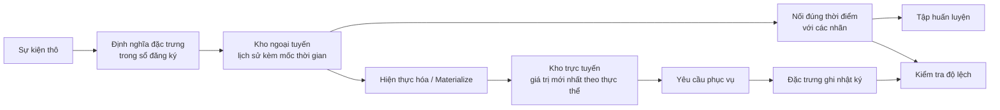

# Kho đặc trưng và Độ lệch Huấn luyện - Phục vụ (Feature Stores and Training-Serving Skew)

> Một đặc trưng chỉ có một định nghĩa duy nhất nhưng lại có hai đối tượng đọc. Tiến trình huấn luyện đọc lịch sử của nó tại thời điểm của từng nhãn, còn tiến trình phục vụ đọc giá trị mới nhất của nó. Khi hai đối tượng đọc này không thống nhất, mô hình sẽ nhìn thấy những dữ liệu đầu vào mà nó chưa từng được huấn luyện.

**Type:** Build
**Languages:** Python
**Prerequisites:** Giai đoạn 2, Bài học 08 (Kỹ nghệ đặc trưng), 13 (Đường ống ML), 15 (Chuỗi thời gian), và 19 (Thiết kế hệ thống ML)
**Time:** ~100 phút

## Mục tiêu học tập

- Mô tả kho ngoại tuyến (offline store), kho trực tuyến (online store), thực thể (entities), mốc thời gian sự kiện (event timestamps), và thời gian sống TTL (time to live), cùng với nhiệm vụ của từng thành phần
- Triển khai phép nối đúng thời điểm (point-in-time correct join) và chỉ ra cách phép nối ngây thơ sao chép các giá trị tương lai vào dữ liệu huấn luyện
- Kể tên bốn nguyên nhân gây ra độ lệch huấn luyện - phục vụ (training-serving skew): hai nhánh mã nguồn, đặc trưng bị cũ (stale features), giá trị mặc định khác nhau, và du hành thời gian (time travel)
- Xây dựng một sổ đăng ký đặc trưng (feature registry) trong đó một định nghĩa duy nhất cung cấp cho cả đường ống huấn luyện lẫn đường ống phục vụ
- Điền bù dữ liệu (backfill) một đặc trưng mới qua các ngày trong quá khứ mà không đọc dữ liệu phát sinh sau từng ngày đó
- Phát hiện độ lệch bằng cách so sánh các đặc trưng phục vụ đã ghi nhật ký (logged serving features) với đường ống huấn luyện cho cùng một thực thể và thời điểm

## Vấn đề thực tế

Một nhóm phát triển xây dựng mô hình dự đoán rời bỏ (churn model). Mỗi nhãn cho biết liệu người dùng có không mua hàng trong 30 ngày sau ngày gắn nhãn hay không. Nhóm nối các nhãn với bảng đặc trưng người dùng dựa trên `user_id` và huấn luyện một quy tắc dựa trên `days_since_last_purchase`. Độ chính xác ngoại tuyến đạt 0.948.

Khi đưa vào lưu lượng thực tế, mô hình hoạt động kém hơn cả một phiên bản cũ và đơn giản hơn. Nguyên nhân là bảng đặc trưng luôn chứa giá trị mới nhất cho mỗi người dùng, từ nhiều tuần sau ngày gắn nhãn. Một người dùng có giao dịch mua cuối cùng vào ngày 115 cho thấy 60 ngày không hoạt động trong ảnh chụp nhanh (snapshot) ngày 175, do đó đặc trưng đã chứa sẵn đáp án! Trong khi đó, một nhóm khác lại viết lại logic tính đặc trưng phục vụ trong một dịch vụ khác. Cửa sổ 30 ngày của họ vô tình tính dư một ngày, và giá trị mặc định cho người dùng mới là -1 thay vì 365.

Cả hai lỗi này đều xuất phát từ cùng một nguyên nhân: Huấn luyện và phục vụ đã tính toán "cùng một đặc trưng" theo hai cách hoàn toàn khác nhau. Bài học này sẽ xây dựng các mảnh ghép của một kho đặc trưng (feature store) từ con số 0. Bạn sẽ viết sổ đăng ký (registry), tiến trình điền bù dữ liệu (backfill), phép nối đúng thời điểm (point-in-time join), kho trực tuyến có TTL, và trình kiểm tra độ lệch (skew check). Bản demo sẽ tái hiện lại cả hai lỗi trên bằng số liệu cụ thể.

## Khái niệm

### Hai đối tượng đọc của cùng một đặc trưng

Đường ống huấn luyện và phục vụ yêu cầu đặc trưng theo các định dạng và yêu cầu khác nhau:

| Đặc tính | Huấn luyện (ngoại tuyến / offline) | Phục vụ (trực tuyến / online) |
|---|---|---|
| Câu hỏi | "Giá trị là bao nhiêu cho mỗi cặp trong số 10 triệu cặp (thực thể, thời gian)?" | "Giá trị cho thực thể duy nhất này hiện tại là bao nhiêu?" |
| Thời gian | Nhiều thời điểm trong quá khứ | Hiện tại |
| Khối lượng | Hàng triệu dòng mỗi tác vụ | Một dòng mỗi yêu cầu (request) |
| Độ trễ | Vài phút vẫn chấp nhận được | Vài mili-giây |
| Lưu trữ | Kho ngoại tuyến: toàn bộ lịch sử kèm mốc thời gian, trong tệp dạng cột hoặc kho dữ liệu (data warehouse) | Kho trực tuyến: giá trị mới nhất cho mỗi thực thể, trong cơ sở dữ liệu key-value |

Kho đặc trưng (feature store) giữ cho cả hai kho lưu trữ này được lấp đầy từ một bộ định nghĩa đặc trưng duy nhất. Hiện thực hóa (materialization) là tác vụ sao chép các giá trị mới nhất từ kho ngoại tuyến sang kho trực tuyến.



### Thực thể, mốc thời gian, và TTL

Bốn thuật ngữ mô tả mỗi dòng đặc trưng:

- **Thực thể (Entity):** Khóa mà đặc trưng mô tả, chẳng hạn như `user_id` hoặc `card_id`.
- **Mốc thời gian sự kiện (Event timestamp):** Thời điểm mà giá trị đó trở thành hiện thực. Số lượng giao dịch "tính đến ngày 14" có mốc thời gian sự kiện là ngày 14.
- **Mốc thời gian tạo (Created timestamp):** Thời điểm mà hệ thống ghi dòng dữ liệu đó. Tác vụ điền bù (backfill) chạy hôm nay sẽ ghi các dòng có mốc thời gian sự kiện cũ nhưng mốc thời gian tạo mới.
- **TTL (Time to live - Thời gian sống):** Tuổi thọ tối đa của một giá trị. Giá trị cũ hơn TTL sẽ bị coi là thiếu (missing), do đó hệ thống sẽ sử dụng giá trị mặc định.

Một nhóm các đặc trưng có cùng thực thể, nguồn dữ liệu và TTL thường được gọi là góc nhìn đặc trưng (feature view).

### Nối đúng thời điểm (Point-in-time correct joins)

Một dòng dữ liệu huấn luyện ghép nối một nhãn với các giá trị đặc trưng tồn tại tại đúng thời điểm của nhãn đó. Phép nối đúng thời điểm thực hiện điều này cho từng nhãn:

1. Tìm các dòng đặc trưng của cùng thực thể.
2. Giữ lại các dòng có mốc thời gian sự kiện bằng hoặc trước mốc thời gian của nhãn.
3. Lấy dòng mới nhất trong số các dòng đó.
4. Loại bỏ dòng đó nếu mốc thời gian nhãn trừ đi mốc thời gian sự kiện lớn hơn TTL.

Dưới đây là một người dùng, một nhãn tại ngày 16, và các dòng đặc trưng hàng tuần:

| Ngày của dòng đặc trưng | `purchases_30d` | Nối đúng thời điểm (Point-in-time) | Nối ngây thơ (Naive join) trên `user_id` |
|---|---|---|---|
| 7 | 4 | | |
| 14 | 3 | Được chọn | |
| 21 | 1 | Tương lai | |
| 28 | 0 | Tương lai | Được chọn |

Nhãn kiểm tra xem người dùng có mua bất kỳ thứ gì trong khoảng từ ngày 17 đến 46 hay không. Dòng ngày 28 đã đếm cả những ngày im ắng sau ngày gắn nhãn. Nó hiển thị 0 giao dịch vì người dùng đã dừng mua hàng - chính là sự kiện mà nhãn đang đo lường! Phép nối ngây thơ đã sao chép đáp án vào đầu vào.

Chúng ta chia tách dữ liệu theo thời gian trong bài học chuỗi thời gian cũng vì lý do này. Phép nối đúng thời điểm áp dụng quy tắc đó cho từng dòng đơn lẻ thay vì cho một điểm phân chia duy nhất.

### Các nguyên nhân gây ra độ lệch huấn luyện - phục vụ (training-serving skew)

Tài liệu "Rules of Machine Learning" của Google định nghĩa độ lệch huấn luyện - phục vụ là sự khác biệt giữa hiệu năng trong quá trình huấn luyện và hiệu năng khi phục vụ thực tế. Tài liệu chỉ ra ba nguyên nhân: xử lý dữ liệu khác nhau trong hai đường ống, sự thay đổi dữ liệu giữa lúc huấn luyện và phục vụ, và vòng lặp phản hồi. Trong các đường ống đặc trưng, bốn nguyên nhân cụ thể xuất hiện lặp đi lặp lại:

| Nguyên nhân | Điều gì xảy ra | Ví dụ từ bản demo |
|---|---|---|
| Hai nhánh mã nguồn (Two code paths) | Huấn luyện và phục vụ tính toán đặc trưng bằng mã nguồn khác nhau | Cửa sổ phục vụ bao gồm ngày `now - 30`, còn cửa sổ huấn luyện thì không |
| Đặc trưng bị cũ (Stale features) | Giá trị mà phục vụ đọc có tuổi thọ khác với giá trị huấn luyện đã dùng | Huấn luyện đọc ảnh chụp nhanh hàng tuần, còn dịch vụ mới tính toán giá trị tức thời |
| Giá trị mặc định khác nhau (Different defaults) | Hai đường ống điền giá trị thiếu khác nhau | Huấn luyện dùng 365 cho "chưa mua hàng bao giờ", phục vụ lại dùng -1 |
| Du hành thời gian (Time travel) | Huấn luyện đọc giá trị phát sinh sau thời điểm gắn nhãn | Phép nối ngây thơ đọc ảnh chụp nhanh mới nhất cho mọi nhãn |

Quy tắc #32 của cùng tài liệu hướng dẫn tái sử dụng mã giữa đường ống huấn luyện và phục vụ bất cứ khi nào có thể. Một kho đặc trưng tuân theo quy tắc đó bằng một định nghĩa duy nhất mà cả hai đường ống đều gọi.

### Sổ đăng ký đặc trưng (Feature registry)

Sổ đăng ký là danh mục lưu trữ các định nghĩa đặc trưng. Mỗi mục chứa tên, thực thể, nguồn dữ liệu, phép biến đổi, cửa sổ thời gian, giá trị mặc định, TTL, chủ sở hữu, phiên bản và mô tả.

Hai quy tắc giữ cho nó an toàn:

- Cả hai đường ống đều đọc định nghĩa từ sổ đăng ký. Không có dịch vụ nào giữ bản sao riêng của phép biến đổi.
- Thay đổi một định nghĩa sẽ tạo ra một phiên bản mới. Phiên bản cũ vẫn được giữ nguyên, nhờ đó các mô hình cũ vẫn giữ đúng đặc trưng mà chúng đã được huấn luyện.

### Điền bù dữ liệu (Backfills)

Một đặc trưng mới sẽ không có lịch sử sẵn, nhưng việc huấn luyện lại cần giá trị của nó tại mọi thời điểm gắn nhãn cũ. Tiến trình điền bù (backfill) chạy định nghĩa tại từng ngày trong quá khứ và ghi một dòng cho mỗi thực thể và ngày. Mỗi lượt chạy chỉ đọc các sự kiện có mốc thời gian bằng hoặc trước ngày đó.

Các đợt điền bù tiêu tốn tài nguyên tính toán tăng dần theo số lượng thực thể nhân với số lượng ngày. Chúng cũng tiềm ẩn nguy cơ rò rỉ tinh vi. Một đợt điền bù chạy hôm nay ghi các dòng với mốc thời gian sự kiện cũ, nhưng nó có thể vô tình đọc dữ liệu đến trễ hoặc đã được hiệu chỉnh sau này. Phép nối đúng thời điểm nghiêm ngặt cũng kiểm tra xem mốc thời gian tạo có bằng hoặc trước thời điểm gắn nhãn hay không.

### Phát hiện độ lệch (Detecting skew)

Quy tắc #29 khuyến nghị ghi nhật ký các đặc trưng tại thời điểm phục vụ và sử dụng chúng trong huấn luyện. Ngay cả một mẫu nhật ký nhỏ cũng cho phép bạn kiểm tra tính nhất quán. Hãy so sánh từng giá trị được ghi nhật ký với giá trị mà đường ống huấn luyện tạo ra cho cùng một thực thể và thời điểm. Đối với mỗi đặc trưng, báo cáo tỷ lệ sai lệch và độ lệch tuyệt đối trung bình.

Để tìm ra nguyên nhân gốc rễ, hãy so sánh ba cặp:

1. Đọc từ kho trực tuyến so với phép nối huấn luyện: Thử nghiệm toàn bộ hệ thống và phải cho thấy độ lệch bằng 0.
2. Tính toán tức thời so với phép nối huấn luyện: Cô lập ảnh hưởng của độ cũ (staleness).
3. Nhánh mã nguồn thứ hai so với tính toán tức thời: Cô lập sự khác biệt về mã, chẳng hạn như cửa sổ thời gian và giá trị mặc định.

```figure
mlprod-pit-join
```

## Xây dựng thực hành (Build It)

Mã nguồn trong `code/main.py` chỉ sử dụng thư viện tiêu chuẩn của Python. Thời gian được tính bằng số nguyên ngày. Một tác vụ theo lô hàng tuần sẽ ghi các ảnh chụp nhanh đặc trưng vào các ngày 7, 14, và tiếp tục cho đến ngày 175.

### Bước 1: Định nghĩa đặc trưng và sổ đăng ký

Một `FeatureDefinition` lưu trữ phép biến đổi dưới dạng dữ liệu: phép tổng hợp, cửa sổ thời gian, và giá trị mặc định. Phương thức `compute` của nó không bao giờ đọc các sự kiện sau mốc `as_of`.

```python
@dataclass(frozen=True)
class FeatureDefinition:
    name: str
    entity: str
    aggregate: str
    window_days: int | None
    default: float
    version: int = 1
    owner: str = "growth-team"
    description: str = ""

    def compute(self, events: list[Event], as_of: int) -> float:
        visible = [e for e in events if e.day <= as_of]
        if self.window_days is not None:
            visible = [e for e in visible if e.day > as_of - self.window_days]
        if self.aggregate == "count":
            return float(len(visible))
        if self.aggregate == "sum":
            return round(sum(e.amount for e in visible), 2)
        if self.aggregate == "days_since_last":
            return float(as_of - max(e.day for e in visible)) if visible else self.default
        raise ValueError(f"unknown aggregate {self.aggregate!r}")
```

`FeatureRegistry.register` chấp nhận cùng một định nghĩa được đăng ký hai lần, nhưng sẽ từ chối một định nghĩa khác có cùng tên và phiên bản. Phương thức `fill_defaults` cung cấp cho cả hai đường ống cùng một giá trị mặc định cho dữ liệu bị thiếu.

Một mô hình ghim chặt một định nghĩa bằng tham chiếu như `spend_30d@1`. Các hàm `compute` và `fill_defaults` phân giải tham chiếu này, và tên không có `@` sẽ đọc phiên bản mới nhất. Tham chiếu có `@` nhưng không có số phiên bản sẽ ném ra ngoại lệ `ValueError`, giúp ngăn lỗi chính tả vô tình đọc phiên bản mới nhất mà không cảnh báo. Tham chiếu này cũng là khóa trong từng dòng được lưu trữ, nhờ đó việc điền bù, kho trực tuyến và thao tác đọc phục vụ đều dùng đúng định nghĩa đã ghim.

### Bước 2: Điền bù dữ liệu cho kho ngoại tuyến

```python
def backfill(registry: FeatureRegistry, names: list[str], events: list[Event], days: list[int]) -> list[FeatureRow]:
    rows = []
    for entity, entity_events in sorted(group_events(events).items()):
        for day in days:
            rows.append(FeatureRow(entity, day, registry.compute(names, entity_events, day)))
    return rows
```

Bản demo thực hiện điền bù ba đặc trưng cho 299 người dùng trên 25 ngày ảnh chụp nhanh, tạo ra 7475 dòng dữ liệu.

### Bước 3: Phép nối đúng thời điểm (Point-in-time join)

Sắp xếp các dòng của mỗi thực thể theo ngày một lần duy nhất. Với mỗi nhãn, `bisect_right` tìm dòng cuối cùng tại hoặc trước ngày của nhãn. Bước kiểm tra TTL sẽ loại bỏ dòng nếu nó quá cũ.

```python
def point_in_time_join(labels: list[LabelRow], rows: list[FeatureRow], ttl_days: int | None = None) -> list[JoinedRow]:
    by_entity: dict[str, list[FeatureRow]] = defaultdict(list)
    for row in rows:
        by_entity[row.entity].append(row)
    days_index = {}
    for entity, entity_rows in by_entity.items():
        entity_rows.sort(key=lambda r: r.day)
        days_index[entity] = [r.day for r in entity_rows]
    joined = []
    for label in labels:
        days = days_index.get(label.entity, [])
        pos = bisect.bisect_right(days, label.day) - 1
        match = by_entity[label.entity][pos] if pos >= 0 else None
        if match is not None and ttl_days is not None and label.day - match.day > ttl_days:
            match = None
        joined.append(JoinedRow(
            label.entity, label.day, label.label,
            match.day if match else None, match.values if match else None,
        ))
    return joined
```

### Bước 4: Đo lường rò rỉ từ phép nối ngây thơ

`naive_latest_join` chỉ nối dựa trên thực thể, nên nó trả về dòng mới nhất cho mọi nhãn. Bản demo xây dựng các nhãn vào ngày 100, 120, và 140 rồi khớp quy tắc một đặc trưng trên từng tập huấn luyện. Sau đó, nó kiểm thử cả hai quy tắc trên các nhãn từ ngày 145, với các đặc trưng đúng thời điểm:

```console
  naive join used a snapshot from after the label day for 100% of rows
  offline accuracy, naive join: 0.948 (rule: idle > 53 days)
  offline accuracy, PIT join:   0.893 (rule: idle > 19 days)
  accuracy on day 145, trained with naive join: 0.763
  accuracy on day 145, trained with PIT join:   0.876
```

Phép nối ngây thơ trông có vẻ tốt hơn khi đánh giá ngoại tuyến (0.948 so với 0.893). Nhưng trên dữ liệu mới, nó tệ hơn đáng kể (0.763 so với 0.876). Đặc trưng bị rò rỉ đã dịch chuyển ngưỡng khớp từ 19 ngày im ắng lên tận 53 ngày!

### Bước 5: Kho trực tuyến và sự hiện thực hóa (Materialization)

Kho trực tuyến giữ một dòng duy nhất cho mỗi thực thể và từ chối các dòng cũ hơn TTL. Hàm `materialize` chỉ ghi các dòng có ngày tại hoặc trước thời điểm chạy tác vụ.

```python
class OnlineStore:
    def __init__(self, ttl_days: int):
        self.ttl_days = ttl_days
        self._latest: dict[str, FeatureRow] = {}

    def write(self, row: FeatureRow) -> None:
        current = self._latest.get(row.entity)
        if current is None or row.day >= current.day:
            self._latest[row.entity] = row

    def read(self, entity: str, now: int) -> dict[str, float] | None:
        row = self._latest.get(entity)
        if row is None or row.day > now or now - row.day > self.ttl_days:
            return None
        return dict(row.values)
```

Với TTL là 10 ngày, thao tác đọc vào ngày 145 sẽ trả về dòng của ngày 140. Thao tác đọc vào ngày 160, khi chưa có đợt hiện thực hóa mới nào, sẽ trả về các giá trị mặc định vì dòng dữ liệu đã cũ 20 ngày.

### Bước 6: Kiểm tra độ lệch (Skew check)

`detect_skew` so sánh hai góc nhìn được lập chỉ mục theo `(entity, day)`. Nó báo cáo tỷ lệ sai lệch và chênh lệch tuyệt đối trung bình trên từng đặc trưng, đồng thời đánh dấu cảnh báo đặc trưng khi có hơn 1% giá trị bị lệch. Nó sẽ ném ngoại lệ `ValueError` khi hai góc nhìn có khóa khác nhau hoặc không có khóa nào. Một yêu cầu bị thiếu có thể che giấu độ lệch, và việc kiểm tra mà không có yêu cầu nào thì vô nghĩa.

```python
def detect_skew(
    training: dict[tuple[str, int], dict[str, float]],
    serving: dict[tuple[str, int], dict[str, float]],
    features: list[str],
    tolerance: float = 1e-6,
    max_mismatch_rate: float = 0.01,
) -> list[SkewReport]:
    if set(training) != set(serving):
        raise ValueError(f"{len(set(training) ^ set(serving))} keys are in only one view: log and compare the same requests")
    if not training:
        raise ValueError("no requests to compare")
    keys = sorted(training)
    reports = []
    for feature in features:
        diffs = [abs(training[k][feature] - serving[k][feature]) for k in keys]
        mismatches = sum(1 for d in diffs if d > tolerance)
        rate = mismatches / len(keys)
        mean_diff = sum(diffs) / len(keys)
        reports.append(SkewReport(feature, len(keys), rate, mean_diff, rate > max_mismatch_rate))
    return reports
```

Bản demo ghi nhật ký các yêu cầu từ ngày 141 đến 150 và chạy ba phép so sánh từ phần khái niệm. Tập yêu cầu bao gồm 20 người dùng mới hoàn toàn không có lịch sử trước đó.

```bash
python3 code/main.py
```

```console
=== Skew checks on 383 logged requests, days 141 to 150 ===
  online store read  vs  training join (one definition, same snapshots)
    ok   days_since_last_purchase   mismatch   0.0%  mean |diff|    0.00
    ok   purchases_30d              mismatch   0.0%  mean |diff|    0.00
    ok   spend_30d                  mismatch   0.0%  mean |diff|    0.00
  fresh compute      vs  training join (staleness only)
    SKEW days_since_last_purchase   mismatch  83.0%  mean |diff|    2.77
    SKEW purchases_30d              mismatch  30.5%  mean |diff|    0.38
    SKEW spend_30d                  mismatch  37.1%  mean |diff|   16.77
  second code path   vs  fresh compute (code differences only)
    SKEW days_since_last_purchase   mismatch   5.5%  mean |diff|   20.07
    SKEW purchases_30d              mismatch  12.5%  mean |diff|    0.13
    SKEW spend_30d                  mismatch  12.5%  mean |diff|    5.09
```

Đọc ba khối kết quả theo thứ tự:

- **Một định nghĩa, cùng ảnh chụp nhanh (One definition, same snapshots):** Kho trực tuyến và phép nối huấn luyện đọc cùng các dòng đã hiện thực hóa, do đó độ lệch bằng 0.
- **Độ cũ (Staleness):** Giá trị tính mới tức thời khác với ảnh chụp nhanh hàng tuần trên hầu hết các yêu cầu. Dữ liệu mới hơn không hẳn là tốt hơn ở đây, bởi mô hình đã học từ các giá trị có độ tuổi lên tới 6 ngày.
- **Khác biệt về mã (Code differences):** Nhánh mã nguồn thứ hai sai lệch trên 12.5% số lượng đếm cửa sổ vì cửa sổ của nó bao gồm thêm một ngày thừa. Nó lệch trên `days_since_last_purchase` chỉ đối với người dùng mới, nhưng với biên độ rất lớn: -1 so với 365.

## Ứng dụng thực tế (Use It)

Feast là một kho đặc trưng mã nguồn mở phổ biến. Mỗi phần trong mã nguồn tự xây dựng đều có thành phần tương ứng trong Feast:

| Tự xây dựng (From scratch) | Feast |
|---|---|
| `FeatureDefinition`, `FeatureRegistry` | `Entity`, `FeatureView`, và `Field` trong kho lưu trữ đặc trưng, được đăng ký bằng `feast apply` |
| Lịch sử `FeatureRow` | Một kho ngoại tuyến, ví dụ `FileSource` trên các tệp Parquet hoặc bảng cơ sở dữ liệu kho |
| `point_in_time_join` kèm TTL | `store.get_historical_features(entity_df=..., features=[...])` |
| `materialize` | `feast materialize-incremental <thời gian kết thúc>` |
| `OnlineStore.read` | `store.get_online_features(features=[...], entity_rows=[...])` |
| Kiểm tra mốc thời gian tạo | Cột `created_timestamp_column` trên nguồn và `filter_by_created_timestamp=True` |

Các định nghĩa trông như sau (mã theo tài liệu khởi động Feast, không bắt buộc cài đặt để chạy bài học này):

```python
from datetime import timedelta

from feast import Entity, FeatureView, Field, FileSource
from feast.types import Float32, Int64

user = Entity(name="user", join_keys=["user_id"])

user_activity_source = FileSource(
    name="user_activity_source",
    path="data/user_activity.parquet",
    timestamp_field="event_timestamp",
    created_timestamp_column="created",
)

user_activity = FeatureView(
    name="user_activity",
    entities=[user],
    ttl=timedelta(days=10),
    schema=[
        Field(name="purchases_30d", dtype=Int64),
        Field(name="spend_30d", dtype=Float32),
        Field(name="days_since_last_purchase", dtype=Int64),
    ],
    source=user_activity_source,
)
```

Huấn luyện và phục vụ sau đó cùng đọc chung góc nhìn đặc trưng này:

```python
from feast import FeatureStore

store = FeatureStore(repo_path=".")

training_df = store.get_historical_features(
    entity_df=labels_df,
    features=["user_activity:purchases_30d", "user_activity:days_since_last_purchase"],
    filter_by_created_timestamp=True,
).to_df()

online = store.get_online_features(
    features=["user_activity:purchases_30d", "user_activity:days_since_last_purchase"],
    entity_rows=[{"user_id": 42}],
).to_dict()
```

`labels_df` chứa một dòng cho mỗi nhãn kèm `user_id`, `event_timestamp`, và nhãn mục tiêu. Tài liệu của Feast nêu rõ rằng TTL được tính tương đối theo từng mốc thời gian trong dataframe thực thể, chứ không phải theo thời điểm truy vấn. Điều đó hoàn toàn khớp với logic kiểm tra TTL trong hàm `point_in_time_join`. Tài liệu cũng mô tả tham số `filter_by_created_timestamp=True`, giúp ngăn chặn các giá trị điền bù rò rỉ vào dữ liệu huấn luyện. Không phải kho ngoại tuyến nào cũng hỗ trợ tùy chọn này; kho không hỗ trợ sẽ báo lỗi thay vì âm thầm bỏ qua.

Tecton, Hopsworks, và các kho đặc trưng trong những nền tảng ML đám mây lớn đều sử dụng sự phân tách tương tự giữa kho ngoại tuyến và trực tuyến. Để kiểm tra độ lệch, TensorFlow Data Validation có thể so sánh dữ liệu huấn luyện với dữ liệu phục vụ. Bài báo của Breck et al. mô tả hệ thống kiểm định dữ liệu trong TFX (nền tảng ML toàn diện của Google), bao gồm cả phát hiện độ lệch huấn luyện - phục vụ.

## Đóng gói ứng dụng (Ship It)

Bài học này tạo ra tệp `outputs/skill-feature-skew-audit.md`. Kỹ năng này kiểm toán một đường ống đặc trưng nhằm phát hiện hiện tượng du hành thời gian và độ lệch huấn luyện - phục vụ. Nó hướng dẫn rà soát từng bước qua phép nối, các định nghĩa, giá trị mặc định, độ tươi mới của từng đường ống, và cơ chế ghi nhật ký cần thiết để kiểm tra độ lệch.

## Bài tập rèn luyện (Exercises)

1. Thay đổi khoảng thời gian ảnh chụp nhanh từ 7 ngày thành 1 ngày. Chạy lại phép so sánh độ cũ và giải thích kết quả.
2. Thiết lập TTL thành 3 ngày. Đếm số dòng huấn luyện bị mất đặc trưng và phải nhận giá trị mặc định.
3. Thêm trường ngày tạo (created day) vào `FeatureRow`. Điều chỉnh phép nối để bỏ qua các dòng được ghi sau ngày gắn nhãn.
4. Đăng ký `spend_7d` làm phiên bản 2 của `spend_30d`. Điền bù dữ liệu cho nó và in cả hai phiên bản từ sổ đăng ký.
5. Sửa lỗi `legacy_serving_features` cho đến khi vượt qua bài kiểm tra độ lệch thứ ba. Liệt kê từng thay đổi.

## Thuật ngữ then chốt (Key Terms)

| Thuật ngữ | Cách gọi thông thường | Ý nghĩa kỹ thuật |
|------|----------------|----------------------|
| Feature store (Kho đặc trưng) | "Cơ sở dữ liệu cho đặc trưng" | Hệ thống tính toán đặc trưng từ một bộ định nghĩa duy nhất và phục vụ cho cả huấn luyện lẫn phục vụ |
| Offline store (Kho ngoại tuyến) | "Dữ liệu huấn luyện" | Toàn bộ lịch sử đặc trưng kèm mốc thời gian sự kiện, được đọc bởi các tác vụ huấn luyện và điền bù |
| Online store (Kho trực tuyến) | "Bộ nhớ cache đặc trưng" | Giá trị mới nhất của mỗi thực thể, được đường ống phục vụ đọc với độ trễ mili-giây |
| Entity (Thực thể) | "ID định danh" | Khóa mà đặc trưng mô tả, chẳng hạn như người dùng hoặc số thẻ |
| Event timestamp (Mốc thời gian sự kiện) | "Khi sự việc diễn ra" | Thời điểm mà giá trị đặc trưng trở thành sự thật |
| Point-in-time join (Nối đúng thời điểm) | "Phép nối as-of" | Phép nối ghép từng nhãn với dòng đặc trưng mới nhất tại hoặc trước thời điểm gắn nhãn |
| TTL (Time to live) | "Hạn sử dụng" | Tuổi thọ tối đa của giá trị đặc trưng trước khi hệ thống coi nó là bị thiếu |
| Materialization (Hiện thực hóa) | "Đồng bộ lên online" | Tác vụ sao chép các giá trị đặc trưng mới nhất từ kho ngoại tuyến sang kho trực tuyến |
| Backfill (Điền bù dữ liệu) | "Tính toán lịch sử" | Chạy một định nghĩa đặc trưng tại các ngày trong quá khứ để tạo dựng dữ liệu lịch sử |
| Training-serving skew (Độ lệch huấn luyện - phục vụ) | "Chạy offline thì ngon" | Sự khác biệt giữa đặc trưng hoặc hành vi trong lúc huấn luyện so với khi phục vụ thực tế |

## Tài liệu đọc thêm (Further Reading)

- [Feast, Point-in-time joins](https://docs.feast.dev/getting-started/concepts/point-in-time-joins): Ngữ nghĩa TTL và bộ lọc mốc thời gian tạo
- [Tài liệu Feast](https://docs.feast.dev/): Góc nhìn đặc trưng, kho ngoại tuyến, kho trực tuyến, và hiện thực hóa
- [Google, Rules of Machine Learning](https://developers.google.com/machine-learning/guides/rules-of-ml): Các quy tắc về độ lệch huấn luyện - phục vụ, từ Quy tắc #29 đến Quy tắc #37
- [Breck et al., Data Validation for Machine Learning (SysML 2019)](https://research.google/pubs/data-validation-for-machine-learning/): Kiểm định dữ liệu tại Google, bao gồm độ lệch huấn luyện - phục vụ
- [Hướng dẫn TensorFlow Data Validation](https://www.tensorflow.org/tfx/guide/tfdv): Kiểm tra lược đồ, phát hiện độ lệch và độ trôi dạt dữ liệu
- [Sculley et al., Hidden Technical Debt in Machine Learning Systems (NeurIPS 2015)](https://papers.nips.cc/paper/2015/hash/86df7dcfd896fcaf2674f757a2463eba-Abstract.html): Nợ phụ thuộc dữ liệu và nợ đường ống xung quanh mô hình ML

