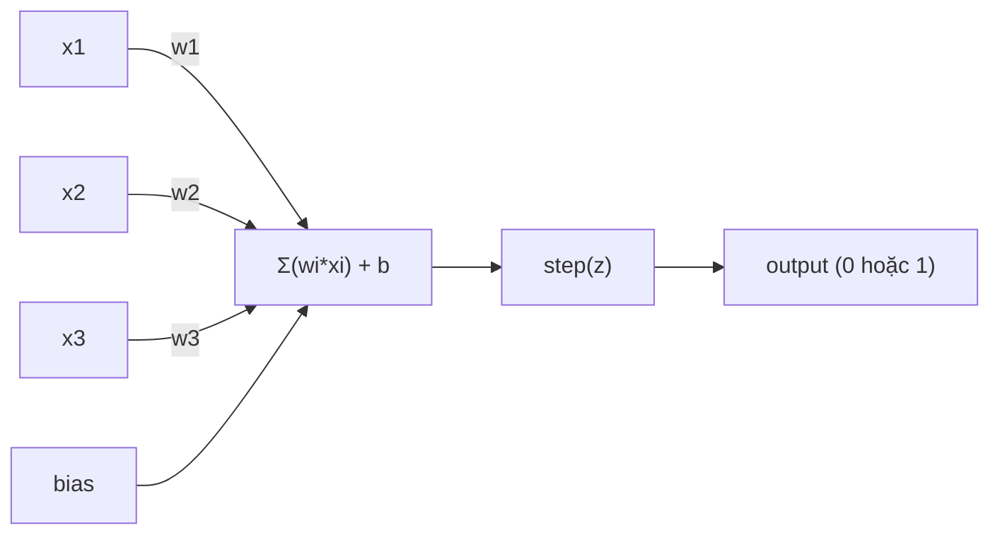
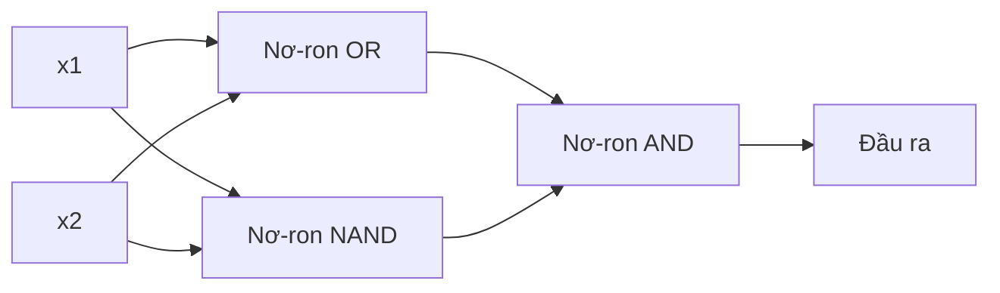

# Perceptron

> Perceptron là nguyên tử cấu thành nên mạng nơ-ron. Khi mổ xẻ nó, bạn sẽ tìm thấy các trọng số, một hệ số chệch, và một quyết định.

**Type:** Build
**Languages:** Python
**Prerequisites:** Giai đoạn 1 (Trực giác đại số tuyến tính)
**Time:** ~60 phút

## Mục tiêu học tập

- Triển khai một perceptron từ con số 0 bằng Python, bao gồm quy tắc cập nhật trọng số và hàm kích hoạt bước nhảy (step activation function)
- Giải thích lý do vì sao một perceptron đơn lẻ chỉ có thể giải quyết các bài toán phân tách tuyến tính và minh họa trường hợp thất bại với cổng XOR
- Xây dựng một mạng perceptron đa tầng (multi-layer perceptron) bằng cách kết hợp các cổng logic OR, NAND và AND để giải quyết XOR
- Huấn luyện một mạng hai tầng với hàm kích hoạt sigmoid và thuật toán lan truyền ngược (backpropagation) để tự động học cổng XOR

## Vấn đề thực tế

Bạn đã biết về vector và tích vô hướng. Bạn biết rằng một ma trận sẽ biến đổi các đầu vào thành đầu ra. Nhưng làm thế nào một cỗ máy có thể *học* được phép biến đổi nào cần sử dụng?

Perceptron giải đáp câu hỏi này. Nó là cỗ máy học đơn giản nhất có thể: nhận một số đầu vào, nhân với trọng số, cộng hệ số chệch và đưa ra quyết định nhị phân. Sau đó điều chỉnh lại. Chỉ có vậy. Mọi mạng nơ-ron từng được xây dựng đều là các tầng chứa đựng ý tưởng này xếp chồng lên nhau.

Hiểu về perceptron đồng nghĩa với việc hiểu bản chất thực sự của việc "học" trong mã nguồn: điều chỉnh các con số cho đến khi đầu ra khớp với thực tế.

## Khái niệm

### Một nơ-ron, một quyết định

Một perceptron nhận $n$ đầu vào, nhân mỗi đầu vào với một trọng số, tính tổng chúng lại, cộng thêm một hệ số chệch (bias), và truyền kết quả qua một hàm kích hoạt (activation function).



Hàm bước nhảy (step function) rất dứt khoát: nếu tổng có trọng số cộng với hệ số chệch $\ge 0$, đầu ra là 1. Ngược lại, đầu ra là 0.

```math
\text{step}(z) = \begin{cases} 1 & \text{nếu } z \ge 0 \\ 0 & \text{nếu } z < 0 \end{cases}
```

Đây là một bộ phân loại tuyến tính (linear classifier). Các trọng số và hệ số chệch định nghĩa một đường thẳng (hoặc siêu phẳng trong không gian nhiều chiều hơn) chia không gian đầu vào thành hai vùng riêng biệt.

### Ranh giới quyết định (Decision Boundary)

Đối với hai đầu vào, perceptron vẽ một đường thẳng đi qua không gian 2D:

```text
  x2
  ┤
  │  Lớp 1          /
  │    (0)          /
  │                /
  │               / w1·x1 + w2·x2 + b = 0
  │              /
  │             /     Lớp 2
  │            /        (1)
  ┼───────────/──────────── x1
```

Mọi điểm nằm ở một phía của đường thẳng sẽ cho đầu ra là 0. Mọi điểm ở phía bên kia sẽ cho đầu ra là 1. Quá trình huấn luyện sẽ dịch chuyển đường thẳng này cho đến khi nó phân tách chính xác các lớp dữ liệu.

### Quy tắc học (The Learning Rule)

Quy tắc học của perceptron rất trực quan:

```text
Với mỗi mẫu huấn luyện (x, y_true):
    y_pred = predict(x)
    error = y_true - y_pred

    Với mỗi trọng số:
        w_i = w_i + learning_rate * error * x_i
    bias = bias + learning_rate * error
```

Nếu dự đoán chính xác, $\text{error} = 0$, không có gì thay đổi. Nếu nó dự đoán 0 nhưng thực tế phải là 1, các trọng số sẽ tăng lên. Nếu nó dự đoán 1 nhưng thực tế phải là 0, các trọng số sẽ giảm đi. Tốc độ học (learning rate) kiểm soát mức độ điều chỉnh lớn hay nhỏ trong mỗi bước.

### Bài toán XOR

Đây chính là điểm mà perceptron đơn lẻ bị giới hạn. Hãy nhìn vào bảng chân trị của các cổng logic sau:

```text
Cổng AND:           Cổng OR:            Cổng XOR:
x1  x2  out         x1  x2  out         x1  x2  out
0   0   0           0   0   0           0   0   0
0   1   0           0   1   1           0   1   1
1   0   0           1   0   1           1   0   1
1   1   1           1   1   1           1   1   0
```

AND và OR là các bài toán phân tách tuyến tính (linearly separable): bạn có thể vẽ một đường thẳng duy nhất để ngăn cách các điểm 0 khỏi các điểm 1. Nhưng XOR thì không thể. Không một đường thẳng đơn lẻ nào có thể chia tách [0,1] và [1,0] khỏi [0,0] và [1,1].

```text
AND (phân tách được):    XOR (không phân tách được):

  x2                      x2
  1 ┤  0     1            1 ┤  1     0
    │     /                 │
  0 ┤  0 / 0              0 ┤  0     1
    ┼──/──────── x1         ┼──────────── x1
       đường thẳng hợp lệ!     không có đường thẳng nào thỏa mãn!
```

Đây là một giới hạn căn bản. Một perceptron đơn lẻ chỉ có thể giải quyết các bài toán phân tách tuyến tính. Minsky và Papert đã chứng minh điều này vào năm 1969, và kết quả đó đã khiến các nghiên cứu về mạng nơ-ron gần như bị đình trệ trong suốt một thập kỷ.

Giải pháp: xếp chồng các perceptron thành nhiều tầng (layers). Một mạng perceptron đa tầng có thể giải quyết XOR bằng cách kết hợp hai ranh giới quyết định tuyến tính thành một ranh giới phi tuyến tính.

```figure
perceptron-boundary
```

## Xây dựng thực hành (Build It)

### Bước 1: Lớp Perceptron

```python
class Perceptron:
    def __init__(self, n_inputs, learning_rate=0.1):
        self.weights = [0.0] * n_inputs
        self.bias = 0.0
        self.lr = learning_rate

    def predict(self, inputs):
        total = sum(w * x for w, x in zip(self.weights, inputs))
        total += self.bias
        return 1 if total >= 0 else 0

    def train(self, training_data, epochs=100):
        for epoch in range(epochs):
            errors = 0
            for inputs, target in training_data:
                prediction = self.predict(inputs)
                error = target - prediction
                if error != 0:
                    errors += 1
                    for i in range(len(self.weights)):
                        self.weights[i] += self.lr * error * inputs[i]
                    self.bias += self.lr * error
            if errors == 0:
                print(f"Converged at epoch {epoch + 1}")
                return
        print(f"Did not converge after {epochs} epochs")
```

### Bước 2: Huấn luyện trên các cổng logic

```python
and_data = [
    ([0, 0], 0),
    ([0, 1], 0),
    ([1, 0], 0),
    ([1, 1], 1),
]

or_data = [
    ([0, 0], 0),
    ([0, 1], 1),
    ([1, 0], 1),
    ([1, 1], 1),
]

not_data = [
    ([0], 1),
    ([1], 0),
]

print("=== Cổng AND ===")
p_and = Perceptron(2)
p_and.train(and_data)
for inputs, _ in and_data:
    print(f"  {inputs} -> {p_and.predict(inputs)}")

print("\n=== Cổng OR ===")
p_or = Perceptron(2)
p_or.train(or_data)
for inputs, _ in or_data:
    print(f"  {inputs} -> {p_or.predict(inputs)}")

print("\n=== Cổng NOT ===")
p_not = Perceptron(1)
p_not.train(not_data)
for inputs, _ in not_data:
    print(f"  {inputs} -> {p_not.predict(inputs)}")
```

### Bước 3: Quan sát sự thất bại trước cổng XOR

```python
xor_data = [
    ([0, 0], 0),
    ([0, 1], 1),
    ([1, 0], 1),
    ([1, 1], 0),
]

print("\n=== Cổng XOR (perceptron đơn) ===")
p_xor = Perceptron(2)
p_xor.train(xor_data, epochs=1000)
for inputs, expected in xor_data:
    result = p_xor.predict(inputs)
    status = "OK" if result == expected else "WRONG"
    print(f"  {inputs} -> {result} (kỳ vọng {expected}) {status}")
```

Nó sẽ không bao giờ hội tụ. Đây là minh chứng rõ ràng cho việc một perceptron đơn lẻ không thể học được cổng XOR.

### Bước 4: Giải quyết XOR bằng hai tầng nơ-ron

Bí quyết ở đây: $\text{XOR} = (x_1 \text{ OR } x_2) \text{ AND NOT } (x_1 \text{ AND } x_2)$. Chúng ta kết hợp ba perceptron lại:



```python
def xor_network(x1, x2):
    or_neuron = Perceptron(2)
    or_neuron.weights = [1.0, 1.0]
    or_neuron.bias = -0.5

    nand_neuron = Perceptron(2)
    nand_neuron.weights = [-1.0, -1.0]
    nand_neuron.bias = 1.5

    and_neuron = Perceptron(2)
    and_neuron.weights = [1.0, 1.0]
    and_neuron.bias = -1.5

    hidden1 = or_neuron.predict([x1, x2])
    hidden2 = nand_neuron.predict([x1, x2])
    output = and_neuron.predict([hidden1, hidden2])
    return output


print("\n=== Cổng XOR (mạng nhiều tầng) ===")
for inputs, expected in xor_data:
    result = xor_network(inputs[0], inputs[1])
    print(f"  {inputs} -> {result} (kỳ vọng {expected})")
```

Cả bốn trường hợp đều chính xác. Việc xếp chồng các perceptron thành tầng tạo ra các ranh giới quyết định mà không một perceptron đơn lẻ nào có thể tạo nên.

### Bước 5: Huấn luyện mạng hai tầng

Ở bước 4, chúng ta gán cứng các trọng số bằng tay. Cách đó giải quyết được XOR, nhưng không thể áp dụng cho các bài toán thực tế nơi bạn không biết trước trọng số phù hợp. Giải pháp: thay thế hàm bước nhảy bằng hàm sigmoid và học các trọng số một cách tự động thông qua thuật toán lan truyền ngược (backpropagation).

```python
class TwoLayerNetwork:
    def __init__(self, learning_rate=0.5):
        import random
        random.seed(0)
        self.w_hidden = [[random.uniform(-1, 1), random.uniform(-1, 1)] for _ in range(2)]
        self.b_hidden = [random.uniform(-1, 1), random.uniform(-1, 1)]
        self.w_output = [random.uniform(-1, 1), random.uniform(-1, 1)]
        self.b_output = random.uniform(-1, 1)
        self.lr = learning_rate

    def sigmoid(self, x):
        import math
        x = max(-500, min(500, x))
        return 1.0 / (1.0 + math.exp(-x))

    def forward(self, inputs):
        self.inputs = inputs
        self.hidden_outputs = []
        for i in range(2):
            z = sum(w * x for w, x in zip(self.w_hidden[i], inputs)) + self.b_hidden[i]
            self.hidden_outputs.append(self.sigmoid(z))
        z_out = sum(w * h for w, h in zip(self.w_output, self.hidden_outputs)) + self.b_output
        self.output = self.sigmoid(z_out)
        return self.output

    def train(self, training_data, epochs=10000):
        for epoch in range(epochs):
            total_error = 0
            for inputs, target in training_data:
                output = self.forward(inputs)
                error = target - output
                total_error += error ** 2

                d_output = error * output * (1 - output)

                saved_w_output = self.w_output[:]
                hidden_deltas = []
                for i in range(2):
                    h = self.hidden_outputs[i]
                    hd = d_output * saved_w_output[i] * h * (1 - h)
                    hidden_deltas.append(hd)

                for i in range(2):
                    self.w_output[i] += self.lr * d_output * self.hidden_outputs[i]
                self.b_output += self.lr * d_output

                for i in range(2):
                    for j in range(len(inputs)):
                        self.w_hidden[i][j] += self.lr * hidden_deltas[i] * inputs[j]
                    self.b_hidden[i] += self.lr * hidden_deltas[i]
```

```python
net = TwoLayerNetwork(learning_rate=2.0)
net.train(xor_data, epochs=10000)
for inputs, expected in xor_data:
    result = net.forward(inputs)
    predicted = 1 if result >= 0.5 else 0
    print(f"  {inputs} -> {result:.4f} (làm tròn: {predicted}, kỳ vọng {expected})")
```

Hai điểm khác biệt mấu chốt so với Bước 4: Thứ nhất, hàm sigmoid thay thế cho hàm bước nhảy - nó trơn (smooth), do đó tồn tại đạo hàm (gradients). Thứ hai, phương thức `train` lan truyền sai số ngược từ đầu ra về tầng ẩn, điều chỉnh từng trọng số tỷ lệ thuận với mức độ đóng góp của nó vào sai số. Đó chính là lan truyền ngược (backpropagation) được hiện thực chỉ trong 20 dòng mã!

Đây là cây cầu nối sang Bài học 03. Cơ sở toán học đằng sau `d_output` và `hidden_deltas` là quy tắc đạo hàm chuỗi (chain rule) được áp dụng trên đồ thị mạng nơ-ron. Chúng ta sẽ dẫn xuất nó một cách chặt chẽ ở bài học đó.

## Ứng dụng thực tế (Use It)

Mọi thứ bạn vừa xây dựng từ con số 0 đều tồn tại chỉ trong một câu lệnh nhập (import):

```python
from sklearn.linear_model import Perceptron as SkPerceptron
import numpy as np

X = np.array([[0,0],[0,1],[1,0],[1,1]])
y = np.array([0, 0, 0, 1])

clf = SkPerceptron(max_iter=100, tol=1e-3)
clf.fit(X, y)
print([clf.predict([x])[0] for x in X])
```

Chỉ 5 dòng mã. Lớp `Perceptron` dài 30 dòng của bạn thực hiện cùng một công việc. Phiên bản scikit-learn bổ sung thêm kiểm tra hội tụ, nhiều hàm mất mát, và hỗ trợ dữ liệu đầu vào thưa - nhưng vòng lặp cốt lõi hoàn toàn giống hệt: tính tổng có trọng số, áp dụng hàm bước nhảy, cập nhật trọng số khi có sai số.

Sự khác biệt thực sự xuất hiện khi mở rộng quy mô. Những gì thay đổi trong các mạng nơ-ron sản xuất:

- Hàm bước nhảy trở thành sigmoid, ReLU, hoặc các hàm kích hoạt trơn khác
- Các trọng số được học tự động thông qua lan truyền ngược (Bài học 03)
- Các tầng mạng trở nên sâu hơn: 3, 10, 100+ tầng
- Nguyên lý vẫn giữ nguyên: mỗi tầng tạo ra các đặc trưng mới từ đầu ra của tầng trước đó

Một perceptron đơn lẻ chỉ có thể vẽ các đường thẳng. Khi xếp chồng chúng lại, bạn có thể vẽ bất kỳ hình dạng nào.

## Đóng gói ứng dụng (Ship It)

Bài học này tạo ra:
- `outputs/skill-perceptron.md` - kỹ năng phân tích khi nào nên dùng kiến trúc đơn tầng so với đa tầng

## Bài tập rèn luyện (Exercises)

1. Huấn luyện một perceptron trên cổng NAND (cổng vạn năng - mọi mạch logic đều có thể xây dựng từ NAND). Xác minh xem các trọng số và hệ số chệch của nó có tạo thành một ranh giới quyết định hợp lệ hay không.
2. Sửa đổi lớp `Perceptron` để theo dõi ranh giới quyết định ($w_1 x_1 + w_2 x_2 + b = 0$) tại mỗi epoch. In ra cách đường thẳng dịch chuyển trong quá trình huấn luyện trên cổng AND.
3. Xây dựng một perceptron 3 đầu vào cho đầu ra là 1 chỉ khi có ít nhất 2 trong số 3 đầu vào là 1 (hàm bỏ phiếu theo đa số / majority vote function). Bài toán này có phân tách tuyến tính được không? Tại sao?

## Thuật ngữ then chốt (Key Terms)

| Thuật ngữ | Cách gọi thông thường | Ý nghĩa kỹ thuật |
|------|----------------|----------------------|
| Perceptron | "Nơ-ron nhân tạo sơ khai" | Bộ phân loại tuyến tính: tích vô hướng của đầu vào và trọng số, cộng hệ số chệch, đi qua hàm bước nhảy |
| Weight (Trọng số) | "Mức độ quan trọng của đầu vào" | Hệ số nhân định lượng mức đóng góp của từng đầu vào vào quyết định |
| Bias (Hệ số chệch) | "Ngưỡng kích hoạt" | Một hằng số dịch chuyển ranh giới quyết định, giúp perceptron kích hoạt ngay cả khi đầu vào bằng 0 |
| Activation function (Hàm kích hoạt) | "Hàm nén giá trị" | Hàm áp dụng sau tổng có trọng số - hàm bước nhảy cho perceptron, sigmoid/ReLU cho mạng hiện đại |
| Linearly separable (Phân tách tuyến tính) | "Có thể vẽ đường thẳng chia đôi" | Tập dữ liệu mà một siêu phẳng duy nhất có thể phân tách hoàn hảo các lớp |
| XOR problem (Bài toán XOR) | "Điều perceptron bó tay" | Minh chứng rằng mạng đơn tầng không thể học được các hàm không phân tách tuyến tính |
| Decision boundary (Ranh giới quyết định) | "Vạch chuyển đổi phân loại" | Siêu phẳng $w \cdot x + b = 0$ chia không gian đầu vào thành hai lớp |
| Multi-layer perceptron (Perceptron đa tầng) | "Mạng nơ-ron thực thụ" | Các perceptron xếp chồng thành nhiều tầng, đầu ra của tầng này là đầu vào của tầng tiếp theo |

## Tài liệu đọc thêm (Further Reading)

- Frank Rosenblatt, "The Perceptron: A Probabilistic Model for Information Storage and Organization in the Brain" (1958) -- bài báo kinh điển khởi nguồn cho tất cả
- Minsky & Papert, "Perceptrons" (1969) -- cuốn sách chứng minh XOR không thể giải quyết bằng mạng đơn tầng và làm đình trệ nghiên cứu perceptron suốt một thập kỷ
- Michael Nielsen, "Neural Networks and Deep Learning", Chương 1 (http://neuralnetworksanddeeplearning.com/) -- miễn phí trực tuyến, giải thích trực quan xuất sắc nhất về cách các perceptron hợp thành mạng lưới

