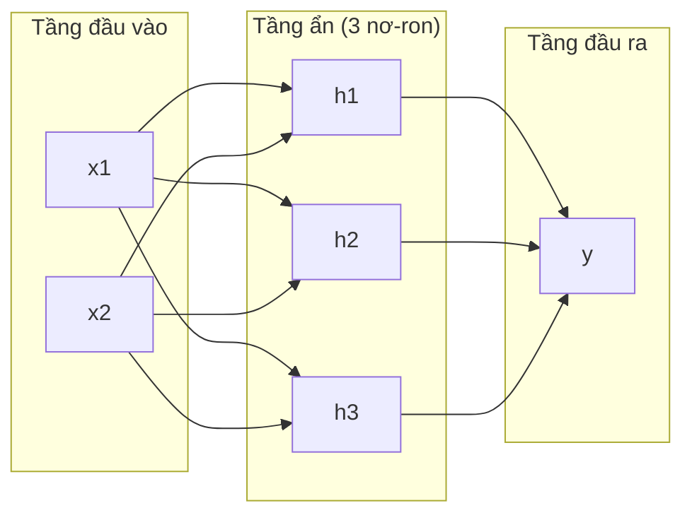
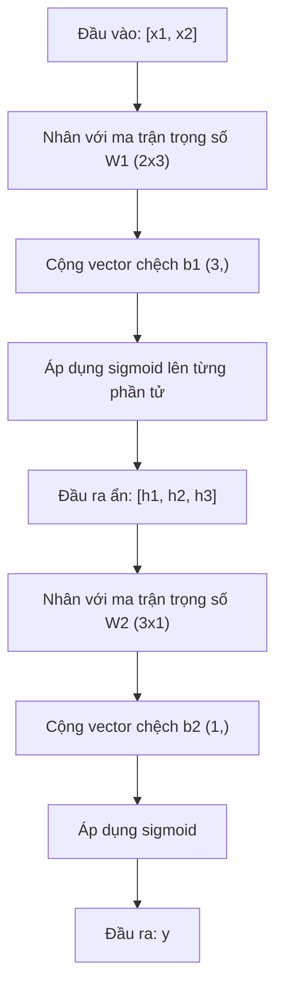
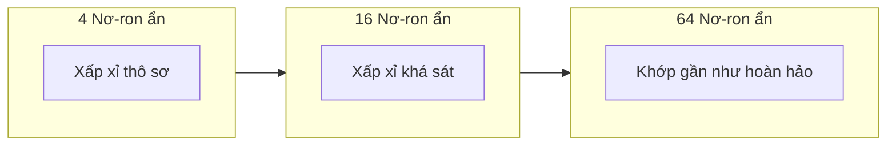

# Mạng nhiều tầng và Lan truyền tiến (Multi-Layer Networks and Forward Pass)

> Một nơ-ron vẽ một đường thẳng. Xếp chồng chúng lại, và bạn có thể vẽ nên bất kỳ hình dạng nào.

**Type:** Build
**Languages:** Python
**Prerequisites:** Giai đoạn 01 (Nền tảng toán học), Bài học 03.01 (Perceptron)
**Time:** ~90 phút

## Mục tiêu học tập

- Xây dựng một mạng nhiều tầng từ con số 0 với các lớp `Layer` và `Network` thực hiện trọn vẹn một lượt lan truyền tiến (forward pass)
- Theo dõi kích thước ma trận qua từng tầng của mạng và nhận diện các lỗi không khớp hình dạng (shape mismatches)
- Giải thích cách việc xếp chồng các hàm kích hoạt phi tuyến tính cho phép mạng nơ-ron học các ranh giới quyết định uốn cong
- Giải quyết bài toán XOR bằng kiến trúc 2-2-1 với các trọng số sigmoid được tinh chỉnh thủ công

## Vấn đề thực tế

Một nơ-ron đơn lẻ chỉ là một công cụ vẽ đường thẳng. Chỉ có thế. Một đường thẳng duy nhất đi qua dữ liệu của bạn. Mọi bài toán thực tế trong AI -- nhận dạng hình ảnh, thấu hiểu ngôn ngữ tự nhiên, chơi cờ vây -- đều đòi hỏi những đường cong phức tạp. Xếp chồng các nơ-ron thành nhiều tầng chính là cách để bạn tạo ra những đường cong đó.

Năm 1969, Minsky và Papert đã chứng minh giới hạn này mang tính chí tử: mạng đơn tầng không thể học được cổng XOR. Không phải là "gặp khó khăn khi học" -- mà là về mặt toán học, nó hoàn toàn bất khả thi. Bảng chân trị XOR đặt [0,1] và [1,0] về một phía, [0,0] và [1,1] về phía bên kia. Không một đường thẳng nào có thể phân tách chúng.

Phát hiện này đã khiến nguồn vốn nghiên cứu mạng nơ-ron bị đóng băng trong hơn một thập kỷ. Nhìn lại, giải pháp hóa ra rất hiển nhiên: đừng chỉ dùng một tầng nữa. Hãy xếp chồng các nơ-ron thành nhiều tầng. Hãy để tầng thứ nhất gọt giũa không gian đầu vào thành các đặc trưng mới, và để tầng thứ hai kết hợp các đặc trưng đó thành các quyết định mà không một đường thẳng đơn lẻ nào có thể đưa ra.

Sự xếp chồng đó chính là mạng nhiều tầng (multi-layer network). Nó là nền tảng của mọi mô hình học sâu trong môi trường sản xuất ngày nay. Lan truyền tiến (forward pass) -- dòng dữ liệu chảy từ đầu vào qua các tầng ẩn đến đầu ra -- là điều đầu tiên bạn cần xây dựng trước khi bất kỳ thứ gì khác có thể hoạt động.

## Khái niệm

### Các tầng mạng: Đầu vào, Tầng ẩn, Đầu ra

Một mạng nhiều tầng có ba loại tầng:

**Tầng đầu vào (Input layer)** -- thực chất không phải là một tầng tính toán. Nó chỉ chứa dữ liệu thô của bạn. Hai đặc trưng tương ứng với hai nút đầu vào. Không có phép tính toán nào diễn ra ở đây.

**Các tầng ẩn (Hidden layers)** -- nơi công việc thực sự diễn ra. Mỗi nơ-ron nhận mọi đầu ra từ tầng trước đó, nhân với trọng số, cộng hệ số chệch, rồi đưa kết quả qua một hàm kích hoạt. Gọi là "ẩn" vì bạn không bao giờ nhìn thấy trực tiếp các giá trị này trong dữ liệu huấn luyện.

**Tầng đầu ra (Output layer)** -- câu trả lời cuối cùng. Với phân loại nhị phân, đó là một nơ-ron với hàm sigmoid. Với phân loại đa lớp, đó là một nơ-ron cho mỗi lớp.



Đây là mạng 2-3-1: Hai đầu vào, ba nơ-ron ẩn, một đầu ra. Mọi liên kết đều mang một trọng số. Mọi nơ-ron (ngoại trừ đầu vào) đều có một hệ số chệch.

Mỗi tầng tạo ra một vector số được gọi là trạng thái ẩn (hidden state). Đối với văn bản, các trạng thái ẩn tăng số chiều -- mã hóa một từ thành 768 con số để nắm bắt ý nghĩa ngữ nghĩa. Đối với hình ảnh, chúng giảm số chiều -- nén hàng triệu điểm ảnh thành một biểu diễn cô đọng. Trạng thái ẩn chính là nơi quá trình học tập thực sự diễn ra.

### Nơ-ron và Hàm kích hoạt

Mỗi nơ-ron thực hiện ba việc:

1. Nhân từng đầu vào với trọng số tương ứng
2. Tính tổng tất cả các tích và cộng thêm hệ số chệch
3. Truyền tổng đó qua một hàm kích hoạt

Hiện tại, hàm kích hoạt là sigmoid:

```math
\text{sigmoid}(z) = \frac{1}{1 + e^{-z}}
```

Sigmoid nén bất kỳ số thực nào vào khoảng (0, 1). Đầu vào dương lớn tiệm cận về 1. Đầu vào âm lớn tiệm cận về 0. Giá trị 0 tương ứng với 0.5. Đường cong mượt mà này chính là thứ giúp việc học trở nên khả thi -- khác với hàm bước nhảy cứng nhắc của perceptron, sigmoid có đạo hàm ở mọi điểm.

### Lan truyền tiến: Cách dữ liệu dịch chuyển

Lan truyền tiến đẩy dữ liệu đầu vào qua mạng lưới, từng tầng một, cho đến khi chạm tới đầu ra. Không có quá trình học nào diễn ra trong lúc lan truyền tiến. Đó thuần túy là tính toán: nhân, cộng, kích hoạt, và lặp lại.



Tại mỗi tầng, ba phép toán diễn ra theo trình tự:

```math
\begin{aligned}
z &= W \cdot \text{input} + b \quad \text{(biến đổi tuyến tính)} \\
a &= \text{sigmoid}(z) \quad \text{(kích hoạt)}
\end{aligned}
```

Đầu ra của tầng này trở thành đầu vào của tầng tiếp theo. Đó là toàn bộ quá trình lan truyền tiến.

### Kích thước ma trận (Matrix Dimensions)

Theo dõi số chiều là kỹ năng gỡ lỗi quan trọng bậc nhất trong học sâu. Dưới đây là bảng phân tích kích thước của mạng 2-3-1:

| Bước | Phép toán | Số chiều | Hình dạng kết quả |
|------|-----------|------------|-------------|
| Đầu vào | $x$ | -- | (2,) |
| Tuyến tính tầng ẩn | $W_1 x + b_1$ | $W_1$: (3, 2), $b_1$: (3,) | (3,) |
| Kích hoạt tầng ẩn | $\text{sigmoid}(z_1)$ | -- | (3,) |
| Tuyến tính đầu ra | $W_2 h + b_2$ | $W_2$: (1, 3), $b_2$: (1,) | (1,) |
| Kích hoạt đầu ra | $\text{sigmoid}(z_2)$ | -- | (1,) |

Quy tắc: Ma trận trọng số $W$ tại tầng $k$ có hình dạng `(số_nơ_ron_tầng_k, số_nơ_ron_tầng_k_trừ_1)`. Số hàng khớp với tầng hiện tại. Số cột khớp với tầng trước đó. Nếu hình dạng không khớp nhau, chắc chắn bạn đã gặp lỗi.

### Định lý xấp xỉ vạn năng (Universal Approximation Theorem)

Năm 1989, George Cybenko đã chứng minh một định lý đáng kinh ngạc: Một mạng nơ-ron chỉ với một tầng ẩn duy nhất nhưng có đủ số lượng nơ-ron có thể xấp xỉ bất kỳ hàm số liên tục nào với độ chính xác tùy ý.

Điều này không có nghĩa một tầng ẩn luôn là tốt nhất. Nó chỉ khẳng định rằng về mặt lý thuyết, kiến trúc này có khả năng làm được điều đó. Trong thực tế, các mạng sâu hơn (nhiều tầng hơn, ít nơ-ron trên mỗi tầng hơn) học được các hàm số tương tự với tổng số tham số ít hơn rất nhiều so với mạng nông nhưng rộng. Đó là lý do vì sao học sâu (deep learning) lại thành công rực rỡ.

Trực giác: mỗi nơ-ron trong tầng ẩn học một "gờ cong" hoặc một đặc trưng. Đủ số gờ cong đặt ở đúng vị trí có thể xấp xỉ bất kỳ đường cong mượt mà nào. Càng nhiều nơ-ron, càng nhiều gờ cong, mức độ xấp xỉ càng chính xác.



### Khả năng kết hợp (Composability)

Các mạng nơ-ron có tính mô-đun hóa cao. Bạn có thể xếp chồng chúng, ghép chuỗi chúng, hoặc cho chúng chạy song song. Mô hình Whisper sử dụng mạng mã hóa (encoder) để xử lý âm thanh và mạng giải mã (decoder) riêng biệt để sinh văn bản. Các LLM hiện đại đa phần là decoder-only. BERT là encoder-only. T5 là encoder-decoder. Lựa chọn kiến trúc sẽ định hình khả năng của mô hình.

```figure
mlp-forward
```

## Xây dựng thực hành (Build It)

Toàn bộ bằng Python thuần. Không dùng numpy. Mọi phép toán ma trận đều được viết từ con số 0.

### Bước 1: Hàm kích hoạt Sigmoid

```python
import math

def sigmoid(x):
    x = max(-500.0, min(500.0, x))
    return 1.0 / (1.0 + math.exp(-x))
```

Việc giới hạn giá trị trong khoảng `[-500, 500]` giúp ngăn chặn tràn số (overflow). `math.exp(500)` là số cực lớn nhưng vẫn hữu hạn, trong khi `math.exp(1000)` sẽ bị tràn thành vô cực.

### Bước 2: Lớp Layer

Phép toán quan trọng nhất trong toàn bộ học sâu là nhân ma trận. Mọi tầng, mọi khối attention, mọi lượt lan truyền tiến -- tất cả đều là nhân ma trận. Một tầng tuyến tính nhận một vector đầu vào, nhân với ma trận trọng số và cộng vector chệch: $y = Wx + b$. Phương trình duy nhất này chiếm tới 90% khối lượng tính toán trong một mạng nơ-ron.

Một tầng lưu giữ ma trận trọng số và vector chệch. Phương thức forward nhận vector đầu vào và trả về đầu ra sau khi kích hoạt.

```python
class Layer:
    def __init__(self, n_inputs, n_neurons, weights=None, biases=None):
        if weights is not None:
            self.weights = weights
        else:
            import random
            self.weights = [
                [random.uniform(-1, 1) for _ in range(n_inputs)]
                for _ in range(n_neurons)
            ]
        if biases is not None:
            self.biases = biases
        else:
            self.biases = [0.0] * n_neurons

    def forward(self, inputs):
        self.last_input = inputs
        self.last_output = []
        for neuron_idx in range(len(self.weights)):
            z = sum(
                w * x for w, x in zip(self.weights[neuron_idx], inputs)
            )
            z += self.biases[neuron_idx]
            self.last_output.append(sigmoid(z))
        return self.last_output
```

Ma trận trọng số có hình dạng `(n_neurons, n_inputs)`. Mỗi hàng là trọng số của một nơ-ron trên tất cả các đầu vào. Phương thức forward lặp qua các nơ-ron, tính tổng có trọng số cộng hệ số chệch, áp dụng sigmoid và gom các kết quả lại.

### Bước 3: Lớp Network

Một mạng là một danh sách các tầng. Lan truyền tiến kết nối chúng tuần tự: đầu ra của tầng $k$ làm đầu vào cho tầng $k+1$.

```python
class Network:
    def __init__(self, layers):
        self.layers = layers

    def forward(self, inputs):
        current = inputs
        for layer in self.layers:
            current = layer.forward(current)
        return current
```

Đó là toàn bộ quá trình lan truyền tiến. Chỉ bốn dòng logic. Dữ liệu đi vào, chảy qua từng tầng, và xuất hiện ở phía bên kia.

### Bước 4: Giải quyết XOR bằng các trọng số chỉnh tay

Trong Bài học 01, chúng ta đã giải quyết XOR bằng cách kết hợp các perceptron OR, NAND và AND. Bây giờ hãy làm điều tương tự với các lớp `Layer` và `Network` của chúng ta theo kiến trúc 2-2-1: hai đầu vào, hai nơ-ron ẩn, một đầu ra.

```python
hidden = Layer(
    n_inputs=2,
    n_neurons=2,
    weights=[[20.0, 20.0], [-20.0, -20.0]],
    biases=[-10.0, 30.0],
)

output = Layer(
    n_inputs=2,
    n_neurons=1,
    weights=[[20.0, 20.0]],
    biases=[-30.0],
)

xor_net = Network([hidden, output])

xor_data = [
    ([0, 0], 0),
    ([0, 1], 1),
    ([1, 0], 1),
    ([1, 1], 0),
]

for inputs, expected in xor_data:
    result = xor_net.forward(inputs)
    predicted = 1 if result[0] >= 0.5 else 0
    print(f"  {inputs} -> {result[0]:.6f} (làm tròn: {predicted}, kỳ vọng: {expected})")
```

Các trọng số lớn (20, -20) khiến hàm sigmoid hoạt động tương tự như hàm bước nhảy. Nơ-ron ẩn đầu tiên xấp xỉ cổng OR. Nơ-ron thứ hai xấp xỉ cổng NAND. Nơ-ron đầu ra kết hợp chúng thành cổng AND, tạo thành logic XOR chuẩn xác.

### Bước 5: Phân loại điểm trong đường tròn

Một bài toán khó hơn: phân loại các điểm 2D là nằm trong hay nằm ngoài một hình tròn bán kính 0.5 có tâm tại gốc tọa độ. Bài toán này đòi hỏi một ranh giới quyết định cong -- điều bất khả thi đối với một perceptron đơn lẻ.

```python
import random
import math

random.seed(42)

data = []
for _ in range(200):
    x = random.uniform(-1, 1)
    y = random.uniform(-1, 1)
    label = 1 if (x * x + y * y) < 0.25 else 0
    data.append(([x, y], label))

circle_net = Network([
    Layer(n_inputs=2, n_neurons=8),
    Layer(n_inputs=8, n_neurons=1),
])
```

Với các trọng số ngẫu nhiên, mạng chưa thể phân loại tốt. Nhưng lượt lan truyền tiến vẫn vận hành trơn tru. Đây chính là điểm cốt lõi -- lan truyền tiến chỉ là tính toán thuần túy. Việc học các trọng số phù hợp thuộc về thuật toán lan truyền ngược, sẽ được đề cập trong Bài học 03.

```python
correct = 0
for inputs, expected in data:
    result = circle_net.forward(inputs)
    predicted = 1 if result[0] >= 0.5 else 0
    if predicted == expected:
        correct += 1

print(f"Độ chính xác với trọng số ngẫu nhiên: {correct}/{len(data)} ({100*correct/len(data):.1f}%)")
```

Trọng số ngẫu nhiên cho độ chính xác thấp -- thường còn tệ hơn việc đoán mò theo lớp chiếm đa số. Sau khi được huấn luyện (Bài học 03), chính kiến trúc này với 8 nơ-ron ẩn sẽ vẽ nên một ranh giới cong phân chia chính xác vùng bên trong và bên ngoài đường tròn.

## Ứng dụng thực tế (Use It)

PyTorch thực hiện mọi điều trên chỉ trong bốn dòng:

```python
import torch
import torch.nn as nn

model = nn.Sequential(
    nn.Linear(2, 8),
    nn.Sigmoid(),
    nn.Linear(8, 1),
    nn.Sigmoid(),
)

x = torch.tensor([[0.0, 0.0], [0.0, 1.0], [1.0, 0.0], [1.0, 1.0]])
output = model(x)
print(output)
```

`nn.Linear(2, 8)` tương ứng với lớp `Layer` của bạn: ma trận trọng số hình dạng (8, 2), vector chệch hình dạng (8,). `nn.Sigmoid()` là hàm sigmoid được áp dụng lên từng phần tử. `nn.Sequential` tương ứng với lớp `Network`: kết nối các tầng theo thứ tự.

Điểm khác biệt nằm ở tốc độ và quy mô. PyTorch chạy trên GPU, xử lý các lô dữ liệu gồm hàng triệu mẫu và tự động tính toán đạo hàm cho quá trình lan truyền ngược. Nhưng logic lan truyền tiến thì hoàn toàn đồng nhất với những gì bạn vừa tự tay xây dựng.

## Đóng gói ứng dụng (Ship It)

Bài học này tạo ra một mẫu câu lệnh tái sử dụng để thiết kế kiến trúc mạng nơ-ron:

- `outputs/prompt-network-architect.md`

Hãy sử dụng nó khi bạn cần quyết định số tầng, số nơ-ron trên mỗi tầng, và hàm kích hoạt nào nên dùng cho một bài toán cụ thể.

## Bài tập rèn luyện (Exercises)

1. Xây dựng một mạng 2-4-2-1 (hai tầng ẩn) và chạy lượt lan truyền tiến trên dữ liệu XOR với các trọng số ngẫu nhiên. In ra các đầu ra trung gian của tầng ẩn để xem biểu diễn dữ liệu được biến đổi như thế nào qua từng tầng.
2. Thay đổi kích thước tầng ẩn trong bài toán phân loại đường tròn từ 8 thành 2, sau đó thành 32. Chạy lượt lan truyền tiến với trọng số ngẫu nhiên trong mỗi lần. Số lượng nơ-ron ẩn có làm thay đổi khoảng giá trị hoặc phân phối đầu ra không? Vì sao?
3. Triển khai phương thức `count_parameters` trên lớp `Network` để trả về tổng số trọng số và hệ số chệch có thể huấn luyện được. Thử nghiệm trên mạng 784-256-128-10 (kiến trúc kinh điển cho tập MNIST). Mạng này có bao nhiêu tham số?
4. Xây dựng lượt lan truyền tiến cho mạng 3-4-4-2. Cung cấp cho nó các giá trị màu RGB (chuẩn hóa về khoảng 0-1) và quan sát hai đầu ra. Đây chính là kiến trúc cho một bộ phân loại màu đơn giản với hai lớp.
5. Thay thế sigmoid bằng một hàm "bước nhảy có rò rỉ" (leaky step): trả về `0.01 * z` nếu $z < 0$, ngược lại trả về `1.0`. Chạy lượt lan truyền tiến trên XOR với cùng bộ trọng số tinh chỉnh từ Bước 4. Nó có còn hoạt động không? Vì sao hàm sigmoid trơn lại được ưa chuộng hơn các ngưỡng ngắt cứng?

## Thuật ngữ then chốt (Key Terms)

| Thuật ngữ | Cách gọi thông thường | Ý nghĩa kỹ thuật |
|------|----------------|----------------------|
| Forward pass (Lan truyền tiến) | "Chạy mô hình" | Đẩy dữ liệu đầu vào qua từng tầng -- nhân trọng số, cộng hệ số chệch, kích hoạt -- để tạo ra kết quả đầu ra |
| Hidden layer (Tầng ẩn) | "Phần ở giữa" | Bất kỳ tầng nào nằm giữa đầu vào và đầu ra mà giá trị của nó không được quan sát trực tiếp trong dữ liệu |
| Multi-layer network (Mạng nhiều tầng) | "Mạng nơ-ron sâu" | Các tầng nơ-ron xếp chồng tuần tự, đầu ra của tầng này làm đầu vào cho tầng kế tiếp |
| Activation function (Hàm kích hoạt) | "Tính phi tuyến" | Hàm toán học áp dụng sau biến đổi tuyến tính giúp đưa các đường cong vào ranh giới quyết định |
| Sigmoid | "Đường cong chữ S" | $\sigma(z) = 1/(1+e^{-z})$, nén mọi số thực về khoảng (0,1), trơn và khả vi tại mọi điểm |
| Weight matrix (Ma trận trọng số) | "Các tham số" | Ma trận $W$ có hình dạng `(nơ_ron_tầng_này, nơ_ron_tầng_trước)` chứa cường độ liên kết có thể học |
| Bias vector (Vector chệch) | "Độ dời" | Vector cộng vào sau phép nhân ma trận, cho phép nơ-ron kích hoạt ngay cả khi mọi đầu vào bằng 0 |
| Universal approximation (Xấp xỉ vạn năng) | "Mạng nơ-ron học được mọi thứ" | Một tầng ẩn duy nhất với đủ số nơ-ron có thể xấp xỉ bất kỳ hàm liên tục nào -- dù "đủ" có thể lên tới hàng tỷ |
| Linear transformation (Biến đổi tuyến tính) | "Bước nhân ma trận" | $z = W x + b$, phép tính toán trước khi kích hoạt, ánh xạ đầu vào sang một không gian mới |
| Decision boundary (Ranh giới quyết định) | "Vạch chuyển đổi phân loại" | Bề mặt trong không gian đầu vào nơi đầu ra của mạng vượt qua ngưỡng phân loại |

## Tài liệu đọc thêm (Further Reading)

- Michael Nielsen, "Neural Networks and Deep Learning", Chương 1-2 (http://neuralnetworksanddeeplearning.com/) -- tài liệu miễn phí giải thích rõ ràng nhất về lan truyền tiến và cấu trúc mạng, kèm hình ảnh tương tác
- Cybenko, "Approximation by Superpositions of a Sigmoidal Function" (1989) -- bài báo gốc về định lý xấp xỉ vạn năng, dễ đọc đến bất ngờ
- 3Blue1Brown, "But what is a neural network?" (https://www.youtube.com/watch?v=aircAruvnKk) -- video trực quan sinh động 20 phút về các tầng, trọng số và lan truyền tiến giúp xây dựng mô hình tư duy chuẩn xác
- Goodfellow, Bengio, Courville, "Deep Learning", Chương 6 (https://www.deeplearningbook.org/) -- tài liệu chuẩn mực về mạng nhiều tầng, đọc trực tuyến miễn phí

