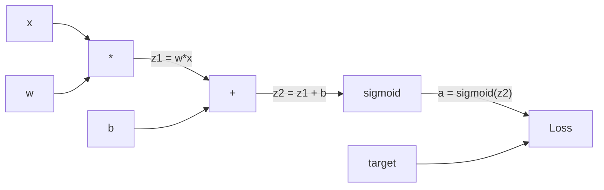
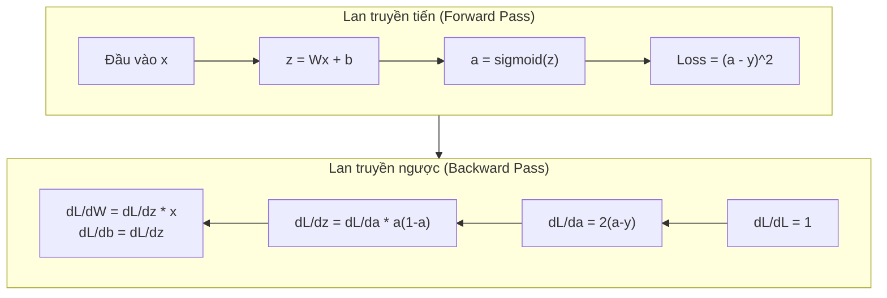
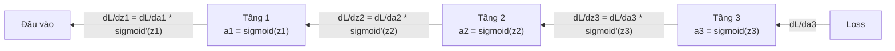

# Thuật toán Lan truyền ngược (Backpropagation from Scratch)

> Lan truyền ngược là thuật toán giúp cỗ máy có khả năng học tập. Không có nó, mạng nơ-ron chỉ là một bộ sinh số ngẫu nhiên đắt đỏ.

**Type:** Build
**Languages:** Python
**Prerequisites:** Bài học 03.02 (Mạng nhiều tầng)
**Time:** ~120 phút

## Mục tiêu học tập

- Triển khai một công cụ vi phân tự động (autograd) dựa trên lớp `Value`, tự động dựng đồ thị tính toán và tính đạo hàm qua sắp xếp topo (topological sort)
- Dẫn xuất lượt lan truyền ngược cho phép cộng, phép nhân và hàm sigmoid dựa trên quy tắc đạo hàm chuỗi (chain rule)
- Huấn luyện mạng nhiều tầng trên bài toán XOR và bài toán phân loại đường tròn chỉ bằng bộ máy lan truyền ngược tự xây dựng từ con số 0
- Nhận diện vấn đề biến mất đạo hàm (vanishing gradient) trong các mạng sigmoid sâu và giải thích lý do đạo hàm suy giảm theo hàm mũ

## Vấn đề thực tế

Mạng nơ-ron của bạn có một tầng ẩn duy nhất với 768 đầu vào và 3072 đầu ra. Đó là 2.359.296 trọng số. Mô hình vừa đưa ra một dự đoán sai. Những trọng số nào đã gây ra lỗi đó? Nếu kiểm tra từng trọng số riêng lẻ, bạn cần chạy 2,3 triệu lượt lan truyền tiến. Thuật toán lan truyền ngược (backpropagation) tính toán toàn bộ 2,3 triệu gradient này chỉ trong một lượt lan truyền ngược duy nhất. Đó không đơn thuần là một tối ưu hóa. Đó là lằn ranh quyết định giữa việc mô hình có thể huấn luyện được hay hoàn toàn bất khả thi.

Cách tiếp cận ngây thơ: lấy một trọng số, nhích nó một lượng cực nhỏ, chạy lại lượt lan truyền tiến, đo xem hàm mất mát tăng hay giảm. Điều đó cho bạn gradient của trọng số đó. Bây giờ hãy làm thế cho từng trọng số trong toàn mạng. Nhân con số đó với hàng nghìn bước huấn luyện và hàng triệu điểm dữ liệu. Bạn sẽ cần thời gian tương đương cả một kỷ địa chất để huấn luyện một thứ gì đó có ích.

Lan truyền ngược giải quyết triệt để vấn đề này: Một lượt lan truyền tiến, một lượt lan truyền ngược, tất cả gradient đều được tính toán. Bí quyết nằm ở quy tắc đạo hàm chuỗi trong giải tích, được áp dụng một cách có hệ thống lên một đồ thị tính toán. Đây chính là thuật toán đưa học sâu trở thành công nghệ thực tiễn. Không có nó, chúng ta vẫn sẽ mắc kẹt ở những bài toán đồ chơi.

## Khái niệm

### Quy tắc đạo hàm chuỗi áp dụng vào mạng nơ-ron

Bạn đã thấy quy tắc đạo hàm chuỗi trong Giai đoạn 01, Bài học 05. Nhắc lại nhanh: nếu $y = f(g(x))$, thì $\frac{dy}{dx} = f'(g(x)) \cdot g'(x)$. Bạn nhân các đạo hàm dọc theo chuỗi phụ thuộc.

Trong mạng nơ-ron, "chuỗi" này chính là chuỗi các phép toán từ đầu vào đến hàm mất mát. Mỗi tầng áp dụng các trọng số, cộng hệ số chệch, và truyền qua một hàm kích hoạt. Hàm mất mát so sánh đầu ra cuối cùng với nhãn mục tiêu. Lan truyền ngược lần theo chuỗi này theo chiều ngược lại, tính toán xem mỗi phép toán đã đóng góp bao nhiêu vào sai số chung.

### Đồ thị tính toán (Computational Graphs)

Mỗi lượt lan truyền tiến đều xây dựng nên một đồ thị. Mỗi nút là một phép toán (nhân, cộng, sigmoid). Mỗi cạnh mang một giá trị đi xuôi và một gradient đi ngược.



Lượt lan truyền tiến: các giá trị chảy từ trái sang phải. $x$ và $w$ tạo ra $z_1 = w x$. Cộng $b$ để được $z_2$. Sigmoid cho giá trị kích hoạt $a$. So sánh $a$ với mục tiêu $y$ qua hàm mất mát.

Lượt lan truyền ngược: các gradient chảy từ phải sang trái. Bắt đầu với $\partial L/\partial a$ (hàm mất mát thay đổi như thế nào theo giá trị kích hoạt). Nhân với $\partial a/\partial z_2$ (đạo hàm của sigmoid). Kết quả cho ta $\partial L/\partial z_2$. Sau đó tách thành $\partial L/\partial b$ (bằng $\partial L/\partial z_2$, vì $z_2 = z_1 + b$) và $\partial L/\partial z_1$. Tiếp tục, $\partial L/\partial w = \partial L/\partial z_1 \cdot x$ và $\partial L/\partial x = \partial L/\partial z_1 \cdot w$.

Mỗi nút trong đồ thị có một nhiệm vụ duy nhất trong lượt lan truyền ngược: nhận gradient truyền từ phía trên, nhân với đạo hàm cục bộ của chính nó, và truyền tiếp xuống phía dưới.

### Lan truyền tiến so với Lan truyền ngược



Lượt lan truyền tiến lưu trữ mọi giá trị trung gian: $z$, $a$, đầu vào của từng tầng. Lượt lan truyền ngược cần các giá trị lưu trữ này để tính gradient. Đây chính là sự đánh đổi giữa bộ nhớ và tính toán cốt lõi của thuật toán: Bạn đánh đổi bộ nhớ (lưu trữ các giá trị kích hoạt) để lấy tốc độ (chỉ một lượt tính toán thay vì hàng triệu lượt).

### Dòng chảy gradient qua mạng nơ-ron

Với một mạng 3 tầng, gradient kết chuỗi qua từng tầng:



Tại mỗi tầng, gradient được nhân với đạo hàm của hàm sigmoid. Đạo hàm sigmoid là $a(1 - a)$, đạt giá trị tối đa chỉ là 0.25 (khi $a = 0.5$). Khi đi qua ba tầng, gradient đã bị nhân với tối đa là $0.25^3 = 0.0156$. Qua mười tầng: $0.25^{10} = 0.000001$.

### Vấn đề biến mất đạo hàm (Vanishing Gradients)

Đây chính là hiện tượng biến mất đạo hàm. Hàm sigmoid nén đầu ra vào khoảng từ 0 đến 1. Đạo hàm của nó luôn nhỏ hơn hoặc bằng 0.25. Khi xếp chồng đủ nhiều tầng sigmoid, gradient sẽ suy giảm về gần như bằng không. Các tầng đầu tiên gần như không học được gì vì chỉ nhận được gradient xấp xỉ 0.

```text
sigmoid(z):     Khoảng đầu ra [0, 1]
sigmoid'(z):    Giá trị tối đa 0.25 (tại z = 0)

Sau 5 tầng:     gradient * 0.25^5 = 0.001x so với ban đầu
Sau 10 tầng:    gradient * 0.25^10 = 0.000001x so với ban đầu
```

Đó là lý do vì sao các mạng sigmoid sâu gần như không thể huấn luyện được. Giải pháp khắc phục -- hàm ReLU và các biến thể -- là chủ đề của Bài học 04. Hiện tại, hãy nhớ rằng bản thân lan truyền ngược hoạt động hoàn hảo; vấn đề nằm ở các hàm số mà nó phải truyền qua.

### Dẫn xuất Gradient cho mạng 2 tầng

Toán học cụ thể cho một mạng có đầu vào $x$, tầng ẩn dùng sigmoid, tầng đầu ra dùng sigmoid, và hàm mất mát sai số toàn phương trung bình (MSE).

Lượt lan truyền tiến:

```math
\begin{aligned}
z_1 &= W_1 x + b_1 \\
a_1 &= \text{sigmoid}(z_1) \\
z_2 &= W_2 a_1 + b_2 \\
a_2 &= \text{sigmoid}(z_2) \\
L &= (a_2 - y)^2
\end{aligned}
```

Lượt lan truyền ngược (áp dụng quy tắc chuỗi từng bước một):

```math
\begin{aligned}
\frac{\partial L}{\partial a_2} &= 2(a_2 - y) \\
\frac{\partial a_2}{\partial z_2} &= a_2 (1 - a_2) \\
\frac{\partial L}{\partial z_2} &= \frac{\partial L}{\partial a_2} \cdot \frac{\partial a_2}{\partial z_2} = 2(a_2 - y) \cdot a_2 (1 - a_2) \\[6pt]
\frac{\partial L}{\partial W_2} &= \frac{\partial L}{\partial z_2} \cdot a_1 \\
\frac{\partial L}{\partial b_2} &= \frac{\partial L}{\partial z_2} \\[6pt]
\frac{\partial L}{\partial a_1} &= \frac{\partial L}{\partial z_2} \cdot W_2 \\
\frac{\partial a_1}{\partial z_1} &= a_1 (1 - a_1) \\
\frac{\partial L}{\partial z_1} &= \frac{\partial L}{\partial a_1} \cdot \frac{\partial a_1}{\partial z_1} \\[6pt]
\frac{\partial L}{\partial W_1} &= \frac{\partial L}{\partial z_1} \cdot x \\
\frac{\partial L}{\partial b_1} &= \frac{\partial L}{\partial z_1}
\end{aligned}
```

Mỗi gradient đều là tích của các đạo hàm cục bộ được lần ngược từ hàm mất mát. Đó là tất cả những gì bản chất lan truyền ngược hướng tới.

```figure
backprop-vanishing
```

## Xây dựng thực hành (Build It)

### Bước 1: Nút Value

Mỗi con số trong quá trình tính toán trở thành một đối tượng `Value`. Nó lưu trữ dữ liệu giá trị (`data`), gradient (`grad`), và cách nó được tạo ra (để biết cách truyền ngược gradient).

```python
class Value:
    def __init__(self, data, children=(), op=''):
        self.data = data
        self.grad = 0.0
        self._backward = lambda: None
        self._children = set(children)
        self._op = op

    def __repr__(self):
        return f"Value(data={self.data:.4f}, grad={self.grad:.4f})"
```

Ban đầu chưa có gradient (0.0). Chưa có hàm lan truyền ngược (`no-op`). Thuộc tính `_children` theo dõi những nút `Value` nào đã tạo ra nút này, giúp chúng ta sắp xếp topo đồ thị sau này.

### Bước 2: Các phép toán đi kèm hàm lan truyền ngược

Mỗi phép toán tạo ra một `Value` mới và định nghĩa cách gradient chảy ngược qua nó.

```python
def __add__(self, other):
    other = other if isinstance(other, Value) else Value(other)
    out = Value(self.data + other.data, (self, other), '+')

    def _backward():
        self.grad += out.grad
        other.grad += out.grad

    out._backward = _backward
    return out

def __mul__(self, other):
    other = other if isinstance(other, Value) else Value(other)
    out = Value(self.data * other.data, (self, other), '*')

    def _backward():
        self.grad += other.data * out.grad
        other.grad += self.data * out.grad

    out._backward = _backward
    return out
```

Với phép cộng: $\partial(a+b)/\partial a = 1$, $\partial(a+b)/\partial b = 1$. Do đó cả hai đầu vào đều nhận trực tiếp gradient của đầu ra.

Với phép nhân: $\partial(ab)/\partial a = b$, $\partial(ab)/\partial b = a$. Mỗi đầu vào nhận giá trị của đầu vào kia nhân với gradient đầu ra.

Toán tử `+=` là tối quan trọng: một `Value` có thể được sử dụng trong nhiều phép toán khác nhau. Gradient của nó là tổng các gradient tích lũy từ tất cả các nhánh rẽ.

### Bước 3: Hàm Sigmoid và Hàm mất mát

```python
import math

def sigmoid(self):
    x = self.data
    x = max(-500, min(500, x))
    s = 1.0 / (1.0 + math.exp(-x))
    out = Value(s, (self,), 'sigmoid')

    def _backward():
        self.grad += (s * (1 - s)) * out.grad

    out._backward = _backward
    return out
```

Đạo hàm sigmoid: $\text{sigmoid}(x) \cdot (1 - \text{sigmoid}(x))$. Chúng ta đã tính $\text{sigmoid}(x) = s$ trong lượt lan truyền tiến. Tái sử dụng ngay giá trị đó mà không cần tính toán lại!

```python
def mse_loss(predicted, target):
    diff = predicted + Value(-target)
    return diff * diff
```

Hàm MSE cho một đầu ra đơn lẻ: $(\text{predicted} - \text{target})^2$. Chúng ta biểu diễn phép trừ dưới dạng phép cộng với một `Value` âm.

### Bước 4: Lượt lan truyền ngược (Backward Pass)

Sắp xếp topo (Topological sort) đảm bảo chúng ta duyệt các nút theo đúng thứ tự -- gradient của một nút phải được tích lũy đầy đủ trước khi lan truyền qua nó.

```python
def backward(self):
    topo = []
    visited = set()

    def build_topo(v):
        if v not in visited:
            visited.add(v)
            for child in v._children:
                build_topo(child)
            topo.append(v)

    build_topo(self)
    self.grad = 1.0
    for v in reversed(topo):
        v._backward()
```

Bắt đầu từ hàm mất mát (gradient = 1.0, vì $dL/dL = 1$). Đi ngược qua đồ thị đã sắp xếp. Phương thức `_backward` của mỗi nút sẽ đẩy gradient về các nút con của nó.

### Bước 5: Lớp Layer và Network

```python
import random

class Neuron:
    def __init__(self, n_inputs):
        scale = (2.0 / n_inputs) ** 0.5
        self.weights = [Value(random.uniform(-scale, scale)) for _ in range(n_inputs)]
        self.bias = Value(0.0)

    def __call__(self, x):
        act = sum((wi * xi for wi, xi in zip(self.weights, x)), self.bias)
        return act.sigmoid()

    def parameters(self):
        return self.weights + [self.bias]


class Layer:
    def __init__(self, n_inputs, n_outputs):
        self.neurons = [Neuron(n_inputs) for _ in range(n_outputs)]

    def __call__(self, x):
        out = [n(x) for n in self.neurons]
        return out[0] if len(out) == 1 else out

    def parameters(self):
        params = []
        for n in self.neurons:
            params.extend(n.parameters())
        return params


class Network:
    def __init__(self, sizes):
        self.layers = []
        for i in range(len(sizes) - 1):
            self.layers.append(Layer(sizes[i], sizes[i + 1]))

    def __call__(self, x):
        for layer in self.layers:
            x = layer(x)
            if not isinstance(x, list):
                x = [x]
        return x[0] if len(x) == 1 else x

    def parameters(self):
        params = []
        for layer in self.layers:
            params.extend(layer.parameters())
        return params

    def zero_grad(self):
        for p in self.parameters():
            p.grad = 0.0
```

Một `Neuron` nhận đầu vào, tính tổng có trọng số cộng hệ số chệch, và áp dụng sigmoid. Khởi tạo trọng số được co giãn theo tỷ lệ $\sqrt{2/n_{\text{inputs}}}$ để ngăn chặn hiện tượng bão hòa sigmoid trong các mạng sâu hơn. Một `Layer` là danh sách các `Neuron`. Một `Network` là danh sách các `Layer`. Phương thức `parameters()` thu thập tất cả các `Value` có thể học được để chúng ta cập nhật.

### Bước 6: Huấn luyện trên cổng XOR

```python
random.seed(42)
net = Network([2, 4, 1])

xor_data = [
    ([0.0, 0.0], 0.0),
    ([0.0, 1.0], 1.0),
    ([1.0, 0.0], 1.0),
    ([1.0, 1.0], 0.0),
]

learning_rate = 1.0

for epoch in range(1000):
    total_loss = Value(0.0)
    for inputs, target in xor_data:
        x = [Value(i) for i in inputs]
        pred = net(x)
        loss = mse_loss(pred, target)
        total_loss = total_loss + loss

    net.zero_grad()
    total_loss.backward()

    for p in net.parameters():
        p.data -= learning_rate * p.grad

    if epoch % 100 == 0:
        print(f"Epoch {epoch:4d} | Loss: {total_loss.data:.6f}")

print("\nKết quả cổng XOR:")
for inputs, target in xor_data:
    x = [Value(i) for i in inputs]
    pred = net(x)
    print(f"  {inputs} -> {pred.data:.4f} (kỳ vọng {target})")
```

Hãy quan sát hàm mất mát giảm dần. Từ những dự đoán ngẫu nhiên đến đầu ra XOR chính xác, tất cả được thúc đẩy hoàn toàn bởi lan truyền ngược: tính toán gradient và nhích các trọng số đi đúng hướng.

### Bước 7: Phân loại hình tròn

Trong Bài học 02, bạn đã tinh chỉnh trọng số thủ công cho bài toán phân loại hình tròn. Bây giờ hãy để mạng tự học chúng:

```python
random.seed(7)

def generate_circle_data(n=100):
    data = []
    for _ in range(n):
        x1 = random.uniform(-1.5, 1.5)
        x2 = random.uniform(-1.5, 1.5)
        label = 1.0 if x1 * x1 + x2 * x2 < 1.0 else 0.0
        data.append(([x1, x2], label))
    return data

circle_data = generate_circle_data(80)

circle_net = Network([2, 8, 1])
learning_rate = 0.5

for epoch in range(2000):
    random.shuffle(circle_data)
    total_loss_val = 0.0
    for inputs, target in circle_data:
        x = [Value(i) for i in inputs]
        pred = circle_net(x)
        loss = mse_loss(pred, target)
        circle_net.zero_grad()
        loss.backward()
        for p in circle_net.parameters():
            p.data -= learning_rate * p.grad
        total_loss_val += loss.data

    if epoch % 200 == 0:
        correct = 0
        for inputs, target in circle_data:
            x = [Value(i) for i in inputs]
            pred = circle_net(x)
            predicted_class = 1.0 if pred.data > 0.5 else 0.0
            if predicted_class == target:
                correct += 1
        accuracy = correct / len(circle_data) * 100
        print(f"Epoch {epoch:4d} | Loss: {total_loss_val:.4f} | Độ chính xác: {accuracy:.1f}%")
```

Chúng ta sử dụng thuật toán SGD trực tuyến (online SGD) ở đây -- cập nhật trọng số sau mỗi mẫu thay vì tích lũy toàn bộ batch. Điều này giúp phá vỡ tính đối xứng nhanh hơn và tránh bão hòa sigmoid trên toàn bộ hàm mất mát. Xáo trộn dữ liệu sau mỗi epoch giúp mạng không bị học vẹt theo thứ tự mẫu.

Không cần chỉnh tay. Mạng tự khám phá ra ranh giới quyết định hình tròn. Đó chính là sức mạnh của lan truyền ngược: Bạn chỉ định nghĩa kiến trúc, hàm mất mát và dữ liệu; thuật toán sẽ tự tìm ra bộ trọng số tối ưu.

## Ứng dụng thực tế (Use It)

PyTorch thực hiện mọi điều trên chỉ trong vài dòng ngắn gọn. Ý tưởng cốt lõi hoàn toàn giống hệt -- autograd dựng đồ thị tính toán trong lúc lan truyền tiến và lần ngược theo đồ thị để tính gradient:

```python
import torch
import torch.nn as nn

model = nn.Sequential(
    nn.Linear(2, 4),
    nn.Sigmoid(),
    nn.Linear(4, 1),
    nn.Sigmoid(),
)
optimizer = torch.optim.SGD(model.parameters(), lr=1.0)
criterion = nn.MSELoss()

X = torch.tensor([[0,0],[0,1],[1,0],[1,1]], dtype=torch.float32)
y = torch.tensor([[0],[1],[1],[0]], dtype=torch.float32)

for epoch in range(1000):
    pred = model(X)
    loss = criterion(pred, y)
    optimizer.zero_grad()
    loss.backward()
    optimizer.step()

print("Kết quả PyTorch XOR:")
with torch.no_grad():
    for i in range(4):
        pred = model(X[i])
        print(f"  {X[i].tolist()} -> {pred.item():.4f} (kỳ vọng {y[i].item()})")
```

`loss.backward()` tương ứng với `total_loss.backward()` của bạn. `optimizer.step()` tương ứng với dòng lệnh thủ công `p.data -= lr * p.grad`. `optimizer.zero_grad()` tương ứng với `net.zero_grad()`. Cùng một thuật toán, nhưng là bản triển khai cấp độ công nghiệp. PyTorch đảm nhiệm tăng tốc GPU, độ chính xác hỗn hợp (mixed precision), gradient checkpointing, và hàng trăm loại tầng khác nhau. Nhưng lượt lan truyền ngược vẫn là quy tắc chuỗi đó được áp dụng trên đồ thị tính toán đó.

Quá trình huấn luyện chạy lan truyền tiến, lan truyền ngược, rồi cập nhật trọng số. Quá trình suy luận (inference) chỉ chạy duy nhất lan truyền tiến: không gradient, không cập nhật trọng số. Sự phân biệt này rất quan trọng vì suy luận là thứ diễn ra trên môi trường sản xuất. Khi bạn gọi một API như Claude hay GPT, bạn đang chạy suy luận -- câu nhắc (prompt) của bạn chảy xuôi qua mạng, và các token xuất hiện ở đầu ra. Không có trọng số nào bị thay đổi. Việc hiểu lan truyền ngược quan trọng là bởi nó đã nhào nặn nên từng trọng số trong mạng nơ-ron đó.

## Đóng gói ứng dụng (Ship It)

Bài học này tạo ra:
- `outputs/prompt-gradient-debugger.md` -- mẫu câu lệnh tái sử dụng để chẩn đoán các sự cố liên quan đến gradient (biến mất đạo hàm, bùng nổ đạo hàm, giá trị NaN) trong bất kỳ mạng nơ-ron nào

## Bài tập rèn luyện (Exercises)

1. Thêm phương thức `__sub__` vào lớp `Value` ($a - b = a + (-1 \cdot b)$). Sau đó triển khai phương thức `__neg__`. Xác minh các gradient có chính xác không bằng cách so sánh với tính toán thủ công cho biểu thức đơn giản như $(a - b)^2$.
2. Thêm phương thức `relu` vào `Value` (đầu ra $\max(0, x)$, đạo hàm là 1 nếu $x > 0$, ngược lại bằng 0). Thay thế sigmoid bằng relu trong các tầng ẩn và huấn luyện lại trên XOR. So sánh tốc độ hội tụ. Bạn sẽ thấy quá trình huấn luyện nhanh hơn rõ rệt -- đây là phần mở đầu cho Bài học 04.
3. Triển khai phương thức `__pow__` trên `Value` cho số mũ nguyên. Sử dụng nó để thay thế `mse_loss` bằng biểu thức `(predicted - target) ** 2` chuẩn tắc. Xác minh gradient khớp với bản triển khai ban đầu.
4. Thêm kỹ thuật cắt ngắn đạo hàm (gradient clipping) vào vòng lặp huấn luyện: sau khi gọi `backward()`, cắt tất cả gradient vào khoảng `[-1, 1]`. Huấn luyện một mạng sâu hơn (4+ tầng với sigmoid) và so sánh đường cong suy giảm mất mát khi có và không có cắt ngắn. Đây là tuyến phòng thủ đầu tiên chống lại hiện tượng bùng nổ đạo hàm (exploding gradients).
5. Xây dựng trực quan hóa: sau khi huấn luyện trên XOR, in ra gradient của mọi tham số trong mạng. Xác định tầng nào có gradient nhỏ nhất. Điều này minh họa trực tiếp vấn đề biến mất đạo hàm mà bạn đã đọc trong phần Khái niệm.

## Thuật ngữ then chốt (Key Terms)

| Thuật ngữ | Cách gọi thông thường | Ý nghĩa kỹ thuật |
|------|----------------|----------------------|
| Backpropagation (Lan truyền ngược) | "Mạng tự học" | Thuật toán tính $\partial L/\partial w$ cho mọi trọng số bằng cách áp dụng quy tắc đạo hàm chuỗi ngược qua đồ thị tính toán |
| Computational graph (Đồ thị tính toán) | "Cấu trúc mạng" | Đồ thị có hướng không chu trình (DAG) trong đó nút là phép toán, cạnh mang giá trị (chiều tiến) và gradient (chiều ngược) |
| Chain rule (Quy tắc chuỗi) | "Nhân các đạo hàm" | Nếu $y = f(g(x))$, thì $\frac{dy}{dx} = f'(g(x)) \cdot g'(x)$ -- nền tảng toán học của lan truyền ngược |
| Gradient | "Hướng tăng dốc nhất" | Đạo hàm riêng của hàm mất mát theo một tham số -- cho biết cần điều chỉnh tham số thế nào để giảm mất mát |
| Vanishing gradient (Biến mất đạo hàm) | "Mạng sâu không học được" | Gradient suy giảm theo hàm mũ khi truyền ngược qua các tầng có hàm kích hoạt bão hòa như sigmoid |
| Forward pass (Lan truyền tiến) | "Chạy mạng" | Tính đầu ra từ đầu vào bằng cách lần lượt áp dụng các phép toán của từng tầng và lưu lại các giá trị trung gian |
| Backward pass (Lan truyền ngược) | "Tính gradient" | Duyệt ngược qua đồ thị tính toán, tích lũy gradient tại từng nút nhờ quy tắc chuỗi |
| Learning rate (Tốc độ học) | "Học nhanh hay chậm" | Hệ số vô hướng điều khiển độ dài bước nhảy khi cập nhật trọng số: $w_{\text{mới}} = w_{\text{cũ}} - \text{lr} \cdot \text{gradient}$ |
| Topological sort (Sắp xếp topo) | "Đúng thứ tự phụ thuộc" | Thứ tự sắp xếp các nút trong đồ thị sao cho mỗi nút xuất hiện sau tất cả các nút mà nó phụ thuộc vào |
| Autograd (Vi phân tự động) | "Tự động tính đạo hàm" | Hệ thống tự động dựng đồ thị tính toán trong quá trình tính xuôi và tự động tính gradient -- cơ chế cốt lõi của PyTorch |

## Tài liệu đọc thêm (Further Reading)

- Rumelhart, Hinton & Williams, "Learning representations by back-propagating errors" (1986) -- bài báo đưa lan truyền ngược trở thành trào lưu chủ đạo và mở khóa khả năng huấn luyện mạng nhiều tầng
- Chuỗi video "Neural Networks" của 3Blue1Brown (https://www.youtube.com/playlist?list=PLZHQObOWTQDNU6R1_67000Dx_ZCJB-3pi) -- giải thích trực quan xuất sắc nhất về lan truyền ngược và dòng chảy gradient trong mạng nơ-ron

